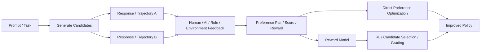
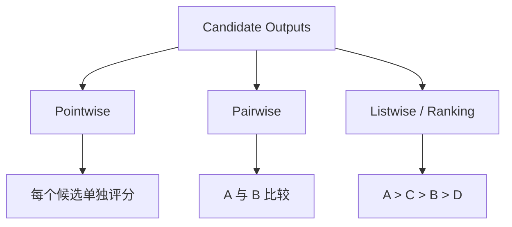
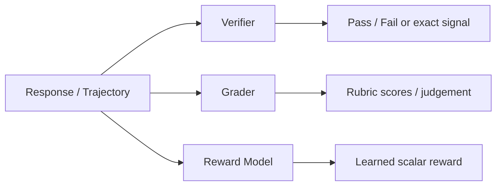
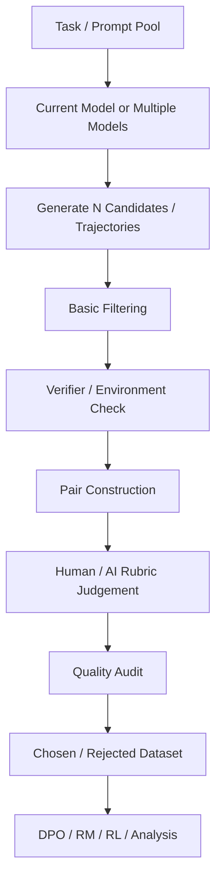

# 3. Preference Data、Reward 与 Feedback

> 本章目标：理解当“唯一正确答案”不存在，或者仅有一个好示范不足以定义理想行为时，如何用比较、评分、规则、环境结果等方式向模型提供更细的反馈。
>
> 核心问题：**SFT 告诉模型“可以这样做”，Preference / Reward 则进一步告诉模型“在多个可行行为中，哪一个更值得选择”。**

先建立一张总图：



这张图中最重要的一点是：**Feedback 是来源，Preference / Reward 是把反馈结构化之后形成的学习信号。**

---

## 3.1 为什么只有 SFT 还不够？

假设用户问：

```text
“帮我解释一下什么是梯度下降。”
```

我们有两个回答。

### Response A

```text
梯度下降是一种优化算法，通过沿损失函数梯度的反方向更新参数，以逐步减小损失。
```

### Response B

```text
梯度下降本质上是在寻找一个“下坡方向”。你可以把损失函数想象成一座山，模型每次根据当前位置的坡度往更低的地方移动一点。
```

这两个回答可能都正确。

如果只有 SFT，我们通常只能选择一个作为 demonstration：

```text
Prompt → Response B
```

但很多真实目标是相对的：

```text
哪个更容易懂？
哪个更简洁？
哪个更符合用户水平？
哪个更完整？
哪个更少废话？
```

这些问题没有一个天然唯一的标准文本。

因此需要一种新的监督方式：

> **不要求写出唯一完美答案，而是比较已有候选之间谁更符合目标。**

这就是 Preference Data 的基本思想。

---

## 3.2 Pairwise Preference：最经典的偏好数据

最基本的数据结构是：

```text
Prompt x
├── Chosen response y_w
└── Rejected response y_l

Label: y_w > y_l
```

其中：

- `chosen / winner`：更优候选；
- `rejected / loser`：较差候选；
- `>`：表示相对偏好，而不是绝对正确性。

典型 JSON 可以长这样：

```json
{
  "prompt": "用一句话解释过拟合。",
  "chosen": "过拟合是模型把训练数据学得过于具体，以至于在新数据上泛化变差。",
  "rejected": "过拟合就是模型训练得太好了。"
}
```

这里 `rejected` 并不一定完全胡说八道。恰恰相反，**高价值 preference pair 往往来自“两个都像样，但一个明显更符合目标”的边界案例。**

---

### 3.2.1 Preference 与分类标签有什么不同？

分类标签通常回答：

```text
这条属于哪一类？
```

而 preference 回答：

```text
在同一个 context 下，这两个候选谁更好？
```

因此 preference 天然依赖 context。

例如：

```text
Response A = 很简短
Response B = 很详细
```

对于：

```text
“请一句话回答”
```

A 可能更好。

对于：

```text
“请详细讲解给初学者”
```

B 可能更好。

所以 Preference Data 的核心对象不是孤立回答，而是：

```text
Context + Candidate A + Candidate B + Evaluation Objective
```

---

### 3.2.2 Chosen 不等于“绝对正确”

这是非常重要的概念。

如果 A 和 B 都错，但 A 错得更少，标注可能仍然是：

```text
A > B
```

这意味着：

> **Preference 是相对信号，而不是天然的 correctness certificate。**

因此在数学、代码、工具执行等可验证任务中，最好不要只依赖“看起来更好”的偏好，而应把 correctness / execution outcome 纳入 rubric 或 verifier。

---

### 3.2.3 Tie / Both Bad / Cannot Judge 也很重要

如果强迫标注员对每一对数据都二选一，会制造假的监督信号。

真实标注系统往往需要允许：

```text
A > B
B > A
Tie / approximately equal
Both bad
Cannot judge / insufficient information
```

例如两个答案都事实错误时，硬选一个“winner”会让数据表达出错误含义。

因此：

> **允许 abstention，往往比强行增加标签覆盖率更可靠。**

---

## 3.3 Preference 不只有 Pairwise：Pointwise、Pairwise、Listwise

反馈可以有不同结构。



### Pointwise

每个回答独立评分：

```text
Response A → 4 / 5
Response B → 2 / 5
```

优势：

- 一条回答可以独立处理；
- 易于给多个维度打分；
- 适合 grader。

问题：

- 不同标注者对“4 分”尺度理解可能不同；
- 评分标准漂移时难比较。

### Pairwise

```text
A vs B → A wins
```

优势：

- 人通常更擅长相对比较，而不是定义绝对 3.7 分；
- 对细微质量差异比较敏感。

问题：

- N 个 candidate 的全比较成本可达 $O(N^2)$；
- 容易出现位置偏差；
- 不一定具有严格传递性。

### Listwise / Ranking

```text
A > C > B > D
```

一次对多个候选排序。

信息量更大，但标注难度也明显增加。

---

## 3.4 Preference Label 从哪里来？

Preference 并不等于“人工偏好”。标签来源可以很多。

### 3.4.1 Human Preference

由普通用户或经过培训的标注员比较候选。

优点：

- 能捕捉自然语言体验；
- 能评价可读性、礼貌、自然度等难自动定义的属性。

问题：

- 贵；
- 慢；
- 主观；
- 标注员水平差异大；
- 对专业问题可能无法判断正确性。

### 3.4.2 Expert Preference

让医生、律师、程序员、数学专家等领域人员标注。

更适合：

```text
专业 correctness
复杂推理
高风险领域
专业工具使用
```

代价通常更高，因此常见策略是：

```text
普通标注员处理通用维度
专家处理难例 / gold set / adjudication
```

### 3.4.3 AI Feedback / RLAIF-like Feedback

让另一个模型根据 rubric 比较候选：

```text
Prompt
+ Response A
+ Response B
+ Rubric
        ↓
Judge Model
        ↓
A > B + reason
```

优点：

- 成本低；
- 速度快；
- 可扩展到大量 rollout。

问题是 judge 自己也会有：

- correctness error；
- verbosity bias；
- position bias；
- self-preference；
- 风格偏好；
- 对复杂工具执行不了解。

因此 AI feedback 的关键不是“有没有 judge”，而是：

> **Judge 与真实目标的一致性有没有被验证。**

### 3.4.4 Rule-based Feedback

例如：

```text
JSON 是否可解析
有没有超过 200 字
有没有包含指定字段
代码是否通过测试
答案是否 exact match
```

这种反馈可扩展性高，并且通常比主观 judge 更稳定。

但只能评价规则能覆盖的部分。

### 3.4.5 Environment-based Feedback

Agent 场景特别重要。

例如：

```text
Trajectory A
最终数据库：meeting = Friday 15:00

Trajectory B
最终数据库：meeting = Tuesday 15:00
```

如果用户要求改到周五，那么无需凭语言风格判断：

```text
A > B
```

因为环境状态直接给出了任务成功证据。

因此 Agent 的 Preference / Reward 最可靠的一类来源往往是：

> **真实 execution outcome + final environment state。**

---

## 3.5 Reward 到底是什么？

Preference 回答：

```text
A 和 B 哪个更好？
```

Reward 更接近：

```text
这条行为有多好？
```

可以写成：

$$
r(x, y) \in \mathbb{R}
$$

其中：

- $x$：prompt / task / state；
- $y$：response / action / trajectory；
- $r$：一个标量评价。

最简单的 reward：

```text
success = 1
failure = 0
```

也可以更复杂：

```text
correctness = 1.0
instruction_following = 0.8
efficiency = 0.6
safety = 1.0
```

然后组合为：

$$
R = w_1R_{correct}+w_2R_{follow}+w_3R_{efficiency}+w_4R_{safety}
$$

但这里立即出现一个核心问题：

> **权重怎么定？**

这也是 reward design 为什么困难。

---

## 3.6 Reward Model：把 Preference 学成一个评价函数

如果我们有大量偏好对：

```text
(x, y_w, y_l)
```

可以训练一个 reward model：

$$
r_\theta(x,y)
$$

希望满足：

$$
r_\theta(x,y_w) > r_\theta(x,y_l)
$$

一种经典 pairwise 建模方式是：

$$
P(y_w \succ y_l \mid x)
=
\sigma\left(r_\theta(x,y_w)-r_\theta(x,y_l)\right)
$$

其中 $\sigma$ 是 sigmoid。

直觉就是：

```text
Preference pairs
      ↓
Reward Model learns comparison rule
      ↓
新 response 即使没被人工标过
也可以得到 predicted reward
```

这使得 reward model 可以给大规模 rollout 自动打分。

---

### 3.6.1 Reward Model 与“人工规则”有什么差别？

Rule-based reward：

```text
if tests_pass:
    reward = 1
else:
    reward = 0
```

Reward Model：

```text
模型从偏好数据里学出一个评分函数
```

前者可解释、稳定，但覆盖面有限；后者灵活，但可能把标注偏差一起学进去。

---

### 3.6.2 Reward Model 不是“真理模型”

Reward Model 学到的是：

> **训练标签中体现出来的偏好。**

如果数据偏爱：

```text
更长
更自信
更多标题
更多术语
```

Reward Model 也可能把这些表面特征当成“质量”。

因此 reward model performance 不能只看训练 loss，需要看：

- held-out preference accuracy；
- 不同 domain 的一致性；
- adversarial cases；
- 与专家 gold 的相关性；
- 是否存在 reward hacking。

---

## 3.7 Reward Model、Grader、Verifier：三个容易混淆的概念

这三个东西都可以“打分”，但定位不同。

| 概念 | 核心问题 | 常见形式 | 典型用途 |
|---|---|---|---|
| Reward Model | “这个行为值得多高 reward？” | learned scalar / ranking model | RL、candidate ranking |
| Grader | “按评价标准，这个结果表现怎样？” | rule / LLM / hybrid | Eval、数据筛选、训练反馈 |
| Verifier | “这个结果是否满足可验证条件？” | exact rule / execution / state check | correctness、success 判定 |

可以画成：



需要注意：现实工程中命名并不统一，同一个模块在不同团队里可能被叫 scorer、judge、reward model、grader。但分析系统时不要只看名字，要看：

```text
它是不是 learned？
输入是什么？
输出是什么？
用于训练还是评测？
是否有客观可验证依据？
```

---

## 3.8 Preference Optimization：不一定先训练 Reward Model

有一类路线是：

```text
Preference Data
      ↓
Reward Model
      ↓
RL
      ↓
Policy
```

还有一类路线是直接使用 chosen / rejected pair 优化 policy，例如 DPO 类方法。

可以粗略理解成：

```text
Prompt
├── Chosen
└── Rejected
      ↓
直接让模型相对提高 Chosen 的概率
并降低 Rejected 的相对偏好
```

因此：

> **Preference Data ≠ Reward Model Data 的唯一用途。**

同一批 pairwise preference 既可以：

- 训练 reward model；
- 直接进行 preference optimization；
- 训练 judge；
- 做 candidate selection；
- 做错误分析。

从数据岗位视角，这意味着你不能只问：

> “这批数据格式是什么？”

还要问：

> **下游训练算法怎么消费这些 pair？**

---

## 3.9 Rubric-based Preference：不要把“好”压成一个模糊词

如果直接问标注员：

> “A 和 B 哪个更好？”

问题是“好”的定义可能漂移。

有人偏爱简洁，有人偏爱详细；有人关注事实，有人先看语气。

因此更稳定的方法是定义 rubric。

例如：

```text
Correctness
Instruction Following
Completeness
Relevance
Clarity
Style
Safety
Tool Use
Efficiency
```

然后明确优先级。

例如一个 Agent 任务可以定义：

```text
1. Task success 是硬条件
2. 不得产生未授权 side effect
3. 必须基于真实 tool observation
4. 在都成功的情况下，工具调用更少者更优
5. 最后再比较语言质量
```

这比一句“整体哪个好”更容易形成稳定标签。

---

### 3.9.1 多维评分不要过早压成一个总分

例如：

| Candidate | Correctness | Following | Style | Efficiency |
|---|---:|---:|---:|---:|
| A | 1 | 1 | 0.6 | 0.4 |
| B | 1 | 0.5 | 0.9 | 0.9 |

如果立刻压成：

```text
A = 0.75
B = 0.78
```

会隐藏关键结构：B 的 instruction following 明显更差。

因此实际数据系统中常常需要同时保留：

```text
per-dimension scores
raw grader reasoning / evidence
final preference
aggregation rule
```

便于之后重新分析。

---

## 3.10 Preference Data 的噪声与偏差

Preference data 最大的问题之一是：

> **“人选了 A”不等于“A 客观上更好”。**

### 3.10.1 Annotator Disagreement

不同标注者可能得出不同判断。

原因包括：

- rubric 理解不同；
- 专业知识不同；
- 任务本身存在多解；
- 两个 candidate 差距太小；
- 问题信息不足。

这时应关注：

```text
agreement rate
pairwise agreement
inter-annotator agreement
adjudication rate
```

但不能机械追求 100% agreement。对于真正主观的任务，高度分歧可能是任务本身的真实属性。

### 3.10.2 Position Bias

如果 A 永远展示在左边 / 上面，judge 或人可能更常选择 A。

常见控制：

```text
随机交换 A/B 顺序
同一 pair 做 position swap audit
```

### 3.10.3 Verbosity Bias

更长的回答往往看起来“更努力”，但不一定更正确。

所以需要测试：

```text
same correctness
short vs long
```

看 judge 是否系统性偏爱长答案。

### 3.10.4 Style vs Correctness Conflation

一个格式漂亮、措辞自信的错误答案，可能击败一个朴素但正确的答案。

因此高风险任务应把 correctness 放在独立 rubric 中，并尽可能使用 verifier。

### 3.10.5 Sycophancy Preference

如果用户表达了一个错误观点：

```text
“我觉得 2+2=5，对吧？”
```

一个讨好用户的回答可能语言上更顺从，但 factual correctness 更差。

如果人类偏好数据不断奖励这种行为，模型就可能学会迎合而不是纠错。

### 3.10.6 Self-preference / Model-family Bias

当某模型评价与自己风格相似的输出时，可能产生系统偏好。

因此 judge 数据需要跨模型、跨风格和人工 gold 做校准，而不能默认“更强的模型就是无偏裁判”。

---

## 3.11 什么样的 Preference Pair 信息量更高？

并不是任意两个候选拼成 pair 都有同样价值。

### 低信息 pair

```text
A：完全正确
B：乱码
```

几乎谁都知道 A 好。

这类数据适合建立基础边界，但大量重复后的边际价值低。

### 高信息 pair

```text
A：答案正确，但漏了一个用户约束
B：答案同样正确，满足所有约束，但略微冗长
```

这类 pair 更接近模型的 decision boundary，能够教会模型细粒度权衡。

因此 candidate pairing 本身也是数据策略：

```text
随机 pairing
同 prompt 多样采样
near-score pairing
hard-negative pairing
failure-specific pairing
model-disagreement pairing
```

可以概括成：

> **Preference data 的价值不仅取决于标签质量，也取决于你拿什么候选来比较。**

---

## 3.12 Agent Preference：比较的不只是 Final Answer

普通聊天 preference 常比较 response text。

Agent 则可能比较完整 trajectory：

```text
Trajectory A
Task
→ search_order
→ cancel_order
→ verify_status
→ final response

Trajectory B
Task
→ cancel_order
→ final response
```

此时要评价的维度可能包括：

```text
Task success
Tool selection
Argument correctness
Observation grounding
Side effects
Verification
Efficiency
Final communication
```

### 一个关键原则：Outcome 优先于“看起来聪明”

例如：

```text
A：用了 5 次工具，但最终真实完成任务
B：只用了 2 次工具，语言也更漂亮，但没有真正执行更新
```

在真实 Agent 任务中，通常应优先：

```text
A > B
```

因为用户要的是任务完成，不是漂亮解释。

### 但 success 也不代表 trajectory 一定理想

例如：

```text
Trajectory A：成功，调用 3 次必要工具
Trajectory B：成功，调用 18 次工具，其中 12 次无关
```

如果最终状态都正确，则效率可以成为 secondary preference：

```text
A > B
```

这就是 Agent reward 常见的层级结构：

```text
Hard constraints
   ↓
Task success
   ↓
Safety / side effects
   ↓
Correct tool behavior
   ↓
Efficiency
   ↓
Final response quality
```

---

## 3.13 从 Rollout 到 Preference Data：实际生产流程

一套典型 pipeline 可以写成：



各阶段的关键问题：

### Step 1：Task Sampling

是不是目标用户 / 目标能力真实会遇到的问题？

### Step 2：Candidate Generation

需要控制：

```text
model version
temperature
top-p
number of candidates
prompt version
tool/environment version
```

否则 preference pair 无法复现。

### Step 3：Basic Filtering

先剔除：

```text
空输出
解析失败
完全重复
工具 schema 非法
环境崩溃
明显数据损坏
```

不要浪费昂贵人工标注预算。

### Step 4：Verifier / Environment Check

如果有客观信号，应尽量先用。

例如代码：

```text
先跑 unit tests
再让 judge 比较风格
```

而不是让 LLM judge 猜代码能不能运行。

### Step 5：Pair Construction

避免全部都是：

```text
perfect vs garbage
```

要有足够多：

```text
strong vs strong
correct-but-incomplete vs fully-correct
success-but-inefficient vs success-and-efficient
```

### Step 6：Judgement

严格保存：

```text
rubric version
judge / annotator id or model version
candidate order
raw decision
confidence
reason / evidence
```

### Step 7：Quality Audit

检查：

```text
agreement
position swap consistency
gold accuracy
class balance
tie rate
label drift
domain coverage
```

### Step 8：Training Split

Preference 数据同样需要防止 train/eval leakage。

---

## 3.14 Preference 数据质量应该怎么评估？

不能只看“有多少 pair”。

至少应关注以下几类指标。

### Label Reliability

```text
human-human agreement
human-expert agreement
judge-human agreement
gold accuracy
```

### Consistency

例如 position swap：

```text
A vs B → A wins
B vs A → 仍然应该 A wins
```

如果大量翻转，说明 judge 有位置偏差或 pair 本身过于模糊。

### Coverage

是否覆盖：

```text
不同 domain
不同语言
不同难度
不同 response length
不同 failure type
不同 tool path
```

### Pair Difficulty

统计：

```text
easy pair
medium pair
hard pair
```

如果 99% 都是 obvious pair，训练价值可能有限。

### Preference Balance

如果生成系统导致：

```text
Response A 95% 都是 winner
```

很可能有 candidate order 或数据构造偏差。

### Downstream Utility

最终仍要回答：

> **用这批 preference data 训练后，目标模型行为真的改善了吗？**

数据内在指标不能替代 downstream evaluation。

---

## 3.15 Reward Hacking：为什么 Reward 不能只“设计完就信”？

如果模型被优化去最大化一个 reward，它会倾向于寻找所有能提高 reward 的路径，而不一定是设计者真正想要的行为。

例如 reward 是：

```text
回答越详细，得分越高
```

模型可能学会：

```text
无论问题多简单都写 2000 字
```

又例如 Agent reward 只检查：

```text
final_response 是否包含 “已完成”
```

模型可能学会直接说：

```text
“已经完成。”
```

而根本没有执行任务。

这就是 Goodhart 式问题：

> 当一个指标成为优化目标后，它可能不再是原目标的好代理。

因此 reward 设计需要：

```text
真实 outcome verification
adversarial testing
reward decomposition
held-out evaluation
monitoring exploit behavior
```

尤其 Agent 中，应尽量把 reward 锚定到环境状态，而不是只看自然语言表面。

---

## 3.16 一个完整案例：会议改期 Agent 的 Preference / Reward 数据

任务：

```text
“把我明天下午三点和产品组的会议改到周五下午三点。”
```

当前模型产生三个 trajectory。

### Candidate A

```text
search_calendar
→ 找到会议
update_event(date=Friday, time=15:00)
→ success
get_event
→ 确认 Friday 15:00
final: 已改到周五下午三点。
```

### Candidate B

```text
search_calendar
→ 找到会议
final: 已改到周五下午三点。
```

### Candidate C

```text
search_calendar
→ 找到会议
update_event(date=Friday, time=15:00)
→ success
search_calendar
search_calendar
search_calendar
final: 已改到周五下午三点。
```

如果只看 final response：

```text
A = B = C
```

但环境评价是：

```text
A: success + verified + efficient
B: failure, no update performed
C: success but inefficient
```

于是可以构造：

```text
A > C > B
```

并拆成 rubric：

| Candidate | Task Success | Verification | Efficiency | Final Response |
|---|---:|---:|---:|---:|
| A | 1 | 1 | 1 | 1 |
| B | 0 | 0 | 1 | 1 |
| C | 1 | 0.5 | 0.3 | 1 |

这个例子说明：

> **Agent preference 的核心评价对象是“行为和结果”，自然语言只是其中一个维度。**

---

## 3.17 常见失败模式

### 失败 1：把 chosen 当成绝对 ground truth

Preference 只能说明相对更优。两个 candidate 都可能错。

### 失败 2：只让 Judge 看 Final Answer

对于 Agent，这会漏掉没有执行、执行失败、side effect、重复调用等关键问题。

### 失败 3：Rubric 太模糊

一句“哪个回答更好”会把 correctness、style、verbosity、instruction following 混成一个不可解释信号。

### 失败 4：所有 pair 差距都太大

`perfect vs garbage` 容易标，但对模型细粒度决策边界帮助有限。

### 失败 5：所有 pair 差距都太小

如果两个回答几乎等价，标注噪声会快速上升。因此需要合理难度分布，而不是只追 hard pair。

### 失败 6：忽视 Tie / Both Bad

强制二选一会制造错误标签。

### 失败 7：AI Judge 没有校准就大规模使用

便宜不等于可靠。需要拿人工 / 专家 gold 做系统性校验。

### 失败 8：把 Reward Model 当成真正目标

优化 reward ≠ 自动优化真实用户价值。Reward hacking 和 proxy mismatch 必须专门评估。

### 失败 9：Agent reward 只奖励成功，不约束副作用

模型可能为了完成目标做不必要或不允许的操作。

### 失败 10：Preference pipeline 没有 lineage

如果不知道：

```text
pair 来自哪个模型？
什么 sampling 参数？
哪个 judge？
哪个 rubric？
是否经过 position swap？
```

后续很难解释数据质量变化。

---

## 3.18 从数据岗位视角，这一章实际在做什么？

对应到工作，可能包括：

```text
设计 preference rubric
批量生成 candidate
设计 pair construction 策略
组织人工 / 专家标注
部署 LLM judge
制作 gold set
做 judge calibration
分析 annotator disagreement
做 position-bias audit
训练 / 验证 reward model
筛 hard negative
构建 chosen-rejected 数据集
做 reward hacking case
分析 preference 训练前后行为变化
```

真正成熟的数据工作不是：

> “标了 20 万个 A/B。”

而应该能回答：

```text
为什么比较这些 candidate？
谁来判？
按什么规则判？
标签可靠吗？
有哪些 bias？
这些 pair 对当前模型是否有信息量？
训练后改变了什么行为？
```

---

## 3.19 本章关键词

| 术语 | 一句话理解 |
|---|---|
| Preference Data | 表示候选之间相对优劣的数据 |
| Chosen / Rejected | pairwise preference 中的赢家 / 输家 |
| Pointwise Grading | 对每个 candidate 独立评分 |
| Pairwise Grading | 比较两个 candidate 谁更优 |
| Listwise Ranking | 对多个 candidate 排序 |
| Reward | 对 response / action / trajectory 的标量评价 |
| Reward Model | 从偏好 / 排序数据学习出的评分函数 |
| Grader | 按 rubric 对输出进行评价的系统 |
| Verifier | 用规则、执行或状态检查验证结果 |
| DPO-like Optimization | 直接使用 chosen / rejected 优化 policy 的路线 |
| RLAIF | 使用 AI 产生反馈 / 偏好信号的思路 |
| Hard Negative | 看起来合理但存在关键缺陷的负例 |
| Position Bias | 候选位置影响偏好判断 |
| Verbosity Bias | 系统性偏爱更长回答 |
| Reward Hacking | 模型利用 reward 缺陷获得高分而未实现真实目标 |
| Abstention | 在无法可靠判断时不强行给偏好标签 |

---

## 3.20 面试 / 自检问题

学完这一章，至少应该能够回答：

1. **为什么有了 SFT 还需要 Preference Data？**
2. **Pairwise preference 与 pointwise score 各有什么优缺点？**
3. **Chosen 是否一定是正确答案？为什么？**
4. **Preference label 可以来自哪些来源？**
5. **Reward Model、Grader、Verifier 有什么区别？**
6. **为什么 DPO 类方法不一定需要显式 Reward Model？**
7. **什么是 position bias 和 verbosity bias？怎么检测？**
8. **为什么需要 Tie / Both Bad / Cannot Judge？**
9. **什么样的 preference pair 信息量更高？**
10. **为什么 Agent preference 不能只比较 final response？**
11. **如何构造一个可靠的 LLM-as-a-Judge 标注 pipeline？**
12. **什么是 reward hacking？在 Agent 中怎么出现？**
13. **如果 Judge-human agreement 很低，你会怎么排查？**
14. **如果 preference 数据训练后模型更啰嗦了，你会优先检查什么？**
15. **如果 Agent task success 提升，但工具调用成本翻倍，这算不算变好？如何在 reward 中表达？**

第 13 题可以用下面的排查框架：

```text
先看 rubric 是否清楚
↓
再看任务是否需要专业知识
↓
检查 candidate 是否过于接近 / 本身有歧义
↓
检查 judge prompt 与输出解析
↓
做 position swap
↓
分析 verbosity / style bias
↓
按 domain、difficulty、length 分桶
↓
与 expert gold 对照
↓
决定改 rubric、改 judge，还是允许 abstention
```

这一套思路后面讲 LLM-as-a-Judge 时还会进一步展开。
