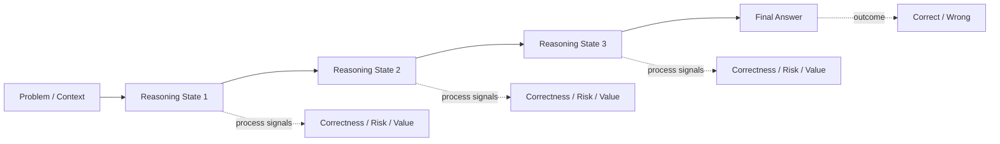
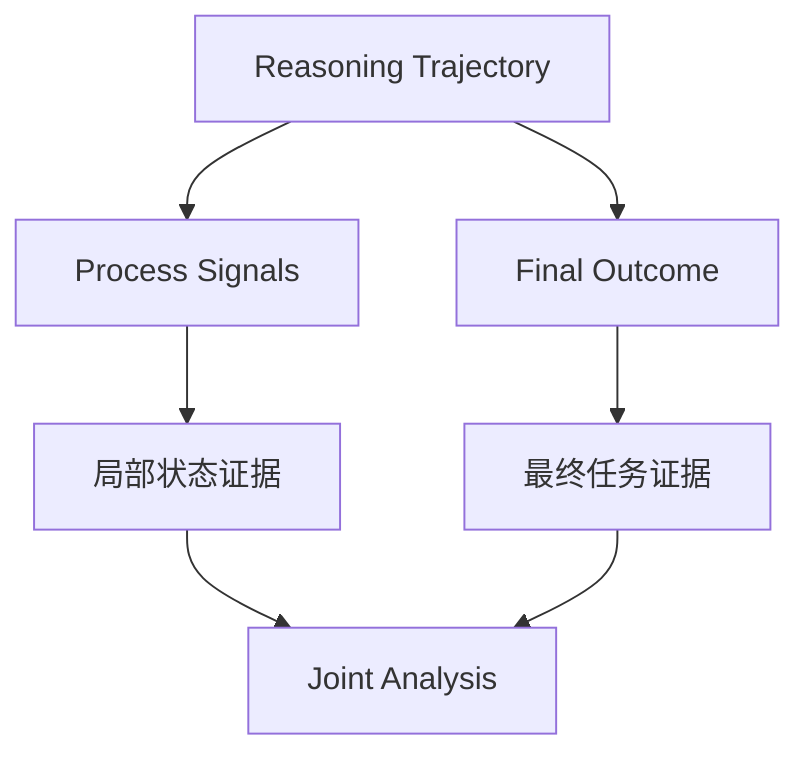
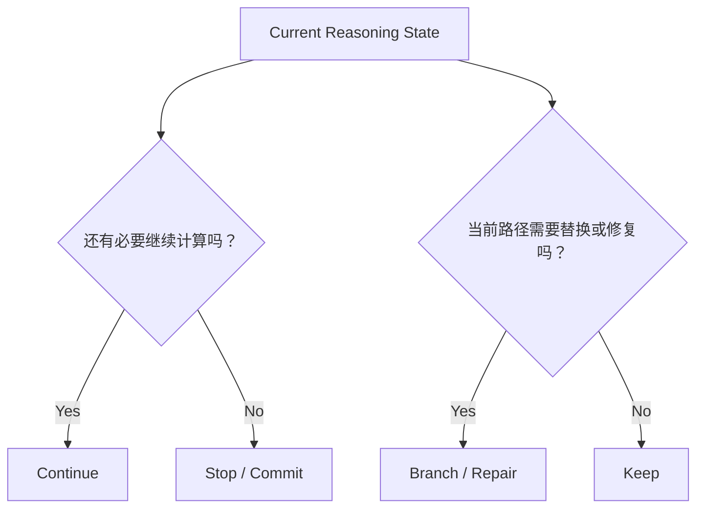
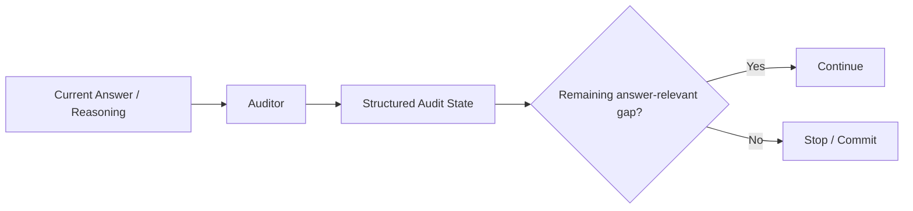
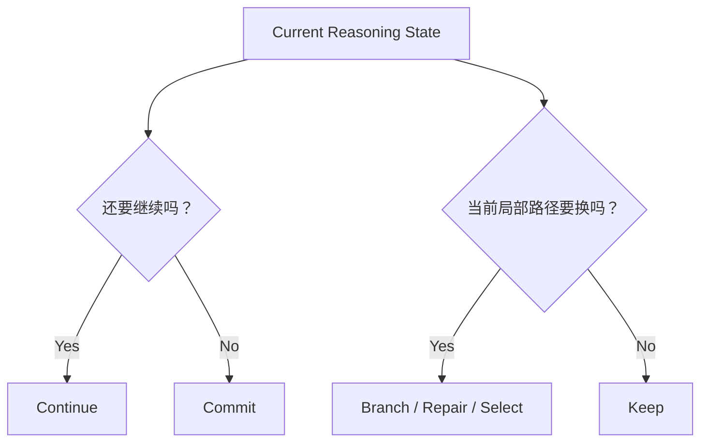
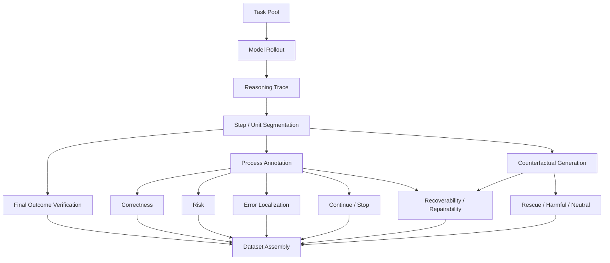

# 第 4 章 Reasoning Data 与 Process Supervision：从“答案对不对”到“当前状态该怎么办”

> 所属体系：[`LLM_Agent_Data_Knowledge_System.md`](../LLM_Agent_Data_Knowledge_System.md)
>
> 前置章节：[`第 3 章 Preference Data、Reward 与 Feedback`](./03_Preference_Data_Reward_and_Feedback.md)
>
> 关联章节：[`第 8 章 Rollout、Rejection Sampling 与 Candidate Selection`](./08_Rollout_Rejection_Sampling_and_Candidate_Selection.md)、[`第 9 章 Hard Case Mining 与 Curriculum`](./09_Hard_Case_Mining_and_Curriculum.md)、[`第 13 章 Task Success 与 Credit Assignment`](./13_Task_Success_and_Credit_Assignment.md)、[`第 15 章 Grader、Verifier 与 LLM-as-a-Judge`](./15_Grader_Verifier_and_LLM_as_a_Judge.md)、[`第 16 章 Benchmark Design 与 Evaluation Protocol`](./16_Benchmark_Design_and_Evaluation_Protocol.md)
>
> 编辑基础设施：[`Canonical Glossary`](./00_Glossary_and_Notation.md) · [`Case C4 — Reasoning Continue / Repair`](./cases/C4_Reasoning_Continue_Repair.md)
>
> 本章定位：**Reasoning state supervision 的 canonical chapter。** 后续章节使用 `Correctness / Risk / Recoverability / Repairability / Selectability`、same-state counterfactual、`Rescue / Harmful`、Continue / Stop、Branch / Repair 等概念时，应以本章定义为准。
>
> 本章核心问题：**复杂推理不能只问“最后答对了吗”，还要问：模型现在推到哪里、当前内容是否正确、是否存在失败风险、从这里是否还有可改善的未来、当前系统是否真的能修，以及如果生成了多个候选，我们能不能在线选对。**

---

# 4.0 总图：Reasoning Data 到底多记录了什么？

普通问答数据可能只有：

```text
Question
   ↓
Final Answer
   ↓
Correct / Wrong
```

Reasoning Data 把中间过程显式纳入数据对象：



因此一条 reasoning sample 不再只是：

```text
input + answer
```

而可能包含：

```text
problem
+ reasoning trajectory
+ step / unit boundaries
+ intermediate states
+ process labels
+ final outcome
+ verifier evidence
+ observable uncertainty signals
+ counterfactual continuations
+ lineage
```

本质变化是：

> **监督粒度从 outcome-level 下沉到了 state / step / transition level。**

但更重要的是：下沉监督不是为了“记录更多 CoT”，而是为了回答**状态级决策问题**。

---

# 4.1 Reasoning Data、Trace、State 与 Action

Reasoning Data 泛指能够描述模型完成复杂推理任务时，中间计算过程、决策状态或中间产物的数据。

它可以包括：

```text
visible reasoning trace
structured reasoning state
subgoal
intermediate answer
proof state
program state
audit state
remaining gap
candidate branch
verification result
observable generation statistics
step reward / state value
```

因此：

> **Reasoning Data ≠ 一长段 Chain-of-Thought 文本。**

更一般地：

> **Reasoning Data 是能够刻画模型从问题走向最终答案时发生了什么状态变化，以及这些状态对后续决策意味着什么的数据。**

---

## 4.1.1 Reasoning Trace

Reasoning Trace 强调“已经走过的整条路径”。可以抽象为：

\[
\tau=(s_0,a_0,s_1,a_1,\ldots,s_T)
\]

其中：

- \(s_t\)：Reasoning State；
- \(a_t\)：继续推导、验证、选择分支、修改答案等 reasoning action；
- \(\tau\)：完整 reasoning trajectory。

---

## 4.1.2 Reasoning State

Reasoning State 强调：

> **模型当前已经推到哪里。**

一个实用表示可以包含：

```text
原始问题 / context
+
当前已接受 reasoning prefix
+
中间结论 / subgoal
+
尚未解决的 answer-relevant gap
+
当前可观测 evidence
```

很多 test-time optimization 真正需要判断的不是：

```text
“这道题难不难？”
```

而是：

```text
“已经走到这个 state 后，下一步应该做什么？”
```

因此必须区分：

```text
Task Difficulty
≠
Current-state Difficulty
≠
Future Intervention Value
```

---

# 4.2 Outcome Supervision 与 Process Supervision

假设一条轨迹是：

```text
Step 1: 正确
Step 2: 正确
Step 3: 使用错误假设
Step 4: 基于错误假设继续
Step 5: 碰巧得到正确答案
```

只看最终答案：

```text
label = correct
```

但它显然不是可靠的推理过程。

反过来：

```text
Step 1: 正确
Step 2: 正确
Step 3: 正确
Step 4: 局部算术失误
Final: wrong
```

最终结果虽然错误，前面的 reasoning prefix 仍然有价值。

所以 outcome label 会把一条长轨迹压缩成：

```text
Correct / Wrong
```

大量中间信息因此丢失。

---

## 4.2.1 Outcome Supervision

Outcome Supervision 只评价最终任务结果，例如：

```text
数学：最终答案是否正确
代码：是否通过测试
逻辑：最终真假判断是否正确
Agent：最终环境状态是否满足目标
```

优点：

```text
cheap
objective when verifiable
scalable
适合大规模 rollout
```

缺点：

```text
feedback sparse
不知道错误从哪里开始
credit assignment 弱
正确结果可能掩盖错误过程
失败轨迹的正确前缀容易被一起判负
```

---

## 4.2.2 Process Supervision

Process Supervision 对中间状态、步骤或 transition 提供反馈。

最简单可以是：

```text
Step 1: correct
Step 2: correct
Step 3: incorrect
Step 4: invalid because dependent on Step 3
```

也可以是更丰富的结构化标签：

```text
logically_valid
factually_supported
remaining_gap
risk
should_continue
recoverable
```

因此 Process Supervision 不等于“逐步判对错”。它可以监督：

```text
correctness
risk
progress
value
recovery opportunity
action choice
```

> **External anchor boundary：** [`R04 — Let's Verify Step by Step`](./00_Canonical_References.md) 支撑公开文献中的 Outcome Supervision vs Process Supervision、step-level feedback 与 process reward context；本章进一步定义的 `Correctness / Risk / Recoverability / Repairability / Selectability`，以及 Continue / Stop、Keep / Branch / Repair 等状态级 operating distinctions，属于本书 canonical model，**不反向归因给 R04**。

---

## 4.2.3 Outcome 与 Process 是互补关系



Outcome 回答“最后是否成功”；Process 回答“中间发生了什么、下一步怎么办”。

如果 process scorer 与客观 final outcome 冲突，不能默认 process scorer 更正确。

---

# 4.3 五个必须分开的状态级概念

这是本章最重要的 canonical distinction。

很多系统最后都输出一个 `score`，但下面五个问题语义完全不同：

```text
Correctness
Risk
Recoverability
Repairability
Selectability
```

其中前三个主要描述**状态本身与未来空间**；后两个描述**当前系统能否实际利用这个空间**。

---

## 4.3.1 Correctness：当前内容已经错了吗？

Correctness 问：

> **这个 step / state 在事实、逻辑或约束意义上是否成立？**

标签可以是：

```text
correct
incorrect
partially_correct
unsupported
cannot_determine
```

例如：

```text
由 x² = 4 直接推出 x = 2
```

在没有额外约束时遗漏 `x=-2`，因此可能是错误或不完整。

Correctness 是“当前内容是否合法”的问题。

---

## 4.3.2 Risk：从当前可观测信息看，后续失败风险高吗？

Risk 问：

> **当前 state 是否呈现出与未来失败相关的危险信号？**

可能的 observable signals：

```text
low token probability
high entropy
small top1-top2 margin
likelihood drop
self-inconsistency
未解决关键约束
反复改答案
重复推导
异常长 reasoning unit
```

必须牢记：

```text
Risk ≠ Error
```

低置信可以是对的；高置信也可以稳定地错。

因此：

> **Uncertainty detector 不是天然的 error detector。**

---

## 4.3.3 Recoverability：从这个状态出发，是否存在更好的未来？

Recoverability 问：

> **从当前 state 出发，是否存在某种允许的未来 continuation / intervention，可以让最终 outcome 比当前基线更好？**

它首先是一个 counterfactual existence question。

例如：

```text
当前路径最终会错
但从同一 state 换一个 continuation 可以答对
```

则该 state 具有 recoverability。

概念上更严谨地写成：

\[
\exists \pi \in \Pi_{allowed}:\; V(s_t;\pi) > V(s_t;\pi_{base})
\]

其中 \(\pi\) 表示从当前 state 开始的一段允许的 future policy / continuation，而不局限于单步 action。

这里关心的是：

```text
更好的未来是否存在？
```

而不是当前系统是否能找到它。

---

## 4.3.4 Repairability：在当前动作空间和预算下，实际上修得了吗？

Repairability 比 Recoverability 更工程化。

即使理论上存在更好的未来，如果当前系统：

```text
不能回退
不能重新采样
没有对应工具
budget 不够
关键状态已经不可逆
```

那么这个 state 对当前系统而言可能并不 repairable。

因此：

```text
Recoverability
= 更好的未来存在吗？

Repairability
= 在当前 action space / budget / runtime 约束下，系统实际能修吗？
```

两者不能混用。

---

## 4.3.5 Selectability：更好的候选存在，我们能在线选出来吗？

假设从同一 state 得到：

```text
candidate A → 最终正确
candidate B → 最终错误
```

这说明 candidate pool 中存在可利用差异。

但如果在线 scorer 无法稳定地区分 A 与 B，实际系统仍然得不到收益。

Selectability 问：

> **只使用决策时真实可见的信息，selector 能否识别出更优候选？**

因此必须区分：

```text
Candidate Existence
≠ Candidate Quality Gap
≠ Selectability
```

这也是为什么 offline oracle 很高，不等于 online selector 一定有效。

Candidate generation / selection 的完整方法在第 8 章展开。

---

## 4.3.6 一张总表

| 概念 | 核心问题 | 典型证据 |
|---|---|---|
| Correctness | 当前已经错了吗？ | rule / verifier / expert |
| Risk | 这里危险吗？ | observable uncertainty / conflict / state features |
| Recoverability | 是否存在更好的未来？ | offline counterfactual rollout |
| Repairability | 当前系统实际上修得了吗？ | action space / budget / irreversible state |
| Selectability | 更好的候选能在线识别吗？ | held-out candidate-selection evaluation |

所以：

> **Low confidence ≠ Wrong ≠ Recoverable ≠ Repairable ≠ Selectable。**

这条区分是本章最重要的分析纪律。

---

# 4.4 Error Localization：错误从哪里开始？

对于 final-wrong trajectory，可以寻找：

```text
S1 ✓
S2 ✓
S3 ✗  ← First Error
S4 ✗
S5 ✗
```

`S4 / S5` 可能只是继承了 `S3` 的错误前提。

因此 First Error 比“把所有后续 step 都标负”更有解释力。

它可以支持：

```text
process verifier
error detector
correction data
backtracking policy
hard-case mining
error propagation analysis
```

但要注意：

> **First Error 不是 First Harmful Action，也不是 Root Cause。**

Reasoning 层面这里只定义“第一处局部失效”；更完整的 `First Error / First Harmful Action / Last Recoverable State / Point of No Return` 因果关系在第 13 章统一定义，Failure diagnosis 则归第 14 章。

---

# 4.5 Step Segmentation：什么叫一个 step？

Process supervision 首先面对一个非常实际的问题：

> **监督单位是什么？**

一段文本：

```text
先设 x=3，因此 y=5，所以答案是 8。
```

到底是一个 step，还是三个？

不同 segmentation 会改变：

```text
label granularity
first-error location
PRM input
annotation cost
step reward semantics
```

---

## 4.5.1 常见切分方式

### Sentence-level

按句子切。便宜，但一句可能包含多个 reasoning operation。

### Model-generated Unit

通过双换行、特殊 stop marker、生成单元等形成 unit，优点是贴近实际 runtime。

### Semantic Step

按一个独立推理动作切：

```text
提出假设
应用规则
计算
验证
修正
```

语义最好，但自动切分和标注更难。

### Token-level

粒度最细，但单 token 往往不具有完整决策语义。

因此：

> **不存在 universally best 的 step definition；segmentation 必须和下游决策动作对齐。**

---

# 4.6 PRM、ORM 与过程评分

PRM = Process Reward Model。

典型输入：

```text
Problem
+
Reasoning Prefix
+
Current Step / State
```

输出可以是：

```text
correctness probability
process quality
reward
future-success proxy
```

关键在于训练目标决定 score 的语义，不能只因为模型名字叫 PRM 就假定它等于“真实 future value”。

---

## 4.6.1 PRM 与 ORM

| 模型 | 主要输入 | 标签粒度 | 核心问题 |
|---|---|---|---|
| ORM | 完整 solution / trajectory | final outcome | 最后成功了吗？ |
| PRM | prefix / step / state | intermediate process | 推到这里表现如何？ |

Process supervision 可以提供比 final outcome 更密的信号，但 PRM 仍可能被：

```text
label noise
local fluency
style shortcut
distribution shift
```

误导。

---

## 4.6.2 多个 step score 如何变成 trajectory score？

例如：

```text
0.99, 0.96, 0.92, 0.35, 0.91
```

可能使用：

```text
minimum
mean
product
last-step score
learned aggregation
```

不同 aggregation 隐含不同假设。

例如 minimum 强调最弱环节，但也容易被单点误判主导。

所以：

> **有 step score ≠ credit assignment 已经解决。**

完整 credit assignment 见第 13 章。

---

# 4.7 Process Verifier、PRM 与 Uncertainty Signal 不要混在一起

三者都可能输出“一个分数”，但证据语义不同。

### Process Verifier

尝试验证某个局部条件：

```text
等式是否合法
逻辑规则是否正确应用
程序状态是否满足 invariant
```

### PRM

学习过程层面的 reward / quality function，其意义取决于训练目标。

### Uncertainty Signal

例如：

```text
logprob
entropy
margin
sampling disagreement
```

它主要回答：

```text
模型对当前生成选择有多不确定？
```

因此：

```text
Low confidence
≠ Wrong
≠ Worth repairing
```

Evaluator 的完整证据层级在第 15 章统一展开。

---

# 4.8 Counterfactual Rollout：怎么定义 Rescue、Harmful 与 Neutral？

给定同一个 authoritative state / prefix \(P\)：

```text
P
├── baseline continuation u0 → outcome O0
├── alternative c1          → outcome O1
└── alternative c2          → outcome O2
```

在相同 prefix 下改变局部 continuation，可以构造更加干净的 counterfactual comparison。

对于某一个“baseline vs replacement”比较：

```text
baseline wrong → replacement correct
= Rescue

baseline correct → replacement wrong
= Harmful

both correct
= Neutral-positive

both wrong
= Neutral-negative
```

这里的 `Rescue / Harmful` 是**相对于 baseline intervention 的 outcome transition**，不是 candidate 的固有属性。

---

## 4.8.1 为什么 same-prefix / same-state 很重要？

如果两个 candidate 来自完全不同前缀，最终结果差异可能来自：

```text
早期 reasoning difference
不同 context
不同 accumulated error
不同 local action
```

很难归因。

same-prefix sibling candidates 控制住历史状态，让差异尽可能集中在当前局部 decision。

因此它们非常适合研究：

```text
local causal leverage
recoverability
branch-worthiness
candidate selection
```

---

## 4.8.2 Discordant candidate 为什么特别重要？

如果同一 state 的两个候选：

```text
一个最终正确
一个最终错误
```

说明局部选择对 downstream outcome 有真实影响。

如果所有候选最终结果都一样，那么 selector 再聪明，也没有可兑现的选择收益。

因此 Candidate Selection 的上限同时受：

```text
Candidate Diversity
×
Outcome Discordance
×
Selectability
```

约束。

完整 selector / oracle / abstention 分析在第 8 章展开。

---

# 4.9 Future Information：Offline Label 与 Online Feature 必须分开

为了定义 Recoverability，我们可以离线运行未来 continuation：

```text
Current State
↓
Counterfactual Futures
↓
Final Outcomes
↓
Recoverability / Rescue / Harmful Labels
```

但真实在线系统在决策时看不到未来。

因此：

```text
Offline supervision / analysis
≠
Online observable feature
```

禁止把：

```text
future final correctness
future continuation outcome
oracle best candidate
```

偷渡进在线 detector / selector feature。

否则得到的是 leakage，不是可部署决策规则。

这条原则在第 16 章 Frozen Protocol 中会再次作为实验纪律出现。

---

# 4.10 Continue / Stop 与 Keep / Branch / Repair 是两个决策问题

Reasoning optimization 至少存在两类不同 action space。

## A. Continue / Stop

问题是：

> **当前 reasoning 是否已经足够，可以 commit；还是继续计算仍有价值？**

```text
continue
stop / commit
```

它解决：

```text
premature stopping
redundant reasoning
compute allocation
```

---

## B. Keep / Branch / Repair

问题是：

> **当前局部路径是否应该保留，还是从当前 state 尝试替代 continuation？**

```text
keep
branch
repair
replace
abstain
```

它解决：

```text
local path risk
error accumulation
alternative-path exploration
```

两者不能都叫“多想一点”。



一个 state 可以：

```text
需要继续，但不需要分支
```

也可以：

```text
不应该沿当前路径继续，而应该局部修复
```

所以 `continue label` 与 `repair / branch label` 必须分开。

---

# 4.11 研究实例一：More Thinking Is Not Always Better

> 本节是具体研究实例，不是通用定义。当前公开作者主页已可核对完整题名、作者与 NLPCC publication identity；但固定深度数值、population 与具体 protocol 的 claim-bearing evidence 仍按 **Internal Research Example + SOURCE ANCHOR PENDING for quantitative evidence** 处理。**Public identity listing ≠ Claim-bearing evidence anchor。** 统一边界见 [`Canonical References`](./00_Canonical_References.md) 与 [`Reference & Source Policy`](./00_Reference_Source_Policy.md)。

该研究关注的核心不是简单证明：

```text
“多想不好”
```

而是：

> **额外推理收益具有显著异质性，因此 test-time compute 应根据 current reasoning state 分配，而不是对所有样本使用固定深度。**

在 ProofWriter、PrOntoQA、ProverQA、FOLIO 等逻辑推理任务上的 fixed-depth 实验呈现非单调性：

```text
depth 1 → 69.04%
depth 2 → 74.09%
depth 3 → 70.97%
```

仅看总体 accuracy 会遗漏两种相反 transition：

```text
Wrong → Right
额外 reasoning 修复答案

Right → Wrong
额外 reasoning 破坏原本正确答案
```

这正说明：

> **Average gain 无法替代 state-dependent transition analysis。**

---

## 4.11.1 Structured Audit State

该研究使用 Answerer–Auditor 迭代，并把当前诊断组织成 structured audit state。



这里有价值的 process data 包括：

```text
remaining_gap
answer-relevant unresolved issue
current audit state
continue / stop decision
```

它不是传统“每个 CoT step 标 correct / incorrect”的 PRM 数据，而更接近：

```text
state diagnosis
+
continuation-value estimation
+
reasoning-budget allocation
```

---

## 4.11.2 数据视角下的三个启发

### Task-hard ≠ State-worth-continuing

难题不代表每个时刻都值得继续计算。

### Transition 比单点 Accuracy 更有解释力

必须分析：

```text
Wrong → Right
Right → Wrong
Wrong → Wrong
Right → Right
```

### Compute 也可以做 marginal-value allocation

真正的问题不是：

```text
“所有题再想一轮好吗？”
```

而是：

```text
“哪些 current state 的下一单位 compute 仍有正边际价值？”
```

---

# 4.12 研究实例二：RoTFuse / K17

> 本节同样是具体研究实例。它用于说明 `Risk → Trigger → Candidate → Selection → Outcome` 的状态级数据结构，不把阶段性结果写成普遍方法结论。

主线可抽象为：

```text
Authoritative Prefix P
        ↓
Greedy Provisional Unit u0
        ↓
Current-state Observable Risk Signal
        ↓
是否触发局部探索？
      /       \
    No         Yes
    ↓           ↓
 keep u0    same-prefix candidates
                 ↓
             online selection
                 ↓
              commit
```

这里在线系统能看到：

```text
current prefix
provisional unit
observable generation statistics
local structural features
```

它不能提前看到最终答案。

因此这个实例特别适合说明：

> **Risk signal 可以在线使用；Rescue / Harmful / Recoverability 必须通过离线未来结果定义。**

---

## 4.12.1 Low Confidence 不是 Error Label

低置信触发首先表示：

```text
suspicion / risk
```

而不是：

```text
known error
```

因为同时存在：

```text
low confidence + correct
high confidence + wrong
```

所以更严谨的问题是：

> **哪些低置信 state 更可能具有值得探索的替代路径？**

而不是：

> “低置信是不是错。”

---

## 4.12.2 Candidate Existence 与 Selectability 必须拆开

从同一 prefix 生成：

```text
u0 = greedy continuation
c1 = alternative
c2 = alternative
```

如果离线发现某个 sibling 能 rescue baseline，只能证明：

```text
better candidate exists
```

还不能证明：

```text
online selector can identify it
```

因此必须分别评估：

```text
Generator Quality
Oracle Gap
Selector Quality
End-to-End Net Gain
```

这一拆分在第 8 章 Candidate Selection 与第 16 章 Evaluation Protocol 中正式展开。

---

## 4.12.3 More Thinking 与 RoTFuse 的统一视角



两者都是：

> **State-dependent test-time decision problem。**

但 action space 不同：

```text
More Thinking
→ continue / stop

RoTFuse
→ keep / branch / repair / select
```

因此不应把两者都概括成“让模型多想”。

---

# 4.13 失败 Reasoning 也可以转化成训练数据

只保留完美 CoT：

```text
Correct trajectory → SFT
```

会浪费大量失败信息。

失败 trajectory 可以派生：

### Error Localization Data

```text
trajectory + first_error_step
```

### Critique Data

```text
wrong step → why wrong
```

### Correction Data

```text
wrong prefix
→ corrected step
→ corrected continuation
```

### Preference Data

```text
bad continuation
vs
repaired continuation
```

### Recovery Data

```text
risky / wrong state
→ detect
→ branch / backtrack / repair
→ recover
```

因此：

> **“失败”不是一种单一负标签，而是可以被重新编码成不同 supervision interface 的经验。**

---

# 4.14 Reasoning Data Production Pipeline



生产时至少记录：

```text
model version
prompt / system context
decoding config
seed if available
max tokens
stop semantics
step segmentation rule
verifier version
annotation / judge version
counterfactual generation policy
```

特别要记录：

```text
某字段是否使用 future information
用于 offline analysis 还是 online policy
```

---

# 4.15 一个推荐的 Reasoning Data Schema

```json
{
  "task_id": "logic_001",
  "trajectory_id": "traj_001",
  "model_version": "model_v1",
  "problem": "...",
  "steps": [
    {
      "step_id": 0,
      "text": "...",
      "start_token": 0,
      "end_token": 42,
      "correctness": "correct",
      "risk_score": 0.12,
      "first_error": false,
      "remaining_gap": true,
      "continue_label": true
    },
    {
      "step_id": 1,
      "text": "...",
      "start_token": 43,
      "end_token": 88,
      "correctness": "uncertain",
      "risk_score": 0.73,
      "first_error": null,
      "remaining_gap": true,
      "continue_label": true
    }
  ],
  "final_answer": "...",
  "final_correct": false,
  "verifier_version": "exact_match_v1",
  "counterfactuals": [
    {
      "branch_from_step": 1,
      "candidate_id": "c1",
      "final_correct": true,
      "relative_to_baseline": "rescue"
    }
  ]
}
```

重点不是字段名，而是：

> **不同语义的 supervision 不要压成一个模糊的 `quality_score`。**

---

# 4.16 Reasoning Data 的特殊难题

## 4.16.1 多条正确路径

开放推理通常不存在唯一 CoT。

所以 process annotation 应判断：

```text
当前推导是否有效
```

而不是：

```text
是否逐句匹配 reference reasoning
```

---

## 4.16.2 Local Correctness 不保证 Global Success

每一步局部合理，也可能：

```text
遗漏关键分支
没有解决核心问题
最终答非所问
```

所以必须保留 global outcome。

---

## 4.16.3 Final Correct 不保证 Process Correct

可能存在：

```text
错误推理 + 猜中答案
```

这正是 process evidence 的价值。

---

## 4.16.4 Hidden Reasoning 与 Observable State

数据系统不应假定必须获得或复现模型全部私有内部思维过程。

更稳健的对象是可观察、可评价、与决策目标直接相关的中间状态：

```text
structured audit state
subgoal
intermediate result
proof / program state
tool action
verification result
candidate continuation
observable generation statistics
```

因此：

> **Process supervision 的目标是得到 decision-relevant evidence，不是记录“模型脑内全部过程”。**

---

## 4.16.5 Long-horizon Credit Assignment

如果最终第 20 步失败：

```text
S1 → S2 → ... → S20 → wrong
```

可能出现：

```text
S3 埋下错误
S12 错失修复机会
S18 造成不可逆后果
```

Reasoning Data 可以提供这些局部证据，但完整的：

```text
First Error
First Harmful Action
Last Recoverable State
Point of No Return
Root Cause
```

应在第 13、14 章完成因果归因与诊断，不在本章重复定义。

---

# 4.17 如何评价一套 Process Supervision Data？

至少分六层。

## 1. Label Accuracy

Correctness / gap / recoverability 标签本身是否可靠？

## 2. Boundary Quality

Segmentation 是否稳定？关键 decision 是否被正确切分？

## 3. Agreement / Calibration

人、人机、Judge、Verifier 之间是否一致？分歧来自噪声还是任务真实歧义？

## 4. Predictive Utility

Process signal 能否预测：

```text
future failure
future rescue
continue benefit
branch benefit
```

## 5. Decision Utility

根据这个 signal 做 policy decision 是否真的改善：

```text
accuracy
success
rescue
harmful rate
tokens
latency
```

## 6. Online Validity

真正部署时是否只依赖当时可观察的信息？是否发生 future leakage？

最终最重要的不是：

```text
Process classifier AUC 很高
```

而是：

> **它是否让实际决策变得更好。**

---

# 4.18 常见失败模式

### 失败 1：把 Final Wrong 的所有 Step 都标 Wrong

会污染正确前缀。

### 失败 2：把 Low Confidence 直接当 Error

Uncertainty 是风险信号，不是 correctness certificate。

### 失败 3：把 Risk 直接当 Worth Repairing

高风险不代表存在可改善未来，更不代表当前系统修得了。

### 失败 4：Recoverable 就默认 Selectable

更好的 candidate 存在，不代表 online selector 能识别它。

### 失败 5：未来信息偷渡进 Online Feature

Offline label 可以看未来；online decision 不可以。

### 失败 6：Step Definition 不稳定

同一种 reasoning operation 被切成不同粒度，process label 会失去统一语义。

### 失败 7：PRM 只学语言风格

“写得像证明”不等于正确。

### 失败 8：只做 Detection，不定义 Action

检测“这里有问题”之后，必须知道系统能做：

```text
continue
stop
branch
repair
backtrack
abstain
```

中的哪一个。

### 失败 9：只看平均 Accuracy，不看 Transition

必须至少分析：

```text
Wrong → Right
Right → Wrong
```

才能看到 repair–degradation trade-off。

### 失败 10：Counterfactual Candidate 不控制 State

前缀不同会严重削弱局部因果解释。

### 失败 11：一个 selector / probe 失败，就宣布“内部状态没有 signal”

一个具体方法在当前样本、表示、层、容量和监督下失败，只能说明：

> **当前可操作方法没有提取到足够稳定的可利用信号。**

不能直接证明理论上不存在信息。

---

# 4.19 从数据岗位视角，这一章实际会做什么？

```text
收集 reasoning rollout
定义 reasoning unit / step schema
切分 trajectory
标 step correctness
找 first error
构建 critique / correction data
生成 same-state counterfactual continuation
跑 verifier
构造 process reward labels
训练 / 校准 PRM
分析 uncertainty signals
构造 recoverability / repairability labels
构造 continue / stop 数据
构造 branch / repair 数据
分析 Wrong→Right / Right→Wrong
维护 reasoning hard-case pool
```

核心能力不是“会看 CoT”，而是：

> **把长推理轨迹转化成可验证、可归因、可用于状态级决策的学习信号。**

---

# 4.20 本章关键词

| 术语 | Canonical meaning |
|---|---|
| Reasoning Trace | 从问题到答案的一整条推理路径 |
| Reasoning State | 当前推理已经到达的决策状态 |
| Outcome Supervision | 只评价最终任务结果 |
| Process Supervision | 对中间 state / step / transition 提供反馈 |
| First Error | 第一处局部事实 / 逻辑 / 约束失效 |
| Correctness | 当前内容是否成立 |
| Risk | 当前可观察状态是否呈现较高未来失败风险 |
| Recoverability | 是否存在能改善最终结果的未来 continuation / intervention |
| Repairability | 当前系统在给定 action space / budget 下是否实际可修 |
| Selectability | 在线 selector 能否用当时可见信息识别更优候选 |
| PRM | 对 reasoning process / state 学习评价信号的模型 |
| ORM | 对完整输出 outcome 进行评价的模型 |
| Counterfactual Rollout | 从相同 state 尝试不同 continuation 并观察 outcome |
| Rescue | baseline wrong → intervention correct |
| Harmful | baseline correct → intervention wrong |
| Branch-worthiness | 当前 state 是否值得探索 alternative branch |
| Wrong→Right | 额外计算修复错误 |
| Right→Wrong | 额外计算破坏原本正确结果 |

更完整定义见 [`Canonical Glossary`](./00_Glossary_and_Notation.md)。

---

# 4.21 面试 / 自检问题

学完这一章至少应该能够回答：

1. Outcome Supervision 和 Process Supervision 有什么区别？
2. 为什么 Final Correct 不能证明 Process Correct？
3. PRM 与 ORM 分别在学习什么？
4. 为什么 Step Segmentation 本身就是数据设计问题？
5. First Error 有什么价值？它为什么不等于 First Harmful Action？
6. Correctness、Risk、Recoverability 为什么必须分开？
7. Recoverability 与 Repairability 有什么区别？
8. Candidate existence 与 Selectability 有什么区别？
9. 为什么 Low Confidence 不能直接等于 Wrong？
10. 如何利用 same-state counterfactual rollout 定义 Rescue / Harmful？
11. 为什么 future outcome 可以用于 offline label，却不能作为 online feature？
12. Continue / Stop 与 Keep / Branch / Repair 为什么是不同决策？
13. 如果 PRM step accuracy 很高，但 search 没提升，可能是什么原因？
14. 一条 final-wrong trajectory 是否应该所有 step 都标负？
15. 如何把失败 reasoning 转成 correction / preference / recovery data？
16. 如何证明一批 process data 真有 downstream decision utility？
17. 为什么 same-prefix sibling candidate 对研究局部 causal leverage 很重要？
18. Wrong→Right / Right→Wrong 比平均 Accuracy 多告诉了我们什么？
19. More Thinking 和 RoTFuse 分别优化哪一种 test-time action？
20. 一个 oracle candidate pool 很强但线上没有收益，你会优先检查什么？

---

## 4.21.1 一个通用回答框架：如何设计 Reasoning Data？

不要直接回答：

```text
“生成更多 CoT。”
```

更成熟的链路是：

```text
1. 明确目标 failure mode
   ↓
2. 明确最终要做的 decision
   ↓
3. 决定 supervision 粒度：outcome / step / state / trajectory
   ↓
4. 定义 reasoning unit 与 schema
   ↓
5. 用 current model rollout 获取真实 failure distribution
   ↓
6. 用 verifier 建立可靠 outcome
   ↓
7. 对关键 state 做 process annotation / error localization
   ↓
8. 必要时从同一 state 做 counterfactual rollout
   ↓
9. 分开 Correctness / Risk / Recoverability / Repairability / Selectability
   ↓
10. 转成 SFT / Preference / PRM / Router / Selector Data
   ↓
11. 用 held-out protocol 验证真实 Decision Utility
```

核心原则：

> **从目标决策倒推数据设计，而不是先生成大量 CoT，再想它们能做什么。**

---

# 4.22 与后续章节的关系

这一章只负责把 reasoning-state semantics 定义清楚。

后续章节分别接手：

```text
第 8 章
→ Candidate Generation / Rejection Sampling / Selector / Oracle

第 9 章
→ 哪些 state / case 值得优先采集

第 13 章
→ First Error / First Harmful / Last Recoverable / Credit

第 15 章
→ Verifier / Grader / Judge 的证据层级

第 16 章
→ Frozen Protocol / paired comparison / Rescue-Harmful evaluation

第 21 章
→ 如何用受控训练实验证明 process data 真有学习价值
```

建议延伸阅读方向：

- Process Supervision / Process Reward Models；
- PRM800K 等 step-level mathematical reasoning feedback 数据；
- Test-time scaling / best-of-N / tree search / verifier-guided search；
- Reasoning correction / critique / repair / recovery data。

外部文献 anchor、内部 Research Example 与本章 canonical operating distinctions 的证据边界统一见 [`Canonical References`](./00_Canonical_References.md) 与 [`Reference & Source Policy`](./00_Reference_Source_Policy.md)。其中 R04 只承担公开 Process Supervision 文献锚点，不承担本章状态级五分法或内部研究数值的证明责任。

---

# 4.23 本章最终要形成的认识

把整章压缩成一条链：

```text
Reasoning State
       ↓
Observable Evidence
       ↓
Diagnosis
├── Correctness
├── Risk
├── Recoverability
├── Repairability
└── Selectability
       ↓
Decision
├── Continue / Stop
└── Keep / Branch / Repair
       ↓
Future Outcome
       ↓
Offline Counterfactual Analysis
       ↺
```

最终要记住的不是某一个 score，而是：

> **Reasoning Data 的价值，不在于保存“模型想了什么”，而在于把中间过程变成能够定位状态、区分风险与错误、识别可恢复空间、约束实际干预，并最终改善决策的数据。**

下一章把同样的状态—动作思想扩展到外部世界：

> [`第 5 章 Tool-use Data 与 Agent Trajectory Data`](./05_Tool_Use_and_Agent_Trajectory_Data.md)

Reasoning action 从“继续推一步”扩展成：

```text
调用工具
读取 observation
更新 state
重新计划
验证结果
继续 / 回退 / 停止
```

也就是说，从 Reasoning Data 到 Agent Data，不是换了一个完全不同的话题，而是从**内部/显式推理状态序列**进一步走向**模型与外部环境交互的决策轨迹**。