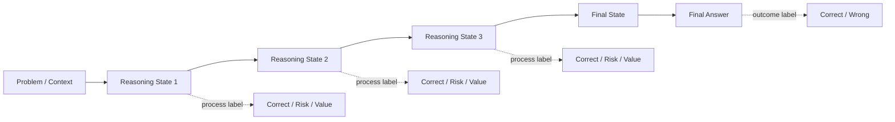
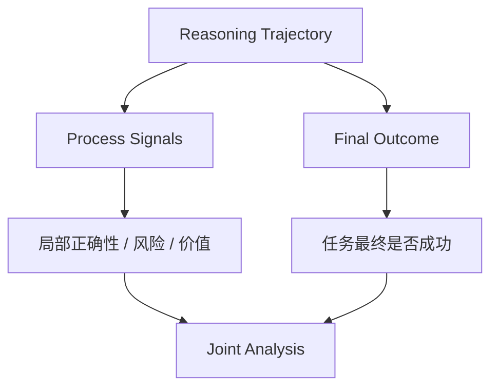
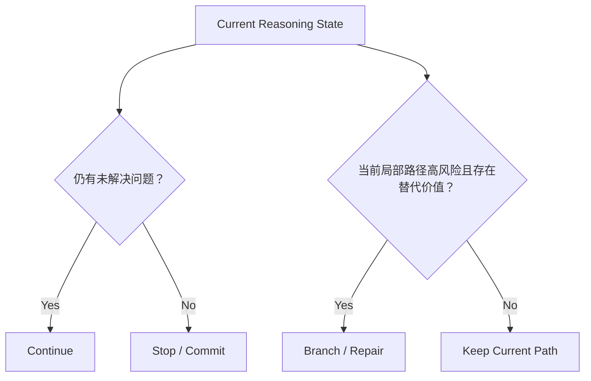
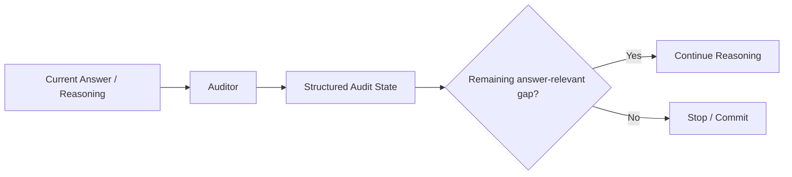
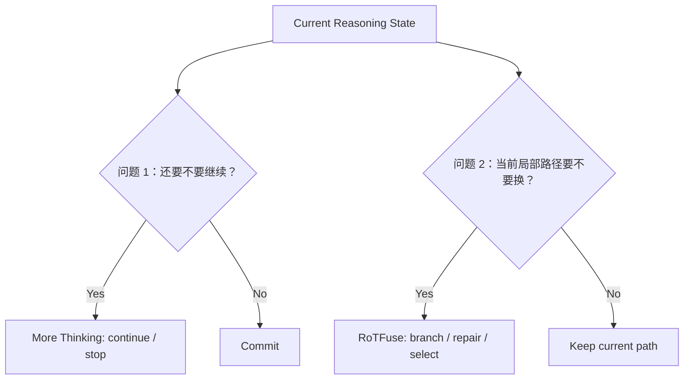
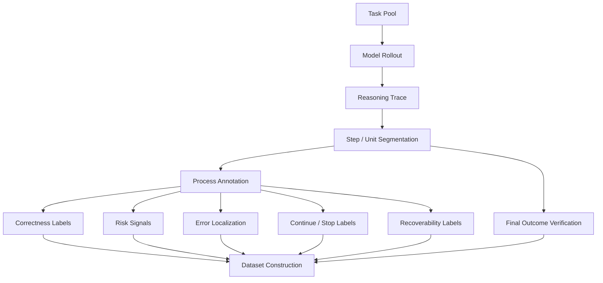

# 第 4 章 Reasoning Data 与 Process Supervision

> 所属体系：[`LLM_Agent_Data_Knowledge_System.md`](../LLM_Agent_Data_Knowledge_System.md)
>
> 本章目标：理解为什么复杂推理任务不能只用“最终答对 / 答错”描述，以及如何把一条 reasoning trajectory 拆成可以分析、标注、验证和学习的数据对象。
>
> 本章核心问题：**不仅要知道结果对不对，还要知道推理进行到哪里、哪里出了问题、当前状态是否值得继续，以及是否还有修复价值。**

---

## 4.0 先建立总图：Reasoning Data 到底多记录了什么？

普通问答数据可能只有：

```text
Question
   ↓
Final Answer
   ↓
Correct / Wrong
```

Reasoning Data 则把中间过程显式纳入数据对象：



因此，一条 reasoning sample 不再只是：

```text
input + answer
```

而可能是：

```text
problem
+ reasoning trajectory
+ step boundaries
+ intermediate states
+ process labels
+ final outcome
+ verifier evidence
+ counterfactual continuations
```

这一变化的本质是：

> **监督粒度从 outcome-level 下沉到了 state / step / transition level。**

---

# 4.1 什么是 Reasoning Data？

Reasoning Data 泛指能够描述模型完成复杂推理任务时**中间计算过程、决策状态或中间产物**的数据。

最直观的形式是可见 Chain-of-Thought：

```text
Problem
↓
Step 1
↓
Step 2
↓
Step 3
↓
Final Answer
```

但实际工作中，Reasoning Data 不应被简单等同于“保存一长段 CoT 文本”。

它还可以包括：

```text
structured reasoning state
subgoal
intermediate answer
proof state
program state
tool result
audit state
remaining gap
candidate branch
verification result
confidence / uncertainty signal
step reward
state value
```

因此更一般的定义是：

> **Reasoning Data = 能够刻画模型在“问题 → 最终答案”之间经历了什么状态变化的数据。**

---

## 4.1.1 Reasoning Trace 与 Reasoning State

这两个概念最好区分。

### Reasoning Trace

强调“走过的整条路径”：

$$
\tau = (s_0, a_0, s_1, a_1, \ldots, s_T)
$$

其中：

- $s_t$：某一时刻的 reasoning state；
- $a_t$：继续推导、选择分支、验证、修改答案等 reasoning action；
- $\tau$：完整推理轨迹。

### Reasoning State

强调“模型当前已经推到哪里”。

可以抽象成：

```text
原始问题
+
当前已接受的推理前缀
+
当前中间结论
+
尚未解决的问题 / gap
```

很多在线推理优化真正需要判断的并不是：

> “这道题难不难？”

而是：

> **“推理已经走到这个状态以后，下一步应该做什么？”**

这也是 reasoning data 从 task-level 走向 state-level 的关键。

---

# 4.2 为什么 Final Answer Label 不够？

假设有下面一条轨迹：

```text
Step 1: 正确
Step 2: 正确
Step 3: 使用错误假设
Step 4: 基于错误假设继续推导
Step 5: 恰好得到正确答案
```

如果只看最终答案：

```text
label = correct
```

但如果真正关心 reasoning reliability，这条轨迹显然存在问题。

反过来，也可能发生：

```text
Step 1: 正确
Step 2: 正确
Step 3: 正确
Step 4: 一个算术失误
Final Answer: wrong
```

最终 label 是 wrong，但前面的 reasoning 大部分是有价值的。

所以 outcome label 会把一条长轨迹压缩成一个比特：

```text
Correct / Wrong
```

大量过程信息因此丢失。

---

## 4.2.1 Outcome Supervision

Outcome Supervision 只评价最终结果。

例如：

```text
MATH：最终答案是否匹配
Code：是否通过全部测试
Logic：最终真假判断是否正确
Agent：最终环境状态是否满足目标
```

优点：

- 成本低；
- 容易自动化；
- 标签通常比较客观；
- 适合大规模 rollout。

缺点：

- feedback sparse；
- 不知道错误从哪里开始；
- credit assignment 困难；
- 正确结果可能掩盖错误过程；
- 失败轨迹中大量正确前缀被一起判负。

---

## 4.2.2 Process Supervision

Process Supervision 给中间过程提供反馈。

例如：

```text
Step 1: correct
Step 2: correct
Step 3: incorrect
Step 4: invalid because it depends on Step 3
```

也可以不是简单的正确 / 错误：

```text
Step 2:
- logically valid = yes
- sufficiently justified = no
- contains unresolved gap = yes
- should continue = yes
```

因此 Process Supervision 的范围实际上比“逐步判对错”更大。

---

## 4.2.3 Outcome 与 Process 不是互相替代

一个常见误解是：

> 有了 process labels，就不需要 final outcome 了。

并不是。

更合理的关系是：



Outcome 是最终任务目标；Process 是帮助理解和分配 credit 的中间证据。

如果 process scorer 和真实 outcome 冲突，不能默认 process scorer 一定正确。

---

# 4.3 Reasoning Data 最重要的三类标签：Correctness、Risk、Recoverability

这是本章最重要的区分之一。

很多项目会把下面三个问题混成一个“confidence score”，但它们本质上不同。

---

## 4.3.1 Correctness：当前内容是不是错了？

问题是：

> **这个 step / state 在逻辑或事实意义上是否正确？**

例如：

```text
Step: 由 x²=4 推出 x=2
```

如果没有额外条件，这一步遗漏了 `x=-2`，因此可能被标记为错误 / 不完整。

Correctness label 可以是：

```text
correct
incorrect
partially correct
unsupported
cannot determine
```

这是最传统的 process label。

---

## 4.3.2 Risk：当前状态是不是危险？

Risk 问的不是“已经错了吗”，而是：

> **从当前可观测状态看，后续出错风险是否升高？**

可能的风险信号包括：

```text
低 token probability
高 entropy
小 top1-top2 margin
突然的 likelihood drop
前后陈述矛盾
未解决的关键约束
反复改答案
重复推导
异常长 reasoning unit
```

关键点是：

> **Risk ≠ Error。**

一个低置信状态完全可能最终是正确的；一个非常自信的状态也完全可能错得很稳定。

因此不能把 uncertainty detector 直接叫作 error detector。

---

## 4.3.3 Recoverability / Future Value：从这里还有没有救？

这是另一个完全不同的问题：

> **如果从当前 state 继续计算、检查、分支或修复，最终结果有没有机会变好？**

可以抽象为：

$$
V(s_t, a) = \mathbb{E}[R_{final} \mid s_t, a]
$$

其中 $a$ 可以是：

```text
continue
stop
branch
revise
verify
backtrack
```

这里真正关心的是**动作之后的未来价值**。

例如两个 state 都很可疑：

```text
State A：虽然不确定，但多算一步通常能解决
State B：已经建立在错误前提上，继续原路径只会越走越远
```

它们的 risk 可能类似，但 recoverability 完全不同。

因此：

```text
Risk answers:          “这里危险吗？”
Correctness answers:   “这里已经错了吗？”
Recoverability answers:“从这里干预值得吗？”
```

这三者应分开设计标签。

---

# 4.4 Error Localization：错误到底从哪一步开始？

如果一条轨迹最终错误，可以进一步寻找：

> **First Error / First Invalid Step**

例如：

```text
S1 ✓
S2 ✓
S3 ✗  ← first error
S4 ✗
S5 ✗
```

这里 S4、S5 虽然也错误，但可能只是继承了 S3 的错误前提。

因此 first-error localization 比“所有后续 step 都打负标签”更有解释力。

---

## 4.4.1 为什么 First Error 很重要？

因为它直接对应 intervention point：

```text
正确前缀
   ↓
第一个错误决策
   ↓
错误传播
   ↓
最终失败
```

如果能够找到第一处错误，数据可以用于：

- process verifier；
- error detector；
- correction data；
- backtracking policy；
- hard-case mining；
- 分析错误传播机制。

---

## 4.4.2 但“第一处看起来奇怪”不一定是第一处错误

复杂 reasoning 中常见：

```text
某一步表达得很跳
```

但其实逻辑成立；反而前面一个看似平滑的假设已经错了。

因此 error localization 需要：

```text
上下文依赖
前提检查
事实验证
逻辑有效性
后续依赖关系
```

而不能简单使用“语言看起来怪不怪”作为标签。

---

# 4.5 Step 到底怎么切？Step Segmentation 本身就是数据设计

Process supervision 首先面对一个非常实际的问题：

> **什么叫一个 step？**

一段 CoT 可能写成：

```text
先设 x=3，因此 y=5，所以答案是 8。
```

这里到底是：

```text
1 step
```

还是：

```text
Step 1: x=3
Step 2: y=5
Step 3: answer=8
```

不同 segmentation 会改变：

- 标签粒度；
- PRM 输入；
- first-error 位置；
- annotation cost；
- step reward 的含义。

---

## 4.5.1 常见切分方式

### Sentence-level

按句号或自然语言句子切。

简单，但一句里可能包含多个 reasoning operation。

### Model-generated Unit

通过模型生成 stop marker、双换行、特殊 token 等形成 reasoning unit。

优点是更贴近实际生成过程。

### Semantic Step

按一个独立推理动作切，例如：

```text
提出假设
应用规则
计算数值
验证结论
修改答案
```

语义最好，但标注 / 自动切分难度更高。

### Token-level

粒度最细，但单 token 往往不具有完整语义，人工过程监督成本极高。

因此不存在 universally best 的 step definition，必须与任务和下游动作一致。

---

# 4.6 Process Reward Model（PRM）是什么？

PRM = Process Reward Model。

它不只给整条 response 一个分数，而是对中间 reasoning step / state 提供评价。

例如：

```text
Step 1 → 0.98
Step 2 → 0.91
Step 3 → 0.17
Step 4 → 0.10
```

直觉上：

> PRM 学习“推理进行到这里是否仍然可靠”。

---

## 4.6.1 PRM 的训练数据

最直接的数据形式是：

```text
Problem
+
Reasoning Prefix
+
Current Step
→
Step Label
```

例如：

```json
{
  "problem": "...",
  "prefix": ["step1", "step2"],
  "step": "step3",
  "label": "incorrect"
}
```

标签来源可以是：

```text
人工逐步标注
专家标注
LLM judge
规则验证
程序执行
Monte Carlo rollout outcome
自动构造的 first-error labels
```

---

## 4.6.2 PRM 与 ORM

ORM = Outcome Reward Model。

区别可以简化为：

| 模型 | 输入关注点 | 标签粒度 | 核心问题 |
|---|---|---|---|
| ORM | 完整 solution | final outcome | “最后答对了吗？” |
| PRM | reasoning prefix / step | intermediate process | “推到这里还好吗？” |

经典 process-supervision 工作表明，在数学推理场景中，逐步反馈可以比只看最终结果提供更细的监督；但这并不意味着任何 PRM score 都天然等于真实 future value。PRM 本身仍然可能被错误标签、局部流畅性或数据分布偏差误导。

---

## 4.6.3 一条 trajectory 的多个 step score 怎么合并？

假设：

```text
0.99, 0.96, 0.92, 0.35, 0.91
```

怎么得到整条轨迹分数？

可能有：

```text
minimum
product
mean
last-step score
learned aggregation
```

不同 aggregation 表达不同假设。

例如取 minimum 相当于强调：

> 只要存在一个高度可疑 step，整条路径都值得警惕。

但它也可能被单个误判 step 主导。

因此“有 step score”并不等于 credit assignment 自动解决。

---

# 4.7 Process Verifier、PRM、Uncertainty Signal 不要混在一起

三者可能都输出一个分数，但语义不同。

### Process Verifier

尝试判断：

```text
当前步骤是否满足某个 correctness 条件？
```

例如：

```text
数学等式是否合法
代码中间状态是否满足 invariant
逻辑规则是否被正确应用
```

### PRM

学习一个过程层面的 reward / quality signal。

它可能与 correctness 高度相关，但取决于训练目标。

### Uncertainty Signal

来自模型生成分布或其他信号，例如：

```text
logprob
entropy
margin
self-consistency disagreement
```

它回答的是：

```text
模型在这里有多不确定？
```

而不是直接回答：

```text
这里是否错误？
```

所以：

```text
Low confidence
≠ Wrong
≠ Worth repairing
```

这是 reasoning data 设计中非常重要的一条纪律。

---

# 4.8 Recoverability：为什么“发现错误”仍然不够？

假设你已经能完美识别：

```text
当前 state 有问题
```

下一步仍然有一个关键问题：

> **干预以后能不能改善最终答案？**

如果一个错误已经不可逆，那么花大量计算分支也没有意义。

如果当前只是局部算术偏差，重新计算一次可能很容易救回来。

因此对于 test-time reasoning，真正有决策价值的标签常常是：

```text
intervention value
branch value
continuation value
repairability
recoverability
```

---

## 4.8.1 如何构造 Recoverability Label？

最直接的方法是 counterfactual rollout。

给定相同 reasoning prefix $P$：

```text
P
├── 原路径 u0 → final outcome O0
├── alternative c1 → final outcome O1
└── alternative c2 → final outcome O2
```

然后比较：

```text
原路径错，alternative 对
→ rescue

原路径对，alternative 错
→ harmful

都对 / 都错
→ neutral or non-discriminative
```

这种标签很有价值，因为它回答：

> “如果当时做了不同选择，结果会不会改变？”

---

## 4.8.2 Future Information 只能做 Offline Label，不能偷渡到 Online Feature

这是研究设计里很关键的一条。

为了知道某个 state 是否可修复，我们可以离线跑未来 continuation：

```text
当前 state
↓
多个 counterfactual futures
↓
观察 final outcome
↓
构造 recoverability label
```

但在线系统在真正做决策时，还没有看到未来。

因此必须严格区分：

```text
Offline supervision / analysis
        vs
Online observable feature
```

不能用“未来答案会错”作为在线 detector 的输入，否则就是 future leakage。

---

# 4.9 Continue / Stop 与 Branch / Repair 是两个不同决策问题

Reasoning optimization 中经常存在两种 failure mode。

### Failure Mode A：推理还没完成，但系统过早停止

对应的问题是：

> **还需不需要继续想？**

动作空间：

```text
continue
stop / commit
```

### Failure Mode B：当前局部路径可能正在走错

对应的问题是：

> **要不要从当前前缀探索另一条局部路径？**

动作空间：

```text
keep current path
branch
repair
replace
abstain
```

这两个问题不能混成“多想一点好不好”。



一个 state 可能：

```text
需要继续，但不需要分支
```

也可能：

```text
不应该沿原路径继续，而应该局部修复
```

所以在数据设计上，`continue label` 和 `repair label` 应当分开。

---

# 4.10 研究实例一：More Thinking Is Not Always Better —— 从题目难度转向 Current Reasoning State

> 下面不是通用定义，而是本体系中一个具体研究实例，用来说明 reasoning state data 如何支持动态计算预算决策。

用户已有研究 **More Thinking Is Not Always Better: Structural and Semantic Factors of Complex Reasoning Tasks in LLMs** 关注的核心并不是简单证明“多想不好”，而是：

> **额外推理的收益具有显著异质性，因此 test-time compute 应根据当前 reasoning state 分配，而不是给所有样本固定深度。**

研究在 ProofWriter、PrOntoQA、ProverQA、FOLIO 四个逻辑推理 benchmark、共 5,001 个样本上比较不同推理深度。

固定深度结果呈现明显非单调性：

```text
fixed depth 1 → 69.04%
fixed depth 2 → 74.09%
fixed depth 3 → 70.97%
```

也就是说：

```text
更多 reasoning
≠ 单调更高 accuracy
```

其中既存在：

```text
Wrong → Right
额外 reasoning 修复了答案
```

也存在：

```text
Right → Wrong
额外 reasoning 导致 answer drift / degradation
```

这正是 process-level 数据分析的典型价值。

---

## 4.10.1 从 Outcome Label 到 Audit State

该研究使用 Answerer → Auditor 的迭代框架，并把 Auditor 的诊断组织成 structured audit state。

可以抽象为：



这里的数据价值不只来自：

```text
最终 answer correct / wrong
```

还来自：

```text
remaining_gap
是否存在未解决的 answer-relevant issue
当前审计判断
continue / stop decision
```

因此这个项目可以被理解为一个非常典型的：

> **从 task-level difficulty 转向 state-level reasoning supervision 的实例。**

---

## 4.10.2 它和 Process Supervision 的关系

这里需要严谨区分：

它不是传统意义上“人工给每个 CoT step 标 correct / incorrect”的 PRM 数据集。

更准确的说法是：

> 它构造并利用了**结构化的 reasoning-state diagnostic signal**，判断当前推理是否还存在与答案相关的 unresolved gap，并据此做动态 continuation / stopping。

因此它更接近：

```text
state diagnosis
+
continuation value estimation
+
reasoning budget allocation
```

而不是单纯 step correctness classification。

这一区分在面试时非常重要。

---

## 4.10.3 数据视角下能学到什么？

这个研究给“做数据”提供了三个直接启发：

### 启发 1：Hard Example 不等于值得继续思考的 Example

同一道难题，在不同 reasoning state 下 continuation value 不同。

因此：

```text
task difficulty
≠ state difficulty
≠ continuation value
```

### 启发 2：要分析 Transition，而不只看最终 Accuracy

只有拆出：

```text
Wrong → Right
Right → Wrong
Wrong → Wrong
Right → Right
```

才能知道额外计算到底做了什么。

### 启发 3：Reasoning Budget 本身可以成为数据策略问题

不是问：

```text
所有题多给一轮是否提升？
```

而是问：

```text
哪些 state 的下一单位 compute 具有正边际价值？
```

这已经接近 Data Strategy 中的“marginal value”思想。

---

# 4.11 研究实例二：RoTFuse / K17 —— Risk、Branch-worthiness 与 Recoverability

> 下面同样是研究实例。当前项目重点在方法与证据链设计，不把阶段性实验结果写成“已经证明稳定提升 accuracy”的结论。

RoTFuse / K17 的主线可以抽象为：

```text
当前 authoritative prefix P
        ↓
生成 greedy provisional unit u0
        ↓
读取当前可观测风险信号
        ↓
是否触发局部探索？
      /       \
    No         Yes
    ↓           ↓
 keep u0    same-prefix alternatives C1/C2
                 ↓
             candidate selection
                 ↓
             commit one unit
```

这里的数据问题和“当前 step 是否错误”并不相同。

系统在线能看到的只是：

```text
当前前缀
当前生成单元
logprob / entropy 等生成信号
位置 / 长度等局部特征
```

它不能提前知道最终 answer。

因此 K17 特别适合说明：

> **在线 trigger 应使用 current-state observable signals；而最终正确性、rescue / harmful 等 counterfactual outcome 只能作为离线标签。**

---

## 4.11.1 为什么 Low Confidence 不能直接当 Error Label？

K17 使用低置信生成信号来决定是否值得探索，本质上检测的是：

```text
suspicion / risk
```

而不是：

```text
known error
```

因为可能存在：

```text
low confidence + correct
high confidence + wrong
```

因此更严谨的研究问题是：

> **低置信 state 是否更可能具有“局部替代路径值得探索”的价值？**

这比“低置信是不是错误”更接近真实 decision objective。

---

## 4.11.2 Counterfactual Sibling Data

从同一个 prefix 生成：

```text
u0  = greedy local continuation
c1  = sampled alternative
c2  = sampled alternative
```

它们形成 sibling candidates。

如果再把每条 candidate 接续到最终 outcome，就可以离线构造：

```text
same prefix
+
different local decision
+
different downstream outcome
```

这种数据特别适合研究：

```text
local causal leverage
branch-worthiness
candidate selection
recoverability
```

因为前缀被控制住了，差异集中在局部 continuation。

---

## 4.11.3 四类 Counterfactual Outcome

可以把局部替换结果理解为：

```text
原路径错 → 替代路径对：rescue
原路径对 → 替代路径错：harmful
两者都对：neutral-positive
两者都错：neutral-negative
```

其中真正对 selector 最有信息量的是 discordant case：

```text
一个 candidate 对，一个 candidate 错
```

因为这说明：

> **当前局部选择具有 downstream causal sensitivity。**

如果无论选哪个最后都一样，那么 selector 再聪明也无法产生净收益。

这就是为什么：

```text
Risk
×
Candidate Diversity
×
Downstream Causal Leverage
```

三者共同决定一次局部探索是否值得。

---

## 4.11.4 More Thinking 与 RoTFuse 的互补关系

两项研究可以放在同一张图里理解：



它们针对的是两个不同 failure mode：

```text
More Thinking
→ redundant reasoning / premature stopping
→ continuation budget allocation

RoTFuse
→ local path risk / error accumulation
→ branch and repair
```

所以面试时不宜把两个项目说成“都是让模型多想”。

更准确的统一表述是：

> **两者都把 test-time reasoning 看成 state-dependent decision problem，但优化的 action 不同：一个决定 continue/stop，另一个决定 keep/branch/repair。**

---

# 4.12 Reasoning Correction Data：错误轨迹也可以变成高价值训练数据

如果只保留完全正确的 CoT：

```text
Correct trajectory → SFT
```

会浪费大量模型自己产生的失败信息。

失败轨迹可以转换成：

### Error Localization Data

```text
trajectory + first_error_step
```

### Critique Data

```text
wrong step → explanation of why wrong
```

### Correction Data

```text
wrong prefix
→ corrected step
→ corrected continuation
```

### Preference Data

```text
bad continuation vs repaired continuation
→ repaired > bad
```

### Recovery Data

```text
error state
→ detect
→ backtrack / branch
→ recover
```

这说明 Reasoning Data 不必只追求“采到一条完美轨迹”。

很多时候：

> **模型最有信息量的数据，恰恰来自它差一点就做对的 failure。**

---

# 4.13 Reasoning Data 的生产 Pipeline

一套较完整流程可以写成：



各阶段分别解决：

### 1. Task Sampling

需要覆盖目标 reasoning 能力，而不是只挑容易自动判的题。

### 2. Rollout

必须记录：

```text
model version
decoding config
prompt
seed if available
max tokens
stop condition
```

### 3. Segmentation

step boundary 必须稳定且可复现。

### 4. Outcome Verification

尽量使用客观 verifier。

### 5. Process Annotation

不要把多个语义不同的 label 硬塞成一个分数。

### 6. Counterfactual Generation

如果研究 recoverability / repair，需要从同一 prefix 产生 alternative continuation。

### 7. Dataset Assembly

保留完整 lineage：

```text
哪条 trajectory
哪个 prefix
哪个 step
谁标的
依据是什么
是否使用未来信息
用于 train 还是 eval
```

---

# 4.14 一个推荐的 Reasoning Data Schema

可以设计成：

```json
{
  "task_id": "logic_001",
  "problem": "...",
  "model_version": "...",
  "trajectory_id": "traj_001",
  "steps": [
    {
      "step_id": 0,
      "text": "...",
      "start_token": 0,
      "end_token": 42,
      "correctness": "correct",
      "risk_score": 0.12,
      "first_error": false,
      "remaining_gap": true,
      "continue_label": true
    },
    {
      "step_id": 1,
      "text": "...",
      "start_token": 43,
      "end_token": 88,
      "correctness": "uncertain",
      "risk_score": 0.73,
      "first_error": null,
      "remaining_gap": true,
      "continue_label": true
    }
  ],
  "final_answer": "...",
  "final_correct": false,
  "verifier": "exact_match",
  "counterfactuals": [
    {
      "branch_from_step": 1,
      "candidate_id": "c1",
      "final_correct": true
    }
  ]
}
```

重点不在字段名，而在于**不要把不同语义的 supervision 混为一个 label**。

---

# 4.15 Reasoning Data 的几个特殊难题

## 4.15.1 多条正确路径

数学、逻辑和开放推理通常没有唯一 CoT。

因此不能因为模型没走 reference path 就判错。

正确 process annotation 应关注：

```text
当前推导是否有效
```

而不是：

```text
是否和参考答案逐句一致
```

---

## 4.15.2 Local Correctness 不保证 Global Success

每个局部 step 看起来都合理，也可能：

```text
遗漏关键分支
没有解决核心问题
最终答非所问
```

因此必须同时保留 global outcome。

---

## 4.15.3 Final Correct 不保证 Process Correct

可能出现：

```text
错误推理 + 猜中答案
```

这正是 process supervision 能补充的信息。

---

## 4.15.4 Hidden Reasoning 与 Observable Trace

现代系统里，不应默认可以访问或需要训练模型复现其全部私有内部思维过程。

在数据工程中更稳健的做法是关注可用的中间产物，例如：

```text
structured audit state
subgoal
intermediate result
tool action
proof state
verification result
candidate continuation
observable generation statistics
```

也就是说：

> **Process supervision 不要求把“模型脑内全部过程”都变成数据。**

真正需要的是与决策目标相关、可观察、可评价的过程状态。

---

## 4.15.5 Long-horizon Credit Assignment

如果最终在第 20 步失败：

```text
S1 → S2 → ... → S20 → wrong
```

到底哪一步应负责？

可能是：

```text
S3 埋下错误
S12 错失纠正机会
S18 做出不可逆决策
```

所以“一条失败 trajectory 全部标负”通常过于粗糙。

需要结合：

```text
first error
causal dependency
repair opportunity
counterfactual continuation
```

进行更细的 credit assignment。

---

# 4.16 如何评价一套 Process Supervision Data？

至少需要看五个层次。

## 1. Label Accuracy

step correctness / gap / recoverability 标签本身准不准？

## 2. Boundary Quality

step segmentation 是否稳定？错误是否被切在合理位置？

## 3. Inter-annotator Consistency

尤其对于开放 reasoning：不同标注者是否一致？

## 4. Predictive Utility

process signal 能否预测：

```text
final failure
future rescue
continue benefit
branch benefit
```

## 5. Decision Utility

最重要的是：

> **根据这个 process signal 做决策，是否真的比基线更好？**

例如：

```text
更高 accuracy？
更少 tokens？
更高 rescue？
更低 harmful intervention？
```

Process metric 很高但无法改善实际 policy，不一定是有价值的数据。

---

# 4.17 常见失败模式

### 失败 1：把 Final Wrong 的所有 Step 都标成 Wrong

这会把正确前缀一起污染。

### 失败 2：把低置信直接当错误

Uncertainty 是风险信号，不是 correctness certificate。

### 失败 3：把“有风险”直接当“值得修”

高风险 state 可能不可修复；低风险 state 也可能存在高价值替代路径。

### 失败 4：用未来信息做在线 feature

离线可以用最终 outcome 构造 label；在线决策不能提前看到未来。

### 失败 5：Step Definition 不稳定

同一逻辑操作在不同样本里切成不同粒度，会让 process labels 失去统一语义。

### 失败 6：PRM 只学语言风格

“写得像数学证明”不等于推理正确。

### 失败 7：只做 Error Detection，不研究 Action

知道“这里有问题”以后，还需要决定：

```text
继续？
停止？
分支？
回退？
重算？
```

### 失败 8：只看平均 Accuracy，不看状态转移

需要至少分析：

```text
Wrong → Right
Right → Wrong
```

否则无法看清 repair 与 degradation trade-off。

### 失败 9：Counterfactual Candidate 不控制 Prefix

如果两个候选来自完全不同前缀，就很难把最终差异归因到当前局部 decision。

### 失败 10：把阶段性 selector 结果上升成“内部状态没有 signal”

一个具体 probe / selector 在当前样本、表示、层、容量和监督条件下失败，只能说明**当前可操作方法未提取到足够稳定信号**，不能直接证明该状态理论上不存在可用信息。

---

# 4.18 从数据岗位视角，这一章实际会做什么？

对应工作可能包括：

```text
收集 reasoning rollout
定义 reasoning unit / step schema
切分 trajectory
标 step correctness
找 first error
构建 critique / correction data
生成 counterfactual continuation
跑 verifier
构造 process reward labels
训练 / 校准 PRM
分析 uncertainty signals
做 recoverability labeling
构造 continue/stop 数据
构造 branch/repair 数据
分析 Wrong→Right / Right→Wrong transition
维护 reasoning hard-case pool
```

因此 Reasoning Data 岗位真正需要的能力不是“会看 CoT”，而是：

> **把一条长推理轨迹转化成可验证、可归因、可用于决策的训练信号。**

---

# 4.19 本章关键词

| 术语 | 一句话理解 |
|---|---|
| Reasoning Trace | 从问题到答案的一整条推理路径 |
| Reasoning State | 当前推理已经到达的状态 |
| Outcome Supervision | 只评价最终结果 |
| Process Supervision | 对中间推理过程提供反馈 |
| Step Label | 针对某个 reasoning step 的监督信号 |
| First Error | 轨迹中第一处关键错误 |
| PRM | 对 reasoning process / step 进行评分的 reward model |
| ORM | 对完整输出最终 outcome 进行评价的 reward model |
| Risk Signal | 表示当前状态潜在失败风险的信号 |
| Uncertainty | 模型对当前生成选择的不确定程度 |
| Recoverability | 从当前 state 通过额外行动修复最终结果的可能性 |
| Future Value | 当前状态采取某动作后的预期未来收益 |
| Counterfactual Rollout | 从同一状态尝试不同 continuation 并观察结果 |
| Branch-worthiness | 当前 state 是否值得探索替代路径 |
| Credit Assignment | 将最终结果归因到中间决策 |
| Error Propagation | 一个局部错误如何影响后续推理 |
| Audit State | 对当前 reasoning 状态进行结构化诊断的中间表示 |
| Wrong→Right | 额外计算修复错误 |
| Right→Wrong | 额外计算破坏原本正确结果 |

---

# 4.20 面试 / 自检问题

学完这一章至少应该能够回答：

1. **Outcome Supervision 和 Process Supervision 有什么区别？**
2. **为什么 final answer correct 不能证明 reasoning process correct？**
3. **PRM 与 ORM 分别在学什么？**
4. **为什么 step segmentation 本身就是数据设计问题？**
5. **什么是 first-error localization，它有什么价值？**
6. **Risk、Correctness、Recoverability 为什么必须区分？**
7. **为什么 low confidence 不能直接等同于 wrong？**
8. **怎么利用 counterfactual rollout 构造 recoverability label？**
9. **为什么未来 outcome 可以用于 offline label，却不能作为 online feature？**
10. **Continue/Stop 与 Branch/Repair 为什么是两个不同决策？**
11. **如果 PRM step accuracy 很高，但用它做 search 没提升，可能是什么原因？**
12. **一条 final-wrong trajectory 应不应该所有 step 都标负？为什么？**
13. **如何把失败 CoT 转换成 correction / preference data？**
14. **Process Supervision 最大的成本瓶颈是什么？**
15. **如何评价一批 process data 是否真的有 downstream value？**
16. **为什么同前缀 sibling candidate 对研究局部 causal leverage 很重要？**
17. **Wrong→Right / Right→Wrong 分析比单独 accuracy 多告诉了我们什么？**
18. **More Thinking 项目和 RoTFuse 项目分别在优化 reasoning 的哪个决策？**

---

## 4.20.1 一个通用回答框架：如何设计 Reasoning Data？

如果面试官问：

> “让你做一批提升模型推理能力的数据，你会怎么做？”

不要直接回答“生成更多 CoT”。

可以按下面的链路回答：

```text
1. 明确目标 failure mode
   ↓
2. 决定监督粒度：outcome / step / state / trajectory
   ↓
3. 定义 reasoning unit 和 schema
   ↓
4. 用当前模型 rollout，获得真实失败分布
   ↓
5. 先用 verifier 建立可靠 final outcome
   ↓
6. 对关键 state 做 process annotation / error localization
   ↓
7. 必要时从同一 prefix 做 counterfactual rollout
   ↓
8. 分开构造 correctness、risk、recoverability 标签
   ↓
9. 形成 SFT / preference / PRM / routing data
   ↓
10. 用 held-out eval 验证真实 decision utility
```

其中最值得强调的是：

> **数据设计必须从目标决策倒推，而不是先生成一堆 CoT 再想怎么用。**

---

# 4.21 延伸阅读

建议至少知道以下脉络：

- **Let’s Verify Step by Step / Improving Mathematical Reasoning with Process Supervision**：经典 Outcome Supervision vs Process Supervision、PRM 路线；
- **PRM800K**：大规模 step-level mathematical reasoning feedback 数据；
- Process Reward Model 相关工作：如何从人工标签、自动 verifier、Monte Carlo rollout 或模型反馈构造 step-level reward；
- Test-time scaling / search：PRM 或 verifier 如何用于 best-of-N、tree search、candidate selection；
- Reasoning correction：如何把错误轨迹转换成 critique、repair 和 recovery 数据。

在本知识体系中，后续第 8 章 Rollout / Candidate Selection、第 9 章 Hard Case Mining、第 16 章 Verifiable Data、第 17 章 Grader，以及第 20 章 Data Flywheel 都会重新用到这一章的概念。

---

# 4.22 本章最终要形成的一个认识

把整章压缩成一句话：

> **Reasoning Data 的价值，不在于保存“模型想了什么”，而在于把推理过程变成可以定位错误、评估风险、估计未来价值并指导下一步决策的数据。**

再进一步，可以把一条 reasoning trajectory 看成：

```text
State
 ↓
Observable Signals
 ↓
Diagnosis
 ├── Correctness
 ├── Risk
 └── Recoverability
 ↓
Decision
 ├── Continue / Stop
 └── Keep / Branch / Repair
 ↓
Future Outcome
```

这套结构会直接连接下一章：

> **Tool-use Data 与 Agent Trajectory Data**

因为 Agent 本质上只是把 reasoning action 从“继续想一步”扩展成了：

```text
调用工具
读取 observation
更新 state
重新计划
验证结果
继续 / 回退 / 停止
```

也就是说，从 Reasoning Data 到 Agent Data，并不是换了一个完全不同的话题，而是从**内部推理状态序列**进一步走向了**模型与外部环境交互的决策轨迹**。