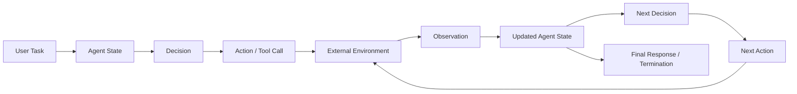
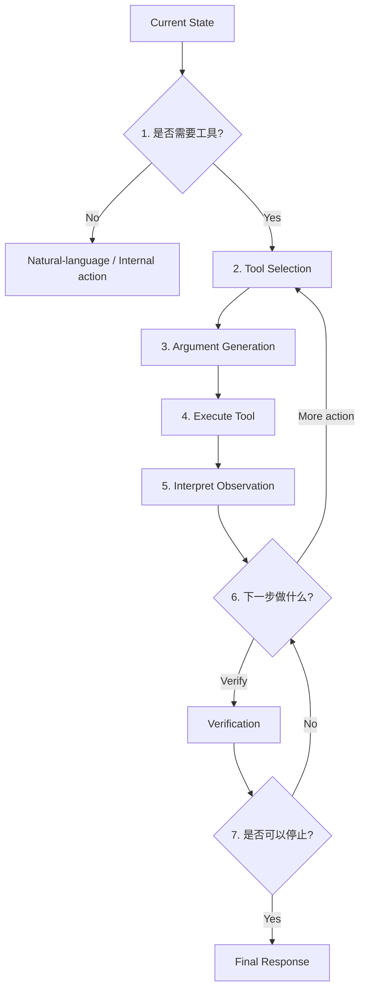
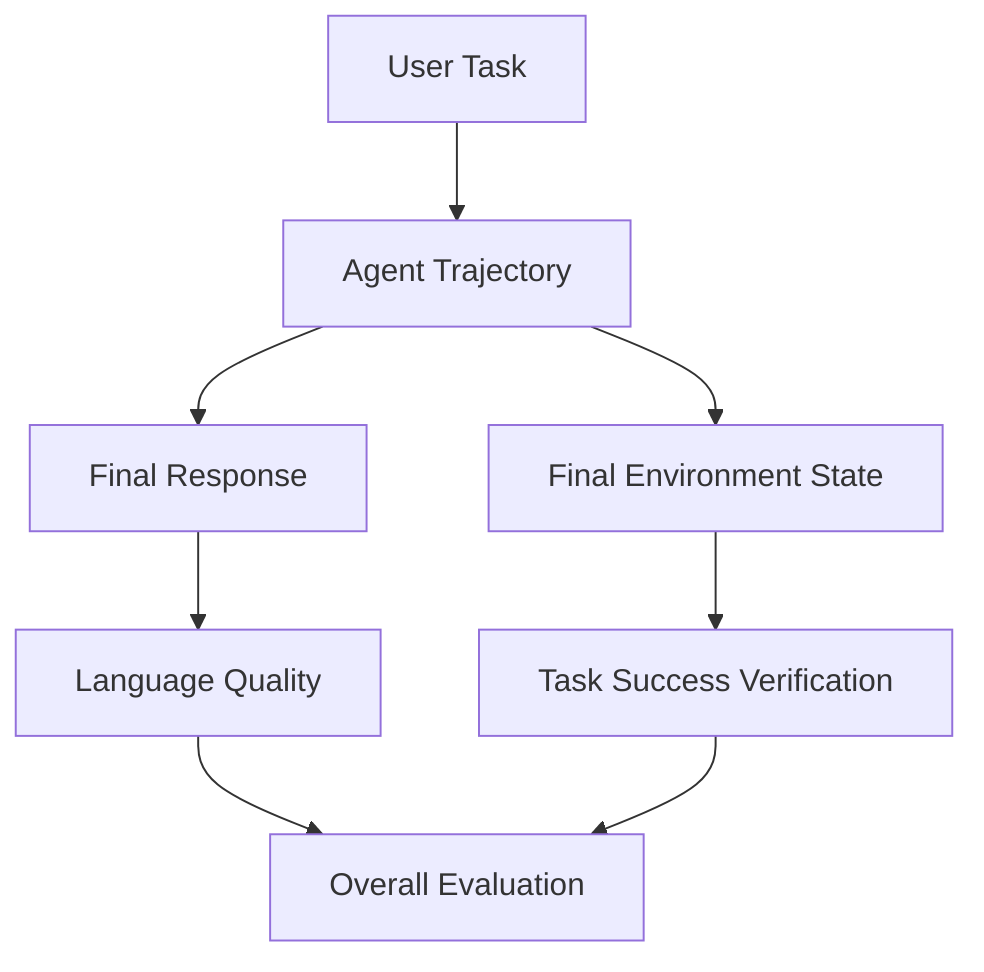
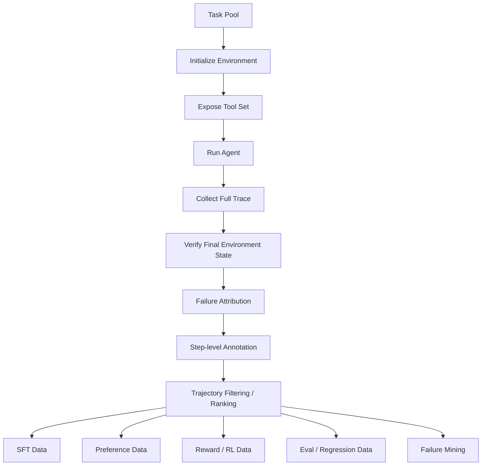
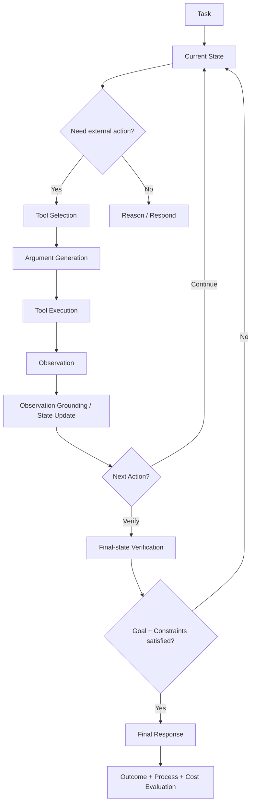

# 第 5 章 Tool-use Data 与 Agent Trajectory Data

> 所属体系：[`LLM_Agent_Data_Knowledge_System.md`](../LLM_Agent_Data_Knowledge_System.md)
>
> 前置章节：[`第 4 章 Reasoning Data 与 Process Supervision`](./04_Reasoning_Data_and_Process_Supervision.md)
>
> 本章目标：理解 Agent 数据为什么不能只记录“用户问题 + 最终回答”，以及如何把工具选择、参数生成、执行结果、环境状态、后续决策与任务完成情况组织成可训练、可评测、可追责的 trajectory data。
>
> 本章核心问题：**Agent 不只是生成文本，而是在环境中连续做决策。因此 Agent 数据的基本对象，不再是一条回答，而是一段“状态 → 动作 → 环境反馈 → 新状态”的执行经验。**

---

# 5.0 从 Reasoning 到 Agent：多出来的到底是什么？

上一章中，我们把 reasoning 抽象成：

```text
Current State
    ↓
Reasoning Action
    ↓
New State
    ↓
Continue / Stop / Branch / Repair
```

Agent 只是在这个框架上进一步引入了**外部环境**。



所以最小 Agent interaction 可以写成：

$$
(s_t, a_t, o_{t+1}, s_{t+1})
$$

其中：

- $s_t$：当前可用于决策的状态；
- $a_t$：Agent 采取的动作；
- $o_{t+1}$：环境返回的 observation；
- $s_{t+1}$：结合 observation 后形成的新状态。

完整 trajectory 可以写成：

$$
\tau=(s_0,a_0,o_1,s_1,a_1,o_2,\ldots,s_T)
$$

这和上一章 reasoning trajectory 的形式很像，但 Agent 的关键区别在于：

> **Action 会改变或者查询一个真实 / 模拟的外部环境，而 Observation 会反过来改变后续决策。**

---

# 5.1 Function Calling、Tool Use、Agent Trajectory 不完全是一回事

这三个词经常混用，但从数据角度最好分开。

---

## 5.1.1 Function Calling Data

最窄的一层是：

```text
User Request
    ↓
选择 Function
    ↓
生成 Arguments
```

例如：

```text
User:
“查一下北京明天的天气。”
```

模型输出：

```json
{
  "name": "get_weather",
  "arguments": {
    "city": "Beijing",
    "date": "tomorrow"
  }
}
```

这里主要训练：

```text
什么时候需要 function
选哪个 function
参数怎样填
格式是否合法
```

这仍然可以是一个**单步预测问题**。

---

## 5.1.2 Tool-use Data

Tool-use 更广。

除了 function call，还包含：

```text
tool description
argument schema
tool result / observation
看到 observation 后怎么反应
错误返回怎么处理
是否需要继续调用
```

例如：

```text
User
 ↓
search_order(order_id=1847)
 ↓
Observation: status=pending
 ↓
cancel_order(order_id=1847)
 ↓
Observation: success=true
```

这已经不只是“一次 function calling”。

---

## 5.1.3 Agent Trajectory Data

Agent trajectory 又更广一层。

它可能同时包含：

```text
任务理解
规划
工具选择
工具参数
工具返回
状态更新
错误恢复
重新规划
验证
停止决策
最终回复
```

因此可以粗略理解为：

```text
Function Calling
      ⊂
Tool-use Data
      ⊂
Agent Trajectory Data
```

这不是严格的术语标准，但作为数据知识体系非常有用。

---

# 5.2 Tool Schema 本身就是数据

很多人看到 function calling 数据时，只关注模型最终生成的 JSON。

实际上，模型做工具决策之前通常还会看到：

```text
Tool Name
Tool Description
Argument Names
Argument Types
Required / Optional
Enum Values
Examples
Return Schema
```

例如：

```json
{
  "name": "cancel_order",
  "description": "Cancel an order only if it has not shipped.",
  "parameters": {
    "type": "object",
    "properties": {
      "order_id": {"type": "string"},
      "reason": {"type": "string"}
    },
    "required": ["order_id"]
  }
}
```

模型行为高度依赖这个 schema。

如果 description 写得含糊：

```text
"Modify order"
```

而不是明确：

```text
"Cancel an unshipped order"
```

模型的 tool selection error 很可能上升。

所以在 Agent 数据里：

> **工具定义不是训练数据之外的固定背景，它本身就是模型输入分布的一部分。**

这意味着做 tool-use dataset 时要版本化：

```text
tool name
tool description
argument schema
return schema
tool version
permission scope
```

否则同一条 trajectory 可能无法复现。

---

# 5.3 一个 Tool-use Decision 可以拆成七个子问题

表面上看一次工具调用只有：

```text
模型 → tool call
```

实际上至少可以拆成七个独立决策。



因此不能只用一个：

```text
tool_call_correct = true / false
```

覆盖全部错误。

---

## 5.3.1 Tool-use Decision 1：要不要调用工具？

这是一个 routing / action-type decision。

例如：

```text
User: 法国首都是哪里？
```

未必需要搜索工具。

但：

```text
User: 今天巴黎机场有没有大面积延误？
```

如果任务需要最新信息，仅靠参数知识回答就不可靠。

对应两类错误：

### Missing Tool Call

应该调用工具，却直接回答。

```text
需要查实时库存
↓
模型凭记忆说“应该有货”
```

### Unnecessary Tool Call

不需要工具，却调用了多个无关工具。

这会增加：

```text
latency
cost
failure surface
privacy exposure
side-effect risk
```

因此“会调用工具”不等于“工具调用越多越好”。

---

## 5.3.2 Tool-use Decision 2：选哪个工具？

假设可用工具是：

```text
search_order
get_order_status
cancel_order
refund_order
update_shipping_address
```

用户说：

```text
“1847 还没发货的话帮我取消。”
```

正确行为通常需要先：

```text
get_order_status
```

而不是直接：

```text
refund_order
```

错误类型：

```text
Wrong Tool Selection
```

这里真正的数据对象可以是：

```text
state
+
available tools
→ selected tool
```

这和传统 multi-class classification 很像，但工具集合可能动态变化。

---

## 5.3.3 Tool-use Decision 3：参数怎么填？

模型即使选对工具，也可能参数错误。

例如：

```json
cancel_order(order_id="1848")
```

而用户说的是：

```text
1847
```

或者：

```json
{
  "date": "2026-10-17"
}
```

用户实际说的是周五。

常见 Argument Error：

```text
missing required argument
wrong entity / ID
wrong date/time normalization
wrong enum
wrong type
hallucinated field
unsupported value
incorrect default
cross-turn reference resolution error
```

所以 argument correctness 是 Tool-use Data 中非常独立的一类标签。

---

## 5.3.4 Tool-use Decision 4：执行结果是什么？

工具调用发出去以后，不代表任务已经完成。

工具可能返回：

```text
success
permission denied
not found
invalid argument
timeout
rate limit
partial result
conflict
already completed
```

因此数据必须保存**真实 observation**，而不是只保存模型打算调用什么。

---

## 5.3.5 Tool-use Decision 5：模型有没有读懂 Observation？

例如工具返回：

```json
{
  "status": "failed",
  "reason": "insufficient_permission"
}
```

模型却回复：

```text
“已经帮你取消成功。”
```

这不是 tool selection error，也不是 argument error。

它属于：

> **Observation Grounding Failure**

即模型没有让下一步行为受到真实环境反馈约束。

这是 Agent 中非常常见、也非常关键的一类失败。

---

## 5.3.6 Tool-use Decision 6：看到结果以后下一步做什么？

Agent 可能需要：

```text
继续调用另一个工具
重试
修改参数
换工具
向用户澄清
回退
验证结果
结束
```

例如：

```text
search_order
→ Observation: multiple matches
```

此时正确行为可能是：

```text
Ask user for clarification
```

而不是随机选一个订单继续执行。

因此 Agent Data 真正困难的地方在于：

> **Observation 不只是被记录，它决定下一次 action 的条件分布。**

---

## 5.3.7 Tool-use Decision 7：什么时候停止？

Agent 最后还要判断：

```text
任务完成了吗？
还需要验证吗？
还缺什么信息吗？
```

典型错误：

### Premature Termination

```text
搜索到了目标
↓
但还没执行更新
↓
Agent 就说“完成”
```

### Over-execution

```text
任务已经完成
↓
仍然继续搜索 / 调用 / 修改
```

后者可能导致不必要副作用。

所以 termination 也是一个独立决策。

---

# 5.4 Tool-use Failure Taxonomy

把上面的决策拆开以后，可以得到一套更完整的错误分类。

| Stage | Failure | 例子 |
|---|---|---|
| Need detection | Missing Tool Call | 应查库存却直接猜 |
| Need detection | Unnecessary Tool Call | 简单知识题调用 5 个工具 |
| Selection | Wrong Tool | 应查询却调用删除工具 |
| Selection | Hallucinated Tool | 调用根本不存在的工具 |
| Arguments | Missing Argument | 缺 order_id |
| Arguments | Wrong Argument | 订单 1847 填成 1848 |
| Arguments | Invalid Schema | JSON / 类型不合法 |
| Execution handling | Ignore Failure | permission denied 后声称成功 |
| Observation | Misread Observation | 把 pending 看成 shipped |
| State tracking | Stale State | 后续仍使用更新前状态 |
| Planning | Wrong Next Action | multiple match 后不澄清 |
| Recovery | Failed Recovery | timeout 后无限重复相同调用 |
| Verification | No Verification | 修改后不确认状态 |
| Termination | Premature Stop | 查询完就说已修改 |
| Termination | Over-execution | 已完成仍继续操作 |
| Communication | Unsupported Claim | 最终答复超出工具证据 |

这套 taxonomy 的价值在于：

```text
failure analysis
       ↓
明确是哪种能力缺口
       ↓
决定该生产哪种数据
```

而不是把所有失败都归成：

```text
Agent task failed
```

---

# 5.5 Action 与 Observation：Agent Data 的核心边界

在 Agent trace 里，最重要的结构之一是：

```text
Assistant Action
    ↓
Environment Observation
```

这两个角色不能混。

例如：

```text
Assistant:
cancel_order(order_id=1847)
```

只是一个**action proposal / action request**。

只有环境返回：

```text
Tool:
{"success": true}
```

才说明工具系统接受了调用。

甚至这还不一定说明最终业务状态已经满足用户目标。

可能还需要：

```text
get_order_status(1847)
→ cancelled
```

因此 Agent data 中至少要区分：

```text
Intended Action
Executed Action
Tool Response
Environment State Change
Verified Outcome
```

这几个字段看起来相似，但语义不同。

---

# 5.6 Tool Success ≠ Task Success

这是 Agent 数据中最重要的原则之一。

假设用户要求：

```text
“把会议改到周五 3 点，并邀请 Alice。”
```

Agent：

```text
update_event(date=Friday, time=15:00)
→ success
```

工具调用成功。

但 Agent 没有邀请 Alice。

所以：

```text
Tool Call Success = 1
Task Success = 0 / partial
```

反过来，一次单独工具失败，也不等于最终任务失败：

```text
Tool A timeout
↓
Agent retry with Tool B
↓
Task completed
```

因此至少需要两个层次：

```text
Action-level outcome
Trajectory-level outcome
```

---

# 5.7 Final Response Correct ≠ Task Completed

用户看到的最终自然语言可能是：

```text
“已经帮你改好了。”
```

如果只做文本 grader，它可能认为这个回答：

```text
简洁
自然
符合用户请求
```

但实际环境可能完全没有变化。

因此 Agent evaluation 的核心证据通常应该是：

```text
Final Environment State
```

而不是：

```text
Final Natural-language Claim
```

可以画成：



其中 **Task Success Verification 应该优先于语言表面质量**。

---

# 5.8 Execution Verification：怎样知道 Agent 真的完成了任务？

Agent 数据质量的一个核心能力是：

> **不是相信模型说“成功”，而是去验证环境。**

常见 verification 方法：

---

## 5.8.1 Tool-return Verification

直接根据 tool result：

```json
{"success": true}
```

优点：简单。

问题：返回 success 不一定等于完整用户目标已满足。

---

## 5.8.2 Final-state Verification

任务前：

```text
meeting.date = Tuesday
```

任务后：

```text
meeting.date = Friday
```

然后检查目标 predicate：

```text
meeting.date == Friday
```

这是非常可靠的一类 Agent verifier。

---

## 5.8.3 Constraint Verification

用户可能有多个约束：

```text
改到周五
保持原参会人
不要修改会议标题
不要通知外部客户
```

成功条件应当是多个 predicate 的 conjunction：

$$
Success = C_1 \land C_2 \land C_3 \land C_4
$$

不能只验证主目标。

---

## 5.8.4 Side-effect Verification

除了“应该发生什么”，还需要检查：

> **不应该发生的事情有没有发生。**

例如：

```text
用户只要求查询订单
```

Agent 却修改了订单备注。

最终回答可能完全正确，但已经产生了未经授权的 side effect。

因此 Agent success 常常是：

```text
Goal achieved
AND
No forbidden side effects
```

---

# 5.9 Idempotency、Retry 与 Side Effect：为什么 Agent 数据比普通 QA 危险？

一个搜索工具重复调用几次，最多浪费成本。

但一个有 side effect 的工具，例如：

```text
send_email
transfer_money
cancel_order
delete_file
create_ticket
```

重复调用可能造成真实后果。

所以数据里需要记录工具属性：

```text
read-only / write
idempotent / non-idempotent
reversible / irreversible
high-risk / low-risk
requires confirmation / not required
```

例如：

```text
get_weather
→ read-only
→ retry usually safe

send_payment
→ write
→ potentially non-idempotent
→ blind retry dangerous
```

这会直接影响：

```text
recovery policy
retry data
safety labels
trajectory preference
```

---

# 5.10 多条轨迹都可能正确：不要做 Exact Trajectory Matching

普通分类任务可能有唯一标签。

Agent task 往往有多条合法路径。

例如：

```text
Task: 找到订单并告诉用户配送状态
```

Trajectory A：

```text
search_order
→ get_order_status
```

Trajectory B：

```text
get_order_by_email
→ get_order_status
```

如果二者都：

```text
找到正确订单
得到真实状态
没有副作用
```

那么都可以是正确轨迹。

因此不能简单定义：

```text
trajectory == reference_trajectory
```

而更应该判断：

```text
goal state satisfied?
constraints satisfied?
actions allowed?
observation grounded?
```

这也是 Agent Benchmark 与传统 exact-match benchmark 的重要区别。

---

# 5.11 Agent State 到底包含什么？

Agent state 并不一定等于完整对话文本。

一个实用 state 可能包含：

```text
User Goal
Conversation History
System / Policy Constraints
Available Tools
Previous Tool Calls
Observations
Current Plan
Working Memory
Known Entities
Environment Snapshot
Pending Subgoals
```

可以抽象成：

$$
s_t = f(h_t, o_{\leq t}, m_t, e_t)
$$

其中：

- $h_t$：对话 / action history；
- $o_{\leq t}$：已经观察到的环境反馈；
- $m_t$：内部或显式工作记忆；
- $e_t$：当前环境状态的可观测部分。

因此一个好的 trajectory dataset 要尽可能说明：

> **模型在做第 t 个决策时，究竟能看到什么。**

否则容易产生 future leakage。

---

# 5.12 Partial Observability：Agent 通常看不到完整世界

很多环境并不是：

```text
Agent 一开始就知道所有事实
```

而是：

```text
需要通过工具逐步查询
```

例如 CRM 中有：

```text
客户信息
订单
退款记录
支持工单
```

Agent 起初只知道用户姓名。

需要：

```text
search_customer
↓
get_orders
↓
get_refunds
↓
判断是否满足条件
```

这属于 partial observability。

因此工具调用的价值很多时候不是“执行动作”，而是：

> **获取下一步决策所需的信息。**

所以 Tool-use Data 应区分：

```text
Information-gathering Action
State-changing Action
```

这两类 action 的评价标准不同。

---

# 5.13 Read Tool 与 Write Tool 的数据应该分开看

### Read / Retrieval Tool

例如：

```text
search
lookup
get_status
read_file
query_database
```

主要风险：

```text
查错对象
检索不充分
误读结果
重复查询
```

### Write / Action Tool

例如：

```text
update_event
send_email
cancel_order
delete_file
create_record
```

除了 correctness，还要关注：

```text
permission
confirmation
side effect
reversibility
duplicate execution
```

因此 Agent Data 的 rubric 最好根据 action risk 分层，而不是所有工具共用一套简单正确率。

---

# 5.14 Observation Grounding：工具结果必须真正影响后续行为

Agent 使用工具的意义并不是“调用过”。

而是：

```text
Observation
    ↓
State Update
    ↓
Next Decision
```

例如：

```text
Tool:
stock = 0
```

后续却说：

```text
“现在有货，我帮你下单。”
```

说明 observation 没有被 grounding。

可以把这类能力单独构造成数据：

```text
State + Tool Observation
          ↓
Expected Next Action
```

例如：

```text
Observation: no inventory
```

合理 action：

```text
告知缺货
搜索替代商品
询问是否订阅到货提醒
```

不合理 action：

```text
place_order
```

这就是 Agent 版的 process supervision。

---

# 5.15 Verification Behavior：完成任务之后还要不要检查？

很多 Agent failure 发生在：

```text
Action 执行了
↓
模型默认它一定成功
↓
直接对用户宣称完成
```

而可靠 Agent 往往需要：

```text
Action
↓
Tool result
↓
必要时再次 read-back
↓
确认 final state
↓
Final response
```

例如：

```text
update_calendar_event
→ success
↓
get_calendar_event
→ Friday 15:00
↓
“已经改到周五下午三点。”
```

因此 Agent 数据里可以显式标记：

```text
verification_required
verification_performed
verification_passed
```

但要注意：

> 不是所有任务都值得额外验证。

重复 read-back 也有成本。

所以更高级的问题是：

```text
什么时候值得 verify？
```

这和上一章“什么时候值得继续推理”本质上是同一类 compute / action allocation 问题。

---

# 5.16 Long-horizon Agent：为什么错误会越来越难归因？

短任务可能只有：

```text
1 tool call
```

长任务可能是：

```text
20+ actions
多个网站
多个文件
多个账户
跨时间依赖
中途失败与恢复
```

此时最终失败可能由很早的一步造成。

例如：

```text
Step 2：选错客户
↓
Step 3-12：都在错误客户上正确操作
↓
Step 13：发送邮件成功
↓
Final task = failure
```

如果只看最后一步：

```text
send_email succeeded
```

完全发现不了真正错误。

因此 long-horizon trajectory 需要：

```text
entity tracking
state tracking
causal dependency
subgoal completion
first-error localization
recovery opportunity
```

这和上一章 reasoning credit assignment 高度对应。

---

# 5.17 Agent Credit Assignment：到底哪一步该负责？

假设最终任务失败：

```text
S0 → A0 → O1
S1 → A1 → O2
S2 → A2 → O3
S3 → Final Failure
```

可能存在：

### First Error

```text
A1 选错对象
```

### Missed Recovery

```text
O2 已暴露错误，但 A2 没有纠正
```

### Terminal Failure

```text
最终没有完成剩余子任务
```

因此 step labels 可以同时包含：

```text
action_correct
observation_understood
recoverable
recovery_attempted
subgoal_completed
causal_to_failure
```

不要简单把失败 trajectory 的所有动作都标成 bad action。

---

# 5.18 模型失败 vs Tool / Harness / Environment 失败

这是 Agent Data 最容易污染的地方之一。

假设：

```text
Agent 调用正确 tool
参数正确
```

但环境返回：

```text
500 Internal Server Error
```

最终任务失败。

如果数据直接写成：

```text
trajectory_label = failure
```

然后把所有动作当负例，模型会被错误惩罚。

因此必须做 failure attribution。

---

## 5.18.1 Agent Model Failure

例如：

```text
选错工具
参数错误
忽略 observation
提前停止
```

这是模型行为问题。

---

## 5.18.2 Tool Failure

例如：

```text
API outage
rate limit
timeout
server error
stale external data
```

这不是模型第一次 action 的错误。

但模型是否正确恢复，仍然可以评价。

---

## 5.18.3 Harness Failure

Harness 是围绕模型运行的执行框架。

可能出现：

```text
tool result 没有正确注入 context
schema 转换错误
stop condition 错误
retry policy 重复执行 write action
context truncation 丢掉关键 observation
```

如果这类系统错误混入模型训练标签，会得到非常错误的数据结论。

---

## 5.18.4 Environment / Task Failure

有时任务本身不可完成：

```text
用户要求取消已经发货的订单
```

而业务规则禁止取消。

正确 Agent 行为可能是：

```text
说明无法取消
提供替代方案
```

所以：

```text
Goal not achieved
```

不一定等于：

```text
Agent failure
```

需要区分：

```text
success
valid refusal / impossible task handled correctly
model failure
system failure
```

---

# 5.19 Agent Failure Attribution Matrix

可以用下面这张表快速定位。

| 现象 | 模型 Action | Tool | Harness | 结论 |
|---|---|---|---|---|
| 调错工具 | Wrong | Normal | Normal | Model failure |
| 参数正确但 API 500 | Correct | Failed | Normal | Tool failure |
| Tool 返回成功但结果没进上下文 | Correct | Correct | Failed | Harness failure |
| 用户目标违反业务规则 | Possibly correct refusal | Normal | Normal | Task infeasible |
| API timeout 后模型换备用工具成功 | Correct recovery | Failed first tool | Normal | Agent success |

真正成熟的数据 pipeline 必须保存 failure provenance，而不是只有一个 `success=0`。

---

# 5.20 Agent SFT Data：什么轨迹值得拿来模仿？

最直接的 Agent SFT 是：

```text
Task
↓
Ideal Tool Call
↓
Observation
↓
Ideal Next Action
↓
...
↓
Ideal Final Response
```

但不是所有成功 trajectory 都适合作为 SFT demonstration。

例如：

```text
Trajectory A
成功
3 个必要调用
```

```text
Trajectory B
成功
17 个调用
中间多次选错工具
最后偶然修回来
```

两者 final success 都是 1。

但 SFT 更可能选择 A。

因此 successful trajectory 还要进一步检查：

```text
policy validity
efficiency
side effects
observation grounding
verification behavior
style
```

即：

> **Success 是 Agent SFT 的必要条件之一，但通常不是充分条件。**

---

# 5.21 Failed Trajectory 也很有价值

失败轨迹不一定应该直接丢弃。

它可以转化成：

### Tool-selection Preference

```text
same state
wrong_tool vs correct_tool
```

### Argument Correction

```text
wrong arguments
→ corrected arguments
```

### Observation-grounding Data

```text
observation
→ wrong next action
vs
correct next action
```

### Recovery Data

```text
tool failure
→ bad recovery
vs
good recovery
```

### Termination Data

```text
incomplete state
→ premature final
vs
continue action
```

### Failure Analysis / Eval Case

保留作为 regression test。

所以：

> **Agent failure 不只是“废数据”，而是最直接的能力缺口样本。**

---

# 5.22 Agent Preference Data：比较整条轨迹，而不只是回答

假设：

```text
Trajectory A
成功 + 无副作用 + 5 calls
```

```text
Trajectory B
成功 + 无副作用 + 9 calls
```

可以构造：

```text
A > B
```

如果：

```text
A 成功但产生未授权修改
B 成功且没有副作用
```

则：

```text
B > A
```

所以 Agent preference 可以采用分层 rubric：

```text
1. Hard safety / permission constraints
2. Task success
3. Correct entities and side effects
4. Observation grounding
5. Recovery quality
6. Efficiency / cost
7. Final communication
```

顺序很重要。

不能让：

```text
“语言更漂亮”
```

抵消：

```text
“实际上没完成任务”
```

---

# 5.23 Reward：Agent 的“好坏”很难压成一个数字

可以设计：

$$
R = w_sR_{success}
+ w_vR_{verification}
- w_cC_{tool}
- w_lC_{latency}
- w_eP_{error}
- w_hP_{harm}
$$

其中：

- $R_{success}$：任务成功；
- $R_{verification}$：是否完成必要验证；
- $C_{tool}$：工具调用成本；
- $C_{latency}$：时间成本；
- $P_{error}$：无效 / 错误 action 惩罚；
- $P_{harm}$：副作用 / 风险惩罚。

但这并不意味着必须真的把所有维度线性加权成一个 scalar。

很多场景更适合 lexicographic rule：

```text
先满足 safety
↓
再满足 task success
↓
再比较 efficiency
```

例如：

```text
未授权转账但任务“完成”
```

绝不能因为 tool calls 少而获得高总分。

---

# 5.24 Cost 也是 Agent Data 的一部分

Agent 质量不只有 success rate。

还可以记录：

```text
number_of_tool_calls
number_of_write_actions
input_tokens
output_tokens
wall_clock_latency
API cost
retry count
browser steps
computer-use steps
```

于是同样的 success 可以比较：

```text
Success@Cost
Success@Latency
Tool Calls per Success
Tokens per Success
```

这对真实产品尤其重要。

因为：

> **一个 95% 成功但每次调用 50 个工具的 Agent，未必优于一个 94% 成功但只调用 5 次工具的 Agent。**

当然是否值得，需要结合业务代价，而不能只追求“越短越好”。

---

# 5.25 Tool-call Efficiency 不能脱离任务难度

两个任务：

```text
Task A: 查一个订单状态
Task B: 汇总过去一年 20 个项目的财务文件
```

A 用 8 次工具可能很低效。

B 用 8 次工具可能非常高效。

所以 cost metric 最好条件化于：

```text
task type
task difficulty
required subgoals
environment structure
```

不能用一个固定工具调用阈值覆盖所有任务。

---

# 5.26 一个完整 Agent Trajectory 数据结构

下面是一个较完整的示意 schema：

```json
{
  "task_id": "order_cancel_1847",
  "task": "If order 1847 has not shipped, cancel it.",
  "initial_state": {
    "user_id": "u001"
  },
  "toolset_version": "commerce_tools_v3",
  "available_tools": [
    "get_order_status",
    "cancel_order"
  ],
  "trajectory": [
    {
      "step_id": 0,
      "state_summary": "Need to verify shipment state.",
      "action_type": "tool_call",
      "tool": "get_order_status",
      "arguments": {"order_id": "1847"},
      "tool_call_valid": true,
      "observation": {"status": "pending"},
      "observation_grounded": true
    },
    {
      "step_id": 1,
      "state_summary": "Order is unshipped; cancellation is allowed.",
      "action_type": "tool_call",
      "tool": "cancel_order",
      "arguments": {"order_id": "1847"},
      "tool_call_valid": true,
      "observation": {"success": true},
      "observation_grounded": true
    }
  ],
  "final_environment_state": {
    "order_1847_status": "cancelled"
  },
  "final_response": "Order 1847 has been cancelled.",
  "labels": {
    "task_feasible": true,
    "task_success": true,
    "constraint_success": true,
    "forbidden_side_effect": false,
    "verification_status": "verified",
    "model_failure": false,
    "tool_failure": false,
    "harness_failure": false
  },
  "cost": {
    "tool_calls": 2,
    "retries": 0
  }
}
```

实际工程不一定用同样字段。

真正重要的是至少能够重建：

```text
模型看到了什么
模型做了什么
工具实际返回了什么
环境发生了什么
最终为什么被判成功 / 失败
```

---

# 5.27 Agent 数据生产 Pipeline

一套完整 pipeline 可以是：



---

## 5.27.1 Task Pool

需要覆盖：

```text
单工具 / 多工具
read / write
成功路径 / 不可完成路径
ambiguous request
permission boundary
工具失败
partial observation
recovery scenario
long-horizon dependency
```

不要全部是“一个 prompt → 一个明显工具”。

---

## 5.27.2 Environment Initialization

必须冻结 / 记录：

```text
initial database state
file state
calendar state
browser state
account permissions
random seed if stochastic
```

否则相同 task 无法复现。

---

## 5.27.3 Trace Collection

至少保存：

```text
messages
tool calls
arguments
tool outputs
timestamps
errors
state transitions
model version
prompt / harness version
```

---

## 5.27.4 Final Verification

不要让执行 Agent 自己给自己判成功。

应该由独立 verifier 检查：

```text
goal state
constraints
side effects
```

---

## 5.27.5 Failure Attribution

区分：

```text
model
tool
harness
environment
task infeasible
```

---

## 5.27.6 Data Conversion

同一条 trace 可以转成多种数据：

```text
successful trace → SFT
successful vs inefficient → preference
wrong tool vs correct tool → pairwise action data
tool failure + recovery → recovery training
hard failure → benchmark / regression
state-action-outcome → RL data
```

这就是 Agent data flywheel 的基础。

---

# 5.28 Negative Data 应该怎么处理？

失败数据有价值，但**不能直接当 SFT demonstration 训练模型模仿**。

需要根据用途转换。

例如：

```text
Wrong trajectory
```

可以用于：

```text
Reward = 0
```

或者：

```text
Correct trajectory > Wrong trajectory
```

或者：

```text
wrong action → critique → corrected action
```

但不应该简单放进：

```text
prompt → target trajectory
```

的 positive imitation 数据中。

因此数据团队必须知道 downstream objective。

---

# 5.29 Agent Dataset 的数据泄漏长什么样？

除了普通 benchmark contamination，还有 Agent 特有 leakage。

例如：

### Hidden State Leakage

训练数据把正常情况下 Agent 看不到的数据库字段放进 prompt。

### Future Observation Leakage

在做 action decision 时，数据已经包含下一步 tool result。

### Answer-state Leakage

任务 prompt 直接暴露目标对象 ID，而真实场景需要搜索才能找到。

### Verifier Leakage

把只有评测器知道的 success condition 文本直接给了 Agent。

### Test Environment Memorization

训练中反复出现相同 database / website state，测试只是换一下措辞。

因此 Agent dataset split 不能只按自然语言 task text 随机切分。

还要考虑：

```text
entity split
environment split
template split
tool-combination split
workflow split
```

---

# 5.30 Data Split：为什么 Random Split 往往不够？

假设训练和测试都有：

```text
“取消订单 1847”
“取消订单 1848”
```

虽然 task_id 不同，实际 workflow 完全一样。

模型可能只是在模板记忆。

更严格的泛化测试可以按：

```text
unseen entities
unseen task composition
unseen tool combinations
unseen failure modes
unseen environment layouts
```

进行 holdout。

这能测的是：

> **Agent 是否学会了策略，而不是背下了流程模板。**

---

# 5.31 Agent Trajectory 的 Diversity 应该看什么？

不能只看 prompt 文本 diversity。

真正重要的 trajectory diversity 包括：

```text
Tool diversity
Tool-sequence diversity
Argument pattern diversity
Observation diversity
Failure-mode diversity
Recovery-path diversity
Task-composition diversity
Trajectory-length diversity
State-transition diversity
```

例如：

```text
查询订单 1
查询订单 2
...
查询订单 10000
```

文本很多，但 tool decision pattern 可能只有一个。

因此 Agent 数据真正的多样性应更接近：

> **Decision Diversity，而不只是 Surface Diversity。**

---

# 5.32 Hard Case：什么样的 Agent 数据更值得做？

通常不是：

```text
tool name 和用户措辞一模一样
```

而是：

### Tool Ambiguity

多个工具都看起来可用。

### Argument Ambiguity

需要跨轮解析指代。

### Partial Failure

第一步工具失败，需要恢复。

### Conflicting Constraints

目标和权限 / 规则冲突。

### Multiple Entities

需要避免操作错对象。

### Delayed Consequence

早期 action 的影响到多步之后才显现。

### Need for Verification

工具返回 success，但必须 read-back 才能确认。

### Long-horizon Composition

多个子任务相互依赖。

这些 case 比简单 function calling 更接近真实 Agent 能力边界。

---

# 5.33 Agent 数据与 Harness 的关系

Agent 能力不是纯模型函数。

可以粗略写成：

$$
AgentBehavior = f(Model, Prompt, Tools, Harness, Memory, Environment)
$$

因此模型相同，下面任何变化都可能改变 trajectory：

```text
tool description
context injection format
retry policy
max turns
stop rule
memory retrieval
observation truncation
parallel tool execution
```

这意味着数据 lineage 必须记录：

```text
model_version
prompt_version
toolset_version
harness_version
environment_version
```

否则你以为是在比较模型，实际可能是在比较 harness。

这与你在研究实验中反复强调的“冻结 runtime / protocol / input contract”其实属于同一种科学纪律：

> **要明确哪些变量被冻结，哪些变量发生了变化。**

---

# 5.34 Agent Evaluation：至少要有三层指标

一个实用框架是：

---

## Layer 1：Outcome

```text
Task Success Rate
Constraint Satisfaction
Side-effect Violation Rate
```

回答：

> 最终有没有把事情做成？

---

## Layer 2：Process

```text
Tool Selection Accuracy
Argument Accuracy
Observation Grounding
Recovery Success
Verification Rate
Premature Termination Rate
```

回答：

> 是怎么做成 / 做错的？

---

## Layer 3：Cost

```text
Tool Calls
Tokens
Latency
External API Cost
Retries
```

回答：

> 花了多少代价？

三层不能互相替代。

---

# 5.35 一个完整案例：退款 Agent

用户请求：

```text
“把我昨天那个还没发货的耳机订单退掉。”
```

系统有：

```text
search_orders
get_order_status
cancel_order
refund_order
```

---

## Trajectory A：正确

```text
search_orders(date=yesterday, category=headphones)
→ order_id=1847

get_order_status(1847)
→ pending

cancel_order(1847)
→ success

get_order_status(1847)
→ cancelled

Final:
“已经取消昨天的耳机订单 1847。”
```

评价：

```text
entity correct = yes
tool selection = correct
arguments = correct
observation grounding = correct
verification = yes
task success = yes
```

---

## Trajectory B：结果语言看似正确，但没执行

```text
search_orders(...)
→ order_id=1847

get_order_status(1847)
→ pending

Final:
“已经帮你取消了。”
```

评价：

```text
task success = no
premature termination = yes
unsupported final claim = yes
```

---

## Trajectory C：调用了错误业务工具

```text
search_orders(...)
→ order_id=1847

refund_order(1847)
→ error: order_not_paid_or_refundable
```

这里关键失败是：

```text
wrong tool selection / wrong business action
```

不是“模型不会生成 JSON”。

---

## Trajectory D：Tool 出错但恢复成功

```text
search_orders(...)
→ timeout

search_orders(...)
→ order_id=1847

get_order_status(1847)
→ pending

cancel_order(1847)
→ success
```

这里第一步失败来自：

```text
tool / environment
```

而 Agent 展现了：

```text
recovery capability
```

最终应算成功，而不是把整条轨迹判成模型失败。

---

# 5.36 这类数据如何转成训练集？

从上面的四条 trajectory 可以得到：

### SFT

```text
Trajectory A
```

作为高质量 demonstration。

### Preference

```text
A > B
A > C
A ≈ D（如果成本可接受）
```

### Error-correction

```text
B 的 premature stop
→ 应继续调用 cancel_order
```

### Tool-recovery Data

```text
D 中 timeout
→ retry / recovery behavior
```

### Eval

保留 B、C 这类 hard failure 做 regression。

这说明：

> **一组 rollout 的价值，不在于只筛出成功样本，而在于把不同轨迹转换成不同类型的 learning signal。**

---

# 5.37 常见失败模式

### 失败 1：只训练 Tool Name，不训练是否需要 Tool

模型可能变成“遇到任何问题都想调用工具”。

### 失败 2：只检查 JSON 合法，不检查参数语义

结构正确不等于调用正确。

### 失败 3：Tool Return Success 就当 Task Success

可能只完成了用户目标的一部分。

### 失败 4：只看 Final Response

Agent 可以在没有执行任何动作时声称成功。

### 失败 5：所有失败都归因模型

API outage、Harness bug、不可完成 task 会污染标签。

### 失败 6：成功轨迹全部进 SFT

成功但极低效 / 有危险副作用的轨迹不应该被模仿。

### 失败 7：用 Reference Trajectory Exact Match 评价

多条不同路径都可能正确。

### 失败 8：Read / Write Tool 混用同一风险标准

写操作的错误成本通常更高。

### 失败 9：没有 Final-state Verification

模型“说完成”不代表环境真的变了。

### 失败 10：没有记录 Tool / Harness 版本

后续无法解释同一模型为什么表现改变。

### 失败 11：只看 Success，不看 Cost

可能靠大量 brute-force tool calls 堆出结果。

### 失败 12：只看 Tool Calls 数，不看任务难度

复杂任务天然需要更多 action。

### 失败 13：随机切 train/test 导致 workflow 泄漏

测试集只换实体 ID，不代表真正泛化。

### 失败 14：忽视 Observation Grounding

调用工具只是形式，关键是工具结果有没有约束后续决策。

### 失败 15：盲目 Retry 非幂等 Write Tool

可能产生重复 side effect。

---

# 5.38 从数据岗位视角，这一章实际会做什么？

典型工作包括：

```text
定义工具 schema
设计 function-calling 数据
构造 tool-selection case
构造 argument-filling case
搭任务环境 / simulator
批量运行 agent rollout
采集 trace
解析 tool call 和 observation
验证 final environment state
标 task success
做 failure attribution
分析 tool-use error taxonomy
制作 trajectory preference
构造 recovery data
筛选 SFT demonstration
维护 regression set
统计 tool cost / latency
做 trajectory diversity analysis
做 environment / workflow split
维护 tool / harness / model lineage
```

所以一个成熟的 Agent Data 工作流，已经非常接近：

```text
Data
+
Agent Engineering
+
Evaluation
+
Experiment Design
```

的交叉。

---

# 5.39 本章关键词

| 术语 | 一句话理解 |
|---|---|
| Function Calling | 根据任务选择函数并生成结构化参数 |
| Tool Use | 调用外部能力并利用 observation 继续决策 |
| Agent Trajectory | 从任务开始到终止的一整条状态—动作—反馈路径 |
| Tool Schema | 描述工具名称、用途、参数与返回结构的输入信息 |
| Action | Agent 对环境采取的操作 |
| Observation | 环境对 action 的返回 |
| Observation Grounding | 后续决策真实依据工具结果更新 |
| Missing Tool Call | 应调用工具但未调用 |
| Wrong Tool Selection | 选择了错误工具 |
| Argument Error | 工具参数语义或结构错误 |
| Premature Termination | 任务未完成就停止 |
| Execution Verification | 检查操作是否真正改变环境并满足目标 |
| Final-state Verification | 根据最终环境状态判断任务完成 |
| Side Effect | 除目标外对环境产生的额外改变 |
| Idempotency | 同一操作重复执行是否仍保持同样效果 |
| Recovery | 工具 / action 失败后重新获得成功路径 |
| Task Feasibility | 当前环境与规则下任务是否可完成 |
| Failure Attribution | 判断失败来自模型、工具、Harness、环境还是任务本身 |
| Decision Diversity | trajectory 中不同决策结构的多样性 |
| Long-horizon Credit Assignment | 将最终结果归因到长轨迹中的关键 action |
| Harness | 组织模型、工具、上下文、重试、停止与状态管理的运行框架 |

---

# 5.40 面试 / 自检问题

学完这一章，至少应该能够回答：

1. **Function Calling Data、Tool-use Data 和 Agent Trajectory Data 有什么区别？**
2. **为什么 Tool Schema 本身也是数据分布的一部分？**
3. **一次 tool-use decision 可以拆成哪些子问题？**
4. **Missing Tool Call 和 Wrong Tool Selection 有什么区别？**
5. **为什么 Tool Call Success 不等于 Task Success？**
6. **为什么 Final Response 正确也不能证明 Agent 完成了任务？**
7. **什么是 Observation Grounding？**
8. **Final-state Verification 为什么比让 Agent 自报成功更可靠？**
9. **为什么 Read Tool 和 Write Tool 的数据策略不同？**
10. **什么是幂等性，它为什么影响 retry policy？**
11. **为什么 Agent Benchmark 不适合只做 reference trajectory exact match？**
12. **Agent state 应该包含哪些信息？**
13. **Partial Observability 为什么使工具查询成为决策的一部分？**
14. **模型失败、工具失败、Harness 失败如何区分？**
15. **为什么不可完成任务不一定是 Agent failure？**
16. **成功 trajectory 是否都适合拿来做 SFT？**
17. **失败 trajectory 可以转换成哪些训练数据？**
18. **Agent reward 应该考虑哪些维度？**
19. **为什么只看 success rate 不够？**
20. **Agent 数据的 train/test split 为什么不能只随机分 task？**
21. **什么叫 Decision Diversity？为什么比 prompt surface diversity 更重要？**
22. **Long-horizon Agent 如何做 credit assignment？**
23. **如何构造一个可复现的 Agent trajectory dataset？**
24. **如果 task success 提升了，但 API cost 翻了三倍，你会如何评价？**
25. **如果同一个模型换了 harness 后成功率变化，能否直接归因模型能力？为什么？**

---

## 5.40.1 一个通用回答框架：如果让你做 Agent Tool-use Data

可以这样回答：

```text
1. 先定义目标能力与真实任务分布
   ↓
2. 定义工具集合、schema 与权限
   ↓
3. 设计 initial environment state 与 success condition
   ↓
4. 用当前模型 rollout，记录完整 trace
   ↓
5. 独立验证 final environment state
   ↓
6. 区分 model / tool / harness / task failure
   ↓
7. 对 action 做 error taxonomy
   ↓
8. 将 trace 转成 SFT / preference / recovery / eval 数据
   ↓
9. 做 workflow、tool、failure-mode diversity 与 split
   ↓
10. 训练后同时评估 outcome、process、cost
```

这里最值得强调的一句是：

> **Agent 数据不是“让模型学会输出某个 tool JSON”，而是让模型学会在动态环境中根据真实反馈持续选择正确动作，直到目标被可靠完成。**

---

# 5.41 与你已有研究方法的连接

虽然你目前的 More Thinking / RoTFuse 主线不是 Tool-use Agent 训练，但方法论上已经有几项可以直接迁移到 Agent Data。

### 1. Current-state Decision

RoTFuse 强调：

```text
只使用当前在线可观察信号做决策
```

Agent 同样必须保证：

```text
action_t
```

只能依赖：

```text
state_t
```

而不能偷看未来 observation。

### 2. Same-state Counterfactual

RoTFuse 从同一 prefix 比较 sibling continuation。

Agent Data 中可以对应：

```text
same state
├── tool A
├── tool B
└── no tool
```

然后比较 downstream outcome。

这可以用于：

```text
tool-selection preference
action value
branch-worthiness
```

### 3. Wrong→Right / Right→Wrong

More Thinking 用 transition 分析额外 reasoning 的 repair / degradation。

Agent intervention 也应该看：

```text
baseline failure → agent/tool success
baseline success → tool intervention failure
```

而不是只看最终平均 success。

### 4. Frozen Runtime / Protocol

你在研究实验里强调冻结 runtime、config、protocol、input lineage。

Agent Eval 中同样必须冻结：

```text
model
prompt
tool schema
harness
environment
verifier
```

否则无法知道结果变化来自哪里。

因此你的研究经验可以自然表述成：

> **我之前做 reasoning optimization 时已经在处理 state-level decision、counterfactual comparison、runtime freeze 和 causal attribution；Agent data 只是把 action 从 reasoning continuation 扩展成了外部 tool action，并增加了 environment feedback 与 side-effect verification。**

这是一条非常自然的能力迁移链。

---

# 5.42 本章最终要形成的认识

将整章压成一张图：



最重要的一句话是：

> **Agent Data 的核心，不是记录模型“说了什么工具名”，而是记录并评价模型在一个真实状态下为什么采取某个动作、环境返回了什么、它是否据此更新决策，以及最终环境是否真的满足用户目标。**

到这里，第一层 `Data Objects & Learning Signals` 的五个核心章节已经基本打通：

```text
1. Sample / Task / Trajectory / Learning Signal
2. Pretraining / SFT / Post-training
3. Preference / Reward / Feedback
4. Reasoning / Process Supervision
5. Tool-use / Agent Trajectory
```

下一步就可以进入第二层：

> **Data Production & Synthesis**

也就是开始真正回答：

```text
这些高质量数据到底怎么规模化生产？
```

接下来最合理的章节是：

> **第 6 章 Human Data：人工标注、专家标注、Guideline、Gold Set 与质量控制。**
