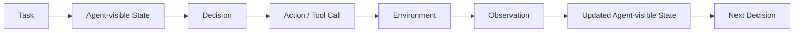
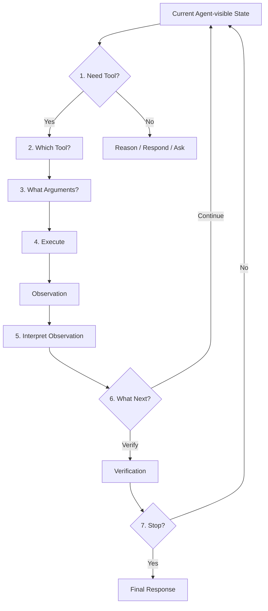
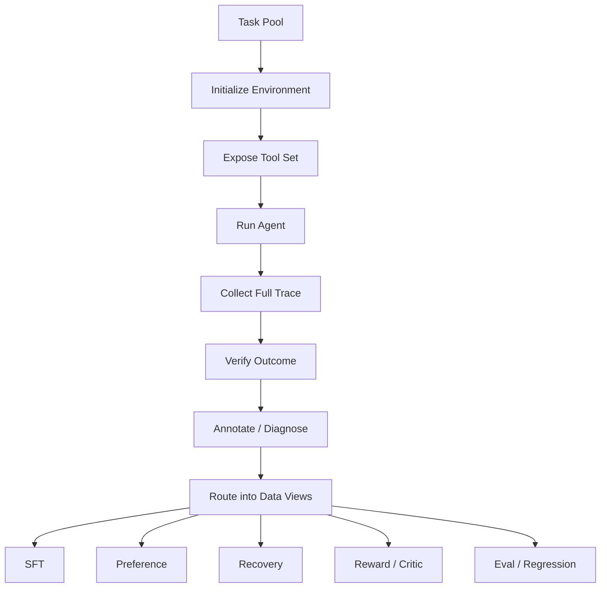

# 第 5 章 Tool-use Data 与 Agent Trajectory Data：从一次 Function Call 到完整执行经验

> 所属体系：[`LLM_Agent_Data_Knowledge_System.md`](../LLM_Agent_Data_Knowledge_System.md)
>
> 前置章节：[`第 4 章 Reasoning Data 与 Process Supervision`](./04_Reasoning_Data_and_Process_Supervision.md)
>
> 关联章节：[`第 10 章 Agent Task Design`](./10_Agent_Task_Design.md)、[`第 11 章 Environment Design`](./11_Environment_Design.md)、[`第 12 章 Agent Trajectory Anatomy`](./12_Agent_Trajectory_Anatomy.md)、[`第 13 章 Credit Assignment`](./13_Task_Success_and_Credit_Assignment.md)、[`第 14 章 Failure Taxonomy`](./14_Agent_Failure_Taxonomy.md)、[`第 15 章 Grader / Verifier / Judge`](./15_Grader_Verifier_and_LLM_as_a_Judge.md)
>
> 编辑基础设施：[`Canonical Glossary`](./00_Glossary_and_Notation.md) · [`Canonical Casebook`](./00_Canonical_Casebook.md)
>
> 本章定位：**Tool-use / Agent Trajectory Data 的入口章。它负责解释“Agent 数据到底多记录了什么”，不承担完整 Task、Environment、Credit、Failure 或 Benchmark 理论。**
>
> 本章核心问题：**Agent 不是只生成一句回答，而是在一个可变化的外部世界里连续做决策。因此 Agent Data 的基本对象不再只是 response，而是一段可还原的“当前可见状态 → 决策 → 动作 → 环境反馈 → 状态更新 → 下一步决策”的执行经验。**

---

# 5.0 从 Reasoning 到 Agent：真正新增的是外部世界

第 4 章把 reasoning 写成：

```text
Reasoning State
↓
Reasoning Decision
↓
Continue / Stop / Branch / Repair
↓
New Reasoning State
```

Agent 在此基础上多出一个关键对象：

> **Environment。**



最小交互单元可以写成：

$$
(s_t, a_t, o_{t+1}, s_{t+1})
$$

完整 episode 中的 trajectory 则近似为：

$$
\tau=(s_0,a_0,o_1,s_1,a_1,o_2,\ldots,s_T)
$$

这里要注意本书的术语边界：

- `Environment State / World State`：外部世界真实处于什么状态，详见第 11 章；
- `Agent-visible State`：Agent 在当前时刻实际能据以决策的信息；
- `Trajectory`：一次 Episode 中实际走过的状态—动作—反馈路径，完整结构详见第 12 章。

所以从 Reasoning Data 到 Agent Data 的变化不是“多了一个 JSON 工具调用”，而是：

> **模型输出开始参与外部状态转移，而外部反馈又反过来约束后续模型行为。**

---

# 5.1 Function Calling、Tool-use Data 与 Agent Trajectory Data

这三个概念可以按数据对象的范围理解。

## 5.1.1 Function Calling Data

最窄的一层：

```text
Context
↓
Should call a function?
↓
Which function?
↓
Arguments?
```

例如：

```json
{
  "name": "get_weather",
  "arguments": {
    "city": "Beijing",
    "date": "tomorrow"
  }
}
```

它主要训练：

```text
Need Detection
Tool Selection
Argument Construction
Schema Following
```

仍然可以近似成一个单步结构化预测问题。

---

## 5.1.2 Tool-use Data

Tool-use Data 进一步保存：

```text
Tool Schema
Tool Call
Execution Result
Observation
Observation-conditioned Next Decision
```

例如：

```text
get_order_status(1847)
↓
Observation: shipped
↓
不要继续 cancel，而是转入其他合法处理
```

这里真正重要的是：

> **模型有没有根据 tool result 改变下一步 policy。**

---

## 5.1.3 Agent Trajectory Data

Agent Trajectory Data 再向上包含：

```text
Task Interpretation
Subgoal / Plan
Tool Decisions
Arguments
Execution Results
Observations
State Updates
Recovery
Verification
Termination
Final Communication
```

因此本书使用下面这个工作性关系：

```text
Function Calling
      ⊂
Tool-use Data
      ⊂
Agent Trajectory Data
```

它不是行业唯一命名标准，但非常适合帮助判断：

> 你做的到底只是结构化 tool call 数据，还是已经进入完整的 Agent experience 数据。

---

# 5.2 Tool Schema 本身就是模型输入数据

Tool-use 数据不能只保存最终 JSON。

Agent 做决策之前看到的通常还有：

```text
Tool Name
Description
Arguments
Required / Optional
Enum / Type
Return Schema
Permission
Side-effect Metadata
```

例如：

```json
{
  "name": "cancel_order",
  "description": "Cancel an order only if it has not shipped.",
  "parameters": {
    "order_id": {"type": "string"}
  }
}
```

如果 description、argument schema 或 return semantics 改了，即使模型完全没变，trajectory distribution 也可能变化。

所以 Tool Schema 应被视为：

> **Agent policy 的输入条件，而不是一个无关的工程背景。**

正式版本管理与 Tool / Harness / Environment 边界见第 11、19 章。

---

# 5.3 一次 Tool-use 实际包含七个决策

表面上一次工具使用像：

```text
Model → Tool Call
```

实际上至少有七个决策点：



这七层是 Agent Data 最常用的一组 supervision interface。

---

## 5.3.1 Need Detection：要不要调用工具？

错误有两种方向：

```text
Missing Tool Call
应该查实时 / 环境状态，却直接猜
```

和：

```text
Unnecessary Tool Call
已有信息足够，却无意义调用外部工具
```

所以“工具调用率更高”本身不是能力提升。

---

## 5.3.2 Tool Selection：调用哪个工具？

给定：

```text
Current State
+
Available Tool Set
```

Agent 要选择最合适的 action interface。

例如 C1 Order / Refund Agent 中：

```text
“如果订单 1847 还没发货，就帮我取消。”
```

通常应该先：

```text
get_order_status
```

而不是直接：

```text
cancel_order
```

这类数据可以直接形成：

```text
state + toolset → selected tool
```

或 same-state tool preference。

---

## 5.3.3 Argument Construction：参数是不是语义正确？

JSON 合法只解决了很小一部分问题。

常见错误包括：

```text
Missing Argument
Wrong Entity / ID
Wrong Scope
Wrong Time / Timezone
Wrong Unit
Wrong Enum
Hallucinated Field
Stale Argument
```

因此：

```text
Schema Validity
≠
Semantic Correctness
```

完整 Argument failure taxonomy 归第 14 章。

---

## 5.3.4 Execution：真正执行了什么？

模型产生：

```text
cancel_order(1847)
```

只是 action request。

系统真正执行的 action、返回值以及环境变化需要单独记录：

```text
Intended Action
Executed Action
Tool Result
Environment Transition
```

这四者不能默认相同。

---

## 5.3.5 Observation Interpretation：有没有读懂结果？

例如：

```text
Observation:
status = shipped
```

但 Agent 后续仍按 `pending` 执行。

这类问题的核心不是“有没有调用工具”，而是：

> **Observation 有没有进入下一步 policy。**

它通常被称为 Observation Grounding。

---

## 5.3.6 Next Decision：看到结果以后做什么？

Observation 之后可能需要：

```text
继续
换工具
修改参数
retry
backtrack
ask user
escalate
verify
abort safely
```

因此 Agent 数据的真正难点往往不是第一个 tool call，而是：

> **中间 observation 如何改变后续动作分布。**

---

## 5.3.7 Termination：什么时候停止？

典型失败包括：

```text
Premature Stop
任务没完成就结束

Over-execution
任务已经完成仍继续行动
```

Stop 本身也是决策；其完整 credit 与 failure 定义分别见第 13、14 章。

---

# 5.4 Action 与 Observation 是 Agent Trace 的基本边界

Agent 数据最重要的结构之一是：

```text
Agent Action
↓
Environment Observation
```

两者角色完全不同。

例如：

```text
Agent:
cancel_order(1847)
```

不能证明：

```text
订单已经取消
```

即使 tool 返回：

```text
{"success": true}
```

也仍可能需要检查 final environment state。

所以实践中最好显式区分：

```text
Action Proposal
Executed Action
Tool / Environment Observation
World-state Change
Verified Outcome
```

这也是为什么 Agent trajectory 比普通 chat transcript 信息密度更高。

---

# 5.5 Tool Success、Task Success 与 Final Claim 是三件事

假设用户要求：

```text
“把会议改到周五三点，并邀请 Alice。”
```

Agent 成功执行：

```text
update_event(time=Friday 15:00)
```

但没邀请 Alice。

那么：

```text
Tool Success = Yes
Task Success = No / Partial
```

如果最终还说：

```text
“已经全部处理完成。”
```

则又多了一层：

```text
Final Communication = Unsupported / Misleading
```

因此至少要分开：

```text
Action-level Outcome
Task-level Outcome
Final Communication
```

Task Contract、Success Predicate 与 Forbidden Side Effect 的正式定义见第 10 章；evaluator stack 见第 15 章。

---

# 5.6 Read Action 与 Write Action 的风险语义不同

Agent action 可以粗略分：

```text
Read / Query
Write / Mutate
```

Read action 常见风险：

```text
查错对象
查询不充分
结果误读
不必要重复
```

Write action 还会增加：

```text
Permission
Side Effect
Reversibility
Idempotency
Confirmation
External Harm
```

所以不能用同一套 rubric 评价所有 tool call。

例如：

```text
get_order_status
```

重复一次可能只是成本问题；

而：

```text
send_payment
```

盲目 retry 可能产生真实重复副作用。

工具的幂等性、transaction 与 retry semantics 归第 11 章系统展开。

---

# 5.7 Partial Observability：Tool Use 很多时候是在买信息

Agent 通常看不到完整 World State。

例如 C1 中一开始只知道：

```text
order_id = 1847
```

但不知道：

```text
status = pending / shipped
```

Agent 必须通过：

```text
get_order_status
```

把隐藏的环境状态转成 observation。

所以 Read Action 的价值很多时候不是：

```text
直接改变世界
```

而是：

```text
减少决策所需的不确定性
```

这也是为什么只用“是否改变目标 state”衡量 action value 会系统性低估 search / inspect / verify / clarify。

完整 Information Gain 与 Credit Assignment 归第 13 章。

---

# 5.8 Agent Trajectory Data 至少要能回答五个问题

一条可用 trajectory 最少应该让后来的人回答：

```text
1. Agent 当时看到了什么？
2. Agent 决定做什么？
3. 系统实际执行了什么？
4. Environment 返回 / 变化了什么？
5. 为什么最终被判成这个 outcome？
```

因此一个基础 schema 可以包含：

```json
{
  "task_id": "order_cancel_1847",
  "episode_id": "ep_001",
  "model_version": "agent_m1",
  "toolset_version": "commerce_tools_v3",
  "harness_version": "harness_v2",
  "environment_snapshot": "orders_seed_17",
  "trajectory": [
    {
      "decision_id": "d0",
      "agent_visible_state": "Need to inspect order status",
      "action": {
        "type": "tool_call",
        "tool": "get_order_status",
        "arguments": {"order_id": "1847"}
      },
      "observation": {"status": "pending"}
    },
    {
      "decision_id": "d1",
      "agent_visible_state": "Order is pending and cancellable",
      "action": {
        "type": "tool_call",
        "tool": "cancel_order",
        "arguments": {"order_id": "1847"}
      },
      "observation": {"success": true}
    }
  ],
  "final_environment_state_ref": "state_after_ep_001",
  "final_response": "Order 1847 has been cancelled.",
  "evaluation_ref": "eval_ep_001"
}
```

注意这里故意没有把全部 Credit / Failure / Judge fields 塞在 trajectory raw schema 里。

因为更稳健的数据分层应该是：

```text
Raw / Canonical Trace
↓
Evaluation
↓
Failure / Credit Annotation
↓
Derived Training Views
```

完整 typed event schema 见第 12 章；治理和 lineage 见第 19 章。

---

# 5.9 Successful Trajectory 不自动等于好 SFT

两个 episode 都成功：

```text
A
3 个必要 action
无副作用
有必要验证

B
17 个 action
中间多次走错
最后偶然修回来
```

如果只看：

```text
Task Success = 1
```

两者一样。

但作为 demonstration，质量明显不同。

所以 Agent SFT 在成功之外还要考虑：

```text
Policy Validity
Observation Grounding
Side Effects
Recovery Quality
Verification
Efficiency
```

这些维度的正式 credit / failure 定义不在本章重复展开，分别见第 13、14 章。

结论是：

> **Outcome filtering 不能替代 trajectory-quality filtering。**

---

# 5.10 Failed Trajectory 不是废数据

一个失败 episode 可以派生很多不同的数据对象。

例如：

```text
State S
↓
wrong tool
↓
failure
```

可以转成：

### Tool-selection Preference

```text
same state
correct tool > wrong tool
```

### Argument Correction

```text
wrong arguments → corrected arguments
```

### Observation-grounding Data

```text
observation + bad next action
vs
observation + grounded next action
```

### Recovery Data

```text
failure state → successful recovery action
```

### Termination Data

```text
premature final
vs
continue / verify
```

### Regression Case

保留完整 failure case 做持续回归。

所以一条 trajectory 的价值不应该只由：

```text
success / failure
```

决定，而要看它能不能形成高信息量 supervision。

---

# 5.11 同一条 Trace 可以派生多个 Training / Eval View

Agent 数据的一个重要特征是：

```text
One Source Episode
→ Multiple Derived Views
```

例如：

```text
Successful clean trajectory
→ SFT

Same-state good vs bad action
→ Preference

Recoverable failure
→ Recovery Data

State-action-outcome tuples
→ Reward / Critic Data

Important failure
→ Regression / Benchmark
```

这些不应该复制成互相失联的“新真相”。

更合理的是保留：

```text
source_episode_id
source_decision_id
view_type
transform_version
```

完整 Derived View 与 lineage 归第 19 章。

---

# 5.12 Agent Data Pipeline：本章只看 Experience Manufacturing 的最小骨架



本章真正关心的是中间这条：

```text
Run Agent
↓
Collect Action / Observation Trace
↓
Preserve Enough Evidence
↓
Later Convert into Different Learning Signals
```

至于：

- Task 怎么设计：第 10 章；
- Environment 怎么 reset / snapshot：第 11 章；
- Trace 怎么做 typed event log：第 12 章；
- 谁负责 final credit：第 13 章；
- failure 属于哪一类：第 14 章；
- 谁来判：第 15 章；
- 怎么公平比较：第 16 章；
- lineage / version：第 19 章；
- 如何规模生产：第 22 章。

这样第 5 章只承担一个清晰任务：

> **告诉读者 Agent Experience Data 到底长什么样，以及为什么它比普通 response data 多出一个动态交互结构。**

---

# 5.13 Leakage：Agent Data 特有的未来信息问题

Agent 数据尤其容易出现：

```text
Hidden-state Leakage
Future-observation Leakage
Answer-state Leakage
Verifier Leakage
Environment Memorization
```

最关键的一条纪律是：

> **Decision $a_t$ 的训练输入只能包含当时 Agent 合法可观察的信息。**

例如在训练：

```text
state_t → next action
```

时，不能已经把：

```text
observation_{t+1}
```

塞进输入。

这与第 4 章的“future outcome 只能用于 offline label，不能偷渡为 online feature”完全同构。

正式 split / contamination governance 见第 16、19、20 章。

---

# 5.14 Diversity：Prompt 多不等于 Agent Experience 多

真正值得关注的是：

```text
Tool Diversity
Decision Diversity
Observation Diversity
Failure-mode Diversity
Recovery-path Diversity
State-transition Diversity
Workflow Diversity
```

例如：

```text
查询订单 1
查询订单 2
...
查询订单 10000
```

文本很多，但 decision pattern 可能只有：

```text
single read tool
```

所以 Agent 数据的核心多样性更接近：

> **在不同 state 下需要做不同决策。**

Synthetic diversity 与 hard-case acquisition 分别见第 7、9 章。

---

# 5.15 Canonical Case：C1 Order / Refund Agent

任务：

```text
“如果订单 1847 还没发货，就帮我取消；已经发货就不要动。”
```

这是一个很好的 Agent Data case，因为它同时包含：

```text
Hidden State
Read-before-write
Conditional Constraint
Observation Grounding
Potential Side Effect
Termination
```

### Episode A：正确

```text
get_order_status(1847)
→ pending

cancel_order(1847)
→ success

get_order_status(1847)
→ cancelled

Final:
“订单 1847 已取消。”
```

### Episode B：Observation Grounding Failure

```text
get_order_status(1847)
→ shipped

cancel_order(1847)
→ rejected
```

真正的问题不是 JSON，而是：

```text
新 observation 没有改变 action policy
```

### Episode C：Unsupported Completion

```text
get_order_status(1847)
→ pending

Final:
“已经取消。”
```

这里 Final Response 看起来合理，但环境根本没发生目标变化。

### Episode D：Infrastructure Failure + Good Recovery

```text
get_order_status(1847)
→ TIMEOUT

retry / fallback safely
→ pending
→ cancel
→ verify
→ success
```

这里不能把第一次 timeout 直接当成 Model Failure。

完整 failure attribution 交给第 14 章。

---

# 5.16 本章真正拥有的 Failure Surface

本章保留一张**入口级** Tool-use failure map，用于帮助读者看懂数据界面：

| Decision Surface | 典型问题 |
|---|---|
| Need Tool? | Missing / Unnecessary Tool Call |
| Which Tool? | Wrong / Hallucinated Tool |
| Arguments? | Missing / Wrong / Invalid Arguments |
| Execution? | Tool Error / Partial Execution |
| Observation? | Misread / Ignore / Stale Observation |
| Next Action? | Wrong Recovery / Wrong Follow-up |
| Stop? | Premature Stop / Over-execution |
| Final Claim? | Unsupported / Misleading Completion |

这里不再发展成完整 taxonomy。

完整定义、root cause、severity、failure owner 和 data routing 统一归：

[`第 14 章 Agent Failure Taxonomy`](./14_Agent_Failure_Taxonomy.md)。

---

# 5.17 Outcome、Process、Cost：Agent Data 最常见的三层评价视图

一条 Agent episode 至少经常需要看三层：

### Outcome

```text
Task Success
Constraint Satisfaction
Forbidden Side Effect
```

### Process

```text
Tool Selection
Argument Quality
Observation Grounding
Recovery
Verification
Termination
```

### Cost

```text
Tool Calls
Tokens
Latency
Retries
External Cost
```

但本章只负责说明这些评价对象来自 trajectory 的哪些位置。

评价系统的 canonical definition 见第 15 章，benchmark / budget-matched reporting 见第 16 章。

---

# 5.18 从数据岗位视角，这一章真正会做什么？

典型工作包括：

```text
设计 function-calling / tool-use schema
维护 tool schema 与 return schema
设计 Need-Tool / Tool-Selection / Argument 数据
批量收集 Agent rollout
解析 action / observation
保留 Agent-visible context
构建 canonical trajectory record
从成功 / 失败 trace 派生不同 data views
构造 same-state action pairs
构造 observation-grounded next-action data
筛选 SFT demonstration
沉淀 recovery / regression seeds
统计 decision / observation / workflow diversity
```

这里真正需要的能力不是：

> “会写 tool JSON。”

而是：

> **知道一个 action 为什么发生、它基于什么 state、环境真实返回了什么、下一步有没有被反馈约束，以及这些 execution evidence 可以怎样被转换成不同 learning signal。**

---

# 5.19 本章关键词

| 术语 | 一句话理解 |
|---|---|
| Function Calling | 选择结构化函数并构造参数 |
| Tool Use | 调用外部能力并根据 observation 继续决策 |
| Agent Trajectory | 一次 Episode 中实际走过的 state–action–observation 路径 |
| Tool Schema | Agent 做工具决策时看到的 action interface 描述 |
| Action | Agent 发起的环境操作 / 查询 |
| Observation | Environment 在 action 后返回给 Agent 的可见反馈 |
| Agent-visible State | 当前 decision 时 Agent 实际可访问的信息 |
| Observation Grounding | 后续 policy 是否真正依据新 observation 更新 |
| Need Detection | 当前是否应该调用工具 |
| Tool Selection | 从可用 action interface 中选择工具 |
| Argument Construction | 为工具构造语义正确的参数 |
| Partial Observability | Agent 无法直接看到全部 World State |
| Read Action | 主要获取信息而不改变 World State 的 action |
| Write Action | 会修改 World State 的 action |
| Derived View | 从同一 source trajectory 派生出的 SFT / Preference / Eval 等视图 |
| Decision Diversity | 不同 state 下需要做不同决策的结构多样性 |

---

# 5.20 面试 / 自检问题

1. Function Calling、Tool-use Data 和 Agent Trajectory Data 的区别是什么？
2. 为什么 Tool Schema 本身也是模型输入数据？
3. 一次 tool-use 可以拆成哪七类 decision？
4. Missing Tool Call 和 Wrong Tool Selection 有什么区别？
5. 为什么 JSON 合法不代表 Argument 正确？
6. Action Proposal、Executed Action 和 Environment Transition 为什么要分开？
7. 什么是 Observation Grounding？
8. 为什么 Tool Success 不等于 Task Success？
9. 为什么 Final Response 正确也不代表任务真的完成？
10. Read Action 与 Write Action 为什么应采用不同风险语义？
11. Partial Observability 为什么使 Tool Use 成为信息获取问题？
12. 一条 trajectory 至少应该保存哪些信息？
13. 为什么 successful trajectory 不一定适合做 SFT？
14. Failed trajectory 可以派生成哪些数据对象？
15. 为什么同一条 episode 最好派生多个 view，而不是复制成互相失联的数据？
16. 什么叫 future-observation leakage？
17. Decision Diversity 为什么比 prompt surface diversity 更重要？
18. 哪些概念应该留在本章，哪些应该交给 Task / Environment / Credit / Failure 章节？

---

## 5.20.1 一个通用回答框架：如果让你做一批 Agent Tool-use Data

```text
1. 定义 Task 与真实 action surface
   ↓
2. 固定 Tool Schema / Permissions / Runtime
   ↓
3. 运行 Agent，保存 Agent-visible State
   ↓
4. 保存 Action → Execution → Observation
   ↓
5. 独立保存 Final Environment Evidence
   ↓
6. 用 evaluator / failure analysis 做派生 annotation
   ↓
7. 把同一 source trajectory 转成
   SFT / Preference / Recovery / Eval 等 view
   ↓
8. 检查 future leakage、decision diversity 和 lineage
```

最关键的一句话是：

> **Agent Tool-use Data 不是“用户问题 → tool JSON”，而是“在当前可见 state 下做出 action，看到真实 environment feedback，再据此继续决策”的执行经验。**

---

# 5.21 本章最终要形成的认识

把整章压缩成：

```text
Task
↓
Agent-visible State
↓
Decision
↓
Action
↓
Environment Execution
↓
Observation
↓
State Update
↓
Next Decision
↓
Verified Outcome
```

本章只负责建立这个**Agent Experience Object**。

后续章节分别把它继续拆开：

```text
Ch10  Task：问题是什么？
Ch11  Environment：世界怎么变化？
Ch12  Trajectory：execution evidence 怎么表示？
Ch13  Credit：哪一步真正改变了未来？
Ch14  Failure：为什么失败、该归谁？
Ch15  Evaluation：谁来判、凭什么判？
Ch16  Benchmark：怎么公平比较？
Ch19  Governance：这些数据如何追溯和版本化？
```

因此从 Reasoning Data 到 Agent Data 的真正升级是：

> **从“模型内部推理过程的数据化”，走向“模型—工具—环境交互经验的数据化”。**
