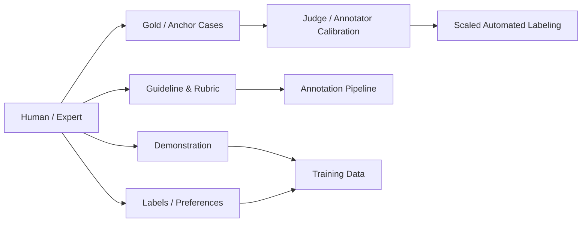
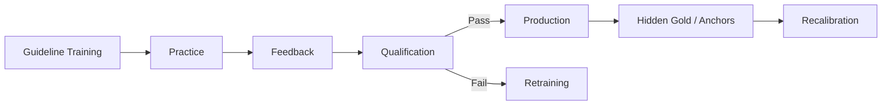
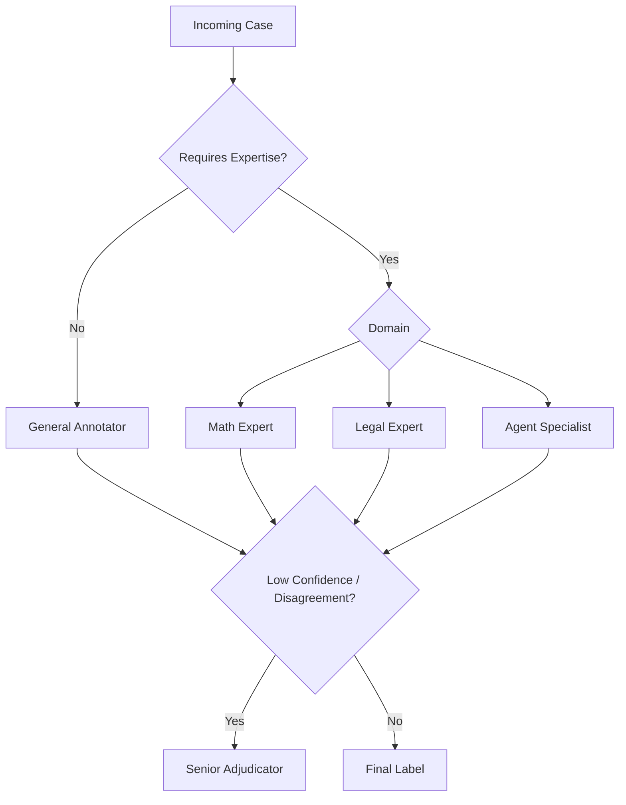

# 第 6 章 Human Data：人工标注、专家标注与质量控制

> 所属体系：[`LLM_Agent_Data_Knowledge_System.md`](../LLM_Agent_Data_Knowledge_System.md)
>
> 前置章节：[`第 5 章 Tool-use Data 与 Agent Trajectory Data`](./05_Tool_Use_and_Agent_Trajectory_Data.md)
>
> 关联章节：[`第 3 章 Preference Data`](./03_Preference_Data_Reward_and_Feedback.md)、[`第 14 章 Failure Taxonomy`](./14_Agent_Failure_Taxonomy.md)、[`第 15 章 Grader / Verifier / Judge`](./15_Grader_Verifier_and_LLM_as_a_Judge.md)、[`第 19 章 Governance / Lineage / Reproducibility`](./19_Data_Governance_Lineage_and_Reproducibility.md)
>
> 编辑基础设施：[`Canonical Glossary`](./00_Glossary_and_Notation.md) · [`Canonical Casebook`](./00_Canonical_Casebook.md)
>
> 本章定位：**Human Annotation / Guideline / Gold / IAA / Calibration / Adjudication / Expertise Routing 的 canonical chapter。Label Versioning、Historical Decision 与 Corrected Label 的系统治理归第 19 章。**
>
> 本章核心问题：**Human Data 的价值不在于“有人看过”，而在于把模糊的人类判断变成定义清楚、边界稳定、质量可测、分歧可解释的监督信号。**

---

# 6.0 2026 年为什么仍然需要 Human Data？

随着 Synthetic Data、自动 Verifier 和 LLM-as-a-Judge 越来越强，人工的角色正在变化，但没有消失。

因为很多目标本身仍然需要人来定义：

```text
什么叫真正满足用户意图？
什么时候应该澄清？
两个都正确的回答哪个更自然？
某个专业判断是否符合领域标准？
一个 Agent 是否做了不必要的高风险操作？
```

所以 Human Data 越来越从：

```text
“大规模逐条手工生产”
```

转向：

```text
定义标准
+
提供高质量示范
+
标关键边界样本
+
建立 Gold
+
校准自动 evaluator
+
处理 disagreement / high-risk cases
```



最重要的变化不是“人工变少”，而是：

> **把人类最稀缺的判断能力用在定义标准和处理高信息量样本上。**

---

# 6.1 Human Data 不只是“人工打标签”

常见 Human Data 至少包括：

### Human-written Demonstration

```text
Prompt → Expert-written Response
```

适合 SFT、reference、style exemplar。

### Human Preference

```text
A vs B → A better / Tie / Both bad
```

适合 Preference / RM / Judge calibration。

### Human Rubric Scoring

```text
Correctness
Instruction Following
Safety
Clarity
```

### Process / Trajectory Annotation

例如：

```text
first error
wrong tool
observation grounding failure
premature stop
```

### Human Correction

```text
Model Output
↓
Human Edit
↓
Corrected Output
```

### Adjudication

对分歧、边界和高风险样本做高可信裁决。

因此 Human Data 可以同时提供：

```text
Demonstration
Preference
Label
Correction
Rubric
Gold
```

它不是一种单一数据格式。

---

# 6.2 谁来标：Staffing 本身就是数据设计

“人工”不是同一个能力等级。

| 角色 | 典型能力 | 更适合 |
|---|---|---|
| General / Crowd Annotator | 规模大、成本低 | 明显分类、简单偏好、格式检查 |
| Trained Annotator | 熟悉专项 guideline | Instruction、Agent trace、复杂 rubric |
| Domain Expert | 专业知识强 | 医疗、法律、数学证明、专业代码 |
| Senior Adjudicator | 解释标准、处理冲突 | Gold、边界样本、规则更新 |

如果一个任务需要：

```text
专业知识
复杂因果分析
长 Agent trace
业务规则
高风险判断
```

却交给不具备相应知识的人，可能得到：

> **高一致性的错误标签。**

所以 Human Data 质量的第一步不是 QC，而是：

> **让正确的人判断正确的问题。**

---

# 6.3 Annotation Guideline 是 Human Data 的核心接口

如果大量 annotator 分歧，不应该第一时间归因：

```text
“人不行”
```

应先检查：

```text
任务定义清楚吗？
label 边界清楚吗？
优先级冲突吗？
有没有 abstain？
有没有 boundary examples？
```

一份成熟 guideline 至少应该有：

```text
Task Definition
Label Definitions
Decision Priority
Positive Examples
Negative Examples
Boundary Cases
Abstain / Escalation Rule
Required Evidence
Common Confusions
```

差的 guideline：

```text
“请判断回答是否优秀。”
```

更好的 guideline：

```text
1. 先判断真实任务是否完成
2. 再判断是否违反显式约束
3. 再检查未授权 side effect
4. 再检查 observation grounding / process
5. 前面相同时再比较 efficiency / style
```

这会显著稳定 decision boundary。

---

# 6.4 Boundary Case 比典型例子更重要

真正决定标注质量的通常不是：

```text
明显正确
明显错误
```

而是：

```text
主结论对但漏一个约束
任务本身不可完成
两个候选都不好
工具成功但任务没完成
正确但有高风险副作用
应该澄清还是可以推断
```

所以 guideline 中最有价值的一部分往往是：

> **“容易混淆的边界在哪里，以及为什么这样裁决。”**

成熟团队会持续把 adjudication 中反复出现的争议案例沉淀成新的 boundary examples。

---

# 6.5 Label Schema：标签空间决定未来能分析什么

如果只有：

```text
Good / Bad
```

未来只能统计：

```text
多少 Good / Bad
```

如果拆成：

```text
correctness
instruction_following
tool_selection
argument_correctness
observation_grounding
verification
safety
efficiency
```

后面才能做能力诊断和数据策略。

常见 label 形式：

### Binary

```text
Pass / Fail
```

### Ordinal

```text
1–5
```

### Multi-label

```text
missing_constraint = true
premature_stop = true
```

### Hierarchical

```text
Tool Use
└── Argument Error
    └── Wrong Entity
```

但要注意概念所有权：完整 Agent Failure Taxonomy 统一归第 14 章。本章负责的是：

> **如何让人稳定地按照既定 taxonomy 产生可靠标签。**

---

# 6.6 Abstention：允许“不知道”是质量机制，不是失败

强迫 annotator 对所有样本二选一，会制造伪标签。

应该允许：

```text
Cannot Judge
Insufficient Information
Ambiguous
Need Expert
Tie
Both Bad
```

这类结果本身很有价值，因为它可以触发：

```text
Expert Routing
Adjudication
Rubric Revision
Hard-case Mining
```

所以 Human Data 的目标不应该是：

```text
100% forced coverage
```

而应该是：

> **最大化 reliable label yield。**

---

# 6.7 Gold Set：它为什么叫 Gold？

Gold Set 不是因为：

```text
“某个资深的人说了算”
```

而是因为它通常具有：

```text
清晰定义
高资质标注
多方复核
充分 evidence
必要时 adjudication
稳定版本
```

Gold 常用于：

```text
Annotator Training
Qualification
Hidden QC
Judge Calibration
Regression
Rubric Validation
```

好的 Gold 应包含：

```text
Easy sanity cases
Medium cases
Boundary cases
Known traps
Historical disagreements
High-severity cases
```

如果 Gold 全是简单题，98% accuracy 并不能证明真实生产能力。

Gold 的系统版本治理、change history 与 lineage 统一见第 19 章。

---

# 6.8 Inter-Annotator Agreement：一致不等于正确

最简单的一致率：

$$
Agreement=\frac{\#\text{agreed items}}{\#\text{items}}
$$

更常见的统计还包括：

```text
Cohen's Kappa
Fleiss' Kappa
Krippendorff's Alpha
```

Cohen's Kappa：

$$
\kappa=\frac{p_o-p_e}{1-p_e}
$$

其中：

- $p_o$：观察到的一致率；
- $p_e$：按标签边际分布估计的随机一致率。

但必须记住：

```text
High Agreement
≠
High Validity
```

如果 guideline 本身错了，所有人完全一致也可能只是：

> **稳定地执行错误标准。**

所以 Human Data 至少要同时看：

```text
Agreement
Gold Accuracy
Adjudication Rate
Abstention Rate
```

而不是只看 IAA。

---

# 6.9 Calibration：标注员不能直接“上线生产”

一个成熟流程通常是：



Calibration 不是让人背答案，而是对齐：

```text
Label Definition
Priority
Boundary
Evidence Standard
Abstain Rule
```

长期项目还要防 Annotation Drift：

```text
Week 1 按 guideline
↓
Week 4 形成口头习惯
↓
Week 8 不同班组出现不同标准
```

因此需要固定 anchor cases 与周期性 recalibration。

---

# 6.10 Adjudication：分歧不是简单多数投票

三个人：

```text
A → Good
B → Bad
C → Bad
```

不一定应该机械地：

```text
Final = Bad
```

因为 A 可能掌握关键领域规则。

Adjudication 的目的不是“再投一次票”，而是：

> **用更高资质、更完整 evidence 和更明确的 rule 解决语义冲突。**

常见进入 adjudication 的条件：

```text
Annotator Disagreement
Low Confidence
Need Expert
High Severity
Judge-Human Conflict
Gold Mismatch
New Failure Type
```

并且 adjudication 应该产生两个输出：

```text
Final Label
+
Guideline / Boundary Example Update
```

否则同一种分歧还会继续发生。

---

# 6.11 Majority Vote：什么时候有用，什么时候危险？

适合：

```text
低风险
简单主观偏好
普通语言质量判断
```

不适合机械使用在：

```text
领域专业题
高风险判断
事实性复杂推理
少数专家才知道标准的任务
```

所以：

> **Annotator count 不能替代 annotator competence。**

---

# 6.12 Confidence：可以记录，但不要当真值

Annotator 可以额外给：

```text
high / medium / low
```

或数值 confidence。

它可以帮助：

```text
挑 adjudication case
识别 guideline ambiguity
分析 human-judge disagreement
构造 hard set
```

但：

```text
High Confidence
≠
Correct
```

所以 confidence 是 routing signal，而不是 gold certificate。

---

# 6.13 Annotation Provenance：本章只定义“标注现场需要记录什么”

一条 Human Label 最好至少知道：

```text
annotator role / anonymized id
guideline version
annotation UI version
timestamp
confidence
abstain / escalation
adjudication status
evidence reference
```

如果有 AI assistance，还应知道：

```text
AI suggestion version
whether annotator saw it before judgment
human final decision
```

这里的重点是：

> **Human judgment 不是脱离上下文的一个 label，它是在某个 guideline、UI、evidence 和 assistance condition 下产生的 measurement。**

至于 Label Versioning、Corrected Labels、Historical Decision、Audit Trail、Re-score / Re-run 的系统治理，统一交给第 19 章，不在本章重复展开。

---

# 6.14 Pilot：不要一上来标 10 万条

推荐先做：

```text
100–1000 cases
```

重点看：

```text
分歧最高的 label
高 abstain case
耗时异常的 case
高置信但错的 case
新 failure pattern
UI friction
专家需求
```

Pilot 的目标不是估计最终产能，而是验证：

```text
Schema 能不能标？
Guideline 能不能执行？
证据够不够？
普通标注员能不能判断？
哪些 case 必须 escalation？
```

所以：

> **Pilot 是 annotation design experiment。**

---

# 6.15 Annotation UI 也是数据质量的一部分

例如 Pairwise UI 如果永远：

```text
A 在左
B 在右
```

会引入 position bias。

Agent trace UI 如果默认只展开 final response，而 action / observation 要层层点开，标注员很容易只看最后一句话。

好的 UI 会支持：

```text
Candidate Position Randomization
Rubric Always Visible
Action / Observation 分块
Before / After State
Evidence Highlight
Quick Abstain / Escalate
Trace Navigation
```

因此 UI 版本也可能影响 label distribution。

---

# 6.16 质量控制应该贯穿生产过程

Human Data QC 常见机制：

### Qualification Gate

上岗前通过准入测试。

### Hidden Gold

生产中混入已知高可信 case。

### Repeated Item

同一 annotator 隔一段时间再次看到相同样本，检查 self-consistency。

### Cross Annotation

同一 item 多人独立判断。

### Distribution Monitoring

观察 annotator 是否出现异常 label pattern。

### Time / Interaction Anomaly

极端过快、从不展开 evidence 等可以作为 audit signal，但不能单独判定低质量。

QC 的目标不是“抓坏标注员”，而是：

> **尽早发现系统性 decision-boundary drift。**

---

# 6.17 Annotator Quality 不应该压成一个黑箱分数

可以观察：

```text
Gold Accuracy
Agreement with Adjudicated Labels
Self-consistency
Abstain Calibration
Rubric-specific Accuracy
Domain-specific Accuracy
```

但比一个总分更有价值的是：

```text
这个人擅长什么？
在哪个 label 上容易错？
什么类型需要升级专家？
```

即：

> **Annotator Capability Profile。**

这为 Expertise Routing 提供基础。

---

# 6.18 Expertise Routing：不同 case 给不同的人



这比：

```text
所有数据 → 同一 workforce
```

更合理，也更省成本。

---

# 6.19 Human + AI：人工可以被辅助，但不能被默认替代

常见三种模式：

### Pre-label

```text
LLM proposes → Human accepts / edits
```

优点是快，风险是 Automation Bias。

### Evidence Assistant

模型只帮助：

```text
抽取约束
总结长 trace
定位相关 evidence
```

不提前给 final label。

这通常更不容易产生锚定。

### Second Opinion

```text
Human independent label
↓
AI second opinion
↓
Conflict → review
```

高风险任务通常更适合这一类。

如果引入 AI-assisted annotation，应该实验比较：

```text
Human-only
vs
AI-assisted Human
```

至少看：

```text
Accuracy
Speed
Agreement
Bias Pattern
Escalation Rate
```

而不是只看 throughput。

---

# 6.20 Human、Verifier、LLM Judge 如何分工？

本章不重新定义 evaluator taxonomy，统一见第 15 章。

Human Data 视角只需要记：

```text
能客观执行验证
→ 优先 Verifier

已有稳定 rubric、规模大
→ LLM Judge 可以放大应用

标准尚不稳定 / 高风险 / 新 failure / 专业领域
→ Human / Expert
```

最成熟的系统往往是：

```text
Verifier
↓
LLM Judge
↓
Human / Expert Escalation
```

而不是：

```text
Human OR AI
```

---

# 6.21 人工预算应该花在哪？

面对百万 rollout，人工不应均匀撒出去。

常见 sampling：

```text
Random Sampling
→ 估总体

Stratified Sampling
→ 保证不同 domain / capability / risk 被覆盖

Disagreement Sampling
→ evaluator 不一致

Uncertainty Sampling
→ 模型 / judge 边界 case

Risk-based Sampling
→ 高 severity

Failure-driven Sampling
→ 新 failure / regression / complaint
```

但 sampling 的正式数据价值与 hard-case acquisition 逻辑统一交给第 9、18 章。

本章只强调：

> **Human review 应集中到“人工判断最能改变决策”的样本。**

---

# 6.22 Cost、Throughput、Quality：不同数据需要不同质量等级

Human pipeline 永远受：

```text
Cost
Throughput
Quality
```

三角约束。

所以可以分 tier：

```text
普通训练数据
→ single label + hidden gold

重要训练 / preference data
→ double label + disagreement review

核心 benchmark / judge calibration
→ expert multi-label + adjudication
```

这比所有数据统一使用最高成本流程更实际。

---

# 6.23 Agent Annotation 为什么特别难？

因为标注员往往需要同时理解：

```text
User Goal
Task Constraints
Tool Set
Tool Schema
Initial State
Actions
Observations
Final Environment State
Final Response
```

所以 Agent annotation 最容易出现：

```text
只看 final answer
忽略实际 action
忽略参数实体
忽略 observation
忽略 side effect
把 infrastructure failure 当 model failure
```

因此 Agent Data 非常需要：

```text
Structured UI
Evidence Package
Layered Rubric
Abstention
Expert Escalation
```

完整 failure label 本身由第 14 章定义。

---

# 6.24 Canonical Case：C1 Order / Refund Agent 的人工 Gold

任务：

```text
“如果订单 1847 还没发货，就帮我取消；已经发货就不要动。”
```

Episode A：

```text
get_order_status(1847)
→ pending

cancel_order(1847)
→ success

verify
→ cancelled
```

Annotator 可以按结构化 rubric 判断：

```text
Task Feasibility = feasible
Tool Need = yes
Tool Selection = correct
Argument = correct
Observation Grounding = correct
Write Decision = correct
Verification = sufficient
Task Outcome = success
Forbidden Side Effect = none
```

Episode B：

```text
get_order_status(1847)
→ shipped

cancel_order(1847)
```

Human annotation 的关键不是只写：

```text
Bad
```

而是基于第 14 章 taxonomy 识别：

```text
Observation Grounding / Policy Failure
```

如果工具结果其实没有进入模型 context，则 annotator 应升级 evidence review，而不是直接标 Model Failure。

这就是为什么 Human annotation 需要看到足够 evidence。

---

# 6.25 Human Data 的真正产物不只是 Final Label

一次高成本人工判断最好保留：

```text
Raw Human Judgment
Confidence
Evidence Reference
Disagreement
Adjudication
Correction
```

然后可以派生：

```text
SFT
Preference
Failure Labels
Eval Gold
Judge Calibration
Hard-case Pool
```

所以：

> **高价值 Human Data 应被视为可复用 supervision asset，而不是一次性 label。**

系统级 Derived View 与 lineage 统一见第 19 章。

---

# 6.26 常见失败模式

1. Guideline 只有一句模糊描述。
2. 只给典型例子，不给 boundary cases。
3. 普通 annotator 被迫判断专业问题。
4. 不允许 abstain / tie / both bad。
5. Gold Set 太简单。
6. 只看 IAA，不看 Gold Accuracy。
7. 项目结束后才做 QC。
8. Adjudication 只改 label，不更新 guideline。
9. AI 预标造成 automation bias。
10. Annotation UI 隐藏关键 evidence。
11. 所有 case 都用同一 workforce。
12. 所有数据都用同一质量 tier。
13. Agent 标注只看 Final Response。
14. Infrastructure failure 被错标成 Model Failure。
15. 把“标完多少条”当作项目成功，而没有验证 downstream value。

Label version overwrite、historical decision mutation 等治理问题不在本章重复列为主 failure；统一见第 19 章。

---

# 6.27 从数据岗位视角，这一章实际会做什么？

```text
设计 label schema
写 annotation guideline
制作 boundary cases
设计 annotation UI
做 pilot
分析 disagreement
定义 Gold / Anchor Set
培训 annotator
做 qualification
插 hidden gold
监控 Gold Accuracy / IAA / abstention
做 expertise routing
组织 adjudication
评估 AI-assisted annotation
构建 annotator capability profile
设计 human-review sampling
沉淀 high-value human supervision assets
```

真正成熟的 Human Data 工作不是：

> “组织人标了 20 万条。”

而是能回答：

```text
标什么？
为什么这样标？
谁有资格标？
证据是否够？
一致性怎样？
正确性怎样？
边界如何处理？
什么时候需要专家？
人工怎样校准自动系统？
```

---

# 6.28 本章关键词

| 术语 | 一句话理解 |
|---|---|
| Human Data | 人产生、评价、修正或裁决的监督数据 |
| Annotation Guideline | 规定 label 语义与决策边界的规范 |
| Boundary Case | 最容易暴露 label 边界与 guideline 歧义的样本 |
| Abstention | 证据不足时拒绝强行给确定标签 |
| Gold Set | 经过高可信流程确定的 reference labels |
| IAA | 标注员之间的一致性 |
| Calibration | 让 annotator decision boundary 对齐 guideline |
| Adjudication | 用更高资质 / 更多证据解决标注分歧 |
| Hidden Gold | 生产任务中暗插的已知高可信样本 |
| Annotation Drift | 标注标准随时间逐渐漂移 |
| Automation Bias | 人被 AI 预标答案锚定 |
| Expertise Routing | 将不同 case 分配给最合适的 annotator |
| Annotator Capability Profile | 描述 annotator 在不同任务 / rubric 上的可靠性 |
| Annotation Provenance | 描述某个人类判断在什么规则和证据条件下产生 |
| Reliable Label Yield | 真正可靠标签的产出，而不是强制覆盖率 |

---

# 6.29 面试 / 自检问题

1. 为什么有 LLM Judge 以后还需要 Human Data？
2. Crowd、Trained Annotator、Expert、Adjudicator 的区别是什么？
3. 一份好的 guideline 至少应该包含什么？
4. 为什么 boundary case 比典型例子更关键？
5. 为什么应该允许 abstention？
6. Gold Set 应该如何构造？
7. IAA 高为什么不等于标签一定正确？
8. Calibration 与 Adjudication 分别解决什么问题？
9. Majority Vote 在什么场景下不可靠？
10. 为什么 annotator confidence 不能直接当 correctness？
11. Annotation UI 为什么会影响 label？
12. 怎么持续监控 Annotation Drift？
13. Annotator Quality 为什么不应该只看一个总分？
14. 什么是 Expertise Routing？
15. AI-assisted annotation 有哪些典型 bias？
16. 什么时候应该 Human-only，什么时候适合自动 grader？
17. 人工预算应该优先投入哪些样本？
18. Agent trajectory 为什么比普通文本更难标？
19. Human annotation 如何同时服务 SFT、Preference、Eval 和 Judge calibration？
20. 哪些内容应该由本章讲，哪些治理问题应交给第 19 章？

---

## 6.29.1 一个通用回答框架：如果让你负责 10 万条 Agent 数据标注

```text
1. 明确目标 capability 与 label interface
   ↓
2. 复用 canonical failure / evaluation taxonomy
   ↓
3. 写 guideline + boundary cases
   ↓
4. 做 200–1000 条 pilot
   ↓
5. 分析 disagreement / abstain / time / UI friction
   ↓
6. 修 guideline 和 UI
   ↓
7. 建 workforce / expertise routing
   ↓
8. 建 Gold + qualification
   ↓
9. 批量生产 + hidden QC
   ↓
10. disagreement / high-risk → adjudication
   ↓
11. 沉淀 Gold / correction / preference / calibration assets
   ↓
12. 下游再验证这些人工监督是否真正有价值
```

最关键的一句话：

> **Human Annotation 的目标不是把每条样本“标满”，而是把人类判断变成稳定、可校准、可放大的监督标准。**

---

# 6.30 本章最终要形成的认识

Human Data 的核心链条是：

```text
Human Defines Standard
↓
Guideline / Rubric
↓
Qualified Annotator / Expert
↓
Judgment + Evidence
↓
Agreement / Gold / Calibration
↓
Adjudication
↓
Reliable Supervision
↓
Scale with Verifier / Judge / Synthetic Pipeline
```

因此 Human Data 并不是 Synthetic Data 时代被淘汰的旧方法。

它更像：

> **整个数据系统的标准制定层和高可信锚点。**

下一章进入 Synthetic Data 时，真正的问题不是“怎么摆脱人工”，而是：

> **怎样把少量高可信的人类标准放大成大规模、可验证、具有真实 decision diversity 的合成经验。**
