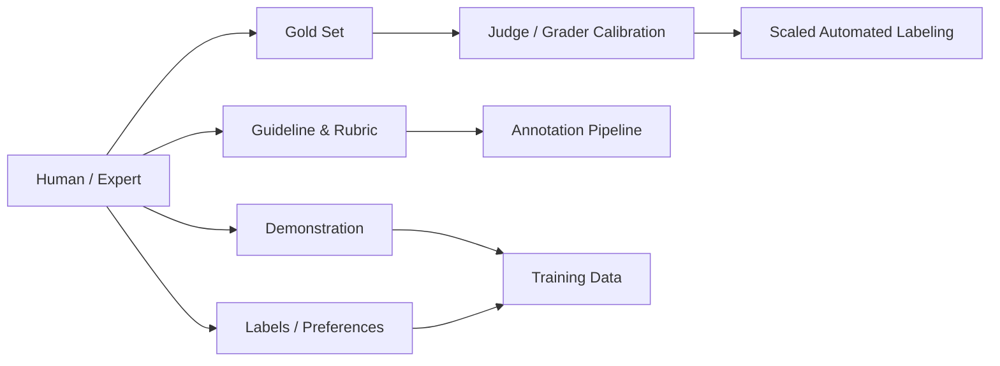
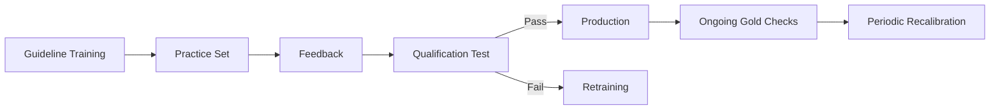
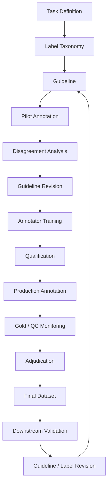
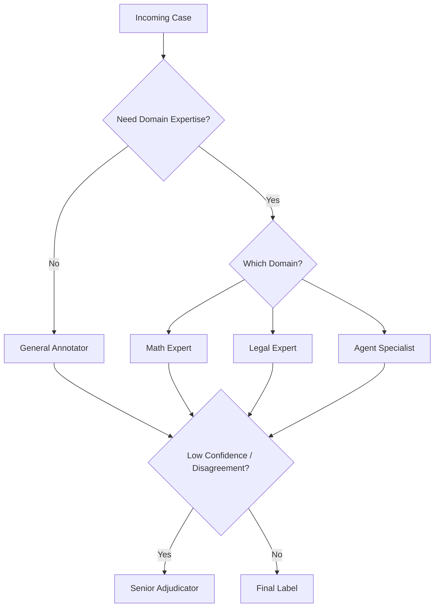
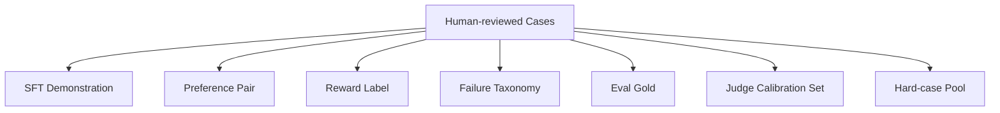

# 第 6 章 Human Data：人工标注、专家标注与质量控制

> 所属体系：[`LLM_Agent_Data_Knowledge_System.md`](../LLM_Agent_Data_Knowledge_System.md)
>
> 前置章节：[`第 5 章 Tool-use Data 与 Agent Trajectory Data`](./05_Tool_Use_and_Agent_Trajectory_Data.md)
>
> 本章目标：理解现代大模型 / Agent 数据生产里，“人工标注”真正负责什么，以及如何把主观判断、专业判断和复杂轨迹评价，转化成稳定、可复现、可审计的数据。
>
> 本章核心问题：**Human Data 的价值不在于“有人看过”，而在于把模糊的人类判断变成定义清楚、质量可控、版本可追踪的监督信号。**

---

# 6.0 为什么 2026 年还需要 Human Data？

看到 Synthetic Data、LLM-as-a-Judge、自动 verifier 越来越强，一个很自然的问题是：

> 还需要人工标注吗？

需要，而且很多时候仍然是不可替代的。

原因不是人工一定比模型聪明，而是**很多目标本身就是由人定义的**。

例如：

```text
这个回答是否符合用户真实需求？
这个解释对初学者是否清楚？
这个 Agent 是否做了不必要的危险操作？
这两个都正确的答案，哪个更自然？
这个场景是否需要澄清？
这个专业结论是否符合领域标准？
```

这些问题不一定存在天然、可执行的“唯一公式”。

因此 Human Data 常承担四类角色：

```text
定义目标
    ↓
提供高质量示范
    ↓
评价模型行为
    ↓
校准自动评价系统
```

可以画成：



所以 Human Data 在现代 pipeline 中并没有消失，而是在从：

> 大规模逐条手工生产

逐渐转向：

> **定义标准 + 标关键样本 + 建 gold + 校准模型 + 处理边界案例。**

---

# 6.1 Human Data 不等于“人工打标签”

人类可以参与的数据形式很多。

---

## 6.1.1 Human-written Demonstration

人工直接写理想答案：

```text
Prompt
↓
Expert-written Response
```

用途：

```text
SFT
few-shot example
gold reference
style exemplar
```

---

## 6.1.2 Human Preference

比较两个或多个候选：

```text
A vs B
→ A better
```

用途：

```text
preference optimization
reward model
judge calibration
ranking analysis
```

---

## 6.1.3 Human Scoring / Rubric Annotation

例如：

```text
Correctness = 4/5
Instruction Following = 5/5
Style = 3/5
Safety = Pass
```

---

## 6.1.4 Human Process Annotation

例如 Reasoning Data：

```text
Step 1 correct
Step 2 correct
Step 3 first error
```

或者 Agent：

```text
Tool selection = correct
Arguments = wrong
Observation grounding = correct
Termination = premature
```

---

## 6.1.5 Human Adjudication

当多个标注员不一致时，由更高资质人员做最终裁决。

```text
Annotator A → label 1
Annotator B → label 2
          ↓
     Adjudicator
          ↓
     Final label
```

---

## 6.1.6 Human Correction

人不只是给标签，也可以直接改模型输出：

```text
Model Output
↓
Human Edit
↓
Corrected Output
```

这类数据特别适合：

```text
SFT
rewrite
correction data
error analysis
```

---

# 6.2 Crowd Annotator、Trained Annotator、Expert 有什么区别？

不能把“人工标注”当成一个统一质量等级。

可以粗略分为：

| 类型 | 特点 | 适合任务 |
|---|---|---|
| Crowd / General Annotator | 成本低、规模大 | 基础分类、明显偏好、格式检查 |
| Trained Annotator | 接受专项培训 | instruction following、复杂 rubric、Agent trace |
| Domain Expert | 专业知识强 | 医疗、法律、数学证明、专业代码 |
| Senior Adjudicator | 处理分歧与规范解释 | gold set、边界案例、规则更新 |

---

## 6.2.1 什么任务不应该交给普通标注员？

如果任务要求：

```text
专业知识
长链路因果分析
复杂数学验证
代码执行理解
行业规则
高风险判断
```

却仍交给普通标注员，表面上会得到大量标签，实际上可能是**高一致性的错误数据**。

例如：

```text
两个数学答案都写得很流畅
```

普通标注员可能更喜欢更有条理的错误答案。

所以 annotation staffing 本身就是数据设计。

---

# 6.3 Annotation Guideline：整个 Human Data Pipeline 的核心

如果一个项目中标注员大量分歧，第一反应不应该是：

> “这些标注员水平不行。”

更应该先检查：

> **任务定义和 guideline 是否真的清楚？**

一个成熟 guideline 至少应该回答：

```text
我们在标什么？
为什么要标？
每个 label 的定义是什么？
边界在哪里？
什么情况不能判断？
冲突时哪个维度优先？
是否允许 abstain？
有没有正例 / 反例？
```

---

## 6.3.1 一个差的 Guideline

```text
请判断回答是否优秀。
```

问题非常大：

```text
什么叫优秀？
正确更重要还是简洁更重要？
漏一个小要求算不算优秀？
语言漂亮但事实错怎么办？
```

---

## 6.3.2 一个更好的 Guideline

例如 Agent trajectory：

```text
第一优先级：任务是否真实完成
第二优先级：是否违反明确约束
第三优先级：是否产生未授权 side effect
第四优先级：是否基于真实 observation
第五优先级：在以上都相同时比较效率
第六优先级：最后比较 final response 的表达质量
```

此时 annotator 的 decision boundary 会稳定很多。

---

## 6.3.3 Guideline 应该包含 Boundary Cases

不要只给典型例子。

真正影响一致性的往往是：

```text
几乎正确但漏一个约束
任务本身不可完成
两个回答都错但一个错得少
调用工具成功但没有真正完成任务
正确回答但极度冗长
模型拒绝，但用户请求其实可完成
```

所以 guideline 最有价值的部分往往不是定义，而是：

> **边界案例及其裁决理由。**

---

# 6.4 Label Taxonomy：标签设计决定后面能分析什么

如果一开始只有：

```text
Good / Bad
```

后面你只能分析：

```text
多少 Good
多少 Bad
```

如果一开始拆成：

```text
correctness
instruction_following
tool_selection
argument_correctness
observation_grounding
verification
safety
efficiency
```

后面才能回答：

```text
模型最常失败在哪？
哪个能力改善了？
哪些 failure 值得生产更多数据？
```

因此 label taxonomy 是一个**面向未来分析能力的 schema design 问题**。

---

## 6.4.1 Binary Label

```text
0 / 1
pass / fail
```

优点：简单。

缺点：信息少。

---

## 6.4.2 Ordinal Label

例如：

```text
1 = 严重错误
2 = 较差
3 = 可接受
4 = 好
5 = 非常好
```

适合连续质量维度。

问题是不同 annotator 对 3、4 的尺度可能不同。

---

## 6.4.3 Multi-label Taxonomy

一条样本可以同时有：

```text
hallucination = true
missing_constraint = true
tool_error = false
premature_stop = true
```

对于 failure analysis 非常有用。

---

## 6.4.4 Hierarchical Label

例如 Agent Failure：

```text
Agent Failure
├── Understanding
├── Planning
├── Tool Use
│   ├── Missing Tool
│   ├── Wrong Tool
│   └── Argument Error
├── Observation
├── Verification
└── Termination
```

层级 taxonomy 可以同时支持粗粒度统计与细粒度诊断。

---

# 6.5 Abstention：允许“不知道”是高质量数据的重要条件

很多数据项目为了追求：

```text
100% coverage
```

要求 annotator 必须选一个 label。

这会制造大量伪标签。

应该允许：

```text
Cannot Judge
Insufficient Information
Ambiguous
Need Expert
Both Bad
Tie
```

这不是标注失败，而是一种有意义的监督信息。

例如：

```text
普通标注员：Need Expert
```

可以把样本自动升级到专家队列。

所以成熟 pipeline 不应该优化：

> 标完率最大化

而是：

> **可靠标签产出率最大化。**

---

# 6.6 Gold Set：什么是“金标”？

Gold Set 是一批经过高可信流程确定的 reference labels。

它的用途包括：

```text
培训标注员
准入考试
线上质量监控
LLM judge calibration
版本回归
规则变更验证
```

Gold 不是因为“某一个人说了算”，而应该因为：

```text
定义清楚
高资质标注
多方复核
必要时 adjudication
证据完整
版本冻结
```

---

## 6.6.1 Gold Set 不应该全是简单题

如果 gold 全是：

```text
A 明显正确
B 明显胡说
```

所有 annotator 都能 99% 正确，但这不能证明他们能处理真实边界案例。

更合理的 gold mixture：

```text
easy sanity cases
medium cases
hard boundary cases
known trap cases
historical disagreement cases
```

---

## 6.6.2 Gold Set 要定期更新吗？

通常要，但不能随意变。

需要区分：

```text
Gold v1
Gold v2
```

并记录：

```text
为什么改？
哪些 label 改了？
是 guideline 变化还是旧 gold 错了？
旧实验使用哪个版本？
```

否则历史结果不可比较。

---

# 6.7 Inter-Annotator Agreement：一致性到底怎么测？

最简单的是 Percent Agreement：

$$
Agreement = \frac{\#\text{一致样本}}{\#\text{总样本}}
$$

例如 100 个 pair 中，两位标注员有 82 个判断一致：

```text
Agreement = 82%
```

但它没有校正“随机一致”。

因此还常用：

```text
Cohen's Kappa
Fleiss' Kappa
Krippendorff's Alpha
```

---

## 6.7.1 Cohen's Kappa

适合两个 annotator 的分类标签。

$$
\kappa = \frac{p_o - p_e}{1-p_e}
$$

其中：

- $p_o$：实际一致率；
- $p_e$：根据标签边际分布推算的随机一致率。

它比 raw agreement 更能说明：

> 标注员是真的达成共识，还是因为大多数样本都属于同一类。

---

## 6.7.2 Fleiss' Kappa

可扩展到多个 annotator。

---

## 6.7.3 Krippendorff's Alpha

更灵活：

```text
多个 annotator
缺失标注
不同 label scale
```

都可以处理。

---

## 6.7.4 IAA 高不一定意味着数据好

假设一个错误 guideline 写得非常明确：

```text
只要回答长于 500 字，就标 Good
```

所有 annotator 可以 100% 一致。

但标签和真实质量毫无关系。

所以：

```text
High Agreement
≠ High Validity
```

一致性只能说明：

> **大家在执行同一个标准。**

不能证明标准本身正确。

---

# 6.8 Calibration：标注员不是上岗就开始生产

一个成熟流程通常包含：



Calibration 的目标是让标注员：

```text
理解 label 定义
理解优先级
熟悉边界案例
形成相似 decision boundary
```

---

## 6.8.1 为什么需要持续 Recalibration？

因为会发生 label drift。

例如一开始：

```text
“回答正确即可标 Good”
```

标了一周之后，人可能逐渐把标准变成：

```text
“回答得漂亮才算 Good”
```

这种漂移往往很慢，人自己意识不到。

因此需要定期插入：

```text
hidden gold
repeated cases
historical anchor cases
```

来检查 decision boundary 是否漂移。

---

# 6.9 Adjudication：分歧不应该被简单平均掉

假设三位 annotator：

```text
A → Good
B → Bad
C → Bad
```

最简单做法是 majority vote：

```text
Final = Bad
```

但对于复杂任务，这可能不够。

为什么？

因为：

```text
A 可能是领域专家
B/C 可能误解了业务规则
```

所以 Adjudication 不是机械投票，而是：

> **用更高资质、更多证据和更明确规则解决真正的语义冲突。**

---

## 6.9.1 哪些 Case 应进入 Adjudication？

可以设置：

```text
annotator disagreement
low confidence
Need Expert
high business risk
judge-human conflict
gold mismatch
new unseen failure type
```

---

## 6.9.2 Adjudication 结果不仅修改 Label，还应该改 Guideline

如果同一种分歧反复发生：

```text
几十个 annotator 都在同一个边界卡住
```

真正的问题往往不是人，而是规则。

因此 adjudication 应产生两类产物：

```text
Final Label
+
Guideline Update / New Example
```

这样系统才会越来越稳定。

---

# 6.10 Majority Vote 什么时候有用？

对于：

```text
主观但简单的语言偏好
明显分类
低风险任务
```

多标 + majority vote 很实用。

例如 5 人评价：

```text
A better: 4
B better: 1
```

可以较可靠地聚合。

但以下场景要谨慎：

```text
领域专业题
少数专家知道正确答案
高风险判断
事实性强的复杂推理
```

此时“多数人觉得”不一定等于正确。

---

# 6.11 Annotation Confidence：为什么要记录置信度？

让 annotator 除 label 外再给：

```text
high / medium / low confidence
```

或：

```text
0-1 confidence
```

可以帮助：

```text
挑 adjudication case
识别 guideline ambiguity
分析 judge-human disagreement
构造 hard set
```

但要注意：

> Annotator self-confidence 不是 correctness。

有人可能错得很自信。

所以 confidence 只是一个辅助信号。

---

# 6.12 Label Provenance：一个 Label 到底是谁、怎么产生的？

高质量数据不能只有：

```json
{"label":"good"}
```

更完整的 provenance 应包括：

```json
{
  "label": "good",
  "annotator_type": "trained_generalist",
  "annotator_id": "anon_017",
  "guideline_version": "v3.2",
  "annotation_time": "...",
  "confidence": "high",
  "adjudicated": false,
  "evidence": "..."
}
```

如果是 AI 辅助：

```text
judge_model_version
judge_prompt_version
human_final_decision
```

也应该保留。

---

# 6.13 Label Versioning：标签会变，历史实验不能跟着偷偷变

这是数据治理里非常关键的问题。

假设一个数据集：

```text
v1 labels
```

后来复查发现 100 条有错误，得到：

```text
v2 corrected labels
```

正确做法不是：

```text
把旧文件覆盖掉
然后假装一直都是这些标签
```

而应该明确：

```text
label_v1
label_v2
change_reason
reviewer
changed_at
```

并重新计算需要更新的统计。

---

## 6.13.1 为什么“重新计分”与“重新做决策”必须区分？

假设一个 selector 当时是基于 v1 信息做的历史决策：

```text
Chosen = A
```

后来 gold label 从：

```text
A correct
```

修正为：

```text
A wrong
```

如果你想评价“历史 selector 在新 gold 下表现如何”，正确操作是：

```text
保持历史选择 A 不变
↓
用 corrected labels 重新计分
```

而不是：

```text
重新运行 selector
↓
得到新的 B
↓
再拿 B 和 corrected labels 比
```

后者改变了原来的实验对象。

这就是：

> **Decision freeze 与 Label correction 是两个不同维度。**

---

## 6.13.2 研究经验映射：Corrected Labels 与 Frozen Decisions

在你已有的 RoTFuse / selector 分析中，就出现过非常典型的标签治理问题：历史 selector 的决策已经冻结，但后续 corrected labels 发生变化。

这种情况下科学上正确的做法是：

```text
Frozen Decisions
      ↓
keep unchanged
      ↓
Corrected Gold Labels
      ↓
Re-score historical decisions
```

这类实践非常适合映射到真实数据岗位，因为它体现的不是某个具体算法，而是三项数据治理能力：

```text
label versioning
experiment immutability
metric recomputation
```

也就是说：

> **标签可以修正，历史决策可以重评，但不能为了让结果更好而把历史决策一起重做。**

这是一条很重要的实验审计原则。

---

# 6.14 Human Annotation Pipeline：一套完整流程

可以抽象为：



这张图最重要的是：

> **Annotation guideline 不是一次写完，而是通过 pilot → disagreement → adjudication 不断迭代。**

---

# 6.15 Pilot：不要一上来就标 10 万条

一个非常常见的工程错误是：

```text
需求确定
↓
直接外包 100k 样本
```

结果标到一半才发现：

```text
标签定义有歧义
guideline 漏了关键边界
数据 UI 信息不全
某些任务需要专家
```

正确方法通常是先 pilot：

```text
100-1000 cases
```

重点分析：

```text
分歧最多的标签
耗时最长的样本
高 abstain case
高置信但错误 case
annotation UI 问题
新 failure category
```

然后再扩大规模。

---

# 6.16 Annotation UI：界面也会影响 Label

这是经常被低估的一点。

例如 pairwise preference：

```text
A 永远在左边
B 永远在右边
```

可能产生 position bias。

Agent trace 如果 UI 默认只展开 final response，而 tool trace 需要手动点开，annotator 可能偷懒只看最终文字。

因此 UI 应支持：

```text
候选随机换位
关键证据高亮
完整 trace 查看
tool call / observation 分块
环境状态 before / after
rubric 固定显示
快捷 abstain
```

所以 annotation UI 也是数据质量系统的一部分。

---

# 6.17 质量控制：不要只在最后抽检

QC 应该贯穿整个流程。

---

## 6.17.1 Qualification Gate

上岗前通过准入测试。

---

## 6.17.2 Hidden Gold

生产中随机混入已知答案样本。

---

## 6.17.3 Repeated Item

同一 annotator 隔一段时间重复看到同一 case，检查 self-consistency。

---

## 6.17.4 Cross Annotation

同一 case 多人独立标注。

---

## 6.17.5 Time-based Anomaly

例如：

```text
正常平均一条 45 秒
某 annotator 平均 2 秒
```

可能说明快速乱标。

但不能单独依据时间淘汰，因为有些 annotator 熟练度高。

---

## 6.17.6 Label Distribution Drift

如果某 annotator：

```text
95% 都标 Good
```

而全体平均是 55%，需要调查。

可能是：

```text
样本分配不同
理解偏差
偷懒
```

不能直接下结论。

---

# 6.18 Annotator Quality Score 怎么设计？

可以综合：

```text
gold accuracy
agreement with adjudicated labels
consistency
abstain calibration
speed anomaly
rubric-specific accuracy
```

但不要简单形成一个黑箱总分后淘汰。

更有价值的是知道：

```text
这个人在哪类任务上可靠？
在哪个标签上经常错？
是否适合更高难度任务？
```

也就是建立 annotator capability profile。

---

# 6.19 Expertise Routing：不同数据给不同的人

假设数据中有：

```text
80% 普通问答
10% 数学
5% 法律
5% Agent 边界案例
```

全部交给同一批 annotator 并不合理。

可以建立：



这就是 expertise routing。

---

# 6.20 Human + AI：人工不一定从零开始标

越来越常见的是：

```text
LLM 先给预标
↓
Human Review
↓
Accept / Edit / Reject
```

优点：

```text
降低成本
提高速度
让人聚焦边界案例
```

但风险也很明显：

> **Automation Bias**

人看到模型先给的答案后，容易被锚定。

因此要做实验比较：

```text
Human-only
vs
AI-assisted Human
```

看：

```text
accuracy
speed
disagreement
systematic bias
```

不能因为 AI-assisted 更快，就默认更好。

---

# 6.21 Model-assisted Annotation 的三种常见模式

## 1. Pre-label

```text
Model proposes label
Human confirms / edits
```

## 2. Evidence Assistant

模型不直接给最终标签，只帮助：

```text
提取关键约束
总结 trace
定位可能错误
```

最后由人判断。

这种方式通常比直接给答案更不容易产生锚定。

## 3. Second Opinion

人先独立标，再让模型提供第二意见。

如果冲突：

```text
进入复核
```

这在高风险数据里更稳妥。

---

# 6.22 Human vs LLM Judge：谁应该做最终裁判？

没有统一答案。

可以按任务分：

### Rule / Verifier 最优

如果可以客观验证：

```text
exact match
unit test
database state
schema validity
```

优先使用 verifier。

### Expert Human 最优

如果需要：

```text
高风险专业判断
复杂边界规则
新型 failure
```

### LLM Judge 最优

如果：

```text
规模大
任务相对稳定
已有 gold 校准
错误成本可控
```

最成熟的做法通常是 hybrid：

```text
Verifier
+
LLM Judge
+
Human / Expert Escalation
```

---

# 6.23 Sampling：人工预算应该花在哪？

如果有 100 万条模型 rollout，不可能全人工看。

所以需要 sampling strategy。

---

## 6.23.1 Random Sampling

用于估计总体质量。

---

## 6.23.2 Stratified Sampling

按：

```text
domain
language
difficulty
model version
failure type
tool type
```

分层抽样，避免只看到主流分布。

---

## 6.23.3 Uncertainty Sampling

优先标模型 / judge 最不确定的样本。

---

## 6.23.4 Disagreement Sampling

例如：

```text
Judge A ≠ Judge B
Model prediction ≠ verifier
Human ≠ LLM judge
```

这些 case 通常信息密度很高。

---

## 6.23.5 Risk-based Sampling

高风险业务优先人工复核。

---

## 6.23.6 Failure-driven Sampling

优先标：

```text
线上投诉
regression
高频失败
新 failure type
```

这会自然连接到后面的 Data Flywheel。

---

# 6.24 Cost、Throughput、Quality：永远是三角权衡

Human Data 生产不只看质量。

真实项目会同时受：

```text
成本 Cost
速度 Throughput
质量 Quality
```

约束。

例如：

```text
专家双人复核 + adjudication
```

质量很高，但成本巨大。

所以不同数据层级可以使用不同流程：

```text
普通数据 → 单标 + hidden gold
重要训练数据 → 双标 + disagreement review
核心 eval gold → 专家多标 + adjudication
```

这叫 risk-based quality tiering。

---

# 6.25 人工标注 Agent Data 为什么特别难？

因为 annotator 不再只看一段文字。

可能需要同时理解：

```text
User Goal
System Constraint
Available Tools
Tool Schema
Initial Environment State
Trajectory
Tool Calls
Observations
Final Environment State
Final Response
```

这对 cognitive load 要求非常高。

---

## 6.25.1 Agent Annotation 最容易漏看的几个地方

### 1. Tool Call 发生了没有

模型说完成不代表执行。

### 2. 参数对象对不对

例如更新了错误会议。

### 3. Observation 是否真的支持后续结论

### 4. 最终环境是否改变

### 5. 是否有 side effect

### 6. 是否重复执行非幂等 write action

### 7. 任务本身是否可完成

因此 Agent annotation guideline 往往必须提供**结构化 UI 与逐层 rubric**。

---

# 6.26 Agent Annotation Rubric 示例

可以设计成：

```text
A. Task Feasibility
- feasible
- infeasible
- unclear

B. Tool Necessity
- tool needed
- tool not needed

C. Tool Selection
- correct
- wrong

D. Arguments
- correct
- partially correct
- wrong

E. Observation Grounding
- grounded
- ignored / contradicted

F. Execution Verification
- verified
- not verified
- not applicable

G. Final Task Outcome
- success
- partial
- failure

H. Side Effect
- none
- acceptable
- harmful

I. Failure Attribution
- model
- tool
- harness
- environment
- task infeasible
```

这样的 schema 后续可以直接用于：

```text
training data
failure analysis
benchmark
reward design
regression monitoring
```

---

# 6.27 Privacy 与 Sensitive Data

Human annotation 往往意味着真实用户数据被更多人看到。

所以需要考虑：

```text
PII removal
redaction
least-privilege access
annotator access logging
data retention
sensitive-domain routing
```

尤其真实 Agent trace 可能包含：

```text
邮件
日历
文件
订单
联系方式
账号信息
```

这类数据不能因为“只是做标注”就忽视隐私边界。

---

# 6.28 Data Leakage：Annotator 也可能造成 Eval 污染

如果同一批 annotator 同时参与：

```text
训练数据生产
benchmark gold 标注
```

又能看到测试题，可能产生间接泄漏。

更严格的体系会区分：

```text
training annotation pool
evaluation annotation pool
hidden benchmark pool
```

并控制访问。

---

# 6.29 Annotator Disagreement 本身就是数据

不要只把 disagreement 当噪声。

高 disagreement case 往往意味着：

```text
guideline 模糊
任务本身主观
信息不足
存在多解
模型输出位于 decision boundary
```

所以可以把 disagreement rate 当作：

```text
ambiguity signal
hardness signal
rubric quality signal
```

高分歧样本特别适合：

```text
做 hard eval
改 guideline
构造 preference boundary data
训练 calibrated judge
```

---

# 6.30 “一致”与“正确”必须分开看

一个成熟的数据质量 dashboard 至少要同时有：

```text
Agreement
Gold Accuracy
Adjudication Rate
Abstention Rate
Label Distribution
Time per Item
Domain Breakdown
```

其中：

```text
Agreement → 大家是否一致
Gold Accuracy → 是否接近可靠标准
Abstention → 是否有大量难判断样本
Adjudication Rate → guideline 是否存在边界问题
```

不能只看一个指标。

---

# 6.31 Annotation Drift：数据生产时间越长，规则越容易变形

长期项目可能出现：

```text
Week 1: 严格执行 guideline
Week 4: 形成口头习惯
Week 8: 不同班组各自形成版本
```

所以需要：

```text
定期 calibration
统一 change log
固定 guideline version
anchor cases
cross-team audit
```

如果 guideline 更新，必须记录：

```text
从哪个日期生效
旧数据是否需要 relabel
哪些指标不可直接横比
```

---

# 6.32 Relabel：什么时候值得重新标？

不应该因为发现 1 条错标就全部重标。

可以根据：

```text
error rate
label importance
systematic vs random error
是否影响核心结论
是否集中于某个 batch / annotator / domain
```

决定。

例如：

```text
错误随机且 <0.1%
```

可能只需记录。

如果：

```text
某个 guideline 解释反了
导致一个月的 Tool Verification 标签全部错
```

就需要系统 relabel。

---

# 6.33 Relabel 后如何保证实验可审计？

需要保存：

```text
old_label
new_label
reason
reviewer
version
```

并明确：

```text
哪些实验使用 v1
哪些实验使用 v2
```

如果论文结果更新，应说明：

```text
旧结果是否重算
哪些结论改变
哪些结论不变
```

这也是数据科学与科研实验共通的 reproducibility 要求。

---

# 6.34 一个完整案例：给 Agent Trajectory 做人工 Gold

任务：

```text
“如果订单 1847 还没发货，就帮我取消；如果已经发货，不要取消，只告诉我状态。”
```

Agent trajectory：

```text
search_order(1847)
→ status = pending

cancel_order(1847)
→ cancellation_success = true

Final:
订单已经取消。
```

Annotator 不应该只标：

```text
Good
```

而可以拆成：

```text
Task Feasible = yes
Tool Needed = yes
Search Tool = correct
Search Argument = correct
Observation Grounding = correct
Cancel Decision = correct
Cancel Argument = correct
Execution Success = yes
Final-state Verified = yes
Final Response = correct
Task Success = yes
Side Effect = none
```

如果另一个 trajectory：

```text
search_order(1847)
→ status = shipped
cancel_order(1847)
→ error
```

那么应该标：

```text
Observation Grounding = wrong
Policy Decision = wrong
Task Success = failure
Failure Attribution = model
```

这类结构化 gold 才能真正支持后续 failure analysis。

---

# 6.35 Human Data 如何转成不同训练信号？

同一批人工标注可以派生：



因此高成本人工数据最好不要只服务一个下游。

应该尽量保存原始 evidence 和结构化标签，便于复用。

---

# 6.36 常见失败模式

### 失败 1：Guideline 只有一句话

标注员只能凭感觉。

### 失败 2：只给典型正例，没有边界案例

上线后分歧集中爆发。

### 失败 3：普通标注员被迫判断专业问题

可能得到高一致性的错误标签。

### 失败 4：所有 case 必须二选一

制造伪 preference。

### 失败 5：Gold Set 太简单

无法检测真实能力差异。

### 失败 6：只看 IAA，不看 Gold Accuracy

一致不等于正确。

### 失败 7：只在项目结束后抽检

发现问题时已经标了几十万条。

### 失败 8：Adjudication 只改 label，不改 guideline

同类分歧反复发生。

### 失败 9：AI 预标导致 Automation Bias

人只是机械点 Accept。

### 失败 10：不记录 Guideline Version

后续无法解释 label drift。

### 失败 11：Corrected Label 直接覆盖旧 Label

历史实验失去可审计性。

### 失败 12：Label 改了以后重新跑历史 selector

这混淆了 label correction 与 decision change。

### 失败 13：Agent 标注只看 Final Response

执行过程和真实环境结果被忽略。

### 失败 14：Tool / Harness Failure 都记成 Model Failure

训练数据被系统故障污染。

### 失败 15：所有数据都使用相同质量等级

简单任务成本过高，关键任务质量又不足。

---

# 6.37 从数据岗位视角，这一章实际会做什么？

典型工作包括：

```text
设计 label taxonomy
写 annotation guideline
制作 boundary cases
搭标注 UI
做 pilot
分析 disagreement
定义 gold set
培训 annotator
做 qualification
设计 hidden gold
监控 agreement / accuracy
组织 adjudication
维护 guideline version
做 corrected labels
做 relabel audit
搭 annotator quality dashboard
设计 expert routing
评估 AI-assisted annotation
维护 eval gold
做 privacy / access control
```

真正成熟的数据工作不是：

> “组织人标了 20 万条。”

而应该能说：

```text
标签定义是什么？
为什么这样定义？
谁有资格标？
一致性怎样？
正确性怎样？
边界怎么处理？
规则如何版本化？
错标怎么纠正？
自动 judge 怎么校准？
训练后有什么价值？
```

---

# 6.38 本章关键词

| 术语 | 一句话理解 |
|---|---|
| Human Data | 由人类产生、评价、修正或裁决的数据 |
| Annotation Guideline | 规定标签语义与决策边界的规范 |
| Label Taxonomy | 一套结构化标签空间 |
| Boundary Case | 位于标签决策边界、最容易产生分歧的样本 |
| Abstention | 在无法可靠判断时选择不强行打标签 |
| Gold Set | 高可信 reference labels 集合 |
| IAA | Inter-Annotator Agreement，标注员间一致性 |
| Cohen's Kappa | 校正随机一致后的双人一致性指标 |
| Krippendorff's Alpha | 支持多 annotator / 缺失数据的通用一致性指标 |
| Calibration | 让 annotator 的决策标准与 guideline 对齐 |
| Adjudication | 对分歧样本进行更高层级裁决 |
| Hidden Gold | 生产任务中暗插的已知答案样本 |
| Label Drift | 标注标准随时间逐渐漂移 |
| Automation Bias | 人被 AI 预标结果锚定 |
| Expertise Routing | 将不同类型任务分配给最适合的标注者 |
| Label Provenance | 记录标签由谁、按什么规则、何时产生 |
| Label Versioning | 对标签修订建立版本与变更记录 |
| Relabel | 对已有样本重新标注 |
| Corrected Label | 经复核修正后的新标签 |
| Decision Freeze | 历史模型 / selector 决策保持不变以便公平重评 |

---

# 6.39 面试 / 自检问题

学完这一章至少应该能够回答：

1. **为什么有了 LLM Judge 还需要 Human Data？**
2. **Crowd Annotator、Trained Annotator、Expert 分别适合什么任务？**
3. **一份好的 annotation guideline 应包含什么？**
4. **为什么 boundary case 比简单例子更重要？**
5. **为什么要允许 abstention？**
6. **什么是 Gold Set，它应该怎么构造？**
7. **Percent Agreement 和 Cohen's Kappa 有什么区别？**
8. **IAA 高是否意味着数据一定高质量？**
9. **Calibration 和 Adjudication 分别解决什么问题？**
10. **为什么 adjudication 之后还要修改 guideline？**
11. **如何监控 annotator drift？**
12. **AI-assisted annotation 有什么风险？**
13. **什么时候应该 human-only，什么时候适合 LLM Judge？**
14. **如果有 100 万条 rollout，只能人工看 1 万条，怎么抽样？**
15. **Agent trajectory 为什么比普通文本更难标？**
16. **为什么 Model Failure、Tool Failure、Harness Failure 必须区分？**
17. **Label correction 与 historical decision freeze 为什么要分开？**
18. **Corrected labels 出现后，哪些结果应该重算？**
19. **如何判断一批数据是否值得 relabel？**
20. **Human Data 怎么同时服务 SFT、Preference、Eval 和 Judge Calibration？**

---

## 6.39.1 一个通用回答框架：如果让你负责 10 万条 Agent 数据标注

可以这样回答：

```text
1. 先定义目标能力和 failure taxonomy
   ↓
2. 设计 label schema 与任务 success condition
   ↓
3. 写 guideline + boundary cases
   ↓
4. 做 200-1000 条 pilot
   ↓
5. 分析 disagreement / abstain / annotation time
   ↓
6. 修 guideline 和 UI
   ↓
7. 按任务难度分 general / expert routing
   ↓
8. 建 gold set 与 qualification
   ↓
9. 批量生产，同时插 hidden gold
   ↓
10. 对 disagreement / high-risk case 做 adjudication
   ↓
11. 维护 guideline / label version
   ↓
12. 最后用 downstream eval 验证数据价值
```

其中最值得强调的是：

> **不要把“标注规模”当成项目目标，目标应该是获得可靠、可解释、能真正改变模型行为的监督信号。**

---

# 6.40 与下一章的衔接：为什么 Human Data 最终会走向 Synthetic Data？

Human Data 最大的问题非常明确：

```text
贵
慢
专家稀缺
难扩展
```

所以一旦 guideline、gold、judge calibration 建立起来，下一步自然会问：

> 能不能让模型自己生产更多数据？

于是进入下一章：

# 第 7 章 Synthetic Data

但这里要先记住一条原则：

> **Synthetic Data 不是为了消灭 Human Data，而是把少量高质量人类监督放大。**

最典型的结构是：

```text
Human defines target
↓
Human creates gold / rubric
↓
Model generates synthetic data
↓
Verifier / Judge filters
↓
Human audits boundary cases
↓
Scale up
```

也就是说，真正可扩展的数据系统通常不是：

```text
Human OR AI
```

而是：

```text
Human + AI + Verifier
```

共同构成一个分层质量控制体系。