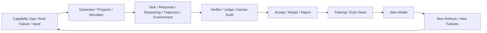

# 第 7 章 Synthetic Data：模型生成数据、任务演化与环境合成

> 所属体系：[`LLM_Agent_Data_Knowledge_System.md`](../LLM_Agent_Data_Knowledge_System.md)
>
> 前置章节：[`第 6 章 Human Data`](./06_Human_Data_Annotation_and_Quality_Control.md)
>
> 关联章节：[`第 4 章 Reasoning Data`](./04_Reasoning_Data_and_Process_Supervision.md)、[`第 5 章 Agent Trajectory Data`](./05_Tool_Use_and_Agent_Trajectory_Data.md)、[`第 8 章 Rollout / Candidate Selection`](./08_Rollout_Rejection_Sampling_and_Candidate_Selection.md)、[`第 9 章 Hard Case Mining`](./09_Hard_Case_Mining_and_Curriculum.md)、[`第 11 章 Environment Design`](./11_Environment_Design.md)、[`第 19 章 Governance / Lineage`](./19_Data_Governance_Lineage_and_Reproducibility.md)、[`第 20 章 Quality / Filtering / Dedup / Mixture`](./20_Data_Quality_Filtering_Deduplication_and_Mixture.md)
>
> 编辑基础设施：[`Canonical Glossary`](./00_Glossary_and_Notation.md) · [`Canonical Casebook`](./00_Canonical_Casebook.md)
>
> 本章定位：**Synthetic Task / Response / Reasoning / Preference / Trajectory / Environment / User 的生成与演化章节。它负责“怎么造出新的经验”，不负责完整 Dedup、Contamination、Lineage、Mixture 或 Data ROI 理论。**
>
> 本章核心问题：**Synthetic Data 的难点不是生成，而是如何生成“与目标能力相关、可验证、具有真实 decision diversity、不会把 Teacher 偏差无限复制”的新经验。**

---

# 7.0 Synthetic Data 的本质：经验扩增，而不是文本扩增

最简单的 synthetic pipeline 是：

```text
Seed
↓
Model generates more samples
↓
Train
```

但现代 LLM / Agent Data 更完整的结构是：



Synthetic Data 的核心价值通常来自：

```text
Scale
Coverage
Rare-case Construction
Controlled Variation
Iteration Speed
```

但必须先记住：

> **Synthetic ≠ Ground Truth。Generate ≠ Trust。**

生成本身只是获得候选经验，验证和下游实验才决定它有没有价值。

---

# 7.1 Synthetic Data 可以生成哪些对象？

不要把 synthetic data 等同于“模型写答案”。

至少可以生成：

| Synthetic Object | 作用 |
|---|---|
| Task / Prompt | 扩展任务覆盖 |
| Response / Demonstration | 生成 SFT candidate |
| Reasoning Trace | 生成 process candidate |
| Critique / Correction | 生成诊断与修复监督 |
| Preference / Negative | 构造相对监督 |
| Agent Trajectory | 生成交互经验 |
| Environment | 扩大可执行任务空间 |
| Synthetic User | 生成多轮交互 |
| Failure Variant | 定向覆盖薄弱 failure mode |

这些对象可以串起来：

```text
Synthetic Environment
↓
Synthetic Task
↓
Agent Rollout
↓
Synthetic Trajectory
↓
Verifier
↓
SFT / Preference / Recovery / Eval
```

所以真正高级的 Synthetic Data 已经不是“文本生成”，而是：

> **Experience Synthesis。**

---

# 7.2 Synthetic Data 的四类来源机制

为了不把所有东西都叫“LLM 生成”，可以分成四类机制。

## 7.2.1 Model-generated

```text
Teacher Model
→ Task / Response / Trace / Critique
```

适合语义丰富、开放式生成。

## 7.2.2 Programmatic

```text
Rule / Template / Program
→ Structured Tasks / Labels
```

适合精确控制、天然 ground truth。

## 7.2.3 Simulator-based

```text
Synthetic Environment
+
Agent Rollout
→ Executed Trajectory
```

适合 Agent / interaction data。

## 7.2.4 Hybrid

```text
Program builds world
↓
LLM writes natural-language task
↓
Agent executes
↓
Program verifies
```

很多高质量 synthetic system 实际上都是 hybrid，而不是“全靠一个 teacher”。

---

# 7.3 Self-Instruct：从少量 Seed 扩展任务空间

Self-Instruct 类方法的基本思想：

```text
Human / High-quality Seeds
↓
Generate New Instructions
↓
Generate Responses
↓
Validate / Filter
↓
Expand Dataset
```

它的重要性不只在于自动扩量，而在于建立了一个通用范式：

> **从少量 target-format seed 出发，让模型对任务空间做受控外推。**

但如果没有 task diversity 和 quality gate，很容易得到：

```text
大量重复
模板化任务
简单任务过多
答案错误
与目标能力无关
```

Dedup / filtering 的正式方法见第 20 章；本章只强调：

> **generation prompt 决定候选分布，filter 决定最终留下什么。**

---

# 7.4 Teacher Model Generation：Teacher 可以生成什么？

Teacher 不只负责写 final response。

它可以生成：

```text
Demonstration
Reasoning Trace
Critique
Correction
Rejected Candidate
Subgoal Decomposition
Tool-use Proposal
Rubric Explanation
Synthetic Task
```

例如代码数据：

```text
Problem
↓
Teacher writes solution
↓
Program runs tests
↓
Keep passing candidate
```

这里真正可靠的并不是：

```text
Teacher 很强
```

而是：

```text
Teacher produces candidate
+
Independent evidence verifies candidate
```

---

# 7.5 Strong Teacher 不等于 automatically good data

强 Teacher 仍然会带来固定偏差：

```text
固定写作风格
固定 reasoning pattern
固定 tool preference
固定 blind spot
偏爱自己熟悉的任务
过度详细 / 过度结构化
```

如果 Student 大量模仿单一 Teacher，可能学到的是：

> **Teacher distribution。**

所以 synthetic generation 的关键组合更接近：

```text
Teacher Quality
× Task Coverage
× Prompt / Sampling Diversity
× Verification
× Target-model Relevance
```

单纯换成更大的 Teacher，不自动解决数据问题。

---

# 7.6 Distillation：真正的问题是“蒸馏什么”

Distillation 可以蒸馏：

```text
Knowledge
Behavior
Style
Reasoning Procedure
Tool Policy
Critique Ability
Verification Habit
```

最简单：

```text
Teacher Output → Student SFT
```

更复杂：

```text
Teacher Task Decomposition
Teacher Reasoning
Teacher Tool Trajectory
Teacher Critique
Teacher Preference
```

但 Distillation 的上限高度依赖：

```text
Teacher Coverage
Target Student Weakness
Data Difficulty
Student Capacity
```

所以：

> **随机蒸馏 Teacher 会的东西，不如定向蒸馏 Student 当前最缺的经验。**

这会自然连接第 9 章 Hard Case Mining。

---

# 7.7 Task Synthesis：数据系统真正的上游

很多数据项目的瓶颈不是：

```text
“答案不会生成”
```

而是：

```text
“没有值得回答的新任务”
```

如果 Task Distribution 很差，再好的 Response 也没有训练价值。

因此 Synthetic Data 的核心工作往往是：

> **Task Space Design。**

---

# 7.8 Capability-guided Task Synthesis

与其 prompt：

```text
“生成 10000 个困难任务。”
```

更稳的是先建立 Capability Matrix。

例如 Agent：

```text
Tool Need
Tool Selection
Argument Construction
Observation Grounding
Recovery
Verification
Constraint Handling
State Tracking
Termination
```

然后为每个 capability 定义 variation axis：

```text
number of tools
ambiguity
hidden state
dependency depth
constraint density
failure injection
side-effect risk
```

最后：

```text
Capability Cell
↓
Generate Task
↓
Validate Feasibility
↓
Measure Coverage
```

Synthetic Task 不再是“随机发挥”，而是对能力空间做实验设计。

---

# 7.9 Prompt / Task Evolution：把已有任务沿某个维度变难

常见 Evolution Operator：

```text
Add Constraint
Add Hidden Information
Add Distractor
Add Tool Dependency
Add Failure Condition
Add Multi-turn Interaction
Add Negative Constraint
Add Ambiguity
Add Delayed Consequence
Add Verification Requirement
```

例如：

```text
Seed:
“查询订单状态。”
```

演化：

```text
“如果没发货就取消；已发货就不要动。”
```

再演化：

```text
“只记得订单后四位，有两个候选，需要先确认目标。”
```

这类 Evolution 的价值在于：

> **难度变化来自决策结构，而不是单纯把文本写长。**

---

# 7.10 Fake Difficulty：复杂不等于更难

Synthetic pipeline 很容易制造“伪困难”：

```text
更长 prompt
更多背景
更多无关信息
```

但底层决策仍然只有：

```text
lookup(x)
```

所以最好区分：

```text
Length Complexity
Knowledge Complexity
Reasoning Complexity
Decision Complexity
Tool Complexity
State-tracking Complexity
```

真正有价值的 difficulty 应对应模型需要新的 decision capability，而不是纯 token inflation。

---

# 7.11 Multi-candidate Response Synthesis

同一个 Task 只生成一个 candidate，信息量有限。

更常见的是：

```text
Task
├── Candidate A
├── Candidate B
├── Candidate C
└── Candidate D
```

不同 candidate 可以覆盖：

```text
不同 reasoning path
不同 tool choice
不同 style
不同 failure
不同 cost
```

这为后续：

```text
Preference
Rejection Sampling
Best-of-N
Judge Calibration
Hard-negative Mining
```

提供基础。

候选如何选择、Oracle Gap 和 Selector Gap 统一交给第 8、16 章。

---

# 7.12 Hard Negative：最值得主动合成的一类数据

Synthetic Data 不应该只造正例。

真正高信息量的负例往往是：

> **“看起来几乎对，但关键决策错了。”**

例如：

```text
漏一个 Negative Constraint
选错一个语义接近 Tool
参数只错一个 Entity
省掉必要 Verification
误解一个 Observation
数学里符号方向错一次
代码里只漏一个 Boundary Case
```

相比：

```text
Perfect vs Garbage
```

这样的 pair，Hard Negative 更接近真实 decision boundary。

---

# 7.13 如何合成 Hard Negative？

可以使用三类方法。

## Controlled Corruption

在正确样本上只改变一个关键因素：

```text
Wrong Entity
Wrong Tool
Missing Constraint
Wrong Timezone
```

## Model-native Failure

让当前模型 rollout，直接收集它真实犯的错误。

## Counterfactual Sibling

从同一 state / prefix 生成多个 alternative，其中部分成功、部分失败。

通常：

> **Model-native + same-state counterfactual** 比完全人工捏造的错误更接近真实 failure distribution。

---

# 7.14 Synthetic Reasoning：Final Correct 不足以验证过程

Reasoning Trace 可以自动生成：

```text
Problem
↓
Teacher Trace
↓
Final-answer Verifier
↓
Optional Process Verification
```

但：

```text
Final Answer Correct
≠
Process Correct
```

所以如果 synthetic trace 要用于 process supervision，还需要检查：

```text
Unsupported Step
Circular Reasoning
First Error
Logical Inconsistency
Hidden Assumption
```

Correctness / Risk / Recoverability 的正式定义统一见第 4 章。

---

# 7.15 Synthetic Critique / Correction

失败 trace 本身可以作为生成 seed：

```text
Wrong Trace
↓
Generate Critique
↓
Generate Corrected Step / Continuation
```

形成：

```text
Failure
+
Diagnosis
+
Repair
```

可以派生成：

```text
Critique SFT
Preference
Correction Data
Recovery Data
```

关键不是让模型“解释得像解释”，而是 critique 是否与真实 failure evidence 对齐。

---

# 7.16 Synthetic Agent Trajectory：必须区分“写出来”和“跑出来”

Agent synthetic trajectory 最可靠的来源是：

```text
Task
↓
Agent emits Action
↓
Harness executes
↓
Environment returns Observation
↓
Agent continues
↓
Final Environment Evidence
```

而不是：

```text
LLM 直接编：
Tool: cancel_order
Observation: success
```

后者最多说明模型会模仿 trace 格式，不能自动证明：

```text
action executable
observation真实
world state changed
final task achieved
```

所以：

> **Agent trajectory synthesis 应尽量是 executed synthesis，而不是 narrative synthesis。**

---

# 7.17 Synthetic Environment：先造世界，再从世界里造任务

很多 Agent Data 真正的扩展瓶颈是 Environment。

可以合成：

```text
CRM
Calendar
E-commerce DB
Filesystem
Website
API Service
Code Repository
```

然后从真实 state 自动生成 task。

例如先生成：

```text
order_1847: pending, 99
order_1848: shipped, 220
```

再生成：

```text
“取消所有未发货且金额低于 100 的订单。”
```

此时成功条件可以程序化：

```text
1847 → cancelled
1848 → unchanged
```

这种“world-first synthesis”非常强，因为 Task、Ground Truth、Verifier 可以共享同一个 state source。

---

# 7.18 Synthetic Environment 的价值与风险

它允许控制：

```text
Rare State
Failure Injection
Permission Boundary
Hidden Constraint
Long-horizon Dependency
Side-effect Risk
```

但最大问题是：

> **Sim-to-real Gap。**

Synthetic world 往往：

```text
更干净
更稳定
更规则化
更少脏数据
更少 UI / API drift
```

所以最终仍需要真实或更高 fidelity 环境验证。

Environment Fidelity 的正式理论见第 11 章。

---

# 7.19 Synthetic User：用户也是环境的一部分

在多轮任务里，可以模拟：

```text
模糊需求
补充信息
反悔
纠正 Agent
拒绝敏感信息
改变目标
回答澄清问题
```

结构：

```text
Agent
↕
Synthetic User
↕
Tool Environment
```

典型偏差是：

```text
Synthetic User 太合作
表达太完整
回答太快
不真实地理解 Agent 问题
```

所以 Synthetic User 本身也需要真实对话分布做 anchor。

---

# 7.20 Synthetic Preference：自动产生 chosen / rejected

Preference 可以来自：

```text
Objective Verifier
Environment Outcome
Rule Grader
LLM Judge
```

例如：

```text
A passes tests
B fails
→ A > B
```

或者：

```text
A final state correct
B final state wrong
→ A > B
```

如果 Generator 与 Judge 高度同源，需警惕：

```text
Self-preference
Style Bias
Shared Blind Spot
```

Verifier / Judge 的可靠性与 meta-evaluation 统一见第 15 章。

---

# 7.21 Verification 是 Synthetic Pipeline 的分水岭

最核心原则：

> **Can Generate ≠ Can Trust。**

常见 evidence hierarchy：

```text
Executable Verifier
>
Environment-state Check
>
Deterministic Rule
>
Calibrated Judge
>
Uncalibrated Judge
```

但这个顺序不是“谁高级”，而是：

> **证据越直接，就越不需要主观推断。**

完整 evaluator taxonomy 统一见第 15 章。

---

# 7.22 Yield Funnel：生成数量不是有效数据数量

Synthetic pipeline 应至少记录：

```text
Generated
↓
Structurally Valid
↓
Executable / Verifiable
↓
Verified Correct
↓
Unique / Diverse
↓
Accepted for Target Use
```

例如：

```text
1,000,000 generated
↓
650k valid
↓
300k verified
↓
180k unique
↓
90k high-value accepted
```

真正的数据产能接近最后一层，而不是第一层。

具体 Quality Funnel、Dedup、Filter Reason 归第 20、22 章。

---

# 7.23 Diversity：Synthetic Data 最容易制造“假繁荣”

至少要区分：

```text
Surface Diversity
Semantic Diversity
Structural Diversity
Decision Diversity
Failure Diversity
```

对 Agent / Reasoning Data，最有价值的通常是：

> **Decision Diversity + Failure Diversity。**

例如一万条：

```text
lookup_order(1)
lookup_order(2)
...
```

字符串很多，但决策模式只有一个。

Decision-level dedup 与 mixture balance 的正式方法见第 20 章。

---

# 7.24 Mode Collapse 与 Teacher Bias

如果长期使用：

```text
一个 Teacher
一个 Prompt Template
一个 Judge
```

数据会逐渐：

```text
语言风格趋同
Reasoning path 趋同
Task structure 趋同
Error blind spot 趋同
```

进一步可能形成：

```text
Model
↓
Synthetic Data
↓
New Model
↓
More Similar Synthetic Data
```

这会造成分布收缩和 error amplification。

常见缓解：

```text
Multiple Sources
Multiple Teachers
Real Failure Seeds
Objective Verification
Human Audit
Fresh Evaluation
```

---

# 7.25 Real Failure → Synthetic Family：最重要的生产模式之一

比起：

```text
“还能生成什么？”
```

更有价值的问题通常是：

> **“当前模型缺什么经验？”**

例如线上发现：

```text
Agent 在 timeout 后经常直接宣称失败
```

可以扩成：

```text
TIMEOUT
RATE_LIMIT
PARTIAL_RESPONSE
MALFORMED_RESPONSE
TEMPORARY_AUTH_FAILURE
```

并训练：

```text
safe retry
fallback
verify-before-retry
ask / escalate
safe stop
```

完整流程：

```text
Real Failure
↓
Root Cause / Capability Gap
↓
Abstract Failure Family
↓
Synthetic Variants
↓
Train
↓
Real Regression
```

这也是 Synthetic Data 与 Data Flywheel 真正接上的地方。

---

# 7.26 Canonical Case：C1 Order / Refund Agent 的 Synthetic Family

Seed：

```text
“如果订单 1847 还没发货，就帮我取消；已经发货就不要动。”
```

可以系统变化：

### State Variant

```text
pending
shipped
cancelled
not_found
```

### Permission Variant

```text
allowed
denied
approval_required
```

### Observation Variant

```text
complete
partial
stale
timeout
```

### Entity Variant

```text
single match
multiple matches
ambiguous user reference
```

### Failure Variant

```text
wrong tool
wrong id
blind retry
no verification
unsupported completion
```

这样得到的是：

```text
同一个 capability family
+
不同 decision boundary
```

而不是简单换订单号。

---

# 7.27 Synthetic Curriculum：可以控制难度，但不能靠直觉宣布有效

Synthetic Data 很适合构造：

```text
Easy → Medium → Hard → Frontier
```

例如 Agent：

```text
L1 single tool
L2 multi-tool fixed dependency
L3 tool selection ambiguity
L4 failure recovery
L5 multi-turn clarification
L6 long-horizon + side effect control
```

但 Curriculum 是训练策略，不是数据生成的天然结论。

它是否优于 static mixture，需要通过第 21 章 Data Experiment 正式验证。

---

# 7.28 本章不再完整展开的三个问题

为了让章节边界清楚，以下内容只保留接口，不在这里重复完整理论。

### Dedup / Filtering / Mixture

```text
生成以后哪些留？
哪些重复？
各类占多少？
```

→ 第 20 章。

### Provenance / Lineage / Versioning

```text
谁生成的？
由哪个 seed 演化？
哪个 prompt / teacher / verifier？
```

→ 第 19 章。

### Contamination / Benchmark Leakage

```text
synthetic derivative 是否和 test 同源？
family 是否跨 split？
```

→ 第 16、19、20 章。

本章只保留一条纪律：

> **Synthetic sample 必须能追溯其 seed、generator 与 generation operation，否则 synthetic pipeline 无法被审计。**

---

# 7.29 常见失败模式

1. 把“能生成”当成“可信”。
2. 只生成 positive，没有 hard negative / recovery data。
3. 只追求 sample count，不看 decision diversity。
4. Teacher output 全量直接入训。
5. Generator / Judge 共享同一 blind spot。
6. Task evolution 只增加长度，不增加 decision complexity。
7. Agent trajectory 是编出来的而不是执行出来的。
8. Synthetic environment 过于理想化。
9. Synthetic user 过于配合。
10. 单 Teacher / 单模板导致 mode collapse。
11. Final answer correct 就把 reasoning trace 当 process gold。
12. Real failure 不回流 synthetic pipeline。
13. 生成规模很大，但 high-value yield 极低。
14. 没有独立 held-out evaluation 就宣布 synthetic data 有用。
15. 没有保留 seed / generator / operation identity，后续无法治理。

---

# 7.30 从数据岗位视角，这一章实际会做什么？

```text
设计 seed pool
定义 target capability cell
写 task synthesis / evolution operator
选择 Teacher / Generator
生成 multi-candidate response
构造 hard negative
生成 critique / correction
运行 Agent rollout
构造 synthetic environment
构造 synthetic user
设计 failure variants
接入 verifier / judge
统计 yield funnel
审计 decision diversity
分析 teacher bias / mode collapse
将真实 failure 转成 synthetic family
```

真正成熟的 Synthetic Data 工作不是：

> “会调 API 批量生成。”

而是：

> **能够把一个 Capability Gap 转成可控制、可执行、可验证、可持续迭代的经验生成系统。**

---

# 7.31 本章关键词

| 术语 | 一句话理解 |
|---|---|
| Synthetic Data | 由模型、程序、规则、模拟器等构造的新数据 |
| Experience Synthesis | 不只生成文本，而是生成 Task / World / Trajectory / Feedback |
| Self-Instruct | 用少量 seed 自动扩展 instruction space |
| Teacher Model | 用于生成 candidate supervision 的较强模型 |
| Distillation | Student 学习 Teacher 知识 / 行为 |
| Task Synthesis | 自动构造新任务 |
| Evolution Operator | 沿某个能力维度改变 seed task |
| Hard Negative | 表面接近正确但关键 decision 错误的负例 |
| Executed Trajectory | 真实经过 Harness / Environment 执行产生的 synthetic trace |
| Synthetic Environment | 自动构造的可执行任务世界 |
| Synthetic User | 模拟真实用户交互行为 |
| Decision Diversity | 底层决策结构的多样性 |
| Failure Diversity | 不同真实 failure mode 的覆盖 |
| Mode Collapse | 合成分布不断收缩成少数模式 |
| Teacher Bias | Teacher 的偏差被复制到合成数据中 |
| Error Amplification | 合成—训练循环不断放大系统错误 |
| Failure-driven Synthesis | 从真实 failure 反向设计 synthetic family |
| Yield Funnel | 从 generated 到 high-value accepted 的逐层转化 |

---

# 7.32 面试 / 自检问题

1. Synthetic Data 为什么不等于“LLM 写答案”？
2. Synthetic Data 可以生成哪些不同对象？
3. Model-generated、Programmatic、Simulator、Hybrid 有什么区别？
4. Strong Teacher 为什么不保证好数据？
5. Task Synthesis 为什么经常比 Response Generation 更重要？
6. Capability-guided synthesis 怎么设计？
7. Evolution Operator 有哪些典型类型？
8. 什么叫 fake difficulty？
9. 为什么 multi-candidate generation 有价值？
10. Hard Negative 为什么通常比垃圾负例更有信息量？
11. 如何构造 Hard Negative？
12. Synthetic Reasoning 为什么不能只验证 final answer？
13. Synthetic Agent Trajectory 为什么最好执行出来？
14. Synthetic Environment 的优势和 Sim-to-real Gap 是什么？
15. Synthetic User 常见偏差是什么？
16. Generator 和 Judge 同源有什么风险？
17. 为什么 verification 是 synthetic pipeline 的关键边界？
18. Yield Funnel 为什么比 generated count 更重要？
19. Decision Diversity 与 Surface Diversity 有什么区别？
20. 什么是 mode collapse / error amplification？
21. Failure-driven synthesis 为什么通常比随机扩写更有价值？
22. 哪些内容属于本章，哪些应交给第 19 / 20 / 21 章？

---

## 7.32.1 一个通用回答框架：如果让我给某种能力补 10 万条 Synthetic Data

```text
1. 先定义 Capability Gap / Failure Mode
   ↓
2. 选真实 failure / high-quality seed
   ↓
3. 设计 task synthesis / evolution axis
   ↓
4. 用 model / program / simulator 生成 candidate
   ↓
5. 生成 hard negative / counterfactual variants
   ↓
6. 能执行的先执行、能 verifier 的先 verifier
   ↓
7. 再进入 Judge / Human audit
   ↓
8. 检查 decision / failure diversity
   ↓
9. 交给第 20 章的 filtering / dedup / mixture
   ↓
10. 用第 21 章的 controlled experiment 验证 downstream value
```

核心不是：

> “生成 10 万条。”

而是：

> **生成 10 万条什么经验，它们为什么值得模型学，以及你如何证明这一点。**

---

# 7.33 本章最终要形成的认识

Synthetic Data 的核心链条是：

```text
Capability Gap / Real Failure
↓
Seed
↓
Synthesis / Evolution
↓
Candidate Experience
↓
Execution / Verification
↓
Quality Gate
↓
Training / Eval View
↓
Downstream Experiment
↓
New Failure
```

本章负责的是中间的：

> **“怎样造出新经验”。**

下一章第 8 章会进一步解决：

> **当同一个 state / task 已经产生多个 candidate 时，怎样判断候选池有没有价值，以及怎样从中选择真正值得保留或提交的 candidate。**
