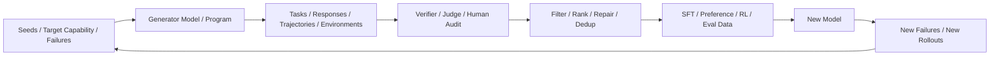
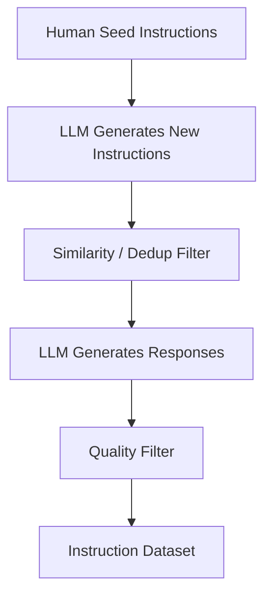
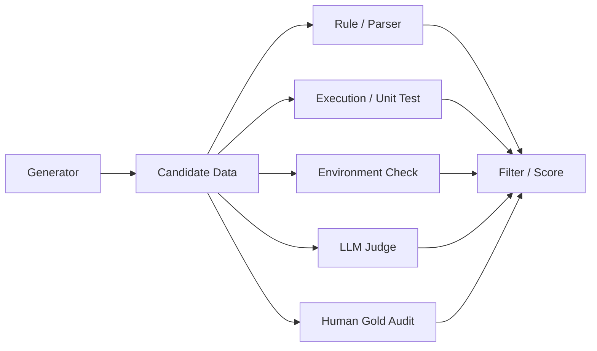
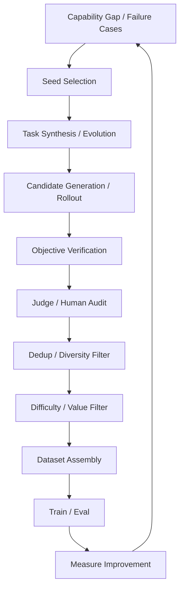

# 第 7 章 Synthetic Data：模型生成数据、任务演化与环境合成

> 所属体系：[`LLM_Agent_Data_Knowledge_System.md`](../LLM_Agent_Data_Knowledge_System.md)
>
> 前置章节：[`第 6 章 Human Data：人工标注、专家标注与质量控制`](./06_Human_Data_Annotation_and_Quality_Control.md)
>
> 本章目标：理解 Synthetic Data 不只是“让大模型写答案”，而是一整套利用模型、程序、规则和环境批量构造 **Task、Response、Preference、Reasoning Trace、Agent Trajectory 与 Environment** 的方法。
>
> 本章核心问题：**Synthetic Data 的难点不是生成，而是生成“对当前模型真正有学习价值、可验证、足够多样、不会把 Teacher 偏差无限复制”的数据。**

---

# 7.0 为什么 Synthetic Data 变得越来越重要？

传统数据生产经常是：

```text
Human writes / labels data
        ↓
Model trains on data
```

而现代大模型 pipeline 越来越常见的是：

```text
Seed / Goal / Failure
        ↓
Model generates new task / response / trajectory
        ↓
Verifier / Judge / Environment checks
        ↓
Filter / Rank / Repair
        ↓
Training / Eval Data
```

可以画成：



Synthetic Data 的价值主要来自三个方面：

```text
Scale
Coverage
Iteration Speed
```

也就是说，它让团队可以更快地回答：

> **如果我们想补某种能力，能不能快速构造出一批针对性经验？**

但这里必须马上加一句：

> **Synthetic ≠ Cheap Ground Truth。**

模型生成数据很便宜，但**可靠标签、真实多样性和有效学习价值**并不会自动出现。

---

# 7.1 什么叫 Synthetic Data？

Synthetic Data 泛指不是直接从真实世界原始分布中采集，而是通过模型、程序、规则、模拟器或组合流程**人为生成或变换得到的数据**。

在大模型 / Agent 里，可以按“生成什么”来分：

```text
Synthetic Task
Synthetic Prompt
Synthetic Response
Synthetic Reasoning Trace
Synthetic Preference
Synthetic Critique
Synthetic Tool-use Trajectory
Synthetic Environment
Synthetic User
Synthetic Failure Case
```

因此不要把 Synthetic Data 简化成：

```text
让 GPT 写 10 万个问答
```

这只是最基础的一种。

---

# 7.2 Synthetic Data 的六种核心对象

可以先建立一张总表。

| 生成对象 | 典型目标 | 示例 |
|---|---|---|
| Task / Prompt | 扩展任务覆盖 | 生成新的数学题、业务任务、Agent case |
| Response | 生成 demonstration | Teacher 写高质量答案 |
| Reasoning Trace | 提供过程数据 | 生成逐步推理、critique、correction |
| Preference / Negative | 构造相对监督 | 生成 rejected / hard negative |
| Trajectory | 训练 Agent | 生成 tool-use execution trace |
| Environment | 扩展交互空间 | 合成数据库、网页、API、用户状态 |

这六类数据经常组合使用。

例如：

```text
Synthetic Environment
        ↓
Synthetic Task
        ↓
Agent Rollout
        ↓
Synthetic Trajectory
        ↓
Environment Verification
        ↓
Preference / SFT / RL Data
```

这已经不是“生成文本”，而是一套完整的数据工厂。

---

# 7.3 Self-Instruct：从少量 Seed 扩展大量 Instruction

Self-Instruct 类方法的核心思想非常简单：

```text
少量人工 Seed Tasks
        ↓
LLM 观察这些任务
        ↓
生成新的 Instruction
        ↓
生成对应 Response
        ↓
过滤、去重
        ↓
得到更大的 Instruction Dataset
```

---

## 7.3.1 为什么 Self-Instruct 有效？

因为强模型通常已经具有大量隐式能力，只是缺少足够丰富的 instruction-response 数据去稳定激活这些能力。

少量 seed 可以告诉模型：

```text
“我们希望任务大致长这样。”
```

然后利用模型自身的知识生成更多变化。

---

## 7.3.2 Self-Instruct 的基本 Pipeline



最容易被忽略的是：

> **真正决定质量的往往不是 generation prompt，而是 filter。**

如果完全不筛，常见问题包括：

```text
重复任务
过于简单
模板化
答案错误
题目自相矛盾
难以验证
与目标能力无关
```

---

# 7.4 Teacher Model Generation：强模型作为数据生产者

另一条非常常见的路线是：

```text
Task
 ↓
Teacher Model
 ↓
High-quality Response / Trace
 ↓
Student Model Training
```

这类过程通常和 distillation 联系在一起。

---

## 7.4.1 Teacher 可以生成什么？

不仅是 final response。

还可以生成：

```text
step-by-step explanation
critique
rubric score
rejected answer
repair answer
tool trajectory
subgoal decomposition
verification rationale
```

例如代码数据：

```text
Problem
↓
Teacher writes solution
↓
Teacher writes tests
↓
Execute tests
↓
Only keep passing solutions
```

这里 verifier 很重要，因为它能避免“强 Teacher 说得很像对，但实际上错了”。

---

## 7.4.2 Strong Teacher ≠ Automatically Good Data

一个常见误区是：

> Teacher 越强，生成数据越好。

不一定。

强 Teacher 仍可能带来：

```text
固定写作风格
固定解题习惯
固定错误模式
过度详细
过度结构化
偏爱某些 tool path
对自己熟悉领域过采样
```

所以最终 Student 可能学到：

> Teacher 的“风格分布”，而不是目标真实分布。

因此真正重要的是：

```text
Teacher Quality
×
Prompt Diversity
×
Task Diversity
×
Verification
×
Filtering
```

---

# 7.5 Distillation：Synthetic Data 与知识蒸馏的关系

Distillation 的核心是：

> 让 Student 学习 Teacher 已经具备的知识或行为。

最直观形式：

```text
Teacher Output
    ↓
Student SFT
```

但现代 distillation 可以更丰富：

```text
Teacher final answer
Teacher reasoning trace
Teacher critique
Teacher preference
Teacher tool trajectory
Teacher structured state
```

---

## 7.5.1 Distillation 的真正瓶颈

如果 Student 只是模仿 Teacher：

```text
Teacher 能什么
↓
Student 学什么
```

那么 Student 很难自然获得 Teacher 没覆盖的新能力。

因此 distillation data 的价值很依赖：

```text
Coverage
Difficulty
Diversity
Target-model Weakness Alignment
```

这就连接到后面的 Hard Case Mining：

> 与其让 Teacher 随机生成 100 万条，不如针对 Student 真正不会的边界生成 10 万条。

---

# 7.6 Task Synthesis：比生成答案更重要的一步

很多数据工作最关键的问题不是：

> 答案怎么写？

而是：

> **题目从哪里来？**

因为如果 task distribution 很差，再好的答案也没用。

---

## 7.6.1 随机 Task Generation 的问题

如果简单 prompt：

```text
“请生成 10000 道有挑战性的数学题。”
```

很容易得到：

```text
表面不同
但结构高度相似
```

例如变量名、数字变了，但 reasoning pattern 没变。

这叫：

> **Surface Diversity ≠ Decision Diversity。**

真正重要的是：

```text
不同知识点
不同约束组合
不同推理结构
不同失败模式
不同 tool dependency
不同 long-horizon complexity
```

---

## 7.6.2 Capability-guided Task Synthesis

更好的方式是先定义 capability taxonomy：

```text
Math
├── algebra
├── geometry
├── combinatorics
└── probability

Agent
├── single-tool lookup
├── multi-tool dependency
├── state update
├── failure recovery
└── long-horizon planning
```

然后每个能力再定义 difficulty axis。

例如 Agent：

```text
number of tools
number of dependent steps
ambiguity
hidden constraints
failure injection
state tracking depth
```

此时 Task Synthesis 变成：

```text
Capability Cell
        ↓
Generate Task
        ↓
Validate Task
        ↓
Fill Coverage Matrix
```

而不是无目的批量生成。

---

# 7.7 Prompt Evolution：不是从零生成，而是“把已有题变难”

Prompt Evolution / Instruction Evolution 的思想是：

```text
Seed Task
   ↓
Apply Evolution Operator
   ↓
Harder / More Complex Task
```

常见 evolution operator：

```text
增加约束
增加上下文
增加步骤
增加干扰信息
增加工具依赖
加入异常情况
要求结构化输出
引入多轮交互
加入冲突条件
```

例如原任务：

```text
“查询订单状态。”
```

演化为：

```text
“查询订单状态；如果未发货则取消；如果已发货则查预计送达时间；不要修改其他订单。”
```

再演化：

```text
“用户只记得订单后四位；有两个候选订单；需要先确认身份，再执行后续操作。”
```

这样可以系统控制 difficulty。

---

## 7.7.1 Evolution 也可能产生“伪困难”

例如：

```text
问题本身其实很简单
但人为塞进 3000 字无关背景
```

token 更多不等于 reasoning 更难。

因此必须区分：

```text
length difficulty
knowledge difficulty
reasoning difficulty
tool-use difficulty
state-tracking difficulty
```

不然很容易造出“看起来复杂但没训练价值”的数据。

---

# 7.8 Response Synthesis：答案也需要多样性

给定一个 task，可以生成多个 candidate：

```text
Task
├── Response A
├── Response B
├── Response C
└── Response D
```

用途包括：

```text
SFT positive
Preference pairs
Hard negatives
Judge data
Rejection sampling
Self-consistency
```

---

## 7.8.1 为什么不要只生成一个答案？

一个 candidate 只能提供：

```text
“模型的一种做法”
```

多个 candidate 可以揭示：

```text
不同 reasoning path
不同错误模式
不同 style
不同 tool choice
不同 confidence
```

因此 multi-candidate generation 对后面的 preference / selection 很重要。

---

# 7.9 Negative Data 与 Hard Negative 的合成

Synthetic Data 不应该只生产正例。

很多能力真正需要的是：

> **模型看起来快对了，但关键处错了。**

这种数据叫 hard negative。

---

## 7.9.1 怎么合成 Hard Negative？

可以人为控制错误类型：

```text
漏一个约束
换错一个工具
参数差一个字段
少验证一步
对 observation 做错误解释
数学中制造一次符号错误
代码中引入一个边界 bug
```

例如：

```text
Correct:
先查库存 → 再回答

Hard Negative:
直接根据历史常识回答“应该有货”
```

后者不是乱码，而是一个真实模型很容易犯的错误。

---

## 7.9.2 Hard Negative 的价值

对 preference learning 来说：

```text
Perfect vs Garbage
```

信息量有限。

而：

```text
Correct-but-incomplete
vs
Fully-correct
```

更接近模型决策边界。

所以 Synthetic Negative 的质量，很多时候比 Positive 的数量更关键。

---

# 7.10 Synthetic Reasoning Data

Reasoning 数据可以通过模型自动生成：

```text
Problem
↓
Teacher generates reasoning trace
↓
Verifier checks final answer
↓
Optional step-level verification
↓
Keep / repair / reject
```

但需要注意：

> **Final answer correct 不代表 synthetic reasoning trace correct。**

因此如果要把 CoT 当过程 supervision，必须额外关注：

```text
process validity
logical consistency
first error
unsupported step
circular reasoning
```

---

## 7.10.1 Synthetic Critique / Correction

失败 reasoning 可以再交给模型生成：

```text
Critique:
“第 3 步错误地假设了……”
```

或者：

```text
Correction:
“应该改为……”
```

于是形成：

```text
Wrong Trace
+
Critique
+
Corrected Trace
```

可用于：

```text
critique training
self-correction
preference data
error localization
repair policy
```

---

# 7.11 Synthetic Agent Trajectory

Agent 数据里最常见的 synthetic pipeline 是：

```text
Synthetic Task
      ↓
Agent Rollout
      ↓
Tool Calls / Observations
      ↓
Final Environment State
      ↓
Verifier
      ↓
Trajectory Data
```

与普通 synthetic response 最大的区别是：

> **trajectory 是通过与环境互动产生的，而不是模型一次性“写出来”的。**

这非常重要。

---

## 7.11.1 “让 LLM 直接编一条 Tool Trace”有什么问题？

例如让模型写：

```text
Tool: cancel_order
Observation: success
```

但它根本没有真正执行工具。

这类 trace 可以用于 format pretraining，但不能天然作为真实 agent success data。

更可靠的 trajectory 应是：

```text
Agent emits action
↓
Harness executes actual tool / simulator
↓
Environment returns observation
↓
Observation enters context
↓
Agent continues
```

这样每一步都有 execution grounding。

---

# 7.12 Synthetic Environment：Agent 数据最前沿也最难的一层

如果只有有限环境，就只能生成有限任务。

因此更进一步的方向是：

> **连环境本身也合成。**

例如构造：

```text
Synthetic CRM
Synthetic Calendar
Synthetic E-commerce Database
Synthetic File System
Synthetic Website
Synthetic API Service
Synthetic Code Repository
```

然后在里面自动生成任务。

---

## 7.12.1 一个简单例子

先生成一个订单数据库：

```json
{
  "orders": [
    {"id": 1847, "status": "pending", "amount": 99},
    {"id": 1848, "status": "shipped", "amount": 220}
  ]
}
```

再根据环境状态生成 task：

```text
“取消所有尚未发货且金额低于 100 元的订单。”
```

成功条件可以自动计算：

```text
order 1847 cancelled
order 1848 unchanged
```

此时一整套 Agent Benchmark / Training Data 都可以自动生成。

---

## 7.12.2 Synthetic Environment 的价值

它允许控制：

```text
task difficulty
state distribution
rare edge cases
failure injection
hidden constraints
multi-step dependencies
```

并且可以自动获得 ground truth。

例如：

```text
数据库最终状态
```

就是天然 verifier。

---

## 7.12.3 Synthetic Environment 的风险

最大问题是：

> **Synthetic World 可能太像“玩具世界”。**

模型可能在 simulator 上表现很好，但一到真实网页 / API：

```text
页面结构变化
返回字段不稳定
网络错误
权限问题
脏数据
非预期用户行为
```

能力立刻下降。

所以需要专门研究：

```text
sim-to-real gap
```

---

# 7.13 Synthetic User：不仅可以生成环境，还可以生成用户

在多轮 Agent 中，用户本身也是环境的一部分。

Synthetic User 可以模拟：

```text
模糊需求
补充信息
反悔
纠正 Agent
回答澄清问题
拒绝提供敏感信息
改变目标
```

典型结构：

```text
Agent
↕
Synthetic User Simulator
↕
Tool Environment
```

这样可以自动生成多轮交互数据。

但同样存在风险：

> Synthetic User 往往比真实用户更“配合”、更完整、更理性。

这会造成 unrealistic interaction distribution。

---

# 7.14 Synthetic Preference Data

Preference label 也可以自动生成。

例如：

```text
Prompt
├── Candidate A
└── Candidate B
      ↓
Judge Model
      ↓
A > B
```

或者使用 objective verifier：

```text
A passes tests
B fails tests
→ A > B
```

对于 Agent：

```text
A final state correct
B final state wrong
→ A > B
```

---

## 7.14.1 Synthetic Preference 最大的问题

如果：

```text
Generator = Model Family X
Judge = Model Family X
```

可能出现：

```text
self-preference
style bias
shared blind spot
```

也就是 generator 和 judge 一起犯同样的错。

因此最好有：

```text
objective verifier
cross-model judge
human gold audit
```

做校准。

---

# 7.15 Verification：Synthetic Data 的生命线

Synthetic Data 最重要的原则之一是：

> **Can generate ≠ Can trust.**

一套成熟 pipeline 应尽量把“生成”和“验证”分开。



优先级通常是：

```text
Objective executable verifier
        >
Reliable deterministic rule
        >
Calibrated judge
        >
Uncalibrated judge
```

当然，并不是所有任务都有 objective verifier。

---

# 7.16 Rejection Rate 本身也是数据质量信号

假设 Teacher 生成 100 万条：

```text
100 万 generated
↓
80 万 verifier fail
↓
10 万 duplicate
↓
5 万 low quality
↓
最终只剩 5 万
```

这说明：

> 生成规模大，不等于有效数据规模大。

因此应同时记录：

```text
generated count
valid count
verified count
accepted count
rejection reason
acceptance rate
```

否则团队很容易用“我们生成了 100 万条”制造虚假的数据规模感。

---

# 7.17 Fake Diversity：Synthetic Data 最常见的陷阱之一

假设生成 1 万条：

```text
查询订单 0001
查询订单 0002
查询订单 0003
...
```

从字符串看有 1 万条。

但 decision pattern 都是：

```text
lookup_order(id)
```

所以真正 diversity 极低。

---

## 7.17.1 应该看哪些 Diversity？

### Surface Diversity

词汇、表达、实体不同。

### Semantic Diversity

任务语义不同。

### Structural Diversity

步骤数、依赖结构不同。

### Decision Diversity

需要采取的 action / reasoning pattern 不同。

### Failure Diversity

能覆盖不同错误模式。

对 Agent 来说，最重要的往往是：

> **Decision Diversity + Failure Diversity。**

---

# 7.18 Mode Collapse：生成数据越来越像自己

当大量数据来自同一个 Teacher / Prompt Template 时，很容易发生：

```text
问题风格越来越像
答案结构越来越固定
句式越来越统一
reasoning path 越来越集中
```

最终训练后的模型又继续生成同类数据：

```text
Model
↓
Synthetic Data
↓
New Model
↓
More Similar Synthetic Data
```

形成 feedback loop。

这就是 synthetic data flywheel 中需要特别警惕的分布收缩。

---

# 7.19 Teacher Bias 与 Error Amplification

Synthetic pipeline 最大风险之一：

```text
Teacher 有一个系统性错误
↓
批量生成 100 万条
↓
Student 学会这个错误
↓
Student 又参与下一轮数据生成
↓
错误被进一步放大
```

这叫 error amplification。

常见控制方式：

```text
multi-teacher
cross-check
objective verifier
human audit
source diversity
held-out eval
error taxonomy monitoring
```

---

# 7.20 Benchmark Contamination：Synthetic Data 也会泄漏 Eval

一个危险场景：

```text
Teacher 已经见过 benchmark
↓
Teacher 生成“新题”
↓
其实和 benchmark 非常相似
↓
Student 训练
↓
在 benchmark 上提升
```

这可能只是 benchmark-family leakage。

因此 synthetic task 也需要做：

```text
exact overlap
near duplicate
semantic similarity
template overlap
source lineage
```

尤其如果 prompt 里直接放了 benchmark examples，更要小心。

---

# 7.21 Data Lineage：Synthetic Data 必须记录“是谁怎么生成的”

每条 synthetic sample 最好记录：

```text
seed source
generator model
generator version
prompt version
sampling parameters
creation time
source task id
parent sample id
evolution operator
verifier version
judge version
filter decision
accept/reject reason
```

例如：

```json
{
  "sample_id": "syn_001",
  "parent_id": "seed_0042",
  "generator": "teacher_v3",
  "prompt_version": "task_evolve_v5",
  "operator": "add_constraint",
  "temperature": 0.8,
  "verifier": "env_check_v2",
  "accepted": true
}
```

否则以后发现问题时，你根本不知道哪批数据受影响。

---

# 7.22 Synthetic Data 的典型 Pipeline

可以把完整流程总结为：



注意最后一定要回到：

```text
Measure Improvement
```

否则 Synthetic Data 会退化成“生产 KPI”。

---

# 7.23 Synthetic Data Quality 应该看什么？

不能只看 acceptance rate。

建议至少分五类指标。

---

## 7.23.1 Validity

```text
schema valid
answer correct
task solvable
trajectory executable
```

---

## 7.23.2 Diversity

```text
surface diversity
semantic diversity
structural diversity
decision diversity
failure diversity
```

---

## 7.23.3 Difficulty

是否对当前模型有信息量？

如果：

```text
current model success = 99.9%
```

再生成 100 万条同类题，边际价值可能很低。

---

## 7.23.4 Coverage

是否覆盖：

```text
target capability
real user distribution
known failure modes
long tail
edge cases
```

---

## 7.23.5 Downstream Utility

最终还是：

> **训练后有没有真正改善目标行为？**

需要通过：

```text
held-out eval
regression set
ablation
control group
```

验证。

---

# 7.24 一条 Synthetic Data 的价值可以怎么想？

可以粗略抽象为：

$$
DataValue
\approx
Quality
\times Diversity
\times Difficulty
\times Relevance
\times Verifiability
$$

这不是严格公式，只是一个思考框架。

如果某个因子接近 0：

```text
答案错
完全重复
过于简单
与目标无关
无法验证
```

那么数据价值可能迅速下降。

---

# 7.25 Synthetic Data 与 Real Data 的关系

不要把两者看成竞争关系。

更合理的是：

```text
Real Data
→ 发现真实分布和真实失败

Synthetic Data
→ 围绕这些失败做定向扩展
```

也就是：

```text
Real Failure
      ↓
Abstract Failure Pattern
      ↓
Synthetic Variants
      ↓
Train
      ↓
Real-world Regression Test
```

这是非常常见的数据飞轮。

---

# 7.26 Failure-driven Synthetic Data：比随机生成更有价值

假设线上发现：

```text
Agent 经常在 tool timeout 后直接放弃
```

那么不应该随机再生成普通 task。

应该专门合成：

```text
Tool timeout
Rate limit
Partial response
Malformed response
Temporary auth failure
```

然后训练：

```text
retry
fallback
clarify
safe stop
```

这就是 failure-driven synthesis。

核心逻辑：

> **不是问“还能生成什么数据”，而是问“当前模型最缺哪类经验”。**

---

# 7.27 Synthetic Data 与 Curriculum

Synthetic Data 很适合按难度控制 curriculum。

例如 Agent：

```text
Level 1：单工具、无异常
Level 2：多工具、固定顺序
Level 3：工具选择
Level 4：环境异常
Level 5：多轮澄清
Level 6：长时程 + side effect control
```

但需要注意：

> Curriculum 是否有效必须实验验证。

不能因为“从简单到复杂听起来合理”就默认一定更好。

---

# 7.28 一个完整案例：合成“订单处理 Agent”数据

目标能力：

> Agent 能正确处理订单取消请求。

---

## Step 1：Synthetic Environment

生成订单数据库：

```text
pending
shipped
delivered
cancelled
```

并定义业务规则：

```text
pending → 可以取消
shipped → 不可直接取消
cancelled → 不重复取消
```

---

## Step 2：Task Synthesis

生成：

```text
“取消订单 1847。”
“如果订单还没发货就取消。”
“取消昨天买的耳机订单。”
“取消金额小于 100 元且未发货的订单。”
```

---

## Step 3：Evolution

加入：

```text
多个候选订单
模糊时间
用户反悔
工具 timeout
权限不足
```

---

## Step 4：Agent Rollout

得到：

```text
successful trajectory
wrong-tool trajectory
wrong-argument trajectory
premature-stop trajectory
recovery trajectory
```

---

## Step 5：Environment Verification

直接检查最终数据库：

```text
target order status
non-target order unchanged
```

---

## Step 6：Dataset Conversion

成功轨迹：

```text
→ SFT demonstration
```

成功 vs 失败：

```text
→ Preference pair
```

失败轨迹：

```text
→ Error taxonomy
→ Correction data
→ Recovery data
```

边界任务：

```text
→ Regression set
```

这就是一个完整 synthetic Agent data factory。

---

# 7.29 常见失败模式

### 失败 1：把“模型能生成”当成“数据可信”

生成和验证必须分开。

### 失败 2：只生成 Positive

缺少 hard negative 和 failure data，模型很难学决策边界。

### 失败 3：只追求 Sample Count

100 万模板变体可能不如 5 万高 decision diversity 样本。

### 失败 4：Teacher 输出全部直接进训练

错误、重复和低价值样本会被一起放大。

### 失败 5：Judge 和 Generator 共用同一 blind spot

会出现 shared bias。

### 失败 6：Prompt Evolution 只增加长度

得到伪难题，而不是真正 reasoning difficulty。

### 失败 7：Synthetic Trajectory 是“写出来的”，不是执行出来的

缺少环境 grounding。

### 失败 8：Synthetic Environment 太理想化

产生严重 sim-to-real gap。

### 失败 9：Synthetic User 太配合

真实用户的模糊、反复、冲突和不完整输入没有被覆盖。

### 失败 10：忽略 Benchmark Leakage

模型可能只是学到了评测模板。

### 失败 11：没有 Lineage

无法追踪哪批数据来自哪个 Teacher / Prompt / Verifier。

### 失败 12：所有数据都来自一个 Teacher

容易 mode collapse。

### 失败 13：没有下游对照实验

无法证明数据真的有用。

### 失败 14：Real Failure 没有进入合成循环

Synthetic pipeline 与真实问题脱节。

### 失败 15：只看 Acceptance Rate

接受率高可能只是 verifier 太松。

---

# 7.30 从数据岗位视角，这一章实际会做什么？

典型工作包括：

```text
设计 seed pool
写 generation prompt
做 capability taxonomy
设计 task synthesis schema
做 prompt evolution
调用 teacher model 批量生成
生成 multi-candidate response
构造 hard negative
生成 critique / correction
跑 agent rollout
搭 synthetic environment
搭 synthetic user
写 verifier
部署 judge
做 dedup
做 diversity audit
做 contamination check
做 difficulty filtering
维护 generation lineage
统计 acceptance / rejection reason
设计 train/eval ablation
```

所以 Synthetic Data 岗位的核心不是：

> “会调 API 批量生成。”

而是：

> **能把目标能力转化成可规模化生成、可靠验证、有效筛选的数据生产系统。**

---

# 7.31 本章关键词

| 术语 | 一句话理解 |
|---|---|
| Synthetic Data | 由模型、程序、规则或模拟器人工生成的数据 |
| Self-Instruct | 从少量 seed 自动扩展 instruction data |
| Teacher Model | 用于生成高质量数据的较强模型 |
| Distillation | Student 学习 Teacher 知识或行为 |
| Task Synthesis | 自动生成任务 / prompt |
| Prompt Evolution | 对已有任务做复杂化、约束化、难化 |
| Response Synthesis | 自动生成答案 / candidate |
| Hard Negative | 看起来合理但含关键错误的负例 |
| Synthetic Reasoning | 自动生成 reasoning trace / critique / correction |
| Synthetic Trajectory | 通过 Agent 与环境交互得到的合成执行轨迹 |
| Synthetic Environment | 自动构造可交互任务环境 |
| Synthetic User | 模拟用户多轮行为的模型或程序 |
| Fake Diversity | 表面不同但底层决策模式重复 |
| Mode Collapse | 合成数据分布越来越单一 |
| Teacher Bias | Teacher 的系统偏差被复制到数据中 |
| Error Amplification | 错误在多轮合成 / 训练中被不断放大 |
| Sim-to-real Gap | synthetic environment 与真实环境分布差异 |
| Failure-driven Synthesis | 围绕真实失败模式定向生成数据 |
| Data Lineage | 记录数据生成、演化、验证和筛选来源 |

---

# 7.32 面试 / 自检问题

学完这一章，至少应该能够回答：

1. **Synthetic Data 和 Human Data 的关系是什么？**
2. **Self-Instruct 的基本 pipeline 是什么？**
3. **为什么 Teacher 越强不代表生成数据自动越好？**
4. **Task Synthesis 为什么往往比 Response Generation 更重要？**
5. **什么是 Surface Diversity 和 Decision Diversity？**
6. **Prompt Evolution 有哪些常见 operator？**
7. **什么是 Hard Negative，为什么有价值？**
8. **Synthetic Reasoning 为什么不能只看 final answer correct？**
9. **为什么 Agent trajectory 最好执行出来，而不是让模型直接编出来？**
10. **Synthetic Environment 能解决什么问题？**
11. **什么是 sim-to-real gap？**
12. **Synthetic User 有哪些常见偏差？**
13. **Generator 和 Judge 用同一模型可能有什么风险？**
14. **为什么 verification 是 synthetic pipeline 的生命线？**
15. **Fake Diversity 怎么检测？**
16. **什么是 mode collapse？**
17. **Teacher Bias 怎么被放大？**
18. **Synthetic Data 怎么发生 benchmark contamination？**
19. **为什么必须保存 generation lineage？**
20. **Failure-driven synthesis 为什么通常比随机生成更有效？**
21. **如果生成了 100 万条但最终模型没提升，你会怎么排查？**
22. **如何判断一条 synthetic sample 有学习价值？**
23. **如何把同一批 Agent rollout 转成 SFT、preference、recovery 和 eval 数据？**
24. **为什么 acceptance rate 高不一定是好事？**
25. **如何证明 synthetic data 真正提升了能力，而不是只提升了 benchmark familiarity？**

---

## 7.32.1 一个通用回答框架：让我设计一套 Synthetic Data Pipeline

如果面试官问：

> “如果让你给一个能力补 10 万条 synthetic data，你会怎么做？”

推荐不要直接回答“调用大模型生成”。

可以回答：

```text
1. 先做 capability gap / failure analysis
   ↓
2. 明确这批数据要改变什么行为
   ↓
3. 选 seed：真实 case + high-quality examples + failure cases
   ↓
4. 设计 task synthesis / evolution operator
   ↓
5. 用多个 generator / sampling 配置生成 candidate
   ↓
6. 先跑 objective verifier
   ↓
7. 再用 calibrated judge / human audit
   ↓
8. 做 dedup + semantic / decision diversity filtering
   ↓
9. 做 difficulty / information-value filtering
   ↓
10. 保存完整 lineage
   ↓
11. 训练，并用独立 held-out eval 做 ablation
   ↓
12. 根据新 failure 进入下一轮 synthesis
```

这里最重要的一句话是：

> **Synthetic Data 是一个“生成—验证—筛选—实验”的闭环，而不是一个 generation job。**

---

# 7.33 与下一章的连接：为什么生成之后还要 Candidate Selection？

这一章解决：

> **数据怎么生成出来？**

但生成 N 个 candidate 之后仍然有一个核心问题：

> **到底留哪一个？**

这就进入下一章：

> **第 8 章 Rollout、Rejection Sampling 与 Candidate Selection**

核心流程是：

```text
Prompt / Task
     ↓
Generate N candidates
     ↓
Score / Verify
     ↓
Accept / Reject / Rank
     ↓
Training Data
```

第 8 章会系统讲：

```text
Best-of-N
Rejection Sampling
Self-consistency
Verifier-guided Selection
Reward-guided Selection
Positive Filtering
Negative Data Retention
Candidate Diversity
Selection Bias
```

也就是说：

> **第 7 章负责“造候选”，第 8 章负责“从候选中挑出真正值得留下的数据”。**
