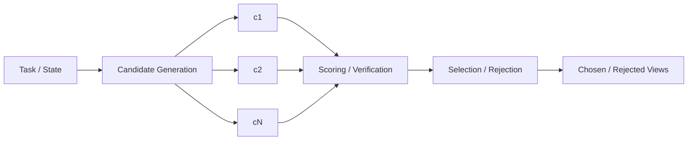

# 第 8 章 Rollout、Rejection Sampling 与 Candidate Selection：有候选以后，怎样真正选得更好

> 所属体系：[`LLM_Agent_Data_Knowledge_System.md`](../LLM_Agent_Data_Knowledge_System.md)
>
> 前置章节：[`第 7 章 Synthetic Data`](./07_Synthetic_Data_Generation_and_Synthesis.md)
>
> 关联章节：[`第 4 章 Reasoning Data`](./04_Reasoning_Data_and_Process_Supervision.md)、[`第 5 章 Agent Trajectory Data`](./05_Tool_Use_and_Agent_Trajectory_Data.md)、[`第 13 章 Credit Assignment`](./13_Task_Success_and_Credit_Assignment.md)、[`第 15 章 Grader / Verifier / Judge`](./15_Grader_Verifier_and_LLM_as_a_Judge.md)、[`第 16 章 Benchmark Design`](./16_Benchmark_Design_and_Evaluation_Protocol.md)、[`第 20 章 Quality / Filtering / Mixture`](./20_Data_Quality_Filtering_Deduplication_and_Mixture.md)
>
> 编辑基础设施：[`Canonical Glossary`](./00_Glossary_and_Notation.md) · [`Canonical Casebook`](./00_Canonical_Casebook.md)
>
> 本章定位：**Rollout Pool / Candidate Generation / Oracle / Selector / Rejection / Abstention / Dynamic N 的 canonical chapter。`Rescue / Harmful / Recoverability / Selectability` 的语义定义分别回到第 4、13 章；总体 Benchmark Protocol、Population Accounting 与统计检验归第 16 章。**
>
> 本章核心问题：**生成多个候选只是在扩大搜索空间；真正决定价值的是：候选池里有没有更好的路、候选之间有没有真实决策差异，以及在线可用的 selector 能不能稳定地把更好的 candidate 选出来。**

---

# 8.0 Candidate Pipeline：先把四个阶段拆开

最常见的 candidate-based pipeline 是：



从数据与实验角度，必须分开：

```text
1. Generation
   候选怎么来？

2. Evaluation
   候选怎么被验证 / 评分？

3. Selection
   什么时候选、换、拒绝或继续探索？

4. Routing
   winner / loser 最后变成什么数据？
```

如果把四步压成一句：

```text
“我们做了 Best-of-N”
```

就很难知道真正的瓶颈在哪。

---

# 8.1 什么是 Rollout？

Rollout 指：

> **从某个 Task / State 出发，让当前 policy 或 generator 实际生成行为，并观察 downstream outcome。**

Reasoning：

```text
Problem
↓
Reasoning Rollout
↓
Final Answer
↓
Verifier
```

Agent：

```text
Task + Initial State
↓
Agent Rollout
↓
Actions / Observations / State Changes
↓
Final Environment State
↓
Verifier
```

它与 Human-written demonstration 最大的不同是：

> **Rollout 反映当前 policy 真正会做什么，而不是我们希望它做什么。**

因此 current-policy rollout 对 failure discovery 和 post-training 尤其重要。

---

# 8.2 Single Rollout 与 Candidate Pool

Single rollout：

```text
x → y1
```

只能看到一个 realization。

Multiple rollout：

```text
x
├── y1
├── y2
├── y3
└── ... yN
```

可以观察：

```text
不同 reasoning path
不同 action choice
不同 final outcome
candidate disagreement
success density
failure modes
```

Candidate Pool 的价值不只是“多几个答案”，而是得到一个局部 action / continuation distribution。

---

# 8.3 Candidate Generation：目标是 Useful Diversity

如果：

```text
c1 ≈ c2 ≈ c3
```

selector 再强也没有东西可选。

候选生成的核心目标应该是：

> **在保持相关性和基本质量的前提下，制造有意义的 decision diversity。**

常见方法：

```text
Greedy
Temperature / Top-p Sampling
Prompt Variation
Multi-model Generation
Same-prefix Branching
Same-state Alternative Action
```

---

# 8.4 Candidate Diversity：不要只看文字差异

至少分四层：

### Surface Diversity

表达不同，但决策完全相同。

### Semantic Diversity

解释方式不同。

### Structural Diversity

推理结构 / tool sequence 不同。

### Decision Diversity

关键 state 上采取了不同 action。

对于 reasoning / Agent，通常最重要的是：

> **Decision Diversity。**

例如：

```text
Same State
├── keep hypothesis
├── verify assumption
├── backtrack
└── call tool
```

这样的 pool 才真正给 selector 留出决策空间。

---

# 8.5 Same-prefix / Same-state Candidate 为什么特别有价值？

如果比较：

```text
A 来自 Prefix P1
B 来自 Prefix P2
```

最终差异可能由很早以前的历史造成。

如果控制成：

```text
Same Prefix / State S
├── c1
├── c2
└── c3
```

那么差异更集中在当前 decision。

这种数据特别适合：

```text
Local Counterfactual Analysis
Action Preference
Branch Value
Recoverability Analysis
Selector Training
```

严格的 `Recoverability / Repairability / Selectability` 定义见第 4 章；局部 credit 见第 13 章。

---

# 8.6 Best-of-N：核心不是 N，而是 Score 的语义

Best-of-N：

$$
\hat{y}=\arg\max_{y_i\in\mathcal{C}}S(x,y_i)
$$

其中：

- $\mathcal{C}$：candidate pool；
- $S$：scoring function；
- $\hat y$：最终选择。

真正要问的是：

```text
S 到底测什么？
```

可能是：

```text
Exact correctness
Reward
Process quality
Model likelihood
Rule compliance
Cost-adjusted utility
```

如果 scorer 的语义和最终目标错位，N 越大甚至可能越危险，因为搜索空间越大，越容易找到“高分但错误”的 exploit。

---

# 8.7 Oracle Analysis：先问“有没有好候选”

在训练 selector 前，应该先计算 candidate pool 的 Oracle 上限。

例如：

```text
Oracle@N
= N 个候选里至少存在一个成功候选的比例
```

如果：

```text
Oracle@8 很低
```

说明问题首先在：

```text
Generation
```

如果：

```text
Oracle@8 很高
Selected@8 很低
```

说明主要瓶颈在：

```text
Selection
```

因此：

> **先看 Oracle Gap，再决定是否值得继续调 selector。**

这是 Candidate System 最重要的诊断纪律之一。

---

# 8.8 Oracle ≠ Online Selectability

Oracle 可以使用：

```text
最终 outcome
昂贵 verifier
完整 future rollout
人工 gold
```

在线 selector 却只能使用：

```text
当前可观测信息
```

所以：

```text
Oracle says good candidate exists
≠
Online selector can identify it
```

这正是：

```text
Recoverability
≠
Selectability
```

在 candidate system 中的直接体现。

---

# 8.9 Rejection Sampling：Reject 不一定等于 Delete

在 LLM 数据工程语境中，常见流程：

```text
Generate N
↓
Verifier / Reward / Rule
↓
Accept / Reject
↓
Training Data
```

但更成熟的做法不是：

```text
Correct → keep
Wrong → delete
```

而是：

```text
Correct + clean
→ SFT Positive

Correct + inefficient
→ Preference / process analysis

Wrong + informative
→ Hard Negative / Critique / Recovery

Wrong + useless noise
→ Drop
```

所以：

> **Rejection 更像 Routing，而不是垃圾桶。**

---

# 8.10 Self-consistency：多数意见只是一个 selector

Self-consistency：

```text
多条 reasoning rollout
↓
final answers vote
↓
choose majority
```

优点：

```text
简单
不需要额外 reward model
```

局限：

```text
Majority Can Be Wrong
Samples Highly Correlated
Only Final-answer Signal
Not natural for open-ended Agent actions
```

所以 self-consistency 只是 Candidate Selection 的一个特例，不是通用 ground truth。

---

# 8.11 Verifier-guided Selection

如果有客观 evidence，优先使用：

```text
Math → symbolic / exact verifier
Code → tests
Agent → environment state
SQL → execution result
Structured Output → schema / rule
```

常见策略：

```text
Hard correctness gate
↓
在通过者中比较 efficiency / style / cost
```

这比一个总 Judge 包办所有维度更稳定。

Verifier / Grader / Judge 的边界统一见第 15 章。

---

# 8.12 Reward-guided Selection

如果没有完全客观 verifier，可以用：

$$
\hat y=\arg\max_i r_\theta(x,y_i)
$$

但 Reward / Judge 并不是 Ground Truth。

尤其要警惕：

```text
Verbosity Bias
Style Bias
Self-preference
Reward Hacking
```

Best-of-N 会主动搜索 scorer 的高分区域，因此：

> **scorer 的小偏差可能被大 N 放大成系统性选择偏差。**

---

# 8.13 Hybrid Selection：一个系统不必只有一个 scorer

现实里经常是：

```text
Syntax / Schema Gate
↓
Executable / Environment Verifier
↓
Policy / Safety Rule
↓
Reward / Judge
↓
Cost / Efficiency Tie-breaker
```

这样的层级式 selector 往往比一个黑箱 scalar 更可解释。

---

# 8.14 Selection 不一定必须选一个

合理动作空间可以包含：

```text
Choose(ci)
KeepBaseline
RejectAll
ExploreMore
Abstain
```

如果所有 candidate 都差：

```text
强制选一个
```

只是错误中选错误。

所以 selector 也应该有：

> **Abstention / Fall-back 能力。**

---

# 8.15 Baseline Candidate：Replacement 是相对决策

很多在线 candidate system 并不是：

```text
从零挑一个最优答案
```

而是：

```text
已有 baseline continuation u0
↓
是否有足够证据替换？
```

此时要特别关注：

```text
Replacement Rate
Beneficial Replacement
Harmful Replacement
Keep Precision
```

`Rescue / Harmful / Neutral` 的正式 outcome transition 定义归第 4、13 章，本章只把它们作为 candidate intervention 的分析接口。

---

# 8.16 Threshold / Margin：什么时候值得偏离 baseline？

如果：

$$
S(c)>S(u_0)
$$

但差距非常小，可能只是 scorer noise。

可以要求：

$$
S(c)-S(u_0)>\delta
$$

再 replacement。

低阈值：

```text
Coverage 高
Rescue 机会多
Harm 风险也高
```

高阈值：

```text
更保守
Harm 少
也可能错过 Rescue
```

完整 Coverage / Risk-Coverage / Denominator reporting 统一见第 16 章。

---

# 8.17 Selector Accuracy 为什么经常没意义？

假设：

```text
90% state 不应该替换
10% state 值得替换
```

永远：

```text
Keep Baseline
```

就有：

```text
Accuracy = 90%
```

但：

```text
Rescue = 0
```

所以真正有价值的 evaluation 应该看：

```text
Oracle Gap
Coverage
Replacement Rate
Beneficial / Harmful Replacement
End-to-end Outcome
Cost
```

指标公式和总体统计协议统一交给第 16 章，本章只强调：

> **Selector 的价值是改变 downstream decision outcome，不是把 classification accuracy 做漂亮。**

---

# 8.18 Candidate Pool 应该作为原始数据资产长期保存

不要只保存：

```text
winner = c1
```

最好保存：

```text
state_id
baseline_id
all candidates
raw scores
verifier outputs
selector decision
selector version
final downstream outcomes
```

这样以后可以：

```text
换 selector
换 corrected labels
重算 oracle
构造 preference
做 failure analysis
```

Candidate Pool 比 Winner 更接近 raw asset；Winner 只是一个 Derived View。

Governance / versioning 见第 19 章。

---

# 8.19 Candidate Pool Schema 示例

```json
{
  "task_id": "task_001",
  "state_id": "state_031",
  "baseline_candidate_id": "u0",
  "generator_version": "gen_v3",
  "candidates": [
    {
      "id": "u0",
      "text": "...",
      "raw_scores": {
        "mean_logprob": -0.42
      },
      "offline_outcome": "fail"
    },
    {
      "id": "c1",
      "text": "...",
      "raw_scores": {
        "mean_logprob": -0.55
      },
      "offline_outcome": "success"
    }
  ],
  "selector": {
    "version": "selector_v3",
    "chosen_id": "c1"
  }
}
```

关键是：

> **Raw Candidate / Score / Historical Decision / Offline Outcome 分层保存。**

不要为了方便，把它们压成一个 winner label。

---

# 8.20 Offline Selection 与 Online Selection

离线分析可以使用：

```text
Future Outcome
Expensive Verifier
Human Annotation
Multiple Continuations
```

在线决策必须遵守：

```text
Only Current Observable Evidence
```

因此：

```text
Offline best selector
```

不能直接当作部署可实现方法。

这与第 4 章的 Future-information discipline 完全一致。

---

# 8.21 Selection Bias：筛选过程本身会改写训练分布

如果原始 rollout：

```text
70% mediocre
20% good
10% excellent
```

只保留 top 5%，最终训练数据已经是被 selector 强烈重塑的 distribution。

可能带来：

```text
Style Collapse
Length Bias
Mode Collapse
Over-specialization to Scorer
```

因此 Rejection Sampling 同时是：

```text
Quality Filter
+
Distribution Transformer
```

详细 Filtering / Mixture / Distribution Audit 归第 20 章。

---

# 8.22 Multi-stage Selection

为了降低成本，可以：

```text
64 candidates
↓ cheap filter
16
↓ verifier / PRM
4
↓ expensive judge / execution
1
```

但必须检查：

> **早期 cheap stage 有没有把真正好的 candidate 误杀。**

否则后面的强 evaluator 已经无法挽回。

这类 cascade 的关键指标之一就是 early-stage recall。

---

# 8.23 Candidate Selection 与 Search 的关系

一次性：

```text
Generate N → Select One
```

是 Best-of-N。

如果把 selection 嵌进生成过程：

```text
State
↓
Expand Branches
↓
Score
↓
Prune
↓
Expand Again
```

就进入：

```text
Beam Search
Tree Search
MCTS-like Search
Verifier-guided Search
```

从数据角度，本质仍然是：

```text
State
→ Candidate Actions
→ Value Evidence
→ Selection / Expansion
```

---

# 8.24 Agent 场景：Candidate 可以是“下一步 Action”

例如 C1：

```text
Current State:
订单状态未知，用户要求“未发货则取消”
```

Candidate Actions：

```text
A. get_order_status
B. cancel_order
C. ask_user
D. answer directly
```

此时 Candidate Selection 已经不是“答案 reranking”，而是：

> **Next-action selection。**

如果从每个 action 继续 rollout，就能得到 trajectory-level preference / credit。

---

# 8.25 Preference Pair：不要把 N 个 candidate 全组合

N=32 时，pair 数量：

$$
\binom{32}{2}=496
$$

大部分 pair 高度重复、信息量低。

更高价值的 pair：

```text
winner vs hardest negative
near-score discordant pair
correct vs plausible-wrong
same-state rescue vs harmful
success-efficient vs success-inefficient
```

目标不是 pair 数量，而是：

> **Decision Boundary Information。**

---

# 8.26 Dynamic N：Compute 也应该 state-dependent

固定：

```text
N=16 for every case
```

简单但浪费。

可以动态分配：

```text
easy / stable state
→ N = 1

uncertain / high-value state
→ N = 4

high-risk / ambiguous state
→ N = 8+
```

本质是：

> **把额外候选预算投到 expected marginal value 更高的 state。**

这和第 4 章 Continue / Stop 以及后续 Data Strategy 的思想一致。

---

# 8.27 Cost：Candidate System 不能脱离预算讨论

至少记录：

```text
Generated Candidates
Generation Tokens
Scoring Tokens
Verifier Calls
Judge Calls
Tool Calls
Latency
GPU / API Cost
```

Candidate 方法真正要回答的是：

> **额外 compute 是否换来了足够多的额外正确 / 安全结果。**

Success@Budget、Pareto、budget-matched baseline 等正式 protocol 统一见第 16 章。

---

# 8.28 研究实例：RoTFuse / K17 的结构映射

这一类方法很适合作为本章 canonical research case：

```text
Authoritative Prefix P
↓
Baseline local continuation u0
↓
Risk / Suspicion Trigger
├── No → keep u0
└── Yes
    ↓
    Same-prefix candidates c1 / c2
    ↓
    Candidate scoring
    ↓
    Select / Commit
```

这里必须拆开三个问题：

```text
Trigger
什么时候值得探索？

Generation
探索以后有没有更好的 local continuation？

Selection
有好 candidate 时能不能选出来？
```

一个 stage 的成功不能替代另一个 stage。

---

## 8.28.1 Baseline u0 的意义

`u0` 是当前 baseline local policy 的 continuation。

所以 selector 不是在做：

```text
“哪个 candidate 绝对最好？”
```

而是在做：

> **“是否有足够证据偏离 baseline？”**

这天然是 conservative intervention 问题。

---

## 8.28.2 Model Likelihood Score 的语义

若使用平均 token log-likelihood：

$$
S(c)=\frac{1}{|c|}\sum_t \log P(c_t\mid P,c_{<t})
$$

它表达的是：

```text
模型自身对这段 continuation 的平均支持程度
```

而不是：

```text
外部 correctness
```

因此：

```text
High Likelihood
≠
Correct
```

这是 Candidate Score interpretation 的典型例子。

---

# 8.29 常见失败模式

1. N 很大，但 candidate 几乎一样。
2. Oracle 很低却一直调 selector。
3. Scorer 有 bias，却用超大 N 放大它。
4. Loser 全删，浪费 hard negative / preference 价值。
5. 所有 candidate 都差时仍强制选一个。
6. 只报 selector accuracy。
7. 不保留 baseline identity，无法判断 intervention transition。
8. 离线用 future outcome 选得很好，就声称线上可实现。
9. Selection 和 final evaluation 共用同一盲点 scorer。
10. 只报告质量增益，不报告额外 compute。
11. 认为 candidate 越多越好。
12. 只保留 top-style mode，造成 distribution collapse。
13. Pair 全组合，制造大量低信息 pair。
14. 只保存 winner，不保存完整 pool。
15. 把 corrected label 后重新选出来的结果冒充历史 selector decision。

---

# 8.30 从数据岗位视角，这一章实际会做什么？

```text
设计 rollout config
控制 sampling / branching
构建 candidate pool
分析 candidate diversity
跑 verifier / reward / judge
计算 Oracle@N
做 rejection / routing
训练 / 校准 selector
做 threshold / abstention policy
构造 chosen / rejected pair
挖 hard negatives
做 same-state counterfactual
设计 dynamic N
保存完整 candidate pool
做 online / offline information audit
统计 end-to-end utility 与 compute
```

真正成熟的 Candidate Selection 工作不是：

> “多采样几个，然后挑分最高的。”

而是：

> **知道搜索空间有没有价值、scorer 在测什么、selector 能否在线实现，以及额外计算最终有没有转化成真实 outcome gain。**

---

# 8.31 本章关键词

| 术语 | 一句话理解 |
|---|---|
| Rollout | 从当前 Task / State 实际生成行为与 outcome |
| Candidate Pool | 同一 state 下完整候选及其元数据集合 |
| Best-of-N | 生成 N 个候选并按 scorer 选择 |
| Rejection Sampling | 生成后按 evidence / score 路由候选 |
| Oracle@N | 候选池中存在成功候选的理论上限 |
| Selector Gap | Oracle 与实际选择表现之间的差距 |
| Same-state Candidate | 从相同决策状态产生的 alternative |
| Decision Diversity | 关键 state 上不同 action / continuation 的差异 |
| Abstention | selector 证据不足时不强制选择 |
| Keep Baseline | 不偏离现有 baseline policy |
| Margin | candidate 与 baseline / alternative 的 score 差 |
| Selection Bias | selection mechanism 改写最终数据分布 |
| Dynamic N | 根据 state 动态分配 candidate budget |
| Hard Negative | 合理但关键 decision 错误的 candidate |
| Online Selectability | 仅用当前可观测证据能否选到更好 candidate |

---

# 8.32 面试 / 自检问题

1. Rollout 与普通 synthetic response 有什么区别？
2. Candidate Pool 为什么比 winner 更有数据价值？
3. Best-of-N 真正的瓶颈有哪些？
4. Oracle@N 为什么应该先于 selector optimization？
5. Recoverability 与 Selectability 在 candidate system 中如何区分？
6. Same-state candidate 为什么适合局部比较？
7. Self-consistency 的适用边界是什么？
8. Verifier-guided 与 Reward-guided Selection 有什么区别？
9. 为什么 N 越大不一定越好？
10. Selector 为什么应该允许 Keep Baseline / Reject All？
11. 为什么 score margin 有决策价值？
12. Selector Accuracy 为什么可能误导？
13. Offline oracle 与 online selector 的信息边界是什么？
14. Selection Bias 怎样改变训练分布？
15. Multi-stage selector 最重要的早期指标是什么？
16. Candidate pair 为什么不应该随机全组合？
17. Dynamic N 的核心思想是什么？
18. 为什么 test-time candidate method 必须做 cost accounting？
19. RoTFuse/K17 中 Trigger / Generation / Selection 为什么不能混成一个“方法效果”？
20. High model likelihood 为什么不等于 candidate correctness？

---

## 8.32.1 一个通用回答框架：如何证明 Candidate Selection 有用？

```text
1. 冻结 Task / State / Generator 条件
   ↓
2. 生成 N candidates，并保留完整 pool
   ↓
3. 建立可靠 offline outcome evidence
   ↓
4. 先算 Oracle@N
   ↓
5. 判断 bottleneck 在 Generation 还是 Selection
   ↓
6. 设计只依赖 online-observable evidence 的 selector
   ↓
7. 保留 baseline / abstention policy
   ↓
8. 做 margin / threshold / dynamic-N analysis
   ↓
9. 用 Ch16 protocol 报 end-to-end outcome、coverage 和 cost
   ↓
10. 把 winner / loser 路由成不同 training views
```

核心不是：

> “selector 分数很高。”

而是：

> **在一个真实可实现的信息条件和预算约束下，它能不能把 candidate pool 中已有的潜在价值兑现出来。**

---

# 8.33 本章最终要形成的认识

Candidate System 可以压成四句话：

```text
Generation
决定有没有更好的路。

Oracle
告诉我们理论上还有多少上限。

Selection
决定在线能不能把上限兑现。

Routing
决定好 / 坏候选怎样变成下一轮数据。
```

下一章第 9 章继续往上游走：

> **哪些 Task / State 最值得投入 rollout、annotation 和 synthetic budget？**
