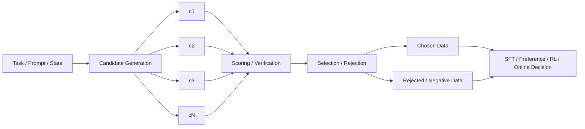
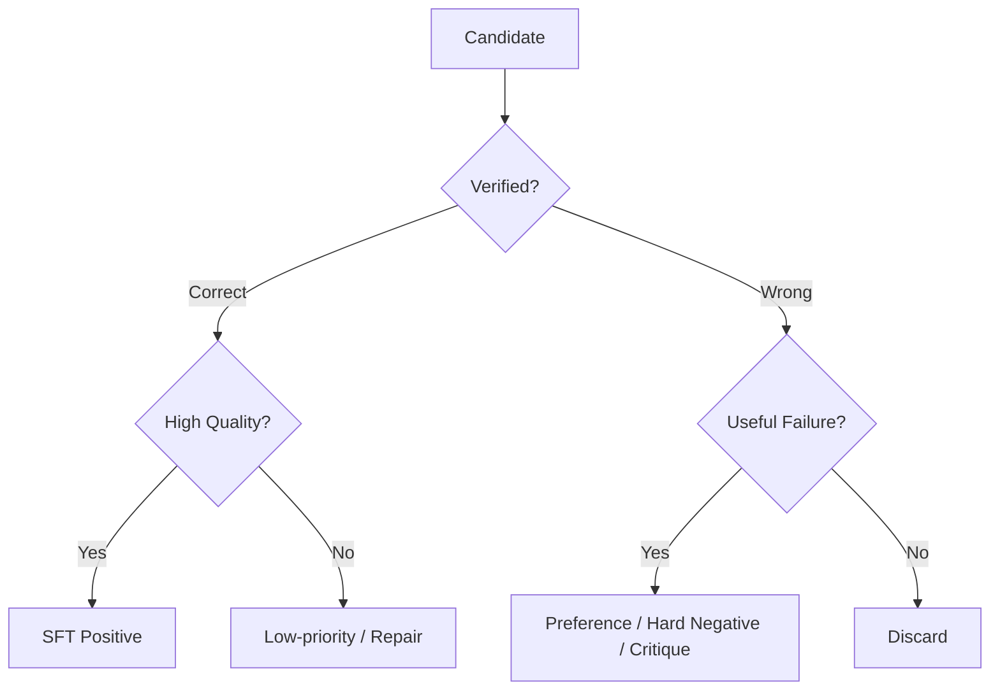

# 第 8 章 Rollout、Rejection Sampling 与 Candidate Selection

> 所属体系：[`LLM_Agent_Data_Knowledge_System.md`](../LLM_Agent_Data_Knowledge_System.md)
>
> 前置章节：[`第 7 章 Synthetic Data：模型生成数据、任务演化与环境合成`](./07_Synthetic_Data_Generation_and_Synthesis.md)
>
> 关联章节：[`第 4 章 Reasoning Data 与 Process Supervision`](./04_Reasoning_Data_and_Process_Supervision.md)、[`第 5 章 Tool-use Data 与 Agent Trajectory Data`](./05_Tool_Use_and_Agent_Trajectory_Data.md)
>
> 本章目标：理解为什么现代大模型 / Agent 数据生产经常不是“生成一条答案就结束”，而是 **生成多个候选 → 评分 / 验证 → 选择 / 拒绝 → 转换成训练信号**；并掌握 Best-of-N、Rejection Sampling、Self-consistency、Verifier-guided Selection、Reward-guided Selection 与 Candidate Diversity 之间的关系。
>
> 本章核心问题：**生成多个候选只是扩大搜索空间；真正决定数据价值的，是候选之间是否有有意义的差异，以及选择器能否稳定地把“更值得学习 / 更值得执行”的候选选出来。**

---

# 8.0 先看总图：Candidate Pipeline 的四个阶段

一套最常见的流程可以抽象成：



从数据角度看，应该把这四件事分开：

```text
1. Candidate Generation
   候选怎么产生？

2. Candidate Evaluation
   每个候选怎么被评分 / 验证？

3. Selection Rule
   根据什么规则选、拒绝、保留多个？

4. Data Conversion
   最终选中的和没选中的，分别变成什么训练数据？
```

很多系统把这四步写成一个“Best-of-N”，但如果不拆开，就很难定位提升或失败来自哪里。

---

# 8.1 什么是 Rollout？

在大模型 / Agent 语境里，rollout 通常指：

> **从某个 prompt / state 出发，让当前 policy 或某个 generator 实际生成一段 response / reasoning / trajectory，并观察其结果。**

例如：

```text
Math Problem
↓
Model Rollout
↓
Reasoning Trace
↓
Final Answer
↓
Verifier: correct / wrong
```

Agent 场景则是：

```text
Task + Initial Environment State
↓
Agent Rollout
↓
Tool Calls / Observations / State Changes
↓
Final Environment State
↓
Task Success / Failure
```

Rollout 的数据价值在于：

```text
它反映模型“真的会做什么”
而不是我们希望模型做什么
```

这和 Human-written demonstration 不同。

---

## 8.1.1 Single Rollout 与 Multiple Rollouts

### Single Rollout

```text
x → y1
```

优点是便宜，但你只看到一个 realization。

### Multiple Rollouts

```text
x
├── y1
├── y2
├── y3
└── ... yN
```

这样可以研究：

```text
输出多样性
模型不确定性
不同 reasoning path
不同 tool path
correct / wrong 分布
candidate disagreement
可修复性
selector 上限
```

所以 Multiple Rollouts 不只是“多采几个答案”，而是把单一轨迹扩展成一个局部 outcome distribution。

---

## 8.1.2 On-policy Rollout 为什么特别重要？

如果候选来自当前模型：

```text
Current Policy
↓
Current-policy Rollouts
```

那么这些候选更接近当前模型真实错误分布。

这比完全来自强 teacher 的样本更适合回答：

> **当前模型到底缺什么？**

因此很多 post-training / agent data pipeline 会强调 current-policy rollout。

---

# 8.2 Candidate Generation：N 个候选应该怎么生成？

候选质量决定 selection 的上限。

如果 N 个候选本质一样：

```text
c1 ≈ c2 ≈ c3 ≈ ...
```

那么再强的 selector 也没有东西可选。

因此 candidate generation 的目标不是单纯“多”，而是：

> **在保持任务相关性的前提下，制造足够有意义的 decision diversity。**

---

## 8.2.1 常见生成方式

### Greedy

```text
temperature = 0
```

得到当前最直接的高概率路径。

优势：

- 稳定；
- 可复现；
- 适合作 baseline。

问题：

- 缺乏多样性；
- 一旦局部进入错误路径，后面容易一直沿同一模式继续。

### Temperature Sampling

通过提高随机性产生多样候选。

```text
same prompt
→ sample 1
→ sample 2
→ sample 3
```

但 temperature 过高可能产生大量低质量噪声。

### Top-p / Top-k Sampling

通过限制采样候选空间控制多样性和质量。

### Prompt / Role Variation

改变 generation instruction：

```text
直接求解
反向验证
使用另一种方法
先列约束再求解
```

### Multi-model Generation

不同模型产生候选。

优点是 diversity 可能更高；缺点是候选分布和成本都更复杂。

### Same-prefix Branching

从完全相同的 state / prefix 开始生成不同 continuation：

```text
Prefix P
├── c1
├── c2
└── c3
```

这种设计对研究局部 decision 特别有价值，因为它控制了历史前缀。

---

# 8.3 Candidate Diversity：不是“文本不同”就够了

Candidate Diversity 可以至少分四层。

## 1. Surface Diversity

文字表达不同：

```text
A：因此答案为 12。
B：所以最终结果是 12。
```

信息价值很低。

## 2. Semantic Diversity

解释方式不同，但核心推导一致。

## 3. Structural Diversity

推理结构 / 工具序列不同。

例如：

```text
A: search → compare → answer
B: search → verify → compare → answer
```

## 4. Decision Diversity

在关键状态采取不同动作：

```text
A: keep current hypothesis
B: backtrack
C: verify assumption
D: use tool
```

对于 reasoning / Agent，Decision Diversity 通常比 surface diversity 更重要。

---

# 8.4 Best-of-N：最直观的 Candidate Selection

Best-of-N 的基本形式是：

```text
Generate N candidates
↓
Score each candidate
↓
Choose highest-scoring candidate
```

形式化地：

$$
\hat{y} = \arg\max_{y_i \in \mathcal{C}} S(x, y_i)
$$

其中：

- $\mathcal{C}$：候选集合；
- $S$：评分函数；
- $\hat{y}$：最终选择。

关键不是 `N`，而是：

> **Score 是否和真实目标一致。**

如果 scorer 错，N 越大反而可能给它更多机会选中“高分但错误”的 candidate。

---

## 8.4.1 Best-of-N 的三个上限

Best-of-N 是否有效，至少受三件事限制。

### Candidate Oracle Upper Bound

如果 N 个候选里至少有一个正确，那么理论上一个完美 selector 可以选到它。

记：

```text
oracle@N = P(候选集合中至少有一个正确)
```

它是 generation quality 的上限指标。

### Selector Accuracy

有正确 candidate 不代表 selector 能认出来。

### Compute Cost

N 越大，生成和评分成本越高。

因此真实目标往往是：

```text
Expected Utility
=
Quality Gain
-
lambda × Compute Cost
```

而不是单纯最大化 accuracy。

---

# 8.5 Rejection Sampling：Generate → Filter → Keep

在 LLM post-training 里，“Rejection Sampling”常被宽泛地用于描述：

```text
生成多个 candidate
↓
根据 reward / verifier / heuristic
拒绝不合格样本
↓
保留高质量样本
↓
作为训练数据
```

需要注意：这里的术语使用往往比经典统计学中的 rejection sampling 更宽松。

在数据工程语境里，更重要的是理解流程，而不是纠结名称。

---

## 8.5.1 一个简单例子

数学题：

```text
每题采 8 个 reasoning solutions
```

然后：

```text
Final answer verifier
↓
正确的留下
错误的拒绝
```

最终得到：

```text
Problem → Verified Correct Solution
```

用于 SFT。

这是一种典型的 rejection-sampling-style data construction。

---

## 8.5.2 只保留正确答案有什么问题？

如果只做：

```text
Correct → keep
Wrong → drop
```

会损失大量信息。

错误 candidate 可能用于：

```text
Preference pair
Hard negative
Critique data
Correction data
Error taxonomy
Reward model data
Recovery training
```

所以更成熟的 pipeline 往往不是：

> rejection = 删除

而是：

> **根据候选类型，把它路由到不同数据用途。**

---

# 8.6 Positive Filtering 与 Negative Retention

可以把 candidate routing 设计成：



这比一刀切的 positive-only filtering 更充分利用 rollout。

---

# 8.7 Self-consistency：多数答案不等于最优候选

Self-consistency 常用于 reasoning：

```text
同一道题采样多条 reasoning path
↓
得到多个 final answer
↓
多数投票
```

例如：

```text
A, A, A, B, C
→ choose A
```

直觉是：如果不同推理路径独立支持同一答案，这个答案更可信。

---

## 8.7.1 Self-consistency 的优势

- 不需要额外训练 reward model；
- 对有明确 final answer 的任务简单有效；
- 可以利用模型自身 stochasticity。

## 8.7.2 局限

### Majority Can Be Wrong

如果模型有系统偏差：

```text
8 条都走同一个错误套路
```

多数票只会放大错误共识。

### Path Correlation

不同 sample 并不一定独立。

### 只看 Final Answer

无法判断哪条 reasoning path 更可靠。

### 不适合开放 Agent Action

Agent 轨迹很难简单按“最终文本答案”多数投票。

因此 self-consistency 是一种 selector，但不是通用解决方案。

---

# 8.8 Verifier-guided Selection

如果任务有可靠 verifier，可以直接用客观条件选候选。

例如：

```text
数学 → exact / symbolic verifier
代码 → unit tests
Agent → final environment state
SQL → query result
结构化输出 → schema validation
```

常见策略：

```text
先 hard filter correctness
再在通过者里比较 style / efficiency / cost
```

这种层级式选择比“一个 LLM judge 决定所有事情”更稳健。

---

## 8.8.1 Binary Verifier 与 Graded Verifier

Binary：

```text
pass / fail
```

Graded：

```text
partial credit
coverage
number of tests passed
constraint satisfaction score
```

Agent 中 graded verifier 特别有用，因为很多任务存在 partial completion。

---

# 8.9 Reward-guided Selection

如果没有完全客观 verifier，可以使用 reward model / grader：

$$
\hat{y}=\arg\max_i r_\theta(x,y_i)
$$

但要记住第 3 章的结论：

> Reward Model 不是 ground truth。

如果 reward model 存在 verbosity bias、style bias、self-preference，那么 Best-of-N 会主动搜索并放大这些漏洞。

这可以理解为：

```text
Candidate Generator
        ↓
不断探索 scorer 的高分区域
        ↓
如果 scorer 有漏洞
        ↓
Selection Amplifies Reward Hacking
```

所以 N 越大，不一定越安全。

---

# 8.10 Hybrid Selection：Verifier + Reward + Heuristic

真实系统往往使用多层 selector。

例如代码 candidate：

```text
Step 1: syntax valid?
Step 2: unit tests pass?
Step 3: no forbidden dependency?
Step 4: runtime / memory cost?
Step 5: style / maintainability?
```

Agent trajectory：

```text
Step 1: task success?
Step 2: no forbidden side effect?
Step 3: all required constraints satisfied?
Step 4: observation grounded?
Step 5: tool cost acceptable?
Step 6: final communication quality?
```

这是一种 lexical / rubric / executable signal 的组合。

---

# 8.11 Candidate Selection 不一定是“必须选一个”

很多时候应该允许：

```text
select one
select multiple
reject all
abstain
request more candidates
fall back to baseline
```

如果所有 candidate 都差：

```text
c1 bad
c2 bad
c3 bad
```

强制选一个只是在错误中挑一个。

因此 selector 的动作空间可以写成：

```text
Choose(ci)
RejectAll
KeepBaseline
ExploreMore
Abstain
```

这和第 3 章 preference 中的 `Tie / Both Bad / Cannot Judge` 是同一个思想：

> **不要为了覆盖率强行制造高置信决策。**

---

# 8.12 Thresholding：评分高不代表一定值得替换

假设 baseline candidate 是 $u_0$，替代 candidate 是 $c$。

即使：

$$
S(c) > S(u_0)
$$

也不一定应该替换。

因为 score difference 很小可能只是噪声。

可以要求：

$$
S(c)-S(u_0) > \delta
$$

才替换。

这相当于 margin / confidence threshold。

它控制的是：

```text
coverage
vs
precision of intervention
```

阈值低：

```text
更多 intervention
更多 potential rescue
也更多 harmful replacement
```

阈值高：

```text
更保守
更少 harmful
但可能错过 rescue
```

这是非常典型的 risk-coverage trade-off。

---

# 8.13 Candidate Selection 的四类 Outcome

对于 baseline $u_0$ 和 replacement $c$，离线可以得到：

| Baseline | Replacement | 类型 | 含义 |
|---|---|---|---|
| Wrong | Right | Rescue | 替换有益 |
| Right | Wrong | Harmful | 替换有害 |
| Right | Right | Neutral-positive | 最终都对 |
| Wrong | Wrong | Neutral-negative | 最终都错 |

真正决定净收益的是：

$$
Net = Rescue - Harmful
$$

而不是：

```text
selector 选了多少 replacement
```

所以 Candidate Selection 的 eval 必须同时报告 positive intervention 和 harmful intervention。

---

# 8.14 Selector Accuracy 不是最重要的指标

假设数据高度不平衡：

```text
90% case 不该替换
10% case 值得替换
```

一个永远 keep baseline 的 selector：

```text
accuracy = 90%
```

但完全没有 utility。

因此更重要的指标包括：

```text
rescue rate
harm rate
net gain
coverage
precision among replacements
oracle gap
compute cost
task-level accuracy after selection
```

如果是 Agent：

```text
task success gain
side-effect rate
API cost
latency
```

---

# 8.15 Oracle Analysis：先判断“有没有东西可选”

在训练 selector 之前，最好先做 oracle analysis。

给定 candidate set：

```text
如果任何 candidate 正确，就假设 oracle 总能选到正确的
```

得到：

```text
oracle performance
```

如果 oracle 提升都很小：

> selector 再复杂也不可能带来大提升。

此时问题在：

```text
candidate generation
```

而不是：

```text
candidate scoring
```

这一步非常重要，因为它能避免在错误瓶颈上反复训练 selector。

---

# 8.16 Candidate Diversity 与 Oracle Upper Bound 的关系

候选越多样，理论上越可能出现至少一个正确分支。

但 diversity 不是无限增加越好。

过高随机性会造成：

```text
大量明显错误 candidate
增加 scoring 成本
增加 reward hacking 搜索空间
降低有效 candidate density
```

因此需要优化的是：

> **Useful Diversity，而不是 Maximum Diversity。**

可以定义一些分析量：

```text
unique final answers
unique reasoning patterns
unique tool sequences
pairwise semantic distance
oracle@N
correct-candidate density
```

---

# 8.17 Rejection Sampling Data 的 Distribution Shift

这是一个很容易被忽略的问题。

假设原始模型 rollout 分布是：

```text
70% mediocre
20% good
10% excellent
```

经过强 reward filter 后，只保留：

```text
top 5%
```

最终训练集分布已经不再代表模型真实行为。

这会产生两个问题。

### 1. Selection Bias

训练数据是被 selector 挑过的。

### 2. Diversity Collapse

高分候选可能集中在同一种风格。

因此 Rejection Sampling 不只是质量过滤，还会重塑训练分布。

---

## 8.17.1 如何缓解？

可以考虑：

```text
按 domain / difficulty 分桶选择
保留多种 high-quality modes
限制每个 seed 的重复数
做 semantic dedup
保留部分中等难度样本
混入 human / real data
监控 length / style / language distribution
```

---

# 8.18 Selector-induced Bias：选择器会把自己的偏好写进数据

如果 selector 偏爱：

```text
更长回答
更多步骤
某种固定格式
高 confidence 风格
```

那么最终训练数据就会越来越像 selector 喜欢的样子。

形成闭环：

```text
Selector bias
↓
Selected Data
↓
Model learns bias
↓
New Rollouts reflect bias
↓
Selector sees even more similar candidates
```

这是一种 data flywheel 的负反馈风险。

因此需要：

```text
selector audit
human gold
cross-selector comparison
style-controlled evaluation
outcome-based verification
```

---

# 8.19 Multi-stage Candidate Selection

有些任务适合分层筛选。

例如生成 64 个 reasoning candidates：

```text
64 candidates
↓
cheap heuristic filter
↓
16 candidates
↓
verifier / PRM
↓
4 candidates
↓
expensive judge / execution
↓
1 candidate
```

这样可以降低总成本。

但必须验证：

> 早期 cheap filter 有没有误杀真正好的 candidate？

否则后面的强 selector 已经无能为力。

---

# 8.20 Candidate Selection 与 Search 的关系

Best-of-N 是“一次生成完再选”。

更复杂的方法会把 selection 放进生成过程中：

```text
State
↓
Generate branches
↓
Score branches
↓
Keep promising branches
↓
Expand again
```

这就进入：

```text
beam search
Tree-of-Thought-like search
MCTS-like search
verifier-guided tree search
```

从数据视角看，本质仍然是：

```text
state
→ candidate actions
→ value estimate
→ pruning / expansion
```

因此第 4 章的 process supervision 会直接决定 search quality。

---

# 8.21 Candidate Selection 与 Agent 的关系

Agent 场景中 candidate 可以不是“多个完整回答”，而是：

```text
当前 state 下的多个 action
```

例如：

```text
State:
订单状态未知，用户要求“未发货则取消”

Candidates:
A. search_order
B. cancel_order
C. ask_user
D. answer directly
```

此时 selector 在做的是：

> **Next-action selection。**

如果进一步 rollout 每个 action：

```text
State
├── A → future trajectory A
├── B → future trajectory B
├── C → future trajectory C
└── D → future trajectory D
```

就可以训练 action value / trajectory preference。

---

# 8.22 Same-prefix / Same-state Candidate Data 为什么特别有价值？

如果比较：

```text
Candidate A 来自 Prefix P1
Candidate B 来自 Prefix P2
```

两者最终差异可能来自很早以前。

但如果控制为：

```text
Same Prefix P
├── c1
├── c2
└── c3
```

差异就集中在当前 decision。

因此 same-prefix / same-state candidate data 特别适合：

```text
local causal analysis
branch value estimation
preference construction
candidate selector training
recoverability analysis
```

这和因果实验里的“控制其他变量，只改变一个 decision”非常类似。

---

# 8.23 研究实例：RoTFuse / K17 作为 Same-prefix Candidate Selection

> 下面是一个与你现有研究直接对应的实例，用于说明 Candidate Generation、Trigger 与 Selector 应如何分开分析。这里不把阶段性实验上升为已证明的普遍结论。

RoTFuse / K17 当前主线可以抽象成：

```text
Authoritative Prefix P
        ↓
Greedy provisional unit u0
        ↓
Risk / suspicion trigger
       / \
     No   Yes
     ↓     ↓
   keep   Generate same-prefix candidates c1, c2
  u0            ↓
             Candidate scoring
                  ↓
             choose one unit
                  ↓
             commit to prefix
```

这里实际上包含三个完全不同的问题：

```text
Trigger Problem
“什么时候值得探索？”

Generation Problem
“从同一 prefix 能不能生成有价值的 alternative？”

Selection Problem
“如果有 alternative，能不能选对？”
```

不能把它们合成一个指标。

---

## 8.23.1 Trigger 与 Selector 的目标不同

Trigger 关注：

```text
是否值得付出额外 compute
```

Selector 关注：

```text
已经产生多个 candidate 后，应该提交哪个
```

因此即使 trigger 很准：

```text
总能找到“危险 state”
```

如果 candidate 没有更好路径，或者 selector 选不出来，最终也不会提升。

反过来，即使 selector 很强，如果 trigger 几乎从不在有 rescue potential 的 state 上启动，也无法发挥作用。

---

## 8.23.2 Greedy u0 的角色

在该框架中，$u_0$ 不是普通随机 candidate，而是：

```text
baseline local continuation
```

所以 candidate selection 不是从零选一个，而是：

> **是否有足够证据偏离 baseline。**

这使问题天然带有 conservative intervention 的性质。

因此要特别关注：

```text
replacement precision
harmful replacement
coverage
net gain
```

而不是只看 selector classification accuracy。

---

## 8.23.3 平均 Log-likelihood 选择的含义

如果 candidate 使用自身平均 token log-probability 评分：

$$
S(c)=\frac{1}{|c|}\sum_{t=1}^{|c|}\log P(c_t\mid P,c_{<t})
$$

它反映的是：

> **当前模型自身对这段 continuation 的平均支持程度。**

但它不是外部 correctness verifier。

因此：

```text
High average log-likelihood
≠ Final answer correct
```

它更像一个 model-internal plausibility / fluency signal。

这正好说明一个通用原则：

> **Candidate Score 的语义必须说清楚，不能把“模型更喜欢”自动解释成“更正确”。**

---

## 8.23.4 K17 能对应到本章哪些通用概念？

| K17 组件 | 本章概念 |
|---|---|
| frozen prefix P | controlled current state |
| greedy u0 | baseline candidate |
| sampled c1/c2 | alternative candidates |
| low-confidence trigger | compute allocation / exploration gating |
| mean log-likelihood | candidate scoring heuristic |
| final correctness | downstream outcome verifier |
| rescue / harmful | intervention utility |

所以这个项目可以作为一个非常完整的 Candidate Selection case 来讲。

---

# 8.24 Candidate Selection 的数据结构

一条完整 candidate-group 数据可以设计为：

```json
{
  "task_id": "task_001",
  "state_id": "state_031",
  "prefix": "...",
  "generator": {
    "model": "...",
    "temperature": 0.7,
    "top_p": 0.95
  },
  "baseline_candidate_id": "u0",
  "candidates": [
    {
      "id": "u0",
      "text": "...",
      "generation_logprob": -0.42,
      "verifier_result": false,
      "reward": 0.31
    },
    {
      "id": "c1",
      "text": "...",
      "generation_logprob": -0.55,
      "verifier_result": true,
      "reward": 0.88
    }
  ],
  "selector": {
    "version": "selector_v3",
    "chosen_id": "c1",
    "confidence": 0.71
  },
  "oracle_best_id": "c1"
}
```

建议保留：

```text
所有 candidate
所有 raw score
最终 chosen
baseline identity
verifier result
selector version
oracle label
```

不要只保存最终 winner，否则后面无法重新研究 selector。

---

# 8.25 为什么必须保留完整 Candidate Pool？

假设以后发现旧 selector 有问题。

如果只保存：

```text
winner = c1
```

就没法重新分析。

但如果保存：

```text
u0, c1, c2
+ raw scores
+ final outcomes
```

就可以：

```text
换 selector
换 label
做 oracle analysis
重新计分
分析 pairwise preference
```

这和第 6 章的 label versioning / experiment immutability 是同一套数据治理思想。

---

# 8.26 Offline Selection 与 Online Selection

需要严格区分。

### Offline Selection

候选全部生成后：

```text
可以用完整 outcome
可以跑昂贵 verifier
可以人工标注
可以重放分析
```

### Online Selection

真实推理时：

```text
只能使用当前可获得的信息
```

不能使用：

```text
未来 final answer correctness
未来 environment outcome
人工离线标签
```

因此：

> **Offline oracle 能选对，不代表 Online selector 可实现。**

这和第 4 章的 future leakage 原则一致。

---

# 8.27 Selection Bias 与 Evaluation Leakage

如果用同一个 grader：

```text
生成训练数据时选 candidate
```

又用它：

```text
评估训练后模型
```

可能出现 evaluator overfitting。

模型只是越来越符合该 grader 的偏好。

因此最好区分：

```text
training selector / reward
vs
held-out evaluator
```

并尽量保留：

```text
human gold
objective verifier
independent benchmark
cross-judge evaluation
```

---

# 8.28 Candidate Selection 的成本账本

如果一个方法 accuracy 提升 1%，但推理成本增加 20 倍，是否值得？

需要记录：

```text
number of generated candidates
generated tokens
scoring tokens
verifier calls
judge calls
tool calls
latency
GPU time
API cost
```

可以计算：

$$
CostPerRescue = \frac{Additional\ Compute}{Number\ of\ Additional\ Correct\ Cases}
$$

或者：

$$
Utility = AccuracyGain - \lambda \cdot Cost
$$

这对 test-time scaling 特别重要。

---

# 8.29 Dynamic N：不是每个 Task 都值得采一样多 Candidate

固定：

```text
每题 N=16
```

简单，但浪费资源。

更合理的是：

```text
easy / high confidence
→ N = 1

uncertain / high-value state
→ N = 4

very ambiguous / high-stakes
→ N = 8 or 16
```

这就是 adaptive compute allocation。

它和 More Thinking 的核心思想相同：

> **计算预算应该跟 current state 的 expected marginal value 绑定。**

---

# 8.30 Candidate Pair Construction：Preference Data 怎么从 Rollout 来？

有多个 candidate 后，可以自动构造 pair。

例如：

```text
verified correct > verified wrong
```

或：

```text
success-efficient > success-inefficient
```

但不要随便全组合。

如果 N=32：

```text
pair 数量 = 496
```

大量 pair 高度重复。

更好的策略包括：

```text
winner vs hardest negative
near-score pair
correct vs plausible wrong
same-state discordant pair
high-reward vs low-reward pair
```

目标是提高每一个 pair 的信息密度。

---

# 8.31 Hard Negative 在 Candidate Selection 中为什么重要？

Hard Negative 是：

```text
看起来合理
但在关键点上失败
```

例如数学：

```text
推导流畅
只错一个隐蔽符号
```

Agent：

```text
工具和参数都正确
但漏了最终 verification
```

Hard Negative 比乱码更能帮助：

```text
reward model
verifier
preference optimization
selector
```

学会真正的 decision boundary。

---

# 8.32 Candidate Pool 本身也是一种数据资产

很多团队只把 winner 当训练集。

其实 candidate pool 可以支持：

```text
SFT
Preference
Reward Modeling
Verifier Training
Failure Analysis
Oracle Study
Calibration
Hard-case Mining
Synthetic Data Seed
Regression Testing
```

因此：

> **Candidate Pool 比单独 Winner 更接近原始资产，Winner 只是其中一种派生数据。**

这和“原始日志 vs 清洗后训练集”的区别类似。

---

# 8.33 常见失败模式

### 失败 1：N 很大，但候选几乎一样

增加的是 token，不是 information。

### 失败 2：Oracle@N 很低却一直调 selector

瓶颈其实在 candidate generation。

### 失败 3：Reward Model 有 bias，却用超大 N 做 Best-of-N

会放大 reward hacking。

### 失败 4：只保留 winner，删除所有 loser

丢失 preference / hard-negative / failure-analysis 价值。

### 失败 5：强制必须选一个 candidate

所有候选都差时应允许 reject all / keep baseline。

### 失败 6：只看 selector accuracy

类别不平衡时 accuracy 可能毫无意义。

### 失败 7：没有 baseline candidate identity

无法判断 replacement 到底是 rescue 还是 harmful。

### 失败 8：离线用 final outcome 选得很好，就认为线上可实现

这是 future leakage。

### 失败 9：同一 grader 同时做 selection 和 final evaluation

容易产生 evaluator overfitting。

### 失败 10：只报告 accuracy gain，不报告 compute

test-time method 的结论不完整。

### 失败 11：候选越多就默认越好

有效 candidate density 可能下降，scoring cost 和 reward hacking 风险上升。

### 失败 12：Rejection Sampling 只看正确性，不看 diversity

最终训练集可能高度模式坍缩。

### 失败 13：Pair Construction 随机全组合

产生大量低信息、重复 pair。

### 失败 14：selector 变了但历史 chosen decision 也被重写

如果是在做历史实验重计分，应保持 frozen decision，不要产生 retrospective decision leakage。

---

# 8.34 从数据岗位视角，这一章实际在做什么？

对应工作可能包括：

```text
设计 rollout 配置
控制 sampling temperature / top-p
批量生成 N candidates
统计 candidate diversity
跑 verifier / grader / reward model
做 rejection sampling
构造 chosen / rejected pair
挖 hard negatives
做 oracle@N 分析
训练 / 校准 selector
做 threshold / coverage sweep
统计 rescue / harmful / net
做 cost accounting
保留完整 candidate pool
做 selector versioning
做 offline / online consistency audit
分析 selection bias
```

这已经非常接近很多大模型数据岗位写的：

> “搭 Agent、做数据实验，让模型自己完成数据生产策略的执行与验证。”

因为工作重点已经不是人工写数据，而是：

```text
让模型产生经验
↓
设计评价信号
↓
把经验筛成有价值的数据
↓
证明筛选策略确实有用
```

---

# 8.35 本章关键词

| 术语 | 一句话理解 |
|---|---|
| Rollout | 从当前 prompt / state 让 policy 实际生成行为与结果 |
| Candidate | 同一任务 / 状态下的一个备选 response、reasoning 或 action |
| Best-of-N | 生成 N 个候选并选最高分者 |
| Rejection Sampling | 生成后按规则 / reward / verifier 过滤并保留部分样本 |
| Self-consistency | 多个 reasoning sample 按 final answer 共识做选择 |
| Verifier-guided Selection | 用客观验证信号筛候选 |
| Reward-guided Selection | 用 learned reward / grader 排候选 |
| Oracle@N | N 个候选中至少存在一个正确解时的理论上限 |
| Candidate Diversity | 候选在语义、结构、决策层面的差异 |
| Hard Negative | 看起来合理但关键处错误的负例 |
| Rescue | baseline 错、replacement 对 |
| Harmful | baseline 对、replacement 错 |
| Coverage | selector 实际干预的样本比例 |
| Margin | 候选评分差距 |
| Selection Bias | 选择机制改变训练数据分布 |
| Selector-induced Bias | selector 的偏好被写入后续数据 |
| Dynamic N | 根据当前 state 动态分配候选数量 |
| Same-prefix Candidate | 在完全相同 reasoning prefix 下产生不同局部 continuation |
| Candidate Pool | 同一 state 下所有原始候选及其元数据集合 |

---

# 8.36 面试 / 自检问题

学完这一章至少应该能够回答：

1. **Rollout 与 Synthetic Data 有什么关系？**
2. **Best-of-N 的提升上限由哪些因素决定？**
3. **为什么 Oracle@N 应该在训练 selector 前先做？**
4. **Rejection Sampling 为什么不应该简单理解成“错误样本删除”？**
5. **Self-consistency 在什么任务上有效，局限是什么？**
6. **Verifier-guided Selection 和 Reward-guided Selection 有什么区别？**
7. **为什么 N 越大不一定越好？**
8. **什么是 Candidate Diversity？哪一层 diversity 最重要？**
9. **为什么 selector accuracy 可能是误导指标？**
10. **Rescue / Harmful / Neutral 如何定义？**
11. **为什么 candidate selector 应允许 reject all / keep baseline？**
12. **什么是 selection bias？**
13. **为什么用同一个 judge 做 selection 和 evaluation 有风险？**
14. **如何把 candidate pool 转换成 preference data？**
15. **Hard Negative 为什么比 obvious negative 更有价值？**
16. **为什么 same-prefix candidate 特别适合做局部因果分析？**
17. **Offline oracle selection 与 online selector 的边界是什么？**
18. **如何评价一个 test-time candidate selection 方法的成本收益？**
19. **Dynamic N 的核心思想是什么？**
20. **RoTFuse/K17 中 trigger、generation、selection 为什么必须分开评估？**
21. **平均 log-likelihood 高为什么不等于 candidate correctness 高？**
22. **为什么完整 candidate pool 应该长期保存，而不是只留 winner？**

---

## 8.36.1 一个通用回答框架：如何设计 Candidate Selection 数据实验？

如果面试官问：

> “给一个模型生成多个回答，你怎么证明筛选策略有用？”

可以回答：

```text
1. 冻结 task set / model / generation config
   ↓
2. 每个 task 生成 N candidates
   ↓
3. 建立可靠 outcome verifier / gold
   ↓
4. 先算 candidate oracle@N
   ↓
5. 判断瓶颈在 generation 还是 selection
   ↓
6. 设计 scorer / selector
   ↓
7. 保留 baseline candidate
   ↓
8. 统计 rescue / harmful / net / coverage
   ↓
9. 做 threshold sweep 与 calibration
   ↓
10. 计算 token / latency / API 成本
   ↓
11. 用 held-out tasks 验证泛化
   ↓
12. 保存完整 candidate pool 和版本 lineage
```

核心不是：

> “selector accuracy 有 80%。”

而是：

> **这个 selector 是否在可实现的信息条件下，把有限额外计算转化成了稳定的任务收益。**

---

# 8.37 本章最终要形成的一个认识

把整章压缩成一句话：

> **Candidate Selection 的本质不是“多生成然后挑最好”，而是在有限计算预算下，设计一个从搜索空间、评价信号到干预策略的完整决策系统。**

更具体地说：

```text
Candidate Generation
决定“有没有更好的路”

Scoring / Verification
决定“能不能认出更好的路”

Selection / Threshold
决定“什么时候值得偏离 baseline”

Data Routing
决定“winner 和 loser 分别变成什么学习信号”
```

下一章将继续解决一个更上游的问题：

> **哪些 task / state 最值得拿来生成这些候选？**

也就是：

# 第 9 章 Hard Case Mining 与 Curriculum

它会系统讨论：

```text
error-driven sampling
uncertainty sampling
disagreement mining
adversarial generation
model-specific hard case
capability frontier
curriculum
active data selection
```

换句话说，第 8 章研究“有候选以后怎么挑”，第 9 章研究“下一批最值得生成的数据到底应该从哪里来”。