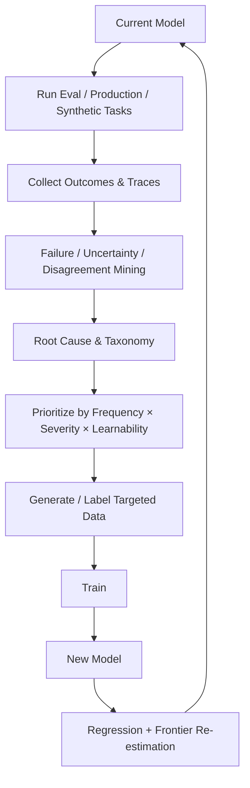
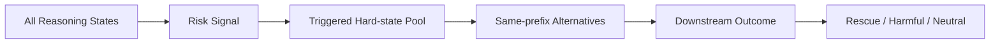
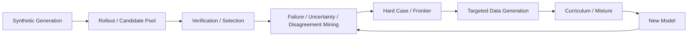

# 第 9 章 Hard Case Mining 与 Curriculum

> 所属体系：[`LLM_Agent_Data_Knowledge_System.md`](../LLM_Agent_Data_Knowledge_System.md)
>
> 前置章节：[`第 8 章 Rollout、Rejection Sampling 与 Candidate Selection`](./08_Rollout_Rejection_Sampling_and_Candidate_Selection.md)
>
> 关联章节：[`第 4 章 Reasoning Data 与 Process Supervision`](./04_Reasoning_Data_and_Process_Supervision.md)、[`第 7 章 Synthetic Data`](./07_Synthetic_Data_Generation_and_Synthesis.md)
>
> 本章目标：理解“下一批数据应该做什么”为什么是一个独立的数据策略问题，并掌握 Error-driven Sampling、Uncertainty Sampling、Disagreement Mining、Hard-negative Mining、Adversarial Generation、Capability Frontier、Active Data Selection 与 Curriculum Learning 的基本逻辑。
>
> 本章核心问题：**数据生产的真正瓶颈，通常不是“还能不能再生成 10 万条”，而是“下一条数据放在哪里，边际价值最高”。**

---

# 9.0 从“更多数据”到“更值钱的数据”

如果已经具备：

```text
Task Synthesis
      ↓
Model Rollout
      ↓
Verifier / Judge
      ↓
Candidate Selection
      ↓
Training Data
```

下一个问题自然会出现：

> **下一批 Task 应该生成什么？**

一种最简单的做法是继续随机采样：

```text
从原分布随机生成更多题
```

但随着模型变强，会出现大量样本：

```text
模型已经稳定会做
训练信号重复
错误率接近 0
几乎没有新的 decision pattern
```

此时继续增加数据量，边际收益会快速下降。

因此现代数据策略越来越关心：

```text
Where does the model still fail?
Where is it uncertain?
Where do models disagree?
Where can intervention change the result?
Which failure is important enough to fix?
```

这就是 Hard Case Mining 的出发点。

---

# 9.1 什么叫 Hard Case？

“难例”听起来很直观，但实际上至少有五种完全不同的定义。

---

## 9.1.1 Human-hard：对人来说难

例如：

```text
高等数学证明
复杂法律分析
冷门医学诊断
```

这是任务的**人类认知难度**。

但它不一定对模型难。

模型可能因为训练中见过大量模板而稳定答对。

---

## 9.1.2 Model-hard：对当前模型难

定义更接近：

```text
当前模型错误率高
或者成功率显著低于平均水平
```

例如：

```text
Task A：人觉得复杂，但模型成功率 95%
Task B：人觉得简单，但模型成功率 42%
```

对于当前数据策略，B 往往更值得研究。

所以：

> **Human Difficulty ≠ Model Difficulty。**

---

## 9.1.3 State-hard：同一道题，在某个中间状态特别难

这一层对 reasoning / agent 尤其重要。

同一道题可能前面都很顺，但某个 state 出现：

```text
分支选择
变量绑定
工具选择
状态冲突
关键约束遗漏
```

于是难点不在 task-level，而在 state-level。

可以写成：

```text
Task Difficulty
      ↓
Trajectory
      ↓
Local Hard State
```

这与前面第 4 章的思想一致：

```text
hard task
≠ hard state
```

---

## 9.1.4 Evaluation-hard：Judge / Verifier 也难判断

有些 case 对模型本身未必最难，却对评价系统很难。

例如：

```text
两个答案都部分正确
多条 Agent 路径都可接受
开放式写作偏好
复杂 long-horizon trajectory
```

这些 case 的难点在：

```text
label ambiguity
judge disagreement
verification cost
```

这类数据适合用于：

```text
Judge calibration
Gold set
Adjudication
Rubric refinement
```

---

## 9.1.5 Learning-hard：真正有训练价值的难例

最重要的是这一类。

一个样本即使当前模型答错，也不一定值得训练。

例如：

```text
题目本身有错误
标签不可验证
极端冷门知识
与目标产品无关
只能靠随机猜
```

这类 case 的 failure 并不一定具有高学习价值。

更合理的定义是：

> **Hard Case = 当前模型存在能力缺口，并且这个缺口对目标能力重要、可监督、可修复。**

因此可以写成一个数据策略近似：

$$
V_{data}(x)
\approx
Gap(x)
\times Importance(x)
\times Learnability(x)
\times Verifiability(x)
$$

这不是严格数学公式，而是一种决策框架。

---

# 9.2 Difficulty 与 Data Value 不是同一个概念

极难的数据不一定最值钱。

可以把数据粗略分成四个区域：

```text
                 Learning Value
                      ↑
                      |
       太难           |       Frontier
    几乎学不会         |      最有价值区域
                      |
----------------------+--------------------→ Difficulty
                      |
       容易但重要       |       太容易
     基础覆盖数据       |     大量重复
```

最常见的高价值区往往不是最右边，而是：

> **模型“差一点会”的 capability frontier。**

也就是：

```text
不是 0% success
也不是 100% success
而是中间区域
```

例如：

```text
success rate ≈ 30%–70%
```

经常比：

```text
0% 或 99.9%
```

具有更多可利用学习信号。

但具体区间必须由实验决定，不能机械套用。

---

# 9.3 Capability Frontier：模型能力边界

可以把一个模型对任务空间的表现想成：

```text
Easy Region
    ↓
Almost Always Correct

Frontier Region
    ↓
Sometimes Correct / Sometimes Wrong

Beyond Frontier
    ↓
Almost Always Fails
```

其中 Frontier Region 特别有价值，因为：

```text
模型已有部分能力
但决策不稳定
```

这意味着数据可能真正推动边界向外移动。

---

## 9.3.1 Frontier 不一定按“题目难度”等级排列

很多 benchmark 会给：

```text
Easy / Medium / Hard
```

但模型自己的 frontier 可能完全不同。

例如：

```text
复杂计算：模型很强
简单否定句：模型反而容易错
```

因此最好使用：

```text
model-conditioned difficulty
```

而不是只使用人工定义的 difficulty tag。

---

## 9.3.2 Frontier 是动态的

模型训练以后：

```text
旧 hard case
↓
变成 easy case
```

所以 Hard Case Pool 不能永久冻结。

更合理的是：

```text
Model v1
↓
Mine hard cases
↓
Train
↓
Model v2
↓
Re-evaluate same pool
↓
Mine new frontier
```

这就是 data-model co-evolution。

---

# 9.4 Error-driven Sampling：从真实失败出发

最直接的 hard case mining 方法是：

```text
Run Current Model
        ↓
Collect Failures
        ↓
Cluster / Taxonomize
        ↓
Sample Important Failure Modes
        ↓
Generate More Similar Cases
```

例如一个 Agent 线上失败分析发现：

```text
40%：漏调用工具
25%：参数格式错误
20%：调用后没验证
10%：提前停止
5%：其他
```

此时下一批数据不应该平均生成。

可以按：

```text
Failure Frequency
× Business Severity
× Learnability
```

排序。

---

## 9.4.1 Error Count 不等于 Priority

例如：

```text
错误 A：占 30%，只是多说一句废话
错误 B：占 2%，会误删用户文件
```

显然 B 的业务优先级可能更高。

因此 hard mining 应考虑：

```text
frequency
severity
business impact
safety impact
recoverability
training cost
```

---

# 9.5 Uncertainty Sampling

另一类常见方法是：

> 找模型最不确定的样本。

分类模型里很直观：

```text
P(A)=0.51
P(B)=0.49
```

说明接近决策边界。

LLM 可以使用：

```text
token entropy
min logprob
mean logprob
top1-top2 margin
sequence likelihood
answer distribution
self-consistency disagreement
```

等信号。

---

## 9.5.1 为什么 Uncertainty 有用？

因为很多时候：

```text
高 uncertainty
→ 模型边界附近
→ 新监督可能更有价值
```

于是可以：

```text
大量 unlabeled cases
↓
模型打 uncertainty
↓
优先人工 / verifier 标高 uncertainty case
```

这就是 active learning 的经典直觉。

---

## 9.5.2 但 Uncertainty ≠ Error

前面已经反复强调：

```text
Low confidence
≠ Wrong
```

同样：

```text
High uncertainty
≠ High data value
```

可能出现：

```text
模型很不确定，但最终一直答对
模型很不确定，是因为问题本身模糊
模型很不确定，但即使训练也难提升
```

所以 uncertainty 只能是一个 acquisition signal，而不是最终标签。

---

## 9.5.3 Calibration 很重要

如果模型 logprob 没有 calibration：

```text
0.9 confidence
```

不一定真的意味着 90% 正确率。

因此 uncertainty mining 最好做：

```text
confidence bucket
↓
empirical correctness
```

例如：

```text
[0.9,1.0] → 97% correct
[0.7,0.9] → 82%
[0.5,0.7] → 63%
```

否则 threshold 很难解释。

---

# 9.6 Disagreement Mining：模型之间不一致的地方

如果多个模型 / 多个采样结果对同一任务给出不同结果：

```text
Model A → answer X
Model B → answer Y
Model C → answer X
```

说明这个 case 可能处于某种能力边界。

这就是 disagreement mining。

---

## 9.6.1 来源一：Model-vs-Model Disagreement

例如：

```text
strong model vs weak model
old model vs new model
model family A vs model family B
```

特别有价值的是：

```text
Old Model correct
New Model wrong
```

它可能暴露 regression。

---

## 9.6.2 来源二：Same-model Multi-sample Disagreement

同一个模型多次采样：

```text
c1 → A
c2 → A
c3 → B
c4 → C
```

说明模型自身 decision instability 较高。

这和 self-consistency 直接相关。

---

## 9.6.3 来源三：Model-vs-Judge / Verifier Disagreement

例如：

```text
Model says: success
Environment says: failure
```

这类 case 特别适合 Agent 数据。

因为它暴露的是：

```text
self-evaluation failure
verification failure
```

---

# 9.7 Hard Negative Mining

Hard Negative 指：

> **看起来很合理，但存在关键错误的负例。**

例如：

```text
答案非常流畅
格式正确
逻辑大部分成立
但一个关键事实错了
```

这比：

```text
乱码
完全答非所问
```

更有训练价值。

---

## 9.7.1 为什么 Hard Negative 重要？

因为简单负例只教模型：

```text
“不要明显胡说八道”
```

Hard Negative 才能教：

```text
“两个看起来都不错时，真正关键区别在哪里”
```

典型来源：

```text
near-score candidates
wrong-but-high-confidence outputs
successful-looking failed agents
near-miss reasoning
constraint-missing answers
```

---

# 9.8 Near-miss Data：差一点做对的失败

Near-miss 是一类特别高价值的数据。

例如：

```text
数学：最后一步算错
代码：只差一个边界条件
Agent：完成更新但忘记验证
Reasoning：正确前缀后走错一个 branch
```

这类数据好在：

```text
大部分能力已经具备
失败原因局部明确
修复成本低
监督信号强
```

因此可以转成：

```text
Correction Data
Preference Pair
Recovery Data
Error Localization
```

---

# 9.9 Adversarial Generation：主动找模型弱点

除了被动收集失败，还可以主动生成挑战样本。

基本流程：

```text
Current Model Weakness
        ↓
Adversary / Generator
        ↓
Generate Challenging Tasks
        ↓
Current Model Attempts
        ↓
Keep Valid Failures
```

例如：

```text
普通约束：请输出 JSON
↓
对抗演化：
请只输出 JSON，字段顺序固定，某字段为空时省略，数字不能带单位……
```

---

## 9.9.1 Adversarial 不等于“把题写得怪”

低质量 adversarial data 常出现：

```text
刻意绕口
人为歧义
现实中没人会问
```

真正有价值的 adversarial generation 应该：

```text
保持任务有效性
保持目标分布相关性
只增加目标能力上的挑战
```

也就是：

> **Harder, but still valid and relevant.**

---

# 9.10 Active Learning：有限标注预算应该花在哪里？

假设有：

```text
100 万条 unlabeled rollout
```

人工只能标：

```text
1 万条
```

随机抽样不是唯一选择。

可以设计 acquisition function：

$$
a(x)=
\alpha U(x)
+\beta D(x)
+\gamma I(x)
+\delta S(x)
$$

其中例如：

```text
U = uncertainty
D = disagreement
I = business importance
S = severity / safety risk
```

然后优先标高 acquisition score 的 case。

---

## 9.10.1 不能只追“最难”

如果 acquisition 永远选择最难样本：

```text
标注成本会上升
任务可能不可学
数据分布会失真
基础能力覆盖会丢失
```

所以 active selection 通常需要：

```text
hardness
+
diversity
+
coverage
```

一起考虑。

---

# 9.11 Diversity-aware Hard Mining

假设有 10 万个失败 case，其中 8 万个都是同一种：

```text
订单 ID 格式错误
```

如果全部保留，训练集会严重偏斜。

因此 Hard Mining 常需要：

```text
Cluster failures
↓
Estimate cluster size
↓
Sample representative cases
↓
Keep rare high-severity cases
```

目标不是：

```text
复制失败频率
```

而是：

```text
覆盖 failure space
```

---

# 9.12 Curriculum Learning：为什么“按顺序学”可能有帮助？

Curriculum Learning 的直觉来自：

```text
先容易
再困难
```

例如 Agent：

```text
Stage 1：单步 tool call
Stage 2：多步但无错误恢复
Stage 3：多工具依赖
Stage 4：tool failure + recovery
Stage 5：long-horizon + side effects
```

理由是：

> 先建立基础技能，再学习复杂组合。

---

## 9.12.1 Curriculum 的三种常见维度

### Task Difficulty Curriculum

```text
easy → medium → hard
```

### Structural Complexity Curriculum

```text
single-step
→ multi-step
→ branching
→ long-horizon
```

### Error Complexity Curriculum

```text
无失败恢复
→ 单一失败
→ 多重异常
→ adversarial failure
```

---

# 9.13 Self-paced Learning：让模型能力决定进度

固定 curriculum 假设：

```text
所有模型都按同一顺序学
```

但更合理的可能是：

```text
Current Model Performance
        ↓
Estimate Current Frontier
        ↓
Select Next Data Band
```

这就是 self-paced / competence-aware 的直觉。

例如：

```text
当前 success > 90%
→ 提升难度

当前 success 30%–70%
→ 重点训练

当前 success < 5%
→ 可能先降难度 / 拆技能
```

---

# 9.14 为什么 Curriculum 不一定优于 Random Mixing？

Curriculum 很直觉，但不能当成定律。

可能失败的原因：

```text
难度定义错误
阶段之间分布差异过大
早期数据导致 overfitting
后期训练遗忘基础能力
模型本来就能同时学
```

因此必须有：

```text
Curriculum
vs
Random Shuffle
vs
Static Mixture
```

对照实验。

---

# 9.15 Anti-Curriculum / Hard-first 也可能有效

有些场景反而会：

```text
先训练 hard / informative cases
```

因为：

```text
easy data 已经学会
hard data 信息密度更高
```

这说明真正目标不是遵守：

```text
easy → hard
```

而是最大化：

> **单位训练预算的 learning gain。**

---

# 9.16 Data Marginal Value：下一条数据到底值多少？

从数据策略角度，真正想知道的是：

$$
\Delta V(x)
=
Performance(D \cup \{x\})
-
Performance(D)
$$

也就是：

> 加这一条数据，模型提升多少？

现实中当然几乎不可能逐条 retrain 测量。

所以会使用 proxy：

```text
model loss
uncertainty
novelty
influence
similarity
failure frequency
judge disagreement
reward gap
```

来估计 marginal value。

---

## 9.16.1 Duplicate Data 的 Marginal Value 很低

即使数据完全正确：

```text
第 1 条：查询订单 123
第 2 条：查询订单 456
第 10000 条：查询订单 999
```

如果 decision pattern 完全相同：

```text
lookup_order(id)
```

边际价值会快速下降。

这也是为什么 Data Curation 和 Hard Mining 必须结合。

---

# 9.17 Model-specific Hard Case

“Hard” 必须写清楚相对于哪个模型。

例如：

```text
Qwen3-8B hard
≠
GPT-class model hard
```

甚至：

```text
Model v1 hard
≠
Model v2 hard
```

因此 hard-case dataset 最好记录：

```text
mined_by_model
model_version
prompt_version
sampling_config
measured_success_rate
```

否则过几个月就不知道“hard”是怎么来的。

---

# 9.18 Hard Case 与 Eval Set 的关系

失败 case 很适合进入 regression eval。

流程：

```text
Production / Benchmark Failure
        ↓
Validated Failure
        ↓
Regression Set
        ↓
Training Data Generation
```

但这里必须严格隔离。

不应该：

```text
把 regression case 原题放进训练
然后继续用同一题证明提升
```

更合理的是：

```text
Failure seed
↓
生成同能力但不同实例的 training data
↓
原 failure case 留在 hidden regression
```

这样测到的才更接近泛化。

---

# 9.19 Failure Seed → Synthetic Family

一个特别实用的数据生产模式是：

```text
真实 Failure
↓
Root Cause
↓
Extract Abstract Pattern
↓
Generate New Variants
↓
Verify
↓
Training Family
```

例如真实失败：

```text
用户说：
“取消明天的会议，但周会不要动。”

Agent 把两个会议都取消了。
```

抽象 failure pattern：

```text
negative constraint handling
```

然后生成：

```text
修改订单，但 VIP 订单不要动
删除文件，但保留 .env
批量发邮件，但不要发给外部联系人
```

这样才能从一个 case 变成一种能力数据。

---

# 9.20 Root Cause Mining：不要按表面错误生成更多表面样本

失败：

```text
Agent 调错了 delete_file
```

表面看是：

```text
Wrong Tool
```

但根因可能是：

```text
tool description 太相似
没理解用户是否确认
上下文里目标文件指代错误
```

如果不做 root cause：

```text
继续生成更多 delete_file 样本
```

可能根本解决不了问题。

因此推荐：

```text
Failure
↓
Observed Error
↓
Root Cause Hypothesis
↓
Target Capability
↓
Data Intervention
```

---

# 9.21 Hard Case Mining 的一个完整闭环



这已经非常接近 Data Flywheel。

---

# 9.22 研究实例一：More Thinking —— “难题”不等于“值得继续算”

在 **More Thinking Is Not Always Better** 中，固定增加 reasoning depth 并不会单调提升效果。

已有结果表现为：

```text
Depth 1 → 69.04%
Depth 2 → 74.09%
Depth 3 → 70.97%
```

这说明一个非常重要的数据策略问题：

> **不能只按题目整体难度决定计算预算，而需要看当前 reasoning state 是否还存在值得继续解决的 gap。**

也就是说：

```text
Hard Task
≠
Continue-worthy State
```

有些 hard task 当前状态已经足够好，继续反而可能产生：

```text
Right → Wrong
```

有些原本错误的 state 继续以后会：

```text
Wrong → Right
```

因此更有价值的数据标签不是：

```text
hard / easy
```

而是：

```text
current state
+
continuation benefit
```

这就是 state-conditioned curriculum 的一个实例。

---

# 9.23 研究实例二：K17 —— Low-confidence State 作为 Mining Signal

RoTFuse / K17 中一个非常自然的 hard-state mining 信号是：

```text
min token logprob
```

当前 provisional unit 如果出现低置信 token，可以把它视为：

```text
suspicious state
```

然后触发：

```text
same-prefix candidate exploration
```

这里必须保持严谨：

```text
Low confidence
≠ Error
≠ Recoverable
```

所以 K17 的数据逻辑实际上是：



也就是说：

> uncertainty / low-confidence 负责 **acquisition**，最终 outcome 负责 **offline supervision**。

这是一个很标准的 Hard Case Mining 结构。

---

## 9.23.1 为什么触发池本身不等于“错误池”？

这是非常重要的科学口径。

一个低置信触发池里面可能同时有：

```text
原路径正确
原路径错误
可被替代路径救回
不可被救回
替代路径反而有害
```

因此触发只是在做：

```text
candidate acquisition
```

不能把它描述为：

```text
error detection
```

这一点对所有 uncertainty-based data mining 都成立。

---

# 9.24 Hard-state Pool 如何避免 Selection Bias？

如果所有研究数据都来自：

```text
low-confidence states
```

那么你最终学到的结论只适用于这个条件分布：

```text
P(data | triggered)
```

不能直接外推到：

```text
P(all reasoning states)
```

所以需要明确：

```text
sampling frame
trigger coverage
untriggered distribution
```

必要时保留随机 baseline sample。

---

# 9.25 Curriculum for Agent：一个具体设计

假设目标是训练一个企业内部操作 Agent。

可以设计：

### Stage 1：Tool Semantics

```text
单工具
明确请求
无异常
```

### Stage 2：Tool Selection

```text
多个相似工具
需要选择
```

### Stage 3：Multi-step Dependency

```text
先查 → 再改
```

### Stage 4：Constraint Handling

```text
多个正负约束
```

### Stage 5：Failure Recovery

```text
timeout
permission denied
not found
```

### Stage 6：Long Horizon

```text
跨多个系统
依赖状态持续维护
```

### Stage 7：Adversarial / Ambiguous

```text
冲突约束
模糊指代
高风险 side effects
```

这种 curriculum 的重点是：

```text
按 decision complexity 递增
```

而不只是按 prompt 字数递增。

---

# 9.26 Curriculum 与 Mixture 应该一起设计

真实训练通常不是：

```text
Stage 1 全删
→ 只训 Stage 2
→ 再只训 Stage 3
```

而更可能是：

```text
Stage 1：基础数据占比高
Stage 2：加入中等难度
Stage 3：hard case 占比逐渐上升
```

同时保留部分基础数据防 regression。

例如概念上：

```text
Early:
Easy 60%
Medium 30%
Hard 10%

Later:
Easy 20%
Medium 40%
Hard 40%
```

这只是示意，不是固定配方。

---

# 9.27 Regression-aware Curriculum

如果一直强化 hard case，可能导致：

```text
目标能力提升
但通用能力下降
```

所以每轮训练都要看：

```text
Target Eval
+
General Capability Eval
+
Safety Eval
+
Regression Set
```

Curriculum 不是只看一个目标指标。

---

# 9.28 Hard Case Pool 的数据结构

建议至少记录：

```json
{
  "case_id": "...",
  "source": "production/eval/synthetic",
  "mined_by_model": "model_v3",
  "mining_signal": {
    "type": "uncertainty",
    "value": 0.82
  },
  "failure_type": "observation_grounding",
  "severity": "high",
  "business_priority": 4,
  "verifiable": true,
  "model_success_rate": 0.35,
  "human_difficulty": "medium",
  "frontier_band": "frontier",
  "root_cause": "ignored tool return status",
  "training_action": "generate_recovery_variants",
  "regression_holdout": true
}
```

这样 hard case 才从：

```text
“这题挺难”
```

升级成真正的数据资产。

---

# 9.29 Hard Case Mining 的指标

至少可以看：

### Mining Precision

挖出来的 case 中，有多少真的属于目标 failure？

### Coverage

覆盖了多少不同 failure category？

### Novelty

是不是大量重复旧模式？

### Frontier Density

样本是否集中在有学习价值的能力边界？

### Verifiability Rate

有多少 case 能可靠判断结果？

### Training Yield

挖出的 case 中有多少最终能转换成可训练数据？

### Downstream Gain

训练后目标能力实际提升多少？

---

# 9.30 Hard Case Mining 的常见失败模式

### 失败 1：只选所有错误样本

错误不等于有价值；可能是坏题、不可学、低优先级。

### 失败 2：只选最低置信样本

低置信可能只是任务模糊或 calibration 问题。

### 失败 3：Hard Pool 全是同一种 failure

数量很多，但 decision diversity 很低。

### 失败 4：用人工 difficulty 替代 model difficulty

模型自己的 frontier 可能完全不同。

### 失败 5：训练数据和 regression case 泄漏

最后只是记住 hard case。

### 失败 6：Adversarial 数据不真实

生成了一堆没人会遇到的怪题。

### 失败 7：只追最难，不看 learnability

大量训练预算耗在几乎学不会的 case。

### 失败 8：Curriculum 没有 random baseline

无法证明排序本身带来收益。

### 失败 9：Hard case 定义没有模型版本

几个月后无法解释为什么它曾经叫 hard。

### 失败 10：只分析 task-level hard，不看 state-level hard

会错过真正的局部决策瓶颈。

### 失败 11：Mining signal 和 training label 混为一谈

uncertainty 可以负责筛样本，但不能自动成为 correctness label。

### 失败 12：Frontier 移动后不更新数据策略

旧 hard case 已经变 easy，却继续大量 oversample。

---

# 9.31 从数据岗位视角，这一章实际做什么？

工作可能包括：

```text
跑当前模型批量 eval / rollout
统计 failure distribution
做 error taxonomy
按 confidence / entropy / disagreement 筛样本
建立 hard-case pool
做 failure clustering
设计 acquisition function
做 adversarial task generation
从真实 failure 生成 synthetic family
设计 curriculum stages
动态调整 data mixture
维护 regression holdout
分析 capability frontier
计算不同数据 source 的 marginal gain
```

所以 Hard Case Mining 已经不只是数据清洗，而非常接近：

```text
Evaluation
+
Data Strategy
+
Experiment Design
```

---

# 9.32 一个通用数据策略：下一批数据该做什么？

可以使用下面的决策链：

```text
1. 当前模型最重要的 failure 是什么？
        ↓
2. failure frequency 和 severity 多大？
        ↓
3. 是 task-level 还是 state-level bottleneck？
        ↓
4. 能否可靠验证？
        ↓
5. 模型是不是已经部分会了？
        ↓
6. 能不能生成 decision-diverse variants？
        ↓
7. 训练数据和 regression 是否隔离？
        ↓
8. 加入训练后如何证明 causal gain？
```

如果 1–8 都答得清楚，才是真正的数据策略。

---

# 9.33 本章关键词

| 术语 | 一句话理解 |
|---|---|
| Hard Case | 当前模型存在重要、可监督能力缺口的样本 |
| Model Difficulty | 相对于当前模型测得的难度 |
| State Difficulty | 轨迹中某个局部 state 的决策难度 |
| Capability Frontier | 模型从稳定会到稳定不会之间的能力边界 |
| Error-driven Sampling | 从真实失败中选择下一批数据 |
| Uncertainty Sampling | 优先选择模型不确定的样本 |
| Disagreement Mining | 从模型 / 采样 / Judge 不一致中找边界样本 |
| Hard Negative | 看起来合理但存在关键错误的负例 |
| Near Miss | 大部分正确、只在局部失败的样本 |
| Adversarial Generation | 主动生成针对模型弱点的有效挑战样本 |
| Active Learning | 在有限标注预算下选择最值得标的数据 |
| Acquisition Function | 决定优先选哪些数据的评分函数 |
| Curriculum Learning | 按能力 / 难度阶段组织训练数据 |
| Self-paced Learning | 根据当前模型能力动态选择下一阶段数据 |
| Marginal Data Value | 新数据带来的额外学习收益 |
| Regression Set | 用来保证旧能力不退化的固定评测集合 |
| Failure Family | 从一个失败抽象出的同类能力模式 |
| Mining Signal | 用来选样本的信号，不一定等于训练标签 |

---

# 9.34 面试 / 自检问题

学完这一章至少应该能回答：

1. **什么叫 Hard Case？为什么不能简单等于“模型答错的题”？**
2. **Human Difficulty 和 Model Difficulty 有什么区别？**
3. **为什么 capability frontier 往往比最难区域更有训练价值？**
4. **什么是 Error-driven Sampling？**
5. **Uncertainty Sampling 的基本逻辑是什么？**
6. **为什么低置信不能直接当错误标签？**
7. **什么是 Disagreement Mining？有哪些来源？**
8. **Hard Negative 和普通 Negative 有什么区别？**
9. **Near-miss 为什么通常信息量较高？**
10. **Adversarial Data 怎么避免变成不真实怪题？**
11. **Active Learning 里的 acquisition function 可以包含哪些信号？**
12. **为什么 acquisition 不能只追最难？**
13. **Curriculum Learning 为什么不一定优于 random mixing？**
14. **什么时候可能 Hard-first 反而更合理？**
15. **什么是 model-specific hard case？为什么要记录模型版本？**
16. **怎么从一个真实 failure 生成一整个 synthetic family？**
17. **为什么训练 hard case 时必须保留 hidden regression？**
18. **Task-level difficulty 和 State-level difficulty 为什么要分开？**
19. **More Thinking 项目说明了哪种 state-level curriculum 问题？**
20. **K17 的 low-confidence trigger 在数据角度属于 label 还是 acquisition signal？**
21. **如何判断一个 hard-case mining pipeline 是否真的有效？**
22. **如果 hard-case 数据训练后目标 benchmark 涨了，但通用能力掉了，下一步怎么办？**
23. **什么是 marginal data value？为什么实际很难直接测？**
24. **如果下一轮只能生产 1 万条数据，你会如何决定生产什么？**

---

## 9.34.1 一个高质量面试回答模板

如果面试官问：

> “模型现在还有很多错误，你怎么决定下一批数据做什么？”

可以回答：

```text
我不会直接把所有错误都放进训练。

第一步先按 failure taxonomy 做归因，区分模型错误、系统错误和坏题；
第二步结合 frequency、severity、business importance 和 verifiability 排优先级；
第三步测当前模型在这些能力上的 success rate，找 capability frontier；
第四步从真实 failure 抽象 root cause，生成同能力但不同实例的 variants；
第五步保留原始 failure 作为 hidden regression，避免 train/eval leakage；
第六步通过 random / static mixture baseline 验证 targeted mining 或 curriculum 是否真的带来额外收益。
```

如果想再进一步，可以补：

> **Hardness 只是 acquisition signal，真正的数据价值还要看 learnability、coverage、diversity 和 downstream gain。**

---

# 9.35 本章最终要形成的认识

把这一章压缩成一句话：

> **好的数据策略不是一直生产更多数据，而是在模型能力边界附近，找到最值得被监督、最可能被学会、又对真实目标最重要的经验。**

因此整个第 7–9 章可以连成：



到这里，第二层 `Data Production & Synthesis` 的核心逻辑已经形成：

```text
Human defines target
        ↓
Synthetic generation scales data
        ↓
Rollout exposes model behavior
        ↓
Selection converts behavior into learning signal
        ↓
Hard mining finds the next valuable frontier
        ↓
Curriculum / mixture allocates training budget
```

下一部分将正式进入：

> **III. Agent Tasks, Environments & Trajectories**

也就是不再只从“已有 trajectory 怎么处理”出发，而是反过来设计：

```text
什么叫一个好的 Agent Task？
环境应该怎样搭？
成功条件怎么定义？
怎样保证任务有真实 decision depth？
怎样避免做出一堆 toy tasks？
```

下一章是：

> **第 10 章 Agent Task Design：目标、约束、状态、成功条件与任务难度设计。**