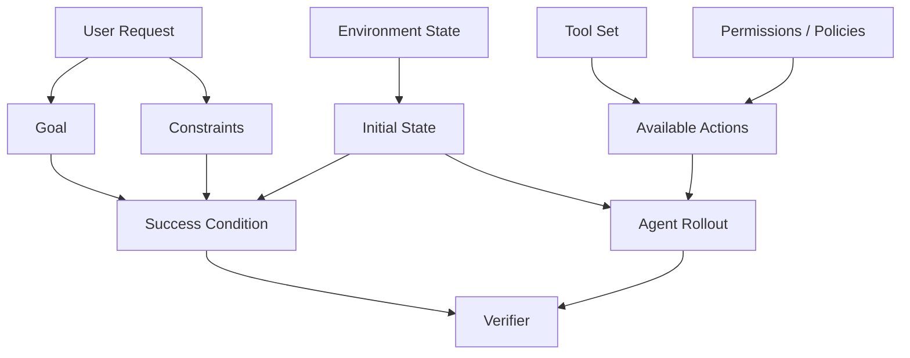
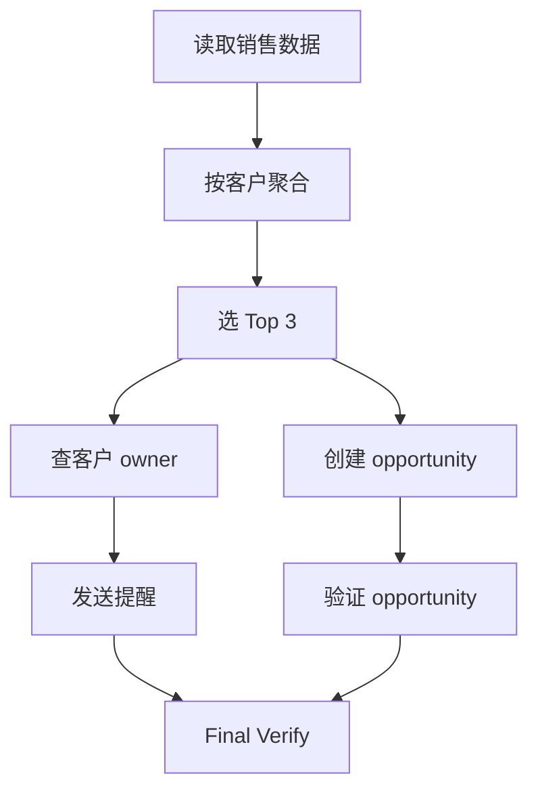

# 第 10 章 Agent Task Design：任务定义、难度控制与可验证性

> 所属体系：[`LLM_Agent_Data_Knowledge_System.md`](../LLM_Agent_Data_Knowledge_System.md)
>
> 前置章节：[`第 9 章 Hard Case Mining 与 Curriculum`](./09_Hard_Case_Mining_and_Curriculum.md)
>
> 关联章节：[`第 5 章 Tool-use Data 与 Agent Trajectory Data`](./05_Tool_Use_and_Agent_Trajectory_Data.md)、[`第 8 章 Rollout、Rejection Sampling 与 Candidate Selection`](./08_Rollout_Rejection_Sampling_and_Candidate_Selection.md)
>
> 本章目标：理解 Agent Task 为什么不是一句 prompt，而是一份完整的 **Task Contract**；掌握 Goal、Initial State、Available Tools、Constraints、Hidden State、Success Condition、Termination、Side Effects、Permissions 与 Difficulty 的设计方法。
>
> 本章核心问题：**一个好的 Agent Task，必须同时定义“要做什么、在什么世界里做、允许怎么做、什么算成功、什么算失败，以及我们凭什么知道它真的做完了”。**

---

# 10.0 为什么 Agent Task Design 是一门独立问题？

普通问答任务往往可以简化为：

```text
Question
   ↓
Answer
```

但 Agent 任务不是这样。

例如：

```text
“把我明天下午三点和产品组的会议改到周五下午三点，并通知所有参会人。”
```

要真正执行，至少还需要知道：

```text
当前日历里有哪些会议？
“产品组会议”到底是哪一个 event？
有哪些参会人？
修改会议需要什么权限？
通知参会人要不要额外发邮件？
如果周五三点冲突怎么办？
什么算“改好了”？
工具返回 success 就算完成吗？
是否允许创建一个新会议代替修改原会议？
```

所以 Agent Task 的真实结构更像：



也就是说：

> **Task Design 决定的不是“模型看到什么 prompt”，而是整场决策问题的边界。**

---

# 10.1 Prompt、Task、Episode、Benchmark Case 要区分

这几个词在 Agent 语境里经常混在一起。

## 10.1.1 Prompt

Prompt 是模型收到的文本 / 消息输入。

例如：

```text
“把订单 1847 取消掉。”
```

它只是任务的一部分。

---

## 10.1.2 Task

Task 是完整目标与规则：

```text
用户目标
+
初始环境状态
+
可用工具
+
约束
+
权限
+
成功条件
+
终止条件
```

---

## 10.1.3 Episode

Episode 是某个 Agent 在该 Task 上实际运行一次产生的过程：

```text
Task
↓
Agent Rollout
↓
Success / Failure / Timeout
```

同一个 Task 可以产生很多 episode。

---

## 10.1.4 Benchmark Case

Benchmark case 通常是一个**冻结的 Task 实例 + 评测规则**。

因此：

```text
Prompt ⊂ Task
Task + Agent Runtime → Episode
Frozen Task + Verifier + Protocol → Benchmark Case
```

这几个层级不分清，后面很容易发生“换了环境却说是同一个任务”“只改 prompt 却认为 benchmark 没变”之类的问题。

---

# 10.2 Task Contract：一个 Agent Task 至少要定义什么？

可以把完整任务写成：

$$
T = (G, S_0, A, C, P, H, V, \tau_{term})
$$

其中：

- $G$：Goal，目标；
- $S_0$：Initial State，初始环境状态；
- $A$：Available Actions / Tools；
- $C$：Constraints，约束；
- $P$：Permissions / Policies；
- $H$：Hidden State / Latent Environment Information；
- $V$：Verifier / Success Condition；
- $\tau_{term}$：Termination Condition。

更工程化地，可以使用下面的 schema：

```json
{
  "task_id": "calendar_001",
  "user_request": "把产品组会议改到周五下午三点，并通知所有参会人。",
  "initial_state": "...",
  "available_tools": ["calendar.search", "calendar.update", "email.send"],
  "constraints": [
    "不得创建重复会议",
    "不得修改其他会议"
  ],
  "permissions": [
    "calendar:write",
    "email:send"
  ],
  "hidden_state": "...",
  "success_condition": "目标会议时间被更新且参会人通知完成",
  "forbidden_side_effects": [
    "其他会议被修改",
    "重复发送通知"
  ],
  "termination": {
    "max_steps": 12,
    "timeout_seconds": 120
  },
  "verifier": "calendar_state_and_notification_check"
}
```

这里最重要的不是字段名，而是：

> **一个 Task 必须能够被独立重建和验证。**

---

# 10.3 Goal：用户到底想完成什么？

Goal 是任务设计的第一层。

但真实用户目标经常不是表面文字本身。

例如：

```text
“帮我把明天的会议取消掉。”
```

可能隐含：

```text
找到正确会议
确认是明天
执行取消
通知参会人
不要取消同名其他会议
```

所以需要区分：

```text
Surface Request
        ↓
Operational Goal
        ↓
Success State
```

---

## 10.3.1 Goal 应尽量写成 State，而不是一句自然语言

最弱的 success 定义：

```text
Agent 最后说“已经取消”。
```

更强的定义：

```text
calendar.events[event_id].status == "cancelled"
```

再完整一点：

```text
目标 event cancelled
AND
其他 event unchanged
AND
required notifications sent exactly once
```

因此 Agent Task 的目标最好尽量转成：

> **Target Environment State**

而不是只依赖最终自然语言。

---

# 10.4 Initial State：同一句任务，在不同环境里可能完全不是同一道题

例如：

```text
“取消订单 1847。”
```

如果 initial state 是：

```text
status = pending
```

任务可直接完成。

如果是：

```text
status = shipped
```

可能业务规则不允许取消。

如果是：

```text
order does not exist
```

正确行为又不同。

所以：

> **Agent Task 的难度和正确策略，高度依赖 initial environment state。**

---

## 10.4.1 Initial State 至少应包含

```text
对象状态
已有记录
权限状态
资源状态
历史事件
当前时间
用户身份
依赖对象
```

例如日历任务里：

```text
当前时间
已有会议
与会者
会议室占用
时区
权限
```

缺其中任何一项，都可能让 task 变成欠定义。

---

# 10.5 Hidden State：Agent 不应该一开始知道所有答案

真实 Agent 通常处于 partial observability。

例如：

```text
用户问：
“订单 1847 能取消吗？”
```

Agent 初始只知道：

```text
order_id = 1847
```

订单状态隐藏在数据库里。

Agent 必须调用：

```text
get_order(1847)
```

才能看到：

```text
status = shipped
```

这就是 Hidden State。

---

## 10.5.1 为什么 Hidden State 很重要？

如果任务 prompt 里直接写：

```text
订单 1847 状态是 shipped，不能取消。
```

那么 Agent 根本不需要工具。

原本测试的是：

```text
Information Acquisition
+
Tool Use
+
Decision
```

最后退化成：

```text
Reading Comprehension
```

所以 Agent benchmark 设计时，必须检查：

> **需要通过环境查询获得的信息，是否被 prompt 泄漏了？**

---

# 10.6 Tool Set：工具不是“越多越难”

很多 toy benchmark 会人为给很多工具：

```text
20 tools
30 tools
50 tools
```

然后把 Tool Count 当难度。

但如果任务里只有一个工具语义明显匹配：

```text
cancel_order
```

那么即使有 50 个无关工具，真实决策难度也可能很低。

更重要的是：

```text
Tool Semantic Overlap
Tool Dependency
Argument Ambiguity
Tool Side Effects
Tool Availability
```

---

## 10.6.1 Tool Ambiguity

例如：

```text
search_order
lookup_order
get_order_details
query_order_history
```

多个工具语义接近，会增加 selection difficulty。

---

## 10.6.2 Tool Dependency

例如：

```text
search_customer
        ↓
得到 customer_id
        ↓
get_orders(customer_id)
        ↓
得到 order_id
        ↓
cancel_order(order_id)
```

这比单步：

```text
cancel_order(order_id)
```

困难很多，因为存在 dependency chain。

---

# 10.7 Constraints：Agent Task 的真正复杂度经常藏在约束里

例如：

```text
“删除重复文件。”
```

很简单。

但：

```text
“删除重复文件，但保留最新版本；
任何 .env 文件都不能删除；
共享目录只能读不能写；
删除前先生成清单。”
```

难度明显增加。

Constraint 可以分为：

```text
Positive Constraint
必须做什么

Negative Constraint
不能做什么

Conditional Constraint
满足条件时才能做

Ordering Constraint
必须先 A 再 B

Cardinality Constraint
最多 / 至少 / 恰好执行几次

Temporal Constraint
时间窗口 / 截止时间

Cross-step Constraint
前面获取的信息决定后面动作
```

---

## 10.7.1 Negative Constraint 是特别容易漏的能力

例如：

```text
“给所有内部员工发通知，但不要发给外部联系人。”
```

很多 Agent 会把“发给谁”做对，但忘掉：

```text
不要发给谁
```

因此 Negative Constraint Handling 是很值得单独设计 task family 的能力。

---

# 10.8 Permissions：正确答案不只取决于“能不能”，还取决于“允不允许”

一个 Agent 即使技术上可以调用工具，也未必有权限这么做。

例如：

```text
refund_order
```

Agent 可能看到：

```text
tool available = true
```

但当前用户权限是：

```text
refund_limit = 100 USD
```

如果订单金额是 500 USD，正确行为可能是：

```text
escalate
```

而不是直接退款。

因此 Task Contract 中需要区分：

```text
Tool Availability
≠
Authorization
```

这对于安全 Agent 尤其重要。

---

# 10.9 Success Condition：什么才算真的完成？

Success Condition 是 Agent benchmark 最容易设计差的地方之一。

一个任务可能有多个层级。

### Action Success

```text
API 返回 200
```

### Subgoal Success

```text
会议时间被修改
```

### Task Success

```text
会议时间被修改
+
通知参会人
```

### Policy-compliant Success

```text
任务完成
+
没有修改其他会议
+
没有重复通知
```

所以：

```text
Tool Success
⊂
Subgoal Success
⊂
Task Success
⊂
Policy-compliant Success
```

---

## 10.9.1 Success Condition 最好机器可验证

优先级通常是：

```text
Environment State Check
>
Executable Rule
>
Deterministic Program
>
Structured Grader
>
LLM Judge
>
Natural-language Self-report
```

并不是说 LLM Judge 没用，而是：

> 如果能直接查数据库状态，就不要让 Judge 猜数据库到底改没改。

---

# 10.10 Forbidden Side Effects：完成目标不等于行为正确

例如：

```text
用户要求：
“删除重复文件。”
```

Agent 最终确实没有重复文件了。

但它做的是：

```text
把整个目录删掉
```

从目标函数看：

```text
duplicate_count = 0
```

但显然不是合理成功。

因此 success 条件通常要加入：

```text
Goal Achieved
AND
Required Constraints Satisfied
AND
Forbidden Side Effects Absent
```

---

## 10.10.1 Side-effect 类型

```text
Unexpected Writes
Unauthorized Writes
Duplicate Actions
Over-deletion
Over-sharing
Extra Emails
Wrong Recipient
Resource Leakage
Irreversible Change
```

Agent task design 如果只看“有没有达到目标”，会系统性奖励危险 shortcut。

---

# 10.11 Termination Condition：什么时候必须停止？

任务不能无限跑。

需要定义：

```text
Success Termination
Failure Termination
Timeout
Max Steps
Budget Exhaustion
Unrecoverable Error
Policy Block
User Clarification Needed
```

---

## 10.11.1 Premature Stop 与 Endless Loop

两个常见失败：

```text
Premature Termination
任务没完成就说完成
```

以及：

```text
Non-termination
已经完成还不断调用工具
```

所以 Agent task 不只测“会不会做”，也测：

> **会不会在正确的时候停。**

---

# 10.12 Task Feasibility：不是所有用户请求都应该成功执行

例如：

```text
“取消已经发货的订单。”
```

如果业务规则禁止，正确 outcome 不是：

```text
task_success = 0
```

而可能是：

```text
valid refusal / infeasible handled correctly
```

因此至少应区分：

```text
Feasible + Completed
Feasible + Failed
Infeasible + Correctly Handled
Infeasible + Hallucinated Success
```

这比简单二分类：

```text
success / failure
```

更准确。

---

# 10.13 Task Decomposition：复杂 Agent 任务通常是一个依赖图

很多任务并不是线性步骤。

例如：

```text
“找到过去 30 天销售额最高的三个客户，
给他们创建续约机会，
并给对应销售负责人发提醒。”
```

可能分解为：



因此 task complexity 应考虑：

```text
Dependency Depth
Branching Factor
Number of Required Subgoals
Cross-step Information Flow
Join Complexity
```

而不只是：

```text
Tool Call Count
```

---

# 10.14 Decision Complexity：真正的 Agent 难度在哪里？

这是本章最重要的概念之一。

两条 trajectory：

### Task A

```text
10 个工具调用
但每一步下一步都是唯一确定的
```

### Task B

```text
3 个工具调用
但每一步都有多个合理动作
且错误动作会导致不可逆后果
```

Task B 可能更难。

因此：

> **Trajectory Length ≠ Decision Complexity。**

---

## 10.14.1 可以从哪些维度描述 Decision Complexity？

### 1. Branching Factor

每个 state 有多少 plausible actions？

### 2. Dependency Depth

后续 action 需要依赖多少前序 observation？

### 3. Partial Observability

关键事实是否必须主动查询？

### 4. Constraint Density

同时需要满足多少约束？

### 5. Irreversibility

错误 action 是否可以恢复？

### 6. Delayed Feedback

错误多久以后才暴露？

### 7. Recovery Requirement

是否需要处理 timeout、tool error、unexpected observation？

### 8. State Tracking Load

Agent 需要记住多少跨步骤信息？

### 9. Tool Ambiguity

多个工具是否语义接近？

### 10. Verification Burden

完成后是否需要额外验证？

可以把任务难度粗略看成：

$$
D_{task} = f(B, L, O, C, I, F, R, M, A, V)
$$

这里不是固定公式，而是帮助构造 difficulty taxonomy。

---

# 10.15 Long-horizon 不等于“强行拉长”

很多数据为了制造长轨迹，会写成：

```text
查 A
查 B
查 C
查 D
查 E
```

但如果五步彼此独立，只是机械重复，这并不是真正 long-horizon reasoning。

真正 long-horizon 应该有：

```text
早期决策影响后续
状态持续变化
跨步依赖
中间结果必须被记住
错误可能延迟暴露
需要动态重规划
```

所以：

> **Long-horizon 的关键不是长度，而是 temporal dependency。**

---

# 10.16 Reversibility：可逆与不可逆动作的任务价值不同

例如：

```text
search
read
preview
```

通常可逆 / 无副作用。

而：

```text
send_email
delete_file
transfer_money
cancel_order
```

可能不可逆。

因此高质量 task 应明确：

```text
Read-only actions
Reversible writes
Irreversible writes
High-risk actions
```

并测试 Agent 是否：

```text
先获取信息
必要时确认
执行动作
验证结果
```

而不是直接冒险执行。

---

# 10.17 Clarification：有些任务不应该直接执行

例如用户说：

```text
“把那个会取消了。”
```

如果日历中有三个可能匹配的会议，正确策略可能是：

```text
Ask Clarifying Question
```

而不是猜。

因此 Agent Task 需要包含：

```text
Ambiguity Level
Clarification Requirement
```

---

## 10.17.1 Clarification Task 的难点

不能把所有模糊表达都设计成“必须问”。

例如：

```text
“帮我查天气。”
```

如果上下文已经提供 location，则无需澄清。

所以真正评测的是：

> **是否存在完成任务所必需、但当前不可推断的信息。**

---

# 10.18 Toy Task vs Realistic Task

### Toy Task

```text
用户：查订单 123
Tool: get_order(id)
```

适合测：

```text
function calling
argument filling
```

但不足以代表真实 Agent 能力。

### Realistic Task

可能包含：

```text
模糊用户表达
多个候选实体
跨工具依赖
权限
工具失败
隐藏状态
负约束
副作用
验证
```

---

## 10.18.1 Toy Task 不是没用

Toy Task 很适合做：

```text
能力单元测试
回归测试
错误定位
训练早期 curriculum
```

问题在于：

> **不能用 toy task 的高分直接宣称 general agent capability。**

---

# 10.19 Task Template：模板化生成怎样避免 Fake Diversity？

一个 task family 可以有模板：

```text
“把 {entity} 从 {state_a} 改成 {state_b}，
但不要影响 {protected_entity}。”
```

模板能扩规模，但容易制造：

```text
换实体名
换数字
换时间
```

这样的 surface diversity。

真正要变化的是：

```text
decision pattern
constraint structure
tool dependency
hidden state
failure mode
```

例如同样是订单任务，可以变化：

```text
订单存在 / 不存在
pending / shipped
单订单 / 多候选订单
用户有权限 / 无权限
API 正常 / timeout
需取消 / 需升级处理
```

这才形成 structural diversity。

---

# 10.20 Task Generator：任务生成器需要和 Verifier 一起设计

一个常见失败是：

```text
先让 LLM 批量生成 Task
↓
最后才发现很多 Task 无法自动验证
```

更稳妥的方法是：

```text
Environment State Generator
        ↓
Goal Generator
        ↓
Task Prompt Generator
        ↓
Verifier Generator / Rule
```

也就是说：

> **Task Generation 与 Ground Truth Generation 应尽量同源。**

---

## 10.20.1 从 Environment 反向生成 Task

例如先生成数据库：

```text
orders = {...}
customers = {...}
```

再从真实 state 生成：

```text
“取消金额低于 100 且未发货的订单。”
```

然后 success condition 可以程序化计算。

这比单独让 LLM 编任务再猜答案可靠得多。

---

# 10.21 Difficulty Calibration：任务难度必须靠模型行为校准

设计者觉得“难”不算数。

真正应该跑模型看：

```text
Success Rate
Step Count
Tool Error Rate
Recovery Rate
Clarification Rate
Verifier Failure Mode
```

例如：

```text
Easy      success > 90%
Medium    success ≈ 60–90%
Hard      success ≈ 20–60%
Frontier  对目标模型最有训练价值的区域
```

这些区间只是示意，不能机械使用。

核心是：

> **Difficulty 是 model-relative 的。**

---

# 10.22 Difficulty 不能只用 Success Rate

两组任务都可能：

```text
success = 50%
```

但原因不同。

### Set A

```text
工具 schema 太乱
```

### Set B

```text
需要复杂跨步规划
```

所以最好进一步分解：

```text
Understanding Difficulty
Planning Difficulty
Tool-selection Difficulty
Argument Difficulty
Observation Difficulty
State-tracking Difficulty
Recovery Difficulty
Verification Difficulty
```

这样 curriculum 和 failure-driven synthesis 才有方向。

---

# 10.23 Train / Eval Split：Agent Task 最容易发生“模板泄漏”

如果训练集：

```text
取消订单 1001
取消订单 1002
取消订单 1003
```

测试集：

```text
取消订单 9999
```

虽然 ID 不同，但 decision pattern 完全相同。

这种 random split 测到的可能只是模板记忆。

更可靠的 split 可以按：

```text
Task Family
Workflow
Tool Combination
Constraint Pattern
Environment Layout
User Intent
Failure Mode
```

进行 holdout。

---

## 10.23.1 OOD Split

例如训练只见过：

```text
search → update
```

测试：

```text
search → compare → update → verify
```

这样更能看组合泛化。

---

# 10.24 Task Leakage：不仅是答案泄漏

Agent task 里还会有：

```text
Hidden-state Leakage
Tool-choice Leakage
Success-condition Leakage
Workflow Leakage
Verifier Leakage
```

例如 prompt 明确说：

```text
“先调用 search_order，再调用 cancel_order。”
```

那评测的已经不是 planning / tool selection，而只是 instruction following。

所以 task prompt 不应无意中泄漏 oracle trajectory。

---

# 10.25 Counterfactual Task Design

一个强的 task family 可以通过改变单个因素做受控对照。

例如保持用户请求相同：

```text
“取消订单 1847。”
```

只改变 initial state：

```text
Case A: pending
Case B: shipped
Case C: not found
Case D: permission denied
```

观察模型策略是否随 state 改变。

这是一种非常有价值的 counterfactual task design，因为它可以测试：

> **模型是不是在真正根据环境状态决策，而不是模板化执行。**

---

# 10.26 Paired / Matched Task Design

如果想测试某个单独因素的影响，可以做 matched pair。

例如：

```text
Task A:
“给内部员工发通知。”

Task B:
“给内部员工发通知，但不要发给外部联系人。”
```

只增加一个 negative constraint。

然后比较：

```text
performance delta
```

这比混合很多不同任务后看总平均，更有解释力。

---

# 10.27 Agent Task 的 Ground Truth 不一定是一条 Reference Trajectory

这是非常重要的一点。

很多 Agent 任务存在多条正确路径：

```text
Path A:
search → update → verify

Path B:
list → filter → update → verify
```

只要都满足最终状态与约束，都可以正确。

所以 Ground Truth 更应该是：

```text
Valid Outcome Set
+
Policy Constraints
```

而不是：

```text
Exact Action Sequence
```

---

# 10.28 Reference Trajectory 什么时候仍然有用？

它可以用于：

```text
SFT Demonstration
Cost Baseline
Minimal-step Reference
Human Annotation Aid
Debugging
```

但评测时最好不要简单做 exact-match。

---

# 10.29 Task-Level Metrics

设计任务时，应提前决定它能支持什么指标。

### Success Rate

```text
最终任务完成比例
```

### Constraint Satisfaction Rate

```text
约束满足比例
```

### Side-effect Rate

```text
出现额外有害状态变化的比例
```

### Tool Efficiency

```text
完成任务使用的工具调用成本
```

### Recovery Rate

```text
出现异常后成功恢复的比例
```

### Clarification Quality

```text
应该问时是否问
不该问时是否避免多余澄清
```

### Verification Rate

```text
执行后是否检查结果
```

因此 Task Design 与 Metric Design 应该同步，而不是 task 做完以后才想“怎么打分”。

---

# 10.30 一个完整任务案例：订单退款 Agent

用户：

```text
“帮我把昨天买的耳机退掉。”
```

这个 task 看起来只有一句话，但完整 Task Contract 可以是：

### Initial State

```text
User = U17
Orders:
O1001: keyboard, delivered 10 days ago
O1002: headphones, delivered yesterday
O1003: headphones, shipped but not delivered
```

### Hidden State

```text
具体订单列表必须通过 order.search 获取
```

### Tools

```text
order.search
order.get
refund.create
shipment.cancel
```

### Policy

```text
Delivered within 7 days → refund allowed
Shipped but not delivered → cancel shipment, not refund
```

### Goal

```text
用户昨天买的耳机被正确退款
```

### Forbidden Side Effects

```text
不能退款错误订单
不能取消另一个耳机订单
不能重复退款
```

### Success Condition

```text
O1002.refund_status == approved
AND
O1001 unchanged
AND
O1003 unchanged
```

### Potential Failure Modes

```text
实体消歧失败
选择错误订单
忽略“昨天”
调用 shipment.cancel
重复 refund
没有验证 refund 状态
```

从这一份 Task 就可以生成很多数据：

```text
SFT trajectory
Preference pairs
Hard negatives
Failure taxonomy
Regression cases
Counterfactual variants
```

这就是高质量 task asset 的价值。

---

# 10.31 Task Asset：任务本身应该被当作可复用数据资产

不要只保存：

```text
prompt text
```

而应保存：

```text
Task ID
Task Family
User Request
Initial State
Hidden State
Tools
Permissions
Constraints
Success Condition
Forbidden Side Effects
Verifier
Difficulty Tags
Capability Tags
Generation Provenance
Version
```

这样一条 task 可以在不同模型 / harness 上重复 rollout。

---

# 10.32 Task Versioning

Task 一旦修改，评测含义也可能变化。

例如：

```text
v1：只要求修改会议时间
v2：增加通知所有参会人
```

不能把它们当同一个 benchmark case。

因此应记录：

```text
task_version
environment_version
toolset_version
verifier_version
```

---

# 10.33 Runtime Freeze：任务设计与实验可比性

如果比较两个 Agent：

```text
Model A
Model B
```

最好冻结：

```text
Task
Environment
Tool Schema
Harness
Timeout
Step Budget
Verifier
```

否则：

```text
表现变化
```

不能确定来自：

```text
模型
还是 runtime
```

这与前面章节强调的 lineage / frozen protocol 是同一套科学原则。

---

# 10.34 从 Benchmark 设计迁移过来的研究方法

如果你本来有模型评测 / reasoning experiment 经验，其实很多方法可以直接迁移到 Agent Task Design：

```text
Controlled Variables
Matched Comparison
Frozen Protocol
Failure Taxonomy
Transition Analysis
Counterfactual Design
Regression Set
```

只是 Agent 额外引入了：

```text
Environment State
Tool Execution
Side Effects
Permissions
Hidden Information
```

因此 Agent benchmark 的本质不是“更复杂的 prompt 集合”，而是：

> **受控环境中的交互决策实验。**

---

# 10.35 Task Difficulty 与 Model Difficulty 要分开记录

Task 可以有 structural metadata：

```text
num_subgoals
max_dependency_depth
num_constraints
num_tools
branching_factor
hidden_state_count
irreversible_action_count
```

同时还要有 empirical model difficulty：

```text
Qwen success rate
GPT success rate
Claude success rate
current-policy success rate
```

这样才能分析：

```text
结构上什么因素真正导致模型失败？
```

而不是把难度完全交给主观判断。

---

# 10.36 Capability Taxonomy：Task 必须知道自己在测什么

例如一个 task 可能标：

```text
entity_resolution
negative_constraint
multi_tool_planning
state_tracking
recovery
verification
permission_handling
```

一个 task 可以有多个 capability tag。

这样可以做：

```text
capability-level accuracy
failure distribution
coverage analysis
curriculum design
hard-case mining
```

---

# 10.37 Task Coverage：不是 Task 数越多越好

10000 条任务如果都测：

```text
single-tool lookup
```

覆盖依旧很窄。

真正要看：

```text
Tool Coverage
Workflow Coverage
Constraint Coverage
State Coverage
Failure Coverage
Capability Coverage
Decision-pattern Coverage
```

---

# 10.38 常见失败模式

### 失败 1：把 Prompt 当成完整 Task

没有 environment state / verifier，就无法知道真正完成没有。

### 失败 2：Task 成功条件写成“模型回答看起来对”

这会奖励 hallucinated completion。

### 失败 3：用 Tool Count 代表任务难度

工具多不等于 decision 难。

### 失败 4：强行增加 trajectory length

长度增加但没有 dependency，不是真正 long-horizon。

### 失败 5：Task Prompt 泄漏正确工具链

把 planning benchmark 变成 instruction following。

### 失败 6：只设计可完成任务

模型就不会学会正确拒绝 / escalation / clarification。

### 失败 7：不检查 side effect

Agent 可能通过危险 shortcut 达成目标。

### 失败 8：只用一条 reference trajectory 判分

会误伤其他合法路径。

### 失败 9：Random Split 导致 workflow 泄漏

测试集只换 ID，不是真泛化。

### 失败 10：Task Difficulty 靠人拍脑袋

必须用模型行为做 empirical calibration。

### 失败 11：没有 Task Version

任务规则变化后结果不可比较。

### 失败 12：Task 与 Verifier 分开设计

最后生成了一堆无法可靠判分的任务。

### 失败 13：隐藏状态被自然语言意外泄漏

工具使用能力被降级成阅读理解。

### 失败 14：不记录 Permissions

模型行为对错无法判断。

### 失败 15：把 infeasible task 当普通 failure

会惩罚正确拒绝。

---

# 10.39 从数据岗位视角，这一章实际会做什么？

典型工作包括：

```text
设计 Agent task schema
定义 task family
构建 capability taxonomy
构造 initial environment state
设计 hidden state
设计 tool set
定义 permissions / policies
写 success condition
实现 verifier
设计 side-effect checker
生成 task template
做 structural variation
做 counterfactual task pair
做 task difficulty calibration
做 model-based pilot rollout
做 train/eval split
维护 task version
维护 benchmark regression set
统计 coverage
分析 task difficulty drivers
```

这已经不是传统意义上的“写 prompt”。

更准确地说，是：

> **设计一个可控、可复现、可验证的决策问题。**

---

# 10.40 本章关键词

| 术语 | 一句话理解 |
|---|---|
| Agent Task | 包含目标、环境、工具、约束和成功条件的完整决策问题 |
| Task Contract | 对任务边界、规则与验证方式的结构化定义 |
| Initial State | Agent 开始前的环境状态 |
| Hidden State | 需要通过行动 / 查询才能获得的信息 |
| Available Actions | 当前允许使用的工具 / 动作集合 |
| Constraint | 必须满足或禁止违反的条件 |
| Permission | Agent / 用户被授权执行哪些动作 |
| Success Condition | 任务完成必须满足的环境状态 / 规则 |
| Forbidden Side Effect | 即使达成目标也不允许产生的额外状态改变 |
| Termination Condition | Episode 在什么情况下停止 |
| Task Feasibility | 当前环境与规则下任务是否可完成 |
| Decision Complexity | 做出正确动作选择本身的难度 |
| Dependency Depth | 后续动作依赖前序信息的深度 |
| Branching Factor | 每个 state 中合理候选动作数量 |
| Partial Observability | Agent 无法直接看到全部环境状态 |
| Reversibility | 错误 action 是否可以撤销 |
| Clarification Requirement | 是否需要向用户获取额外信息 |
| Task Template | 可参数化生成一族任务的结构 |
| Counterfactual Task | 只改变关键条件形成的受控对照任务 |
| Capability Taxonomy | Task 对应的能力维度分类 |
| Task Coverage | 任务集合对能力 / 工作流 / 状态空间的覆盖程度 |
| Runtime Freeze | 比较模型时冻结环境、工具、harness 与 verifier |

---

# 10.41 面试 / 自检问题

学完这一章至少应该能够回答：

1. **Prompt 和 Agent Task 的根本区别是什么？**
2. **一个完整 Task Contract 至少应该包含哪些元素？**
3. **为什么 Agent success 最好定义成 environment state？**
4. **Hidden State 为什么是 Agent benchmark 的核心？**
5. **Tool Count 为什么不能直接代表任务难度？**
6. **什么是 Decision Complexity？**
7. **Long-horizon 为什么不等于长 trajectory？**
8. **什么是 Negative Constraint？为什么模型容易漏？**
9. **Tool Availability 和 Permission 有什么区别？**
10. **为什么 final task success 还需要 side-effect check？**
11. **如何处理 infeasible task？**
12. **什么时候 Agent 应该 ask clarification？**
13. **为什么 reference trajectory 不适合作为唯一 ground truth？**
14. **什么是 workflow leakage？**
15. **如何设计 Agent train/eval split？**
16. **如何构造 counterfactual task？**
17. **Task Difficulty 应该如何 calibration？**
18. **为什么 Task Generation 和 Verifier Generation 最好一起设计？**
19. **Task Template 怎么避免 fake diversity？**
20. **如何评价一个 Agent task set 的 coverage？**
21. **如果模型成功率低，你如何判断是 task 真难，还是 verifier / environment 有问题？**
22. **如果两个模型使用不同 harness，能否直接比较 Agent 能力？**
23. **如何把一个真实线上 failure 变成一族高价值 Agent task？**
24. **什么叫 toy task，什么时候 toy task 仍然有价值？**
25. **为什么 Agent benchmark 更像“受控环境中的交互决策实验”，而不是 prompt collection？**

---

## 10.41.1 一个通用回答框架：如果让你设计 Agent Benchmark Task

可以这样回答：

```text
1. 先定义要测的 capability / failure mode
   ↓
2. 设计 environment state
   ↓
3. 确定哪些信息应该 hidden
   ↓
4. 定义 tool set、permissions 和 policies
   ↓
5. 写 user-facing task prompt
   ↓
6. 定义 target environment state
   ↓
7. 定义 forbidden side effects
   ↓
8. 实现 deterministic verifier
   ↓
9. 设计 counterfactual / matched variants
   ↓
10. 用多个模型做 pilot rollout
   ↓
11. 根据 empirical failure 校准 difficulty
   ↓
12. 做 workflow / capability-level split
   ↓
13. 冻结 task + environment + verifier protocol
```

这个回答比“我会写一些真实用户 prompt，然后人工看结果”完整得多。

---

# 10.42 本章最终要形成的认识

如果把整个 Agent Task Design 压缩成一句话：

> **Agent Task 不是一句问题，而是一份可执行、可验证的决策契约。**

一条高质量任务应该能够明确回答：

```text
Agent 要达成什么？
从什么状态开始？
能看到什么？
看不到什么？
能用什么工具？
有什么权限？
必须遵守什么约束？
哪些副作用禁止发生？
什么状态算成功？
什么情况下停止？
我们如何客观验证？
```

只有这些都定义清楚以后：

```text
Trajectory
Reward
Failure Analysis
Preference
Curriculum
Benchmark
```

才真正有稳定含义。

下一章将继续进入：

> **第 11 章 Environment Design：数据库、浏览器、文件系统、代码环境与可执行世界**

因为 Task Contract 只定义了“问题是什么”；而 Agent 真正能不能被可靠训练和评测，还取决于：

> **我们有没有构造出一个稳定、可控、可重置、可验证的 Environment。**