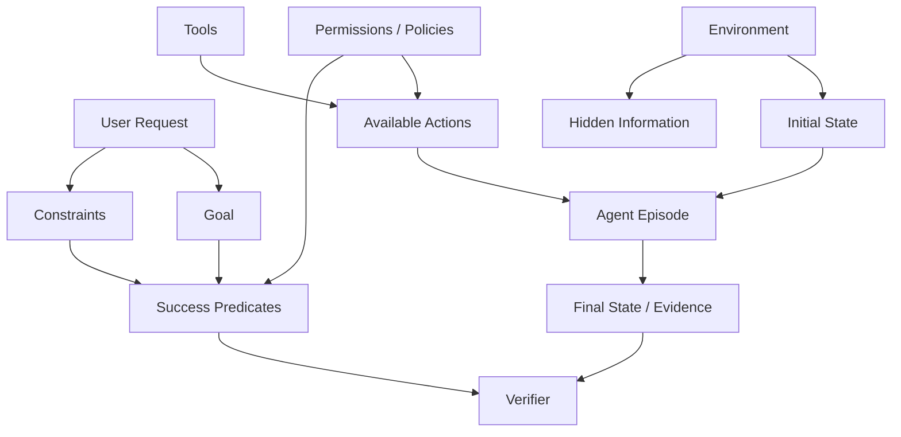
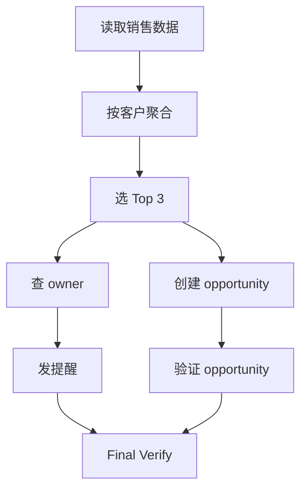

# 第 10 章 Agent Task Design：把一句用户请求变成可执行、可验证的 Task Contract

> 所属体系：[`LLM_Agent_Data_Knowledge_System.md`](../LLM_Agent_Data_Knowledge_System.md)
>
> 前置章节：[`第 9 章 Hard Case Mining 与 Curriculum`](./09_Hard_Case_Mining_and_Curriculum.md)
>
> 关联章节：[`第 1 章 Data Objects & Learning Signals`](./01_Data_Objects_and_Learning_Signals.md)、[`第 5 章 Tool-use Data 与 Agent Trajectory Data`](./05_Tool_Use_and_Agent_Trajectory_Data.md)、[`第 11 章 Environment Design`](./11_Environment_Design.md)、[`第 12 章 Agent Trajectory Anatomy`](./12_Agent_Trajectory_Anatomy.md)、[`第 15 章 Grader、Verifier 与 LLM-as-a-Judge`](./15_Grader_Verifier_and_LLM_as_a_Judge.md)、[`第 16 章 Benchmark Design 与 Evaluation Protocol`](./16_Benchmark_Design_and_Evaluation_Protocol.md)
>
> 编辑基础设施：[`Canonical Glossary`](./00_Glossary_and_Notation.md) · [`Canonical Casebook`](./00_Canonical_Casebook.md)
>
> 本章定位：**Task / Case / Episode / Benchmark Case 与 Task Contract 的 canonical chapter。** 后续章节如果讨论一个 Agent “到底被要求做什么”，应优先回到本章定义。
>
> 本章核心问题：**Agent Task 不是一句 prompt，而是一份决策契约：目标是什么、从什么状态开始、哪些信息可见或隐藏、能做什么、允许做什么、必须满足什么约束、哪些副作用禁止发生、什么算成功，以及什么时候应该停止。**

---

# 10.0 为什么 Agent Task Design 是一门独立问题？

普通问答经常可以简化成：

```text
Question
   ↓
Answer
```

但 Agent 任务通常是：

```text
User Request
+
Environment State
+
Tools
+
Permissions
+
Constraints
+
Success / Failure Semantics
+
Termination
```

例如用户说：

```text
“把我明天下午三点和产品组的会议改到周五下午三点，并通知所有参会人。”
```

真正执行前至少还要知道：

```text
“产品组会议”是哪一个 event？
当前日历有哪些冲突？
有哪些参会人？
当前用户有什么权限？
通知是否需要额外工具？
是否允许创建新会议替代修改？
什么算“改好了”？
工具返回 success 就算完成吗？
```

所以：

> **Task Design 决定的不是“模型看到哪一句 prompt”，而是整个决策问题的边界。**



---

# 10.1 Prompt、Task、Case、Episode、Trajectory、Benchmark Case

这些词必须长期保持区分。

## Prompt

模型实际收到的消息或文本输入，例如：

```text
“把订单 1847 取消掉。”
```

Prompt 只是任务的可见表达之一。

---

## Task

Task 描述一个目标行为问题，包括：

```text
Goal
Constraints
Tools / Action Space
Permissions / Policies
Success Semantics
Termination Semantics
Environment Requirements
```

Task 更接近“问题定义”。

---

## Case

Case 是 Task 的一个**冻结实例**。

例如同一“取消订单”Task family，可以有：

```text
Case A: order = pending
Case B: order = shipped
Case C: order = not found
Case D: permission denied
```

Case 应绑定具体 initial state / environment snapshot / task version。

---

## Episode

Episode 是某个 Agent 在某个 Case 上**实际运行一次**：

```text
Case
↓
Agent Runtime
↓
Success / Failure / Timeout / Escalation
```

同一个 Case 可以有很多 Episode，例如不同模型、不同 seed、不同 runtime policy。

---

## Trajectory / Trace

Trajectory 是一个 Episode 中真正发生的路径：

```text
state
→ action
→ observation
→ state
→ ...
→ termination
```

因此：

```text
Episode = 一次完整运行事件
Trajectory = 这次运行实际走过的路径记录
```

---

## Benchmark Case

Benchmark Case 是一个被正式纳入评测协议的冻结 Case，并绑定：

```text
evaluation semantics
verifier / grader
runtime constraints
protocol version
```

所以更准确的关系是：

```text
Prompt
  = agent-visible request / messages

Task
  = abstract decision problem

Case
  = frozen Task instantiation

Case + Agent Runtime
  → Episode

Episode
  → Trajectory + Outcome

Frozen Case + Evaluation Contract
  → Benchmark Case
```

这套关系是后续 Task / Environment / Trajectory / Benchmark 章节的共同语言。

---

# 10.2 Task Contract：一个任务至少要定义什么？

建议把 Task Contract 视为一组显式字段，而不是执着于某个固定公式。

至少包括：

```text
Goal
Initial State / Environment Reference
Agent-visible Information
Hidden Information
Available Tools / Actions
Constraints
Permissions / Policies
Success Predicates
Forbidden Side Effects
Termination Conditions
Verifier / Evidence Requirements
```

一个工程化 schema：

```json
{
  "task_id": "calendar_move_v3",
  "case_id": "calendar_move_v3_case_017",
  "task_family": "calendar_reschedule",
  "user_request": "把产品组会议改到周五下午三点，并通知所有参会人。",
  "initial_state_ref": "calendar_snapshot_017",
  "agent_visible_context": "...",
  "hidden_state": "...",
  "available_tools": [
    "calendar.search",
    "calendar.update",
    "email.send"
  ],
  "constraints": [
    "不得创建重复会议",
    "不得修改其他会议"
  ],
  "permissions": [
    "calendar:write",
    "email:send"
  ],
  "success_predicates": [
    "target_event.time == friday_15_00",
    "required_attendees_notified == true"
  ],
  "forbidden_side_effects": [
    "other_event_modified",
    "duplicate_notification"
  ],
  "termination": {
    "max_steps": 12,
    "timeout_seconds": 120
  },
  "verifier": "calendar_state_and_notification_check_v2"
}
```

最重要的不是字段名，而是：

> **一个 Case 必须能被独立重建、执行和验证。**

---

# 10.3 Goal：用户到底想让系统完成什么？

需要区分：

```text
Surface Request
↓
Operational Goal
↓
Target State / Success Predicates
```

例如：

```text
“帮我把明天的会议取消掉。”
```

可能实际包含：

```text
找到正确会议
确认时间匹配
执行取消
必要时通知参会人
不能误伤同名其他会议
```

最弱的 Goal 定义：

```text
Agent 最后说“已经取消”。
```

更强：

```text
calendar.events[event_id].status == "cancelled"
```

更完整：

```text
target_event.cancelled
AND other_events_unchanged
AND required_notifications_sent_exactly_once
```

所以 Agent Task 最好把 Goal 尽可能转化为：

> **Target Environment State / Verifiable Predicates。**

---

# 10.4 Initial State：同一句 Prompt 可以是完全不同的 Case

例如：

```text
“取消订单 1847。”
```

如果：

```text
status = pending
```

可能直接可取消。

如果：

```text
status = shipped
```

可能应该拒绝取消或转入其他流程。

如果：

```text
order not found
```

正确行为又不同。

因此：

> **Agent 的正确策略是 Task × Initial State × Policy 的函数。**

Initial State 可能需要包含：

```text
object state
current time
user identity
permissions
resource state
history
related entities
existing records
```

---

# 10.5 Agent-visible Information 与 Hidden Information

真实 Agent 常处于 partial observability。

例如用户问：

```text
“订单 1847 能取消吗？”
```

初始只知道：

```text
order_id = 1847
```

而真实状态：

```text
status = shipped
```

必须通过：

```text
get_order(1847)
```

才能获得。

如果 prompt 直接泄漏：

```text
“订单 1847 已发货，不能取消。”
```

原本测：

```text
Information Acquisition
+
Tool Use
+
State-conditioned Decision
```

就退化成：

```text
Reading Comprehension
```

所以 Task Contract 应明确区分：

```text
World / Environment Truth
Agent-visible Information
Evaluator-only Information
```

这和第 11、12 章的 state taxonomy 必须一致。

---

# 10.6 Tools / Action Space：工具多不等于任务难

Tool Count 只是表面属性。

真正影响决策难度的通常是：

```text
Tool Semantic Overlap
Argument Ambiguity
Tool Dependency
Tool Side Effects
Tool Availability
Permission Boundary
```

例如：

```text
search_order
lookup_order
get_order_details
query_order_history
```

语义高度接近时，selection difficulty 才真正上升。

再例如 dependency chain：

```text
search_customer
↓
get customer_id
↓
get_orders(customer_id)
↓
select order_id
↓
cancel_order(order_id)
```

这比直接给 `order_id` 的单步调用复杂得多。

工具本身的 runtime / schema / error semantics 归第 11 章 Environment Design 深讲。

---

# 10.7 Constraints：Agent 复杂度经常藏在“不能做什么”

Constraint 可以包括：

```text
Positive Constraint      必须做
Negative Constraint      不能做
Conditional Constraint   满足条件时才能做
Ordering Constraint      必须先 A 再 B
Cardinality Constraint   最多 / 至少 / 恰好几次
Temporal Constraint      时间窗口 / 截止时间
Cross-step Constraint    早期 observation 约束后续 action
```

例如：

```text
“删除重复文件，
但保留最新版本；
任何 .env 都不能删除；
共享目录只能读；
删除前先生成清单。”
```

真正难的往往不是 `delete_file` 本身，而是：

```text
condition recognition
constraint retention
state-dependent inhibition
```

---

## 10.7.1 Negative Constraint 值得单独作为 capability

例如：

```text
“给内部员工发通知，但不要发给外部联系人。”
```

模型很容易学会“给谁发”，却遗漏“不要给谁发”。

因此 task family 应显式覆盖：

```text
negative_constraint
conditional_stop
protected_entity
forbidden_action
```

---

# 10.8 Permission 与 Tool Availability 不是一回事

```text
Tool Available
≠
Action Authorized
```

例如 `refund_order` 工具存在，但当前用户：

```text
refund_limit = 100 USD
```

而订单金额：

```text
500 USD
```

正确行为可能是：

```text
escalate
```

而不是直接退款。

因此 Task Contract 必须明确：

```text
who is acting
on whose behalf
what is technically possible
what is authorized
```

---

# 10.9 Success：不是 API 200，也不是 Agent 自己说成功

可以分层：

```text
Action Success
→ 单次调用是否执行

Subgoal Success
→ 一个局部目标是否完成

Task Success
→ 用户目标是否完成

Policy-compliant Success
→ 完成目标且没有违反约束 / 权限 / side-effect policy
```

所以：

```text
Tool Success
⊂ Subgoal Success
⊂ Task Success
⊂ Policy-compliant Success
```

评测时应优先使用：

```text
Direct Environment Evidence
>
Executable Verification
>
Deterministic Rule
>
Structured Grader
>
LLM Judge
>
Agent Self-report
```

完整 evaluator stack 归第 15 章。

---

# 10.10 Forbidden Side Effects：达成目标也可能是失败

用户要求：

```text
“删除重复文件。”
```

Agent 如果直接删除整个目录：

```text
duplicate_count = 0
```

但显然不能视为成功。

一个更成熟的 success contract 是：

```text
Goal Achieved
AND Required Constraints Satisfied
AND Forbidden Side Effects Absent
```

常见 side effects：

```text
unauthorized write
over-deletion
wrong recipient
duplicate action
resource leakage
extra notification
irreversible unintended change
```

---

# 10.11 Termination：什么时候必须停？

Task Contract 应定义：

```text
Success Termination
Valid Refusal / Escalation
Clarification Needed
Failure Termination
Timeout
Max Steps
Budget Exhaustion
Policy Block
Unrecoverable Runtime Condition
```

典型两类错误：

```text
Premature Termination
任务没完成就宣布完成

Non-termination
任务已经完成却继续操作
```

所以 Agent 能力也包括：

> **在正确的时候停止。**

---

# 10.12 Feasibility：有些任务本来就不应该执行成功

例如：

```text
“取消已经发货且业务规则禁止取消的订单。”
```

正确结果可能不是“完成取消”，而是：

```text
Valid refusal
Valid escalation
Offer allowed alternative
```

因此至少区分：

```text
Feasible + Completed
Feasible + Failed
Infeasible + Correctly Handled
Infeasible + Hallucinated Success
```

否则会错误惩罚一个正确拒绝的 Agent。

---

# 10.13 Task Decomposition：复杂任务通常是依赖图

例如：

```text
“找到过去 30 天销售额最高的三个客户，
创建续约机会，
并给对应销售负责人发提醒。”
```



Task complexity 应考虑：

```text
Dependency Depth
Branching Factor
Number of Required Subgoals
Cross-step Information Flow
Join Complexity
```

而不只是 Tool Call Count。

---

# 10.14 Decision Complexity：真正的 Agent 难度在哪里？

```text
Task A
10 个工具调用，但每一步只有一个明显正确动作

Task B
3 个工具调用，但每一步有多个 plausible action，且错误动作不可逆
```

Task B 可能更难。

因此：

> **Trajectory Length ≠ Decision Complexity。**

可以从以下维度描述：

```text
Branching Factor
Dependency Depth
Partial Observability
Constraint Density
Irreversibility
Delayed Feedback
Recovery Requirement
State-tracking Load
Tool Ambiguity
Verification Burden
```

可以写一个仅作概念组织的函数：

\[
D_{task}=f(B,L,O,C,I,F,R,M,A,V)
\]

它不是标准化公式，而是 difficulty taxonomy 的提示。

---

# 10.15 Long-horizon 不等于长

如果数据只是：

```text
查 A
查 B
查 C
查 D
查 E
```

五步彼此独立，那么它并不具有真正 long-horizon dependency。

真正 long-horizon 更强调：

```text
早期 action 改变未来 state
后续决策依赖前序 observation
错误延迟暴露
状态持续变化
需要动态重规划
```

所以：

> **Long-horizon 的核心是 temporal dependency，不是 step count。**

---

# 10.16 Reversibility：错误动作能不能撤销？

一般：

```text
search / read / preview
```

风险较低。

而：

```text
send_email
delete_file
transfer_money
cancel_order
```

可能不可逆或高风险。

Task metadata 可以显式记录：

```text
read_only
reversible_write
irreversible_write
high_risk_action
```

并测试 Agent 是否学会：

```text
先读
→ 再判断
→ 必要时确认
→ 执行
→ 验证
```

---

# 10.17 Clarification：什么时候不应该猜？

例如：

```text
“把那个会取消了。”
```

如果有多个候选会议，正确动作可能是：

```text
Ask Clarifying Question
```

但不能把所有模糊表达都设计成“必须问”。

真正要判断的是：

> **完成任务所必需的信息是否缺失，并且无法从已有 context / environment 合理推断。**

因此可记录：

```text
ambiguity_type
missing_required_information
clarification_required
```

---

# 10.18 Toy Task 与 Realistic Task

Toy Task：

```text
User: 查订单 123
Tool: get_order(id)
```

适合做：

```text
function-call unit test
argument filling
regression
curriculum early stage
```

Realistic Task 可能加入：

```text
entity ambiguity
cross-tool dependency
permissions
hidden state
negative constraints
tool failure
verification
side effects
```

Toy Task 不是没用；问题是：

> **不能从 toy-task 高分直接外推 general agent capability。**

---

# 10.19 Task Family 与 Fake Diversity

模板化生成很容易得到：

```text
“查询订单 1001”
“查询订单 1002”
“查询订单 1003”
```

表面很多，decision pattern 只有一种。

高价值 variation 应改变：

```text
initial state
constraint structure
hidden information
tool dependency
permission state
failure mode
recovery requirement
```

例如同一订单 family：

```text
pending
shipped
not found
multiple candidates
permission denied
API timeout
requires escalation
```

这才是 structural / decision diversity。

---

# 10.20 Task Generator 与 Ground Truth Generator 应尽量同源

常见失败：

```text
LLM 先批量编任务
↓
最后才发现很多任务无法验证
```

更稳妥的方式：

```text
Environment State Generator
        ↓
Goal / Constraint Generator
        ↓
User-facing Prompt Renderer
        ↓
Success / Forbidden Predicate Generator
```

例如先生成真实数据库 state，再从 state 派生 task 和 verifier。

因此：

> **Task Generation 不应与 Ground Truth / Verifier Generation 脱节。**

---

# 10.21 Difficulty Calibration：设计者觉得难，不代表模型觉得难

结构 difficulty metadata：

```text
num_subgoals
max_dependency_depth
num_constraints
num_tools
branching_factor
hidden_state_count
irreversible_action_count
```

同时记录 empirical model difficulty：

```text
success rate
step count
tool-error rate
recovery rate
clarification rate
verification failure
```

所以：

> **Structural Difficulty ≠ Empirical Model Difficulty。**

“Easy / Medium / Hard / Frontier”的阈值必须由目标模型和用途校准，而不是永久固定。

---

# 10.22 Difficulty 不应该只用 Success Rate 描述

两个 task set 都可能：

```text
success = 50%
```

但一个是 tool schema 混乱，另一个是多步规划困难。

建议分解：

```text
Understanding Difficulty
Planning Difficulty
Tool-selection Difficulty
Argument Difficulty
Observation-grounding Difficulty
State-tracking Difficulty
Recovery Difficulty
Verification Difficulty
```

这样 curriculum / hard mining 才知道该补什么能力。

---

# 10.23 Train / Eval Split：不要把“换 ID”当泛化

训练：

```text
取消订单 1001
取消订单 1002
取消订单 1003
```

测试：

```text
取消订单 9999
```

虽然文本不同，workflow 可能完全相同。

更可靠的 split 可按：

```text
family_id
workflow_id
tool combination
constraint pattern
environment layout
failure mode
seed lineage
```

进行 group-level holdout。

如果同一 synthetic seed 派生出大量 sibling task，也应尽量整体分组。

---

# 10.24 Task Leakage 不只是答案泄漏

还包括：

```text
Hidden-state Leakage
Tool-choice Leakage
Success-condition Leakage
Workflow Leakage
Verifier Leakage
```

例如 prompt 直接说：

```text
“先 search_order，再 cancel_order。”
```

那么 planning / tool selection 已经被答案化。

因此：

> **Prompt 不应无意中泄漏 oracle trajectory。**

---

# 10.25 Counterfactual / Matched Task Design

保持用户请求不变，只改变一个关键 state：

```text
“取消订单 1847。”

A: pending
B: shipped
C: not found
D: permission denied
```

可以测试：

> **模型是否真正根据环境状态改变策略。**

也可以只增加一个约束：

```text
Task A:
给内部员工发通知

Task B:
给内部员工发通知，但不要发给外部联系人
```

这样能更清楚地估计：

```text
negative_constraint effect
```

Matched design 的统计协议在第 16 章进一步展开。

---

# 10.26 Ground Truth 不等于 Reference Trajectory

很多 Agent task 有多条正确路径：

```text
search → update → verify
```

和：

```text
list → filter → update → verify
```

只要都满足：

```text
Success Predicates
+
Policy Constraints
+
Forbidden-side-effect Rules
```

都可以正确。

所以评测 Ground Truth 更应该表示为：

> **Valid Outcome / Behavior Set，而不是 Exact Action Sequence。**

Reference Trajectory 仍然可以用于：

```text
SFT Demonstration
Cost Baseline
Minimal-step Reference
Human Annotation Aid
Debugging
```

但不应成为唯一合法路径。

---

# 10.27 Task-level Metrics 应在设计阶段就确定

一个 Task family 可能支持：

```text
Task Success Rate
Constraint Satisfaction Rate
Forbidden Side-effect Rate
Recovery Rate
Clarification Quality
Verification Rate
Tool / Token Cost
Latency
```

所以：

> **Task Design 与 Metric Design 必须同步。**

不能先做 1 万条 task，最后才问“怎么判”。

---

# 10.28 Canonical Case：C1 Order / Refund Agent

用户：

```text
“如果订单 1847 还没发货，就帮我退款；已经发货就不要动。”
```

可以构造：

### Initial State

```text
Order 1847
status = shipped
amount = 79
```

### Agent-visible State

初始只知道：

```text
order_id = 1847
```

### Hidden Environment Truth

必须通过：

```text
order.get(1847)
```

获取 `status=shipped`。

### Available Tools

```text
order.get
refund.create
shipment.cancel
```

### Constraint

```text
if status == shipped:
    do not refund
    do not cancel shipment
```

### Success Predicates

```text
order 1847 unchanged
refund_created == false
shipment_cancelled == false
```

### Forbidden Side Effects

```text
refund created
shipment cancelled
other order modified
```

这个 Case 可以在后续章节依次分析：

```text
Ch11  Environment
Ch12  Trajectory
Ch13  Credit
Ch14  Failure
Ch15  Verifier
Ch16  Benchmark
Ch21  Data Experiment
```

完整 Case 定义见 [`Canonical Casebook`](./00_Canonical_Casebook.md)。

---

# 10.29 Task Asset：任务本身应该成为可复用资产

不要只保存 prompt text。

至少保存：

```text
task_id
case_id
task_family
user_request
initial_state_ref
agent_visible_context
hidden_state_ref
tools
permissions
constraints
success predicates
forbidden side effects
termination
verifier
difficulty tags
capability tags
seed / family lineage
version
```

这样同一个 Case 才能在不同：

```text
model
prompt
harness
selector
runtime
```

上重复 rollout。

---

# 10.30 Versioning 与 Runtime Freeze

Task 变化会改变评测含义。

例如：

```text
v1：只要求修改会议时间
v2：增加“通知所有参会人”
```

它们不能被当成同一个 Case。

至少记录：

```text
task_version
case_version
environment_version
toolset_version
verifier_version
```

比较模型时，还应尽量冻结：

```text
Case
Environment
Tool Schema
Harness
Step / Time Budget
Verifier
```

否则性能变化无法归因。

完整 Frozen Evaluation Protocol 归第 16 章。

---

# 10.31 Capability Taxonomy 与 Coverage

一个 Task 可以标多个 capability：

```text
entity_resolution
negative_constraint
multi_tool_planning
state_tracking
recovery
verification
permission_handling
```

Task set 的 coverage 也不应该只看数量，而应看：

```text
Tool Coverage
Workflow Coverage
Constraint Coverage
State Coverage
Failure Coverage
Capability Coverage
Decision-pattern Coverage
Risk / Permission Coverage
```

10000 条 single-tool lookup 依旧是窄覆盖。

---

# 10.32 常见失败模式

### 失败 1：把 Prompt 当完整 Task

没有 state / constraints / verifier，就无法知道真正完成没有。

### 失败 2：把 Agent Self-report 当 Success

“已经完成”不是环境证据。

### 失败 3：用 Tool Count 代表难度

工具多不代表决策复杂。

### 失败 4：强行拉长 Trajectory

长度没有 dependency，不是真 long-horizon。

### 失败 5：Prompt 泄漏正确工具链

Planning benchmark 被降级成 instruction following。

### 失败 6：只设计可执行任务

会漏掉 valid refusal / escalation / clarification 能力。

### 失败 7：不检查 Forbidden Side Effect

模型可能通过危险 shortcut 达标。

### 失败 8：用单一 Reference Trajectory 做 exact-match

会误伤其他合法策略。

### 失败 9：Random Row Split 造成 workflow / family leakage

换 ID 不等于泛化。

### 失败 10：Difficulty 靠人拍脑袋

需要 empirical calibration。

### 失败 11：Task 没有 Version / Lineage

规则变化后实验不可比较。

### 失败 12：Task 与 Verifier 分开设计

最后得到无法可靠判分的数据。

### 失败 13：Hidden State 被 Prompt 泄漏

Tool-use 任务退化成阅读理解。

### 失败 14：Tool Availability 与 Permission 混为一谈

技术上能做，不代表被允许做。

### 失败 15：把 Infeasible Case 当普通 Failure

会错误惩罚正确拒绝。

### 失败 16：把 Task、Case、Episode 混用

会让“换了 initial state / runtime 还说是同一实验”的问题变得不可见。

---

# 10.33 从数据岗位视角，这一章实际会做什么？

```text
设计 Task / Case schema
定义 task family
构建 capability taxonomy
构造 initial state
定义 agent-visible / hidden information
设计 tool set
定义 permissions / policies
写 success predicates
写 side-effect predicates
定义 termination
实现 verifier
构造 counterfactual / matched cases
做 task difficulty calibration
做 model pilot rollout
设计 group-level train/eval split
维护 task / case version
维护 regression assets
统计 coverage
分析 structural difficulty driver
```

这已经不是传统“写 prompt”。

更准确地说：

> **设计一个可控、可复现、可验证的决策问题。**

---

# 10.34 本章关键词

| 术语 | Canonical meaning |
|---|---|
| Prompt | Agent 实际看到的消息 / 请求表达 |
| Task | 抽象目标、规则、动作空间与成功语义 |
| Case | Task 的冻结实例，绑定具体 initial state 等 |
| Episode | Agent 在一个 Case 上的一次完整运行 |
| Trajectory | Episode 中实际发生的 state–action–observation 路径 |
| Benchmark Case | 被正式纳入冻结评测协议的 Case |
| Task Contract | Task / Case 边界、规则与验证方式的结构化定义 |
| Initial State | Episode 开始前的环境状态 |
| Hidden Information | Agent 初始不可见、需要通过交互获得的信息 |
| Constraint | 必须满足或不得违反的条件 |
| Permission | 当前 actor 被授权执行什么 |
| Success Predicate | 任务完成必须满足的可验证条件 |
| Forbidden Side Effect | 即使目标完成也不得发生的额外状态改变 |
| Termination | Episode 在什么条件下停止 |
| Feasibility | 当前规则和环境下目标是否可执行 |
| Decision Complexity | 做出正确动作选择本身的复杂程度 |
| Task Family | 共享同一能力结构的一组 Task / Case |
| Counterfactual Case | 只改变关键因素形成的受控 Case |

更完整定义见 [`Canonical Glossary`](./00_Glossary_and_Notation.md)。

---

# 10.35 面试 / 自检问题

1. Prompt、Task、Case、Episode、Trajectory 有什么区别？
2. 一个完整 Task Contract 至少需要哪些元素？
3. 为什么 Agent success 最好落到环境 state / predicate？
4. Hidden Information 为什么是 Agent benchmark 的核心？
5. Tool Count 为什么不能直接代表任务难度？
6. 什么是 Decision Complexity？
7. Long-horizon 为什么不等于 trajectory 很长？
8. Negative Constraint 为什么值得单独测试？
9. Tool Availability 与 Permission 有什么区别？
10. 为什么 task success 还需要 side-effect check？
11. 如何处理 infeasible task？
12. 什么时候 Agent 应该 clarification？
13. 为什么 reference trajectory 不能当唯一 ground truth？
14. 什么是 workflow / family leakage？
15. 如何设计 Agent train/eval split？
16. 如何构造 counterfactual / matched case？
17. Structural Difficulty 与 Empirical Model Difficulty 有什么不同？
18. 为什么 Task Generator 和 Verifier Generator 最好共同设计？
19. Template 怎么避免 fake diversity？
20. 如何评价一个 task set 的 coverage？
21. 模型成功率低时，如何排除 task / environment / verifier bug？
22. 两个模型使用不同 Harness，是否可以直接比较 Agent capability？
23. 如何把一个真实线上 failure 变成一族高价值 Task Family？
24. Toy Task 什么时候仍然有价值？
25. 为什么 Agent benchmark 更像“受控环境中的交互决策实验”？

---

## 10.35.1 一个通用回答框架：如何设计 Agent Benchmark Case？

```text
1. 定义 capability / failure mode
   ↓
2. 定义 Task Family
   ↓
3. 构造 frozen Environment State
   ↓
4. 明确 Agent-visible 与 Hidden Information
   ↓
5. 定义 Tools / Permissions / Policies
   ↓
6. Render User-facing Prompt
   ↓
7. 定义 Success Predicates
   ↓
8. 定义 Forbidden Side Effects
   ↓
9. 定义 Termination
   ↓
10. 实现 deterministic / executable verifier
   ↓
11. 构造 counterfactual / matched variants
   ↓
12. 多模型 pilot，校准 empirical difficulty
   ↓
13. 按 family / workflow 做 split
   ↓
14. 冻结 Case + Environment + Runtime + Evaluation Protocol
```

---

# 10.36 与后续章节的关系

```text
第 11 章 Environment Design
→ Task Contract 所依赖的世界如何真正运行

第 12 章 Trajectory Anatomy
→ 一个 Episode 实际发生后，如何记录 state / action / observation

第 13 章 Credit Assignment
→ 最终 Outcome 如何归因到中间 action

第 14 章 Failure Taxonomy
→ 失败 Case / Episode 如何诊断

第 15 章 Evaluator
→ Success Predicate 与证据如何被验证

第 16 章 Benchmark Protocol
→ 多个 frozen Case 如何组成可信评测
```

---

# 10.37 本章最终要形成的认识

如果压缩成一句话：

> **Agent Task 不是一句问题，而是一份可执行、可验证的决策契约；Case 则是这份契约在具体环境中的冻结实例。**

一条成熟 Case 应能回答：

```text
要达成什么？
从什么状态开始？
Agent 看得到什么？
看不到什么？
能做什么？
允许做什么？
必须满足什么？
绝不能发生什么？
什么算成功？
什么时候停止？
如何客观验证？
```

只有这些定义稳定以后：

```text
Trajectory
Reward
Failure Analysis
Preference
Curriculum
Benchmark
```

才具有稳定语义。

下一章继续回答：

> [`第 11 章 Environment Design`](./11_Environment_Design.md)

因为 Task Contract 规定了“问题是什么”，而 Environment 决定：

> **这个世界究竟如何变化、Agent 能看见什么、Action 如何产生 Observation，以及实验能不能被可靠重置和复现。**