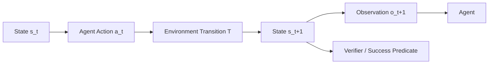

# 第 11 章 Environment Design：状态、转移、重置与可复现 Agent 世界

> 所属体系：[`LLM_Agent_Data_Knowledge_System.md`](../LLM_Agent_Data_Knowledge_System.md)
>
> 前置章节：[`第 10 章 Agent Task Design`](./10_Agent_Task_Design.md)
>
> 关联章节：[`第 5 章 Tool-use Data 与 Agent Trajectory Data`](./05_Tool_Use_and_Agent_Trajectory_Data.md)、[`第 7 章 Synthetic Data`](./07_Synthetic_Data_Generation_and_Synthesis.md)
>
> 本章目标：理解 Agent Environment 为什么不是“给模型几个 API”这么简单，而是一整套可执行、可重置、可验证、可隔离、可复现的外部世界；掌握 State、Transition、Snapshot、Reset、Time、Concurrency、Permissions、Failure Injection、Observability、Isolation 与 Sim-to-real Gap 的设计方法。
>
> 本章核心问题：**Agent 的能力只有放进一个定义清楚、状态真实、转移可靠、结果可验证的环境里才有意义。一个差的 Environment 会把模型能力、工具错误、Harness bug 和环境噪声混成一个不可解释的分数。**

---

# 11.0 为什么 Environment Design 是 Agent 数据的核心基础设施？

普通 LLM 任务往往可以理解成：

```text
Input
  ↓
Model
  ↓
Output
```

而 Agent 是：

```text
Current State
    ↓
Agent Decision
    ↓
Action
    ↓
Environment Transition
    ↓
Observation
    ↓
New State
```

因此 Agent 的行为质量不只取决于模型，还取决于：

```text
任务有没有定义清楚？
工具是不是可用？
环境状态是不是真实？
工具执行后状态有没有真的改变？
Observation 是否准确？
环境能不能 reset？
多条 episode 是否互相污染？
失败能不能复现？
最终状态能不能验证？
```

一个最基本的环境可以抽象成：

$$
E = (S, A, T, O, R, G)
$$

其中：

- $S$：Environment State；
- $A$：Allowed Actions；
- $T$：State Transition Function；
- $O$：Observation Function；
- $R$：Reward / Feedback，可选；
- $G$：Goal / Success Predicate。

可以画成：



所以 Environment 不是背景，它本身就是 Agent 任务的一部分。

---

# 11.1 Tool、Harness、Environment：三个系统层必须区分

这是 Agent 工程里最容易混淆的地方之一。

---

## 11.1.1 Tool

Tool 是 Agent 可调用的一个动作接口。

例如：

```text
search_order(id)
cancel_order(id)
create_event(...)
read_file(path)
run_python(code)
```

它定义：

```text
name
description
arguments
return schema
permission
side-effect type
```

Tool 是 Agent 看到的 action surface。

---

## 11.1.2 Environment

Environment 是这些 action 实际作用的世界。

例如：

```text
订单数据库
日历数据库
文件系统
浏览器页面状态
代码容器
CRM
邮件系统
GUI desktop
```

Tool 调用：

```text
cancel_order(1847)
```

真正发生的是：

```text
orders[1847].status
pending
→
cancelled
```

这个状态变化属于 Environment。

---

## 11.1.3 Harness

Harness 是把模型、工具、环境和执行流程组织起来的运行框架。

它负责的可能包括：

```text
把 Tool Schema 注入模型上下文
解析 tool call
调用对应 tool
把 observation 放回 context
控制最大步数
retry
parallel tool call
memory
context truncation
stop condition
logging
```

所以：

```text
Tool = Action Interface
Environment = World State + Transition
Harness = Runtime Orchestration
```

三者不能混在一起。

---

## 11.1.4 为什么这个区分对数据很重要？

假设出现失败：

```text
Agent 选择 cancel_order(1847)
```

可能有四种完全不同的原因：

```text
1. 模型选错工具
2. Tool wrapper 参数映射错
3. Environment 后端返回 500
4. Harness 没把成功 observation 回传
```

如果最后只记：

```text
success = 0
```

数据会失去归因能力。

因此环境数据必须保存 failure provenance。

---

# 11.2 Environment State：Agent 世界里“现在发生了什么”

Environment 的核心不是 API，而是 State。

例如订单环境可能有：

```json
{
  "orders": {
    "1847": {
      "status": "pending",
      "amount": 89.9,
      "customer_type": "regular"
    }
  }
}
```

日历环境可能有：

```json
{
  "events": [
    {
      "id": "event_021",
      "start": "2026-10-19T15:00",
      "attendees": ["alice", "bob"]
    }
  ]
}
```

Agent 的所有 action，本质上都是对 state 的：

```text
Read
Write
Transform
Query
```

---

## 11.2.1 State 要分 Visible 与 Hidden

### Visible State

Agent 可以直接观察。

例如：

```text
当前页面文本
当前文件目录
工具返回结果
```

### Hidden State

真实存在，但 Agent 必须通过 action 才能知道。

例如：

```text
数据库里订单真实状态
网页后端某字段
客户权限等级
未打开邮件正文
```

因此：

> **Partial Observability 不是环境缺陷，而往往是 Agent 任务本身的核心。**

如果把所有 hidden state 都直接塞进 prompt，工具使用能力就被绕开了。

---

# 11.3 State Transition：Action 调用以后，世界到底怎么变化？

一个环境必须定义：

$$
s_{t+1}=T(s_t,a_t)
$$

例如：

```text
State:
order.status = pending

Action:
cancel_order(1847)

Transition:
order.status = cancelled
```

问题是：很多真实系统的 Transition 并不这么简单。

---

## 11.3.1 Deterministic Transition

相同状态 + 相同 action：

```text
永远得到同样结果
```

例如模拟数据库。

优点：

- 容易复现；
- 适合 benchmark；
- 容易 debug。

---

## 11.3.2 Stochastic Transition

例如：

```text
API timeout
搜索结果排序变化
网页推荐不同
随机延迟
外部服务状态改变
```

同一个 action 可能得到不同 observation。

这更真实，但会让 evaluation variance 上升。

因此测试时必须记录：

```text
random seed
service version
external snapshot
time
retry policy
```

否则很难知道性能差异来自模型还是环境噪声。

---

# 11.4 Observation：Environment State 不等于 Agent 看到的内容

Environment 真正状态是：

```text
State
```

Agent 收到的是：

```text
Observation = O(State)
```

这两者必须区分。

例如数据库真实状态：

```text
100 个订单
```

search tool 返回：

```text
前 20 个结果
```

Agent 看不到剩余 80 个。

所以 observation 可能存在：

```text
pagination
truncation
ranking
filtering
redaction
permission-based visibility
```

这都会改变 Agent 的决策难度。

---

## 11.4.1 Observation Grounding

Agent 成功调用 tool 之后，不代表它真正利用了 observation。

例如：

```text
Tool:
order_status = shipped
```

Agent 下一步却：

```text
cancel_order(...)
```

如果业务规则规定已发货不能取消，则属于 Observation Grounding Failure。

因此 trajectory data 应保留：

```text
Action
Observation
Next Action
```

而不是只保存 tool call。

---

# 11.5 Environment Reset：为什么每个 Episode 都必须回到可控起点？

Agent benchmark 最基本的要求之一是：

> 每条 task 开始前，环境应该处于预期 initial state。

例如 Task A：

```text
cancel order 1847
```

运行一次后：

```text
order 1847 = cancelled
```

如果不 reset，再跑第二次：

```text
cancel order 1847
```

结果已经变了。

因此：

```text
Episode 1
↓
Environment Mutation
↓
Reset
↓
Episode 2
```

必须成为标准流程。

---

## 11.5.1 Reset 的几种方式

### Full Rebuild

每次重新构建整个环境。

最干净，但成本可能很高。

### Snapshot Restore

```text
Base Snapshot
↓
Run Episode
↓
Restore Snapshot
```

通常更高效。

### Transaction Rollback

数据库场景可以：

```text
BEGIN
run episode
ROLLBACK
```

适合确定性测试。

### Copy-on-write

文件系统 / VM / container 场景常见。

---

# 11.6 Snapshot：环境版本控制的核心

一个可靠 benchmark 不能只说：

```text
“我们用了一个 CRM 环境。”
```

而应该知道：

```text
environment_version
snapshot_id
data_seed
schema_version
fixture_version
```

例如：

```text
env_version = crm_v3
snapshot = 2026-10-17_seed42
```

这样同一个 task 才能在未来重新跑。

---

## 11.6.1 Task 与 Snapshot 必须绑定

一个 task 的正确答案可能依赖环境状态。

例如：

```text
“取消金额低于 100 元且未发货的订单。”
```

如果订单数据库换了，ground truth 也会变。

因此 Task ID 不应该只绑定 prompt，还应该绑定：

```text
Task Definition
+
Environment Snapshot
+
Verifier Version
```

---

# 11.7 Determinism：Agent Eval 为什么要尽量控制环境随机性？

假设同一个 Agent 连续跑 10 次：

```text
7 次 success
3 次 API timeout
```

这时 success rate 到底是在测：

```text
Agent 能力？
还是 API 稳定性？
```

因此 benchmark 通常应该尽可能把不必要的随机性消掉。

但真实产品 evaluation 又不能完全忽略随机失败。

所以可以区分两类环境：

```text
Canonical Deterministic Environment
用于模型能力比较

Stress / Stochastic Environment
用于 robustness evaluation
```

二者不要混成一个总分。

---

# 11.8 Time：时间也是 Environment State

时间经常被忽略，但对 Agent 非常重要。

例如：

```text
“帮我订明天下午三点的会议室。”
```

正确行为依赖：

```text
current_date
current_time
timezone
business hours
holiday calendar
```

如果环境中的时间不冻结，同一个 benchmark case 过几天可能就失效。

所以需要：

```text
frozen clock
simulated time
timezone
calendar version
```

---

## 11.8.1 Temporal Transition

有些 action 会让时间推进：

```text
等待 1 小时
任务超时
预约未来事件
定时触发
```

因此 Environment 可能需要支持：

```text
advance_time(dt)
```

或者显式 event queue。

---

# 11.9 Concurrency：多个事件同时发生时怎么办？

真实环境里常出现：

```text
Agent 读取状态
↓
另一个用户修改状态
↓
Agent 根据旧状态继续写入
```

这就是 race condition。

例如：

```text
Agent A:
stock = 1

Agent B:
stock = 1

两者都下单
```

如果环境不考虑 concurrency，可能完全测不到这种问题。

---

## 11.9.1 Benchmark 是否应该引入并发？

分阶段。

基础能力 benchmark 可以先冻结环境：

```text
single-agent
single-thread
```

高级 robustness benchmark 再加入：

```text
concurrent writes
external state changes
stale reads
version conflicts
```

否则基础实验会因为噪声难以解释。

---

# 11.10 Transaction 与 Atomicity：一半成功算什么？

例如 Agent 要：

```text
给客户创建订单
并扣减库存
```

如果：

```text
订单创建成功
库存扣减失败
```

环境进入不一致状态。

因此真实系统经常需要：

```text
transaction
atomic operation
rollback
```

Agent 数据设计中必须知道：

```text
action 是否原子？
失败后会不会部分写入？
是否可回滚？
```

否则 side-effect verifier 很难设计。

---

# 11.11 Idempotency：Retry 为什么可能非常危险？

Read tool 通常可以重复调用：

```text
get_order(1847)
get_order(1847)
```

但 Write tool 不一定。

例如：

```text
send_email(...)
```

retry 两次可能真的发送两封邮件。

所以 Tool / Environment 应标注：

```text
idempotent = true / false
```

常见：

```text
GET / search / read
通常幂等

send / charge / transfer / create
通常需要特别处理
```

Harness retry policy 必须读取这个属性，而不是统一自动重试。

---

# 11.12 Permissions 与 Identity：环境必须知道“谁在做”

Agent action 是否允许，不只取决于 tool 是否存在。

环境还需要：

```text
user identity
role
permissions
resource ownership
scope
```

例如：

```text
User A 可以查看自己的订单
但不能看 User B 的订单
```

如果 benchmark 环境没有权限层，Agent 的安全能力根本测不出来。

---

## 11.12.1 Authentication 与 Authorization 要区分

```text
Authentication
你是谁？

Authorization
你允许做什么？
```

一个 Agent 可能已经登录，但仍没有权限执行高风险操作。

---

# 11.13 Sandbox 与 Isolation：为什么 Agent 不能直接操作真实世界？

训练和 benchmark 常常会产生：

```text
删除文件
发邮件
修改数据库
运行代码
访问网页
```

如果没有隔离，很危险。

所以需要：

```text
sandbox
container
VM
mock service
test account
synthetic database
```

核心目标是：

> **让 Agent 可以真实执行 action，但副作用被限制在受控环境里。**

---

## 11.13.1 Episode Isolation

不同 episode 之间不能互相污染。

例如：

```text
Task A 创建了 file_x
Task B 读到了 file_x
```

如果 Task B 本来不应该看到，就产生 leakage。

所以每个 episode 需要：

```text
isolated namespace
isolated filesystem
isolated database tenant
isolated browser session
```

---

# 11.14 Failure Injection：环境故障也可以成为训练数据

真实 Agent 必须处理失败。

因此环境可以主动注入：

```text
API timeout
rate limit
permission denied
empty result
malformed response
partial success
stale data
network error
server 500
```

然后观察 Agent 是否：

```text
retry
switch tool
ask user
rollback
abort safely
verify state
```

这就是 Failure Injection。

---

## 11.14.1 但 Failure Injection 必须可控

应该记录：

```text
failure_type
injection_step
probability / schedule
seed
expected recovery behavior
```

否则每次运行随机炸不同地方，会很难比较模型。

---

# 11.15 Error Semantics：环境返回什么错误非常重要

一个好的环境不能只有：

```text
ERROR
```

更合理的 observation 应区分：

```text
NOT_FOUND
PERMISSION_DENIED
INVALID_ARGUMENT
RATE_LIMITED
TIMEOUT
CONFLICT
PRECONDITION_FAILED
SERVER_ERROR
```

因为不同错误应该触发不同 recovery policy。

如果环境把所有错误都压成一个字符串，Agent 学不到真正的错误处理。

---

# 11.16 Environment Verifier：最终状态怎么判？

前一章 Task Contract 定义了 success condition。

这一章 Environment 要提供可执行 verifier。

例如：

```python
success = (
    order.status == "cancelled"
    and other_orders_unchanged
    and duplicate_refund_count == 0
)
```

或者：

```text
calendar[event].start == target_time
AND
calendar[event].attendees == original_attendees
```

理想情况下 verifier 直接读真实 environment state，而不是读 Agent 的 final message。

---

## 11.16.1 State Diff

对于 write task，非常推荐保存：

```text
Before State
After State
Diff
```

例如：

```diff
- order_1847.status = pending
+ order_1847.status = cancelled
```

同时检查有没有意外变化：

```diff
- order_1901.status = pending
+ order_1901.status = cancelled   ← forbidden side effect
```

State Diff 是 Agent eval 里非常强的证据。

---

# 11.17 Observability：为了 Debug，环境要暴露哪些日志？

Benchmark 对 Agent 隐藏信息，不代表对研究者也应该隐藏。

研究日志至少应包括：

```text
episode_id
task_id
environment_snapshot
state before action
action
tool arguments
transition result
observation
state after action
verifier result
failure provenance
latency
cost
```

但给模型看的 observation 仍然只应该包含允许的信息。

因此需要区分：

```text
Agent-visible Observation
vs
Researcher-visible Trace
```

---

# 11.18 Reproducibility：一个 Agent Episode 要怎么复现？

理想情况下，应当可以通过下面的信息重放：

```text
Task Version
Environment Snapshot
Tool Version
Harness Version
Model Version
Prompt Version
Random Seed
Clock
Failure Injection Config
```

可以抽象成：

```text
Episode =
Task
× Environment
× Tools
× Harness
× Model
× Seed
```

缺任何一项，都可能导致 replay 不一致。

---

# 11.19 Environment 类型一：Database / CRM Environment

这是最适合做 Agent benchmark 的环境之一。

可以包含：

```text
customers
orders
tickets
opportunities
inventory
employees
```

Agent 通过工具：

```text
search
create
update
delete
aggregate
```

进行操作。

优势：

```text
状态结构化
可 snapshot
可 reset
可 verifier
适合 task synthesis
```

---

## 11.19.1 Database Environment 的典型难点

```text
join 多张表
foreign key
权限
事务
唯一约束
分页
排序
重复记录
脏数据
并发修改
```

这些都可以形成真实的 Agent decision complexity。

---

# 11.20 Environment 类型二：Filesystem Environment

文件系统可以测：

```text
read
write
move
rename
delete
search
grep
archive
```

适合：

```text
代码 Agent
办公 Agent
数据处理 Agent
```

关键问题：

```text
路径
权限
symlink
隐藏文件
大文件
重复文件
编码
文件依赖
```

---

## 11.20.1 文件环境必须防止越界

例如 Agent 不应该从 sandbox：

```text
/workspace/task_01
```

访问宿主机：

```text
/etc
/home/user
```

因此需要：

```text
path isolation
permission boundary
mount policy
```

---

# 11.21 Environment 类型三：Code Sandbox

代码 Agent 需要：

```text
编辑代码
运行程序
跑测试
读取错误
修改
重新运行
```

因此 Environment 至少需要：

```text
filesystem
runtime
compiler / interpreter
dependencies
test runner
resource limits
network policy
```

---

## 11.21.1 Code Environment 的 Ground Truth 很强

可以通过：

```text
unit tests
integration tests
static checks
build success
runtime output
```

自动验证。

所以代码领域很适合大规模 rollout + verifier。

---

# 11.22 Environment 类型四：Browser / Web Environment

Web Agent 面临更多非结构化问题：

```text
DOM
visual layout
navigation
forms
pagination
popups
authentication
dynamic content
```

环境可以是：

```text
live web
recorded web
local cloned website
synthetic website
```

---

## 11.22.1 Live Web 的问题

```text
网页随时间变化
AB test
cookie
地区差异
登录状态
广告
网络延迟
第三方依赖
```

因此 live web 很真实，但 benchmark reproducibility 差。

---

## 11.22.2 Synthetic / Snapshot Web

可以固定：

```text
HTML
backend state
user account
time
```

更适合 controlled benchmark。

缺点是可能产生 sim-to-real gap。

---

# 11.23 Environment 类型五：Calendar / Email / CRM

这类办公环境特别适合测试真实 Agent。

### Calendar

```text
create event
update event
invite attendee
check conflicts
reschedule
cancel
```

### Email

```text
search
read
reply
forward
draft
send
```

### CRM

```text
lookup customer
update opportunity
create note
assign owner
send follow-up
```

这些环境共同特点是：

```text
多对象
长期状态
权限
不可逆 side effect
跨工具依赖
```

非常适合 long-horizon task。

---

# 11.24 Environment 类型六：GUI / Computer-use Environment

Computer-use Agent 不直接调用语义 API，而可能执行：

```text
click
scroll
type
drag
keyboard shortcut
window switch
```

此时 environment state 包括：

```text
screen
window hierarchy
focus
cursor
application state
filesystem
network state
```

难点显著增加。

---

## 11.24.1 GUI 的 Action Space 更低层

Function Calling：

```text
update_event(id, time)
```

GUI：

```text
click calendar
click event
click edit
click time field
type 15:00
click save
```

同一个高层 goal，被拆成大量低层 action。

所以 GUI trajectory length 很长，但其中很多步骤是机械执行，而不一定是高 decision complexity。

这再次说明：

> **Action Count ≠ Reasoning Difficulty。**

---

# 11.25 Simulator：什么时候需要模拟环境？

真实服务可能：

```text
昂贵
危险
不可 reset
有隐私
速率受限
不可公开
```

因此需要 simulator。

Simulator 可以模仿：

```text
API behavior
state transition
error code
user response
latency
business rules
```

---

## 11.25.1 Simulator Fidelity

需要考虑：

```text
State Fidelity
Action Fidelity
Observation Fidelity
Failure Fidelity
Temporal Fidelity
Distribution Fidelity
```

模拟器并不是越复杂越好，而是：

> **必须在目标能力相关维度上足够真实。**

---

# 11.26 Sim-to-real Gap：在模拟器里会做，不代表线上会做

常见 gap：

```text
模拟 API 永远稳定
线上会 timeout

模拟数据很干净
线上有缺失字段

模拟网页布局固定
线上经常变化

模拟权限简单
线上权限层级复杂
```

因此最好采用：

```text
Simulator Training / Development
        ↓
Controlled Realistic Eval
        ↓
Limited Real-world Validation
```

逐级验证。

---

# 11.27 Environment Difficulty：环境本身也有难度

任务难度不仅来自 Task。

同一个目标：

```text
找出客户最近一次订单
```

在不同环境中可能非常不同。

### Easy Environment

```text
search_customer(name)
→ last_order 直接返回
```

### Hard Environment

```text
search_customer
→ customer_id
↓
list_orders(customer_id)
→ pagination
↓
按时间排序
↓
读取最新订单
```

所以整体 Agent 难度可以看成：

$$
Difficulty = f(Task, Environment, Tools, Harness)
$$

而不是只由 prompt 决定。

---

# 11.28 Environment Confound：为什么比较模型时必须冻结环境？

假设：

```text
Model A 在 toolset v1 上跑
Model B 在 toolset v2 上跑
```

或者：

```text
A 用旧网页快照
B 用新网页
```

最后得分差异无法解释。

因此科学比较至少需要冻结：

```text
Task Set
Environment Snapshot
Tool Schema
Harness
Verifier
Budget
```

只改变目标变量，例如：

```text
Model
```

这和受控实验完全一致。

---

# 11.29 Frozen Runtime：研究里非常重要但经常被忽略

如果目标是比较一个新的 selector、routing rule、memory mechanism 或 agent policy，最好维持：

```text
same model
same prompt
same toolset
same environment
same generation config
same verifier
```

只改变目标组件。

否则：

```text
performance change
```

无法归因。

这套思路和 reasoning 实验中的 frozen protocol / frozen runtime 是一致的。

---

# 11.30 Environment Versioning 与 Lineage

一条环境版本最好至少记录：

```json
{
  "environment_id": "crm_env",
  "environment_version": "v4",
  "schema_version": "v2",
  "snapshot_id": "seed_42",
  "toolset_version": "tools_v3",
  "verifier_version": "verifier_v5",
  "clock": "2026-10-17T09:00:00+08:00",
  "failure_profile": "none"
}
```

对应每条 episode：

```text
Task ID
Environment Version
Snapshot
Model
Harness
Seed
```

都应可追溯。

---

# 11.31 State Leakage：环境里的答案不能提前泄露给 Agent

例如任务：

```text
找出还没有付款的订单
```

但 tool description 写：

```text
order_1847 is unpaid
```

那么工具查询能力根本没被测试。

常见 leakage 包括：

```text
prompt 泄漏 hidden state
文件名泄漏答案
tool description 泄漏目标对象
DOM hidden text 泄漏目标
metadata 泄漏 gold label
```

因此 benchmark 环境必须做 leakage audit。

---

# 11.32 Environment Contamination：不同 Episode 之间的状态污染

除了训练测试 contamination，Agent 还有另一种 contamination：

```text
前一个 episode 修改了环境
↓
后一个 episode 继承修改
```

例如：

```text
Task 1 创建 customer note
Task 2 搜索 customer
```

Task 2 看到了不应存在的信息。

所以必须验证：

```text
reset completeness
snapshot integrity
namespace isolation
```

---

# 11.33 Multi-agent Environment

更复杂场景可能有多个 Agent：

```text
Agent A
Agent B
Human
External Process
```

共享同一个环境。

这时会出现：

```text
coordination
competition
communication
race condition
resource contention
```

数据结构也要记录：

```text
actor_id
action order
shared state
message channel
```

Multi-agent 并不是简单多跑几个单 Agent。

---

# 11.34 Human-in-the-loop Environment

真实产品经常需要：

```text
Agent asks user
↓
User clarifies
↓
Agent continues
```

因此 Environment 可能包含一个 user simulator 或真人。

例如：

```text
“帮我订周五的机票。”
```

Agent 应问：

```text
出发地？
目的地？
时间？
```

如果 benchmark 不支持 clarification interaction，就测不到这类能力。

---

# 11.35 Environment Cost Model

Agent action 不是免费的。

不同 action 可能有：

```text
latency
API cost
compute cost
risk cost
human interruption cost
```

因此环境可以定义：

$$
C(\tau)=\sum_t c(a_t)
$$

最终评估：

```text
Success
vs
Cost
```

而不是只看成功率。

---

# 11.36 Environment Safety：高风险操作需要特殊控制

例如：

```text
transfer_money
delete_database
send_external_email
purchase_item
publish_content
```

环境设计应该支持：

```text
approval gate
spending limit
sandbox mode
dry-run
confirmation token
restricted scope
```

这样才能测试：

```text
Agent 是否知道什么时候应该停下来请求授权
```

---

# 11.37 Dry-run 与 Commit 两阶段环境

一种很实用的设计是：

```text
Plan / Dry-run
      ↓
Preview State Diff
      ↓
Approve
      ↓
Commit
```

例如删除文件：

```text
Agent 提议删除 12 个文件
↓
系统展示列表
↓
确认后真正删除
```

这类环境非常适合高风险 Agent。

---

# 11.38 Environment Benchmark 应该测哪些层？

可以分成：

```text
L1 Tool Invocation
L2 State Tracking
L3 Multi-step Execution
L4 Recovery
L5 Constraint Handling
L6 Side-effect Control
L7 Long-horizon Planning
L8 Robustness to Environment Change
```

这样比单一 success rate 更容易解释。

---

# 11.39 一个完整案例：订单环境

假设任务：

```text
“取消所有未发货且金额低于 100 元的订单，
但 VIP 客户的订单不要动。”
```

---

## Initial State

```text
order_1:
amount = 80
status = pending
customer = regular

order_2:
amount = 70
status = pending
customer = VIP

order_3:
amount = 120
status = pending
customer = regular

order_4:
amount = 60
status = shipped
customer = regular
```

---

## Tools

```text
list_orders()
get_customer(id)
cancel_order(id)
get_order(id)
```

---

## Expected Final State

```text
order_1 → cancelled
order_2 → pending
order_3 → pending
order_4 → shipped
```

---

## Environment Requirements

```text
resettable
snapshot-based
state diff
permission-aware
idempotency metadata
verifier
```

---

## Verifier

```text
order_1.status == cancelled
AND
order_2.status == pending
AND
order_3.status == pending
AND
order_4.status == shipped
```

---

## Possible Failure Injection

```text
第一次 cancel_order timeout
```

理想 Agent 应：

```text
检查实际状态
↓
若未取消，再安全 retry
```

而不是盲目重复写操作。

---

# 11.40 从数据岗位视角，这一章实际在做什么？

真实工作可能包括：

```text
搭 sandbox / simulator
设计 synthetic database
构造 environment snapshot
设计 tool backend
实现 reset
实现 state diff
实现 verifier
设计 permissions
控制 side effect
注入 API failure
冻结 clock
做 environment versioning
维护 task-environment binding
检查 state leakage
做 episode isolation
统计 latency / cost
复现失败 trajectory
区分 model / tool / harness / env failure
```

所以 Agent Data 工程并不是：

> “给模型接几个 API。”

而是：

> **构造一个既足够真实，又足够可控、可验证、可复现的实验世界。**

---

# 11.41 常见失败模式

### 失败 1：Environment 没有 Reset

前一个 episode 污染后一个。

### 失败 2：Tool 返回 Success 就当 Environment 已正确更新

必须检查真实 state。

### 失败 3：真实网页直接作为唯一 benchmark

时间变化和随机因素导致不可复现。

### 失败 4：Simulator 太干净

模型线上遇到 timeout / 脏数据就崩。

### 失败 5：把 Tool、Harness、Environment failure 都归模型

导致错误归因。

### 失败 6：没有 Snapshot Version

历史实验无法 replay。

### 失败 7：隐藏状态泄漏

Agent 不需要查询就知道答案。

### 失败 8：所有错误只返回 ERROR

Agent 学不到 recovery semantics。

### 失败 9：Write Tool 自动无脑 retry

非幂等操作可能产生重复 side effect。

### 失败 10：只看最终值，不看 State Diff

可能通过破坏其他对象达到目标。

### 失败 11：同一 benchmark 不同模型跑在不同环境版本

无法公平比较。

### 失败 12：时间没冻结

相对日期任务不可复现。

### 失败 13：只测 deterministic happy path

真实 robustness 被高估。

### 失败 14：一开始就引入大量随机故障

基础能力结果反而不可解释。

### 失败 15：Environment 只有 API，没有业务规则

Agent 可以通过非法 shortcut 获得成功。

---

# 11.42 本章关键词

| 术语 | 一句话理解 |
|---|---|
| Environment | Agent action 实际作用的外部世界 |
| State | 环境当前真实状态 |
| Hidden State | 真实存在但 Agent 未直接观察的信息 |
| Observation | Environment 暴露给 Agent 的信息 |
| Transition | Action 导致的状态变化 |
| Snapshot | 可恢复的环境状态版本 |
| Reset | Episode 后恢复初始状态 |
| Determinism | 同一 state/action 是否产生同一结果 |
| Stochasticity | 环境随机性 |
| Isolation | 不同 episode / agent 之间的状态隔离 |
| Idempotency | 重复执行同一 action 是否保持相同效果 |
| Atomicity | 一个操作是否全部成功或全部失败 |
| Transaction | 一组操作的原子状态变化机制 |
| Failure Injection | 主动构造 timeout、权限等故障 |
| State Diff | 执行前后环境状态差异 |
| Sandbox | 将 Agent 副作用限制在受控空间 |
| Sim-to-real Gap | 模拟环境与真实世界的分布差异 |
| Frozen Runtime | 固定除研究变量之外的运行条件 |
| Environment Lineage | 环境版本、snapshot、schema 等可追溯信息 |

---

# 11.43 面试 / 自检问题

1. **Tool、Harness、Environment 有什么区别？**
2. **为什么 Agent Benchmark 必须支持 Reset？**
3. **Snapshot 和 Reset 分别解决什么问题？**
4. **State 与 Observation 有什么区别？**
5. **什么是 Partial Observability？为什么它对 Agent 很重要？**
6. **为什么 Tool Success 不等于 Environment State 正确？**
7. **Deterministic Environment 和 Stochastic Environment 各适合什么？**
8. **为什么 benchmark 要冻结 clock？**
9. **什么是 Race Condition？**
10. **什么是 Idempotency？为什么 retry 需要知道它？**
11. **Transaction / Atomicity 对 Agent 有什么意义？**
12. **为什么要保存 Before / After State Diff？**
13. **Failure Injection 能测试什么能力？**
14. **为什么错误码应该细分？**
15. **什么是 Episode Isolation？**
16. **真实网页为什么难做可复现 benchmark？**
17. **Synthetic Web / Simulator 的优势与风险是什么？**
18. **什么是 Sim-to-real Gap？怎么缓解？**
19. **为什么比较两个模型必须冻结 Environment / Tool / Harness？**
20. **Environment Versioning 应记录哪些信息？**
21. **什么是 State Leakage？**
22. **多 Agent 环境会新增哪些问题？**
23. **Human-in-the-loop environment 为什么重要？**
24. **为什么 success rate 之外还要记录 latency / action cost？**
25. **如何设计一个既真实又可控的 Agent Environment？**

---

## 11.43.1 通用回答框架：如果让你搭一个 Agent Benchmark Environment

可以这样回答：

```text
1. 先明确目标能力和 task family
   ↓
2. 定义环境真实 state schema
   ↓
3. 区分 visible / hidden state
   ↓
4. 设计 tool/action interface
   ↓
5. 实现真实 state transition
   ↓
6. 实现 observation function
   ↓
7. 设计 snapshot / reset
   ↓
8. 加权限、side-effect、idempotency 等语义
   ↓
9. 实现 environment-state verifier
   ↓
10. 做 episode isolation
   ↓
11. 冻结 clock / seed / version
   ↓
12. 基础 deterministic eval
   ↓
13. 再加入 failure injection / stochastic robustness
   ↓
14. 保存完整 lineage 与 replay 信息
```

这比“写几个 mock API”完整得多。

---

# 11.44 本章最终应该形成的认识

可以把 Agent Environment 压缩成：

```text
World State
   ↓
Allowed Action
   ↓
State Transition
   ↓
Observation
   ↓
Verification
```

真正可靠的环境还必须具备：

```text
Resettable
Reproducible
Isolated
Observable
Versioned
Verifiable
Safe
```

所以：

> **一个 Agent benchmark 的可信度，上限往往不是由题目数量决定，而是由 environment fidelity、state control 与 verification quality 决定。**

下一章将进一步进入：

> **第 12 章 Agent Trajectory Anatomy：State、Decision、Action、Observation、Memory、Branching 与 Backtracking**

也就是开始真正拆解：

```text
一条完整 Agent 轨迹内部到底发生了什么？
```
