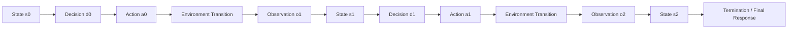
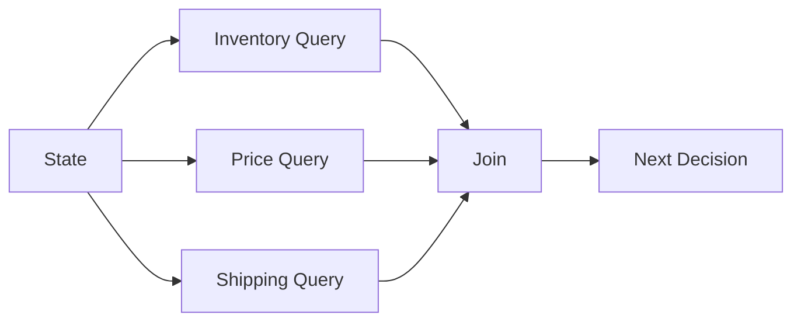
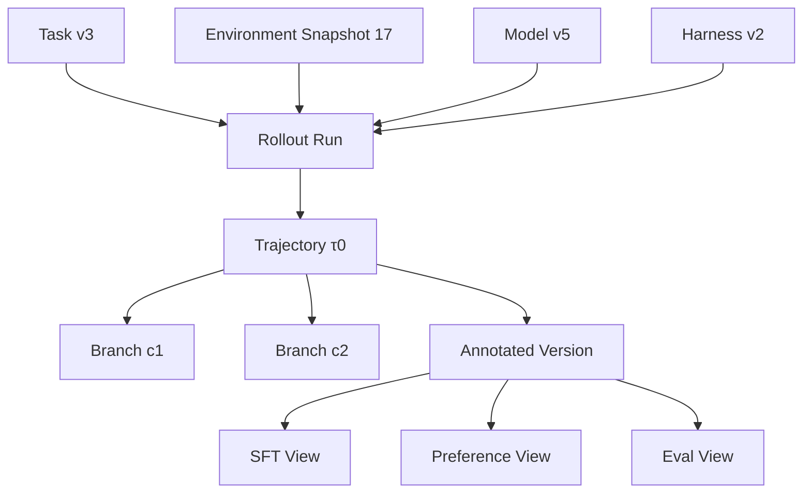
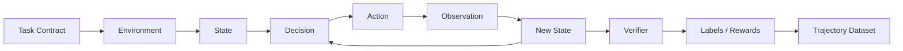

# 第 12 章 Agent Trajectory Anatomy：状态、事件、记忆、分支与可审计轨迹

> 所属体系：[`LLM_Agent_Data_Knowledge_System.md`](../LLM_Agent_Data_Knowledge_System.md)
>
> 前置章节：[`第 11 章 Environment Design`](./11_Environment_Design.md)
>
> 关联章节：[`第 5 章 Tool-use Data 与 Agent Trajectory Data`](./05_Tool_Use_and_Agent_Trajectory_Data.md)、[`第 10 章 Agent Task Design`](./10_Agent_Task_Design.md)、[`第 4 章 Reasoning Data 与 Process Supervision`](./04_Reasoning_Data_and_Process_Supervision.md)
>
> 本章目标：把 Agent trajectory 从“一串聊天消息”提升为一套可以训练、评测、回放、归因和审计的**结构化事件轨迹**；掌握 State、Decision、Action、Observation、Memory、Context、Branch、Backtrack、Termination、Trace Schema、Replay 与 Lineage 的设计方法。
>
> 本章核心问题：**一条 Agent trajectory 的价值，不在于它有多长，而在于我们能否准确恢复“当时 Agent 看到了什么、做了什么、环境发生了什么、下一步为什么变化，以及最终结果由哪些关键决策导致”。**

---

# 12.0 为什么 Trajectory 不能只保存成 Chat Transcript？

最简单的 Agent 日志可能长这样：

```text
User: 取消订单 1847
Assistant: 我先查询一下订单。
Assistant tool_call: search_order(1847)
Tool: status=pending
Assistant tool_call: cancel_order(1847)
Tool: success=true
Assistant: 已经取消。
```

人眼看起来已经足够。

但如果要真正做：

```text
训练
错误分析
离线回放
候选比较
step-level grading
failure attribution
regression test
数据重标
```

这段文本远远不够。

你还需要知道：

```text
每条消息的 event type 是什么？
tool call 的 schema version 是什么？
Agent 当时看到了哪些 context？
有没有隐藏掉的旧 observation？
工具调用前的 environment state 是什么？
调用后 state diff 是什么？
这个 call 是第一次还是 retry？
如果 retry，为什么 retry？
最终 success 是谁判的？
使用的是哪个 verifier version？
中间有没有 context truncation？
Harness 有没有自动插入系统消息？
```

所以成熟的 trajectory 应该被理解成：

> **typed event log + state lineage + execution evidence**

而不是自然语言 transcript。

可以画成：



---

# 12.1 一条 Agent Trajectory 的最小数学结构

经典形式可以写成：

$$
\tau = (s_0,a_0,o_1,s_1,a_1,o_2,\ldots,s_T)
$$

但真实 Agent 系统往往需要更丰富的表示：

$$
\tau = (e_0,e_1,\ldots,e_n)
$$

其中每个 $e_i$ 是一个 typed event，例如：

```text
USER_MESSAGE
SYSTEM_MESSAGE
MODEL_DECISION
TOOL_CALL
TOOL_RESULT
STATE_UPDATE
MEMORY_WRITE
MEMORY_READ
RETRY
BACKTRACK
VERIFICATION
FINAL_RESPONSE
TERMINATION
```

这个 event-log 表达比简单 `(state, action, observation)` 更适合真实工程。

---

## 12.1.1 为什么 Event-based Schema 更好？

因为它允许明确区分：

```text
模型主动做的
Harness 自动做的
Tool 执行产生的
Environment 自己变化的
Evaluator 后处理产生的
```

例如：

```text
TIMEOUT
```

如果不记录 source，你可能不知道它来自：

```text
Model timeout
Tool timeout
Network timeout
Harness deadline
Environment simulation timeout
```

不同来源对应完全不同的 failure attribution。

---

# 12.2 State：Agent 决策时到底“知道什么”？

State 是 trajectory 分析里最容易被模糊化的词。

一个更严谨的拆法是：

```text
World State
Agent-visible State
Internal Working State
Persistent Memory
Execution Metadata
```

---

## 12.2.1 World State

真实环境状态。

例如订单系统：

```json
{
  "order_1847": {
    "status": "pending",
    "amount": 79.0,
    "customer": "C142"
  }
}
```

Agent 通常不能直接看到全部 world state。

---

## 12.2.2 Agent-visible State

Agent 当前能够使用的信息。

包括：

```text
当前 user request
system / developer instructions
tool descriptions
最近若干 messages
tool observations
retrieved memory
当前计划 / structured scratch state
```

所以：

> **World State ≠ Agent-visible State。**

这是 partial observability 的来源。

---

## 12.2.3 Internal Working State

这里指系统显式保存、且允许用于后续决策的中间结构，例如：

```text
current plan
open subgoals
known facts
resolved entities
uncertainties
pending verification
```

注意：不要把它和模型不可见的私有内部神经状态混为一谈。

Agent 数据工程通常关心的是**可记录、可复现、可用作决策输入的 working state**。

---

## 12.2.4 Persistent Memory

跨 episode 或跨较长时间保留的信息。

例如：

```text
用户偏好
历史任务状态
长期项目背景
已确认实体映射
```

Memory 会在第 12.10 节单独展开。

---

# 12.3 Decision 与 Action：不要把“想做什么”和“真正执行了什么”混成一层

假设 Agent 输出：

```text
我应该先查询订单状态。
```

随后调用：

```text
cancel_order(1847)
```

此时：

```text
Decision / Plan
≠
Executed Action
```

如果日志只保存最终 tool call，你会丢掉 plan-action inconsistency；如果只保存自然语言 reasoning，又无法确认真正执行了什么。

因此建议区分：

```text
Decision Intent
Planned Action
Executed Action
Execution Result
```

---

## 12.3.1 Action 可以有哪些类型？

不仅是 tool call。

可以包括：

```text
TOOL_CALL
FINAL_RESPONSE
ASK_USER
WAIT
RETRY
ABORT
DELEGATE
WRITE_MEMORY
READ_MEMORY
CHANGE_PLAN
VERIFY
BACKTRACK
```

所以 Agent action space 比 function calling 更广。

---

# 12.4 Observation：Tool Result 不是唯一 Observation

Observation 是 Agent 从环境获得的新信息。

来源可能包括：

```text
Tool Result
User Reply
Environment Event
Execution Error
File Change
Page Change
Timeout
Permission Error
Another Agent Message
Verifier Feedback
```

所以最好把 observation schema 做成统一 event：

```json
{
  "event_type": "observation",
  "source": "tool",
  "source_id": "search_order",
  "status": "ok",
  "payload": {
    "order_id": 1847,
    "status": "pending"
  }
}
```

---

## 12.4.1 Observation Grounding

最关键的问题不是：

> Agent 有没有收到 observation？

而是：

> **下一步决策有没有真正被 observation 约束？**

例如：

```text
Tool: order 1847 status = shipped
```

Agent 下一步却调用：

```text
cancel_order(1847)
```

如果业务规则禁止取消已发货订单，则说明：

```text
Observation exists
but
Observation was not grounded into decision
```

因此数据中最好区分：

```text
observation_received
observation_parsed
observation_used
```

---

# 12.5 Message、Action、Observation Boundary 为什么重要？

很多数据集直接把所有东西塞进 `messages`：

```json
[
  {"role":"user", ...},
  {"role":"assistant", ...},
  {"role":"tool", ...}
]
```

这对训练很方便，但对分析不一定够。

例如 Assistant message 可能同时包含：

```text
自然语言解释
+
tool call
+
结构化 reasoning tag
+
final answer fragment
```

于是一个 message 内包含多个 decision event。

因此成熟的数据层通常需要：

```text
Raw Message Layer
        ↓
Normalized Event Layer
        ↓
Decision / Transition Layer
```

这样可以兼容不同模型 API，同时保持统一分析语义。

---

# 12.6 一个推荐的 Trajectory Event Schema

一个较实用的 schema 可以是：

```json
{
  "trajectory_id": "traj_001",
  "task_id": "task_1847",
  "episode_id": "ep_20261017_001",
  "events": [
    {
      "event_id": 0,
      "timestamp": "...",
      "event_type": "user_message",
      "actor": "user",
      "content": "取消订单 1847",
      "visible_to_agent": true
    },
    {
      "event_id": 1,
      "event_type": "tool_call",
      "actor": "agent",
      "tool_name": "search_order",
      "arguments": {"id": 1847},
      "parent_event_id": 0,
      "call_id": "call_001"
    },
    {
      "event_id": 2,
      "event_type": "tool_result",
      "actor": "environment",
      "call_id": "call_001",
      "status": "ok",
      "payload": {"status": "pending"}
    }
  ],
  "final_outcome": {
    "task_success": true,
    "verifier_version": "v3"
  }
}
```

这只是示意，真正关键的是以下字段族。

---

## 12.6.1 Identity

```text
trajectory_id
episode_id
task_id
run_id
candidate_id
branch_id
```

---

## 12.6.2 Lineage

```text
parent_event_id
parent_state_id
source_trajectory_id
branch_from_event_id
retry_of_call_id
replay_of_episode_id
```

---

## 12.6.3 Runtime

```text
model_version
prompt_version
toolset_version
harness_version
environment_version
verifier_version
generation_config
```

---

## 12.6.4 Timing / Cost

```text
start_time
end_time
latency_ms
input_tokens
output_tokens
tool_latency
API cost
```

---

## 12.6.5 Evaluation

```text
step_label
failure_type
reward
verifier_result
human_annotation
judge_score
confidence
```

---

# 12.7 Step 到底怎么切？Trajectory Segmentation

和 Reasoning Data 一样，Agent trajectory 也存在 segmentation 问题。

可以有四种常见粒度。

---

## 12.7.1 Message-level

```text
一条 message = 一个 step
```

简单，但容易把多个行为塞在一起。

---

## 12.7.2 Tool-call-level

```text
一次 tool call + result = 一个 step
```

适合 tool-use analysis。

但会漏掉：

```text
ask user
stop
memory read
plan update
```

---

## 12.7.3 Decision-level

一个 step 表示：

```text
State
→ Decision
→ Action
→ Observation
```

这是最适合 credit assignment 的粒度之一。

---

## 12.7.4 Subgoal-level

例如：

```text
Step A: 找到目标订单
Step B: 判断是否可取消
Step C: 执行取消
Step D: 验证状态
```

语义最好，但自动切分最困难。

---

## 12.7.5 一个原则：切分粒度要和下游决策一致

如果你要训练：

```text
tool selector
```

那么 tool-call-level 足够。

如果你要研究：

```text
long-horizon planning / recovery
```

那么 subgoal-level 或 decision-level 更合适。

所以：

> **Segmentation 不是纯粹的日志格式问题，而是 supervision design。**

---

# 12.8 Trajectory 是 Sequence，还是 Graph？

很多数据默认 trajectory 是线性的：

```text
A → B → C → D
```

但真实 Agent 经常不是。

---

## 12.8.1 Branching

例如从同一 state：

```text
State S
├── search by email
├── search by user_id
└── ask user clarification
```

如果做 candidate generation，就天然形成分支。

---

## 12.8.2 Backtracking

```text
A → B → C
        ↓
      failure
        ↓
      backtrack to B
        ↓
        D
```

如果强行存成简单线性日志，就会看起来像：

```text
A B C B D
```

却不知道第二个 B 是“回退到历史状态”，还是重新生成的相似文本。

---

## 12.8.3 Parallel Actions

例如：

```text
同时查询库存
同时查询价格
同时查询配送时间
```

之后 join：

```text
三个结果都回来以后再决策
```

这实际上更接近 DAG：



因此复杂 Agent trace 最好支持：

```text
parent_event_ids
branch_id
join_id
```

而不是假设事件永远只有一个 parent。

---

# 12.9 Branch Lineage：同状态候选为什么必须精确记录？

假设从同一个 state 生成：

```text
Candidate A
Candidate B
Candidate C
```

如果想比较它们的 downstream outcome，必须确认它们确实来自**同一个 authoritative state**。

否则：

```text
A 的 prefix 不同
B 的 memory 不同
C 的 tool observation 不同
```

最后 outcome 差异就无法归因到当前 action。

因此 candidate trajectory 至少要保存：

```text
branch_from_state_id
branch_from_event_id
context_hash
world_snapshot_id
memory_snapshot_id
```

这和 reasoning 中 same-prefix candidate 的原则完全一致。

---

# 12.10 Memory：Trajectory 中最容易被漏掉的一层

很多 Agent 看起来是：

```text
Task → Tool → Tool → Answer
```

但实际系统可能有 Memory：

```text
Short-term Context
Long-term Memory
Retrieved Memory
User Profile
Task Memory
External Notes
```

如果 trajectory 不记录 memory read/write，很多行为无法解释。

---

## 12.10.1 Memory Read

例如 Agent 在当前任务中读到：

```text
用户偏好：不要周五下午安排会议
```

然后拒绝周五三点。

如果日志没有 memory read，你会误以为模型“凭空知道”。

---

## 12.10.2 Memory Write

例如 Agent 执行后保存：

```text
订单 1847 已取消
```

如果这个 memory 后续跨任务被使用，那么它就是环境的一部分。

因此 trajectory 最好显式记录：

```text
MEMORY_READ
MEMORY_WRITE
MEMORY_DELETE
MEMORY_UPDATE
```

以及：

```text
memory source
memory version
visibility
retention scope
```

---

## 12.10.3 Memory Contamination

如果 benchmark episode 之间共享 memory：

```text
Episode A
↓
写入答案
↓
Episode B
↓
读取
```

那么测试集可能被前一个 episode 污染。

所以 benchmark 必须明确：

```text
memory reset policy
cross-episode persistence policy
```

---

# 12.11 Context 与 State 不完全相同

State 是语义概念；Context 是模型真正收到的 token / message 输入。

可以写成：

```text
Full Agent State
        ↓
Context Construction Policy
        ↓
Model Context Window
```

也就是说：

> **Agent 知道什么，不仅取决于系统存了什么，还取决于 Harness 决定把什么塞进 context。**

---

## 12.11.1 Context Truncation

长任务中可能发生：

```text
早期 observation 被截掉
```

于是模型后来做错，不一定是推理能力差，而可能是：

```text
关键证据已不在 context
```

因此 trajectory 要记录：

```text
context_window
context_length
truncation_policy
which events were dropped
which events were summarized
```

否则无法区分：

```text
model forgot
vs
harness removed information
```

---

## 12.11.2 Context Compression / Summarization

很多长 Agent 会对历史进行压缩：

```text
Raw history
↓
Summary
↓
Continue
```

此时 summary 本身就是一个新的信息瓶颈。

必须记录：

```text
summary input range
summary output
summary model/version
summary timestamp
```

否则后续错误可能其实是 summary corruption。

---

# 12.12 Hidden Reasoning 与 Observable Decision State

Agent trace 不应该依赖“保存模型全部内部思维”。

真正可操作的数据应优先记录：

```text
observable messages
structured plans
subgoals
selected actions
tool results
memory operations
verification results
state transitions
```

也就是说：

> **Trajectory audit 应建立在可观察行为和状态证据上，而不是假设自然语言 CoT 完整代表模型内部计算。**

这和 Reasoning Data 章节的原则一致。

---

# 12.13 Retry：一次失败以后重新做，究竟算新 action 还是同一个 action？

Retry 很常见。

例如：

```text
send_email
→ timeout
→ retry
→ success
```

如果只看 tool call count：

```text
2 calls
```

但语义上是：

```text
1 logical action + 1 retry
```

因此建议保存：

```text
logical_action_id
attempt_id
retry_of_attempt_id
retry_reason
retry_policy
```

---

## 12.13.1 Retry 是否合理取决于错误类型

```text
TIMEOUT
→ maybe retry

RATE_LIMIT
→ backoff + retry

PERMISSION_DENIED
→ retry usually useless

INVALID_ARGUMENT
→ modify args, not identical retry
```

对于非幂等写操作，还需要确认：

```text
第一次到底有没有成功
```

否则 retry 可能产生 duplicate side effect。

---

# 12.14 Backtracking：失败后恢复到哪个状态？

Backtracking 比 retry 更高级。

Retry 是：

```text
同一个 action 再试
```

Backtracking 是：

```text
回到更早的 decision state
重新选择另一条 path
```

例如：

```text
Search by name
↓
找到两个同名客户
↓
错误选择 customer A
↓
后续发现 email 不匹配
↓
backtrack
↓
改选 customer B
```

数据中最好记录：

```text
backtrack_from_event
backtrack_to_state
backtrack_reason
invalidated_events
replacement_branch
```

这使 recovery trajectory 可以被专门学习。

---

# 12.15 Loop：重复行为到底是“坚持”还是“卡死”？

Agent 常出现：

```text
search
search
search
search
```

但并非所有重复都是坏的。

可能是：

```text
分页
polling
逐个对象处理
正常 retry
```

也可能是：

```text
dead loop
stuck planning
repeated identical tool call
no state progress
```

所以 Loop Detection 应考虑：

```text
Action Similarity
Observation Similarity
State Progress
Goal Progress
Retry Semantics
```

一个实用指标是：

```text
同一 action signature 重复
+
observation 基本不变
+
goal progress = 0
```

这比单纯“调用超过 3 次”更合理。

---

# 12.16 Progress：如何判断 trajectory 有没有向目标推进？

这和 reasoning 中的 “step correctness ≠ progress” 很像。

一个 action 可以完全正确，但对目标没帮助。

例如：

```text
用户要取消订单 1847
Agent 查询天气
```

weather tool call 本身可能执行成功，但 goal progress 为零。

因此可以给 event / subgoal 增加：

```text
progress_label
resolved_subgoal
new_information_gain
constraint_satisfaction_delta
```

这对 efficiency 和 credit assignment 都很有价值。

---

# 12.17 Trajectory Compression：长轨迹到底该保留什么？

真实 Agent trace 可能很大：

```text
几十轮消息
大量 HTML
大文件内容
重复工具返回
截图
日志
```

训练和分析不能无限保存所有内容。

因此需要区分：

```text
Raw Trace
Normalized Trace
Compressed Trace
Training View
Evaluation View
```

---

## 12.17.1 Raw Trace

尽可能完整保存原始事实：

```text
原始 tool input/output
原始 timestamps
原始 context
原始 state diff
```

作为 source of truth。

---

## 12.17.2 Normalized Trace

统一不同 tool / model API：

```text
标准 event type
标准字段
标准 error taxonomy
```

---

## 12.17.3 Compressed Trace

用于较轻量分析：

```text
去掉冗余 payload
只保留关键字段
摘要长 observation
```

---

## 12.17.4 Training View

训练只暴露模型应该看到的内容。

绝不能把：

```text
hidden world state
gold label
future verifier result
```

意外塞进训练 context。

---

# 12.18 Agent-visible Trace 与 Researcher-visible Trace 必须分开

这是非常重要的数据安全边界。

### Agent-visible

模型在线决策真正看到：

```text
User messages
System instructions
Tool schemas
Tool observations
Permitted memory
```

### Researcher-visible

离线分析可以看到：

```text
Hidden environment state
Ground truth
Verifier outputs
Failure attribution
Counterfactual labels
Future outcome
```

如果二者混淆，就会出现：

```text
future leakage
label leakage
hidden-state leakage
```

所以建议每个字段显式带：

```text
visible_to_agent: true / false
```

---

# 12.19 Replay：能不能把同一条 trajectory 重放出来？

高质量 Agent dataset 最好支持 replay。

理想情况下：

```text
Task Snapshot
+
Environment Snapshot
+
Runtime Versions
+
Action Sequence
```

能够重放出：

```text
相同或可接受等价的 observations
```

---

## 12.19.1 Exact Replay

完全相同：

```text
same observation bytes
same state diff
same tool output
```

适合 deterministic simulator。

---

## 12.19.2 Semantic Replay

真实网络环境里可能做不到字节级一致。

例如搜索结果顺序变化，但关键事实一致。

因此可以定义：

```text
semantic equivalence
```

而不是 exact match。

---

## 12.19.3 Replay Failure 本身也是信号

如果同一 action sequence 今天已经无法复现：

可能是：

```text
environment drift
tool version changed
external API changed
time-dependent state
missing snapshot
```

这说明 dataset reproducibility 已经退化。

---

# 12.20 Trajectory Lineage：一条轨迹是怎么来的？

Trajectory 最好能回答：

```text
它来自哪个 Task？
哪个 Environment Snapshot？
哪个 Model？
哪个 Prompt？
哪个 Toolset？
哪个 Harness？
哪个 Sampling Config？
是不是从另一条 trajectory 分支出来的？
有没有人工修过？
有没有被 replay？
有没有被 relabel？
```

可以表示成：



这就是 trajectory provenance。

---

# 12.21 一条 Trajectory 可以派生出很多不同的数据视图

同一条原始轨迹可以转换成：

```text
SFT Demonstration
Tool Selection Data
Argument Prediction Data
Observation Grounding Data
Step Reward Data
Preference Pair
Failure Classification
Recovery Data
Termination Data
Regression Case
Benchmark Episode
```

因此：

> **Raw Trajectory 是数据资产，训练格式只是它的一个 View。**

不要一开始就只保存最终训练 JSON，而丢掉原始 lineage。

---

# 12.22 Trajectory Preference：比较整条路径，而不只是最后回答

假设两条轨迹最终都成功。

### A

```text
search
update
verify
```

### B

```text
search
search
wrong update
rollback
update
search
verify
```

最终：

```text
both success
```

但 A 可能更好，因为：

```text
更低 cost
更少 side effect
更少 failure exposure
更易审计
```

因此 trajectory preference 可考虑：

```text
Task Success
Safety
Side Effects
Correctness of Intermediate Actions
Recovery Quality
Efficiency
Verification
Final Communication
```

---

# 12.23 Credit Assignment：最终失败到底怪哪一步？

假设：

```text
S0
↓
A0 correct
↓
A1 correct
↓
A2 wrong entity selected
↓
A3 technically valid update
↓
Final failure
```

如果简单给所有 action reward = 0，会把 A0、A1 一起惩罚。

更细的分析需要：

```text
first harmful action
causal dependency
repair opportunity
last recoverable state
irreversible point
```

---

## 12.23.1 First Harmful Action

和 reasoning 中 first error 类似。

```text
第一个真正让未来 outcome 变差的 action
```

它不一定是第一个 syntactically wrong action。

---

## 12.23.2 Last Recoverable State

非常有价值的概念：

> **到哪个 state 为止，Agent 仍然有机会通过合理操作恢复？**

例如：

```text
选错对象
↓
尚未执行 write
```

仍可修复。

但：

```text
执行不可逆 transfer
```

之后可能已无法恢复。

所以 trajectory 可以标：

```text
first_error_state
last_recoverable_state
point_of_no_return
```

---

# 12.24 Trajectory 的 Counterfactual Analysis

一个很强的分析方法是：

```text
保持前缀完全一致
只替换某一步 action
```

然后继续 rollout。

```text
Prefix P
├── Action A → Outcome 0
├── Action B → Outcome 1
└── Action C → Outcome 1
```

这样可以估计：

```text
local action value
causal leverage
recoverability
selector headroom
```

这和 Reasoning / K17 中 same-prefix sibling comparison 的逻辑完全一致，只是这里 action 变成了 tool / Agent decision。

---

# 12.25 Trajectory Length：至少有四种“长度”

不要只统计：

```text
messages = 12
```

更完整的长度包括：

```text
Message Count
Decision Count
Tool Call Count
Token Count
Wall-clock Time
```

其中：

```text
12 messages
```

可能只包含：

```text
2 meaningful decisions
```

所以做 efficiency analysis 时要根据任务选择合适长度定义。

---

# 12.26 Cost：Agent Trajectory 的代价不仅是 Token

总成本可以粗略写成：

$$
C = C_{LLM} + C_{tool} + C_{latency} + C_{sideeffect} + C_{human}
$$

其中：

```text
LLM token cost
Tool/API cost
Wall-clock latency
External resource cost
Human confirmation cost
Risk / side-effect cost
```

例如：

```text
多一次 search
```

可能非常便宜；

但：

```text
多一次付费 API / 写操作 / 用户确认
```

代价完全不同。

所以 trajectory efficiency 不能只按 action count。

---

# 12.27 Termination Event：为什么“结束”本身也是一个 Decision？

Agent 什么时候结束非常关键。

可能的 termination type：

```text
SUCCESS
VALID_REFUSAL
NEED_USER_INPUT
TIMEOUT
BUDGET_EXHAUSTED
UNRECOVERABLE_ERROR
POLICY_BLOCK
MODEL_STOP
HARNESS_STOP
```

如果只保存：

```text
terminated = true
```

会丢掉大量语义。

---

## 12.27.1 Model Stop 与 Harness Stop 要区分

例如：

```text
Model 想继续
但 harness 达到 max_steps
```

这不能算模型主动停止。

反过来：

```text
模型提前输出 final
```

而任务还没完成，则是 premature termination。

---

# 12.28 Multi-Agent Trajectory

如果多个 Agent 协作：

```text
Planner
Executor
Verifier
Researcher
```

trajectory 就不再只有一个 actor。

需要记录：

```text
actor_id
role
message recipient
action ownership
shared state
private state
handoff
```

例如：

```text
Planner 给 Executor 错计划
Executor 正确执行
```

最后失败，责任应该归到 Planner，而不是 Executor。

所以 multi-agent credit assignment 更依赖 actor-level lineage。

---

# 12.29 Human-in-the-loop Trajectory

真实 Agent 里经常需要：

```text
ask_user
request_approval
human_override
human_edit
```

这些不能被当成普通 observation。

建议区分：

```text
Human Clarification
Human Approval
Human Correction
Human Intervention
```

因为它们反映不同能力：

```text
知道何时需要问
知道何时需要授权
能否利用用户纠正
```

---

# 12.30 Trajectory Quality：一条“好轨迹”到底是什么？

可以从六个层面看。

### 1. Outcome Quality

目标是否完成？

### 2. Decision Quality

关键 state 是否做出合理选择？

### 3. Execution Quality

工具调用是否正确、稳定？

### 4. Grounding Quality

是否依据 observation 更新？

### 5. Safety / Side-effect Quality

有没有越权或额外影响？

### 6. Efficiency / Auditability

是否成本合理、路径清晰、结果可验证？

因此：

> **Trajectory quality 是多维的，不能压成“成功 / 失败”一个标签。**

---

# 12.31 Trajectory Dataset 的推荐分层

一个成熟的数据仓库可以分四层。

```text
L0 Raw Trace
    原始日志，不改写

L1 Normalized Events
    统一 schema / event types

L2 Annotated Trajectory
    failure / reward / labels / state diff

L3 Training & Eval Views
    SFT / preference / benchmark / regression
```

优点是：

```text
原始事实保留
分析层可重做
标签可修正
训练格式可重新派生
```

这比“直接把日志清洗成训练 JSON 然后删原始数据”要可靠得多。

---

# 12.32 一个完整案例：订单退款 Agent 的 Trajectory Anatomy

任务：

```text
“如果订单 1847 还没发货，而且金额不超过 100 元，就帮我退款。”
```

环境初始状态：

```text
order_1847.status = pending
order_1847.amount = 79
order_1847.refunded = false
```

理想 trajectory：

```text
Event 0 USER_MESSAGE
↓
Event 1 TOOL_CALL search_order(1847)
↓
Event 2 TOOL_RESULT pending, 79
↓
Event 3 DECISION eligible_for_refund = true
↓
Event 4 TOOL_CALL refund_order(1847)
↓
Event 5 TOOL_RESULT success
↓
Event 6 TOOL_CALL get_order(1847)
↓
Event 7 TOOL_RESULT refunded=true
↓
Event 8 FINAL_RESPONSE
```

但真正值得记录的是：

```text
State Before Event 4:
status=pending
amount=79
policy_limit=100

Action:
refund_order(1847)

State After Event 5:
refunded=true

State Diff:
false → true

Verification:
refund persisted

Side Effects:
none
```

---

## 12.32.1 一个失败版本

```text
search_order(1847)
→ pending, 79

refund_order(1848)
→ success
```

如果只看：

```text
Tool Success = true
```

完全看不出问题。

但 trajectory analysis 会发现：

```text
entity binding failure
wrong target action
forbidden side effect
final goal unresolved
```

这就是为什么 trajectory 必须带：

```text
entity lineage
state diff
final verifier
```

---

# 12.33 常见失败模式

### 失败 1：把 trajectory 当聊天记录

丢掉 event type、state、lineage 后很难做严谨分析。

### 失败 2：只保存最终训练格式

以后无法重新标注、重放或做新的分析。

### 失败 3：没有 branch_from_state

candidate 之间无法确认是否真正同状态比较。

### 失败 4：Memory 不入日志

模型行为会看起来“凭空发生”。

### 失败 5：Context truncation 不记录

把 Harness 丢信息误判成模型遗忘。

### 失败 6：Retry 不做 lineage

无法区分新动作和重复尝试。

### 失败 7：Backtracking 只存成线性文本

恢复路径和历史状态关系丢失。

### 失败 8：并行 action 强行线性化

会制造错误因果顺序。

### 失败 9：Researcher-only label 泄漏进 Agent context

导致 benchmark / training future leakage。

### 失败 10：Termination 只记一个 boolean

不知道是 success、timeout、budget stop 还是 model stop。

### 失败 11：所有成功 trajectory 都认为高质量

忽略低效、危险、不可审计路径。

### 失败 12：只记录 tool return，不记录 state diff

无法验证写操作是否真正生效。

### 失败 13：不保存 Runtime Versions

同一 trace 无法可靠 replay。

### 失败 14：Message-level step 直接拿来做 credit assignment

一个 message 可能包含多个独立决策。

### 失败 15：只按 message count 衡量 trajectory complexity

忽略 decision count 和 dependency structure。

---

# 12.34 从数据岗位视角，这一章实际在做什么？

对应工作可能包括：

```text
设计 trajectory schema
定义 event taxonomy
统一多模型 / 多工具 trace
建立 state snapshot
记录 state diff
构建 context lineage
记录 memory read/write
做 retry/backtrack 标注
做 branch lineage
做 trajectory normalization
做 trace compression
构建 replay pipeline
做 termination taxonomy
提取 first harmful action
标 last recoverable state
构造 trajectory preference
构造 multi-agent trace
维护 runtime version lineage
派生 SFT / preference / eval views
```

真正成熟的 Agent 数据工作，已经不是：

> “把模型日志收集下来。”

而是：

> **把行为过程变成可查询、可回放、可归因、可重新派生学习信号的数据资产。**

---

# 12.35 本章关键词

| 术语 | 一句话理解 |
|---|---|
| Trajectory | 一次 Agent episode 的完整行为路径 |
| Event | trajectory 中一个有明确类型的发生单元 |
| State | 当前决策相关的信息状态 |
| World State | 环境真实状态 |
| Agent-visible State | Agent 实际可见的信息 |
| Action | Agent 对环境采取的操作 |
| Observation | 环境 / 用户 / 工具返回的新信息 |
| Event Lineage | event 之间的父子、分支、重试、回退关系 |
| Branch | 从同一 state 探索不同 action |
| Backtracking | 回到早期 state 重新选择路径 |
| Retry | 对同一 logical action 再次尝试 |
| Memory Read/Write | 对长期或外部记忆的读写 |
| Context Construction | 从完整 state 中选择模型实际看到的输入 |
| Context Truncation | 因窗口或策略丢弃历史内容 |
| Replay | 根据 snapshot 和 action sequence 重放 episode |
| State Diff | action 前后环境状态差异 |
| First Harmful Action | 第一处真正降低未来 outcome 的 action |
| Last Recoverable State | 最后一个仍有机会修复任务的状态 |
| Point of No Return | 之后已很难或不能恢复的不可逆节点 |
| Agent-visible Trace | 在线模型真正可访问的轨迹视图 |
| Researcher-visible Trace | 离线分析可见的完整证据视图 |
| Raw Trace | 未加工的原始运行日志 |
| Normalized Trace | 统一为标准 event schema 的轨迹 |
| Training View | 从轨迹派生的训练数据视图 |

---

# 12.36 面试 / 自检问题

学完这一章至少应该能够回答：

1. **为什么 Agent trajectory 不能只保存成 messages？**
2. **State、Observation、Context 三者有什么区别？**
3. **World State 和 Agent-visible State 为什么必须区分？**
4. **Decision 与 Executed Action 为什么要分开？**
5. **为什么 Event-based schema 比纯文本 transcript 更适合 Agent 数据？**
6. **Trajectory segmentation 有哪些粒度？**
7. **什么时候 trajectory 应该表示成 graph 而不是 sequence？**
8. **Branch lineage 为什么是 candidate comparison 的前提？**
9. **Memory read/write 为什么必须进入 trace？**
10. **Context truncation 会如何污染模型能力归因？**
11. **Retry 和 Backtracking 有什么区别？**
12. **如何判断 repeated tool calls 是正常 retry 还是 loop？**
13. **什么是 Observation Grounding？**
14. **为什么 raw trace、normalized trace、training view 最好分层保存？**
15. **Agent-visible trace 和 researcher-visible trace 为什么不能混？**
16. **什么叫 trajectory replay？为什么 benchmark 需要它？**
17. **First Harmful Action 和 First Syntactic Error 有什么区别？**
18. **什么是 Last Recoverable State？**
19. **为什么 tool success 不等于 trajectory success？**
20. **一条成功 trajectory 为什么仍可能不是好 SFT 数据？**
21. **Multi-agent trajectory 如何做 actor-level credit assignment？**
22. **Human-in-the-loop event 应该如何表示？**
23. **如何比较两条都成功的 trajectory？**
24. **为什么 action count 不等于真实 cost？**
25. **如何把一条 raw trajectory 转换成 SFT、Preference 和 Eval 三种不同数据？**

---

## 12.36.1 一个通用回答框架：如何设计 Agent Trajectory Dataset？

如果面试官问：

> “你会怎么设计一套 Agent trajectory 数据？”

可以按下面回答：

```text
1. 先冻结 Task Contract 与 Environment
   ↓
2. 定义统一 Event Schema
   ↓
3. 明确 State / Action / Observation 边界
   ↓
4. 保存完整 Raw Trace
   ↓
5. 建立 Tool / Memory / Context / Branch Lineage
   ↓
6. 保存 Environment Before/After State 与 Diff
   ↓
7. 记录 Runtime Versions 和 Cost
   ↓
8. 建立 Failure / Termination / Recovery Taxonomy
   ↓
9. 构建 Normalized + Annotated Trace
   ↓
10. 从同一 Raw Trace 派生 SFT / Preference / Eval Views
   ↓
11. 用 Replay 验证可复现性
```

这里最重要的思路是：

> **先保存事实和 lineage，再派生 supervision；不要一开始就把轨迹压扁成某一种训练格式。**

---

# 12.37 与前面章节的统一关系

到这里，可以把第 4、5、10、11、12 章串成一条完整链路：



其中：

```text
第 10 章：定义 Task
第 11 章：定义 Environment
第 12 章：定义 Trajectory
第 13 章：下一步要解决——Task Success 与 Credit Assignment
```

第 13 章会继续追问：

> **如果一条 trajectory 最终成功 / 失败，reward 应该怎么分配到中间 action？**

这会正式进入：

```text
Binary Success
Partial Credit
Step Reward
Trajectory Reward
Terminal Reward
Side-effect Penalty
Efficiency Penalty
Counterfactual Credit
First Harmful Action
Last Recoverable State
```

也就是从“把 trajectory 记录清楚”进一步走向“**怎么给这条 trajectory 分配监督信号**”。