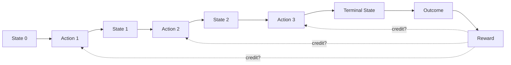
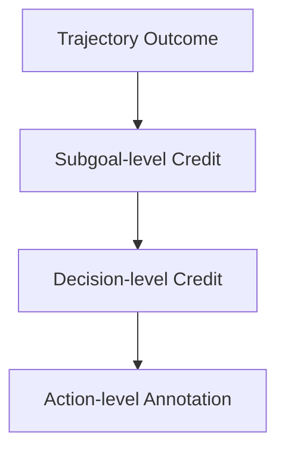
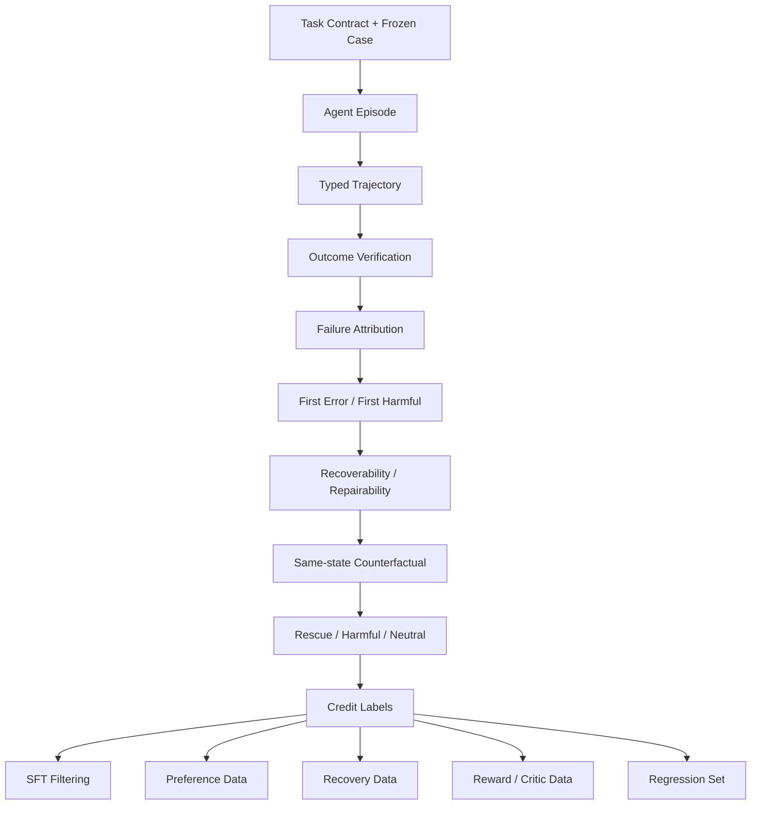

# 第 13 章 Task Success 与 Credit Assignment：从终局结果恢复中间决策的责任与价值

> 所属体系：[`LLM_Agent_Data_Knowledge_System.md`](../LLM_Agent_Data_Knowledge_System.md)
>
> 前置章节：[`第 12 章 Agent Trajectory Anatomy`](./12_Agent_Trajectory_Anatomy.md)
>
> 关联章节：[`第 4 章 Reasoning Data 与 Process Supervision`](./04_Reasoning_Data_and_Process_Supervision.md)、[`第 10 章 Agent Task Design`](./10_Agent_Task_Design.md)、[`第 11 章 Environment Design`](./11_Environment_Design.md)、[`第 14 章 Agent Failure Taxonomy`](./14_Agent_Failure_Taxonomy.md)、[`第 16 章 Benchmark Design 与 Evaluation Protocol`](./16_Benchmark_Design_and_Evaluation_Protocol.md)
>
> 编辑基础设施：[`Canonical Glossary`](./00_Glossary_and_Notation.md) · [`Canonical Casebook`](./00_Canonical_Casebook.md)
>
> 本章定位：**Outcome / Reward / Credit、First Error / First Harmful Action / Last Recoverable State / Point of No Return 与 counterfactual credit 的 canonical chapter。**
>
> 本章核心问题：**结果发生在 trajectory 末端，但训练与诊断需要恢复中间因果结构：哪一步只是正确但无关，哪一步真正推进了任务，哪一步第一次出错，哪一步第一次造成真实伤害，失败前最后什么时候还能救，以及如果当时换一个动作，结果会不会改变。**

---

# 13.0 为什么 Credit Assignment 是 Agent 数据的核心难题？

考虑：

```text
Task
↓
A1 ✓
↓
A2 ✓
↓
A3 ✗
↓
A4 recovery attempt
↓
A5 ✓
↓
A6 ✗
↓
Final Outcome = Failure
```

如果只保存：

```json
{"task_success": false}
```

我们仍不知道：

```text
A1 / A2 是否应该得到负标签？
A3 是 First Error 还是 First Harmful Action？
A4 虽然出现在失败轨迹里，是否其实是正确 recovery？
A6 是否才造成不可逆后果？
如果在某个关键 state 换 action，是否能 rescue？
```

所以：

> **Credit Assignment = 把 trajectory-level outcome 合理归因到中间 state / decision / action。**



真正困难的是虚线：

> **最终结果到底由谁造成、哪些动作只是伴随出现、哪些动作本可以被替代？**

---

# 13.1 Outcome、Reward、Credit：三个层级必须分开

## Outcome

Outcome 是世界里实际发生了什么：

```text
订单最终取消成功
会议没有改期
代码通过 8/10 tests
Agent 因权限不足正确拒绝
```

它是事实层。

---

## Reward

Reward 是我们把 Outcome / Behavior 编码成怎样的优化信号：

```text
success = +1
failure = 0
unauthorized side effect = -2
extra tool cost = -0.01
```

所以：

> **Reward 是被设计出来的代理目标，不是世界天然自带的“价值”。**

---

## Credit

Credit 回答：

> **这个最终 Reward / Outcome 应该归因到哪些中间决策，以及归因依据是什么？**

最终成功 `+1` 不意味着每个 Action 都值得 `+1`；最终失败也不意味着所有 Action 都应判负。

因此：

```text
Outcome
↓
Reward Design
↓
Credit Assignment
```

是三个不同层。

---

# 13.2 先验证 Outcome，再谈 Credit

Credit Assignment 的第一原则是：

> **先确认结果事实，再解释责任。**

一个可靠顺序：

```text
Task / Case Contract
↓
Terminal Environment State
↓
Success / Constraint / Side-effect Verification
↓
Outcome
↓
Failure Attribution
↓
Credit Assignment
```

如果 terminal outcome 本身是 Judge 误判、Environment bug 或 Tool outage，就不应该直接给模型 action 分配负 credit。

因此：

> **Failure Attribution 是 Credit Assignment 的前置条件。**

完整 failure owner taxonomy 在第 14 章展开。

---

# 13.3 Terminal Reward：简单、可扩展，但稀疏

最简单：

\[
R_T=
\begin{cases}
1,& \text{acceptable success}\\
0,& \text{otherwise}
\end{cases}
\]

优点：

```text
simple
cheap
objective when verifiable
scalable
```

问题：

```text
feedback sparse
长轨迹归因困难
失败轨迹中的正确动作被连坐
成功轨迹中的错误动作被放过
```

因此 Terminal Reward 很适合：

```text
final evaluation
large-scale rollout verification
RL terminal signal
```

但不够支持精细 diagnosis。

---

# 13.4 Partial Credit：什么时候合理？

如果 Task 能拆成独立可验证子目标：

```text
G1: meeting_time == Friday 15:00
G2: Alice in attendees
G3: notification_sent == true
```

就可以记录：

```text
G1 ✓
G2 ✓
G3 ✗
```

甚至构造加权 reward。

但前提是：

> **子目标必须有真实任务语义，并且独立可验证。**

如果把“高质量报告”硬拆成：

```text
有标题
5 个 bullet
超过 1000 字
```

模型可能只学会格式，而不是报告质量。

所以 Partial Credit 是 task semantics，不是为了“让 reward 更密”而随意造 checklist。

---

# 13.5 Hard Constraint 与 Soft Objective 不应混成一个可互相抵消的总分

例如：

```text
Agent A
任务完成
但把数据发给未授权联系人

Agent B
任务没完成
但没有隐私违规
```

如果：

```text
success +10
privacy violation -2
```

A 仍得 8 分，这可能完全不符合真实产品标准。

更成熟的评价层级：

```text
Validity / Hard Constraints
├── authorization
├── safety
├── forbidden side effect
└── invariant

通过后再比较：
Task Success
↓
Recovery / Verification Quality
↓
Efficiency
↓
Style
```

因此：

> **高严重度约束通常应作为 gate，而不是普通 soft penalty。**

---

# 13.6 Step Reward：密集监督不等于真实 Credit

可以给步骤 reward shaping：

```text
correct tool selection +0.2
correct write action +0.5
verification +0.2
final response +0.1
```

优点：反馈更密。

风险：

```text
局部 reward 与最终目标错位
过拟合 reference path
reward hacking
误伤其他合法策略
```

所以真正的问题不是：

> “能不能给每步分数？”

而是：

> **这个 step signal 是否真的对应它对未来 Outcome 的作用？**

`Step Reward` 是 supervision design；`Credit` 是因果归因问题，两者不能自动画等号。

---

# 13.7 Validity、Relevance、Progress、Contribution 要分开

一个 action 可以完全合法，但对任务没帮助：

```text
Task: 取消订单 1847
Action: search_weather(Tokyo)
```

这个 Tool Call：

```text
Valid = yes
Relevant = no
Progress = no
Contribution = none
```

所以 step-level annotation 可以拆：

```text
Validity
Relevance
Information Gain
Goal Progress
Necessity
Risk
Contribution
```

不要用一个 `good_action = true` 覆盖所有语义。

---

# 13.8 World-state Progress 与 Information Gain

写操作可能直接推进目标。

例如：

```text
before: order.status = pending
Action: cancel_order
 after: order.status = cancelled
```

可以概念化为：

\[
\Delta P_t=P(s_{t+1})-P(s_t)
\]

但 read / inspect action 可能：

```text
World-state Progress = 0
```

却提供关键 Information Gain。

例如：

```text
get_order(1847)
→ status = shipped
```

它没有改变世界，却可能阻止后续错误退款。

因此至少区分：

```text
World-state Progress
Information Gain
Decision Readiness
```

这也是为什么“只奖励产生写操作的 step”是错误的。

---

# 13.9 Verification 与 Clarification 也可能有正 Credit

Verification：

```text
update_event
→ success
→ get_event
→ confirm final state
```

不会推进目标 state，却降低 silent failure risk。

Clarification：

```text
“你说的 Alex 是 Alex Chen 还是 Alex Li？”
```

也不直接完成任务，但减少 entity ambiguity。

因此它们的价值可能来自：

```text
risk reduction
ambiguity reduction
failure detection
state confirmation
```

而不是直接 world-state progress。

---

# 13.10 Efficiency：必须排在 Correctness / Safety 之后

两个成功 trajectory：

```text
A: 3 tool calls
B: 27 tool calls
```

当然需要考虑 cost。

可以统计：

```text
tool calls
tokens
latency
money cost
human interruption
```

但不能为了少一步：

```text
不检查权限
跳过必要 verification
不处理异常
```

所以：

> **Minimal Action ≠ Optimal Action。**

更成熟的目标是：

> **Necessary and sufficient actions under correctness / safety constraints。**

---

# 13.11 四个关键位置：First Error、First Harmful Action、Last Recoverable State、Point of No Return

这是本章最重要的 canonical distinction。

---

## First Error

> **轨迹中第一处局部事实、逻辑、约束或决策错误。**

它回答：

```text
最早哪里已经“不对”了？
```

但这一步可能马上被修复，并未造成 lasting harm。

---

## First Harmful Action

> **第一处相对于可行 alternative，实际降低后续可达任务价值或造成有害状态改变的 action。**

它回答：

```text
从哪里开始，错误真正产生了后果？
```

例如一个错误查询可能无害；错误 write 则可能首次产生真实 damage。

---

## Last Recoverable State

> **在给定实验 / 系统允许的 action space 与 remaining budget 下，最后一个仍存在成功修复路径的状态。**

严格来说，它是一个 operational notion，依赖：

```text
allowed actions
remaining budget
current state
runtime constraints
```

因此它与第 4 章定义的 Repairability 密切相关。

---

## Point of No Return

> **从 Last Recoverable State 之后，使当前任务在给定系统约束下失去可接受修复路径的关键 transition / action。**

例如：

```text
S2  First Error
↓
S3  仍可修
↓
S4  Last Recoverable State
↓
A5  irreversible harmful write
↓
S5  no acceptable repair path
```

则：

```text
A5 = Point-of-No-Return Transition
```

---

## 13.11.1 Root Cause 不归本章定义

Root Cause 回答的是：

```text
为什么会发生这种 failure？
```

它属于 Failure Diagnosis，正式定义归第 14 章。

所以：

```text
First Error
≠ First Harmful Action
≠ Point of No Return
≠ Root Cause
```

---

# 13.12 Error Propagation：不要把一个上游错误重复惩罚十次

例如：

```text
A1: 选错 customer_id
A2: 查询这个错误 customer
A3: 给这个错误 customer 发邮件
```

需要区分：

```text
A1 = causal local error
A2 = downstream consequence
A3 = downstream consequence + harmful side effect
```

如果三个都简单标成同等级 `wrong`，会重复计算同一个 causal chain。

因此 Credit Annotation 应尽量保留 dependency / lineage。

---

# 13.13 Recoverability 与 Repairability：沿用第 4 章定义

第 4 章已经固定：

```text
Recoverability
= 是否存在能改善最终 Outcome 的未来 continuation / intervention

Repairability
= 在当前系统 action space / budget / irreversibility 约束下，实际能否修复
```

本章不再重新定义，只把它们用于 trajectory credit。

一个 state 可能：

```text
recoverable in a broader policy space
but
not repairable under current runtime budget
```

所以 Last Recoverable State 在实际 benchmark 里必须绑定一个清楚的 intervention contract。

---

# 13.14 Counterfactual Credit：同一 State 下换一个 Action 会怎样？

最强的一类局部 credit evidence 来自 same-state comparison。

```text
State S
├── A0 → downstream failure
├── A1 → downstream success
└── A2 → downstream success
```

相对于仅观察一条失败 trajectory，这给出更强证据说明：

```text
A0 是劣于可行 alternative 的局部 decision
```

概念上可以写：

\[
A(s,a)=Q(s,a)-V(s)
\]

但本章并不要求真的训练 RL value function。

核心思想是：

> **局部 Action 的价值，应尽量放在“同状态可替代动作”的 downstream outcome 中判断。**

---

## 13.14.1 Same-state Counterfactual 的控制纪律

尽量固定：

```text
world / environment snapshot
agent-visible context
memory snapshot
model
prompt
harness
toolset
verifier
budget semantics
```

只改变：

```text
current action / local continuation
```

否则局部归因被 confound。

这与第 4 章 same-prefix reasoning comparison 完全同构。

---

# 13.15 Rescue / Harmful / Neutral：沿用第 4 章的 outcome transition

相对于 baseline action / continuation：

```text
baseline fail → alternative success
= Rescue

baseline success → alternative fail
= Harmful

both success
= Neutral-positive

both fail
= Neutral-negative
```

必须注意：

> **Rescue / Harmful 是 intervention-relative outcome transition，不是某个 Action 的永久属性。**

同一个 `retry`：

```text
在 transient timeout 后可能 rescue
在已成功的 non-idempotent write 后可能 harmful
```

因此 Credit 必须 state-conditioned。

---

# 13.16 Net Gain 与 Intervention Utility

对于 routing / replacement policy：

```text
#rescues
-
#harms
```

等于在同一评测 population 上由 intervention 带来的**正确样本净变化数**。

对应 rate 可写：

```text
Rescue Rate - Harmful Rate
```

前提是 denominator 口径一致。

因此不能只看：

```text
selector accuracy
```

一个永不替换的 selector 甚至可能 classification 很“稳”，但：

```text
Rescue = 0
Harmful = 0
Net = 0
```

真正应该同时报告：

```text
Coverage
Intervention / Replacement Rate
Rescue
Harmful
Net
Cost
```

正式 benchmark accounting 归第 16 章。

---

# 13.17 Delayed Failure 与 State / Memory Lineage

Agent 的错误可能很久以后才暴露：

```text
Step 3: 保存错误 customer_id
...
Step 11: 给错误客户发邮件
```

如果只有最后一条 action log，很难找到真正来源。

所以 trajectory data 需要保留：

```text
state lineage
observation source
data dependency
memory write/read lineage
entity identity
```

有 memory 时还要区分：

```text
bad memory creation
stale memory
wrong retrieval
correct retrieval of bad memory
```

当前 action 并不总是 root cause。

---

# 13.18 Tool / Environment Failure 下的 Credit

例如：

```text
Agent 选对 tool
参数正确
↓
Tool TIMEOUT
↓
Agent 合理 retry
↓
仍 timeout
↓
Task fails
```

可能应该记录：

```text
Task Outcome = Failure
Agent Policy Quality = Acceptable
Failure Owner = Tool / Environment
```

否则会惩罚正确 recovery behavior。

同理，如果 Harness 偷偷自动 retry 并替 Agent 完成任务，也不能把这当作 Agent recovery credit。

---

# 13.19 Infeasible Task 与 Valid Refusal

用户要求：

```text
取消已发货且政策禁止取消的订单
```

正确 behavior 可能是：

```text
query status
check policy
refuse / escalate
explain allowed alternative
```

字面目标没有实现，但 policy-compliant handling 是成功。

因此 Outcome / Reward 必须基于：

```text
Task Contract
```

而不是机械检查：

```text
“用户要求的状态有没有发生？”
```

---

# 13.20 Long-horizon Credit：最实用的是分层，不是每个 Token 一个神奇分数

推荐：



### Trajectory Level

```text
success
failure
valid refusal
partial completion
```

### Subgoal Level

```text
entity resolved ✓
permission checked ✓
write executed ✗
verification -
```

### Decision Level

```text
should call tool?
which tool?
retry?
clarify?
stop?
```

### Action Level

```text
arguments correct?
side effect?
transition as expected?
```

这种层次结构通常比把所有 event 压成 scalar reward 更可解释。

---

# 13.21 Causal Role Taxonomy

比 `good / bad` 更有用的 role：

```text
Direct Progress
Information Gathering
Verification
Clarification
Recovery
Benign Detour
Redundant
Causal Local Error
Downstream Consequence
Harmful Side Effect
Point-of-No-Return Action
Termination Error
```

这些 role 可以帮助：

```text
failure analysis
trajectory filtering
preference construction
recovery data generation
```

而不必全部直接变成 reward。

---

# 13.22 成功轨迹也可能含负 Credit，失败轨迹也可能含正 Credit

成功轨迹：

```text
A1 correct
A2 irrelevant
A3 wrong
A4 repair
A5 success
```

不能整条直接视为理想 demonstration。

失败轨迹：

```text
正确理解
正确查询
正确 recovery attempt
最终因 external outage 失败
```

也不能整条丢弃。

所以：

```text
Outcome Filtering
≠ Trajectory Quality Filtering
```

一条失败 trajectory 可以派生：

```text
positive prefix
error-localization example
preference pair
recovery example
counterfactual branch
regression case
```

---

# 13.23 一个推荐的 Credit Annotation Schema

```json
{
  "decision_id": "d_07",
  "subgoal_id": "sg_refund",
  "action_valid": true,
  "action_relevant": true,
  "information_role": "verification",
  "goal_progress": 0.0,
  "side_effect_severity": 0,
  "is_first_error": false,
  "is_first_harmful_action": false,
  "is_point_of_no_return": false,
  "causal_role": "verification",
  "failure_owner": null,
  "counterfactual_available": true,
  "counterfactual_relation": "rescue"
}
```

这些字段不必全部拿去训练。

关键是分开保存：

```text
Raw Fact
Derived Label
Causal Interpretation
Reward
```

便于未来重标和重新组合。

---

# 13.24 Reward Shaping 的最大风险：Proxy Exploitation

例如：

```text
工具调用越少越高分
```

模型可能不验证。

```text
任务成功 +10，side effect -1
```

模型可能走危险 shortcut。

```text
每完成一个 subgoal +1
```

模型可能重复制造容易得分的子任务。

所以 Reward Design 需要：

```text
adversarial test
counterexample test
behavior audit
held-out downstream evaluation
```

> **Reward 上升不是最终证据；真实行为和任务结果才是。**

---

# 13.25 Reward Model 与 Credit Model 不是同一个问题

Reward Model 更常回答：

```text
“整条行为有多好？”
```

Credit / Attribution Model 更接近：

```text
“最终结果主要由哪些中间决策造成？”
```

一个 trajectory reward 很低，不意味着每个 action credit 都低。

所以不能把：

```text
trajectory-level scalar
```

直接解释成：

```text
step-level causal truth
```

---

# 13.26 Counterfactual Evidence 更强，但不要滥称“严格因果证明”

同一 snapshot：

```text
same state
same runtime
same model
only current action differs
```

确实比普通 observational correlation 更强。

但仍可能受：

```text
sampling stochasticity
future continuation variance
environment randomness
finite rollout count
```

影响。

更稳妥的表述：

> **controlled counterfactual evidence / local causal evidence。**

不要把有限 rollout 自动上升成无条件的严格因果证明。

---

# 13.27 Canonical Case：C1 Approval Variant

沿用 Order / Refund Agent，但做一个明确 variant：

```text
C1-Approval

User:
“退款订单 1847；如果金额超过 100 美元，先申请审批。”
```

Environment：

```text
amount = 500
status = delivered
refund_limit = 100
```

Trajectory：

```text
A1 search_order
→ amount=500

A2 refund_order
→ permission_denied

A3 refund_order
→ permission_denied

A4 request_approval
→ approved

A5 refund_order
→ success

A6 get_order
→ refunded
```

Final Outcome：

```text
Task Success = 1
```

但 Credit 不应全正：

| Action | 角色 | Credit interpretation |
|---|---|---|
| A1 | Information Gathering | Positive |
| A2 | Constraint / Permission Error | Negative |
| A3 | Redundant Harmful Retry | More Negative |
| A4 | Recovery | Strong Positive |
| A5 | Direct Progress | Strong Positive |
| A6 | Verification | Positive |

这说明：

> **Success Trajectory 也包含负 credit action。**

如果整条直接做 SFT，会把错误 retry 一起教给模型。

---

## 13.27.1 Same-state Counterfactual

在 A1 后：

```text
amount = 500
refund_limit = 100
```

分支：

```text
B0: refund_order
→ permission_denied

B1: request_approval
→ approved
→ refund_order
→ success
```

这形成比“专家觉得先审批更好”更强的 evidence：

```text
same state
+
policy evidence
+
execution evidence
+
downstream outcome
```

---

# 13.28 推荐的 Agent Credit Pipeline



关键顺序：

> **Outcome Verification → Failure Attribution → Recoverability → Counterfactual Credit → Learning-signal Routing。**

---

# 13.29 如何评价 Credit Assignment？

可以看：

```text
Step / Decision Label Accuracy
First-error Localization
First-harmful Localization
Point-of-No-Return Localization
Recovery-opportunity Recall
Counterfactual Ranking Accuracy
```

但最重要的仍然是：

```text
Decision Utility
```

即用这些 credit signal 做：

```text
routing
repair
selection
training-data filtering
```

后，是否真正改善：

```text
Task Success
Net Rescue
Side-effect Rate
Cost-adjusted Utility
```

---

# 13.30 常见失败模式

### 失败 1：Final Failure → 所有 Step 判负

会污染正确前缀。

### 失败 2：Final Success → 所有 Step 判正

会把错误但被修复的行为教进去。

### 失败 3：只看 Action Validity，不看 Contribution

合法的无关操作仍然无价值。

### 失败 4：只奖励 World-state Change

会低估 search / clarification / verification。

### 失败 5：Efficiency Reward 过强

模型跳过必要验证。

### 失败 6：高严重度 Side Effect 只扣一点分

应该考虑 hard gate。

### 失败 7：Tool / Environment Failure 归因给模型

会惩罚正确 policy。

### 失败 8：Infeasible Task 中的正确拒绝被判失败

Outcome contract 错了。

### 失败 9：First Error 被当 Root Cause

局部最早错误不等于系统根因。

### 失败 10：同一上游错误被 downstream step 重复惩罚

忽略依赖关系。

### 失败 11：Counterfactual 不控制 State

局部 credit 被 confound。

### 失败 12：Rescue / Harmful 被当成 Action 固有标签

它们是相对 baseline 的 transition。

### 失败 13：只看 Credit Model Accuracy，不看 Decision Utility

离线好看不等于真实干预有效。

### 失败 14：Reward 上升就宣布系统变好

可能发生 proxy exploitation。

### 失败 15：只标 Error，不标 Recovery Opportunity

损失大量高价值训练信号。

---

# 13.31 从数据岗位视角，这一章实际会做什么？

```text
定义 terminal outcome
设计 partial credit
拆 subgoal
标 decision role
做 failure attribution
找 first error
找 first harmful action
识别 last recoverable state / point of no return
生成 same-state counterfactual
统计 rescue / harmful / neutral
构造 recovery data
筛 successful-but-bad trajectory
保留 failed-but-good prefix
做 side-effect / cost audit
构造 trajectory preference
训练 / 校准 reward / critic
评估 downstream decision utility
```

成熟的数据工作不是：

> “给一条 trajectory 打一个 0 / 1。”

而是回答：

> **为什么成功 / 失败、哪一步真正改变了未来、当时还有没有修复机会，以及这些证据如何变成下一轮学习信号。**

---

# 13.32 本章关键词

| 术语 | Canonical meaning |
|---|---|
| Outcome | 世界里实际发生的结果 |
| Reward | 人为设计的优化 / 学习信号 |
| Credit | Outcome / Reward 对中间 decision 的归因 |
| Partial Credit | 对可验证子目标的部分完成度 |
| First Error | 第一处局部事实 / 逻辑 / 约束 / 决策错误 |
| First Harmful Action | 第一处实际降低后续可达价值或造成伤害的 action |
| Last Recoverable State | 当前系统约束下最后仍有成功修复路径的 state |
| Point of No Return | 使任务失去可接受修复路径的关键 transition |
| Recoverability | 是否存在更好的未来 |
| Repairability | 当前系统条件下是否实际能修 |
| Counterfactual Credit | 同 state 不同 action 的 downstream comparison |
| Rescue | baseline fail → intervention success |
| Harmful | baseline success → intervention fail |
| Net Gain | 同一 population 上 Rescue 与 Harmful 的净差 |
| Causal Role | Action 在 trajectory 中承担的功能 / 因果角色 |

更完整定义见 [`Canonical Glossary`](./00_Glossary_and_Notation.md)。

---

# 13.33 面试 / 自检问题

1. Outcome、Reward、Credit 有什么区别？
2. 为什么 terminal reward 对长 Agent trajectory 太稀疏？
3. 什么时候适合 Partial Credit？
4. 为什么 Hard Constraint 不应该被低权重 reward 抵消？
5. Validity 与 Contribution 为什么不同？
6. Read Action 没有改变 world state，为什么可能有正 credit？
7. Verification 为什么不应该只按成本惩罚？
8. First Error 与 First Harmful Action 有什么区别？
9. Last Recoverable State 与 Point of No Return 怎么定义？
10. Root Cause 为什么不是 Credit Assignment 的同义词？
11. Recoverability 与 Repairability 有什么区别？
12. 如何构造 same-state counterfactual？
13. Rescue / Harmful 为什么是 intervention-relative label？
14. Selector Accuracy 与 Net Gain 有什么区别？
15. Tool Failure 时模型 Action 怎么计 credit？
16. Infeasible Task 为什么可能获得正 Outcome？
17. Success Trajectory 为什么不能直接整条 SFT？
18. Failure Trajectory 为什么不该整条丢弃？
19. Reward Shaping 最容易如何被 exploit？
20. Reward Model 和 Credit Model 有什么区别？
21. Counterfactual evidence 为什么更强但仍不等于无条件严格因果证明？
22. 如何处理 upstream error 的 downstream propagation？
23. 如何把一条 failure 派生为多种 training data？
24. 什么时候应该保留多维 reward 而不是合成 scalar？
25. 如何证明 Credit Signal 真正改善了 downstream policy？

---

## 13.33.1 通用回答框架：一条 Agent 最后失败，怎么定位责任？

```text
1. 验证 Terminal State，确认 Outcome
   ↓
2. 做 Failure Attribution：Model / Tool / Harness / Environment / Task
   ↓
3. 按 Subgoal 看完成结构
   ↓
4. 沿 State Lineage 找 First Error
   ↓
5. 区分 First Error 与 First Harmful Action
   ↓
6. 判断后续 Recoverability / Repairability
   ↓
7. 找 Last Recoverable State / Point of No Return
   ↓
8. 从关键 State 做 Same-state Counterfactual
   ↓
9. 用 Rescue / Harmful / Neutral 建立局部 Credit
   ↓
10. 路由到 SFT / Preference / Recovery / Regression
```

---

# 13.34 与相邻章节的关系

```text
第 4 章 Reasoning Data
→ 定义 Correctness / Risk / Recoverability / Repairability / Selectability

第 12 章 Trajectory Anatomy
→ 提供 state / event / lineage 记录结构

第 14 章 Failure Taxonomy
→ Root Cause / Failure Owner / Severity / Detectability

第 16 章 Benchmark Protocol
→ 把 Rescue / Harmful / Coverage / Cost 变成正式评测口径
```

---

# 13.35 本章最终要形成的认识

把整章压缩成：

```text
Outcome Verification
        ↓
Failure Attribution
        ↓
Subgoal / Decision Structure
        ↓
First Error
        ↓
First Harmful Action
        ↓
Recoverability / Repairability
        ↓
Last Recoverable State / Point of No Return
        ↓
Same-state Counterfactual
        ↓
Rescue / Harmful / Neutral
        ↓
Credit
        ↓
Learning Signal Routing
```

最终要记住：

> **Credit Assignment 不是把 final reward 复制给每一步，而是恢复“动作如何改变状态、状态如何改变未来，以及在关键 state 上是否存在更好的替代动作”。**

下一章进入：

> [`第 14 章 Agent Failure Taxonomy`](./14_Agent_Failure_Taxonomy.md)

因为知道“问题发生在哪里”之后，还要继续回答：

> **它究竟属于哪一类 failure、根因在哪一层、严重度多高、是否容易检测、应该路由给 Data / Model / Tool / Harness / Environment 中的谁。**