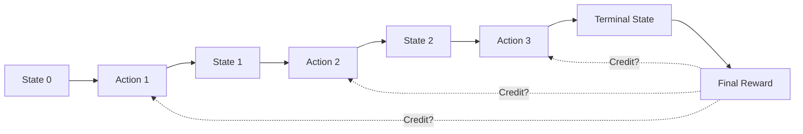
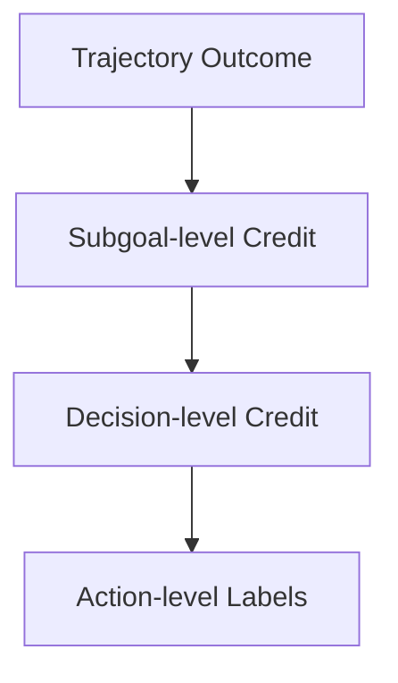
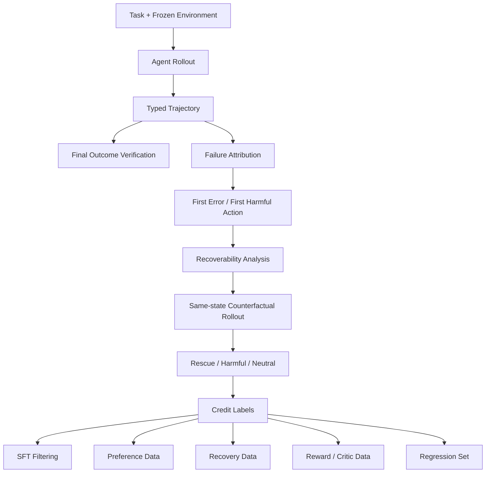

# 第 13 章 Task Success 与 Credit Assignment：从终局结果到中间决策归因

> 所属体系：[`LLM_Agent_Data_Knowledge_System.md`](../LLM_Agent_Data_Knowledge_System.md)
>
> 前置章节：[`第 12 章 Agent Trajectory Anatomy`](./12_Agent_Trajectory_Anatomy.md)
>
> 关联章节：[`第 4 章 Reasoning Data 与 Process Supervision`](./04_Reasoning_Data_and_Process_Supervision.md)、[`第 5 章 Tool-use Data 与 Agent Trajectory Data`](./05_Tool_Use_and_Agent_Trajectory_Data.md)、[`第 8 章 Rollout、Rejection Sampling 与 Candidate Selection`](./08_Rollout_Rejection_Sampling_and_Candidate_Selection.md)、[`第 10 章 Agent Task Design`](./10_Agent_Task_Design.md)
>
> 本章目标：理解为什么 Agent 的最终成功 / 失败不能直接等价成每一步 action 的好坏；掌握 Terminal Reward、Partial Credit、Step Reward、Side-effect Penalty、Efficiency Penalty、First Harmful Action、Last Recoverable State、Counterfactual Credit 与 Long-horizon Credit Assignment 的基本方法。
>
> 本章核心问题：**结果发生在 trajectory 末端，但训练和诊断需要知道“哪一步真正推进了任务、哪一步埋下了失败、哪些动作虽然出现在失败轨迹里却是正确的，以及如果当时换一个动作，结果会不会改变”。**

---

# 13.0 为什么 Credit Assignment 是 Agent 数据最难的问题之一？

考虑一条长轨迹：

```text
Task
↓
Action 1  ✓
↓
Action 2  ✓
↓
Action 3  ✓
↓
Action 4  ✗
↓
Action 5  recovery attempt
↓
Action 6  ✓
↓
Action 7  ✗
↓
Final Outcome = Failure
```

如果只保存：

```json
{"task_success": false}
```

我们知道任务失败了，但仍然不知道：

```text
Action 1 是否应该被惩罚？
Action 4 是否是第一处真正有害的动作？
Action 5 的 recovery 是否其实是正确行为？
Action 7 是否才是 point of no return？
如果在 Action 4 改选另一条路径，是否可以 rescue？
```

这就是 Credit Assignment：

> **如何把 trajectory-level outcome，合理归因到中间 state / decision / action。**

可以画成：



真正困难的就是这些虚线：

> **最终 reward 到底应该回传给谁、回传多少、依据是什么？**

---

# 13.1 Outcome、Reward、Credit：先把三个词分开

这三个概念很容易混。

## 13.1.1 Outcome

Outcome 是发生了什么。

例如：

```text
订单最终取消成功
会议最终没有改期
代码通过 8/10 tests
Agent 因权限不足正确拒绝
```

它是事实层。

---

## 13.1.2 Reward

Reward 是我们如何把 outcome / behavior 转成优化信号。

例如：

```text
success = +1
failure = 0
unauthorized side effect = -2
extra tool call = -0.01
```

所以：

> **Reward 是设计出来的，不是世界天然自带的。**

---

## 13.1.3 Credit

Credit 回答：

> **最终这个 reward 应该归因到哪些中间动作？**

例如最终成功：

```text
+1
```

并不意味着：

```text
每一个 action 都值得 +1
```

因为中间可能存在：

```text
无关搜索
错误工具调用
危险但最终被补救的写操作
偶然成功
```

因此：

```text
Outcome
   ↓
Reward Design
   ↓
Credit Assignment
```

是三个不同层次。

---

# 13.2 Terminal Reward：最简单，也最稀疏

最简单的 Agent reward 是：

$$
R_T =
\begin{cases}
1, & \text{task success} \\
0, & \text{otherwise}
\end{cases}
$$

也就是整个 episode 结束以后才给一次 reward。

例如：

```text
trajectory 1 → success → +1
trajectory 2 → failure → 0
```

优点：

```text
定义简单
客观
容易自动验证
不需要人工逐步标注
不容易把错误 step rubric 硬塞进去
```

问题：

```text
feedback sparse
长轨迹 credit assignment 困难
失败轨迹中的正确动作被整体连坐
成功轨迹中的错误动作被整体放过
```

因此 Terminal Reward 很适合做：

```text
最终任务完成率
RL terminal signal
大规模 rollout verification
```

但它不够支持精细 failure analysis。

---

# 13.3 Binary Success 为什么仍然不够？

两个失败 trajectory：

### Trajectory A

```text
目标 3 个子任务
完成 2 个
最后一步失败
```

### Trajectory B

```text
一开始就理解错任务
完全没完成
```

如果都记：

```text
reward = 0
```

大量信息被丢掉。

因此需要 Partial Credit。

---

# 13.4 Partial Credit：把 Task 分解成可验证子目标

假设任务是：

```text
“把会议改到周五三点，
邀请 Alice，
并通知所有参会者。”
```

可以拆成：

```text
G1: meeting_time = Friday 15:00
G2: Alice in attendees
G3: notification_sent = true
```

于是 reward 可以写成：

$$
R = w_1 G_1 + w_2 G_2 + w_3 G_3
$$

例如：

```text
时间改了      → 1
Alice 加了     → 1
没发通知       → 0
```

得到：

```text
partial success = 2 / 3
```

---

## 13.4.1 Partial Credit 的前提：子目标必须独立可验证

否则容易制造错误 reward。

例如：

```text
“写一份高质量市场分析报告”
```

如果硬拆成：

```text
包含标题
包含 5 个 bullet
超过 1000 字
```

然后每项 +1，Agent 可能学会优化格式，而不是报告质量。

所以 Partial Credit 最适合：

```text
结构明确
可执行验证
子目标语义清楚
```

的任务。

---

# 13.5 Hard Constraint 与 Soft Objective：不要全压成一个分数

Agent reward 常见一个危险做法：

```text
总分 = success + style + efficiency + safety
```

但不同维度不一定能简单加权。

例如：

```text
Agent A
任务成功
但把数据发给未授权联系人

Agent B
任务失败
但没有安全违规
```

如果：

```text
success = +10
privacy_violation = -2
```

那么 A 仍然得 8 分。

这显然可能不合理。

因此更好的设计通常是层级约束：

```text
Hard Constraints
├── no unauthorized action
├── no privacy violation
└── no forbidden side effect

然后再比较：
Task Success
↓
Efficiency
↓
Style
```

也就是说：

> **安全、权限、不可接受副作用往往应该作为 feasibility / validity gate，而不是普通 soft reward。**

---

# 13.6 Step Reward：中间步骤能不能直接打分？

可以，但要谨慎。

例如：

```text
search_order → correct tool      +0.2
cancel_order → correct action    +0.5
verify_order → good verification +0.2
final response                  +0.1
```

这种叫 reward shaping。

优点：

```text
反馈更密
更容易学到长轨迹行为
更容易训练 recovery / verification
```

问题是：

```text
局部 reward 可能和最终目标不一致
模型可能 reward hack
人工规则可能过拟合某种参考路径
不同正确路径会被误伤
```

所以 Step Reward 的核心问题不是：

> “能不能打分？”

而是：

> **这个 step-level signal 是否真的与最终任务价值一致？**

---

# 13.7 Process Correctness ≠ Contribution to Success

一个 step 可以是正确的，但对任务没有帮助。

例如：

```text
用户：取消订单 1847
```

Agent：

```text
search_weather(Tokyo)
```

工具调用语法完全正确，结果也真实。

但对目标：

```text
contribution = 0
```

所以 step-level annotation 至少可以分成：

```text
Validity
Relevance
Progress
Necessity
Risk
Contribution
```

不能只问：

```text
“这个 action 是否合法？”
```

---

# 13.8 Progress Signal：这个动作有没有让状态更接近目标？

一种更直接的 process signal 是 Goal Progress。

设：

$$
P(s_t) = \text{state } s_t \text{ 距离目标的完成程度}
$$

那么 action 的局部 progress 可以写成：

$$
\Delta P_t = P(s_{t+1}) - P(s_t)
$$

例如：

```text
目标：取消订单 1847

before:
status = pending

Action:
cancel_order(1847)

after:
status = cancelled
```

这一步：

```text
ΔP > 0
```

而重复查询：

```text
search_order(1847)
```

可能：

```text
ΔP = 0
```

但注意：

> **Information Gathering 的价值不一定体现为环境 goal progress。**

例如查询订单状态本身没有改环境，却提供了后续正确决策必须的信息。

所以 progress 至少要分：

```text
World-state Progress
Information Gain
Decision Readiness
```

---

# 13.9 Information Gain：Read Action 也可以非常有价值

Agent 经常需要：

```text
search
read
inspect
query
```

这些动作不会直接改变目标 state。

但它们减少 uncertainty。

可以概念上写成：

$$
IG(a_t)=H(S_t)-H(S_t\mid o_{t+1})
$$

其中 $H$ 表示对关键状态的不确定性。

无需真的在线计算 entropy，核心思想是：

> **一个 read action 的价值可能来自“获得了决策所需信息”，而不是直接改变世界。**

因此简单的：

```text
write action = 有贡献
read action = 无贡献
```

是错误的。

---

# 13.10 Side-effect Penalty：达成目标也可能不值得奖励

考虑：

```text
目标：删除重复文件
```

Agent：

```text
rm -rf entire_folder
```

最终：

```text
重复文件数 = 0
```

但明显不是成功策略。

因此可以定义：

$$
R = R_{goal} - \lambda R_{side\_effect}
$$

但高风险场景更推荐 hard constraint，而不是只做线性 penalty。

Side effect 可以按严重程度分级：

```text
Benign
Recoverable
Costly
Irreversible
Unauthorized
Safety-critical
```

例如：

```text
多查一次订单
```

和：

```text
给错误账户转账
```

不能使用同一种 penalty 尺度。

---

# 13.11 Efficiency Penalty：成功但极其低效，算不算好？

考虑：

```text
Trajectory A
3 次工具调用
success

Trajectory B
27 次工具调用
success
```

如果都只有：

```text
reward = 1
```

系统无法表达效率偏好。

可以考虑：

$$
R = R_{success}
- \lambda_1 N_{tool}
- \lambda_2 Tokens
- \lambda_3 Latency
- \lambda_4 Cost
$$

但一个关键原则是：

> **Efficiency 通常应该在成功 / 安全成立之后再优化。**

否则模型可能为了节省调用，直接不验证结果。

例如：

```text
2 calls, no verification
```

不一定比：

```text
3 calls, verified success
```

更好。

---

# 13.12 Minimal Action ≠ Optimal Action

有些 benchmark 容易把：

```text
tool calls 越少越好
```

当作效率。

但最少 action 可能导致：

```text
不检查权限
不验证状态
不处理异常
```

因此应该优化：

> **Necessary and sufficient actions**

而不是：

> Minimum actions at all costs。

这可以通过比较：

```text
necessary action
useful verification
redundant action
harmful action
```

来做更细粒度 annotation。

---

# 13.13 First Error、First Harmful Action 与 Root Cause 不是一个概念

这三个概念需要分开。

## First Error

第一处不正确行为。

例如：

```text
选错了工具
```

---

## First Harmful Action

第一处真正降低最终成功概率 / 破坏状态的 action。

有些错误可能马上被修正，并没有造成长期伤害。

---

## Root Cause

导致失败的最根本原因。

例如：

```text
模型没识别“不要通知外部联系人”这个 negative constraint
```

它可能直到很后面的 send_email 才表现为 harmful action。

所以：

```text
First Error
≠ First Harmful Action
≠ Root Cause
```

---

# 13.14 Error Propagation：后续错误是否应该重复惩罚？

假设：

```text
A1: 错误地选了客户 ID 17
A2: 查询客户 17
A3: 给客户 17 发邮件
```

A2 和 A3 的局部动作可能在“错误 state”下是合理的。

如果每一步都独立标：

```text
wrong
wrong
wrong
```

会重复计算同一个上游错误。

所以需要 dependency-aware annotation：

```text
A1 = causal error
A2 = downstream consequence
A3 = downstream consequence + side effect
```

这比把所有后续步骤都标成同等级 error 更准确。

---

# 13.15 Last Recoverable State：失败之前，最后还能救回来的地方

上一章已经引入这个概念，这里正式展开。

一条失败轨迹可能是：

```text
S0
↓
S1
↓
S2  first error
↓
S3  still recoverable
↓
S4  still recoverable
↓
S5  irreversible harmful action
↓
S6  failure
```

那么：

```text
Last Recoverable State = S4
Point of No Return = Action from S4 to S5
```

这对数据非常有价值，因为可以构造：

```text
Recovery Training Data
Branching Data
Intervention Trigger Data
```

例如：

```text
S4
├── original action → failure
└── alternative action → success
```

这是非常强的 counterfactual supervision。

---

# 13.16 Recoverability 与 Repairability

有时候可以进一步区分：

```text
Recoverability
= 从当前 state 是否存在某种未来策略可以成功

Repairability
= 在允许的干预动作 / budget 下是否能实际修回来
```

比如理论上重新执行整套任务能成功，但在线只允许再调用一次工具。

那么：

```text
recoverable in principle = yes
repairable under budget = no
```

因此修复能力总是依赖：

```text
allowed actions
remaining budget
current environment state
irreversibility
```

不是一个纯粹 intrinsic property。

---

# 13.17 Counterfactual Credit：如果当时换一个 Action，会怎样？

最强的一类 credit evidence 来自 counterfactual comparison。

给定同一个 state $s_t$：

```text
s_t
├── a0 → downstream failure
├── a1 → downstream success
└── a2 → downstream success
```

那么我们有更强依据认为：

```text
a0 harmful / dominated
```

而不是只因为最终 trajectory 失败，就猜 a0 是坏的。

可以定义概念上的 action advantage：

$$
A(s_t,a) = Q(s_t,a) - V(s_t)
$$

其中：

- $Q(s_t,a)$：在 state $s_t$ 采取 action $a$ 后的未来价值；
- $V(s_t)$：该 state 的基准未来价值。

数据里不一定真的训练 RL value function，但这种思想非常重要：

> **局部 action 的价值，要放在“同状态下可替代动作”里比较。**

---

# 13.18 Same-state Counterfactual 的实验纪律

为了让 counterfactual credit 有意义，必须固定：

```text
world_snapshot
memory_snapshot
visible context
model
prompt
harness
toolset
verifier
```

只改变：

```text
current action / local continuation
```

否则：

```text
结果差异
```

无法归因到当前 action。

这和 reasoning 里的 same-prefix comparison 完全同构。

---

# 13.19 Rescue、Harmful、Neutral：从 Reasoning 推广到 Agent

给定 baseline action $a_0$ 和 alternative action $a_1$：

```text
Baseline fails
Alternative succeeds
→ Rescue

Baseline succeeds
Alternative fails
→ Harmful

Both succeed
→ Neutral-positive

Both fail
→ Neutral-negative
```

这套分类可以用于：

```text
Tool Choice
Recovery Action
Branch Selection
Verification Decision
Clarification Decision
```

因此 Agent selector 的真实目标也不是简单：

```text
predict good / bad action
```

而是：

> **在需要替换时找到真正能 rescue 的 action，同时避免把原本成功的路径替换坏。**

---

# 13.20 Net Gain 比 Selector Accuracy 更重要

如果做 action replacement / routing，可以定义：

```text
Rescue = baseline fail → intervention success
Harmful = baseline success → intervention fail
Net = Rescue - Harmful
```

一个 selector 可能 classification accuracy 很高，但：

```text
从不替换
```

于是：

```text
Rescue = 0
Harmful = 0
Net = 0
```

从任务改善角度没有价值。

因此评估 intervention policy 时至少应看：

```text
Coverage
Replacement Rate
Rescue
Harmful
Net Gain
Cost
```

而不是只看 selector accuracy。

---

# 13.21 Delayed Failure：错误为什么可能很久以后才暴露？

Agent 的一个难点是 delayed consequence。

例如：

```text
Step 3:
保存了错误客户 ID

Step 11:
根据这个 ID 发错邮件
```

failure 在第 11 步才被看到，但根因可能在第 3 步。

这就要求 trajectory schema 保存：

```text
state lineage
data dependency
source observation
memory write/read lineage
```

否则只能看见“最后发错邮件”，看不到错误信息最早从哪里进入系统。

---

# 13.22 Memory Credit Assignment

有 memory 的 Agent 更复杂。

例如：

```text
Episode / Step A
写入错误 memory
↓
很久以后
Memory Read
↓
错误决策
```

此时 root cause 可能是：

```text
memory write
```

而不是当前 read 或当前 action。

所以可以标：

```text
bad memory creation
stale memory
incorrect memory retrieval
correct retrieval of bad memory
```

不能把所有问题都归因于当前模型 turn。

---

# 13.23 Tool Failure 下的 Credit Assignment

考虑：

```text
Agent 选对 tool
参数正确
↓
Tool TIMEOUT
↓
Agent retry
↓
仍 timeout
↓
任务失败
```

最终 outcome 是 failure。

但 Agent actions 可能全部正确。

因此 reward / labels 应区分：

```text
Task Outcome = Failure
Agent Policy Quality = Correct
External Failure = Tool / Environment
```

否则训练会惩罚正确 recovery behavior。

这也是为什么：

> **Failure Attribution 是 Credit Assignment 的前置条件。**

---

# 13.24 Infeasible Task 下的 Credit Assignment

如果用户要求：

```text
取消一个已经发货、且业务规则禁止取消的订单
```

Agent 正确行为是：

```text
查询状态
发现 shipped
检查规则
拒绝取消
说明原因
```

从字面 goal 来看：

```text
订单没有被取消
```

但这应该得到正 credit。

所以 reward 必须基于：

```text
policy-compliant task handling
```

而不是机械的：

```text
literal user requested state achieved or not
```

---

# 13.25 Verification Action 的 Credit

很多任务完成后需要：

```text
verify
re-read
state check
```

例如：

```text
update_event
→ success
→ get_event
→ confirm new time
```

验证动作本身可能：

```text
不改变世界
不增加子目标完成率
增加 token / latency
```

但却显著降低 silent failure 风险。

因此不能只用：

```text
environment progress
```

评价 verification。

可以给 verification 单独的价值维度：

```text
confidence gain
failure detection value
safety assurance
```

---

# 13.26 Clarification Action 的 Credit

Agent 说：

```text
“你说的 Alex 是 Alex Chen 还是 Alex Li？”
```

没有直接完成任务。

但如果环境里确实有两个 Alex，这一步非常关键。

因此：

```text
Ask User
```

不能自动视为：

```text
no progress
```

它可能具有：

```text
ambiguity reduction
risk reduction
permission confirmation
```

等价值。

---

# 13.27 Stop Decision 也需要 Credit Assignment

Agent action 不只有“做什么”，还有：

```text
什么时候停
```

两种典型错误：

```text
Premature Stop
任务未完成就终止
```

以及：

```text
Overrun
任务已完成但继续执行，增加 side effect / cost
```

所以 termination 本身也是一个 decision：

```text
continue
stop
ask user
abstain
```

可以单独评价。

这和 reasoning 中 continue/stop decision 完全对应。

---

# 13.28 Long-horizon Credit Assignment：最实用的分层方法

现实中不一定需要给每个 token 学一个精确 reward。

更实用的做法是分层。



例如：

### Level 1：Trajectory

```text
success / failure / valid refusal
```

### Level 2：Subgoal

```text
找到订单 ✓
判断资格 ✓
执行取消 ✗
验证状态 -
```

### Level 3：Decision

```text
选 tool 是否正确？
是否应该 ask user？
是否应该 retry？
```

### Level 4：Action

```text
参数是否正确？
执行是否产生 side effect？
```

这种分层比直接对所有 event 打 scalar reward 更可解释。

---

# 13.29 一个推荐的 Credit Annotation Schema

可以在 trajectory annotation 中加入：

```json
{
  "event_id": 14,
  "decision_id": "d_07",
  "subgoal_id": "sg_cancel_order",
  "action_valid": true,
  "action_relevant": true,
  "information_gain": 0.0,
  "goal_progress": 1.0,
  "side_effect_severity": 0,
  "is_first_error": false,
  "is_first_harmful_action": false,
  "is_last_recoverable_state": false,
  "causal_role": "direct_progress",
  "failure_source": null,
  "counterfactual_available": true,
  "counterfactual_outcome": "rescue"
}
```

这些字段不需要全部用于训练。

关键是把：

```text
事实
解释
标签
reward
```

分层保存，后续可以重新组合。

---

# 13.30 Causal Role Taxonomy：比简单 Good / Bad 更有用

一个 action 可以标成：

```text
Direct Progress
Information Gathering
Verification
Recovery
Clarification
Redundant
Benign Detour
Causal Error
Downstream Consequence
Harmful Side Effect
Point of No Return
Termination Error
```

这样比：

```text
good / bad
```

更适合 failure analysis 和数据生产。

---

# 13.31 成功轨迹也需要找“坏步骤”

不要只分析 failure。

一个成功 trajectory 可能是：

```text
A1 正确
A2 无关
A3 错误
A4 修复
A5 成功
```

如果直接作为 SFT：

```text
整条 trajectory = positive demonstration
```

模型会把 A2、A3 一起模仿。

所以 successful trajectory 进入 SFT 前，最好检查：

```text
policy validity
efficiency
side effects
recovery quality
observation grounding
```

这也是：

> **Outcome Filtering ≠ Trajectory Quality Filtering。**

---

# 13.32 失败轨迹也需要找“好步骤”

反过来：

```text
Final Failure
```

不代表：

```text
所有步骤都是负例
```

失败 trajectory 中可能包含：

```text
正确 task understanding
正确 tool selection
正确 information gathering
正确 recovery attempt
正确 verification
```

因此可把失败轨迹拆成：

```text
positive prefix
critical error
recovery opportunity
terminal failure
```

然后分别转换成不同数据。

---

# 13.33 一条失败轨迹可以派生出哪些数据？

例如：

```text
S0 → A1 ✓ → S1 → A2 ✗ → S2 → A3 → failure
```

可以生成：

### SFT Positive Prefix

```text
S0 → A1
```

### Error Classification

```text
A2 = wrong tool selection
```

### Preference Pair

```text
A2_alt > A2
```

### Recovery Data

```text
S2 → recovery action
```

### Counterfactual Branch Data

```text
S1
├── A2 → fail
└── A2_alt → success
```

### Regression Case

```text
完整 task + failure seed
```

所以一条 failure 往往可以派生多种监督信号。

---

# 13.34 Reward Shaping 的最大风险：Goodhart / Proxy Exploitation

如果 reward 是：

```text
工具调用越少越高
```

模型可能不验证。

如果 reward 是：

```text
任务成功 +10
```

但没有 side-effect penalty，模型可能走危险 shortcut。

如果 reward 是：

```text
每完成一个 subgoal +1
```

模型可能重复制造 / 完成容易 subgoal。

因此 Reward Design 必须做：

```text
adversarial test
counterexample test
policy audit
held-out behavior evaluation
```

不能只看 reward 本身是否上升。

---

# 13.35 Reward Model 与 Credit Model 的区别

Reward Model 常回答：

```text
这条 trajectory / response 有多好？
```

Credit Model 更接近：

```text
最终结果主要由哪些中间动作造成？
```

两者可以重叠，但不是同一个问题。

一个 trajectory reward 很低，不意味着所有 action credit 都低。

因此做 long-horizon Agent 时，需要特别防止：

```text
trajectory-level scalar
```

被误当成：

```text
step-level causal explanation
```

---

# 13.36 Counterfactual ≠ 真正的因果证明，但比相关性更强

从同一 snapshot 做 alternative rollout：

```text
same state
same environment
same runtime
only action differs
```

可以显著增强局部归因。

但仍然要注意：

```text
模型 sampling stochasticity
后续 continuation variance
environment randomness
finite rollout count
```

所以更准确的表述是：

> **controlled counterfactual evidence**

而不是轻易宣称“严格因果证明”。

---

# 13.37 Credit Assignment 的评价指标

如果你做一个 step scorer / credit model，可以看：

### Step Label Accuracy

是否正确识别 good / bad action？

### First-error Localization Accuracy

第一处错误找对了吗？

### First-harmful Localization

真正开始降低成功概率的位置找对了吗？

### Recovery Opportunity Recall

是否能发现仍可修复的 state？

### Counterfactual Ranking Accuracy

同一 state 下，能否把 rescue action 排在 harmful action 前？

### Decision Utility

最终用这个 scorer 做 routing / repair，是否真的提升：

```text
Task Success
Net Rescue
Cost-adjusted Utility
```

最后一项仍然最重要。

---

# 13.38 研究实例：从 RoTFuse / K17 的局部替换推广到 Agent Credit

> 本节是方法论映射，不把 reasoning experiment 的阶段性结论直接外推成 Agent 结论。

RoTFuse / K17 中的核心结构可以抽象为：

```text
Authoritative Prefix P
├── u0
├── c1
└── c2
```

然后通过后续 outcome 构造：

```text
rescue
harmful
neutral
```

这一结构推广到 Agent 后就是：

```text
Authoritative Agent State S
├── Action A0
├── Action A1
└── Action A2
```

再从同一个 world / memory / context snapshot 往后 rollout。

于是可以研究：

```text
Tool Choice Credit
Retry Credit
Clarification Credit
Verification Credit
Recovery Credit
```

核心保持不变：

> **不是问某个 action “看起来好不好”，而是问它相对于同状态 alternative，是否改变了 downstream outcome。**

---

# 13.39 研究实例：More Thinking 中 Wrong→Right / Right→Wrong 的 Credit 解释

More Thinking 的 transition 分析：

```text
Wrong → Right
Right → Wrong
```

本质上已经是一种 action-level consequence analysis。

如果把：

```text
continue reasoning
```

视为一个 action，那么：

```text
Wrong → Right
= positive continuation credit

Right → Wrong
= harmful continuation credit
```

这说明：

> **Continue 本身不是天然正动作，它的 credit 取决于当前 state。**

推广到 Agent：

```text
retry
verify
ask user
search again
```

同样都不是天然好 / 坏，需要 state-conditioned evaluation。

---

# 13.40 一个完整例子：退款 Agent 的 Credit Assignment

任务：

```text
“退款订单 1847，如果金额超过 100 美元则先申请审批。”
```

环境：

```text
order_1847.amount = 500
order_1847.status = delivered
user.refund_limit = 100
```

Agent trajectory：

```text
A1: search_order(1847)
→ amount=500, delivered

A2: refund_order(1847)
→ permission_denied

A3: refund_order(1847)
→ permission_denied

A4: request_approval(1847)
→ approved

A5: refund_order(1847)
→ success

A6: get_order(1847)
→ refunded

Final: 已完成退款。
```

最终结果：

```text
Task Success = 1
```

但 step-level credit 不应是全正。

可以分析：

| Action | Validity | Contribution | Credit |
|---|---|---|---|
| A1 search | 正确 | 获得必要状态 | Positive |
| A2 refund | 错误 | 忽略权限约束 | Negative |
| A3 retry refund | 更差 | 无新信息的无效重复 | More Negative |
| A4 approval | 正确恢复 | 修复路径 | Strong Positive |
| A5 refund | 正确 | 直接完成目标 | Strong Positive |
| A6 verify | 正确 | 验证 final state | Positive |

所以：

> **Success trajectory 仍然包含 negative-credit actions。**

如果拿这整条轨迹直接做 SFT，会把错误 retry 一起教给模型。

---

# 13.41 同一个例子的 Counterfactual Credit

在 A1 后 state 已知：

```text
amount = 500
refund_limit = 100
```

可以从同状态生成：

```text
Branch B0:
refund_order
→ permission_denied

Branch B1:
request_approval
→ approved
→ refund_order
→ success
```

于是：

```text
B1 > B0
```

这个 preference 比“专家觉得先审批更好”更强，因为它同时有：

```text
policy evidence
execution evidence
downstream outcome
```

---

# 13.42 一个推荐的 Agent Credit Pipeline



这条 pipeline 的关键顺序是：

```text
先确认 outcome
↓
再做 failure attribution
↓
再谈 action credit
```

否则很容易把系统故障归因给模型。

---

# 13.43 常见失败模式

### 失败 1：Final Failure → 所有 Step 都是负例

会污染正确前缀。

### 失败 2：Final Success → 所有 Step 都是正例

会把冗余、危险、错误但被修复的 action 一起教进去。

### 失败 3：只看 Action Validity，不看 Goal Contribution

合法调用无关工具并不值得 reward。

### 失败 4：只奖励 World-state Change

会低估 search、clarification、verification 等信息动作。

### 失败 5：Efficiency Penalty 太强

模型为了少调用工具而跳过必要验证。

### 失败 6：Side Effect 只是小 penalty

高风险副作用应作为 hard constraint。

### 失败 7：把 Tool Failure 归因模型

会惩罚正确行为。

### 失败 8：忽略 Infeasible Task

正确拒绝可能被错标 failure。

### 失败 9：把 First Error 当 Root Cause

第一处表面错误不一定是根本原因。

### 失败 10：所有后续错误重复惩罚

会放大同一个上游 causal error。

### 失败 11：Counterfactual 不控制 State

不同 snapshot 的结果不能做局部 credit。

### 失败 12：只做 Step Accuracy，不看 Decision Utility

credit scorer 很准，不代表 routing / repair 真能提升任务结果。

### 失败 13：Reward 上升就认为真实行为变好

必须检查 reward hacking。

### 失败 14：只标 Error，不标 Recovery Opportunity

会错过大量高价值修复数据。

### 失败 15：忽略 Stop Decision

提前停和过度执行都属于 credit assignment 问题。

---

# 13.44 从数据岗位视角，这一章实际会做什么？

典型工作包括：

```text
定义 task success predicate
设计 partial-credit schema
拆 subgoal
标 step / decision contribution
做 failure attribution
找 first error
找 first harmful action
标 root cause
识别 last recoverable state
生成 same-state counterfactual
统计 rescue / harmful / neutral
构造 recovery data
做 side-effect audit
做 cost / latency accounting
筛成功但坏轨迹
保留失败但好 prefix
构造 trajectory preference
训练 / 校准 critic / reward model
评估 decision utility
```

真正成熟的 Agent 数据工作不是：

> “给整条轨迹打一个 0 / 1。”

而是能够回答：

> **为什么成功 / 失败、哪一步真正改变了未来、当时还有没有修复机会，以及这些证据怎样转成下一轮训练信号。**

---

# 13.45 本章关键词

| 术语 | 一句话理解 |
|---|---|
| Terminal Reward | episode 结束时给出的最终 reward |
| Partial Credit | 按可验证子目标给予部分得分 |
| Reward Shaping | 给中间行为增加辅助 reward |
| Credit Assignment | 将最终结果归因到中间决策 |
| Goal Progress | 当前 action 对任务完成度的推进 |
| Information Gain | 动作减少关键状态不确定性的价值 |
| Side-effect Penalty | 对非目标 / 有害状态变化的惩罚 |
| Efficiency Penalty | 对额外 token、tool、latency、cost 的成本约束 |
| First Error | 第一处不正确行为 |
| First Harmful Action | 第一处真正降低未来价值的行为 |
| Root Cause | 导致 failure 的根本机制 |
| Last Recoverable State | 最后仍存在成功修复路径的状态 |
| Point of No Return | 之后已无法在允许条件下恢复的关键动作 |
| Counterfactual Credit | 基于同状态不同 action 的 downstream outcome 做归因 |
| Rescue | baseline fail → alternative success |
| Harmful | baseline success → alternative fail |
| Net Gain | Rescue - Harmful |
| Delayed Failure | 错误影响在较后步骤才显现 |
| Causal Role | action 在 trajectory 中承担的功能角色 |

---

# 13.46 面试 / 自检问题

学完这一章至少应该能够回答：

1. **Outcome、Reward 和 Credit 有什么区别？**
2. **为什么 terminal reward 对长 Agent 轨迹很稀疏？**
3. **什么时候适合 partial credit？**
4. **为什么 hard constraint 不应该简单变成小 penalty？**
5. **Step correctness 和 contribution to success 为什么不同？**
6. **Read action 没有改变 world state，为什么仍可能有正 credit？**
7. **为什么 verification 不应该因为增加调用成本就被一律惩罚？**
8. **First Error、First Harmful Action 和 Root Cause 有什么区别？**
9. **什么是 Last Recoverable State？**
10. **Recoverability 与 Repairability 有什么区别？**
11. **怎么构造 same-state counterfactual？**
12. **Rescue / Harmful / Neutral 如何用于 Agent action selection？**
13. **为什么 selector accuracy 不如 Net Gain 直接？**
14. **Tool failure 时模型 action 应该怎样计 credit？**
15. **为什么不可完成任务中的正确拒绝应该得到正评价？**
16. **为什么成功 trajectory 也不能直接全部进入 SFT？**
17. **为什么失败 trajectory 也不应该整体丢弃？**
18. **Reward shaping 最常见的 reward hacking 是什么？**
19. **如何评价一个 credit model 是否真正有用？**
20. **为什么 same-state counterfactual 比普通相关性更强，但仍不能轻易称严格因果证明？**
21. **如果 task success 提升，但 side effects 同时上升，如何评价？**
22. **如果 tool call 更少但 verification 也消失了，这算 efficiency improvement 吗？**
23. **如何把一条失败 trajectory 变成多个训练数据对象？**
24. **如何处理 upstream error 导致的 downstream repeated errors？**
25. **什么时候应该把 reward 拆成多维而不是压成一个 scalar？**

---

## 13.46.1 一个通用回答框架：如何给 Agent Trajectory 做 Credit Assignment？

如果面试官问：

> “一条 Agent 最后失败了，你怎么判断哪一步的问题？”

可以按下面回答：

```text
1. 先验证 terminal state，确认任务确实失败
   ↓
2. 做 failure attribution：模型 / tool / harness / environment / infeasible
   ↓
3. 按 subgoal 找到完成与未完成部分
   ↓
4. 沿 state lineage 定位 first error
   ↓
5. 区分 first error、first harmful action 和 root cause
   ↓
6. 判断后续是否仍 recoverable
   ↓
7. 找 last recoverable state / point of no return
   ↓
8. 从关键 state 做 same-state counterfactual rollout
   ↓
9. 用 rescue / harmful / neutral 建立局部 credit
   ↓
10. 把结果转成 SFT / preference / recovery / regression data
```

这个回答比：

> “我会让 LLM Judge 判断哪一步错了。”

完整得多。

---

# 13.47 本章最终要形成的认识

把整章压缩成一句话：

> **Agent Credit Assignment 的目标，不是把 final reward 粗暴复制给每一步，而是恢复“动作如何改变状态、状态如何影响未来、错误何时开始产生真实伤害，以及在哪些关键 state 上存在更好的替代动作”。**

最终可以把一条 trajectory 看成：

```text
Task Outcome
    ↓
Failure Attribution
    ↓
Subgoal Credit
    ↓
Decision Credit
    ↓
First Error / First Harmful
    ↓
Recoverability
    ↓
Counterfactual Alternatives
    ↓
Rescue / Harmful / Neutral
    ↓
Training Signal
```

这会直接连接下一章：

> **第 14 章 Agent Failure Taxonomy**

因为当 credit assignment 告诉我们“问题发生在哪里”以后，下一步就需要回答：

> **它到底属于哪一种 failure？理解失败、规划失败、工具失败、参数失败、grounding 失败、状态跟踪失败、验证失败，还是停止失败？**

第 14 章会把这些 failure 组织成一套可以同时服务：

```text
Annotation Guideline
Failure Analysis
Benchmark Taxonomy
Hard-case Mining
Synthetic Data Generation
Training Data Strategy
```

的统一错误体系。