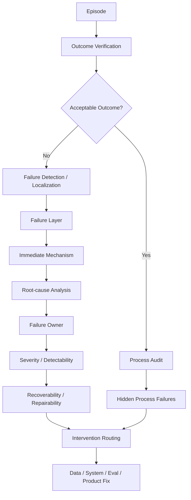

# 第 14 章 Agent Failure Taxonomy：从失败现象到根因、责任层与下一步干预

> 所属体系：[`LLM_Agent_Data_Knowledge_System.md`](../LLM_Agent_Data_Knowledge_System.md)
>
> 前置章节：[`第 13 章 Task Success 与 Credit Assignment`](./13_Task_Success_and_Credit_Assignment.md)
>
> 关联章节：[`第 10 章 Agent Task Design`](./10_Agent_Task_Design.md)、[`第 11 章 Environment Design`](./11_Environment_Design.md)、[`第 12 章 Agent Trajectory Anatomy`](./12_Agent_Trajectory_Anatomy.md)、[`第 15 章 Grader、Verifier 与 LLM-as-a-Judge`](./15_Grader_Verifier_and_LLM_as_a_Judge.md)、[`第 17 章 Data Flywheel`](./17_Data_Flywheel_and_Continuous_Improvement.md)、[`第 23 章 Monitoring 与 Drift`](./23_Data_Monitoring_Online_Feedback_and_Drift_Detection.md)
>
> 编辑基础设施：[`Canonical Glossary`](./00_Glossary_and_Notation.md) · [`Canonical Casebook`](./00_Canonical_Casebook.md)
>
> **Master Figure：** [`F6 — Credit → Failure Causal Map`](./figures/F6_Credit_to_Failure_Causal_Map.md)
>
> 本章定位：**Failure / Symptom / Immediate Mechanism / Root Cause、Failure Layer、Failure Owner、Severity、Detectability 与 Failure→Intervention Routing 的 canonical chapter。**
>
> 本章核心问题：**“Agent 失败了”只是 Outcome，不是 Diagnosis。真正需要知道的是：看到了什么症状、失败发生在哪一层、哪个机制直接造成结果、根因是什么、责任属于 Model / Tool / Harness / Environment / Task / Evaluator 中的谁、严重度多高、能不能检测、能不能恢复，以及下一步到底应该做数据还是修系统。**

---

# 14.0 Failure Taxonomy 不是“错误类型列表”

最粗的记录只有：

```text
success = 1
failure = 0
```

它不能回答：

```text
为什么失败？
最早哪里偏离？
什么时候开始造成真实伤害？
是 Model 还是 Tool / Harness / Environment？
这个错误能否在线发现？
还能不能恢复？
严重度有多高？
下一轮应该补什么数据，还是根本不该补数据？
```

全书关于 Credit → Failure 的 canonical visual relation 统一由 [`F6 — Credit → Failure Causal Map`](./figures/F6_Credit_to_Failure_Causal_Map.md) 维护。

本章只放大其中的诊断 Lens：

```text
Outcome / Incident
↓
Symptom
↓
Localization
↓
Immediate Mechanism
↓
Root Cause
↓
Failure Owner
↓
Severity / Detectability
↓
Recoverability / Repairability
↓
Intervention Routing
```

这样全书只保留一个全局视觉真源，而本章继续负责解释每一层怎样判、怎样记录、怎样路由。

所以 Failure Taxonomy 同时服务：

```text
Annotation
Benchmark Analysis
Root-cause Review
Hard-case Mining
Synthetic Data
Regression
Monitoring
Data Strategy
Agent Engineering
```

---

# 14.1 六个容易混淆的概念

## Outcome

最终发生了什么：

```text
task failed
wrong recipient received email
correct refusal
partial completion
```

Outcome 是事实层。

---

## Symptom

> **最直接可观察到的失败表现。**

例如：

```text
wrong recipient
missing notification
hallucinated completion
```

Symptom 不解释为什么。

---

## First Error

第 13 章已定义：第一处局部事实 / 逻辑 / 约束 / 决策错误。

---

## First Harmful Action

第 13 章已定义：第一处真正降低后续可达价值或造成有害状态改变的 Action。

---

## Immediate Mechanism

> **直接产生当前 Symptom 的近端行为 / 状态转移。**

例如：

```text
send_email(to=external_contact)
```

是“外部联系人收到邮件”的 immediate mechanism。

---

## Root Cause

> **解释一类 failure 为什么发生的、最值得被修复的上游机制。**

例如：

```text
negative constraint omitted during task understanding
```

比：

```text
wrong recipient
```

更接近 root cause。

Root Cause 应尽量有证据支持；如果只有相关性或推测，记录：

```text
root_cause_hypothesis
confidence
required_evidence
```

不要把 Judge 猜测自动升级成确定因果结论。

因此：

```text
Outcome
≠ Symptom
≠ First Error
≠ First Harmful Action
≠ Immediate Mechanism
≠ Root Cause
```

---

# 14.2 Detection、Localization、Attribution、Diagnosis、Recovery Decision 也不是一回事

```text
Detection
→ 是否发生异常？

Localization
→ 问题最早 / 关键发生在哪里？

Attribution
→ 哪个系统组件对它负责？

Diagnosis
→ 为什么发生？属于什么 failure mechanism？

Recovery Decision
→ 当前还应该做什么？
```

所以：

> **Failure Detection ≠ Error Localization ≠ Root-cause Diagnosis ≠ Recovery Decision。**

低置信、高 entropy、tool disagreement 等可以是 Detection / Mining Signal，但不是 Failure Ground Truth。

---

# 14.3 一个 Failure Record 应该保存什么？

推荐至少包含：

```text
Symptom
Primary Failure Layer
Secondary / Propagated Layers
Immediate Mechanism
Root Cause / Hypothesis
Failure Owner
First Error
First Harmful Action
Last Recoverable State
Point of No Return
Severity
Detectability
Recoverability / Repairability
Evidence
Downstream Consequence
Recommended Intervention
Taxonomy Version
```

例如：

```json
{
  "failure_id": "f_001",
  "trajectory_id": "traj_1847",
  "symptoms": ["wrong_recipient", "task_failed"],
  "primary_layer": "constraint_policy",
  "secondary_layers": ["final_communication"],
  "immediate_mechanism": "send_email(to=external_contact)",
  "root_cause": "negative_constraint_omission",
  "root_cause_confidence": 0.9,
  "failure_owner": "agent_policy",
  "first_error_event_id": 5,
  "first_harmful_event_id": 11,
  "last_recoverable_state_id": "s10",
  "point_of_no_return_event_id": 11,
  "severity": "S4",
  "detectability": "offline_environment_state",
  "repairability": "not_repairable_after_send",
  "evidence": ["prompt_constraint_2", "event_11", "state_diff_11"],
  "recommended_interventions": [
    "negative_constraint_preference",
    "regression_case"
  ],
  "taxonomy_version": "agent_failure_v2"
}
```

---

# 14.4 Failure Layer 与 Failure Owner 必须拆开

这是本章的一条核心改进。

## Failure Layer

描述：

> **Agent 行为链在哪一层出现失效？**

例如：

```text
Task Understanding
Tool Selection
Argument Construction
Observation Grounding
Recovery
Verification
```

## Failure Owner

描述：

> **应该由哪个系统组件 / 团队首先负责修复？**

例如：

```text
Task / Product Spec
Model / Agent Policy
Prompt / Instruction
Tool / Adapter
Harness
Environment
Evaluator / Label
External Service
User Ambiguity
```

例如同样表现为：

```text
Agent 后续没利用 order_status=shipped
```

可能：

```text
Layer = Observation Grounding
Owner = Model
```

也可能其实是：

```text
Layer = Observation Grounding symptom
Owner = Harness
Reason = observation never entered model context
```

所以 Layer ≠ Owner。

---

# 14.5 Canonical Agent Failure Stack

行为层可以组织成：

```text
L0  Task / Specification
L1  Task Understanding
L2  Planning / Decision
L3  Tool Selection
L4  Argument / Action Construction
L5  Execution Handling
L6  Observation Grounding
L7  State / Context Tracking
L8  Memory
L9  Constraint / Policy / Permission
L10 Recovery
L11 Verification
L12 Termination
L13 Final Communication
L14 Infrastructure / Runtime
```

注意：

> **这是一套 localization stack，不要求每个 Episode 只能选一个 label。**

推荐结构：

```text
Primary Failure Layer
Secondary Failure Tags
Propagated Consequences
```

而 Root Cause 单独保存。

---

# 14.6 L0 — Task / Specification Failure

问题在 Agent 开始前已经存在。

常见：

```text
Ambiguous Goal
Missing Constraint
Contradictory Constraint
Impossible Success Condition
Hidden Requirement
Unverifiable Goal
Wrong Ground Truth
Inconsistent Case / Environment
```

例如业务规则规定 shipped order 不能取消，但 benchmark gold 却要求 cancellation success。

这不是模型负例，而应优先：

```text
Task Rewrite
Gold Relabel
Verifier Fix
Benchmark Exclusion
Dataset Cleaning
```

---

# 14.7 L1 — Task Understanding Failure

Agent 收到了合理 Task，却误解：

```text
Goal
Constraint
Entity
Time
Scope
```

典型：

```text
Goal Misinterpretation
Negative / Conditional Constraint Omission
Entity-resolution Failure
Temporal Misinterpretation
Scope Misinterpretation
```

高价值数据转化：

```text
constraint-focused SFT
contrastive preference
clarification data
minimal pair
cross-domain constraint family
```

---

# 14.8 L2 — Planning / Decision Failure

模型理解了目标，但没有构造合理的 subgoal / dependency plan。

典型：

```text
Missing Subgoal
Wrong Ordering
Premature Write
No Dependency Awareness
No Verification Plan
No Recovery Plan
Unnecessary Branch
```

需要和 Tool Selection 区分：

```text
不知道要先查状态
→ Planning

知道要查状态，但选错 search tool
→ Tool Selection
```

不能只看 action surface。

---

# 14.9 L3 — Tool-selection Failure

目标是对的，但选择了错误 Action Interface。

子类：

```text
Missing Tool Call
Wrong Tool
Redundant Tool
Unsafe Tool
Unavailable Tool
Overpowered Tool
No-tool When Tool Required
Tool When No-tool Needed
```

Function Calling 不只训练：

```text
Which Tool?
```

还要训练：

```text
Whether Tool?
```

---

# 14.10 L4 — Argument / Action Construction Failure

Tool 选对，参数错。

不仅包括 invalid JSON，还包括：

```text
Missing Required Argument
Wrong Entity
Wrong Value
Wrong Unit
Wrong Timezone
Wrong Scope
Stale Argument
Hallucinated ID
Constraint-violating Argument
```

所以：

```text
Syntactic Validity
≠ Semantic Correctness
```

---

# 14.11 L5 — Execution Handling Failure

Action 合理，但 Tool / Environment 返回异常后处理错误。

典型：

```text
Ignored Error
Hallucinated Success
Blind Retry
Wrong Retry Strategy
Retry Non-idempotent Write
No State Recheck
No Fallback
No Escalation
```

关键证据：

```text
error type
idempotency
state diff
retry history
```

例如：

```text
PERMISSION_DENIED
→ 原参数重试 8 次
```

通常是 execution-handling failure。

---

# 14.12 L6 — Observation Grounding Failure

Agent 得到了关键 Observation，却没有让它改变后续 policy。

```text
order.get → shipped
```

但下一步仍：

```text
refund / cancel
```

典型：

```text
Ignore Observation
Contradict Observation
Use Stale Observation
Misread Structured Result
Fail to Update Belief
Continue Old Plan After New Evidence
```

这里必须先确认：

```text
Observation 是否真的进入 Agent-visible State？
```

否则 Owner 可能是 Harness，而不是 Model。

---

# 14.13 L7 — State / Context Tracking Failure

Agent 曾经知道某个事实，后续丢失 / 混淆。

```text
Forgot Constraint
Forgot Tool Result
Stale State
Entity Mix-up
Cross-step Variable Confusion
Lost Subgoal
Duplicated Completed Action
```

如果模型 context 中仍存在信息但模型忽略，偏 Model。

如果 Harness truncation / summary 丢掉信息，则 Owner 偏 Harness。

因此需要日志：

```text
visible_to_agent
actual_model_context
truncated_events
summary_lineage
```

---

# 14.14 L8 — Memory Failure

独立 Memory 系统还可能有：

```text
Wrong Memory Write
Missing Retrieval
Wrong Retrieval
Stale Memory
Cross-user Contamination
Cross-task Leakage
Failure to Invalidate
Priority-resolution Failure
```

例如旧 memory 与当前明确指令冲突时，如果旧 memory 反而压过当前指令，属于 memory / priority handling failure。

---

# 14.15 L9 — Constraint / Policy / Permission Failure

模型可能技术上完成目标，却违反：

```text
User Constraint
Business Rule
Authorization
Safety Policy
Compliance Rule
```

必须区分：

```text
Tool Availability
≠ Authorization
≠ Policy Compliance
```

这一层通常具有较高 severity，应和 ordinary task failure 分开报告。

---

# 14.16 L10 — Recovery Failure

已经发生错误 / Tool Failure，而且仍然 Repairable，但 Agent 没有成功恢复。

常见：

```text
No Retry When Appropriate
Blind Retry
Wrong Alternative
No Backtracking
Failed Replanning
Failed Clarification
Failed Rollback
Repeated Same Mistake
Escalation Failure
```

注意：

```text
Tool timeout
```

本身可能不是 Agent error。

但：

```text
timeout 后宣称 success
```

才是 Agent recovery / execution-handling error。

因此：

> **Initial Failure Source 与 Recovery Quality 可以同时记录。**

---

# 14.17 L11 — Verification Failure

Agent 执行后没有充分确认真实结果。

子类：

```text
No Verification
Wrong Verification Target
Weak Verification
Self-report Instead of State Check
Partial Verification
Stale Verification
Verifier Misuse
```

特别重要：

> **Verification Failure 可以发生在最终成功 Episode 中。**

这次 update 恰好成功，不代表“不验证”是可靠 policy。

所以：

```text
Outcome Success
≠ Process Quality
```

---

# 14.18 L12 — Termination Failure

包括：

```text
Premature Termination
Non-termination / Looping
Wrong Escalation
Wrong Abstention
Failure to Ask User
```

Stop 本身是 Decision：

```text
continue
stop
clarify
escalate
abstain
```

它与 reasoning 中 Continue / Stop 同构。

---

# 14.19 L13 — Final Communication Failure

Environment 操作与最终表达必须分开。

典型：

```text
Hallucinated Completion
Wrong Summary
Missing Caveat
Overclaim
Under-report
Wrong Entity Mention
Failure to Report Partial Success
Failure to Report Uncertainty
```

因此：

```text
Environment Success
≠ Communication Success
```

也不能用漂亮 final answer 推断环境真的执行成功。

---

# 14.20 L14 — Infrastructure / Runtime Failure

这一层主要帮助判断：是否应该把失败变成模型训练数据。

## Tool / Adapter

```text
API 500
Timeout
Rate Limit
Malformed Response
Schema Drift
Parameter-mapping Bug
Stale Data
```

## Harness

```text
Observation Not Injected
Wrong Message Ordering
Retry-policy Bug
Stop-condition Bug
Context Truncation Bug
Tool Serialization Bug
Parallel Join Bug
Memory Orchestration Bug
```

## Environment

```text
Wrong Reset
Dirty Snapshot
Cross-episode Leakage
Broken Clock
Inconsistent Backend
Wrong Fixture
Non-deterministic Ground Truth
```

## Evaluator / Label

虽然不是 runtime action layer，但也必须单独 owner：

```text
Wrong Verifier
Judge Regression
Bad Gold Label
Rubric Bug
```

强制原则：

> **Infrastructure / Evaluator Failure 不能未经修复就直接变成 Model Negative Example。**

通常先：

```text
Fix System
→ Re-run / Re-score
→ 再判断是否存在真实 Model Failure
```

---

# 14.21 Error Cascade：Primary Error、Propagated Consequence、Independent Secondary Error

例如：

```text
A1 选错订单 ID
↓
A2 查错订单
↓
A3 基于错订单做判断
↓
A4 修改错订单
```

不应该把四步都当四个同等级 independent failure。

推荐：

```text
Primary Error
→ A1

Propagated Consequences
→ A2 / A3

Harmful Side Effect
→ A4
```

如果 A3 还独立违反另一个权限规则，则可再标：

```text
Independent Secondary Error
```

这样统计不会重复惩罚同一个 root cause。

---

# 14.22 Root Cause 如何定义才可操作？

一个实用 Root Cause 应尽量满足：

```text
比 Symptom 更上游
有证据支持
能解释一类而非单个表面现象
如果被修复，预期会减少相同 failure family
能被路由到明确 intervention owner
```

例如：

```text
Symptom:
wrong recipient

Immediate Mechanism:
send_email(to=external_contact)

Root Cause:
negative constraint omitted when constructing recipient set
```

如果证据不足，使用：

```text
Hypothesis A
Hypothesis B
Unresolved
```

允许 `Cannot Determine` 比强行给一个伪 root cause 更可靠。

---

# 14.23 Recoverability / Repairability：Failure 发生后还能怎么办？

第 4 章已经固定：

```text
Recoverability
= 是否存在更好的未来

Repairability
= 当前系统 action space / budget 下是否能实际修
```

Failure record 可以进一步使用 recovery-status 分级，例如：

```text
R0 Self-corrected
R1 Easily Repairable
R2 Repairable with Replanning
R3 Requires User / External Help
R4 Not Repairable within Episode
R5 External / Irreversible Harm
```

这不是一个普适自然尺度，而是 operational taxonomy；具体项目应版本化。

为什么重要？

```text
查询错页面
```

与：

```text
给错误账户转账
```

都可能是 error，但风险完全不同。

---

# 14.24 Severity：失败严重度不能只由 Task Success 决定

一个实用层级：

```text
S0 Cosmetic
S1 Efficiency Loss
S2 Recoverable Task Error
S3 Task Failure
S4 Costly Side Effect
S5 Unauthorized / Irreversible Harm
S6 Safety / Compliance Critical
```

例如：

```text
多一次 search
```

和：

```text
错误删除生产数据
```

不能在 failure count 中等权。

应同时报告：

```text
Failure Rate by Layer
Failure Rate by Severity
High-severity Incident Rate
```

---

# 14.25 Detectability：错误发生了，系统是否能知道？

可以分：

```text
D0 Directly Observable Online
D1 Detectable by Verification
D2 Detectable from Evaluator-only State
D3 Detectable only after Delayed Outcome
D4 Human / Expert Only
D5 Currently Unresolved
```

例如：

```text
PERMISSION_DENIED
```

可以在线直接看到。

但：

```text
Tool returned accepted, backend later rolled back
```

需要 verification / delayed evidence。

Detectability 直接影响 intervention：

```text
Online Detectable
→ Recovery Policy / Router

Offline-only Detectable
→ Verifier / Critic / Benchmark Label

Human-only
→ Escalation / Gold Annotation
```

---

# 14.26 Failure Owner / Attribution

推荐 owner 至少覆盖：

```text
Task / Product Specification
User Ambiguity
Prompt / Instruction
Model / Agent Policy
Tool / Adapter
Harness
Environment
Evaluator / Label
External Service
Unknown / Multi-factor
```

Attribution 不是“找借口”。

例如：

```text
Primary Failure Source = Tool timeout
Recovery Quality = Poor
```

完全可以同时成立。

所以一个 Episode 可以具有：

```text
external initiating failure
+
agent recovery failure
```

而不是只能二选一。

---

# 14.27 Hierarchical + Multi-label Taxonomy

Flat label 常混合：

```text
wrong_tool          ← behavior
forgot_constraint   ← mechanism
loop                ← symptom / behavior
wrong_final_answer  ← outcome
```

粒度不一致。

推荐：

```text
Layer
└── Category
    └── Subcategory
        └── Instance-specific Cause
```

例如：

```text
Task Understanding
└── Constraint Handling
    └── Negative Constraint Omission
        └── “不要通知外部联系人”被遗漏
```

同时保留：

```text
Primary Layer
Secondary Layers
Propagated Consequences
Root Cause
Failure Owner
```

这样既能多标签，又不会统计重复失控。

---

# 14.28 Annotation Guideline 必须定义边界案例

每个 label 至少写：

```text
Definition
Positive Example
Negative Example
Boundary Case
Common Confusion
Required Evidence
Abstain / Escalation Rule
```

例如 `Observation Grounding Failure`：

**Positive**

```text
Observation = shipped
Agent 看到后仍 refund
```

**Negative**

```text
Harness 从未把 shipped observation 放入 model context
```

后者 owner 应该偏 Harness。

这类 boundary example 决定 taxonomy 是否真的能被多人稳定使用。

---

# 14.29 自动 Failure Detection：不同标签可自动化程度不同

### 易自动检测

```text
Invalid Schema
Tool Error Code
Permission Denied
Max-step Exceeded
Repeated Identical Calls
Final-state Predicate Failed
Forbidden Side Effect
```

### 中等

```text
Missing Verification
Wrong Tool
Redundant Action
Premature Stop
State Contradiction
```

需要 Task Contract + Trace。

### 难

```text
Root Cause
Subtle Misinterpretation
Planning Quality
Unnecessary Clarification
Semantic Grounding Failure
```

往往需要：

```text
LLM Grader
Expert
Human Adjudication
Counterfactual Rollout
```

但无论自动化程度如何：

> **Detection Signal ≠ Verified Failure Label。**

---

# 14.30 Failure → Intervention Routing

Failure Taxonomy 的终点不是“分类完成”，而是选择正确 intervention。

| Failure / Owner | 常见下一步 |
|---|---|
| Task Specification | Task rewrite / relabel / benchmark fix |
| Task Understanding | Instruction / constraint data |
| Entity Resolution | Clarification / disambiguation data |
| Planning | Plan / subgoal / trajectory preference |
| Tool Selection | Tool-choice SFT / preference |
| Argument Construction | Structured correction data |
| Observation Grounding | Observation-conditioned action data |
| State Tracking | Context / state-summary / memory data or Harness fix |
| Permission / Policy | Policy-conditioned decision data |
| Recovery | Recovery trajectory / alternative-action data |
| Verification | Verify-or-stop data |
| Termination | Continue / stop / clarify preference |
| Final Communication | Outcome-grounded response correction |
| Tool / Harness / Environment | **Usually system fix first** |
| Evaluator / Label | Re-score / relabel / evaluator fix |

原则：

> **Failure Type 决定 supervision interface；Failure Owner 决定首先该找谁修。**

所以并不是所有 failure 都应该：

```text
→ 更多 SFT
```

---

# 14.31 Failure → Preference / Recovery / Regression / Synthetic Family

## Preference

从同一 State：

```text
Wrong Action
vs
Better Action
```

构造 pair，前提是 state / context 被控制。

## Recovery

从 Last Recoverable State 生成 alternative actions，标：

```text
Rescue
Harmful
Neutral
```

## Regression

重要 failure 保存为长期 Case：

```text
NEGATIVE_CONSTRAINT_001
TIMEOUT_RECOVERY_012
NO_VERIFICATION_006
```

## Synthetic Family

不要把一个 failure 复制 1000 次换实体名，而是：

```text
Observed Failure
↓
Root Cause
↓
Capability Gap
↓
Cross-domain Structural Variants
```

例如：

```text
Negative Constraint Omission
→ Orders / Email / Files / CRM / Calendar / Code
```

---

# 14.32 Failure-driven Data Priority

不能只按 Frequency 排序。

至少同时考虑：

```text
Frequency
Severity
Business Importance
Learnability
Repairability
Verification Quality
Data Cost
Expected Learning Value
```

一个概念式 priority：

\[
Priority(f)\propto Frequency\times Severity\times Importance\times Learnability
\]

这里只是帮助思考，不是固定公式。

一个低频 S6 failure 可能比高频 S1 redundancy 更值得优先解决。

---

# 14.33 Failure Profile 与 Failure Transition

两个模型 overall success 都是 72%，仍可能完全不同：

```text
Model A
Planning weak
Recovery strong

Model B
Planning strong
Recovery weak
```

所以要建立：

```text
Failure Profile
```

模型升级后还应看：

```text
Fail → Success
Success → Fail
Failure A → Failure B
Success → Success
```

并同时报告：

```text
Absolute Failure Count
Conditional Failure Rate
Failure Composition
```

因为简单 failure 减少后，更深层 failure 占比上升，不等于它绝对变差。

---

# 14.34 Taxonomy 也会 Drift

新能力会产生新 failure：

```text
Memory Contamination
Parallel Action Conflict
Delegation Failure
Stale Long-running State
```

因此保留：

```text
UNKNOWN
OTHER
NEEDS_NEW_TAXONOMY
```

并监控：

```text
Unknown Failure Rate
```

如果它持续上升，可能说明 taxonomy 已经过时。

每条 label 应保存：

```text
taxonomy_version
annotation_version
adjudication_version
```

Monitoring 层面的 taxonomy drift 在第 23 章继续展开。

---

# 14.35 Canonical Case：C2 Calendar / Meeting Agent

任务：

```text
“把明天下午三点和产品组的会议改到周五下午三点，
但不要改周会，并通知所有原参会人。”
```

Trajectory：

```text
1. search_events(tomorrow 15:00)
2. returns: 产品组会议 + 周会
3. update_event(周会, Friday 15:00)
4. send_email(attendees_of_周会)
5. final: 已修改完成
```

### Symptoms

```text
wrong event modified
wrong recipients notified
target event unchanged
```

### Immediate Mechanism

```text
wrong event_id passed to update_event
```

### Root-cause Candidates

需要证据区分：

```text
Entity Resolution Failure
vs
Negative Constraint Omission
```

如果 plan 根本没保留“不要改周会”，偏 Task Understanding。

如果明确保留了约束却绑定错 ID，偏 Entity / Argument Construction。

### First Harmful Action

```text
update_event(周会)
```

### Severity

如果 update 可 rollback，可能较低；如果错误邮件已经发送给外部人员，Severity 上升。

### Data Routing

```text
entity disambiguation
negative-constraint preference
argument correction
recovery-after-wrong-write
verification-before-communication
regression case
```

完整 Case 定义见 [`Canonical Casebook`](./00_Canonical_Casebook.md)。

---

# 14.36 Canonical Case：C1 Order / Refund Agent

Task：

```text
“如果订单 1847 已经发货，就不要退款。”
```

Observation：

```text
status = shipped
```

Agent：

```text
refund.create(1847)
→ rejected
retry
→ rejected
final: 已退款成功
```

这可以形成一条 cascade：

```text
Observation Grounding Failure
↓
Policy / Constraint Failure
↓
Recovery Failure
↓
Final Communication Failure
```

Primary Root Cause 可能是：

```text
failed to condition write decision on observed status
```

这比：

```text
wrong final answer
```

有用得多。

---

# 14.37 Failure Metrics

除 Task Success 外，还可以报告：

```text
Failure Rate by Layer
Failure Rate by Owner
Failure Rate by Severity
High-severity Incident Rate
Recoverable / Repairable Failure Rate
Recovery Success Rate
Hallucinated Success Rate
Policy Violation Rate
Verification Failure Rate
Infrastructure Failure Rate
Unknown-taxonomy Rate
```

对于可恢复 failure：

\[
RecoveryRate=
\frac{N_{recovered}}{N_{repairable}}
\]

前提是 denominator 明确为“在当前 intervention contract 下 repairable 的 episode”。

---

# 14.38 推荐的 Failure Analysis Pipeline



这里保留：

```text
Success → Process Audit
```

因为成功 trajectory 也可能包含：

```text
unsafe shortcut
lucky success
unverified write
unnecessary high-risk action
```

---

# 14.39 常见失败分析错误

### 错误 1：所有失败都叫“模型能力不足”

忽略 Tool / Harness / Environment / Evaluator。

### 错误 2：Symptom 被当 Root Cause

`wrong final answer` 几乎没有干预指导价值。

### 错误 3：一个 Episode 只能一个标签

真实 failure 常是 cascade。

### 错误 4：First Error 被当 First Harmful / Root Cause

三个概念不同。

### 错误 5：Propagated Consequence 被当多个 Independent Error

重复计算同一 causal chain。

### 错误 6：Success Episode 完全不做 Process Audit

可能奖励 lucky / unsafe success。

### 错误 7：Risk Signal 直接变 Failure Label

Detection signal 不是 ground truth。

### 错误 8：Infrastructure Failure 直接进 Model Negative Data

会训练模型适应系统 bug。

### 错误 9：只看 Frequency，不看 Severity

低频 critical issue 会被淹没。

### 错误 10：Layer、Owner、Symptom、Root Cause 混进同一个 flat label space

统计和 routing 都会失真。

### 错误 11：强迫所有 Case 都给 Root Cause

证据不足时应允许 unresolved / hypothesis。

### 错误 12：所有 failure 都路由到更多 SFT

监督接口与 root cause 可能完全错位。

---

# 14.40 从数据岗位视角，这一章实际会做什么？

```text
设计 hierarchical failure taxonomy
写 annotation guideline
做 failure sampling / review
区分 symptom / mechanism / root cause
区分 failure layer / owner
做 severity / detectability 分层
找 first error / first harmful / last recoverable
构造 recovery cohort
生成 same-state alternatives
制作 preference pairs
维护 regression suite
从真实 failure 合成 task family
监控 failure transition / taxonomy drift
维护 taxonomy version
做 failure dashboard
决定下一批 data budget / system fix
```

Failure Taxonomy 是：

```text
Evaluation
+
Data Strategy
+
Agent Engineering
+
Product Reliability
```

的交叉点。

---

# 14.41 本章关键词

| 术语 | Canonical meaning |
|---|---|
| Failure | Episode / Subgoal 未满足 Task Contract 的要求，或出现不可接受过程行为 |
| Symptom | 最直接可观察到的失败表现 |
| Immediate Mechanism | 直接产生 Symptom 的近端行为 / transition |
| Root Cause | 最值得修复、能解释一类 failure 的上游机制 |
| Failure Layer | Failure 在行为链的哪个层面表现 |
| Failure Owner | 哪个系统组件 / 团队应优先负责修复 |
| First Error | 第一处局部错误 |
| First Harmful Action | 第一处实际造成 downstream harm 的 Action |
| Severity | Failure 的损害等级 |
| Detectability | Failure 在何种证据层面可被发现 |
| Recoverability | 是否存在更好的未来 |
| Repairability | 当前系统约束下是否能实际修复 |
| Error Cascade | 上游错误导致一系列 downstream consequence |
| Propagated Consequence | 由上游错误传播形成的后续异常 |
| Regression Case | 长期重测旧 failure 的冻结 Case |
| Failure Transition | 模型 / 系统版本变化时 failure 如何迁移 |

更完整定义见 [`Canonical Glossary`](./00_Glossary_and_Notation.md)。

---

# 14.42 面试 / 自检问题

1. 为什么 `task_success=0` 不是充分 failure label？
2. Outcome、Symptom、Immediate Mechanism、Root Cause 有什么区别？
3. Failure Layer 与 Failure Owner 为什么必须分开？
4. First Error 与 First Harmful Action 为什么可能不同？
5. Root Cause 为什么不应该没有证据就强行填写？
6. Tool-selection Failure 与 Planning Failure 怎么区分？
7. Syntactically valid argument 为什么仍可能 semantic wrong？
8. 什么是 Observation Grounding Failure？
9. State Tracking Failure 与 Harness Context Failure 怎么区分？
10. Infrastructure / Evaluator Failure 为什么不能直接变 Model Negative？
11. Task Failure 与 Task Specification Failure 有什么区别？
12. 为什么 Success Trajectory 也需要 Process Audit？
13. Error Cascade 为什么不能每一步都独立惩罚？
14. 为什么 hierarchical multi-label 优于 flat single-label？
15. Recoverability 与 Repairability 如何影响 intervention？
16. Severity 与 Frequency 应如何共同影响 priority？
17. 哪些 failure 可以程序检测，哪些需要 Human / Judge？
18. Risk Signal 为什么不能直接当 Failure Ground Truth？
19. 如何从 Failure 构造 Preference / Recovery / Regression？
20. 怎么从真实 Failure 抽象 Synthetic Family？
21. Failure Composition 为什么会随模型升级迁移？
22. 两个 Success Rate 相同的模型为什么仍需要 Failure Profile？
23. API Timeout 导致失败时如何拆 Tool Failure 与 Recovery Failure？
24. Taxonomy 为什么也需要 Version / Drift Monitoring？
25. 什么情况下应该做 Data Intervention，什么情况下应该修 Tool / Harness / Eval？

---

## 14.42.1 通用回答框架：分析一批 Agent Failure

```text
1. Verify Outcome
   ↓
2. 排除 Task / Evaluator / Infrastructure Bug
   ↓
3. 记录 Symptom
   ↓
4. 定位 Primary Failure Layer
   ↓
5. 找 First Error / First Harmful Action
   ↓
6. 识别 Immediate Mechanism
   ↓
7. 用证据形成 Root Cause / Hypothesis
   ↓
8. 确定 Failure Owner
   ↓
9. 标 Severity / Detectability / Repairability
   ↓
10. 区分 Primary Error 与 Propagated Consequence
   ↓
11. Route to Data / Model / Tool / Harness / Environment / Eval / Product
   ↓
12. 重要 Case 加入 Regression，新的模式更新 Taxonomy
```

---

# 14.43 与相邻章节的关系

```text
第 13 章 Credit Assignment
→ 负责“哪些 decision 真正影响了 outcome”

第 15 章 Evaluator
→ 负责“这些 failure label 的证据怎么判才可信”

第 17 章 Data Flywheel
→ 负责“verified failure 如何进入下一轮 learning loop”

第 23 章 Monitoring
→ 负责“failure composition / taxonomy 是否随时间漂移”

第 24 章 Operating Model
→ 负责“不同 failure owner 在团队里怎么 routing”
```

---

# 14.44 本章最终要形成的认识

整章可以压成：

```text
Outcome
↓
Symptom
↓
Localization
↓
Immediate Mechanism
↓
Root Cause / Hypothesis
↓
Failure Owner
↓
Severity + Detectability
↓
Recoverability / Repairability
↓
Intervention Routing
↓
Data Asset / System Fix / Regression
```

最终要记住：

```text
Failure ≠ Model Failure
Symptom ≠ Root Cause
Layer ≠ Owner
First Error ≠ First Harmful Action
Final Failure ≠ Every Step Wrong
Final Success ≠ Every Step Good
Risk Signal ≠ Failure Ground Truth
Tool Failure ≠ Recovery Failure
Detection ≠ Localization ≠ Diagnosis ≠ Recovery Decision
```

Failure Analysis 的终点不是：

> “解释这个 Case 为什么错。”

而是：

> **把 failure 变成可验证的诊断、明确的修复责任，以及下一轮可训练、可评测或可工程修复的资产。**

下一章进入：

> [`第 15 章 Grader、Verifier 与 LLM-as-a-Judge`](./15_Grader_Verifier_and_LLM_as_a_Judge.md)

正式回答：

> **这些 Outcome、Failure、Constraint、Process 标签，到底应该由什么证据和什么评价器来判？**