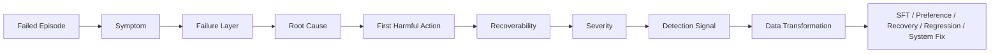
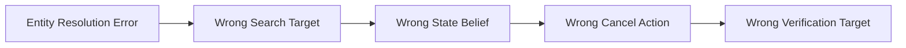
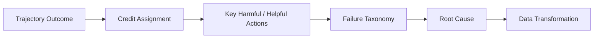
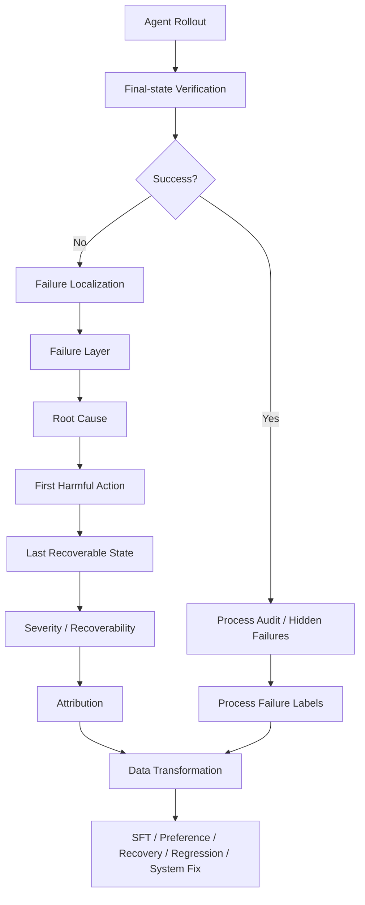

# 第 14 章 Agent Failure Taxonomy：从失败现象到根因、归因与数据转化

> 所属体系：[`LLM_Agent_Data_Knowledge_System.md`](../LLM_Agent_Data_Knowledge_System.md)
>
> 前置章节：[`第 13 章 Task Success 与 Credit Assignment`](./13_Task_Success_and_Credit_Assignment.md)
>
> 关联章节：[`第 5 章 Tool-use Data 与 Agent Trajectory Data`](./05_Tool_Use_and_Agent_Trajectory_Data.md)、[`第 9 章 Hard Case Mining 与 Curriculum`](./09_Hard_Case_Mining_and_Curriculum.md)、[`第 10 章 Agent Task Design`](./10_Agent_Task_Design.md)、[`第 11 章 Environment Design`](./11_Environment_Design.md)、[`第 12 章 Agent Trajectory Anatomy`](./12_Agent_Trajectory_Anatomy.md)
>
> 本章目标：建立一套可以真正用于 Agent 数据生产、benchmark 分析、回归测试与改进闭环的 Failure Taxonomy；掌握 Symptom、Failure Layer、Root Cause、Severity、Recoverability、Detectability、Failure Attribution、Error Propagation 与 Data Transformation 的关系。
>
> 本章核心问题：**“Agent 失败了”只是一个结果，不是一个诊断。真正有价值的数据问题是：失败发生在哪一层、最早由什么原因触发、什么时候开始真正造成伤害、是否还能恢复、我们凭什么检测到它，以及这次失败应该被转化成什么下一步数据。**

---

# 14.0 为什么 Failure Taxonomy 不是“错误类型列表”？

最粗糙的 Agent 评测通常只有：

```text
success = 1
failure = 0
```

它能告诉我们：

```text
模型有没有完成任务
```

但完全不能回答：

```text
为什么没完成？
失败最早从哪里开始？
是模型错，还是 Tool / Harness / Environment 错？
这个错误严重吗？
错误还能恢复吗？
应该增加哪种训练数据？
下一轮 benchmark 应该补哪一类 case？
```

因此 Failure Taxonomy 的真正目标不是：

> 给 failure 起一个名字。

而是建立：

```text
Observed Failure
      ↓
Localization
      ↓
Attribution
      ↓
Root Cause
      ↓
Recoverability
      ↓
Severity / Risk
      ↓
Data Transformation
      ↓
Training / Eval / Product Fix
```

可以画成：



所以，一套成熟 taxonomy 应该同时服务：

```text
Annotation
Failure Analysis
Hard-case Mining
Synthetic Data
Regression Testing
Model Training
Agent Engineering
Product Monitoring
```

---

# 14.1 先定义一个 Failure Record 应该包含什么

如果只存：

```json
{"failure_type": "tool_error"}
```

远远不够。

更合理的 failure record 至少应该描述：

```text
1. Symptom
2. Failure Layer
3. Root Cause
4. Triggering State
5. First Error
6. First Harmful Action
7. Last Recoverable State
8. Severity
9. Recoverability
10. Detectability
11. Attribution
12. Evidence
13. Downstream Consequence
14. Suggested Data Transformation
```

可以抽象成：

```json
{
  "failure_id": "f_001",
  "trajectory_id": "traj_1847",
  "symptom": "task_not_completed",
  "failure_layer": "tool_selection",
  "root_cause": "failed_to_distinguish_search_order_from_cancel_order",
  "first_error_event_id": 8,
  "first_harmful_event_id": 10,
  "last_recoverable_state_id": "s_12",
  "severity": "medium",
  "recoverability": "recoverable",
  "detectability": "explicit_tool_result",
  "attribution": "agent_policy",
  "evidence": ["event_8", "event_10", "state_diff_10"],
  "recommended_transform": ["tool_selection_preference", "regression_case"]
}
```

这时候 Failure Taxonomy 才真正变成数据结构，而不是自然语言备注。

---

# 14.2 一个统一的分层框架：Agent Failure Stack

可以把 Agent failure 粗略分成以下层级：

```text
L0 Task / Specification
L1 Task Understanding
L2 Planning / Decision
L3 Tool Selection
L4 Argument / Action Construction
L5 Execution Handling
L6 Observation Grounding
L7 State / Context Tracking
L8 Memory
L9 Constraint / Policy / Permission
L10 Recovery
L11 Verification
L12 Termination
L13 Final Communication
L14 Tool / Harness / Environment Infrastructure
```

注意：

> **这些层是为了定位，不意味着一条 failure 只能属于一层。**

真实失败经常是：

```text
Root Cause at L1
→ Harmful Action at L4
→ Final Symptom at L12
```

因此推荐：

```text
Primary Root Cause
+
Secondary Failure Tags
```

而不是只允许一个扁平 label。

---

# 14.3 L0：Task / Specification Failure

有些 failure 在 Agent 开始运行之前就已经存在。

例如任务定义：

```text
“把重要文件归档好。”
```

但没有定义：

```text
什么算重要？
归档到哪里？
能不能移动原文件？
什么算完成？
```

这种问题不是模型本身不会。

而是：

> **Task Contract 不完整。**

---

## 14.3.1 常见 Task Failure

```text
Ambiguous Goal
Missing Constraint
Contradictory Constraint
Impossible Success Condition
Hidden Requirement
Unverifiable Goal
Inconsistent Environment State
Wrong Ground Truth
```

例如：

```text
用户要求：取消已经发货的订单
```

如果 benchmark 却标：

```text
正确结果 = cancel success
```

而系统业务规则明确：

```text
shipped order cannot be cancelled
```

那么错的是 benchmark specification。

---

## 14.3.2 数据处理原则

Task failure 不应该直接变成模型负例。

应该优先进入：

```text
Dataset Cleaning
Task Rewrite
Verifier Fix
Benchmark Exclusion
Gold Relabel
```

这和第 6 章 Human Data 中讲的 corrected labels / relabel 是同一个治理问题。

---

# 14.4 L1：Task Understanding Failure

Agent 已经拿到了合理任务，但对用户意图理解错了。

例如：

```text
用户：
“把明天的会议改到周五，但不要改周会。”
```

Agent 理解为：

```text
把明天所有会议都改到周五
```

这是：

```text
Task Understanding Failure
```

---

## 14.4.1 常见子类

### Goal Misinterpretation

理解错主要目标。

### Constraint Omission

漏掉：

```text
不要
只允许
至少
最多
除了
必须
```

这类 negative / conditional constraints。

### Entity Resolution Failure

例如：

```text
“给 Alex 发邮件”
```

系统里有：

```text
Alex Chen
Alex Li
```

Agent 没有澄清直接选择一个。

### Temporal Misinterpretation

```text
“下周一”
“月底前”
“工作日”
```

理解错误。

### Scope Misinterpretation

```text
“这些文件”
“这个项目”
“所有内部员工”
```

范围理解错误。

---

## 14.4.2 常见检测信号

```text
Final result violates explicit prompt constraint
Agent plan omits required subgoal
Reference constraint coverage mismatch
Entity chosen without disambiguation
```

---

## 14.4.3 常见数据转化

```text
Constraint-focused SFT
Contrastive Preference
Clarification Data
Minimal-pair Task
Negative Constraint Family
```

例如原 failure：

```text
“通知所有内部员工，但不要通知外部联系人”
```

可以扩展成：

```text
修改所有订单，但不要修改 VIP
删除缓存，但保留 lock file
同步所有仓库，但不要 push protected branch
```

这就是：

> Failure Seed → Abstract Capability → Synthetic Family。

---

# 14.5 L2：Planning / Decision Failure

Agent 理解了任务，但没有形成合理的行动计划。

例如：

```text
任务：
找到过去 30 天销售额最高的三个客户，并创建续约机会。
```

Agent 直接：

```text
create_opportunity(customer_A)
```

却没有先：

```text
query sales
aggregate
sort top3
```

这属于 planning failure。

---

## 14.5.1 常见类型

```text
Missing Subgoal
Wrong Ordering
Premature Action
Unnecessary Branch
No Dependency Awareness
No Verification Plan
No Recovery Plan
```

---

## 14.5.2 Planning Failure 与 Tool Failure 的区别

例如 Agent 先调用：

```text
cancel_order(id)
```

但正确流程应该先：

```text
search_order(id)
```

可能有两种根因：

```text
A. 不知道应该先检查状态
→ Planning Failure

B. 知道要检查，但选错了具体工具
→ Tool-selection Failure
```

因此 annotation 不能只看 action surface。

要结合：

```text
prior state
explicit plan
available tools
subgoal structure
```

---

# 14.6 L3：Tool-selection Failure

Agent 知道下一步目标，但选错了工具。

例如：

```text
目标：查询订单
```

却调用：

```text
cancel_order
```

这是最典型的：

```text
Wrong Tool Selection
```

---

## 14.6.1 Tool-selection 可以细分

```text
Missing Tool Call
Wrong Tool
Redundant Tool
Unsafe Tool
Unavailable Tool
Overpowered Tool
No-tool When Tool Required
Tool When No-tool Needed
```

其中两个特别重要：

### Missing Tool Call

应该查实时数据，却凭记忆回答。

### Unnecessary Tool Call

明明不需要外部信息，却总是调用工具。

所以 function-calling 数据不能只训练：

```text
哪个 tool？
```

还要训练：

```text
要不要 tool？
```

---

# 14.7 L4：Argument / Action Construction Failure

Tool 选对了，但参数错。

例如：

```text
cancel_order(order_id=1848)
```

但用户说的是：

```text
1847
```

---

## 14.7.1 参数错误不只有 JSON 错

常见包括：

```text
Schema Invalid
Missing Required Argument
Wrong Entity
Wrong Value
Wrong Unit
Wrong Timezone
Wrong Date Format
Wrong Scope
Constraint-violating Argument
Stale Argument
Hallucinated ID
```

因此：

> **Syntactic Validity ≠ Semantic Correctness。**

例如：

```json
{"order_id": 1848}
```

JSON 完全合法，但语义错误。

---

## 14.7.2 推荐评价维度

```text
Schema Correctness
Entity Correctness
Value Correctness
Constraint Consistency
State Consistency
Permission Consistency
```

---

# 14.8 L5：Execution Handling Failure

Agent action 本身可能合理，但执行返回异常后，处理错了。

例如：

```text
Tool Result = TIMEOUT
```

Agent 直接说：

```text
“已经成功取消订单。”
```

这不是初始 tool selection 错，而是：

```text
Execution Handling Failure
```

---

## 14.8.1 常见类型

```text
Ignored Error
Hallucinated Success
Blind Retry
Wrong Retry Strategy
Retry Non-idempotent Write
No Fallback
No Escalation
No Backoff
No State Recheck
```

---

## 14.8.2 Retry 不是天然正确

```text
TIMEOUT
→ retry
```

可能合理。

但：

```text
PERMISSION_DENIED
→ 同参数 retry 8 次
```

通常不合理。

更危险的是：

```text
transfer_money()
→ timeout
→ retry
```

如果工具非幂等，第一次可能已经成功，只是 response 丢失。

所以 failure analysis 必须结合：

```text
error type
idempotency
state change evidence
retry history
```

---

# 14.9 L6：Observation Grounding Failure

工具已经正确返回信息，但 Agent 没有真正根据 observation 更新决策。

例如：

```text
search_order(1847)
→ status = shipped
```

业务规则：

```text
shipped order cannot be cancelled
```

Agent 却继续：

```text
cancel_order(1847)
```

这就是：

```text
Observation Grounding Failure
```

---

## 14.9.1 典型表现

```text
Ignore Observation
Contradict Observation
Use Stale Observation
Misread Structured Result
Fail to Update Belief
Continue Old Plan After New Evidence
```

---

## 14.9.2 为什么 Observation Grounding 很重要？

一个 Agent 可以：

```text
Tool selection 100% 正确
Argument 100% 正确
```

但如果 tool result 对后续行为没有约束作用，它仍然不是真正会用工具。

因此 Tool-use 能力不只是：

```text
call tool
```

更重要的是：

```text
use returned evidence to change policy
```

---

# 14.10 L7：State / Context Tracking Failure

Agent 在长轨迹中丢失了关键状态。

例如前面已经知道：

```text
order 1847 = shipped
```

后面却又按：

```text
pending
```

处理。

---

## 14.10.1 常见类型

```text
Forgot Constraint
Forgot Tool Result
Stale State
Entity Mix-up
Cross-step Variable Confusion
Lost Subgoal
Duplicated Completed Action
Context Truncation Failure
Summary Corruption
```

---

## 14.10.2 Model Failure 与 Harness Failure 要区分

如果模型上下文里仍然有：

```text
status = shipped
```

但模型忽略了，可能是 model state-tracking failure。

但如果 Harness 在 context compression 时把这条 observation 丢掉了，根因更接近：

```text
Harness / Context Construction Failure
```

所以 trajectory 必须记录：

```text
visible_to_agent
actual_model_context
truncated_events
summary lineage
```

否则没法正确归因。

---

# 14.11 L8：Memory Failure

Memory failure 和普通 context failure 不完全一样。

可能出现：

```text
Wrong Memory Retrieval
Missing Memory Retrieval
Wrong Memory Write
Stale Memory
Cross-user Memory Contamination
Cross-task Leakage
Incorrect Memory Update
Failure to Forget Invalid State
```

---

## 14.11.1 一个典型例子

历史记忆里写着：

```text
用户通常周五下午不开会
```

这次用户明确说：

```text
“这周五下午三点可以。”
```

Agent 仍然拒绝安排。

这说明：

```text
stale / lower-priority memory
```

错误压过了当前显式指令。

所以 memory failure 常常也是：

```text
Priority Resolution Failure
```

---

# 14.12 L9：Constraint / Policy / Permission Failure

这一层对真实 Agent 尤其重要。

Agent 可能：

```text
技术上完成了目标
```

但违反：

```text
用户约束
业务规则
权限
安全策略
合规要求
```

---

## 14.12.1 Constraint Failure

例如：

```text
“给员工发邮件，但不要发给外部联系人。”
```

Agent 发给全部联系人。

---

## 14.12.2 Permission Failure

Tool available：

```text
refund_order
```

但当前 user authorization：

```text
refund_limit = 100
```

订单金额：

```text
500
```

Agent 直接 refund。

这是：

```text
Authorization Failure
```

---

## 14.12.3 Policy Failure

有些行为技术可执行，也有权限，但 policy 不允许。

因此：

```text
Tool Availability
≠ Permission
≠ Policy Compliance
```

三者要分开。

---

# 14.13 L10：Recovery Failure

Agent 已经发生错误 / Tool failure，但仍有机会恢复，却没有恢复成功。

这类数据通常非常有价值。

因为它直接对应：

```text
Last Recoverable State
```

---

## 14.13.1 常见 Recovery Failure

```text
No Retry When Appropriate
Blind Retry
Wrong Alternative Tool
No Backtracking
Failed Replanning
Failed Clarification
Failed Rollback
Repeated Same Mistake
Escalation Failure
```

---

## 14.13.2 Recovery Failure 与 Initial Error 应分开

例如：

```text
Step 4：工具返回 timeout
```

这不是 Agent error。

但：

```text
Step 5：Agent 宣称成功
```

才是 recovery / execution-handling error。

再比如：

```text
Step 4：Agent 选错工具
Step 5：观察到异常
Step 6：有机会切换工具
Step 7：仍然坚持错误工具
```

那么：

```text
Initial Tool-selection Failure
+
Recovery Failure
```

都应该记录。

---

# 14.14 L11：Verification Failure

Agent 做完一个 action 后，没有确认结果。

例如：

```text
update_event(...)
→ response: accepted
```

Agent 立即说：

```text
“已经修改完成。”
```

但后台实际上稍后失败。

如果任务要求强确认，那么应该：

```text
get_event(...)
```

再次检查最终状态。

---

## 14.14.1 Verification Failure 类型

```text
No Verification
Wrong Verification Target
Weak Verification
Self-report Instead of State Check
Partial Verification
Stale Verification
Verifier Misuse
```

---

## 14.14.2 Verification Failure 不一定表现为 Task Failure

这点很重要。

可能这次运气好：

```text
update 确实成功
```

所以最终 outcome：

```text
success
```

但行为仍然脆弱。

因此：

> **Successful Episode 也可以包含 Verification Failure。**

这再次说明：

```text
Outcome
≠ Process Quality
```

---

# 14.15 L12：Termination Failure

Agent 不知道什么时候该停。

两类典型错误：

```text
Premature Termination
Non-termination / Looping
```

---

## 14.15.1 Premature Termination

例如：

```text
会议时间改了
```

但任务还要求：

```text
通知所有参会人
```

Agent 已经输出 final response。

---

## 14.15.2 Overrun / Endless Loop

任务已经完成，Agent 还继续：

```text
search
verify
search
verify
search
verify
```

增加：

```text
latency
cost
side-effect risk
```

---

## 14.15.3 Stop Decision 也是一个 action

因此 termination 本身应该被评价：

```text
Should Stop?
Should Continue?
Should Ask User?
Should Escalate?
```

这和 reasoning 中 continue / stop 决策具有同构关系。

---

# 14.16 L13：Final Communication Failure

Agent 已经正确完成环境操作，但最后向用户表达错了。

例如：

```text
订单已成功取消
```

实际：

```text
订单取消失败，但退款申请已创建
```

这是：

```text
Final Communication Failure
```

---

## 14.16.1 常见类型

```text
Hallucinated Completion
Wrong Summary
Missing Caveat
Overclaim
Under-report
Wrong Entity Mention
Failure to Report Partial Success
Failure to Report Uncertainty
```

因此：

```text
Environment Success
≠ Communication Success
```

反过来也一样：

```text
Final response 很漂亮
```

不代表：

```text
环境真的变了
```

---

# 14.17 L14：Tool / Harness / Environment Infrastructure Failure

这一层非常重要，因为它决定是否应该把 failure 归因给模型。

---

## 14.17.1 Tool Failure

```text
API 500
Timeout
Rate Limit
Malformed Response
Stale Data
Tool Schema Drift
```

---

## 14.17.2 Harness Failure

```text
Tool Result 没注入 Context
Wrong Message Ordering
Retry Policy Bug
Stop Condition Bug
Context Truncation Bug
Wrong Tool Serialization
Parallel Join Bug
```

---

## 14.17.3 Environment Failure

```text
Wrong Reset
Dirty Snapshot
Cross-episode State Leakage
Inconsistent Backend
Non-deterministic Fixture
Wrong Clock
Broken Ground Truth
```

---

## 14.17.4 一个强制原则

> **Infrastructure Failure 不能直接变成 Model Negative Example。**

否则会训练模型去“适应 benchmark bug”。

更合理的是：

```text
Infrastructure Fix
+
Re-run
+
Only then decide whether model data is needed
```

---

# 14.18 Symptom、Mechanism、Root Cause：不要混在一个标签里

考虑：

```text
最终现象：发错了邮件
```

可能的 root cause 完全不同：

```text
A. 理解错联系人范围
B. entity resolution 选错人
C. memory 中联系人 ID 过期
D. email tool 参数映射 bug
E. observation 返回顺序错
F. Harness 把旧 ID 注入 context
```

所以：

```text
Symptom = Wrong Recipient
```

不能直接等于：

```text
Root Cause = Tool Argument Failure
```

推荐至少保存：

```text
Observable Symptom
Immediate Mechanism
Root Cause
```

例如：

```text
Symptom:
wrong recipient received email

Immediate Mechanism:
send_email(to=external_contact)

Root Cause:
negative constraint omitted during task understanding
```

这比单标签强很多。

---

# 14.19 Error Cascade：一个早期错误会制造很多“假后续错误”

假设：

```text
Step 1
把订单 1847 识别成 1848
```

后面：

```text
Step 2 查 1848
Step 3 判断 1848 状态
Step 4 取消 1848
Step 5 验证 1848
```

如果逐步标：

```text
Step 2 wrong
Step 3 wrong
Step 4 wrong
Step 5 wrong
```

实际上是在重复惩罚同一个早期 root cause。

所以需要区分：

```text
Primary Error
Propagated Consequence
Independent Secondary Error
```

可以画成：



真正 root cause 可能只有：

```text
A
```

---

# 14.20 First Error、First Harmful Action、Root Cause、Point of No Return

第 13 章已经提出三分法，这里进一步放进 Failure Taxonomy。

---

## 14.20.1 First Error

第一处不正确的行为或判断。

---

## 14.20.2 First Harmful Action

第一处真正降低成功概率、破坏环境或消耗不可逆资源的 action。

---

## 14.20.3 Root Cause

导致整个 failure chain 的核心能力缺失 / 系统缺陷。

---

## 14.20.4 Last Recoverable State

最后一个仍存在合理 rescue path 的状态。

---

## 14.20.5 Point of No Return

执行之后已经无法在当前 episode 内安全恢复的节点。

例如：

```text
误删文件
```

如果有 snapshot：

```text
仍可恢复
```

如果没有备份：

```text
可能进入 Point of No Return
```

所以 recoverability 依赖环境能力，不只是模型行为。

---

# 14.21 Recoverability：失败不是只有“发生 / 没发生”

可以把 failure 按 recoverability 分成：

```text
R0 Self-corrected
R1 Easily Recoverable
R2 Recoverable with Replanning
R3 Recoverable with User / External Help
R4 Irreversible within Episode
R5 Irreversible / External Harm
```

---

## 14.21.1 为什么 Recoverability 很重要？

两种 error：

```text
A. 查询了一个错误页面
B. 给错误账户转了钱
```

从：

```text
action correctness
```

看都可能是错。

但从 risk 看完全不同。

因此 failure severity 应该和：

```text
Recoverability
Side-effect Scope
Irreversibility
```

结合。

---

# 14.22 Severity：错误严重性不能只由“任务是否失败”决定

可以建立一个 severity hierarchy：

```text
S0 Cosmetic
S1 Efficiency Loss
S2 Recoverable Task Error
S3 Task Failure
S4 Costly Side Effect
S5 Unauthorized / Irreversible Harm
S6 Safety-critical / Compliance-critical
```

例如：

```text
多查一次数据库
```

和：

```text
删除错误生产表
```

不能在同一个 failure count 里等权。

因此可以报告：

```text
Failure Rate by Severity
```

而不是只有：

```text
Overall Failure Rate
```

---

# 14.23 Detectability：发生错误，不代表系统能发现错误

有些 failure 非常显式：

```text
Tool Result = PERMISSION_DENIED
```

Agent 立即可见。

但有些 failure 很隐蔽：

```text
Tool 返回 success
但最终数据库没有 commit
```

或者：

```text
错误 recipient 接收到邮件
Agent 自己没有看到
```

因此需要区分：

```text
Explicitly Detectable
Detectable by Verification
Detectable only by Hidden State
Detectable only after Delayed Outcome
Human-only Detectable
```

---

## 14.23.1 Detectability 影响训练方式

如果错误在线可检测：

```text
可以训练 recovery policy
```

如果只有 offline hidden state 能发现：

```text
更适合 verifier / critic / benchmark label
```

如果甚至 offline 都很难判断：

```text
需要 human / expert adjudication
```

---

# 14.24 Failure Attribution：到底是谁的错？

推荐至少区分：

```text
Agent Policy
Model Capability
Prompt / Instruction
Tool
Harness
Environment
Task Specification
Verifier / Label
External System
User Ambiguity
```

---

## 14.24.1 Attribution 不等于找借口

例如：

```text
API timeout
```

不是 Agent 造成的。

但 Agent 接下来：

```text
是否正确 retry / verify / abort
```

仍然属于 Agent 能力。

所以一次 episode 可能同时有：

```text
Primary Failure Source = Tool
Recovery Quality = Poor
```

这比：

```text
model failed
```

准确得多。

---

# 14.25 一个推荐的 Failure Annotation Schema

可以设计成多层标签，而不是单个字符串。

```json
{
  "failure": {
    "symptom": [
      "task_not_completed",
      "wrong_recipient"
    ],
    "primary_layer": "constraint_policy",
    "secondary_layers": [
      "task_understanding",
      "verification"
    ],
    "root_cause": "negative_constraint_omission",
    "first_error_event_id": 5,
    "first_harmful_event_id": 11,
    "last_recoverable_state_id": "state_10",
    "point_of_no_return_event_id": 11,
    "severity": "S4",
    "recoverability": "R4",
    "detectability": "offline_environment_state",
    "attribution": {
      "primary": "agent_policy",
      "contributing": []
    },
    "propagated_events": [12, 13, 14],
    "evidence": [
      "prompt_constraint_2",
      "event_11",
      "state_diff_11"
    ]
  }
}
```

---

# 14.26 Hierarchical Taxonomy 为什么比 Flat Labels 更好？

扁平标签可能是：

```text
wrong_tool
wrong_argument
forgot_constraint
loop
wrong_final_answer
```

问题是：

```text
粒度不一致
有些是 root cause
有些是 symptom
有些是 behavior
有些是 outcome
```

更好的结构是：

```text
Layer
└── Category
    └── Subcategory
        └── Instance-specific Cause
```

例如：

```text
Task Understanding
└── Constraint Handling
    └── Negative Constraint Omission
        └── “不要通知外部联系人”被忽略
```

这样更适合：

```text
统计
标注
模型训练
数据生成
版本扩展
```

---

# 14.27 Multi-label：一条 failure 可以有多个标签

例如：

```text
Agent 忘记了 negative constraint
↓
调用了错误 tool
↓
没有验证
↓
最后错误声称成功
```

可以同时有：

```text
Task Understanding Failure
Tool-selection Failure
Verification Failure
Final Communication Failure
```

但应该指定：

```text
Primary Root Cause
```

否则统计时会重复计算。

推荐：

```text
primary_failure
secondary_failures
propagated_failures
```

三个层次。

---

# 14.28 Annotation Guideline：如何让不同标注员标得一致？

一个好的 failure taxonomy 必须配 annotation guideline。

每个 label 至少定义：

```text
Definition
Positive Examples
Negative Examples
Boundary Cases
Common Confusions
Required Evidence
Escalation Rule
```

例如：

### Label: Observation Grounding Failure

Definition：

```text
Agent 收到了与后续决策相关的新 observation，但后续 action 与该 observation 冲突或未按其更新。
```

Positive：

```text
order.status = shipped
Agent 仍执行 cancel
```

Negative：

```text
Tool result 没被 Harness 注入 context
```

后者应该是：

```text
Harness Failure
```

而不是 Observation Grounding。

这类 boundary case 决定 IAA 是否能做起来。

---

# 14.29 自动 Failure Detection：哪些可以程序化？

不同 failure 的自动检测难度差异很大。

---

## 14.29.1 容易自动检测

```text
Invalid JSON
Wrong Schema
Tool Error Code
Max Step Exceeded
Repeated Identical Calls
Permission Denied
Final State Predicate Failed
Forbidden Side Effect
```

---

## 14.29.2 中等难度

```text
Missing Verification
Wrong Tool
Redundant Action
Premature Stop
State Contradiction
```

需要结合 task contract / trajectory context。

---

## 14.29.3 很难自动检测

```text
Root Cause
Subtle Misinterpretation
Unnecessary Clarification
Poor Planning
Hidden Constraint Omission
Semantic Grounding Failure
```

可能需要：

```text
LLM Judge
Expert
Counterfactual Rollout
Human Adjudication
```

---

# 14.30 Detection Signal ≠ Failure Label

这一点和第 9 章 Hard Case Mining 一致。

例如：

```text
High Entropy
Low Logprob
Repeated Revision
Tool Disagreement
```

可以作为：

```text
Risk Signal
Mining Signal
```

但不能直接变成：

```text
Failure Ground Truth
```

所以：

```text
Signal
→ Candidate for Inspection
→ Verified Failure Label
```

中间不能省略。

---

# 14.31 Failure → Data Transformation：错误怎么变成训练数据？

这是 Failure Taxonomy 最重要的下游用途。

不同 failure 应该转成不同数据。

| Failure | 推荐数据转化 |
|---|---|
| Task Understanding | Instruction SFT / Constraint contrastive data |
| Entity Resolution | Clarification / entity disambiguation data |
| Planning | Plan SFT / subgoal decomposition / trajectory preference |
| Tool Selection | Tool-selection preference / function-calling SFT |
| Argument Error | Structured argument correction / schema data |
| Observation Grounding | Observation-conditioned next-action SFT |
| State Tracking | Long-context / state-summary / memory data |
| Permission Failure | Policy-conditioned action data |
| Recovery Failure | Recovery trajectory / alternative-action data |
| Verification Failure | Verify-or-stop decision data |
| Termination Failure | Continue / stop preference |
| Final Communication | Outcome-grounded response correction |
| Tool / Harness Failure | Usually system fix, not model training |

这里最重要的不是表，而是原则：

> **Failure Type 决定 supervision interface。**

如果错误发生在：

```text
Tool Selection
```

却只补：

```text
更多 final answer SFT
```

往往是监督错位。

---

# 14.32 Failure → Preference Pair

从同一 state 可以构造：

```text
State S
├── Wrong Tool
└── Correct Tool
```

形成：

```text
chosen = correct action
rejected = failed action
```

但前提是：

```text
same state
same context
same world snapshot
```

否则 preference pair 混入其他变量。

---

# 14.33 Failure → Recovery Data

从：

```text
Last Recoverable State
```

生成：

```text
Alternative Action A
Alternative Action B
Alternative Action C
```

并比较：

```text
rescue
harmful
neutral
```

于是 failure 不再只是：

```text
negative example
```

而是：

```text
recovery opportunity
```

这类数据对 long-horizon Agent 特别有价值。

---

# 14.34 Failure → Regression Case

重要失败最好进入长期 regression set。

例如：

```text
NEGATIVE_CONSTRAINT_OMISSION_001
PERMISSION_HANDLING_004
TIMEOUT_RECOVERY_012
NO_VERIFICATION_AFTER_WRITE_006
```

以后每次：

```text
model update
prompt update
harness update
tool update
```

都重新跑。

但 regression set 也要控制：

```text
重复 case
模板过拟合
过期 environment
label drift
```

---

# 14.35 Failure → Synthetic Family

一个真实 failure 不应该只复制成 1000 个表面变体。

应该：

```text
Observed Failure
↓
Root Cause
↓
Abstract Capability Gap
↓
Generate Diverse Task Family
```

例如 root cause：

```text
negative constraint omission
```

可以生成：

```text
Email
Files
CRM
Calendar
Orders
Code
```

不同环境下的结构同构任务。

这样获得的是：

```text
Structural Diversity
Decision Diversity
```

而不是只换实体名。

---

# 14.36 Failure-driven Hard Case Mining

可以根据 failure distribution 决定下一批数据。

例如当前 10,000 episodes：

```text
Tool Selection        8%
Argument Error        3%
Observation Grounding 17%
Verification          2%
Termination           10%
```

不应该直接说：

```text
17% 最大，所以全做 Observation Grounding
```

还要看：

```text
Business Importance
Severity
Recoverability
Data Cost
Expected Learning Gain
Frequency
```

可以概念上定义：

$$
Priority(f)
=
Freq(f)
\times Severity(f)
\times Importance(f)
\times Learnability(f)
$$

这不是固定公式，而是 failure-driven data allocation 的思路。

---

# 14.37 Failure Distribution 本身也是模型画像

一个模型可能：

```text
Tool Selection 很强
但 Recovery 很弱
```

另一个模型可能：

```text
Planning 较弱
但 Observation Grounding 很强
```

如果只比较 overall success rate：

```text
72% vs 72%
```

看不出两者差异。

所以可以建立：

```text
Failure Profile
```

例如：

```text
Task Understanding     5%
Planning              12%
Tool Selection         3%
Argument               4%
Observation            8%
State Tracking         7%
Recovery              10%
Verification           6%
Termination            2%
```

这比一个总分更有诊断意义。

---

# 14.38 Failure Transition：模型升级后“错误会迁移”

模型变强之后，failure distribution 不会只是整体下降。

可能发生：

```text
Tool Selection Error ↓
Argument Error ↓
Long-horizon Recovery Error ↑占比
```

不是 recovery 绝对变差，而是：

> 旧的简单错误减少以后，更深层错误成为主要瓶颈。

因此要看：

```text
Absolute Failure Count
+
Conditional Failure Rate
+
Failure Composition
```

而不是只看占比。

---

# 14.39 Pairwise Failure Transition：版本之间哪些问题被修了？

同一 task 在 Model A / Model B 上可以比较：

```text
Fail → Success
Success → Fail
Fail_Type_A → Fail_Type_B
Success → Success
```

例如：

```text
Model A:
Tool Selection Failure

Model B:
Tool Selection 正确
但 Verification Failure
```

说明能力边界推进了一层，但还没真正闭环。

这类 failure transition 比只看平均准确率更能解释模型升级。

---

# 14.40 与 More Thinking / RoTFuse 一类研究的连接

前面的 reasoning 研究已经隐含了一套 failure-analysis 思想：

```text
不是问：
这题难不难？

而是问：
当前 state 有没有风险？
是否值得继续？
是否有 alternative path？
能不能 rescue？
```

推广到 Agent 后，可以写成：

```text
Current Agent State
        ↓
Risk / Suspicion Signal
        ↓
Potential Failure Layer
        ↓
Recoverability
        ↓
Alternative Action
        ↓
Rescue / Harmful / Neutral
```

因此 failure taxonomy 不应该只描述：

```text
“哪里错了”
```

还应该描述：

```text
“现在还救不救得回来”
```

也就是说：

```text
Failure Detection
≠ Error Localization
≠ Recovery Decision
```

三者是不同问题。

---

# 14.41 Failure Taxonomy 与 Credit Assignment 的关系

第 13 章解决：

```text
最终 outcome 应该归因给哪些 action？
```

第 14 章进一步回答：

```text
这些 action 属于什么 failure？
为什么会错？
风险有多大？
还能否恢复？
```

两者关系：



---

# 14.42 Failure Taxonomy 与 Hard Case Mining 的关系

第 9 章的 hard case mining 解决：

```text
下一批样本从哪里找？
```

Failure Taxonomy 提供：

```text
找什么类型的 failure
```

于是可以从：

```text
Random Hard Cases
```

升级为：

```text
Targeted Failure Mining
```

例如：

```text
专门挖
Observation Grounding + High Severity + Recoverable
```

这种 cohort。

这比“挑最难题”更接近真正的数据策略。

---

# 14.43 一个完整案例：Calendar Agent

任务：

```text
“把明天下午三点和产品组的会议改到周五下午三点，
但不要改周会，并通知所有原参会人。”
```

Agent trajectory：

```text
1. search_events(tomorrow 15:00)
2. 返回：产品组会议 + 周会
3. update_event(周会, Friday 15:00)
4. Tool success
5. send_email(all attendees of 周会)
6. Final: “已经修改完成。”
```

---

## 14.43.1 Symptom

```text
wrong event modified
wrong recipients notified
required target unchanged
```

---

## 14.43.2 Immediate Mechanism

```text
wrong event_id used in update_event
```

---

## 14.43.3 Root Cause 候选

需要结合 trace 判断：

```text
Entity Resolution Failure
或
Negative Constraint Omission
```

如果 Agent 明明识别到：

```text
“不要改周会”
```

却仍选错 ID，更接近 entity / argument failure。

如果 plan 里完全没体现这个约束，更接近 task understanding failure。

---

## 14.43.4 First Harmful Action

```text
update_event(周会)
```

---

## 14.43.5 Point of No Return

如果 update 可 rollback：

```text
仍可恢复
```

如果 send_email 已经发出：

```text
外部 side effect 已发生
```

可能进入更高 severity。

---

## 14.43.6 Data Transformation

可以生成：

```text
Entity Disambiguation Data
Negative Constraint SFT
Tool Argument Preference
Recovery after Wrong Write
Verification-before-communication Data
Regression Case
```

这就是从一个 failure 变成一组不同监督信号。

---

# 14.44 一个完整案例：Order Agent

任务：

```text
“取消订单 1847。”
```

环境：

```text
order.status = shipped
policy = shipped orders cannot be cancelled
```

Agent：

```text
1. search_order(1847)
2. observation = shipped
3. cancel_order(1847)
4. tool = rejected
5. retry cancel_order(1847)
6. retry
7. final: “已经取消成功。”
```

这里不是一个 failure，而是一串 failure：

```text
Observation Grounding Failure
↓
Policy Failure
↓
Recovery Failure
↓
Final Communication Failure
```

Primary root cause 很可能是：

```text
failed to condition action on observed order state
```

这比标：

```text
wrong final answer
```

有价值得多。

---

# 14.45 一个完整案例：Coding Agent

任务：

```text
修复一个 failing test。
```

Agent：

```text
1. 读测试
2. 找到原因
3. 修改代码
4. 目标 test 通过
5. 没跑其他 tests
6. 提交 final
```

最后隐藏 verifier：

```text
另有 5 个 regression tests 失败
```

这里：

```text
Local Fix = Correct
Task Success = Failure
```

Root cause 可能是：

```text
Verification Scope Failure
```

而不是：

```text
Code Generation Failure
```

这类 case 对 coding agent 特别常见。

---

# 14.46 Failure Metrics：怎么量化？

除了：

```text
Task Success Rate
```

可以进一步报告：

```text
Failure Rate by Layer
Failure Rate by Severity
Recoverable Failure Rate
Irreversible Failure Rate
Mean First-error Position
Mean Last-recoverable Position
Recovery Success Rate
Verification Failure Rate
Policy Violation Rate
Tool Error Recovery Rate
Hallucinated Success Rate
```

---

## 14.46.1 Recovery Rate

如果有：

```text
N_recoverable
```

个可恢复 failure，其中：

```text
N_recovered
```

最终救回：

$$
RecoveryRate = \frac{N_{recovered}}{N_{recoverable}}
$$

这比单纯 success rate 更能测：

```text
Agent resilience
```

---

## 14.46.2 Harmful Action Rate

可以统计：

```text
发生 irreversible / unauthorized harmful action 的 episode 比例
```

在高风险 Agent 中，这可能比平均 success rate 更重要。

---

# 14.47 Failure Taxonomy 版本也必须管理

Taxonomy 会演化。

例如最初只有：

```text
tool_error
```

后来拆成：

```text
wrong_tool
missing_tool
argument_error
execution_error
observation_grounding
```

因此应该保存：

```text
taxonomy_version
annotation_version
adjudication_version
```

旧数据不一定要全部立刻重标，但要知道：

```text
label 是按哪个 taxonomy 产生的
```

否则不同批次不可直接比较。

---

# 14.48 一个推荐的 Failure Analysis Pipeline



这里故意保留：

```text
Success → Process Audit
```

因为成功 trajectory 也可能包含：

```text
unsafe shortcut
unnecessary action
unverified write
lucky success
```

---

# 14.49 数据岗位视角：这一章实际会做什么？

真实工作可能包括：

```text
设计 failure taxonomy
写 annotation guideline
抽样失败轨迹
做 root-cause review
计算 failure distribution
区分 model / tool / harness failure
做 severity 分层
构造 recovery cohort
生成 same-state alternatives
制作 preference pairs
维护 regression set
从真实失败合成 task family
监控版本之间 failure transition
维护 taxonomy version
做 failure dashboard
决定下一批数据预算投向
```

所以 Failure Taxonomy 是：

```text
Evaluation
+
Data Strategy
+
Agent Engineering
```

三者的交叉点。

---

# 14.50 常见错误

### 错误 1：所有失败都叫“模型能力不足”

可能其实是 tool / harness / environment。

### 错误 2：一个 episode 只允许一个 failure label

真实 Agent failure 经常是 cascade。

### 错误 3：只标 symptom，不找 root cause

`wrong final answer` 几乎没有指导意义。

### 错误 4：只找 first error，不看 first harmful action

有些 error 被马上修复，没有真正造成损失。

### 错误 5：把 propagated consequence 当多个独立错误

会重复惩罚同一个 root cause。

### 错误 6：成功轨迹完全不做 process audit

可能包含 lucky success / unsafe shortcut。

### 错误 7：把 low confidence 直接标 failure

Risk signal 不等于 ground truth。

### 错误 8：Infrastructure failure 直接进模型负例

会污染训练数据。

### 错误 9：只看 failure frequency，不看 severity

高频轻微错误不一定比低频高风险错误重要。

### 错误 10：taxonomy 粒度不一致

把 outcome、symptom、root cause 混成一个 label space。

### 错误 11：不记录 taxonomy version

后续统计无法对齐。

### 错误 12：failure repair 只做更多 SFT

监督接口可能根本不匹配 root cause。

---

# 14.51 本章关键词

| 术语 | 一句话理解 |
|---|---|
| Failure Symptom | 最终可观察到的失败表现 |
| Failure Layer | 错误发生在哪个系统 / 决策层 |
| Root Cause | 导致失败链的核心原因 |
| First Error | 第一处不正确行为 |
| First Harmful Action | 第一处真正造成 downstream harm 的 action |
| Last Recoverable State | 最后仍有 rescue path 的状态 |
| Point of No Return | 此后难以在当前 episode 内恢复的节点 |
| Recoverability | 错误发生后还能否修复 |
| Severity | failure 的损害程度 |
| Detectability | 系统能否在线 / 离线发现失败 |
| Failure Attribution | 判断失败责任属于模型、工具、Harness、环境等哪一层 |
| Error Cascade | 一个早期错误导致后续一系列派生错误 |
| Propagated Failure | 由上游错误自然传播产生的结果 |
| Hierarchical Taxonomy | 分层组织 failure labels |
| Multi-label Failure | 一个 episode 同时具有多个 failure tag |
| Recovery Data | 从可恢复状态生成纠错轨迹的数据 |
| Regression Case | 用于持续验证旧失败是否再次出现的 case |
| Hallucinated Success | 环境未成功但 Agent 声称已完成 |
| Observation Grounding | 后续 action 是否真正依据 observation 更新 |
| Failure Transition | 模型版本变化时错误类型如何迁移 |

---

# 14.52 面试 / 自检问题

学完这一章，至少应该能够回答：

1. **为什么 `task_success=0` 不是一个充分的 failure label？**
2. **Symptom、Immediate Mechanism、Root Cause 有什么区别？**
3. **First Error 和 First Harmful Action 为什么可能不同？**
4. **什么是 Last Recoverable State？**
5. **Point of No Return 如何定义？**
6. **Tool-selection Failure 和 Planning Failure 怎么区分？**
7. **Argument syntactically valid 为什么仍可能是错误？**
8. **什么是 Observation Grounding Failure？**
9. **State Tracking Failure 与 Harness Context Failure 怎么区分？**
10. **为什么 Infrastructure Failure 不应该直接变成模型负例？**
11. **Task Failure 和 Task Specification Failure 有什么区别？**
12. **为什么 success trajectory 也需要 process audit？**
13. **Error Cascade 为什么不能每一步都独立惩罚？**
14. **为什么 failure taxonomy 更适合 hierarchical multi-label，而不是 flat single-label？**
15. **Recoverability 为什么需要纳入 failure annotation？**
16. **Severity 和 frequency 应该如何共同影响数据优先级？**
17. **哪些 failure 可以程序自动检测，哪些需要人工？**
18. **Risk signal 为什么不能直接当 failure ground truth？**
19. **怎么把一个真实 failure 转成 synthetic task family？**
20. **怎么从 failure 构造 preference pair？**
21. **怎么从 Last Recoverable State 构造 recovery data？**
22. **如何建立 Agent failure regression suite？**
23. **模型升级后，failure composition 为什么可能变化？**
24. **两个 success rate 相同的模型，为什么 failure profile 仍可能完全不同？**
25. **如果 API timeout 导致任务失败，应该如何拆分 Tool Failure 与 Agent Recovery Failure？**

---

## 14.52.1 一个通用回答框架：如果让你分析一批 Agent Failure

可以这样回答：

```text
1. 先用 final-state verifier 判断真实 outcome
   ↓
2. 区分 task / model / tool / harness / environment failure
   ↓
3. 定位 primary failure layer
   ↓
4. 找 symptom、first error、first harmful action、root cause
   ↓
5. 标 Last Recoverable State 和 severity
   ↓
6. 判断 failure 是否在线可检测
   ↓
7. 分离 primary error 与 propagated consequence
   ↓
8. 映射到具体数据转化方式
   ↓
9. 高频 / 高危 failure 进入 hard-case mining
   ↓
10. 关键 case 进入 regression suite
```

其中最重要的一句话是：

> **Failure Analysis 的终点不是“解释这个 case 为什么错”，而是让这个 failure 变成下一轮可训练、可评测、可复现的数据资产。**

---

# 14.53 本章总结

本章最核心的知识链可以概括为：

```text
Outcome
↓
Symptom
↓
Failure Layer
↓
Root Cause
↓
First Harmful Action
↓
Last Recoverable State
↓
Severity + Recoverability + Detectability
↓
Attribution
↓
Data Transformation
```

最重要的几个判断是：

```text
Failure ≠ Model Failure
Symptom ≠ Root Cause
First Error ≠ First Harmful Action
Final Failure ≠ Every Step Wrong
Final Success ≠ Every Step Good
Risk Signal ≠ Failure Ground Truth
Tool Failure ≠ Recovery Failure
Failure Detection ≠ Error Localization ≠ Recovery Decision
```

真正成熟的 Agent 数据体系，不会只问：

> “这个 Agent 做对了吗？”

而会继续问：

> **“如果没做对，是哪一层开始偏离？什么时候真正产生伤害？当时还能不能救？为什么没救回来？这个 failure 下一步应该变成哪种数据？”**

这正是 Failure Taxonomy 从评测工具升级为 Data Flywheel 基础设施的地方。

---

# 下一章预告：第 15 章 Grader、Verifier 与 LLM-as-a-Judge

前面已经不断使用：

```text
Verifier
Judge
Human Label
Environment Check
```

下一章将正式回答：

```text
谁来判断 Agent 是否做对？
```

会系统区分：

```text
Deterministic Verifier
Executable Checker
Environment-state Grader
Rule-based Grader
Reward Model
LLM-as-a-Judge
Human Evaluation
```

并重点讲：

```text
Judge Calibration
Judge Bias
Position Bias
Verbosity Bias
Self-preference
Reference-based vs Reference-free
Pairwise vs Pointwise
Rubric Design
Gold Set
Inter-rater Agreement
Meta-evaluation
Judge Hacking
Verifier Leakage
```

到那里，前面的：

```text
Task
Environment
Trajectory
Failure
```

就会开始真正接入统一的 **Evaluation & Grading** 层。