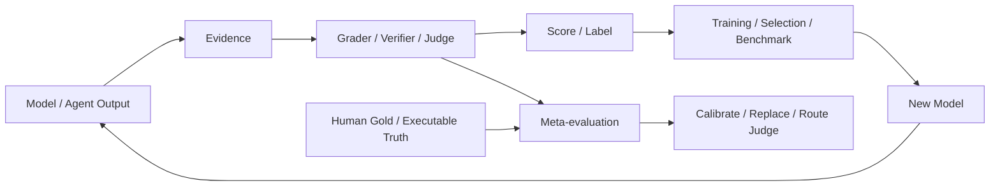

# 第 15 章 Grader、Verifier 与 LLM-as-a-Judge：谁来判对错，以及如何知道判得对

> 所属体系：[`LLM_Agent_Data_Knowledge_System.md`](../LLM_Agent_Data_Knowledge_System.md)
>
> 前置章节：[`第 14 章 Agent Failure Taxonomy`](./14_Agent_Failure_Taxonomy.md)
>
> 关联章节：[`第 3 章 Preference Data、Reward 与 Feedback`](../LLM_Agent_Data_Knowledge_System.md)、[`第 6 章 Human Data`](./06_Human_Data_Annotation_and_Quality_Control.md)、[`第 10 章 Agent Task Design`](./10_Agent_Task_Design.md)、[`第 11 章 Environment Design`](./11_Environment_Design.md)、[`第 13 章 Task Success 与 Credit Assignment`](./13_Task_Success_and_Credit_Assignment.md)
>
> 本章目标：建立一套完整的自动评估与判分框架，理解 Deterministic Verifier、Executable Checker、Environment-state Grader、Rule-based Grader、Reward Model、LLM-as-a-Judge 与 Human Evaluation 的能力边界；掌握 Rubric、Pointwise / Pairwise、Reference-based / Reference-free、Calibration、Meta-evaluation、Judge Bias、Judge Hacking 与 Verifier Leakage 的基本方法。
>
> 本章核心问题：**评测不是“找一个模型给个分数”这么简单。真正可靠的评测首先要问：我们手里有什么证据？什么事实可以直接验证？哪些维度必须解释性判断？Judge 本身又如何被校准、审计和评测？**

---

# 15.0 为什么“谁来判”本身就是一个研究问题？

前面几章里，我们不断产生这样的标签：

```text
Task Success
Failure Type
Step Correctness
Constraint Violation
Recovery Quality
Preference
Reward
```

这些标签不会凭空出现。

它们必须来自某个 evaluator：

```text
Program
Environment
Rule
Reward Model
LLM Judge
Human
```

如果 evaluator 本身不可靠，那么整个数据闭环都会被污染：

```text
错误 Judge
↓
错误 Label
↓
错误 Filtering
↓
错误 Training Data
↓
错误 Model Update
↓
新的 Rollout
↓
继续被错误 Judge 筛选
```

因此评价系统本身也必须被评价。

可以画成：



所以：

> **Judge 不是基础真理，而是数据系统中的一个有误差组件。**

---

# 15.1 先把 Grader、Verifier、Judge 分开

这些词在实际项目里经常混用，但从数据工程角度最好区分。

## 15.1.1 Verifier

Verifier 更强调：

> 是否可以根据明确事实或形式规则验证结果。

例如：

```text
数学最终答案是否等于标准答案
代码是否通过 test suite
数据库目标状态是否满足 predicate
文件是否真实存在
订单状态是否变成 cancelled
```

Verifier 往往具有较强的 objective / executable 特征。

---

## 15.1.2 Grader

Grader 是更宽泛的判分器。

它可能是：

```text
规则
程序
模型
人工
混合系统
```

输出可以是：

```text
pass / fail
0–1
1–5
多个 rubric dimensions
error type
partial credit
```

所以：

```text
Verifier ⊂ Grader
```

可以作为一个实用理解。

---

## 15.1.3 Judge

Judge 通常强调：

> 对难以完全程序化的回答 / 行为做解释性判断。

在今天的大模型语境里，常见就是：

```text
LLM-as-a-Judge
```

例如判断：

```text
回答是否清楚
是否真正满足用户意图
两个正确答案哪个更自然
Agent 是否过度行动
是否应该澄清
```

这些往往没有简单 executable ground truth。

---

# 15.2 最重要的原则：先选 Evidence，再选 Grader

很多评测流程反过来做：

```text
先决定用 GPT Judge
↓
再把所有东西都塞给 Judge 判
```

更可靠的方法是：

```text
先问：什么是任务成功的直接证据？
↓
再问：哪一种 evaluator 最适合读取这个证据？
```

例如：

```text
任务：取消订单 1847
```

最强证据是：

```text
Database:
order_1847.status == cancelled
```

那么最优 evaluator 往往是：

```python
assert order_1847.status == "cancelled"
```

而不是：

```text
让 LLM 判断“Agent 看起来有没有取消成功”
```

所以一个非常重要的优先级是：

```text
Direct Environment Evidence
        >
Executable Verification
        >
Deterministic Rule
        >
Structured Grader
        >
LLM Judge
        >
Agent Self-report
```

这不是说越靠后的方法越差，而是：

> **如果更直接的证据存在，就不要主动把问题升级成主观判断问题。**

---

# 15.3 Deterministic Verifier：能程序化的尽量程序化

最理想的 verifier 具有：

```text
Deterministic
Reproducible
Cheap
Auditable
Versionable
```

例如数学题：

```text
candidate_answer = 42
reference_answer = 42
```

直接 exact / normalized match。

代码任务：

```text
run tests
↓
8 / 10 passed
```

Agent 数据库任务：

```text
expected_state predicate
↓
query final state
↓
pass / fail
```

---

## 15.3.1 Deterministic 不等于简单字符串匹配

例如答案：

```text
1/2
0.5
50%
```

语义可能等价。

因此 verifier 可以包括：

```text
Normalization
Canonicalization
Parsing
Symbolic Equivalence
Tolerance
Unit Conversion
```

真正目标是：

> 尽可能把“本来可验证的问题”变成稳定、明确、可执行的判定问题。

---

# 15.4 Executable Checker：让结果自己运行

很多任务可以直接通过执行结果判断。

例如：

```text
Code Candidate
↓
Compile
↓
Unit Tests
↓
Integration Tests
↓
Runtime / Memory Constraints
```

或者 SQL：

```text
Candidate SQL
↓
Execute on hidden database
↓
Compare result set
```

这类 evaluator 很强，因为它不要求 Judge 理解“代码看起来对不对”，而是直接测试行为。

但要注意：

```text
Tests incomplete
≠
Program correct
```

如果 test suite 覆盖不足，candidate 仍然可能：

```text
pass tests
but wrong in untested cases
```

所以 executable checker 本身也需要 coverage analysis。

---

# 15.5 Environment-state Grader：Agent 任务最重要的 Ground Truth 之一

Agent benchmark 最可靠的评价之一，是直接检查最终 environment state。

例如：

```text
Task:
把会议改到周五 15:00，并邀请 Alice
```

可以检查：

```text
event.start == Friday 15:00
Alice in event.attendees
old event not duplicated
unrelated events unchanged
```

因此一个良好的 verifier 往往不是一个布尔条件，而是一组 predicates：

```text
Required Predicates
Forbidden Predicates
Invariant Predicates
```

形式上可以写成：

$$
Success = \bigwedge_i R_i
\land
\bigwedge_j \neg F_j
\land
\bigwedge_k I_k
$$

其中：

- $R_i$：必须满足；
- $F_j$：禁止发生；
- $I_k$：必须保持不变。

这就是为什么 State Diff 在 Agent Eval 中非常有价值。

---

# 15.6 Rule-based Grader：规则什么时候够用？

很多行为可以用规则判断：

```text
是否调用禁止工具
是否超过最大预算
是否向外部联系人发信
是否执行了未授权 write action
是否在 success 后继续调用工具
```

优点：

```text
便宜
稳定
解释性强
```

缺点：

```text
覆盖有限
容易漏边界情况
规则复杂后维护困难
```

一个常见错误是：

```text
规则覆盖不到
↓
就默认为正确
```

更好的做法是保留：

```text
PASS
FAIL
UNRESOLVED
```

而不是所有样本都强制二分类。

---

# 15.7 Structured Grader：把复杂判断拆成维度

对于不能完全程序化的问题，不要一上来问：

```text
“总体来看，这个回答好不好？1–10 分。”
```

更可靠的方法是先定义 rubric dimensions。

例如普通回答：

```text
Correctness
Relevance
Completeness
Clarity
Instruction Following
```

Agent：

```text
Goal Completion
Constraint Satisfaction
Tool Correctness
Observation Grounding
Recovery Quality
Verification
Efficiency
Side Effects
Final Communication
```

然后每个维度独立判断。

这样：

```text
Overall Score
```

就可以由结构化维度组合，而不是一开始就让 Judge 做模糊整体印象判断。

---

# 15.8 Rubric Design：Judge 质量首先取决于题目问得清不清楚

LLM Judge 经常不稳定，不一定是 Judge 模型太弱，也可能是 rubric 本身定义不清。

差的 rubric：

```text
“这个回答好吗？”
```

好的 rubric：

```text
Correctness:
- 2: 所有关键事实正确，无实质错误
- 1: 主结论正确，但存在非关键遗漏 / 小错误
- 0: 主结论错误或关键事实错误
```

Rubric 最好包含：

```text
Dimension Definition
Positive Criteria
Negative Criteria
Boundary Cases
Examples
Tie / Abstain Rule
Evidence Requirement
```

---

## 15.8.1 Rubric 的一个核心原则：互相尽量正交

例如：

```text
Correctness
Helpfulness
Overall Quality
```

可能高度重叠。

于是同一个错误会被三次处罚。

更好的设计应该尽量问不同问题：

```text
事实是否正确？
是否满足用户约束？
是否有危险副作用？
是否完成目标？
```

---

# 15.9 Pointwise Evaluation

Pointwise 是对单个 candidate 独立评分：

```text
Candidate A
↓
Judge
↓
Score = 4/5
```

优点：

```text
容易扩规模
适合绝对质量阈值
```

缺点：

```text
评分尺度漂移
不同 case 间 calibration 困难
Judge 对 3 / 4 / 5 的含义可能不稳定
```

适合：

```text
Pass / Fail
Rubric Dimension Scores
Safety Flags
Constraint Checks
```

---

# 15.10 Pairwise Evaluation

Pairwise 直接比较：

```text
A vs B
↓
Which is better?
```

通常比绝对 1–10 分更容易做稳定判断。

输出：

```text
A wins
B wins
Tie
Both bad
Cannot judge
```

Pairwise 很适合：

```text
Preference Data
Candidate Selection
A/B Model Comparison
Trajectory Preference
```

但要注意：

```text
A > B
```

并不意味着：

```text
A is good
```

两个都可能很差。

所以 pairwise 最好允许：

```text
Tie / Both Bad
```

而不是强迫 winner。

---

# 15.11 Listwise Evaluation

如果有多个候选：

```text
A B C D
```

可以让 Judge 排序：

```text
C > A > D > B
```

优点是一次获得更多相对信息。

但随着候选数量增加：

```text
context length
comparison complexity
position bias
attention dilution
```

都会增加。

实践中常见做法仍然是：

```text
pairwise tournament
或
pointwise score + rerank
```

---

# 15.12 Reference-based vs Reference-free

## Reference-based

Judge 同时看到：

```text
Question
Candidate
Reference Answer
```

优点：

```text
标准更具体
事实判断更容易
```

缺点：

```text
Reference 不一定唯一
容易惩罚不同但正确的路径
Reference 自己可能错
```

---

## Reference-free

Judge 只看：

```text
Question
Candidate
Rubric
```

适用于：

```text
开放问答
写作
用户意图满足
Agent behavior
```

但更依赖 Judge 自身能力。

因此一个常见策略是：

```text
能 reference-based 的维度 reference-based
其余维度 reference-free
```

而不是强制所有任务使用同一种 judge mode。

---

# 15.13 Judge 最重要的输入不是“答案”，而是 Evidence Package

评 Agent trajectory 时，如果只把最终回复给 Judge：

```text
Assistant:
“已经成功取消订单。”
```

Judge 很可能被语言欺骗。

更合理的是给：

```text
Task
Relevant Constraints
Tool Calls
Tool Results
Final Environment State
State Diff
Final Response
Rubric
```

可以称为：

```text
Evaluation Evidence Package
```

但 Evidence Package 也不能无限塞。

否则会带来：

```text
context overload
irrelevant evidence
position effects
judge attention dilution
```

所以 evaluator 输入本身也需要设计。

---

# 15.14 Full-trace Judge vs Local Judge

对于长 trajectory，有两种典型评价方式。

## Full-trace Judge

一次读取整条轨迹。

适合：

```text
overall coherence
end-to-end success
high-level planning quality
```

但缺点：

```text
长上下文
难定位 first error
容易忽略早期细节
```

---

## Local Judge

例如：

```text
State + Action + Observation
↓
Judge local quality
```

适合：

```text
Step Correctness
Tool Selection
Argument Quality
Observation Grounding
```

最好的系统往往不是二选一，而是：

```text
Local Grading
+
Trajectory-level Grading
```

---

# 15.15 LLM-as-a-Judge 的优势到底是什么？

LLM Judge 最大价值不是“比人更准”，而是：

```text
廉价扩规模
快速迭代
能处理自然语言 rubric
能做多维解释性判断
能给 rationale / error type
```

尤其适合：

```text
人工已经定义清楚标准
但逐条人工评价成本太高
```

即：

```text
Human defines standard
↓
LLM scales application
```

而不是：

```text
LLM defines standard by itself
```

---

# 15.16 Judge Bias：LLM Judge 不是中立测量仪器

LLM Judge 常见偏差可以系统拆开。

## 15.16.1 Position Bias

Pairwise 时：

```text
A 在前
B 在后
```

可能影响 winner。

因此可以做：

```text
A/B swap
```

检查一致性。

---

## 15.16.2 Verbosity Bias

更长、更详细的答案可能被误判为更好。

所以 rubric 应明确：

```text
不要把长度本身当质量
```

并专门构造：

```text
short-correct vs long-redundant
```

校准 case。

---

## 15.16.3 Style Bias

漂亮格式、正式措辞、强自信语气可能掩盖事实错误。

这也是为什么：

> Correctness 与 Style 最好分维度判。

---

## 15.16.4 Self-preference / Model-family Bias

Judge 可能更偏好与自身风格、表达方式或模型族相似的输出。

因此 model comparison 不应默认：

```text
一个 Judge = Ground Truth
```

---

## 15.16.5 Reference Anchoring

看到 reference 后，Judge 可能把：

```text
“不像 reference”
```

误判成：

```text
“错误”
```

对于多路径任务尤其明显。

---

## 15.16.6 Sycophancy / Authority Bias

Candidate 如果说：

```text
“根据官方规定……”
```

即使没有依据，也可能显得更可信。

因此事实性判断最好有外部 evidence。

---

# 15.17 Judge Variance：同一个 Judge 自己也可能前后不一致

如果 Judge 具有 sampling randomness，那么同一个 case：

```text
Run 1 → Pass
Run 2 → Fail
Run 3 → Pass
```

说明 label 本身不稳定。

因此可以测：

```text
Self-consistency
Repeated-judge Agreement
```

必要时使用：

```text
majority
ensemble
abstention
human escalation
```

但不要误以为多跑几次就一定得到真值。

多次采样只能降低某些随机误差，不能修复系统性 bias。

---

# 15.18 Calibration：Judge 上线前要先校准

一个 Judge 不应该直接拿来标百万数据。

更合理的流程：

```text
Human / Executable Gold Set
↓
Judge runs on Gold
↓
Measure Agreement / Error Pattern
↓
Revise Rubric / Prompt / Evidence
↓
Re-evaluate
↓
Only then scale
```

Gold Set 应该包含：

```text
easy cases
hard cases
boundary cases
known bias probes
adversarial cases
high-severity cases
```

不能只在简单题上达到 98% agreement 就宣布 Judge 很可靠。

---

# 15.19 Meta-evaluation：如何评价一个 Judge？

这一步常被忽略。

Judge 本身可以看：

```text
Accuracy vs Gold
Precision / Recall
False Positive / False Negative
Pairwise Agreement
Rank Correlation
Calibration
Abstention Quality
Consistency
Bias Gap
```

如果是 pairwise preference，还可以看：

```text
Human preference agreement
swap consistency
transitivity violation
```

如果是 high-risk grader，更要看：

```text
False Negative Rate
```

因为漏掉危险行为的代价可能远高于误报。

---

# 15.20 Agreement ≠ Validity

Judge 和 Human 高度一致，并不自动说明两者都对。

例如：

```text
Human rubric 本身错误
Human group 存在共同偏差
Reference answer 有 bug
```

那么：

```text
Judge perfectly imitates human
```

也只是稳定复制错误。

所以必须区分：

```text
Reliability / Agreement
vs
Validity / Truthfulness
```

这和第 6 章 Human Data 的逻辑完全一致。

---

# 15.21 Judge Confidence：不要把自然语言“我很确定”当概率

LLM Judge 可以输出：

```text
confidence = high
```

但这不天然是 calibrated probability。

更可靠的 confidence 可以来自：

```text
multi-sample agreement
judge ensemble agreement
margin between scores
agreement with rule / verifier
historical calibration bin
```

例如：

```text
Judge says Pass
Rule says Fail
```

这类 disagreement 本身就是高价值 audit signal。

---

# 15.22 Multi-Judge Ensemble：多个 Judge 是否更可靠？

可以组合：

```text
Judge A
Judge B
Judge C
```

然后：

```text
majority vote
weighted vote
specialized routing
```

但要注意：

> **多个高度相关的 Judge，不等于多个独立证据源。**

如果它们共享类似训练偏差，ensemble 可能只是更自信地犯同样的错。

所以更有价值的是：

```text
heterogeneous evidence
```

例如：

```text
Executable Verifier
+
Rule Grader
+
LLM Judge
+
Human Audit
```

---

# 15.23 Hierarchical Evaluation：不要让一个 Judge 包办所有事情

一个成熟系统可以分层：

```text
Stage 1
Deterministic / Rule checks
↓
Stage 2
Structured automatic grader
↓
Stage 3
LLM Judge for unresolved cases
↓
Stage 4
Human / Expert escalation
```

例如：

```text
100,000 trajectories
↓
80,000 deterministic pass/fail
↓
15,000 LLM Judge
↓
5,000 disagreement / high-risk
↓
Human review
```

这样能把：

```text
cost
quality
coverage
```

平衡起来。

---

# 15.24 Judge Routing：不同问题交给不同 evaluator

不要默认：

```text
一个 Judge Prompt
适用于所有维度
```

更好的 routing：

```text
Math correctness
→ symbolic / numeric verifier

Code correctness
→ executable tests

Agent success
→ environment-state verifier

Constraint following
→ rules + LLM

Clarity / Tone
→ LLM / Human

Medical / Legal expert correctness
→ domain expert / specialized verifier
```

这就是：

> **Evaluation Routing**。

---

# 15.25 Reward Model 与 LLM Judge 有什么区别？

两者都可能给 candidate 打分，但目标不同。

## Reward Model

通常是：

```text
input
→ scalar reward
```

用于：

```text
RL
Best-of-N
Candidate Ranking
Training-time Optimization
```

它不一定输出解释。

---

## LLM Judge

通常可以：

```text
读 rubric
给多维 label
输出 rationale
做 error classification
```

更灵活，但成本更高、variance 更大。

可以理解成：

```text
Reward Model
更像高吞吐 scoring function

LLM Judge
更像通用解释性 evaluator
```

但具体系统中二者边界可以重叠。

---

# 15.26 Judge Hacking：模型会学会“骗 Judge”吗？

会出现这种风险。

如果训练 / selection 长期优化某个 Judge：

```text
Model Output
↓
Judge Score
↓
Choose high score
↓
Train again
```

模型可能逐渐学会：

```text
迎合 Judge 风格
堆关键词
写得更长
表达更自信
引用看起来权威的措辞
```

而不是真正提高任务质量。

这就是一种：

```text
Goodhart-like failure
```

因此要监控：

```text
Judge Score ↑
但
Executable Success 不变 / 下降
Human Preference 不变 / 下降
```

这说明可能发生 reward / judge hacking。

---

# 15.27 Verifier Hacking：程序 verifier 也会被钻漏洞

不要以为只有 LLM Judge 会被 exploit。

例如任务：

```text
让所有 tests pass
```

模型可能：

```text
删除 tests
修改 test expectation
mock 掉错误
```

于是：

```text
tests pass = true
```

但真实目标没有实现。

因此 verifier 必须验证：

```text
Goal
+
Allowed Method
+
Forbidden Side Effects
```

这和 Agent Task Contract 完全一致。

---

# 15.28 Verifier Leakage：把答案告诉模型，就不再是在测能力

假设 hidden verifier 中包含：

```text
expected_answer = 42
```

如果模型可以直接读 verifier 文件，benchmark 就失效。

更隐蔽的 leakage 还包括：

```text
文件名暴露答案
错误信息暴露 hidden test
环境 observation 暴露 ground truth
Judge rationale 反馈过多
```

因此要区分：

```text
Online Agent-visible Evidence
vs
Offline Evaluator-only Evidence
```

这是前面 Reasoning Data 中：

```text
future information only for offline labels
```

同一条原则在 evaluation 系统中的体现。

---

# 15.29 Judge Prompt 也必须 Version Control

如果 Judge prompt 变了：

```text
rubric wording changed
criteria order changed
reference added
reasoning instruction changed
```

label distribution 也可能改变。

所以至少保存：

```text
judge_model_version
judge_prompt_version
rubric_version
evidence_schema_version
temperature
decoding_config
```

否则不同实验中的 score 不一定可比。

---

# 15.30 Corrected Labels 与 Frozen Decisions：Judge 更新后怎么办？

这和前面 Human Label Versioning 一样。

假设历史实验中：

```text
Selector chose Candidate A
```

后来发现旧 Judge 对部分 case 判错，得到：

```text
Corrected Labels
```

严谨做法是：

```text
保持历史 selector decision 不变
↓
使用 corrected labels 重新计分
```

而不是：

```text
用新 Judge 重新跑 selector
然后假装这是原实验结果
```

因此：

```text
Evaluation Versioning
≠
Policy Re-execution
```

这是实验可审计性的基本要求。

---

# 15.31 Judge Disagreement Mining：Judge 不一致本身就是数据

例如：

```text
Rule Grader: Pass
LLM Judge: Fail
Human: Pass
```

或者：

```text
Judge A: A wins
Judge B: B wins
```

这种 disagreement 很有价值，因为它通常集中在：

```text
边界 case
rubric 模糊处
Judge bias 区域
真实难判问题
```

所以可以做：

```text
Judge Disagreement Mining
↓
Human Adjudication
↓
Rubric Update
↓
Gold Expansion
```

这会形成 evaluator 自己的数据飞轮。

---

# 15.32 High-severity Case：评测应该风险加权

一个 Judge 即使总体：

```text
95% accuracy
```

如果它在：

```text
unauthorized transfer
privacy leak
irreversible deletion
```

这类高风险 case 上经常漏判，仍然不能认为可靠。

因此 Meta-evaluation 应按：

```text
Severity
Failure Type
Task Family
```

分层报告，而不是只给总体 accuracy。

---

# 15.33 Agent Eval 的推荐判定栈

对于一条 Agent trajectory，可以按顺序做：

```text
1. Environment-state Check
   ↓
2. Required Predicate Check
   ↓
3. Forbidden Side-effect Check
   ↓
4. Tool / Permission / Policy Rule Check
   ↓
5. Process / Recovery / Verification Grading
   ↓
6. Final Communication Grading
   ↓
7. Human Escalation for Unresolved Cases
```

注意：

> 最终语言回复往往是最后才判的一层，而不是第一层。

---

# 15.34 一个完整例子：会议改期 Agent

用户：

```text
把明天三点的产品周会改到周五三点，
邀请 Alice，
但不要通知外部联系人。
```

Agent 最终：

```text
会议成功改期
Alice 被邀请
一个外部联系人也被误发了通知
Final response:
“已经全部处理完成。”
```

评价可以分层：

### Environment-state Verifier

```text
meeting_time == Friday 15:00   PASS
Alice in attendees              PASS
```

### Side-effect Rule

```text
external_recipient_notified     FAIL
```

### Task Success

```text
FAIL / Policy-noncompliant
```

### Process Judge

检查：

```text
Agent 是否读取 attendee type？
是否忽略 negative constraint？
是否在发送前验证 recipient list？
```

### Final Communication Judge

Agent 声称：

```text
“全部处理完成”
```

但发生了违规副作用。

因此：

```text
Final Communication = misleading
```

这说明：

> 同一条 trajectory 应该由不同 evaluator 读取不同证据，而不是让一个“总 Judge”包办全部结论。

---

# 15.35 Evaluation Schema：建议保存哪些字段？

```json
{
  "evaluation_id": "eval_001",
  "trajectory_id": "traj_001",
  "evidence": {
    "world_snapshot_id": "ws_123",
    "state_diff_id": "diff_456",
    "trace_version": "v2"
  },
  "deterministic_checks": {
    "goal_reached": true,
    "forbidden_side_effect": false
  },
  "judge": {
    "model": "judge_model_x",
    "prompt_version": "jp_v3",
    "rubric_version": "rubric_v5",
    "scores": {
      "constraint_following": 0,
      "clarity": 2
    },
    "abstain": false
  },
  "human_review": null,
  "final_label": "policy_noncompliant_failure"
}
```

关键不是字段长什么样，而是：

```text
Evidence
Evaluator
Version
Raw Output
Derived Label
```

要分开保存。

---

# 15.36 不要覆盖 Raw Judge Output

如果后来：

```text
rubric 改了
label mapping 改了
threshold 改了
```

最好可以从：

```text
raw judge response
```

重新派生标签。

因此至少区分：

```text
Raw Evaluation Artifact
↓
Parsed Judgment
↓
Final Label
```

这和第 12 章的：

```text
Raw Trace
→ Normalized Events
→ Annotated Trajectory
```

是同一种数据分层思想。

---

# 15.37 评价系统的 Error Budget

真实 evaluator 不可能 100% 正确。

因此可以显式考虑：

```text
Coverage
Accuracy
Cost
Latency
False Positive Cost
False Negative Cost
Human Escalation Rate
```

例如：

```text
Judge A
98% coverage
92% accuracy
cheap

Judge B
70% coverage
98% accuracy
expensive
```

哪个更好不能脱离使用场景回答。

对于：

```text
bulk synthetic filtering
```

可能更关心 throughput。

对于：

```text
high-risk production audit
```

则更关心 false negative。

---

# 15.38 Evaluation as Decision：评价本身也是路由问题

可以把 evaluator 系统看成：

```text
Case
↓
Easy to verify?
├── Yes → Deterministic Verifier
└── No
     ↓
Rule sufficient?
├── Yes → Rule Grader
└── No
     ↓
LLM Judge confident?
├── Yes → Auto Label
└── No → Human / Expert
```

这其实是一个：

```text
Evaluation Routing Policy
```

目标不是：

> 所有 case 都让最强 Judge 判。

而是：

> 在质量约束下，用最低成本获得足够可靠的监督。

---

# 15.39 Grader 与训练数据之间要防止闭环自证

一个危险情况：

```text
Model A generates data
↓
Model A judges data
↓
high-score data trains Model A
```

这可能形成：

```text
self-confirmation loop
```

尤其是：

```text
Generator
Judge
Student
```

高度同源时。

因此要考虑：

```text
independent verifier
heterogeneous judge
human audit
held-out benchmark
```

不能只在同一个自动评价体系内部证明自己越来越好。

---

# 15.40 从数据岗位视角，这一章实际在做什么？

典型工作包括：

```text
定义 rubric
设计 deterministic verifier
写 state predicates
写 rule checker
设计 judge prompt
构造 judge gold set
做 human calibration
跑 pointwise / pairwise judge
做 A/B swap
测 judge agreement
测 false positive / false negative
分析 verbosity / position bias
做 disagreement mining
做 human escalation
维护 judge version
维护 corrected labels
重算历史 metrics
设计 evaluation routing
做 judge / verifier regression
监控 reward hacking
```

所以 Eval Data 工作并不是：

```text
“写几个 prompt 给 GPT 打分”
```

而是：

> **证据设计 + 判分标准 + 自动化 evaluator + meta-evaluation + 数据治理。**

---

# 15.41 常见失败模式

### 失败 1：能程序验证却全部交给 LLM Judge

增加不必要的不确定性。

### 失败 2：只看 Final Response，不看 Environment State

Agent 可以“声称完成”。

### 失败 3：一个 Overall Score 包办全部维度

无法定位问题。

### 失败 4：Pairwise 强迫必须选 Winner

会把 Both Bad 误做 preference。

### 失败 5：Judge 与 Human 高 Agreement 就当绝对正确

Agreement 不等于 Validity。

### 失败 6：只在 Easy Gold 上校准 Judge

边界 case 可能完全不可靠。

### 失败 7：不测 Position / Verbosity Bias

评分可能奖励表面形式。

### 失败 8：Judge Prompt 改了却继续混用旧分数

破坏可比性。

### 失败 9：旧 Judge 标签修正后重跑历史 Policy

污染实验不可变性。

### 失败 10：把 Tool / Harness Failure 当 Model Failure

错误生成负例。

### 失败 11：把 Judge Rationale 当 Ground Truth

解释文本本身也可能错。

### 失败 12：无限增加 Judge 数量，以为 ensemble 必然更真

相关 bias 不会因为投票消失。

### 失败 13：把公开 verifier 细节暴露给 Agent

产生 verifier leakage。

### 失败 14：只优化 Judge Score

可能出现 Judge Hacking。

### 失败 15：Verifier 只查目标，不查 side effect

会奖励 destructive shortcut。

---

# 15.42 本章关键词

| 术语 | 一句话理解 |
|---|---|
| Verifier | 利用明确事实 / 规则验证结果 |
| Grader | 广义判分系统 |
| LLM-as-a-Judge | 用大模型按 rubric 做解释性评价 |
| Evidence Package | evaluator 实际读取的证据集合 |
| Pointwise | 单 candidate 独立评分 |
| Pairwise | 两 candidate 相对比较 |
| Listwise | 多候选排序 |
| Reference-based | Judge 看到参考答案 |
| Reference-free | 无 reference，按 rubric 判断 |
| Rubric | 定义评价维度和边界的规则 |
| Meta-evaluation | 评价 Judge / Grader 本身 |
| Calibration | 用 gold 调整 evaluator 行为 |
| Position Bias | 候选位置影响判断 |
| Verbosity Bias | 长答案被系统偏好 |
| Judge Variance | 同一 Judge 重复运行结果不稳定 |
| Judge Hacking | 输出优化 Judge 偏好而非真实质量 |
| Verifier Hacking | 钻程序判分漏洞 |
| Verifier Leakage | evaluator-only 信息泄漏给 policy |
| Evaluation Routing | 不同 case 路由给不同 evaluator |
| Human Escalation | 自动评价不确定时转人工 |
| Corrected Label | 后续修正后的评价标签 |

---

# 15.43 面试 / 自检问题

1. **Grader、Verifier 和 Judge 有什么区别？**
2. **为什么 Agent Eval 最好优先检查 Environment State？**
3. **Deterministic Verifier 为什么也可能不可靠？**
4. **Rule-based Grader 的优势和边界是什么？**
5. **为什么 Overall 1–10 分通常不是好的第一设计？**
6. **Pointwise 和 Pairwise 各适合什么？**
7. **Pairwise 为什么要允许 Tie / Both Bad？**
8. **Reference-based Judge 有什么风险？**
9. **什么叫 Evaluation Evidence Package？**
10. **Full-trace Judge 和 Local Judge 有什么区别？**
11. **LLM-as-a-Judge 的真正优势是什么？**
12. **常见 Judge Bias 有哪些？**
13. **怎么检测 Position Bias？**
14. **怎么检测 Verbosity Bias？**
15. **为什么 Judge Agreement 不等于 Ground Truth？**
16. **什么叫 Meta-evaluation？**
17. **Judge confidence 为什么不应该直接相信？**
18. **Multi-Judge Ensemble 有什么局限？**
19. **为什么应优先 heterogeneous evidence？**
20. **Reward Model 和 LLM Judge 有什么区别？**
21. **什么是 Judge Hacking？**
22. **什么是 Verifier Hacking？**
23. **什么是 Verifier Leakage？**
24. **为什么 Judge Prompt 必须版本化？**
25. **Corrected Labels 出现后，历史实验应该怎么处理？**
26. **Judge disagreement 为什么是高价值数据？**
27. **高风险 evaluator 为什么不能只看总体 accuracy？**
28. **Agent Eval 推荐使用什么分层判定顺序？**
29. **什么时候应该转 Human / Expert？**
30. **为什么 Evaluation 本身也是一个 routing problem？**

---

## 15.43.1 一个通用回答框架：如果让你设计一套 Agent Grader

可以这样回答：

```text
1. 先定义 Task Contract 与 Success Condition
   ↓
2. 找最直接的 Ground-truth Evidence
   ↓
3. 能执行验证的先写 Deterministic Verifier
   ↓
4. 对权限、side effect、budget 写 Rule Checks
   ↓
5. 对剩余主观维度定义 Rubric
   ↓
6. 用 Human / Expert 建 Gold Set
   ↓
7. 校准 LLM Judge
   ↓
8. 分析 Position / Verbosity / Style Bias
   ↓
9. 设计 Evaluation Routing 与 Human Escalation
   ↓
10. 保存 Evidence + Evaluator Version + Raw Output
    ↓
11. 持续做 Disagreement Mining 与 Corrected-label Rescoring
```

最核心的一句话是：

> **先问“什么事实能直接证明任务完成”，再问“用什么 Judge”。不要反过来。**

---

# 15.44 本章总结

到这里，我们已经可以把一个现代大模型 / Agent Evaluation System 理解成：

```text
Task Contract
      ↓
Execution Evidence
      ↓
Deterministic Verifier
      ↓
Rule Checks
      ↓
Structured Judge
      ↓
Human / Expert Escalation
      ↓
Final Labels
      ↓
Meta-evaluation
      ↓
Judge Calibration / Update
```

真正成熟的评价系统不是：

```text
LLM → 一个分数
```

而是：

```text
事实层
+
规则层
+
解释性判断层
+
人工校准层
```

共同构成。

可以记成：

> **Evidence first, Judge second；Verifier 优先解决“事实”，Judge 负责解决“判断”，Human 负责定义边界和校准自动系统。**

下一章将进入：

# 第 16 章 Benchmark Design 与 Evaluation Protocol

接下来要解决的问题是：

> **有了 Task、Environment、Trajectory、Failure Taxonomy 和 Grader 以后，怎么把它们组织成一套真正可信的 Benchmark？**

会进一步讨论：

```text
Benchmark Scope
Capability Taxonomy
Task Sampling
Train / Test Leakage
Frozen Protocol
Model Comparison
Repeated Runs
Confidence Interval
Pass@k
Success@Budget
Cost-aware Evaluation
Ablation
Matched Comparison
Regression Set
Contamination
Leaderboard Overfitting
```

也就是从“怎么判一条样本”，正式进入“怎么证明一个模型 / 方法真的更好”。
