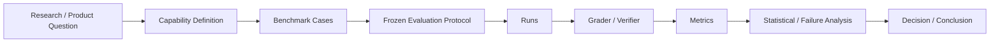

# 第 16 章 Benchmark Design 与 Evaluation Protocol：如何证明模型、Agent 或方法真的更好

> 所属体系：[`LLM_Agent_Data_Knowledge_System.md`](../LLM_Agent_Data_Knowledge_System.md)
>
> 前置章节：[`第 15 章 Grader、Verifier 与 LLM-as-a-Judge`](./15_Grader_Verifier_and_LLM_as_a_Judge.md)
>
> 关联章节：[`第 9 章 Hard Case Mining 与 Curriculum`](./09_Hard_Case_Mining_and_Curriculum.md)、[`第 10 章 Agent Task Design`](./10_Agent_Task_Design.md)、[`第 11 章 Environment Design`](./11_Environment_Design.md)、[`第 13 章 Task Success 与 Credit Assignment`](./13_Task_Success_and_Credit_Assignment.md)、[`第 14 章 Agent Failure Taxonomy`](./14_Agent_Failure_Taxonomy.md)
>
> 本章目标：建立一套完整的 Benchmark / Evaluation Protocol 设计框架，理解 Capability Taxonomy、Benchmark Scope、Sampling、Frozen Protocol、Matched / Paired Comparison、Repeated Runs、Confidence Interval、Pass@k、Success@Budget、Cost-aware Evaluation、Ablation、Regression Set、Contamination 与 Leaderboard Overfitting 等概念之间的关系。
>
> 本章核心问题：**评测的目标不是“跑一个分数”，而是在受控条件下回答一个清楚的科学或产品问题：到底是哪种能力发生了变化、变化有多大、是否稳定、代价是多少，以及这个结论在什么范围内成立。**

---

# 16.0 Benchmark 不是题库，Evaluation 也不是“跑一下”

最简单的评测看起来像：

```text
Dataset
↓
Model A
↓
Accuracy = 72%
```

然后：

```text
Model B
↓
Accuracy = 75%
```

很容易得出：

> Model B 更好。

但真正严谨的问题至少包括：

```text
两个模型是否使用了同样 prompt？
解码参数是否一致？
工具版本是否一致？
环境是否 reset 到相同状态？
Judge / Verifier 是否同版本？
75% 比 72% 的差异是否稳定？
提升集中在哪些 capability？
是否牺牲了 cost / latency / safety？
样本是否存在 contamination？
是否只是对 benchmark 本身过拟合？
```

因此：

> **Benchmark 是被定义好的测量对象，Evaluation Protocol 是规定“如何测”的实验协议。**

可以画成：



如果其中任意一层定义模糊，最后的数字就很难解释。

---

# 16.1 先定义 Evaluation Question

一个好的 benchmark 应该先回答：

> **我们到底想知道什么？**

而不是先找一堆 dataset。

例如下面几个问题完全不同：

```text
Q1：这个模型数学推理更强吗？
Q2：这个 Agent 更会用工具吗？
Q3：这个方法能否减少 harmful tool calls？
Q4：增加 test-time compute 是否提高正确率？
Q5：新的 routing policy 是否在相同预算下更优？
Q6：某个 selector 能否把更好的 candidate 选出来？
```

对应的 benchmark、protocol 和 metric 都不一样。

所以第一步最好明确：

```text
Target Capability
Intervention / Compared Systems
Primary Metric
Secondary Metrics
Budget Constraint
Failure Cost
Allowed Evidence
Claim Scope
```

---

# 16.2 Capability Taxonomy：先定义“测什么能力”

Benchmark 最容易犯的错误之一，是：

```text
Dataset 名字
=
Capability 名字
```

例如：

```text
AIME
MATH
LiveBench
```

这些是 dataset / benchmark suite 名称，不是能力本身。

更好的做法是先建立 capability taxonomy。

对于 Agent，可以例如拆成：

```text
Task Understanding
Constraint Following
Planning
Tool Selection
Argument Construction
Observation Grounding
State Tracking
Memory Use
Recovery
Verification
Termination
Safety / Permission Compliance
Final Communication
```

然后一个 benchmark case 可以关联多个 capability。

---

## 16.2.1 Capability 不能定义得太宽

例如：

```text
Agent Ability
```

几乎无法诊断。

太细也会有问题：

```text
能否在某个特定 API 上正确填写第三个字段
```

可能缺乏泛化价值。

比较好的 taxonomy 往往满足：

```text
可解释
可覆盖
可操作
能映射到 failure / data strategy
不过度依赖某个具体 benchmark
```

---

# 16.3 Benchmark Scope：你打算声称多大的结论？

如果只测：

```text
30 道数学题
```

就声称：

```text
“方法普遍提升 LLM reasoning”
```

结论通常过强。

Benchmark Scope 至少应明确：

```text
Domain
Task Family
Difficulty Range
Language
Tool / Environment Type
Model Family
Budget Range
Interaction Length
Safety / Risk Level
```

更严谨的写法通常是：

> 在当前模型、当前任务集合、当前预算和当前协议下，观察到……

而不是轻易升级成：

> 普遍证明……

---

# 16.4 Benchmark Case 应该是什么？

对于普通 QA：

```text
input
reference / verifier
metadata
```

对于 Agent，更完整的 case 应该接近：

```text
Task Contract
+
Initial Environment Snapshot
+
Toolset / Permissions
+
Success Predicates
+
Forbidden Side Effects
+
Termination Rules
+
Verifier
+
Metadata
```

也就是：

```text
benchmark case
≠
prompt string
```

---

# 16.5 Sampling：Benchmark 中的样本从哪里来？

Benchmark 的代表性首先取决于 sampling。

常见来源包括：

```text
真实用户日志
公开 benchmark
人工设计
专家设计
Synthetic generation
Failure-driven mining
Adversarial generation
Counterfactual generation
```

每一种 sampling 都有偏差。

---

## 16.5.1 Random Sampling

优点：

```text
接近真实总体分布
适合估计平均表现
```

缺点：

如果简单 case 占 95%，那么：

```text
overall success rate
```

可能非常高，但真正重要的复杂能力没有被测到。

---

## 16.5.2 Stratified Sampling

按：

```text
Capability
Task Family
Difficulty
Risk
Language
Tool Type
```

分层采样。

优点是 coverage 更好。

但最后总体指标是否需要重新按真实分布加权，要单独决定。

---

## 16.5.3 Challenge Set

专门收集：

```text
Hard Cases
Known Failures
Boundary Cases
High-risk Cases
```

它适合测 capability frontier 和 regression，

但不适合直接当真实总体成功率。

所以：

> **Challenge-set performance ≠ Population performance。**

---

# 16.6 Test Set 与 Regression Set 不完全一样

## Test Set

用于估计模型 / 方法在某个目标分布上的能力。

## Regression Set

用于保证：

```text
过去修好的问题
不能再次坏掉
```

Regression set 往往故意集中于：

```text
historical failures
high-severity cases
critical workflows
```

因此它不一定具有总体代表性。

一个成熟系统通常同时维护：

```text
Representative Test Set
+
Capability Challenge Set
+
Regression Set
+
Safety / High-risk Set
```

---

# 16.7 Train / Dev / Test：Agent 场景下怎么切才不泄漏？

普通随机拆分：

```text
80% train
10% dev
10% test
```

对于 Agent 往往远远不够。

如果：

```text
Train:
取消订单 1001
取消订单 1002

Test:
取消订单 9999
```

只是实体 ID 变化。

真正的 workflow 没有变化。

因此可以考虑按：

```text
Task Family
Workflow
Tool Combination
Constraint Pattern
Environment Layout
Capability
Failure Mode
Domain
```

做 group holdout。

---

# 16.8 Contamination：测试题被模型见过怎么办？

Benchmark contamination 可能来自：

```text
Pretraining Exposure
Fine-tuning Exposure
Prompt Template Leakage
Reference Leakage
Synthetic Near-duplicate
Public Leaderboard Iteration
Agent Memory Contamination
```

常见检测包括：

```text
Exact Match
Near-duplicate Search
Embedding Similarity
Template Similarity
Entity-swapped Duplicate Detection
```

但 contamination 很难被完全证明“没有”。

因此更实用的是：

```text
控制可控的泄漏
记录可能的暴露风险
使用动态 / private / held-out benchmark
```

---

# 16.9 Benchmark Leakage 与 Verifier Leakage 要区分

## Benchmark Leakage

模型提前见过任务 / 答案模式。

## Verifier Leakage

模型在运行时直接获得：

```text
hidden answer
hidden tests
expected state
future outcome
```

两者都会让评测失效，但发生位置不同。

特别是 Agent 环境必须明确：

```text
Agent-visible State
vs
Evaluator-only State
```

---

# 16.10 Frozen Protocol：评测首先要冻结什么？

如果要比较两个系统，必须尽量保证除被比较变量外其他条件一致。

典型需要冻结：

```text
Dataset / Case Version
Prompt
Model Version
Tokenizer
Generation Config
Random Seed Policy
Toolset
Tool Schemas
Harness
Environment Snapshot
Timeout
Max Steps
Budget
Judge / Verifier
Metric Definition
Post-processing
```

可以形式化成：

```text
Protocol =
Inputs
+
Runtime
+
Decision Rules
+
Evaluation Rules
```

然后版本化：

```text
protocol_v1
protocol_v2
```

---

## 16.10.1 为什么 Frozen Protocol 很重要？

假设方法 B 比 A 高 3%。

但同时：

```text
Prompt 变了
Judge 变了
Tool timeout 变了
Generation temperature 也变了
```

那么：

```text
+3%
```

根本无法归因。

所以实验设计的核心之一是：

> **只改变你想研究的那个变量。**

---

# 16.11 Paired / Matched Comparison：同题比较通常比独立总体比较更强

如果 Model A 和 B 都跑同一批 case，应该优先使用 paired analysis。

对于二元结果，可以得到：

```text
A correct, B correct
A correct, B wrong
A wrong, B correct
A wrong, B wrong
```

真正最有信息的是两个 discordant cell：

```text
A→B improvement
B→A regression
```

即：

```text
Wrong → Right
Right → Wrong
```

这比只报告：

```text
A = 72%
B = 75%
```

更有解释力。

---

## 16.11.1 Matched Comparison 的价值

Matched comparison 尽量固定：

```text
同一 Task
同一 Initial State
同一 Prefix / Agent State
同一 Environment Snapshot
```

只改变：

```text
Policy / Candidate / Intervention
```

这样 outcome 差异更容易归因。

---

# 16.12 Intervention Evaluation：Rescue / Harmful / Neutral

对于一个 intervention，可以把 case 分成：

```text
Baseline Fail → Intervention Success
= Rescue

Baseline Success → Intervention Fail
= Harmful

Baseline Success → Intervention Success
= Neutral-positive

Baseline Fail → Intervention Fail
= Neutral-negative
```

核心量：

$$
Net = Rescue - Harmful
$$

也可以看：

```text
Replacement Rate
Coverage
Rescue Precision
Harmful Rate
Conditional Gain
```

如果一个方法：

```text
Rescue = 10
Harmful = 9
```

和：

```text
Rescue = 10
Harmful = 1
```

虽然 rescue 数一样，价值完全不同。

---

# 16.13 Trigger / Generator / Selector 要分别评价

对于 candidate-based intervention：

```text
State
↓
Trigger
↓
Candidate Generation
↓
Candidate Scoring
↓
Selection
↓
Outcome
```

应该拆开评价：

```text
Trigger Quality
Candidate Oracle
Selector Quality
End-to-end Net Gain
Compute Cost
```

例如：

```text
Oracle@N 很低
```

说明 generation 没找到好 candidate。

而：

```text
Oracle@N 很高
实际 selection 很差
```

说明 selector 是瓶颈。

不能把所有失败都叫：

```text
method failure
```

---

# 16.14 Oracle Analysis：先看理论可得上限

如果从 N 个候选里只要有一个正确就算 oracle success：

```text
Oracle@N
```

可以回答：

> 当前 candidate generator 给 selector 留了多大的上限？

这对于 Best-of-N / Search / Agent Branching 非常重要。

如果：

```text
Oracle@8 = 91%
Selected@8 = 68%
```

那么很明显：

```text
Selection Gap = 23 points
```

而不是 generator 的问题。

---

# 16.15 Repeated Runs：有随机性的系统不能只跑一次

如果系统存在：

```text
sampling
stochastic tools
non-deterministic environment
LLM Judge variance
```

一次 run 只是一个 realization。

应该考虑：

```text
multiple seeds
multiple rollouts
multiple judge runs
```

但注意：

> 多跑几次不是为了“挑最好的一次”，而是估计 variance。

---

# 16.16 Confidence Interval：不要只报告点估计

例如：

```text
success rate = 73.2%
```

更完整的是：

```text
73.2% ± uncertainty
```

可以使用：

```text
Binomial confidence interval
Bootstrap confidence interval
Paired bootstrap
```

具体方法取决于 metric 和实验结构。

尤其当：

```text
N 很小
```

例如 AIME 只有几十题时，单题变化就会造成较大百分比波动。

所以小样本 benchmark 更需要：

```text
raw count
+
percentage
+
uncertainty
```

一起报告。

---

# 16.17 Statistical Significance ≠ Practical Significance

即使：

```text
p < 0.05
```

也不意味着提升一定值得上线。

还需要问：

```text
Effect Size 多大？
额外成本多少？
有没有严重 regression？
提升是否集中在重要 task？
```

例如：

```text
+0.3% accuracy
+300% compute
```

可能并不值得。

所以最终应该看：

```text
Statistical Evidence
+
Effect Size
+
Cost
+
Risk
+
Business / Scientific Relevance
```

---

# 16.18 Pass@k：为什么和 Accuracy 不一样？

如果对一个 task 采样 k 次，只要其中一次正确就算成功：

```text
Pass@k
```

它回答的是：

> 给模型 k 次机会，它至少生成一个正确解的概率有多大？

这和：

```text
单次 greedy accuracy
```

是完全不同的能力定义。

因此报告时必须明确：

```text
Greedy
Single-sample
Best-of-N
Pass@k
Self-consistency
```

不能混在同一列里直接比较。

---

# 16.19 Success@Budget：对 Agent / Test-time Compute 更合理的指标

很多方法通过增加 compute 提升表现。

那么更合理的问题是：

> 在相同预算下，谁更好？

可以定义：

```text
Success@TokenBudget
Success@ToolBudget
Success@LatencyBudget
Success@DollarBudget
```

例如：

```text
Model A
75% success
2k tokens

Model B
78% success
20k tokens
```

如果实际产品只能接受 4k tokens，B 的 78% 就不是可部署表现。

---

# 16.20 Cost-aware Evaluation：质量与成本必须一起画

常见成本维度：

```text
Input Tokens
Output Tokens
Reasoning Tokens
Tool Calls
Search Calls
Wall-clock Latency
GPU Time
API Cost
Human Review Cost
```

最终可以看：

```text
Quality vs Cost Curve
```

而不是一个孤立分数。

---

## 16.20.1 Pareto Frontier

如果：

```text
System A
quality = 75
cost = 10

System B
quality = 76
cost = 100

System C
quality = 76
cost = 20
```

B 被 C 支配。

真正值得比较的是：

> **Pareto frontier 上的系统。**

这对 test-time compute、Agent planning depth、Best-of-N 特别重要。

---

# 16.21 Average Cost 与 Conditional Cost 要区分

一个按需触发的方法可能：

```text
大多数 case 不触发
少数 case 很贵
```

只报告 triggered case cost 会夸大整体成本，

只报告全体平均又可能掩盖局部高开销。

所以最好同时报告：

```text
Overall Average Cost
Triggered-case Cost
Non-triggered Cost
Trigger Rate
P50 / P95 Cost
```

---

# 16.22 Coverage：不是所有方法都对所有 case 动手

Routing / Abstention / Intervention 方法经常只覆盖部分样本。

需要区分：

```text
Total Population
Eligible Population
Triggered Population
Intervened Population
Successfully Resolved Population
```

否则很容易出现分母混乱。

例如：

```text
“方法在 80% case 上成功”
```

到底指：

```text
全部 case？
triggered case？
intervened case？
有 candidate 的 case？
```

必须写清楚。

---

# 16.23 Denominator Discipline：所有百分比都要问“分母是谁？”

这是 benchmark 报告里极其重要的纪律。

每个指标都最好能回答：

```text
Numerator
Denominator
Inclusion Rule
Exclusion Rule
```

例如：

```text
Trigger Rate = triggered / all screened

Rescue Rate = rescues / baseline failures eligible for intervention

Replacement Precision = beneficial replacements / all replacements
```

如果分母不一致，不同表格里的百分比很容易产生错误解读。

---

# 16.24 Per-task / Per-domain Breakdown：平均分会掩盖异质性

总体：

```text
+2.1%
```

可能来自：

```text
Math +8%
Code +4%
Agent -3%
Safety -5%
```

所以必须做：

```text
Task Family Breakdown
Capability Breakdown
Difficulty Breakdown
Failure-type Breakdown
Risk-level Breakdown
```

平均表现只是第一层。

---

# 16.25 Micro Average、Macro Average 与 Weighted Average

如果不同 dataset 大小差异很大：

```text
Dataset A: 1000 cases
Dataset B: 30 cases
```

直接合并所有样本是：

```text
Micro Average
```

两个 dataset 各自算分后平均是：

```text
Macro Average
```

按真实业务流量权重则是：

```text
Weighted Average
```

三者回答的问题不同。

必须明确采用哪一种。

---

# 16.26 Ablation：到底是哪一部分起作用？

完整方法：

```text
Trigger
+
Candidate Generation
+
Selector
+
Verifier
```

如果比 baseline 高，仍然不知道：

```text
究竟是谁贡献了提升？
```

因此 ablation 可以移除：

```text
No Trigger
No Selector
Random Selector
Greedy-only
Different Candidate Count
Different Score
No Verification
```

核心是回答：

> **必要组件是什么？贡献来自哪里？**

---

# 16.27 Control Group：很多“看起来有效”的方法其实缺少正确对照

例如方法用了：

```text
更多 token
更多 candidate
更多 tool calls
```

那么 baseline 也应该考虑：

```text
等 token budget
等 candidate count
等 tool-call budget
```

否则提升可能只是：

> 用了更多计算。

而不是方法本身更聪明。

---

# 16.28 Strong Baseline：Baseline 太弱，结论也弱

一个新方法如果只比较：

```text
弱 prompt
随机策略
```

即使提升很大，也难说明真正价值。

应该尽量包含：

```text
Greedy Baseline
Reasonable Sampling Baseline
Best-known Simple Heuristic
Budget-matched Baseline
Ablation Baseline
```

Baseline 的目的不是“让新方法赢”，而是判断：

> 新方法有没有超出简单替代方案。

---

# 16.29 Negative Result 也需要 Protocol

如果某方法没有提升，不能马上说：

```text
“这个方向没用”
```

要检查：

```text
Candidate Oracle 是否足够高？
样本量是否有 power？
Metric 是否对应目标？
Implementation 是否正确？
Selector 是否真的看到所需信息？
Protocol 是否过窄？
```

因此更严谨的结论通常是：

> 在当前数据、当前表示、当前样本量和当前 protocol 下，没有观察到稳定收益。

而不是：

> 这种 signal 不存在。

---

# 16.30 Corrected Labels：标签修正后怎么处理历史实验？

如果历史 policy / selector 已经产生固定 decision：

```text
Decision_old
```

后来发现：

```text
Gold Labels_old
```

部分错误，得到：

```text
Gold Labels_corrected
```

正确做法是：

```text
冻结 Decision_old
↓
用 corrected labels 重新计分
```

而不是：

```text
用新标签重训 / 重选
↓
再把结果当历史实验
```

所以要区分：

```text
Decision Freeze
Evaluation Update
Policy Re-execution
```

三件事。

---

# 16.31 Evaluation Artifact Lineage：一个分数应该能追溯到什么？

每个最终 metric 最好能追溯到：

```text
Dataset Version
Case IDs
Protocol Version
Model Version
Prompt Version
Harness Version
Environment Version
Verifier / Judge Version
Raw Outputs
Per-case Labels
Aggregation Script
Metric Definition
```

这就是 evaluation lineage。

如果只有：

```text
accuracy = 76.2%
```

没有对应 artifact，后续几乎无法审计。

---

# 16.32 Leaderboard Overfitting：反复调 benchmark 也会过拟合

即使模型没有直接训练测试集，团队也可能：

```text
反复看 leaderboard
↓
针对 benchmark 调 prompt / policy
↓
再看 leaderboard
↓
继续调
```

久而久之：

```text
benchmark
```

已经变成隐式 dev set。

这就是 leaderboard overfitting。

缓解方法包括：

```text
private test
rotating test
hidden benchmark
fresh task generation
limited evaluation frequency
```

---

# 16.33 Benchmark Saturation：分数太高以后还测得到东西吗？

如果：

```text
所有强模型都 97–99%
```

benchmark 对新模型已经缺乏区分力。

此时需要：

```text
harder cases
new capability slices
adversarial tasks
longer horizon
higher-risk constraints
```

但不能简单地“把题变怪”。

新的 hard cases 仍然应该对应真实 capability gap。

---

# 16.34 Dynamic Benchmark：为什么 Agent 更需要动态测试？

Agent 的外部世界变化很快：

```text
Websites change
APIs change
Tools change
Policies change
```

因此静态 benchmark 很容易老化。

动态 benchmark 可以：

```text
refresh entities
refresh environment state
regenerate task instances
rotate hidden tests
```

但同时必须保持：

```text
difficulty comparability
capability coverage
verifier stability
```

否则“每次题都不一样”会让纵向比较失去意义。

---

# 16.35 Online Eval 与 Offline Eval

## Offline Eval

优点：

```text
可重复
便于回放
风险低
```

## Online Eval

可以看到：

```text
真实用户分布
真实工具噪声
真实长尾问题
```

但有：

```text
安全风险
用户成本
环境漂移
难以复现
```

成熟系统通常是：

```text
Offline Benchmark
↓
Canary / Shadow Eval
↓
Limited Online Rollout
↓
Production Monitoring
```

---

# 16.36 Shadow Evaluation：上线前先“旁路观察”

一种实用做法是：

```text
真实请求
↓
Production Policy 真执行
↓
Candidate Policy 只做 shadow decision
↓
不产生真实 side effect
```

这样可以比较：

```text
decision difference
predicted quality
cost
risk
```

而不直接让新 policy 控制生产环境。

---

# 16.37 Safety-critical Benchmark：不能只看平均成功率

高风险任务需要单独指标：

```text
Unauthorized Action Rate
Irreversible Harm Rate
Privacy Violation Rate
Policy Violation Rate
Hallucinated Success Rate
Safe Abort Rate
Escalation Quality
```

因为：

```text
99% overall success
```

如果剩余 1% 全是高严重度错误，仍然不可接受。

---

# 16.38 Calibration：模型知道自己什么时候不会吗？

对于可以 abstain / escalate 的系统，还要评：

```text
Confidence
vs
Actual Correctness
```

以及：

```text
Selective Accuracy
Coverage
Risk-Coverage Curve
```

例如：

```text
只处理 70% case
但 accuracy = 99%
```

和：

```text
处理 100%
accuracy = 90%
```

取决于产品目标，可能有不同价值。

---

# 16.39 Selective Prediction：Coverage 和 Risk 要一起看

如果系统可以：

```text
Answer
Abstain
Escalate
```

那么一个重要关系是：

```text
Coverage ↑
通常 Risk ↑
```

可以画：

```text
Risk-Coverage Curve
```

看在不同 coverage 下的错误率。

这比一个固定 threshold 的单点更完整。

---

# 16.40 Benchmark Report 最少应该包含什么？

一个比较严谨的报告至少包含：

```text
1. Evaluation Question
2. Benchmark Scope
3. Dataset / Case Version
4. Inclusion / Exclusion Rules
5. Protocol
6. Baselines
7. Primary Metric
8. Secondary / Cost Metrics
9. Per-case / Per-slice Results
10. Paired Transition Analysis
11. Statistical Uncertainty
12. Failure Breakdown
13. Ablation
14. Cost Accounting
15. Known Limitations
16. Artifact Paths / Lineage
```

---

# 16.41 一个推荐的 Evaluation Protocol Template

可以使用下面这套模板。

```text
Research Question
-----------------
我们想验证什么？

Compared Systems
----------------
Baseline:
Method:

Frozen Factors
--------------
Model:
Prompt:
Tokenizer:
Generation Config:
Toolset:
Harness:
Environment:
Verifier:

Dataset
-------
Version:
N:
Task Families:
Inclusion Rule:
Exclusion Rule:

Primary Metric
--------------

Secondary Metrics
-----------------
Cost:
Latency:
Safety:
Coverage:

Paired Analysis
---------------
Wrong→Right:
Right→Wrong:
Net:

Statistical Analysis
--------------------
CI:
Bootstrap / paired test:

Ablations
---------

Known Limitations
-----------------

Artifacts
---------
Raw outputs:
Labels:
Summary:
Protocol file:
```

---

# 16.42 研究实例：More Thinking——平均准确率之外为什么要看状态转移？

一个简单报告可能只写：

```text
Depth 1: 69.04%
Depth 2: 74.09%
Depth 3: 70.97%
```

这已经能说明性能非单调。

但进一步看：

```text
Wrong → Right
Right → Wrong
```

才能知道：

```text
额外 thinking
既可能 repair
也可能 degrade
```

于是评测问题从：

```text
“更多 thinking 是否平均提高准确率？”
```

升级成：

```text
“哪些当前 reasoning states 值得继续投入 compute？”
```

这就是 benchmark analysis 如何推动问题定义本身升级。

---

# 16.43 研究实例：RoTFuse / K17——为什么 Trigger、Candidate、Selector、E2E 必须拆开？

K17 这类 intervention 方法可以分成：

```text
All Cases
↓
Risk Screening
↓
Triggered Cases
↓
Candidate Generation
↓
Candidate Selection
↓
Final Outcome
```

因此至少要分别回答：

```text
1. Trigger 是否集中到了有价值的 state？
2. Candidate pool 是否真的包含更优 continuation？
3. Selector 能否识别更好的 candidate？
4. End-to-end Rescue 是否超过 Harmful？
5. 代价是多少？
```

如果只报告最终 accuracy，一旦没有提升，就不知道问题在哪。

---

## 16.43.1 Full-population Accounting

Routing / Trigger 方法还必须特别注意：

```text
未触发 case
```

仍然属于完整 benchmark population。

即使这些 case：

```text
不生成额外 candidate
不产生 intervention
```

它们依然应该进入 end-to-end 总体结果。

所以需要明确：

```text
All Screened
Triggered
Non-triggered
Intervened
```

各自数量和分母。

---

## 16.43.2 Candidate Pool 的 Oracle 与 Actual Selection

如果：

```text
same-prefix candidate pool
```

存在正确 alternative，说明：

```text
recoverability exists
```

但如果 selector 选不到，则：

```text
selectability insufficient
```

所以：

```text
Risk
Recoverability
Selectability
```

必须作为不同 scientific objects。

---

# 16.44 Benchmark Governance：Benchmark 也要版本管理

Benchmark 会变化：

```text
修正标签
补充 case
删除泄漏 case
更新 verifier
调整 taxonomy
```

因此至少要保存：

```text
benchmark_version
case_manifest
label_version
protocol_version
verifier_version
release_notes
```

如果 benchmark 更新后，历史分数不应无声覆盖。

应该明确：

```text
Score on v1
Score on v2
```

---

# 16.45 数据改了，历史结果怎么办？

最好遵循：

```text
Raw Run Immutable
↓
Labels Versioned
↓
Metrics Recomputable
```

即：

```text
原始模型输出不改
历史 policy decision 不改
新标签单独保存
重新 aggregation
```

这样任何历史结论都可以审计。

---

# 16.46 Benchmark Reproducibility：别人能不能重建你的数字？

最低要求通常包括：

```text
case manifest
protocol config
model identifier
seed / generation config
runtime versions
raw predictions
per-case labels
metric script
```

如果环境任务，还需要：

```text
environment snapshot
reset procedure
tool version
verifier version
```

---

# 16.47 Common Failure Modes

### 失败 1：Dataset 名字当 Capability

结果只能说“在这个 dataset 上高了”。

### 失败 2：只报告 Overall Accuracy

看不到 repair / degradation / task heterogeneity。

### 失败 3：Baseline 和 Method 预算不一致

把 compute advantage 当算法 advantage。

### 失败 4：Protocol 同时改多个变量

无法归因。

### 失败 5：随机 train/test split 导致 workflow leakage

看似泛化，实际只是实体变化。

### 失败 6：Challenge Set 当真实总体分布

难例成绩不能直接解释成线上成功率。

### 失败 7：Triggered-case 指标冒充 Full-population 指标

分母错了。

### 失败 8：只看平均 cost

掩盖 P95 或 triggered-case 高成本。

### 失败 9：只报点估计，不报不确定性

尤其小样本时很危险。

### 失败 10：看到 p-value 就认为值得上线

忽略 effect size 和 cost。

### 失败 11：Judge 更新后重跑 policy，再冒充历史结果

破坏实验不可变性。

### 失败 12：Negative Result 直接上升为“signal 不存在”

超出当前 protocol 能支持的结论。

### 失败 13：Leaderboard 反复调参

测试集已经变 dev set。

### 失败 14：Benchmark 太饱和

已经无法区分强系统。

### 失败 15：没有保存 per-case artifact

最终数字不可审计。

---

# 16.48 从数据 / Eval 岗视角，这一章实际会做什么？

典型工作包括：

```text
定义 capability taxonomy
搭 benchmark task families
做 representative / challenge / regression set
设计 train/dev/test split
做 contamination audit
冻结 evaluation protocol
管理 benchmark / label version
跑 baseline
做 paired comparison
统计 W→R / R→W
计算 confidence interval
做 cost accounting
做 ablation
分析 failure distribution
维护 regression suite
做 leaderboard / release report
维护 raw artifact 与 per-case lineage
```

真正核心能力不是：

```text
“会跑 benchmark”
```

而是：

> **知道一个数字在什么前提下可解释，以及它究竟支持多大的结论。**

---

# 16.49 本章关键词

| 术语 | 一句话理解 |
|---|---|
| Benchmark | 定义清楚的能力测量集合 |
| Evaluation Protocol | 规定如何运行、判分和聚合的实验协议 |
| Capability Taxonomy | 将目标能力拆成可解释维度 |
| Representative Set | 近似目标总体分布的样本集 |
| Challenge Set | 专门覆盖能力边界和难例 |
| Regression Set | 防止历史问题再次出现 |
| Frozen Protocol | 比较过程中固定非研究变量 |
| Paired Comparison | 在同一 case 上比较两个系统 |
| Oracle@N | 候选池中至少存在一个成功候选的比例 |
| Pass@k | k 次生成里至少一次成功的概率 |
| Success@Budget | 给定成本预算下的成功率 |
| Coverage | 系统实际处理 / 干预的样本比例 |
| Rescue | baseline fail → intervention success |
| Harmful | baseline success → intervention fail |
| Net Gain | Rescue − Harmful |
| Ablation | 移除组件以识别贡献来源 |
| Contamination | benchmark 信息进入训练或策略迭代 |
| Leaderboard Overfitting | 围绕测试榜单反复调参导致隐式过拟合 |
| Evaluation Lineage | 从最终分数追溯到 protocol、raw output 与 labels |

---

# 16.50 面试 / 自检问题

1. Benchmark 和 Dataset 有什么区别？
2. 为什么 Dataset 名字不能直接等价成 Capability？
3. Representative Set、Challenge Set、Regression Set 有什么区别？
4. Agent benchmark 为什么不适合简单随机 train/test split？
5. 什么是 workflow leakage？
6. Frozen Protocol 应该冻结哪些变量？
7. 为什么 paired comparison 比只看两个 accuracy 更有信息量？
8. Wrong→Right 与 Right→Wrong 分别表示什么？
9. Rescue / Harmful / Net Gain 怎么定义？
10. 为什么 Trigger、Generator、Selector 要单独评价？
11. Oracle@N 有什么作用？
12. Pass@k 和 single-run accuracy 有什么区别？
13. 为什么 Agent / test-time compute 更适合 Success@Budget？
14. 什么是 Pareto frontier？
15. Overall Average Cost 和 Triggered-case Cost 为什么都要报？
16. 什么叫 denominator discipline？
17. Micro / Macro / Weighted Average 有什么区别？
18. 什么是 ablation？为什么 random selector 可能是一个有价值的 baseline？
19. Negative Result 应该怎样严谨表述？
20. Corrected labels 出现后，历史 decision 应该怎么处理？
21. Benchmark contamination 和 verifier leakage 有什么区别？
22. 什么是 leaderboard overfitting？
23. Benchmark saturation 后应该怎么办？
24. Dynamic benchmark 的优势和风险是什么？
25. 为什么 safety-critical benchmark 不能只看 average success？
26. Selective prediction 为什么要看 risk-coverage curve？
27. Evaluation artifact lineage 为什么重要？
28. 怎样证明一个方法提升不是单纯因为用了更多 compute？
29. 如何设计一个 budget-matched baseline？
30. 如果整体 accuracy 不变，但 high-severity harmful rate 明显下降，你会如何解释？

---

## 16.50.1 一个通用回答框架：如果让你设计一套 Agent Benchmark

可以回答：

```text
1. 先定义 evaluation question 和 capability taxonomy
   ↓
2. 明确 benchmark scope 和 claim scope
   ↓
3. 设计 representative / challenge / regression slices
   ↓
4. 为每个 task 定义 Task Contract + Environment Snapshot + Verifier
   ↓
5. 做 leakage / contamination 检查
   ↓
6. 冻结 model / prompt / tool / harness / environment / judge protocol
   ↓
7. 运行强 baseline 和 budget-matched baseline
   ↓
8. 做 paired per-case analysis
   ↓
9. 报 primary quality + cost + safety + coverage
   ↓
10. 做 confidence interval / ablation / failure breakdown
   ↓
11. 保存 raw outputs、labels、protocol 和 metric lineage
   ↓
12. 最后只做与证据范围一致的结论
```

这里最关键的一句话是：

> **Benchmark 不是为了制造一个漂亮分数，而是为了让一个比较结论可解释、可复现、可审计。**

---

# 16.51 与前后章节的关系

到这一章，第四层已经形成：

```text
Human / Gold
↓
Verifier / Grader / Judge
↓
Failure Taxonomy
↓
Benchmark Protocol
↓
Statistical + Cost-aware Evaluation
```

而下一阶段会进一步进入：

> **数据和评测结果如何回流，形成真正的 Data Flywheel。**

也就是从：

```text
“模型哪里差？”
```

继续走到：

```text
“下一轮该生产什么数据？”
“哪些数据值得优先标？”
“哪些失败应该进入 regression？”
“模型更新后怎样重新采集新的 frontier cases？”
```

---

# 16.52 本章总结

这一章最重要的不是记住某个 metric，而是建立以下评测观：

```text
Scientific / Product Question
        ↓
Capability Definition
        ↓
Benchmark Scope
        ↓
Frozen Protocol
        ↓
Matched Runs
        ↓
Evidence-based Grading
        ↓
Paired + Cost-aware Analysis
        ↓
Failure / Slice Analysis
        ↓
Auditable Conclusion
```

最终真正值得信任的 benchmark 结论，应该同时回答：

```text
提升了什么？
在哪里提升？
有没有退化？
代价是多少？
结论稳不稳定？
这个结论能推广到哪里？
```

这才是 Evaluation Protocol 的核心。