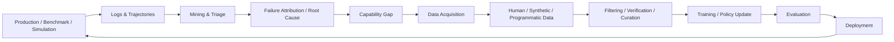
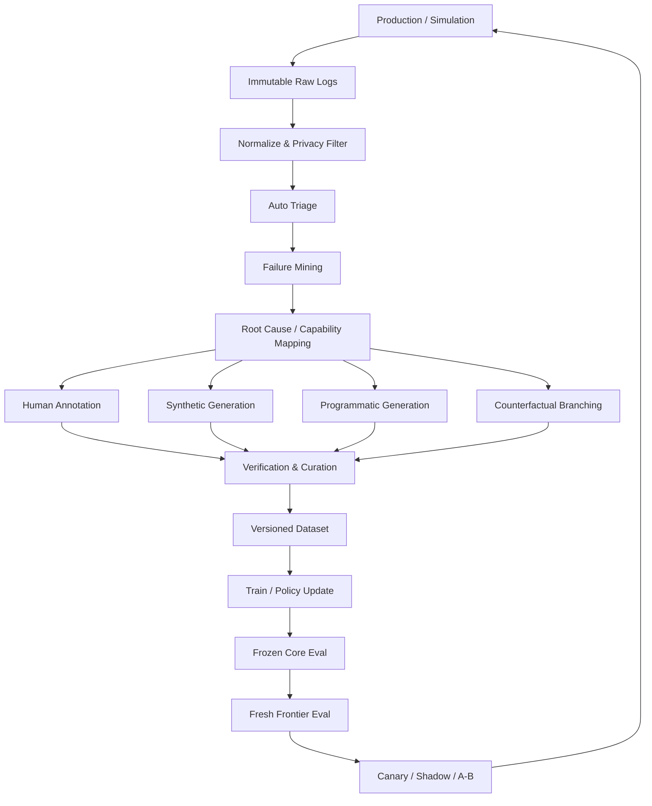

# 第 17 章 Data Flywheel：从失败日志到持续改进的数据闭环

> 所属体系：[`LLM_Agent_Data_Knowledge_System.md`](../LLM_Agent_Data_Knowledge_System.md)
>
> 前置章节：[`第 16 章 Benchmark Design 与 Evaluation Protocol`](./16_Benchmark_Design_and_Evaluation_Protocol.md)
>
> 关联章节：[`第 6 章 Human Data`](./06_Human_Data_Annotation_and_Quality_Control.md)、[`第 7 章 Synthetic Data`](./07_Synthetic_Data_Generation_and_Synthesis.md)、[`第 9 章 Hard Case Mining 与 Curriculum`](./09_Hard_Case_Mining_and_Curriculum.md)、[`第 14 章 Agent Failure Taxonomy`](./14_Agent_Failure_Taxonomy.md)、[`第 15 章 Grader、Verifier 与 LLM-as-a-Judge`](./15_Grader_Verifier_and_LLM_as_a_Judge.md)
>
> 本章目标：理解 Data Flywheel 为什么不是“上线后把日志拿回来训练”这么简单，而是一套围绕 **生产分布 → 失败发现 → 根因抽象 → 数据获取 → 训练 → 评测 → 部署 → 新分布** 持续运行的数据系统；掌握 Offline / Online Flywheel、Human-in-the-loop、Model-in-the-loop、Active Learning、Regression Growth、Capability Frontier Refresh、Distribution Shift、Feedback Delay、Data Versioning 与 Flywheel Degeneration 等核心问题。
>
> 本章核心问题：**一个真正有效的数据飞轮，不是把模型自己的输出不断喂回模型，而是持续发现“当前系统最值得学、最能被验证、修复后最有价值”的新经验，并确保数据闭环没有因为自举、选择偏差和评价偏差而越来越窄。**

---

# 17.0 什么是 Data Flywheel？

最简单的理解是：

```text
Model
↓
Serve Users
↓
Collect Data
↓
Train Again
↓
Better Model
```

但这个版本太粗糙。

真正有价值的数据飞轮至少要回答：

```text
哪些线上数据值得留下？
哪些失败真的是模型失败？
哪些只是 Tool / Harness / Environment 问题？
失败应该怎么抽象成 capability gap？
应该人工标、合成、还是直接写 verifier？
哪些数据值得训练，哪些只该进入 regression？
新模型改善后，旧 hard case 还 hard 吗？
新的模型又会产生什么新的 failure distribution？
```

所以更完整的飞轮是：



真正让 flywheel 转起来的，不是“数据回流”，而是：

> **每一轮都比上一轮更会识别高价值数据。**

---

# 17.1 Data Flywheel 和普通 Data Pipeline 有什么区别？

普通 pipeline 更像一次性过程：

```text
Raw Data
↓
Cleaning
↓
Labeling
↓
Training
↓
Done
```

Flywheel 则强调：

```text
Deployment Result
↓
产生新的 Data Signal
↓
改变下一轮 Data Strategy
```

所以飞轮有两个关键特征：

## 17.1.1 Closed-loop

模型行为本身会产生下一轮数据来源。

## 17.1.2 Adaptive

下一轮数据分布会根据当前模型的 failure / uncertainty / frontier 动态调整。

因此：

```text
Static Dataset
≠
Adaptive Data System
```

---

# 17.2 一个成熟飞轮的五个核心模块

可以把整个系统拆成：

```text
1. Signal Collection
2. Data Mining
3. Supervision Construction
4. Model Update
5. Evaluation & Refresh
```

分别对应：

```text
哪里值得看？
↓
哪些 case 值得做？
↓
这些 case 怎么变成学习信号？
↓
怎么更新模型 / policy？
↓
怎么判断修复是否真实、下一轮去哪找？
```

---

# 17.3 Signal Collection：飞轮从哪里获得信号？

常见来源包括：

```text
Production Logs
Benchmark Failures
Shadow Traffic
Human Feedback
Tool Errors
Judge Disagreement
Low-confidence States
Repeated Retry / Loop
Escalation Cases
Support Tickets
Offline Simulation
Synthetic Stress Tests
```

这些来源不是等价的。

例如：

```text
Production Log
```

最贴近真实分布，但标签往往弱。

而：

```text
Benchmark Failure
```

标签强、可复现，但分布可能不代表真实用户。

所以成熟系统通常需要：

> **real-distribution signal + controllable evaluation signal**

同时存在。

---

# 17.4 Production Log 不是 Training Data

这是 Data Flywheel 里最重要的原则之一。

线上日志只是：

```text
Raw Experience
```

它可能包含：

```text
成功行为
错误行为
用户自己纠正
Harness Bug
Tool Timeout
隐私信息
重复请求
异常流量
攻击输入
无意义操作
```

因此：

```text
Production Log
≠
Training Example
```

中间至少要经过：

```text
Triage
Attribution
Privacy Filtering
Quality Control
Labeling / Verification
Selection
```

否则就是把生产噪声直接灌回模型。

---

# 17.5 Triage：不是所有失败都值得进入飞轮

假设一天有 100 万个 episode，其中 8 万个失败。

真正应该进入数据系统的，可能只是其中一部分。

首先排除：

```text
Infrastructure Failure
Duplicate Failure
Invalid Task
Spam / Abuse
Unresolvable External Event
Known Bug Already Fixed
Low-value Cosmetic Failure
```

剩下再进入：

```text
Model-relevant Failure
Novel Failure
High-severity Failure
High-frequency Failure
Recoverable Failure
Capability-frontier Failure
```

所以 triage 本质上是在做：

> **failure prioritization。**

---

# 17.6 Failure Prioritization：高频不等于高价值

一个 failure 的优先级可以概念上写成：

$$
Priority(x)=f(Frequency, Severity, Learnability, Recoverability, Business\ Value, Novelty)
$$

例如：

### Failure A

```text
出现 50,000 次
只是格式多一个空格
```

### Failure B

```text
出现 30 次
但会错误退款
```

显然后者可能更值得优先。

因此：

> **Frequency ≠ Importance。**

---

# 17.7 Root Cause Abstraction：不要直接围着表面 failure 造数据

一个真实失败：

```text
“取消明天的会议，但周会不要动。”
Agent 把两个会议都取消了。
```

如果直接做：

```text
再生成 10,000 条取消会议题
```

很可能浪费预算。

应该先抽象：

```text
Symptom:
误取消了周会

Root Cause:
Negative Constraint Handling Failure

Capability Gap:
Selective Action under Exclusion Constraint
```

然后扩展到不同 domain：

```text
删除文件，但 .env 不要动
退款订单，但 VIP 订单不要动
群发通知，但外部联系人不要发
更新数据库，但冻结账户不能修改
```

于是：

```text
Single Failure
↓
Root Cause
↓
Capability Abstraction
↓
Task Family
```

这才是 flywheel 的“放大器”。

---

# 17.8 Failure Cluster：从单个 case 到 failure family

生产日志中经常会出现很多表面不同、根因相同的 case。

可以聚类：

```text
Wrong Recipient
Wrong File
Wrong Order
Wrong User
```

可能共同属于：

```text
Entity Resolution Failure
```

或者：

```text
Too Early Stop
Missing Verification
False Success Claim
```

可能共同属于：

```text
Termination / Verification Failure
```

因此 flywheel 应该同时维护：

```text
Case-level Failure
Family-level Failure
Capability-level Gap
```

不能只做单样本修补。

---

# 17.9 Novelty：飞轮要能区分“新失败”和“旧失败重复出现”

一个成熟系统应给 failure 做 lineage：

```text
failure_id
failure_family
first_seen_version
last_seen_version
frequency
severity
fixed_in_version
regressed_in_version
```

这样可以区分：

```text
New Failure
Persistent Failure
Recurring Regression
Resolved Failure
```

其中：

```text
Recurring Regression
```

尤其值得关注，因为说明：

```text
修复不稳
或者 regression protection 不够
```

---

# 17.10 Capability Frontier Refresh：Hard Case 会随模型变强而变化

第 9 章已经讲过 capability frontier。

在飞轮中，更重要的是：

> **Frontier 不是固定的。**

例如 Model v1：

```text
2-step tool use
成功率 60%
```

经过训练后 Model v2：

```text
2-step tool use
成功率 95%
```

那么继续大量生成同类 case，边际价值会下降。

此时 frontier 可能转移到：

```text
multi-constraint
long-horizon
recovery
partial observability
```

所以每一轮都需要：

```text
Refresh Capability Map
↓
Retire Saturated Cases
↓
Promote Frontier Cases
```

---

# 17.11 Data Acquisition：发现 capability gap 后，下一步数据从哪里来？

至少有五种方式：

```text
1. Real Production Cases
2. Human-authored Cases
3. Synthetic Generation
4. Programmatic Generation
5. Counterfactual Mutation
```

例如发现：

```text
Permission Handling Failure
```

可以：

### Real

从真实 permission-denied episode 中筛。

### Human

让专家设计复杂权限边界。

### Synthetic

让 generator 产生不同角色和权限组合。

### Programmatic

枚举：

```text
role × action × object × permission state
```

### Counterfactual

同一个 task 只改变：

```text
authorized → unauthorized
```

这样就得到 matched cases。

---

# 17.12 Human-in-the-loop：人应该放在哪里？

不一定是：

```text
人负责逐条写数据
```

更高价值的位置往往是：

```text
定义 taxonomy
设计 rubric
确认 root cause
处理 ambiguity
审查 high-risk case
adjudicate disagreement
校准 judge
审核 synthetic boundary cases
```

也就是：

> **Human 从 mass labeling 转向 standard setting、boundary judgment 和 expert adjudication。**

---

# 17.13 Model-in-the-loop：模型不只是被训练对象，也可以是数据生产工具

模型可以参与：

```text
Failure Summarization
Failure Clustering
Task Generation
Counterfactual Generation
Response Generation
Critique
Candidate Generation
Preference Pre-label
Evidence Extraction
Rubric-assisted Grading
```

但一个基本原则是：

> **Model-generated signal 不是天然 ground truth。**

必须通过：

```text
Verifier
Human
Environment
Cross-model Agreement
Rule
```

提供外部约束。

---

# 17.14 Offline Flywheel 与 Online Flywheel

这两个概念要区分。

## 17.14.1 Offline Flywheel

```text
Logs
↓
Offline Mining
↓
Build Dataset
↓
Retrain / Fine-tune
↓
Offline Eval
↓
Deploy New Version
```

优点：

```text
可控
可审计
风险低
```

缺点：

```text
反馈慢
版本周期长
```

---

## 17.14.2 Online Flywheel

模型运行过程中直接利用：

```text
feedback
confidence
reward
user correction
runtime verifier
```

调整：

```text
routing
candidate selection
memory
retrieval
policy
```

注意：

> Online adaptation 不一定意味着在线更新模型参数。

也可以只是：

```text
动态 routing
动态 tool policy
动态 candidate selection
```

---

# 17.15 Online Signal 与 Offline Ground Truth 要分开

在线 policy 可以看到：

```text
current observation
confidence
tool return
current state
```

但不能偷看：

```text
future outcome
human final adjudication
hidden reference
future rollout
```

这些只能用于 offline label。

因此：

```text
Online Feature
≠
Offline Supervision
```

这是贯穿 reasoning、Agent 和 data flywheel 的统一原则。

---

# 17.16 Active Learning：有限标注预算应该花在哪？

假设每天有：

```text
1,000,000 episodes
```

只能人工看：

```text
5,000
```

就需要 acquisition policy。

例如：

$$
A(x)=
\alpha U(x)
+\beta D(x)
+\gamma S(x)
+\delta N(x)
+\epsilon B(x)
$$

其中：

- $U$：uncertainty；
- $D$：judge/model disagreement；
- $S$：severity；
- $N$：novelty；
- $B$：business importance。

于是：

```text
Human Annotation Budget
```

被主动分配到最有价值的区域。

---

# 17.17 Data Selection Policy 本身也应该被评测

一个 acquisition strategy 可以问：

```text
随机抽 5,000 条
vs
uncertainty 抽 5,000 条
vs
disagreement 抽 5,000 条
vs
risk-weighted 抽 5,000 条
```

训练后谁提升更多？

也就是评估：

```text
Data Selection → Downstream Delta
```

这比只看：

```text
筛出的数据平均有多难
```

更重要。

最终要优化的是：

> **单位数据成本带来的模型增益。**

---

# 17.18 Data Marginal Value：不是所有新样本都等价

定义一种概念化指标：

$$
MV(D_i)=\frac{\Delta Performance(D_i)}{Cost(D_i)}
$$

其中 cost 可以包括：

```text
Generation Cost
Human Label Cost
Verification Cost
Training Cost
Engineering Cost
```

这就是：

> **Data ROI。**

数据工作不应该只汇报：

```text
做了 100 万条
```

还应该问：

```text
这 100 万条带来了什么？
```

---

# 17.19 Regression Growth：每次真实失败都可能变成长期资产

高价值 failure 被确认后，除了进入 training，还应该进入：

```text
Regression Set
```

例如：

```text
Bug #1847
Agent 错删 protected file
```

修复后保存：

```text
Task
Environment Snapshot
Verifier
Expected Behavior
Failure Type
```

以后每个版本都跑。

于是：

```text
Production Failure
↓
Regression Asset
↓
Permanent Capability Guardrail
```

这就是飞轮里非常重要的一种“记忆”。

---

# 17.20 Regression Set 也不能无限膨胀

如果每个 bug 都永久加入：

```text
10k
100k
1M
```

最终成本会失控。

所以可以做：

```text
Deduplication
Failure-family Compression
Severity-based Tiering
Fast Core Set
Full Nightly Set
Archived Historical Set
```

例如：

```text
Tier 0: Safety-critical, every build
Tier 1: Core regression, daily
Tier 2: Full regression, nightly / weekly
```

---

# 17.21 Feedback Delay：数据飞轮不是瞬时系统

一个 failure 今天产生，可能经过：

```text
1 day mining
2 days annotation
1 week training
2 days eval
1 week rollout
```

才影响线上模型。

所以：

```text
Observed Failure Distribution at t
```

对应的模型可能已经是：

```text
Model v3
```

而训练数据来自：

```text
Model v1 logs
```

这会带来：

> **stale data problem。**

因此数据要保存：

```text
source_model_version
source_policy_version
collection_time
production_context
```

---

# 17.22 Distribution Shift：飞轮本身会改变它观察到的数据

模型变强后，用户行为也可能改变。

例如：

```text
旧模型只会简单任务
↓
用户只敢给简单任务
```

新模型更强后：

```text
用户开始提交更复杂任务
```

于是线上 failure rate 可能：

```text
不降反升
```

但不一定说明模型变差。

可能是：

```text
task mix 变难了
```

因此 production monitoring 要做：

```text
Capability-conditioned Metrics
Difficulty-conditioned Metrics
Task-mix Adjustment
```

不能只看总体 success rate。

---

# 17.23 Selection Bias：被记录的数据不一定代表真实分布

例如只收：

```text
用户点了“差评”的对话
```

那么 dataset 会偏向：

```text
用户愿意主动反馈的失败
```

而漏掉：

```text
用户没意识到的错误
用户直接离开的失败
隐性副作用
高置信错误
```

所以线上反馈不是 unbiased ground truth。

需要结合：

```text
Random Audit
Verifier Audit
Silent Failure Detection
Shadow Evaluation
```

---

# 17.24 Positive-only Flywheel 为什么会退化？

如果每一轮都只保留：

```text
Judge 评分最高的输出
```

然后继续训练：

```text
Model
↓
Generate
↓
Keep only high-score style
↓
Train
↓
Generate more same style
```

可能出现：

```text
style homogenization
mode collapse
loss of rare behavior
judge overfitting
```

也就是：

> **飞轮越转，分布越窄。**

所以需要保留：

```text
Diversity
Hard Negatives
Rare Cases
Novel Failures
Human Data
External Data Sources
```

---

# 17.25 Self-training Flywheel 的最大风险：模型只会越来越像自己

设：

```text
Model v1
生成 synthetic data
↓
训练 Model v2
↓
Model v2 再生成 data
↓
训练 Model v3
```

如果没有外部 truth source，错误和偏差可能递归放大。

因此应该引入：

```text
Human Gold
Executable Verifier
Fresh Real Data
Independent Teacher
Environment Truth
Adversarial Audit
```

可以理解为：

> **Flywheel 必须不断注入外部锚点。**

---

# 17.26 Judge-driven Flywheel 的风险：学会 Judge，而不是学会任务

流程：

```text
Generate
↓
Judge Score
↓
Keep High Score
↓
Train
↓
Repeat
```

如果 Judge 有 bias，模型会越来越适配 bias。

所以要同时监控：

```text
Judge Score
Executable Success
Human Preference
Real-world Outcome
```

如果：

```text
Judge Score ↑
但 Real Success →
```

甚至下降，说明 flywheel 可能已经 reward-hacking。

---

# 17.27 Flywheel Degeneration 的常见模式

至少包括：

```text
1. Distribution Narrowing
2. Judge Overfitting
3. Teacher Bias Amplification
4. Duplicate Explosion
5. Easy-case Dominance
6. Failure Blind Spot
7. Regression Forgetting
8. Stale-data Training
9. High-risk Under-sampling
10. Synthetic Fingerprint Overfitting
```

所以飞轮需要自己的 health metrics。

---

# 17.28 Flywheel Health Metrics

可以监控：

```text
Novel Failure Rate
Failure-family Coverage
Synthetic / Real Ratio
Human Gold Ratio
Duplicate Rate
Acceptance Rate
Hard-case Yield
High-severity Coverage
Regression Pass Rate
Judge-human Agreement
Verifier-Judge Disagreement
Data Age
Source Model Distribution
Downstream Gain per 1k Samples
```

尤其值得看：

```text
Downstream Gain / Data Cost
```

而不是只看：

```text
Dataset Size
```

---

# 17.29 Data Versioning：每一轮数据必须能追溯来源

推荐至少保留：

```text
dataset_version
sample_id
source_type
source_model_version
source_episode_id
failure_family
parent_sample_id
generator_version
verifier_version
judge_version
human_guideline_version
accepted_by_rule
created_at
```

这样才能回答：

```text
某个训练样本从哪来？
为什么被选中？
当时是谁判它是好数据？
后来 label 是否修正？
哪些模型训练过它？
```

这就是 Data Lineage。

---

# 17.30 Immutable Raw Layer：原始日志不要被后处理覆盖

推荐类似第 12 章 trajectory 分层：

```text
L0 Raw Production Trace
↓
L1 Normalized Episode
↓
L2 Annotated / Graded Failure
↓
L3 Curated Dataset
↓
L4 Training View
```

如果后面：

```text
Judge 改了
taxonomy 改了
label 修正了
```

应该重做 L2 / L3，

而不是覆盖原始 L0。

---

# 17.31 Evaluation Freeze：飞轮不能边训练边偷偷改尺子

如果每一轮：

```text
Model 改
Judge 改
Benchmark 改
Rubric 改
```

最后无法知道模型是否真的变好。

因此至少保留：

```text
Frozen Core Benchmark
+
Fresh Frontier Benchmark
```

前者用于：

```text
longitudinal comparability
```

后者用于：

```text
avoid saturation / overfitting
```

这就是：

> **stable ruler + moving frontier。**

---

# 17.32 为什么 Regression 和 Frontier 要同时维护？

如果只看 regression：

```text
模型只会越来越擅长旧错误
```

如果只看 frontier：

```text
旧能力可能悄悄退化
```

所以：

```text
Regression Set
保护已解决能力

Frontier Set
寻找下一轮能力边界
```

二者缺一不可。

---

# 17.33 A/B、Canary 与 Shadow：飞轮如何安全接线上？

新模型不应该直接 100% 替换旧模型。

常见策略：

```text
Offline Eval
↓
Shadow Traffic
↓
Canary
↓
Small A/B
↓
Expanded Rollout
↓
Full Deployment
```

### Shadow

新模型看真实请求，但不真正执行 side effects。

### Canary

只给很小流量。

### A/B

比较真实用户 outcome。

这样可以让飞轮逐步验证：

```text
offline gain
是否真的转化为 online gain
```

---

# 17.34 Offline Win ≠ Online Win

离线 benchmark 提升，线上可能没有提升。

原因包括：

```text
task mix 不同
用户行为变化
latency 更高
tool failure 更多
context 更长
线上环境更脏
成本约束不同
```

所以飞轮最终必须回到：

```text
Real-world Outcome
```

而不是只围绕 benchmark 自循环。

---

# 17.35 User Correction 是非常高价值信号，但也不能直接当真值

例如：

```text
Assistant: 会议已经取消。
User: 我不是让你取消周会！
```

这是高价值 signal。

它说明：

```text
user detected a mismatch
```

但不能机械把用户下一句话全部当 ground truth。

仍然要判断：

```text
用户是在纠错？
补充约束？
改变需求？
还是自己理解错？
```

所以：

> **User Correction = high-value supervision candidate，而不是 automatic label。**

---

# 17.36 Implicit Feedback：没有显式差评，也可能有失败信号

例如：

```text
用户重复同一请求
用户自己手动修正
用户放弃任务
用户立即 undo
用户重新打开旧页面
用户反复确认
```

这些都是：

```text
behavioral failure signals
```

但它们通常是 noisy proxy。

更适合：

```text
mining / triage
```

而不是直接当 correctness label。

---

# 17.37 Recovery Data Flywheel：失败不一定只转成“正确示范”

对于 Agent，特别值得保存：

```text
Failure State
↓
Recovery Action
↓
Recovered Outcome
```

例如：

```text
refund_order
↓
PERMISSION_DENIED
↓
request_approval
↓
approved
↓
refund_order
↓
success
```

这比单独保存最终成功轨迹更能训练：

```text
Recovery Policy
```

---

# 17.38 Counterfactual Flywheel：从一个失败状态生成多个替代动作

对于一个 high-value state：

```text
State S
↓
Observed Action A → Failure
```

可以生成：

```text
B
C
D
```

然后在同一个 snapshot 下 rollout：

```text
A → Fail
B → Success
C → Fail
D → Success
```

于是得到：

```text
same-state preference
rescue label
harmful label
recovery data
selector training data
```

这就是一种局部 Data Flywheel。

---

# 17.39 More Thinking / RoTFuse 视角下的局部飞轮

Reasoning 场景也可以写成：

```text
Current Reasoning State
↓
Risk / Uncertainty Mining
↓
Same-prefix Alternatives
↓
Future Outcome
↓
Rescue / Harmful / Neutral
↓
Trigger / Selector Evidence
↓
下一轮更精准的 state mining
```

它说明飞轮不一定发生在“整个用户会话”粒度。

也可以发生在：

```text
reasoning state
agent decision state
tool-call state
```

这些局部状态层面。

---

# 17.40 Flywheel 与 Continual Learning 的关系

Data Flywheel 解决的是：

```text
经验怎么持续产生
哪些经验值得学
怎么转成 supervision
```

Continual Learning 更强调：

```text
模型如何持续吸收新分布
同时避免遗忘旧能力
```

二者相关，但不相同。

一个系统可以有很强的数据飞轮，

但仍然采用：

```text
周期性离线训练
```

而不是 continuous parameter update。

---

# 17.41 Catastrophic Forgetting：新数据修复一个问题，也可能伤害旧能力

例如为了修复：

```text
模型过度调用工具
```

加入大量：

```text
不要调用工具
```

的数据。

可能导致：

```text
真正需要工具的任务也不调用
```

所以每轮更新必须看：

```text
Target Improvement
+
Regression Risk
```

这也是为什么：

```text
Frozen Core Benchmark
```

必须长期存在。

---

# 17.42 Data Mixture Governance：新数据应该加多少？

发现新 failure 后，不是简单：

```text
把这类样本加到越多越好
```

需要考虑：

```text
base distribution
new failure frequency
severity
oversampling risk
capability interaction
```

所以数据 mixture 本身也是 policy：

```text
base data
+
frontier data
+
regression data
+
high-risk data
+
synthetic data
```

不同版本比例可能变化。

---

# 17.43 Oversampling Hard Cases 的副作用

如果模型线上：

```text
99% case 是普通任务
```

但训练数据里：

```text
80% 都是 edge cases
```

可能导致模型：

```text
过度谨慎
过度澄清
过度拒绝
过度验证
```

所以 hard-case mining 需要和 representative distribution 配合。

也就是：

> **Fix the frontier without forgetting the center。**

---

# 17.44 Flywheel Dashboard 应该看什么？

建议至少分五层。

## Data Supply

```text
new episodes
new failures
new unique failure families
synthetic generated
human labeled
```

## Data Quality

```text
verifier pass
judge-human agreement
abstention rate
duplicate rate
```

## Coverage

```text
capability coverage
failure-family coverage
high-severity coverage
frontier coverage
```

## Learning

```text
training delta
regression delta
cost per improvement
```

## Production

```text
online success
escalation rate
high-severity incident rate
latency
cost
```

---

# 17.45 “做更多数据”与“改系统”必须区分

不是所有 failure 都应该通过训练解决。

例如：

```text
Tool schema 含糊
Harness 丢 observation
Environment timeout
Verifier bug
```

正确 action 是：

```text
Fix System
```

而不是：

```text
Generate More Training Data
```

所以飞轮最终应该有多个出口：

```text
Model Data Fix
Prompt Fix
Tool Fix
Harness Fix
Environment Fix
Product UX Fix
Policy Fix
```

这比“所有错误都变成训练数据”成熟得多。

---

# 17.46 一个完整的 Agent Data Flywheel 示例

任务：

```text
“取消订单 1847，如果已经发货就不要取消，告诉我下一步怎么处理。”
```

生产中观察到：

```text
Agent 不查状态，直接 cancel_order
↓
API 返回 shipped_order_cannot_cancel
↓
Agent 仍然说“已取消成功”
```

## Step 1：Failure Record

```text
Symptom:
False success claim

Root Cause 1:
Missing precondition check

Root Cause 2:
Observation grounding failure

Severity:
S3

Recoverability:
R1
```

## Step 2：Capability Abstraction

```text
Precondition Checking
+
Tool Result Grounding
```

## Step 3：Generate Task Family

```text
pending
shipped
cancelled
not_found
permission_denied
```

## Step 4：Matched Counterfactual

保持 prompt 不变，只改变 order state。

## Step 5：Generate Rollouts

收集：

```text
correct
wrong
recovery
```

## Step 6：Verifier

检查：

```text
final order state
forbidden side effect
final claim consistency
```

## Step 7：Data Transformation

```text
Correct Demo
Preference Pair
Observation-grounding Negative
Recovery Trajectory
Regression Case
```

## Step 8：Train / Update

## Step 9：Frozen Eval

检查：

```text
old regression
new task family
representative tasks
```

## Step 10：Deploy & Monitor

观察：

```text
missing precondition ↓ ?
false success ↓ ?
latency ↑ ?
extra tool calls ↑ ?
```

这就是一个完整 flywheel。

---

# 17.47 Data Flywheel 的常见失败模式

## Failure 1：日志全收，直接训练

问题：

```text
noise / privacy / system failure / model failure 混杂
```

---

## Failure 2：只看显式差评

问题：

```text
selection bias
```

---

## Failure 3：只做 synthetic，不看真实线上分布

问题：

```text
sim-to-real gap
```

---

## Failure 4：只留 Judge 高分样本

问题：

```text
judge overfitting
mode collapse
```

---

## Failure 5：所有 failure 都训练模型

问题：

```text
system bug 被错误归因成 model weakness
```

---

## Failure 6：Hard case 永久 hard

问题：

```text
不 refresh frontier
```

---

## Failure 7：修新能力忘旧能力

问题：

```text
catastrophic regression
```

---

## Failure 8：没有 data lineage

问题：

```text
无法知道某个错误数据影响了哪些模型
```

---

## Failure 9：Judge、benchmark、model 一起变

问题：

```text
无法纵向比较
```

---

## Failure 10：只看数据量

问题：

```text
quantity vanity metric
```

---

# 17.48 一套推荐的 Flywheel Architecture

可以抽象成：



旁路还应该有：

```text
System Bug
→ Engineering Fix

High-risk Case
→ Human / Expert Review

Regression Case
→ Permanent Guardrail
```

---

# 17.49 数据岗真正应该交付什么？

如果面试或工作中问：

> “你会怎么搭一个大模型 / Agent Data Flywheel？”

一个成熟回答不应该只说：

```text
收集日志 → 清洗 → 标注 → 训练
```

而应该包含：

```text
1. 定义目标能力与业务 outcome
2. 建立生产 trace schema
3. 建立 failure taxonomy
4. 区分 model / system / environment failure
5. 做 mining 与 prioritization
6. 把 failure 抽象成 capability gap
7. 选择 human / synthetic / programmatic acquisition
8. 建 verifier / judge / gold
9. 保留 lineage 与 version
10. 形成 train / preference / recovery / regression views
11. 冻结 core benchmark
12. 动态刷新 frontier benchmark
13. 做 cost-aware downstream evaluation
14. 安全上线并收集 fresh signals
15. 监控 flywheel degeneration
```

这才是完整的数据系统思维。

---

# 17.50 本章关键概念速记

```text
Data Flywheel
Production Signal
Failure Mining
Failure Prioritization
Root Cause Abstraction
Capability Gap
Human-in-the-loop
Model-in-the-loop
Offline Flywheel
Online Flywheel
Active Learning
Acquisition Function
Data Marginal Value
Data ROI
Regression Growth
Capability Frontier Refresh
Feedback Delay
Distribution Shift
Selection Bias
Flywheel Degeneration
Data Lineage
Evaluation Freeze
Stable Ruler + Moving Frontier
Shadow / Canary / A-B
Counterfactual Flywheel
```

---

# 17.51 本章自测 / 面试题

1. Production Log 为什么不能直接当 Training Data？
2. Data Pipeline 和 Data Flywheel 最大区别是什么？
3. 一个 failure 应该按什么维度决定是否值得进入下一轮数据生产？
4. Frequency 和 Priority 为什么不是同一个概念？
5. 为什么真实失败要先抽象 root cause，再扩展成 task family？
6. Hard case 为什么需要定期 refresh？
7. Human 在现代数据飞轮里最有价值的位置是什么？
8. Model-in-the-loop 最大风险是什么？
9. Offline Flywheel 和 Online Flywheel 有什么区别？
10. Active Learning 在 Agent 数据里可以用哪些 acquisition signals？
11. 什么是 Data Marginal Value？
12. 为什么每个真实 failure 都值得考虑进入 regression？
13. Regression Set 为什么也需要分层和压缩？
14. 什么是 stale data problem？
15. 为什么模型变强后总体线上 failure rate 反而可能升高？
16. 只看用户差评为什么会有 selection bias？
17. Positive-only self-training 为什么可能让分布越来越窄？
18. Judge-driven flywheel 如何发生 reward hacking？
19. 为什么 flywheel 需要外部 truth anchor？
20. Data lineage 最少应该记录哪些信息？
21. 为什么要同时维护 frozen core benchmark 和 fresh frontier benchmark？
22. Shadow、Canary、A/B 各自适合验证什么？
23. 为什么 Offline Win 不一定 Online Win？
24. User Correction 为什么是高价值 signal，但不是自动 ground truth？
25. 一个 failure 什么时候应该修 system，而不是加 model training data？
26. 如何从一个 production failure 生成 SFT、Preference、Recovery 和 Regression 四类数据？
27. 如何监控 flywheel 是否正在退化？
28. 为什么 hard-case oversampling 可能导致模型过度谨慎？
29. 什么叫 stable ruler + moving frontier？
30. 如何衡量一个 Data Flywheel 是否真的越来越有效？

---

# 17.52 与下一章的连接

到这一章为止，我们已经知道：

```text
哪里找数据
↓
怎么判断数据值不值得做
↓
怎么把 failure 变成 supervision
↓
怎么训练
↓
怎么评估
↓
怎么重新上线
```

但还有一个更上层的问题：

> **当训练预算、标注预算、推理预算、人工专家预算都有限时，到底应该把钱花在哪一类数据上？**

这就进入下一章：

# 第 18 章 Data Strategy 与 Data Valuation

会进一步讨论：

```text
Data Portfolio
Coverage vs Quality
Quantity vs Marginal Utility
Data ROI
Acquisition Cost
Label Cost
Training Cost
Capability Gap Prioritization
Risk-weighted Data Investment
Data Mixture
Ablation-based Data Valuation
Shapley-style Intuition
Portfolio Rebalancing
Build vs Buy vs Generate
```

也就是说，第 17 章解决：

> **飞轮怎么转。**

第 18 章开始解决：

> **飞轮有限的资源，应该优先压在哪个方向。**
