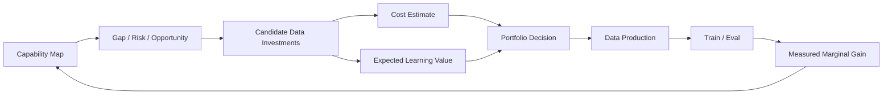

# 第 18 章 Data Strategy 与 Data Valuation：如何决定哪类数据最值得做

> 所属体系：[`LLM_Agent_Data_Knowledge_System.md`](../LLM_Agent_Data_Knowledge_System.md)
>
> 前置章节：[`第 17 章 Data Flywheel`](./17_Data_Flywheel_and_Continuous_Improvement.md)
>
> 关联章节：[`第 7 章 Synthetic Data`](./07_Synthetic_Data_Generation_and_Synthesis.md)、[`第 9 章 Hard Case Mining 与 Curriculum`](./09_Hard_Case_Mining_and_Curriculum.md)、[`第 14 章 Agent Failure Taxonomy`](./14_Agent_Failure_Taxonomy.md)、[`第 16 章 Benchmark Design 与 Evaluation Protocol`](./16_Benchmark_Design_and_Evaluation_Protocol.md)
>
> 本章目标：从“如何生产数据”进一步升级到“如何配置有限数据预算”；建立 Data Portfolio、Marginal Utility、Data ROI、Capability-gap Prioritization、Risk-weighted Investment、Data Mixture、Ablation-based Valuation、Build vs Buy vs Generate 与 Portfolio Rebalancing 的基本框架。
>
> 本章核心问题：**数据战略的本质不是把数据做得更多，而是在有限的采集、标注、验证、训练与评测预算下，持续把资源投入到边际能力收益最高、业务价值最高、风险最值得控制的数据上。**

---

# 18.0 为什么 Data Strategy 是独立于 Data Production 的问题？

假设团队已经具备：

```text
Human Annotation
Synthetic Generation
Agent Rollout
Verifier / Judge
Hard-case Mining
Data Flywheel
```

技术上已经“什么数据都能做一些”。

真正困难的问题反而变成：

```text
下一季度应该重点做哪类数据？
10 万条 SFT 和 2 万条高质量 preference，哪个更值？
是补 planning，还是补 recovery？
是继续造 synthetic，还是买专家标注？
某类 benchmark 提升 2 分，值不值得继续投入？
某个高风险 failure 很少见，但是否应该重点投？
```

这些已经不是单纯的数据生产问题，而是：

> **Resource Allocation under Uncertainty。**

可以画成：



所以：

```text
Data Production
回答“怎么做”

Data Strategy
回答“为什么做这个、做多少、什么时候停”
```

---

# 18.1 Data Asset、Data Batch 与 Data Investment

先区分三个层级。

## 18.1.1 Data Asset

一个可长期复用的数据资产，例如：

```text
Agent Regression Set
Human Gold Set
Math Verifiable Corpus
Tool-use Preference Pool
Failure Taxonomy Dataset
```

它可能被反复用于：

```text
Training
Evaluation
Calibration
Regression
Analysis
```

---

## 18.1.2 Data Batch

某次具体生产得到的一批数据：

```text
2026Q4_recovery_failures_v2
```

它有明确：

```text
source
model version
selection policy
annotation protocol
cost
size
quality
```

---

## 18.1.3 Data Investment

真正战略层关心的是：

> **为了某个目标，我们投入了多少资源去得到某类数据，以及它最终带来了多少增益。**

所以 Data Investment 至少包含：

```text
Target Capability
Data Source
Production Method
Quantity
Quality Level
Cost
Training Usage
Evaluation Delta
Business / Risk Impact
```

---

# 18.2 Data Portfolio：不要把所有预算押在一种数据上

真实模型需要多个能力同时成立。

例如一个 Agent 可能需要：

```text
Task Understanding
Tool Selection
Argument Construction
Observation Grounding
State Tracking
Recovery
Verification
Termination
```

数据预算也不应该只有：

```text
“今年做 100 万条 Agent 数据”
```

更合理的是建立 Data Portfolio：

| Capability | Current Level | Business Importance | Risk | Data Gap | Current Spend |
|---|---:|---:|---:|---:|---:|
| Tool Selection | high | high | medium | low | medium |
| Recovery | low | high | high | high | low |
| Verification | medium | high | high | high | low |
| Tone | high | medium | low | low | high |

一眼就能看到：

```text
Tone 数据可能已经过度投入
Recovery / Verification 反而欠投
```

所以 Data Strategy 的第一步通常是：

> **把数据预算映射到 capability，而不是只映射到 dataset name。**

---

# 18.3 Capability Gap 不是单纯的 Benchmark Gap

假设：

```text
Benchmark A = 68%
Benchmark B = 82%
```

不能直接说：

```text
A 更值得做数据
```

因为还需要看：

```text
这个 capability 对真实产品重要吗？
失败严重吗？
能通过数据修复吗？
有没有更便宜的工程修复？
benchmark 是否代表目标分布？
```

因此可以把 Capability Gap 看成：

$$
GapValue(c)=
f(
PerformanceGap,
Importance,
Risk,
Frequency,
Learnability,
Fixability
)
$$

这里不是固定公式，而是战略框架。

---

# 18.4 Data Value 的一个实用分解

可以把一批数据的潜在价值粗略写成：

$$
V(D)
\approx
Q(D)
\times
R(D)
\times
N(D)
\times
L(D)
\times
A(D)
$$

其中：

```text
Q = Quality
R = Relevance
N = Novelty / Diversity
L = Learnability
A = Applicability / Business Importance
```

如果其中某项接近 0，整体价值也可能很低。

例如：

```text
数据完全正确
但模型已经 99.9% 会了
```

则：

```text
Novelty / Marginal Learnability ≈ 0
```

继续生产价值有限。

---

# 18.5 Data ROI：不要只汇报“做了多少条”

传统数据团队常见 KPI：

```text
标注了 50 万条
生成了 300 万条
```

这只能描述 throughput。

更有意义的是：

$$
DataROI(D)
=
\frac{\Delta Utility(D)}{TotalCost(D)}
$$

其中 Utility 可以是：

```text
Benchmark Gain
Production Success Gain
Risk Reduction
Cost Reduction
Latency Reduction
Human Escalation Reduction
```

Total Cost 则不只是标注费。

---

# 18.6 Total Data Cost：数据成本远比 annotation price 大

完整成本至少包括：

```text
Acquisition Cost
Generation Cost
Human Annotation Cost
Expert Review Cost
Verification Cost
Judge Cost
Tool / Environment Execution Cost
Dedup / Cleaning Cost
Storage Cost
Training Cost
Evaluation Cost
Iteration Cost
Engineering Cost
```

可以写成：

$$
C_{total}
=
C_{acq}
+C_{gen}
+C_{ann}
+C_{verify}
+C_{train}
+C_{eval}
+C_{eng}
$$

例如 synthetic data：

```text
生成很便宜
```

但如果：

```text
verification 很贵
acceptance rate 很低
需要大量人工复核
```

最终未必便宜。

---

# 18.7 Acceptance Rate：生成 100 万条不等于得到 100 万条数据

假设：

```text
Generate 1,000,000
↓
Schema pass 800,000
↓
Verifier pass 300,000
↓
Dedup 220,000
↓
Human audit acceptable 180,000
```

最终 usable yield：

$$
Yield = 18\%
$$

因此 synthetic pipeline 应关注：

```text
Raw Generation Cost
Acceptance Rate
Verified Yield
Unique Yield
High-value Yield
```

而不是 raw count。

---

# 18.8 Marginal Utility：第 100 万条和第 1 万条价值通常不同

假设同一 task family：

```text
0 → 10k
提升很明显

10k → 50k
仍有提升

50k → 200k
提升变小

200k → 1M
几乎不动
```

这就是 diminishing returns。

可以定义近似边际收益：

$$
MU_k
=
\frac{Perf(D_{1:k+\Delta})-Perf(D_{1:k})}{\Delta}
$$

当：

```text
Marginal Utility
<
Alternative Investment Opportunity
```

就应该考虑停止继续扩这类数据。

---

# 18.9 Stop Rule：什么时候应该停止做某类数据？

常见停止条件可以包括：

```text
Capability Saturation
Marginal Gain ≈ 0
High Duplicate Rate
Acceptance Rate Collapse
Frontier Shift
Better Alternative Investment
Evaluation Ceiling
Business Priority Change
```

一个成熟数据项目应该在开始前就思考：

> **什么证据出现时，我们会停止继续扩数据？**

否则非常容易：

```text
已经投入很多
↓
因为 sunk cost
↓
继续投入
```

---

# 18.10 Risk-weighted Data Investment

数据价值不能只看平均 benchmark gain。

例如：

```text
Failure A
多说一句废话
发生率 10%

Failure B
未经确认删除文件
发生率 0.2%
```

后者虽然少见，但风险可能远高。

因此可以考虑：

$$
RiskPriority
\approx
Frequency
\times
Severity
\times
Exposure
\times
Irreversibility
$$

对于：

```text
privacy
money movement
irreversible write
external communication
permission escalation
```

应该采用风险加权，而不是平均频次驱动。

---

# 18.11 Learnability：不是所有高价值失败都适合靠训练解决

考虑三个问题：

### Case A

```text
模型不会识别 negative constraint
```

可能适合数据训练。

### Case B

```text
Tool schema 写错了
```

应该修工具。

### Case C

```text
Agent 根本没有权限访问所需信息
```

应该修产品 / 权限设计。

所以战略决策前要先判断：

```text
Is this a data problem?
```

而不是：

```text
所有 failure → 再训练
```

---

# 18.12 Build vs Buy vs Generate vs Mine

获得数据通常有四类路径。

## Build

```text
内部人工设计 / 标注
```

优点：

```text
可控
贴近业务
可定制 rubric
```

缺点：

```text
贵
慢
专家瓶颈
```

---

## Buy

```text
采购外部数据 / 标注服务
```

优点：

```text
快速扩规模
```

缺点：

```text
质量不可完全控
分布可能不贴业务
IP / privacy / provenance 复杂
```

---

## Generate

```text
Teacher / LLM / Simulator Synthetic
```

优点：

```text
便宜
快
可定向
```

缺点：

```text
teacher bias
mode collapse
verification burden
```

---

## Mine

```text
Production / Rollout / Failure Logs
```

优点：

```text
真实
高相关
能反映当前模型边界
```

缺点：

```text
稀疏
隐私
selection bias
label 不完整
```

因此真正的战略问题往往不是：

```text
“synthetic 好还是 human 好？”
```

而是：

> **哪种 capability gap 用哪种 acquisition channel 的单位成本收益最好？**

---

# 18.13 Data Source Portfolio

一个成熟组合可能是：

```text
Production Failures
→ 保证真实性

Human Gold
→ 保证标准可靠

Synthetic Expansion
→ 扩规模

Adversarial Cases
→ 压 capability frontier

Regression Cases
→ 防止遗忘
```

它们的功能不同，不能互相完全替代。

---

# 18.14 Data Mixture：训练配比本身就是一种策略

假设有：

```text
General SFT
Tool-use
Recovery
Safety
Reasoning
Preference
```

最终不是简单 concatenate。

要决定：

```text
sample ratio
sampling temperature
loss weighting
curriculum order
oversampling
undersampling
```

所以：

> **Mixture Design 是 Data Strategy 的一部分，不只是训练脚本参数。**

---

# 18.15 Sample Count ≠ Effective Weight

例如：

```text
Dataset A
100k samples
平均 100 tokens

Dataset B
20k samples
平均 2000 tokens
```

按 sample count：

```text
A : B = 5 : 1
```

但按 token：

```text
A = 10M tokens
B = 40M tokens
```

实际训练暴露可能完全相反。

所以 mixture 至少要区分：

```text
Sample Weight
Token Weight
Loss Weight
Exposure Frequency
```

---

# 18.16 Oversampling Hard Cases 的风险

Hard case 很有价值，但如果过度 oversample：

```text
模型会认为所有任务都很难
过度思考
过度调用工具
过度澄清
过度验证
```

例如生产分布中：

```text
90% 简单任务
10% hard tasks
```

训练却：

```text
50% hard tasks
```

模型可能学到错误 prior。

所以要区分：

```text
Learning Distribution
vs
Deployment Distribution
```

必要时通过 weighting / calibration 恢复部署 prior。

---

# 18.17 High-quality Small Data vs Large Noisy Data

不能机械认为：

```text
更多一定更好
```

也不能机械认为：

```text
高质量小数据一定更好
```

真正应该比较：

```text
Quality × Scale × Coverage × Cost
```

例如：

```text
5k expert data
vs
200k synthetic verified data
```

最终要通过 downstream experiment 判断。

---

# 18.18 Data Valuation 的最低可信方法：Controlled Ablation

最简单可靠的方法之一：

```text
Baseline Training Mix
vs
Baseline + Dataset D
```

其他尽量冻结。

然后测：

```text
Target Capability
General Capability
Safety
Cost
Regression
```

于是得到：

$$
\Delta(D)=Perf(M_{+D})-Perf(M_{base})
$$

这虽然成本高，但至少能直接回答：

> **这批数据加入训练以后，到底有没有贡献。**

---

# 18.19 Leave-one-source-out Ablation

如果训练集由：

```text
A + B + C + D
```

可以分别做：

```text
All
All - A
All - B
All - C
All - D
```

观察每个 source 的贡献。

但要注意：

> 数据源之间存在 interaction。

例如：

```text
A 单独没用
B 单独没用
A + B 很有用
```

因此简单 leave-one-out 不能完全得到真实因果价值。

---

# 18.20 Data Interaction：数据价值不是可加的

假设：

```text
SFT teaches behavior format
Preference teaches ranking
Recovery data teaches repair
```

可能出现：

```text
Recovery data
只有在基础 Tool-use SFT 已经足够时才有用
```

所以：

$$
V(A+B)
\neq
V(A)+V(B)
$$

Data Strategy 本质上是组合优化，而不是单个 dataset 排名。

---

# 18.21 Shapley-style 思想：谁贡献了多少？

理论上可以把不同数据源看成 coalition：

```text
A
B
C
```

通过不同组合训练，估计每个源的边际贡献。

这和 Shapley value 思想类似。

但真实大模型训练成本太高，往往无法穷举。

因此实践里常用：

```text
Small-scale Proxy
Subsample Experiment
Checkpoint Continuation
Targeted Fine-tune
Ablation Matrix
```

近似判断。

---

# 18.22 Proxy Experiment：先用便宜实验筛方向

如果完整训练一次成本很高，可以先：

```text
smaller model
smaller data
shorter training
single capability benchmark
```

验证方向。

但必须记住：

```text
Proxy Winner
≠
Full-scale Winner Guaranteed
```

因为 scaling 后 interaction 可能变化。

所以 proxy 用来：

```text
筛掉明显差方案
```

而不是自动替代最终验证。

---

# 18.23 Marginal Data Value 与 Model Version 强相关

同一批数据：

```text
对弱模型非常有用
```

对强模型可能：

```text
完全饱和
```

因此：

$$
V(D \mid M_1)
\neq
V(D \mid M_2)
$$

所以 data valuation 必须记录：

```text
source_model
training_model
model_version
current capability level
```

不能把“历史上有用”理解成“永远有用”。

---

# 18.24 Data Value 也与目标 Metric 强相关

同一批数据可能：

```text
提升 Accuracy
但增加 Tool Cost
```

或者：

```text
几乎不提升平均 Success
但大幅降低 High-risk Failure
```

所以 Data Value 必须相对目标定义：

```text
Quality
Safety
Efficiency
Latency
Coverage
Reliability
```

不存在脱离目标的统一“最值钱数据”。

---

# 18.25 Multi-objective Data Strategy

实际优化经常是多目标：

$$
U
=
\alpha Q
+\beta S
-\gamma C
-\delta L
$$

其中例如：

```text
Q = Quality
S = Safety / Reliability
C = Cost
L = Latency
```

不同产品阶段权重不同。

所以：

```text
研究 demo
```

和：

```text
真实支付 Agent
```

不应该使用同一套 data priority。

---

# 18.26 Risk-adjusted ROI

对于高风险能力，可以定义：

$$
ROI_{risk}
=
\frac{ExpectedRiskReduction}{DataCost}
$$

例如：

```text
一批 permission / irreversible-action 数据
```

可能对总体 success 只提升：

```text
+0.3%
```

但让：

```text
unauthorized write
```

下降 70%。

这种数据仍然可能非常值得投入。

---

# 18.27 Coverage：不要让 Data ROI 把长尾能力全部饿死

如果只追求短期 ROI，最容易发生：

```text
高频简单任务得到大量预算
低频长尾能力长期没有数据
```

于是系统在平均指标上很好，但在重要长尾上非常脆弱。

因此 portfolio 通常需要：

```text
Core Allocation
Frontier Allocation
Safety Allocation
Exploration Allocation
```

例如概念上：

```text
60% core business
20% frontier improvement
15% safety / high-risk
5% exploration
```

具体比例必须按业务决定，不能照抄。

---

# 18.28 Exploration Budget：必须允许“暂时不知道有没有用”的数据

如果所有项目都要求：

```text
上线前证明 ROI
```

团队就不会探索新能力。

所以应该保留：

```text
Exploration Budget
```

用于：

```text
new task family
new annotation schema
new verifier
new synthetic method
new trajectory supervision
```

但 exploration 也要有：

```text
small pilot
clear hypothesis
stop condition
```

而不是无限试验。

---

# 18.29 Data Portfolio Rebalancing

Portfolio 不是一次制定以后不变。

每个版本都应该重新评估：

```text
Capability Level
Failure Distribution
Production Mix
Risk Profile
Data Saturation
Marginal Utility
```

然后：

```text
Increase
Maintain
Reduce
Retire
Explore
```

某类数据。

例如：

```text
Tool Selection 已稳定 98%
```

可以减少新增预算。

而：

```text
Recovery Failure 增长
```

则需要加大投入。

---

# 18.30 Retirement：数据也应该有退出机制

数据资产不能只增不减。

应该考虑 retire：

```text
过时 API
旧产品流程
已修复 bug
重复 case
低质量历史标注
旧 rubric
旧环境状态
```

但不要物理删除所有历史数据。

更合理的是：

```text
Active
Deprecated
Archived
Regression-only
```

保持 lineage。

---

# 18.31 Freshness：数据价值会随时间衰减

尤其 Agent / 产品环境：

```text
API 变化
UI 变化
Tool schema 变化
用户行为变化
业务规则变化
```

所以数据应带：

```text
collection_time
validity_window
environment_version
tool_version
policy_version
```

可以定义：

```text
Freshness Risk
```

避免模型反复学习已经不存在的旧流程。

---

# 18.32 Data Provenance 是 Valuation 的前提

如果不知道数据从哪里来，就很难知道它为什么有效。

至少保存：

```text
source
seed
parent_sample
source_model
source_task_family
generator_version
judge_version
human_label_version
selection_policy
training_run_ids
```

只有这样，才能做：

```text
source-level ablation
quality audit
contamination tracing
ROI accounting
```

---

# 18.33 Contamination 会让 Data ROI 看起来虚高

如果训练数据泄漏了 benchmark：

```text
Evaluation Gain ↑
```

但这不是真实能力增益。

因此 valuation 时必须同时检查：

```text
Exact Leakage
Near-duplicate Leakage
Template Leakage
Workflow Leakage
Teacher Leakage
```

否则“最有价值的数据源”可能只是最会污染测试集的数据源。

---

# 18.34 Targeted Data vs Broad Data

Targeted Data：

```text
专门修某个 capability gap
```

Broad Data：

```text
维持整体能力覆盖
```

只做 targeted：

```text
容易过拟合当前 failure distribution
```

只做 broad：

```text
对关键弱点修复效率低
```

成熟 portfolio 通常两者并存。

---

# 18.35 Repair Data、Regression Data、Frontier Data 要分开管理

### Repair Data

```text
针对当前已知 failure
```

### Regression Data

```text
确保修复后不复发
```

### Frontier Data

```text
主动探索下一层能力边界
```

三者目标不同。

如果都塞进一个大池子，就很难回答：

```text
这批数据到底是为了修 bug
还是为了扩能力
还是为了防回归？
```

---

# 18.36 数据项目应该有 Data Card / Investment Memo

对于重要数据项目，可以在启动前写：

```text
Target Capability
Current Failure Evidence
Expected Benefit
Data Source
Proposed Size
Quality Standard
Verification Plan
Estimated Cost
Training Plan
Evaluation Plan
Stop Rule
Risks
```

生产完成后再补：

```text
Actual Yield
Actual Cost
Quality Audit
Training Delta
Eval Delta
Regression
Decision: Scale / Maintain / Stop
```

这样 Data 项目就从“做数据”变成可审计投资。

---

# 18.37 一个简单的 Data Investment Scorecard

可以维护：

| Candidate Investment | Importance | Gap | Learnability | Risk Reduction | Cost | Expected ROI |
|---|---:|---:|---:|---:|---:|---:|
| Recovery Data | 5 | 5 | 4 | 5 | 3 | High |
| More Tool-selection Data | 4 | 1 | 2 | 2 | 2 | Low |
| Verification Data | 5 | 4 | 4 | 5 | 3 | High |
| Style Data | 2 | 1 | 3 | 1 | 2 | Low |

这里的分数不是科学真值，而是强迫团队显式讨论：

```text
为什么这个项目值得做？
```

---

# 18.38 一个完整例子：订单 Agent 的数据预算怎么分？

当前线上统计：

```text
Overall Success = 88%
```

Failure Breakdown：

```text
Tool Selection          1%
Argument Error          2%
Negative Constraint     4%
Recovery Failure        2%
Verification Failure    2%
Infrastructure          1%
```

第一反应可能是：

```text
Negative Constraint 最大
→ 全部预算投这里
```

但进一步分析：

```text
Negative Constraint
frequency high
severity medium
learnability high

Verification Failure
frequency lower
severity high
irreversible harm exposure high
learnability high

Infrastructure
frequency 1%
but not a model-data problem
```

于是更合理的预算可能是：

```text
Negative Constraint
→ targeted synthetic + human audit

Verification
→ high-risk task family + recovery / verify-or-stop preference

Infrastructure
→ engineering fix
```

而不是所有 failure 都生产训练数据。

---

# 18.39 Data Strategy 与 Hard-case Mining 的区别

Hard-case Mining 回答：

> 哪些 case 值得拿出来？

Data Strategy 回答：

> 拿出来以后，哪些值得投入资源做成数据？做多少？和其他方向相比是否更值？

所以：

```text
Hard-case Mining
是 candidate discovery

Data Strategy
是 portfolio allocation
```

---

# 18.40 Data Strategy 与 Data Flywheel 的关系

Data Flywheel 负责：

```text
持续产生新的信号
```

Data Strategy 负责：

```text
决定哪些信号应该得到预算
```

可以写成：

```text
Flywheel
产生 Opportunities
        ↓
Strategy
做 Resource Allocation
        ↓
Production
生成 Data Assets
        ↓
Training / Eval
产生 Measured Return
        ↓
Strategy Update
```

所以一个没有 Data Strategy 的 Flywheel 很容易：

```text
哪里数据多就做哪里
哪里容易自动化就做哪里
哪里指标好看就做哪里
```

最终偏离真正的产品 / 科学目标。

---

# 18.41 Data Strategy 与 Benchmark 的关系

Benchmark 不只是最后验收工具。

它还是：

```text
Data Investment Measurement System
```

没有稳定 benchmark，就无法回答：

```text
这批数据到底有没有价值？
```

所以前面第 16 章的：

```text
Frozen Core Benchmark
+
Fresh Frontier Benchmark
```

在这里对应：

```text
Stable ROI Measurement
+
New Opportunity Discovery
```

---

# 18.42 Data Valuation 最容易犯的错误

## 错误 1：用数据量代表价值

```text
100 万条 > 10 万条
```

不成立。

---

## 错误 2：用训练 loss 下降代表数据价值

模型更容易拟合，不等于 downstream 更好。

---

## 错误 3：只看总体 benchmark

可能某批数据只修了一个关键高风险 slice。

---

## 错误 4：只看 target benchmark，不看 regression

可能：

```text
Recovery ↑
General Helpfulness ↓
```

---

## 错误 5：忽略训练成本

两批数据质量相同，但一批 token 数巨大，训练成本完全不同。

---

## 错误 6：忽略 verifier / human cost

synthetic 便宜不代表 verified synthetic 便宜。

---

## 错误 7：历史上有用，就无限扩

忽略 marginal utility 和 saturation。

---

## 错误 8：只做高频 failure

忽略 high-severity long tail。

---

## 错误 9：所有 failure 都转成训练数据

忽略 tool / harness / product fix。

---

## 错误 10：只做当前模型的 failure

容易失去 general coverage 与 future frontier。

---

# 18.43 Data Strategy Dashboard 应该看什么？

至少可以有四组指标。

## Capability

```text
Capability Score
Failure Rate
Frontier Score
Regression Rate
```

## Data

```text
Samples
Tokens
Unique Coverage
Acceptance Rate
Duplicate Rate
Freshness
```

## Cost

```text
Generation Cost
Human Cost
Verification Cost
Training Cost
Evaluation Cost
```

## Return

```text
Target Gain
Generalization Gain
Risk Reduction
Cost Reduction
Marginal Gain
ROI
```

如果 dashboard 只有：

```text
本周产出 50 万条
```

那仍然只是 throughput dashboard。

---

# 18.44 数据团队真正应该形成的能力

成熟的大模型数据工作不只是：

```text
会标注
会合成
会清洗
```

而是能完成：

```text
发现 Capability Gap
↓
判断是不是 Data Problem
↓
选择最合适 Data Source
↓
估计 Cost / Risk / Expected Return
↓
小规模 Pilot
↓
训练验证 Marginal Gain
↓
Scale / Stop
↓
更新 Portfolio
```

也就是：

> **从 Data Production 走向 Data Investment。**

---

# 18.45 面试 / 工作表达：如何说明自己“懂数据策略”？

不要只说：

```text
“我做了 20 万条数据。”
```

更专业的表达是：

```text
先通过 error slicing 发现 recovery failure 是当前主要可修复瓶颈；
用小规模 matched hard-case cohort 验证该 slice 的 intervention potential；
比较 human-written、teacher-generated 和 rollout-mined 三种 acquisition channel 的 verified yield 与成本；
最终选择高验证率的 synthetic + human audit 方案，并通过 frozen benchmark 测量加入该数据后的 target gain、regression 与 cost，决定是否扩规模。
```

这体现的是：

```text
Problem Framing
Data Acquisition
Experiment Design
Cost Awareness
Causal Validation
Resource Allocation
```

---

# 18.46 自检问题

如果真正理解本章，应该能回答：

1. 为什么 Data Quantity 不能直接代表 Data Value？
2. 什么是 Data Portfolio？
3. 为什么 Capability Gap 不等于 Benchmark Gap？
4. Data ROI 的分母应该包含哪些成本？
5. 为什么 Synthetic Data 的 raw generation cost 可能很低，但 total cost 很高？
6. 什么是 Marginal Utility？
7. 什么时候应该停止继续扩某类数据？
8. 为什么低频高风险 failure 仍可能值得高投入？
9. 怎么判断一个 failure 是 data problem 还是 engineering problem？
10. Build / Buy / Generate / Mine 分别适合什么场景？
11. 为什么 Data Mixture 也是数据策略？
12. 为什么 sample count 和 effective training weight 不一样？
13. Hard-case oversampling 有什么副作用？
14. 怎样最低成本地估计一批数据是否有价值？
15. Leave-one-source-out ablation 有什么局限？
16. 为什么数据价值不是可加的？
17. 为什么同一批数据对不同模型版本价值不同？
18. Risk-adjusted ROI 与普通 ROI 有什么区别？
19. 为什么 portfolio 必须保留 exploration budget？
20. 什么情况下应该 retire 数据？
21. 为什么 freshness 和 provenance 会影响 data valuation？
22. Hard-case Mining 与 Data Strategy 的边界是什么？
23. Data Flywheel 与 Data Strategy 分别负责什么？
24. 为什么 Stable Benchmark 是 Data ROI 测量系统的一部分？
25. 怎样把一个数据项目写成 Investment Memo？

---

# 18.47 本章总结

这一章最重要的不是某个公式，而是完成一个思维转变：

```text
“能不能做更多数据？”
        ↓
“哪类数据最值得继续投入？”
```

最终可以把现代 Data Strategy 概括成：

```text
Capability Gap
+
Business / Risk Importance
+
Learnability
+
Data Acquisition Options
+
Total Cost
+
Measured Marginal Utility
+
Portfolio Balance
```

真正成熟的团队应该能够回答：

> **为什么这 1 万条数据，比另外 10 万条更值得做？**

以及：

> **什么证据会让我们继续投入，什么证据会让我们停止？**

这就是 Data Valuation 的核心。

---

# 18.48 下一章：Data Governance、Lineage 与 Reproducibility

当数据开始跨：

```text
来源
模型版本
Judge 版本
人工标签
Synthetic Generator
Training Run
Benchmark
```

不断流转以后，新的问题会出现：

> **我们还知不知道一条数据到底从哪里来、谁改过、在哪个模型上用过、对应哪个标签版本，以及最终影响了什么实验？**

因此下一章进入：

```text
Data Governance
Data Lineage
Dataset Versioning
Schema Versioning
Label Versioning
Immutable Raw Data
Derived Views
Provenance
Reproducibility
PII / Privacy
Access Control
Audit Trail
Retention
Deletion
Licensing / Consent
```

也就是把前面所有“好数据方法”，进一步变成一套真正可长期维护、可审计、可复现的数据资产体系。