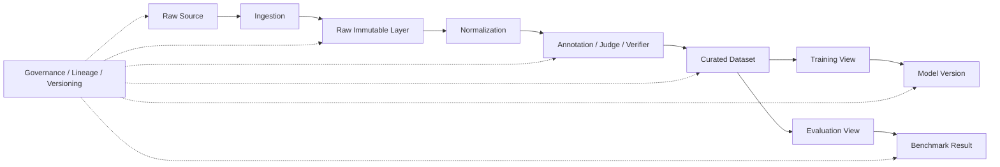
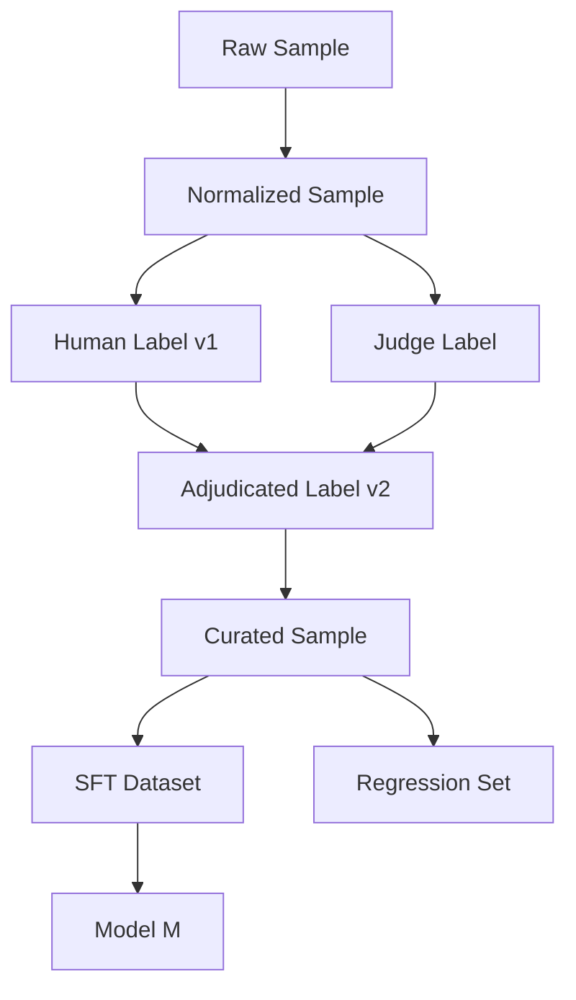

# 第 19 章 Data Governance、Lineage 与 Reproducibility：让数据系统可追溯、可复现、可审计

> 所属体系：[`LLM_Agent_Data_Knowledge_System.md`](../LLM_Agent_Data_Knowledge_System.md)
>
> 前置章节：[`第 18 章 Data Strategy 与 Data Valuation`](./18_Data_Strategy_and_Data_Valuation.md)
>
> 关联章节：[`第 6 章 Human Data`](./06_Human_Data_Annotation_and_Quality_Control.md)、[`第 12 章 Agent Trajectory Anatomy`](./12_Agent_Trajectory_Anatomy.md)、[`第 15 章 Grader、Verifier 与 LLM-as-a-Judge`](./15_Grader_Verifier_and_LLM_as_a_Judge.md)、[`第 16 章 Benchmark Design 与 Evaluation Protocol`](./16_Benchmark_Design_and_Evaluation_Protocol.md)、[`第 17 章 Data Flywheel`](./17_Data_Flywheel_and_Continuous_Improvement.md)
>
> 本章目标：建立一套完整的数据治理与可复现体系，理解 Immutable Raw Data、Derived View、Dataset / Schema / Label Versioning、Provenance、Lineage DAG、Reproducibility Manifest、PII / Privacy、Access Control、Retention / Deletion、Licensing / Consent 与 Audit Trail 的关系。
>
> 本章核心问题：**一条数据进入系统以后，我们能不能回答“它从哪里来、经历了什么、谁改过、为什么被选中、进入过哪些训练集、影响了哪些模型、后来标签是否修正，以及如果今天重跑，能不能得到同样的结果”。**

---

# 19.0 为什么 Data Governance 不是“后台管理问题”？

很多团队前期关注的是：

```text
怎么收数据？
怎么标数据？
怎么合成数据？
怎么训练？
```

但随着系统运行几个月，很快会出现：

```text
这条样本到底从哪来的？
为什么它在训练集里？
这个 label 是旧版还是修正版？
这个 Judge 用的是哪一版 prompt？
这批数据有没有混入测试集？
某个用户要求删除数据后，训练派生数据怎么办？
这个 benchmark 结果对应哪个 environment snapshot？
某个模型提升，到底用了哪一批数据？
```

如果回答不了，系统会逐渐失去：

```text
Reproducibility
Auditability
Debuggability
Compliance
Trust
```

所以 Data Governance 不是文档工作，而是：

> **保证整个数据—训练—评测系统仍然可以被解释和追责的基础设施。**

可以画成：



---

# 19.1 一个成熟数据系统至少要回答六类问题

## 19.1.1 Identity

```text
这条数据是谁？
```

需要稳定 ID：

```text
sample_id
trajectory_id
episode_id
task_id
annotation_id
dataset_id
```

---

## 19.1.2 Origin

```text
它从哪里来？
```

例如：

```text
Production Log
Human Author
Teacher Model
Synthetic Generator
Public Dataset
Partner Data
Benchmark
```

---

## 19.1.3 Transformation

```text
它经历了哪些处理？
```

例如：

```text
raw
→ normalized
→ redacted
→ deduplicated
→ annotated
→ verified
→ filtered
→ sampled
```

---

## 19.1.4 Decision

```text
为什么它被保留 / 删除 / 选进训练？
```

必须能追溯：

```text
selection_policy
filter_reason
quality_score
failure_type
sampling_bucket
```

---

## 19.1.5 Usage

```text
它后来被用到了哪里？
```

例如：

```text
SFT v4
Preference v2
RM training
Benchmark regression set
Judge calibration set
```

---

## 19.1.6 Outcome

```text
它最终带来了什么？
```

例如：

```text
trained model X
benchmark delta
fixed failure cluster
regression coverage
```

---

# 19.2 Immutable Raw Data：原始事实层尽量不要被覆盖

一个重要原则是：

> **Raw evidence should be append-only / immutable whenever possible.**

例如一条 Agent rollout 的原始记录：

```text
model output
tool call
tool result
timestamp
environment state diff
```

不应该因为后来：

```text
annotation changed
parser improved
failure taxonomy changed
```

就直接覆盖原始事实。

更推荐：

```text
L0 Raw
↓
L1 Normalized
↓
L2 Annotated
↓
L3 Curated View
```

其中：

```text
L0 尽量不可变
L1-L3 可以版本化重建
```

这和第 12 章 Trajectory Layering 的原则一致。

---

# 19.3 Raw、Canonical、Derived：三个数据层要分开

## Raw Layer

尽可能保留原始输入：

```text
original text
raw response
raw tool return
original timestamp
source metadata
```

## Canonical Layer

统一格式后的标准表示：

```text
parsed JSON
normalized role
canonical tool schema
normalized units
canonical timestamps
```

## Derived Layer

所有由规则 / 模型 / 人推导出的信息：

```text
labels
failure type
reward
quality score
embedding
cluster id
judge result
selection score
```

最重要的治理原则：

> **Derived information should not masquerade as raw truth.**

例如：

```text
judge_score = 0.91
```

不是世界事实。

它只是：

```text
某个 judge
在某个 rubric
某个 prompt
某个 evidence package
下的输出
```

---

# 19.4 Provenance：一条数据的“出生证明”

每条数据至少应该知道：

```text
source_type
source_uri / source_system
source_model
source_model_version
source_time
generator_prompt_version
generation_config
human_author / vendor / annotator pool
license / consent status
```

例如 synthetic task：

```json
{
  "sample_id": "syn_0001847",
  "source_type": "synthetic",
  "generator_model": "teacher_x",
  "generator_version": "2026-10-01",
  "prompt_version": "taskgen_v7",
  "seed_sample_id": "prod_fail_381",
  "generated_at": "2026-10-17"
}
```

如果连 seed 都保存，就能继续形成：

```text
Production Failure
↓
Abstract Capability
↓
Synthetic Family
↓
Derived Training Sample
```

完整 lineage。

---

# 19.5 Data Lineage：不要只存“来自哪个文件”

真正 lineage 不是：

```text
train_v3.jsonl
来自
raw_v2.jsonl
```

而应该描述：

```text
Sample A
↓ normalize
Sample A'
↓ annotator 32 label
Annotation A1
↓ adjudication
Annotation A2
↓ verifier v4
Verified A
↓ sampling policy v7
Training View A
↓ SFT run 20261017
Model M17
```

这天然是一个 DAG，而不是单链。



---

# 19.6 为什么 Lineage DAG 对 Debugging 很重要？

假设新模型出现异常：

```text
对某类退款任务开始过度拒绝
```

如果有 lineage，可以追：

```text
Model
↓
Training Run
↓
Data Mixture
↓
Refund Preference Dataset
↓
某批 synthetic hard negatives
↓
Judge v3
↓
Rubric 中对 unauthorized risk 权重过高
```

于是问题就从：

```text
“模型怎么突然坏了？”
```

变成：

```text
“哪一条数据链路把什么偏好放大了？”
```

这就是 lineage 的真正价值。

---

# 19.7 Dataset Versioning：数据集不是一个永远不变的名字

避免：

```text
agent_train.jsonl
```

一直被覆盖。

更推荐：

```text
agent_train_v1
agent_train_v2
agent_train_v3
```

但仅版本号仍然不够。

至少保存：

```text
dataset_id
version
created_at
parent_version
source snapshot
transform config
schema version
label version
filter version
sampling policy
row count
hash / manifest
```

---

# 19.8 Dataset Version 的变化类型最好显式记录

例如：

```text
ADD
新增样本

REMOVE
删除无效 / 合规问题样本

RELABEL
标签修正

REWEIGHT
采样权重变化

REFILTER
过滤规则变化

RESCHEMA
schema 变化
```

这样团队看到：

```text
v7 → v8
```

就知道到底发生了什么，而不是只看到“新版本”。

---

# 19.9 Schema Versioning：字段定义变化本身也会改变数据含义

例如早期：

```json
{"success": true}
```

后来改成：

```json
{
  "goal_success": true,
  "policy_compliance": false,
  "side_effect": "unauthorized_write"
}
```

这不只是多了字段。

它实际上改变了：

```text
“success” 的语义
```

所以要显式维护：

```text
schema_version
migration_script
backfill_status
compatibility rule
```

---

# 19.10 Backward-compatible vs Breaking Schema Change

可以区分：

## Backward-compatible

```text
新增 optional 字段
```

例如：

```text
judge_confidence
```

## Breaking

```text
字段改名
字段语义变化
枚举重定义
一个 label 拆成多个 label
```

例如：

```text
success
→ goal_success + policy_compliance
```

这种情况不能只静默改 parser。

---

# 19.11 Label Versioning：标签不是永远正确的

标签可能因为：

```text
annotation guideline 更新
judge 修复
reference answer 修正
新的 evidence 出现
adjudication
```

发生变化。

因此要保存：

```text
label_v1
label_v2
change_reason
changed_by
changed_at
evidence
```

而不是直接覆盖：

```text
old_label
```

---

# 19.12 Decision Freeze 与 Label Correction 必须分开

这是实验治理里最重要的原则之一。

假设历史 selector 当时选择：

```text
Candidate A
```

后来发现旧标签错了：

```text
A 实际失败
B 实际成功
```

正确做法是：

```text
Frozen Decision = A
↓
Corrected Label
↓
Recompute Historical Metric
```

而不是：

```text
Correct Label
↓
Re-run Selector
↓
让它改选 B
↓
覆盖原实验
```

必须区分：

```text
Historical Decision
Evaluation Label
Re-execution Result
```

这三者是不同 artifact。

---

# 19.13 Derived View：不要为每种用途复制一份“新真相”

同一份 canonical data 可以派生：

```text
SFT View
Preference View
RL View
Judge Calibration View
Benchmark View
Regression View
```

例如：

```text
Canonical Trajectory
↓
SFT formatter
↓
messages format
```

和：

```text
Canonical Trajectory
↓
Preference extractor
↓
chosen / rejected
```

推荐保留：

```text
source_sample_id
view_type
view_version
transform_config
```

而不是复制后彻底断开来源。

---

# 19.14 Reproducibility：什么叫“能复现”？

很多团队所谓复现只保存：

```text
model checkpoint
```

但真正至少需要：

```text
Data
Code
Config
Environment
Model
Toolset
Randomness
Evaluator
```

也就是：

```text
Run = f(
  code_version,
  dataset_version,
  model_version,
  prompt_version,
  toolset_version,
  env_snapshot,
  seed,
  config,
  verifier_version
)
```

其中任一项变化，都可能改变结果。

---

# 19.15 Reproducibility Manifest

每个重要训练 / benchmark run 推荐保存一个 manifest：

```yaml
run_id: eval_20261017_001
code_commit: abc123
dataset_version: benchmark_v5
schema_version: task_schema_v3
model_version: model_m17
prompt_version: agent_prompt_v9
toolset_version: tools_v4
harness_version: harness_v7
environment_snapshot: env_20261017
verifier_version: verifier_v5
judge_prompt_version: judge_v8
seed_policy: fixed_seed_set_v2
max_steps: 40
timeout_sec: 120
```

这其实是“实验身份证”。

---

# 19.16 Hash 与 Manifest：证明“你跑的就是这批数据”

对于 frozen evaluation，最好保存：

```text
file hash
row count
sample ID manifest
artifact hash
```

例如：

```text
benchmark_v5
rows = 8,412
sample_ids.sha256 = ...
```

这样可以防止：

```text
文件名没变
但内容已经被悄悄替换
```

---

# 19.17 Determinism：复现不等于每个 token 都必须完全一样

某些系统具有天然 stochasticity：

```text
sampling
network timing
parallel tool calls
external API
browser content
```

因此要区分：

```text
Exact Reproducibility
Statistical Reproducibility
Protocol Reproducibility
```

## Exact

同样输入得到完全一致结果。

## Statistical

重复运行得到稳定分布。

## Protocol

别人可以在同一实验定义下重新执行并得到可比结论。

对于 Agent 系统，第三种往往比“字节级一致”更现实。

---

# 19.18 Environment Snapshot 也是数据版本的一部分

Agent benchmark 不能只版本化 prompt。

还要保存：

```text
DB snapshot
filesystem snapshot
calendar snapshot
web fixture
permission map
clock
locale
```

因为：

```text
Task 不变
Environment State 变了
```

实际就是另一个 task instance。

所以可以把 benchmark case 定义成：

```text
Task Definition
+
Environment Snapshot
+
Verifier
+
Protocol
```

---

# 19.19 Time Dependency：时间本身需要冻结或显式记录

例如：

```text
“取消明天的会议”
```

如果当前日期不同，task 语义就不同。

因此应记录：

```text
frozen_clock
timezone
locale
holiday_calendar
business_hours_version
```

否则同一个 case 下个月重跑可能已经不是同一个问题。

---

# 19.20 Tool / API Versioning：工具升级也会改变 benchmark

假设：

```text
search_order v1
```

只返回：

```text
status
```

后来：

```text
search_order v2
```

增加：

```text
refund_eligibility
```

这会显著降低任务难度。

所以工具版本也应该进入：

```text
experiment manifest
```

而不是被当作基础设施细节忽略。

---

# 19.21 Audit Trail：谁在什么时候改了什么？

对于重要数据资产，最好保留：

```text
actor
action
timestamp
object_id
before_version
after_version
reason
reviewer
```

例如：

```text
2026-10-17
annotator_42
changed label
wrong_tool → correct_tool
reason: schema interpretation fixed
reviewed_by: adjudicator_7
```

这比只有最终状态可靠很多。

---

# 19.22 Annotation Provenance

Human Label 至少可以保存：

```text
annotator_id / anonymized_id
annotator_role
expertise_tier
guideline_version
UI version
time_spent
confidence
adjudication status
```

为什么 UI version 也重要？

因为：

```text
证据有没有折叠
A/B 谁放左边
有没有显示 reference
```

都会影响 label。

---

# 19.23 Judge Provenance

LLM Judge 输出必须绑定：

```text
judge_model
judge_model_version
judge_prompt_version
rubric_version
evidence_schema_version
reference_version
decoding_config
run_id
```

否则：

```text
score = 0.87
```

没有独立意义。

---

# 19.24 Sampling Provenance：样本为什么会进入训练集？

推荐保存：

```text
selection_policy
sampling_probability
sampling_bucket
priority_score
hardness_score
uncertainty_score
failure_cluster
business_priority
```

因为这会影响：

```text
训练数据分布
```

也影响后续：

```text
bias analysis
reweighting
```

---

# 19.25 Data Leakage 与 Split Governance

训练 / 验证 / 测试 split 不能只做一次 random split。

尤其 LLM / Agent 场景需要防：

```text
exact duplicate leakage
near-duplicate leakage
same workflow leakage
same environment leakage
same user session leakage
synthetic sibling leakage
benchmark-derived training leakage
```

所以 split 本身也要有：

```text
split_policy_version
```

---

# 19.26 Group Split：避免同一族样本跨 Train/Test

例如 synthetic family：

```text
Seed Failure F
├── Task A
├── Task B
├── Task C
└── Task D
```

如果：

```text
A/B/C train
D test
```

可能高估泛化。

更合理的是：

```text
family_id
workflow_id
seed_id
```

作为 group split 单位。

---

# 19.27 Benchmark Contamination Registry

可以维护：

```text
benchmark_name
benchmark_version
known_training_overlap
known_public_exposure
synthetic_derivative_status
first_seen_date
contamination_risk
```

而不是简单说：

```text
“我们没主动训练这个 benchmark”
```

因为它可能通过：

```text
web data
teacher generation
synthetic paraphrase
public solution
```

间接进入训练。

---

# 19.28 PII 与 Privacy：Data Governance 的另一条主线

线上数据可能包含：

```text
姓名
电话
邮箱
地址
账号
订单
位置
内部文档
企业机密
```

所以数据 ingestion 不能只有：

```text
collect everything
```

而要有：

```text
Data Minimization
PII Detection
Redaction / Tokenization
Purpose Limitation
Access Control
Retention Policy
Deletion Workflow
```

---

# 19.29 Data Minimization：能不收就不收

最强隐私策略不是：

```text
先全收，再想怎么保护
```

而是：

> **如果某字段对目标没有必要，就不要进入数据闭环。**

例如 failure analysis 可能只需要：

```text
error type
state abstraction
tool sequence
```

而不需要用户真实姓名。

---

# 19.30 Redaction 与 Pseudonymization 要区分

## Redaction

```text
Alice Chen
→ [NAME]
```

目标是去掉具体值。

## Pseudonymization

```text
Alice Chen
→ user_8f12
```

仍然可以跨事件连接同一个实体。

两者用途不同。

Pseudonymization 仍然可能有 re-identification risk，不能等同于完全匿名。

---

# 19.31 Access Control：不是所有人都应该看到 Raw Data

可以按层级控制：

```text
Raw Production Data
→ restricted

Redacted Canonical Data
→ wider internal access

Aggregated Metrics
→ broad access
```

同时采用：

```text
least privilege
role-based access
purpose-based access
```

而不是所有数据工程 / 研究人员默认都能看完整用户日志。

---

# 19.32 Retention Policy：数据不应该无限保存

不同数据可以有不同生命周期：

```text
raw logs: 30 / 90 days
redacted data: longer
benchmark assets: long-term
regression cases: long-term
sensitive raw attachments: shortest necessary
```

具体时间取决于产品、法律和业务要求，但治理思想是：

> **Retention should be intentional, not accidental.**

---

# 19.33 Deletion：删除一条数据比看起来难

如果用户要求删除原始数据，需要考虑：

```text
Raw Log
Canonical Record
Annotation
Embedding
Cached Feature
Synthetic Derivative
Training Dataset
Model Checkpoint
Evaluation Artifact
Backup
```

所以只有：

```text
delete raw row
```

未必完成真正的数据删除流程。

这也是为什么 lineage 很重要：

> 你必须先知道它衍生去了哪里，才谈得上完整处理。

---

# 19.34 Derived Data 的删除与“不可逆训练影响”

这里要区分：

```text
删除存储中的样本
```

和：

```text
逆转该样本对已训练模型参数的影响
```

是不同问题。

后者可能需要：

```text
retraining
unlearning
policy-specific remediation
```

不能简单把：

```text
file deleted
```

表述成：

```text
model never learned it
```

---

# 19.35 Licensing：数据“能拿到”不等于“能训练”

外部数据需要记录：

```text
license
terms
usage scope
commercial restrictions
redistribution restrictions
attribution requirements
```

尤其：

```text
公开可访问
```

不自动等于：

```text
可无限训练 / 商业使用 / 重新分发
```

因此 license metadata 应跟数据一起走。

---

# 19.36 Consent 与 Purpose Limitation

用户为了：

```text
完成某次任务
```

提供的数据，不一定天然适合被重用为：

```text
训练数据
公开 benchmark
synthetic seed
```

所以治理系统应区分：

```text
collection purpose
allowed downstream use
consent status
```

---

# 19.37 Data Quality Record：质量信息本身也要版本化

推荐保存：

```text
quality_checks
schema_valid
verifier_pass
human_reviewed
dedup_status
contamination_status
risk_flags
```

而不是只有：

```text
approved = true
```

因为不同用途对质量门槛可能不同。

---

# 19.38 One Sample, Multiple Trust Levels

同一条数据可能：

```text
适合 failure analysis
```

但不适合：

```text
SFT
```

例如：

```text
label 不够确定
但 failure pattern 很有研究价值
```

所以可以给：

```text
use_allowed_for:
- analysis
- mining

not_allowed_for:
- training
- benchmark_gold
```

而不是一个全局 `usable=true`。

---

# 19.39 Gold Set 必须治理得比普通训练数据更严格

Gold Set 应至少保存：

```text
source
expert review
adjudication
version
change history
evidence
known ambiguity
```

因为它承担：

```text
Judge calibration
Benchmark truth
Human calibration
Regression
```

如果 Gold 本身漂了，整个系统都会跟着漂。

---

# 19.40 Train Data 与 Eval Data 的治理边界

建议物理或逻辑隔离：

```text
Training Assets
Evaluation Assets
```

并限制：

```text
谁能看 hidden eval
谁能生成 benchmark-derived training data
谁能修改 evaluator
```

否则 leaderboard tuning 很容易变成隐性训练。

---

# 19.41 Evaluation Artifact 也应该 Immutable

一次正式 benchmark run 应该保存：

```text
raw output
raw tool trace
raw environment state
judge raw output
verifier result
metric computation
final report
```

不要只留下：

```text
accuracy = 78.4%
```

因为后面标签修正时，需要：

```text
recompute metrics
```

而不是重新生成模型行为。

---

# 19.42 Re-score 与 Re-run 要分开

## Re-score

```text
Frozen Output
+
New / Corrected Labels
↓
New Metrics
```

## Re-run

```text
Current Code / Model / Environment
↓
New Output
```

两者回答的问题不同。

所以实验报告应清楚写：

```text
historical replay
rescoring
fresh rerun
```

不要混在一起。

---

# 19.43 Training Run Lineage

每个训练模型至少应该追溯：

```text
base_model
training_code_commit
training_config
data_mixture
sample weights
dataset versions
optimizer config
seed
checkpoint lineage
```

于是：

```text
Model M18
```

不是一个孤立 artifact，而是一个可追溯节点。

---

# 19.44 Model Card 与 Data Card 可以互相链接

例如：

```text
Model Card
→ trained_on_dataset_ids

Dataset Card
→ used_by_model_ids
```

这样可以形成双向 lineage。

如果某个 dataset 后来发现严重 label bug，就能查询：

```text
哪些 model 受影响？
```

---

# 19.45 Data Card：一个数据资产至少应该说明什么？

建议包括：

```text
Purpose
Source
Collection Method
Schema
Labeling Method
Verifier / Judge
Population
Sampling
Known Bias
Known Limitations
Privacy
License
Version
Intended Use
Prohibited Use
```

Data Card 不是写给形式合规看的，而是让后来的人知道：

> **这批数据究竟能支持什么结论，不能支持什么结论。**

---

# 19.46 Dataset Manifest 示例

```yaml
dataset_id: agent_recovery_v3
version: 3.0.1
parent: agent_recovery_v3.0.0
schema_version: trajectory_v6
label_version: failure_taxonomy_v4
source_model_versions:
  - agent_m15
  - agent_m16
selection_policy: recovery_mining_v5
verifier_version: env_verifier_v7
judge_version: judge_rubric_v8
rows: 42871
created_at: 2026-10-17
split_policy: workflow_group_split_v2
license_status: internal-approved
privacy_status: redacted
```

---

# 19.47 Lineage 的最小可行实现，不一定需要复杂平台

研究团队早期完全可以从：

```text
stable IDs
JSON manifests
Git commit
immutable raw files
versioned labels
hashes
```

开始。

关键不是先建一个巨大 Data Platform。

关键是：

> **任何重要结果都能从 artifact 追到 source，从 source 追到 transform，从 transform 追到 decision。**

---

# 19.48 Research Prototype 与 Production Governance 的差别

研究原型可以：

```text
少量脚本
manifest
manual review
Git versioning
```

生产系统才需要更强：

```text
catalog
RBAC
policy engine
automated deletion
central lineage
compliance workflow
```

但两者共同的科学原则不变：

```text
Version
Provenance
Lineage
Immutability
Reproducibility
```

---

# 19.49 一个完整 Agent Data Governance 示例

假设出现线上失败：

```text
用户：退款 500 美元订单
Agent 未检查权限直接退款
```

完整链路可以是：

```text
Production Event
id = prod_9138
↓
Raw Trajectory
traj_9138_raw
↓
PII Redaction
traj_9138_redacted_v1
↓
Failure Annotation
permission_failure_v1
↓
Adjudication
permission_failure_v2
↓
Synthetic Expansion
family_perm_refund_07
↓
Verifier Check
verified_batch_20261017
↓
Preference View
pref_perm_v3
↓
Training Dataset
agent_pref_mix_v12
↓
Training Run
run_m19_041
↓
Model
agent_m19
↓
Regression
regression_perm_refund_v2
```

如果三个月后发现：

```text
failure label 定义有误
```

就可以：

```text
修正 annotation
↓
重新构建 derived view
↓
重评 benchmark
```

而不需要改写 raw trajectory。

---

# 19.50 Governance Failure 本身也应该有 Taxonomy

常见治理失败：

```text
Unknown Source
Broken Lineage
Silent Relabel
Schema Drift
Train/Eval Leakage
Missing License
PII Exposure
Untracked Judge Change
Untracked Environment Change
Irreproducible Run
Orphaned Derived Data
Deletion Incompleteness
```

这些不是模型 failure，但会严重破坏数据系统可信度。

---

# 19.51 Governance Metrics

可以监控：

```text
% samples with complete provenance
% samples with valid lineage
% datasets with manifest
% labels with version history
% runs reproducible from manifest
% PII scan coverage
% deletion requests fully propagated
% evaluation artifacts immutable
% benchmark cases with contamination status
```

也就是：

> **Governance 也应该可量化，而不是只写制度。**

---

# 19.52 Reproducibility Debt

如果早期一直不记录：

```text
version
source
config
lineage
```

短期看似省时间。

但后面会产生：

```text
不知道结果怎么来的
无法复算
无法定位 bug
不能确认哪些模型受影响
不能解释数据差异
```

这就是 Reproducibility Debt。

它和 technical debt 一样，会越积越贵。

---

# 19.53 Governance 不等于“什么都不能改”

治理目标不是冻结一切。

而是允许：

```text
数据改
标签改
规则改
Judge 改
Schema 改
```

但要求：

```text
知道改了什么
知道为什么改
保留旧版本
能重建新版本
不篡改历史事实
```

所以：

> **Governance = Controlled Change，不是 No Change。**

---

# 19.54 一个推荐的数据层级

```text
L0 Raw Evidence
        ↓
L1 Canonical Records
        ↓
L2 Labels / Scores / Metadata
        ↓
L3 Curated Assets
        ↓
L4 Training / Evaluation Views
        ↓
L5 Runs / Models / Reports
```

每一层都保留：

```text
ID
Version
Parent
Transform
Timestamp
Owner
```

于是整个数据系统自然形成 lineage graph。

---

# 19.55 对 Agent / LLM 数据岗的实际能力映射

这一章对应的岗位能力包括：

```text
设计 dataset schema
维护 sample IDs
建立 data manifests
做 label versioning
追踪 judge / verifier versions
维护 train/eval split
排查 contamination
构建 provenance
做 data cards
管理 PII / redaction
支持 reproducible experiments
追踪 training-data lineage
支持 regression / rollback / audit
```

这类工作经常不会直接写成：

```text
“Data Governance”
```

而会出现在：

```text
数据平台
模型评测
训练数据管线
数据质量
AI Infra
Agent Data
```

岗位中。

---

# 19.56 面试题：一条标签被发现错了，你怎么办？

一个成熟回答不应该只是：

```text
把 label 改掉
```

而应该是：

```text
1. 保留 raw sample
2. 新建 corrected label version
3. 记录 change reason / reviewer / evidence
4. 查 lineage，定位受影响 derived datasets
5. 对历史 frozen outputs 先 re-score
6. 区分是否需要 fresh re-run
7. 查哪些 training runs / models 使用过旧 label
8. 评估是否需要 retrain / regression
9. 更新 gold / guideline / judge calibration
```

---

# 19.57 面试题：如何保证一个 benchmark 结果半年后还能复现？

至少要保存：

```text
Benchmark version
Sample manifest
Code commit
Model version
Prompt version
Tool version
Harness version
Environment snapshot
Verifier / Judge version
Generation config
Seed policy
Metric code
Raw outputs
```

如果只有：

```text
final score
```

就谈不上真正复现。

---

# 19.58 面试题：训练数据太大，不能逐条追踪怎么办？

可以分层：

```text
Dataset-level lineage
Batch-level lineage
Sample-level lineage
```

并不是所有场景都要求每一个 token 都有完整来源链。

可以按照：

```text
risk
value
compliance requirement
```

决定粒度。

例如：

```text
高风险专家数据
→ sample-level

大规模公共预训练 corpus
→ source / shard-level
```

---

# 19.59 本章最终心智模型

可以把 Data Governance 理解成五个词：

```text
Identity
谁？

Provenance
从哪来？

Lineage
经历了什么？

Versioning
什么时候变了？

Reproducibility
能不能重新得到？
```

再加两个边界条件：

```text
Privacy / Rights
能不能用？

Auditability
出了问题能不能追？
```

最终形成：

```text
Raw Evidence
↓
Controlled Transformation
↓
Versioned Labels
↓
Curated Assets
↓
Training / Evaluation Views
↓
Models / Results
↓
Full Lineage Back to Source
```

一个成熟的数据系统，不只是：

> **“有很多数据。”**

而是：

> **“知道每一类关键数据是什么、来自哪里、经历了什么、能用于什么、不能用于什么，以及它如何影响模型与结论。”**

---

# 19.60 本章检查清单

完成一个重要数据项目后，至少可以问：

1. Raw data 是否保留且尽量不可变？
2. Canonical 与 Derived 是否分层？
3. 每条关键数据是否有稳定 ID？
4. Source / generator / annotator 是否可追溯？
5. Dataset、Schema、Label 是否分别版本化？
6. Label correction 是否保留历史版本？
7. Historical decisions 是否和 corrected labels 分离？
8. Derived views 是否可从 canonical data 重建？
9. 训练 / 评测 run 是否有完整 manifest？
10. Environment / Tool / Judge 是否进入版本管理？
11. Train / Eval split 是否有防 leakage 策略？
12. Synthetic siblings 是否按 group 管理？
13. Benchmark contamination 是否有记录？
14. PII 是否最小化、脱敏并受访问控制？
15. Retention / deletion 是否覆盖 derived artifacts？
16. License / consent / intended use 是否有记录？
17. Gold Set 是否有更严格的变更治理？
18. Evaluation raw artifacts 是否保留？
19. Re-score 和 Re-run 是否明确区分？
20. 能否从 Model 反查到它使用过的 Dataset？
21. 能否从 Dataset 反查哪些 Model 使用过它？
22. 关键治理指标是否可观测？

如果这些问题大多可以回答，数据体系才真正从：

```text
“文件集合”
```

升级成：

```text
“可追溯的数据系统”
```

---

# 下一章

下一章建议进入：

# 第 20 章 Data Quality、Filtering、Deduplication 与 Mixture

重点回答：

> **即使来源合法、lineage 完整，一批数据在真正进入训练之前，还要怎么判断“该不该留、留多少、和谁混在一起”？**

将系统讨论：

```text
Data Cleaning
Quality Filtering
Semantic Deduplication
Near-duplicate Detection
Contamination Filtering
Difficulty Filtering
Toxic / Unsafe Filtering
Model-based Filtering
Human Audit
Data Mixture
Sampling Weights
Temperature Sampling
Domain Balancing
Capability Balancing
Curriculum vs Mixture
Mixture Ablation
Data Quality vs Quantity
```

这会把前面多次出现但尚未独立成章的 **Filtering / Dedup / Mixture** 正式收拢起来。