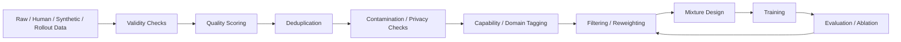

# 第 20 章 Data Quality、Filtering、Deduplication 与 Mixture：哪些数据该留、该删、该降权，以及最终怎么混

> 所属体系：[`LLM_Agent_Data_Knowledge_System.md`](../LLM_Agent_Data_Knowledge_System.md)
>
> 前置章节：[`第 19 章 Data Governance、Lineage 与 Reproducibility`](./19_Data_Governance_Lineage_and_Reproducibility.md)
>
> 关联章节：[`第 6 章 Human Data`](./06_Human_Data_Annotation_and_Quality_Control.md)、[`第 7 章 Synthetic Data`](./07_Synthetic_Data_Generation_and_Synthesis.md)、[`第 9 章 Hard Case Mining 与 Curriculum`](./09_Hard_Case_Mining_and_Curriculum.md)、[`第 15 章 Grader、Verifier 与 LLM-as-a-Judge`](./15_Grader_Verifier_and_LLM_as_a_Judge.md)、[`第 18 章 Data Strategy 与 Data Valuation`](./18_Data_Strategy_and_Data_Valuation.md)
>
> 本章目标：建立一套完整的数据清洗、质量过滤、去重与 mixture 设计框架；理解 Quality Dimension、Rule / Model / Human Filtering、Exact / Near / Semantic Dedup、Contamination Filtering、Difficulty Balance、Domain / Capability Mixture、Sampling Weight、Temperature Sampling、Effective Sample Size、Mixture Ablation 与 Distribution Drift 的关系。
>
> 本章核心问题：**数据进入训练集，不应该只是“通过 / 不通过”的二元决定，而是要回答：这条数据质量如何、和已有数据重复多少、是否污染测试、代表哪个能力与分布、应该保留多少权重，以及它和其他数据混在一起以后会不会改变模型真正学到的东西。**

---

# 20.0 为什么 Data Quality 不是“把脏数据删掉”这么简单？

最朴素的数据清洗逻辑通常是：

```text
Raw Data
↓
Remove Bad Samples
↓
Train
```

但真实的大模型数据系统里，“Bad”并不是一个简单概念。

一条数据可能：

```text
事实正确
但风格单一

标签可靠
但和已有样本高度重复

任务很难
但不可验证

回答很好
但来自受污染 benchmark

真实线上产生
但包含隐私信息

synthetic 很干净
但 10 万条其实只有 500 种 decision pattern
```

所以更准确的问题不是：

> **这条数据好不好？**

而是：

> **它在哪些质量维度上好、在哪些维度上差，以及对于当前训练目标，它是否值得保留、保留多少、以什么权重进入 mixture。**

因此完整 pipeline 更像：



关键点在于：

> **Filtering 和 Mixture 不是训练前的一次性清洗动作，而是和目标能力、模型阶段、评测结果一起迭代的。**

---

# 20.1 Data Quality 是多维的，不是单一分数

最常见的问题是试图定义：

```text
quality_score = 0.87
```

然后所有样本按一个数字排序。

这种做法方便，但往往掩盖了不同质量维度之间的差异。

至少可以拆成：

```text
Correctness
Relevance
Completeness
Instruction Fidelity
Consistency
Verifiability
Diversity
Difficulty
Novelty
Safety
Privacy
Provenance Quality
Formatting / Parseability
```

对 Agent 数据还可以加入：

```text
Tool Validity
Argument Correctness
Observation Grounding
State Consistency
Recovery Quality
Side-effect Safety
Termination Quality
```

所以更合理的表示往往是：

```json
{
  "correctness": 1.0,
  "relevance": 0.9,
  "verifiability": 1.0,
  "novelty": 0.4,
  "diversity": 0.3,
  "safety": 1.0,
  "privacy_ok": true
}
```

而不是只存：

```json
{"quality": 0.86}
```

---

# 20.2 质量维度之间可能冲突

例如：

```text
Data A
非常标准
容易验证
但和已有数据高度重复

Data B
新颖
覆盖罕见 failure
但需要专家审核
```

A 在：

```text
Verifiability
Consistency
```

上更好。

B 在：

```text
Novelty
Coverage
Frontier Value
```

上更好。

因此：

> **高质量不等于所有维度都高，也不等于所有项目都应该选择同一种质量标准。**

不同阶段关注点不同。

例如：

### SFT

可能更重：

```text
Correctness
Instruction Fidelity
Clarity
Low Noise
```

### Preference Data

可能更重：

```text
Pair Informativeness
Label Confidence
Decision-relevant Difference
```

### Verifier / RM Data

更重：

```text
Hard Negative
Boundary Case
Reliable Label
```

### Agent Recovery Data

更重：

```text
Failure Authenticity
Recoverability
State Fidelity
Counterfactual Value
```

所以：

> **Quality 是 task-dependent 的。**

---

# 20.3 第一层过滤：Validity / Integrity Checks

在谈“质量”以前，先检查数据是不是结构上有效。

例如：

```text
字段是否缺失
JSON 是否可 parse
schema 是否符合版本
tool name 是否存在
arguments 是否符合 schema
reference 是否能解析
trajectory lineage 是否完整
state snapshot 是否存在
```

这一层回答的是：

> **这条数据能不能被系统可靠读取和解释？**

常见规则：

```text
Malformed JSON
Missing Required Field
Invalid Tool Name
Broken Parent ID
Corrupt Encoding
Invalid Timestamp
Missing Environment Snapshot
Unknown Label Version
```

这些最好是 deterministic check。

不要让 LLM Judge 去判断：

```text
“这个 JSON 看起来是不是大概合法？”
```

---

# 20.4 Rule-based Filtering：先用便宜、确定的规则挡掉明确问题

Rule-based filter 非常适合：

```text
空答案
长度异常
重复控制字符
schema 违规
非法工具
明显 PII
benchmark exact match
禁止 domain
异常 token ratio
```

优点：

```text
Cheap
Fast
Deterministic
Auditable
```

但缺点也明显：

```text
coverage limited
容易误伤
无法理解深层语义
```

因此一个成熟 filter 不应该只是：

```text
PASS / DROP
```

还可以有：

```text
PASS
DROP
QUARANTINE
NEED_REVIEW
DOWNWEIGHT
```

这比“一刀切”更适合复杂数据。

---

# 20.5 Model-based Filtering：模型适合做哪些质量判断？

模型可以做：

```text
事实 plausibility
instruction following
reasoning quality
answer completeness
style quality
failure classification
semantic redundancy
```

但模型过滤有几个风险：

```text
Judge Bias
Self-preference
Style Preference
Model-family Bias
Reward Hacking
Distribution Narrowing
```

例如：

```text
Generator = Model A
Filter = Model A
```

很可能造成：

```text
Model A 喜欢自己的表达风格
↓
更多类似风格被保留
↓
mixture 越来越单一
```

所以：

> **Model-based filtering 是一个有误差的选择器，不是客观真理。**

最好保留：

```text
filter_model
prompt_version
score
reason
threshold
```

并定期用 Human / Verifier audit。

---

# 20.6 Human Filtering：什么时候应该让人介入？

Human 不应该替代所有自动 filter。

更适合：

```text
高风险 case
边界 case
模型 disagreement
新 failure type
专业 domain
rubric 不清楚
gold expansion
```

一种常见 cascade：

```text
Rule Filter
↓
Verifier
↓
LLM Grader
↓
Disagreement / High-risk
↓
Human Review
```

这样能平衡：

```text
Cost
Quality
Scale
```

---

# 20.7 Filtering 的最大风险：把“有价值的难数据”当脏数据删掉

一个 filter 如果只偏好：

```text
流畅
标准
容易判断
高置信
```

很容易把：

```text
边界 case
复杂 failure
低资源 domain
不确定但重要的样本
hard negative
```

删除。

结果就是：

```text
Dataset looks cleaner
but
Capability Coverage becomes narrower
```

所以过滤不能只优化：

```text
Average Cleanliness
```

还要看：

```text
Coverage
Diversity
Frontier Retention
High-risk Retention
```

---

# 20.8 Filter Precision vs Filter Recall

过滤器本身也有 Precision / Recall。

例如目标是去掉低质量样本。

### High Precision Filter

删掉的几乎都是真的坏数据。

但可能漏很多。

### High Recall Filter

坏数据几乎都删了。

但可能误删大量有价值数据。

对不同场景权衡不同。

例如：

```text
Safety / PII
```

通常更偏：

```text
High Recall
```

而：

```text
Hard-case Filtering
```

如果误删高价值 frontier data，代价可能更高。

因此 filter 也应该在 gold subset 上做：

```text
Precision
Recall
False Positive
False Negative
```

---

# 20.9 Deduplication：为什么重复数据会影响训练？

重复会导致：

```text
某些 pattern 被过度采样
训练分布失真
模型记忆具体表达
评测 contamination 风险增大
有效数据规模被高估
```

例如：

```text
100,000 samples
```

如果其中：

```text
80,000 都是同一个模板改 ID
```

实际 information content 远小于 100,000。

所以：

> **Raw Sample Count ≠ Effective Information Size。**

---

# 20.10 Exact Deduplication

最简单：

```text
hash(normalized_text)
```

相同就去重。

Normalization 可能包括：

```text
trim whitespace
normalize unicode
normalize line breaks
remove metadata noise
```

优点：

```text
fast
cheap
stable
```

但只能抓完全相同或非常接近的 duplicate。

---

# 20.11 Near-duplicate Detection

例如：

```text
“取消订单 1847”
“请取消订单 1848”
“帮我取消订单 1849”
```

文本不同，但 task structure 可能完全一样。

可以使用：

```text
n-gram overlap
MinHash
SimHash
Jaccard
edit distance
```

来做表面近重复检测。

---

# 20.12 Semantic Deduplication

更难的是语义重复。

例如：

```text
A:
把明天的 3 点会议移到周五

B:
请将明日下午三点的会议重新安排至本周五同一时间
```

表面差异很大，但语义近似。

常见做法：

```text
Embedding
↓
Nearest Neighbor
↓
Similarity Threshold
```

但 semantic dedup 也有风险。

两个 prompt 语义相似，可能实际差在关键约束：

```text
A:
取消会议

B:
取消会议，但周会不要动
```

如果 embedding 过于相似而误去重，可能正好删掉最有价值的 negative-constraint case。

所以：

> **Semantic Similarity ≠ Decision Equivalence。**

---

# 20.13 Decision-level Deduplication：Agent / Reasoning 数据更应该看“决策是否重复”

对 Agent 数据，比 semantic dedup 更重要的可能是：

```text
Decision Pattern Dedup
```

例如：

```text
Task 1
查订单 → 取消

Task 2
查订单 → 取消

Task 3
查订单 → 取消
```

即使对象、措辞、用户名字都不同，decision pattern 可能一样。

可以抽象：

```text
State Type
Action Type
Constraint Pattern
Tool Sequence
Failure Type
```

形成结构 signature。

例如：

```text
lookup → permission_check → write → verify
```

如果 10 万条都属于这一种 workflow，那么：

```text
Surface Diversity 高
Decision Diversity 低
```

这是 Agent synthetic data 最常见的“假多样性”之一。

---

# 20.14 Family-level Dedup：不要把同一个 synthetic seed 的变体拆到 train/test

如果：

```text
Seed S
├── Variant 1
├── Variant 2
├── Variant 3
└── Variant 4
```

然后：

```text
1,2,3 → train
4 → eval
```

可能造成 leakage。

因此应保存：

```text
seed_id
family_id
workflow_id
```

并按 family 做 split / dedup。

---

# 20.15 Contamination Filtering

Contamination 不只是 exact benchmark match。

至少包括：

```text
Exact Match
Near Duplicate
Paraphrase
Solution Leakage
Synthetic Derivative
Same Workflow / Same Seed
Reference Leakage
```

例如 benchmark answer 在：

```text
training corpus
teacher prompt
synthetic seed
judge rationale
```

中出现，都可能形成间接 contamination。

因此 contamination filtering 最好在：

```text
sample level
family level
source level
workflow level
```

同时做。

---

# 20.16 Dedup 不是“越多越好”

极端 dedup 也可能损伤训练。

例如一种重要模式本来就高频：

```text
真实用户大量使用某种 workflow
```

如果完全只留一条，模型可能低估真实频率。

所以要区分：

```text
Redundant Duplicate
vs
Legitimate Frequency Signal
```

可以采用：

```text
cap per cluster
subsample by frequency
retain representative multiplicity
weight instead of hard-delete
```

也就是说：

> **Dedup 的目标不是让每个 pattern 只出现一次，而是防止某些 pattern 因采集机制被不合理放大。**

---

# 20.17 Data Filtering 与 Reweighting：不是所有问题都需要删除

对于一条边界数据：

```text
不够好到高置信保留
也不够差到明确删除
```

可以：

```text
Downweight
```

而不是 drop。

例如：

```text
Human Gold = weight 1.0
Verified Synthetic = weight 0.8
Weakly Judged Synthetic = weight 0.3
```

这只是示意，不是固定标准。

重要的是：

> **Hard filtering 把质量问题变成离散决策；reweighting 可以表达不确定程度。**

---

# 20.18 什么是 Data Mixture？

假设有：

```text
General SFT
Math Reasoning
Code
Tool Use
Agent Recovery
Safety
Long-context
Domain Expert
```

训练不可能只问：

```text
总共有多少条？
```

而要问：

> **每类数据以什么比例出现？**

这就是 Data Mixture。

可以表示：

$$
M = \{(D_i, w_i)\}_{i=1}^{K}
$$

其中：

- $D_i$ 是数据源 / bucket；
- $w_i$ 是采样权重。

---

# 20.19 Mixture Weight 不等于原始数据占比

假设：

```text
General = 10M
Recovery = 100k
```

如果按原始大小混：

```text
Recovery ≈ 1%
```

模型可能几乎学不到 recovery。

因此训练 mixture 常常会：

```text
upsample small-but-important buckets
```

或：

```text
downsample dominant buckets
```

所以：

> **Dataset Size 和 Training Exposure 是两个不同概念。**

---

# 20.20 Sample-based Mixture vs Token-based Mixture

如果两个 bucket：

```text
A: 每条 100 tokens
B: 每条 3000 tokens
```

按 sample 数 50/50：

```text
并不意味着 token exposure 50/50
```

因此 mixture 至少要明确：

```text
Sample Ratio
Token Ratio
Batch Ratio
Update Ratio
```

否则：

```text
“20% Agent data”
```

这个数字本身没有意义。

---

# 20.21 Temperature Sampling

当不同数据源规模差异巨大时，可以使用温度采样调整相对权重。

例如：

$$
p_i \propto n_i^\alpha
$$

其中：

- $n_i$：数据源大小；
- $\alpha=1$：按原始规模；
- $\alpha<1$：提高小数据源相对权重；
- $\alpha=0$：接近各源均匀。

这类方法常用于：

```text
multilingual
multi-domain
multi-task
```

但 α 本身仍然需要实验验证。

---

# 20.22 Capability-balanced Mixture

比 domain balance 更重要的一层是：

```text
Capability Balance
```

例如 Agent 数据按：

```text
Tool Selection
Argument Construction
Observation Grounding
Recovery
Verification
Termination
```

分桶。

如果只是按业务 domain：

```text
Calendar
Email
CRM
```

可能看不出：

```text
90% 数据其实都在训练 lookup
而 recovery 几乎没有
```

所以 mixture 设计最好同时考虑：

```text
Domain
Capability
Difficulty
Failure Type
Risk
Source
```

---

# 20.23 Difficulty-balanced Mixture

如果数据几乎全是：

```text
easy positive examples
```

模型容易学会表面模式，却不能推进能力 frontier。

但如果全是：

```text
extremely hard failures
```

又可能：

```text
label noise 高
learnability 低
训练不稳定
```

因此 mixture 常需要：

```text
Easy
Medium
Frontier
High-risk Hard
```

不同层都有一定比例。

这和 Curriculum 的区别是：

```text
Mixture
强调同时有什么

Curriculum
强调什么时候看到什么
```

---

# 20.24 Positive / Negative / Recovery Balance

很多数据集天然偏向 positive：

```text
成功回答
成功 trajectory
正确 tool call
```

但如果没有：

```text
hard negative
bad candidate
near-miss
recovery
abstention
clarification
```

模型很难学会：

```text
什么时候不要做
什么时候停
什么时候改道
什么时候拒绝
```

所以 mixture 不只要平衡 capability，也要平衡行为类型。

---

# 20.25 Agent Mixture 里不要把“成功轨迹”当唯一正样本

成功轨迹可能包含：

```text
redundant actions
lucky recovery
unsafe shortcut
unnecessary retries
```

而失败轨迹中可能包含：

```text
correct search
correct clarification
correct intermediate reasoning
```

所以更好的做法是：

```text
trajectory-level outcome
+
step-level labels
+
failure attribution
```

一起决定哪些 step 进入什么数据 view。

---

# 20.26 Effective Sample Size：100 万条数据未必真的有 100 万条的信息量

如果权重极度集中，或者 duplicate cluster 很大，effective sample size 会显著下降。

在加权采样里可以概念上用：

$$
N_{eff} \approx \frac{(\sum_i w_i)^2}{\sum_i w_i^2}
$$

直觉是：

```text
如果少数样本拿走大部分权重
实际有效覆盖就会变小
```

无需机械使用这个公式，但它提醒我们：

> **训练曝光次数和独立信息量不是一回事。**

---

# 20.27 Mixture Interaction：A 数据的价值会依赖 B 数据是否存在

数据价值不是完全可加的。

例如：

```text
Tool-use SFT
+
Recovery Preference
```

可能共同提高 Agent。

但单独只加 recovery preference，如果模型连基础 tool schema 都不会，可能没用。

也可能：

```text
Safety Data 太多
↓
模型 over-refuse
```

因此：

```text
Value(A + B)
≠
Value(A) + Value(B)
```

这就是 mixture interaction。

---

# 20.28 Mixture Ablation：怎么知道某类数据到底有没有用？

至少可以做：

```text
Full Mixture
vs
- Recovery
vs
- Verification
vs
- Synthetic
vs
- Human Gold
```

观察：

```text
Overall
Capability Slice
Safety
Cost
Regression
```

变化。

但要注意：

```text
remove one bucket
```

通常也改变总 token budget。

更严谨可以：

```text
budget matched
```

即删掉一类后，用其他数据补足相同 token / update 数。

这样更能回答：

> **这类数据本身是不是比替代数据更有价值？**

---

# 20.29 Marginal Mixture Test：不要一上来大规模扩某个 bucket

一种实用方法：

```text
Baseline Mixture
+
1% Recovery
+
3% Recovery
+
5% Recovery
+
10% Recovery
```

看：

```text
Capability Gain
Regression
Overfit
Cost
```

找到边际收益开始下降的位置。

这比：

```text
“Recovery 很重要，所以直接加到 30%”
```

更科学。

---

# 20.30 Mixture Drift：随着模型变强，最佳比例会变化

Model v1：

```text
Tool Selection 很弱
```

可能需要：

```text
更多基础 tool-use SFT
```

Model v3：

```text
基础 tool use 已经稳定
```

新的瓶颈变成：

```text
Recovery
Verification
Long-horizon State Tracking
```

所以：

> **Mixture 不是永久配方。**

应该随着 capability frontier 更新。

---

# 20.31 Distribution Matching：训练分布要不要等于线上分布？

不能简单说：

```text
线上什么比例
训练就什么比例
```

因为线上分布是：

```text
Frequency
```

而训练分布更关心：

```text
Learning Value
Risk
Coverage
```

例如某个安全 failure：

```text
线上只有 0.01%
```

但训练中可能需要显著 upweight。

所以更准确的是：

```text
Training Distribution
= f(Production Frequency,
    Learning Value,
    Risk,
    Coverage,
    Business Priority)
```

而不是简单复制 production mix。

---

# 20.32 Distribution Shift 与 Mixture Monitoring

数据 mixture 本身也会 drift。

应该监控：

```text
Domain share
Capability share
Difficulty share
Failure-type share
Source share
Synthetic share
Human share
Language share
Length distribution
Tool frequency
```

比如：

```text
synthetic share
从 30% → 80%
```

可能意味着：

```text
数据越来越依赖同一个 generator
```

需要 audit。

---

# 20.33 Length Bias：长样本会偷偷拿走更多训练预算

如果按样本混：

```text
Short Data = 50%
Long Data = 50%
```

但 long sample 平均长度是 short 的 10 倍，实际 token exposure 会严重偏向 long。

这会导致：

```text
长 trajectory 过度主导更新
```

所以 Agent / reasoning mixture 特别要看：

```text
Sample Share
Token Share
Trajectory Length Distribution
```

---

# 20.34 Source Balance：不要让一个 Generator 定义整个训练世界

如果：

```text
90% synthetic data
```

都来自同一个 teacher，容易继承：

```text
Teacher Style
Teacher Bias
Teacher Failure Modes
```

更好的 mixture 可以引入：

```text
Human
Production
Multiple Teachers
Programmatic Generator
Environment-grounded Rollout
```

这不是为了形式上的“来源多样”，而是为了：

> **减少单一生成机制对训练分布的支配。**

---

# 20.35 Hard Negative Ratio：不是越多越好

Hard negative 很有价值，但过多可能导致：

```text
模型过度谨慎
过度拒绝
对正确行为缺乏稳定正例
```

所以应该实验：

```text
Positive : Hard Negative
```

比例，而不是默认：

```text
负例越多越专业
```

---

# 20.36 Filtering Bias：过滤器会重新定义训练分布

假设原始数据：

```text
Short answers 40%
Long answers 60%
```

如果 Judge 偏爱长答案，过滤后可能：

```text
Short 10%
Long 90%
```

那么：

```text
Filter
```

实际上已经成为：

```text
Distribution Transformer
```

所以过滤前后要比较：

```text
Length
Style
Domain
Difficulty
Capability
Failure Type
```

分布变化。

这叫：

```text
Filter-induced Distribution Shift
```

---

# 20.37 Dedup Bias：去重器也会改变能力分布

假设一种 capability 的表述天然相似：

```text
permission checking
```

而另一类：

```text
creative writing
```

表面差异巨大。

如果统一 semantic similarity threshold，可能更容易把前一类大量删掉。

所以 dedup 也需要：

```text
bucket-aware thresholds
```

或至少做：

```text
post-dedup capability distribution audit
```

---

# 20.38 Filtering Pipeline 推荐顺序

一个常见顺序可以是：

```text
Raw Data
↓
Schema / Integrity Check
↓
Privacy / License Filter
↓
Exact Dedup
↓
Near / Family Dedup
↓
Executable / Rule Verification
↓
Model-based Quality Scoring
↓
Human Audit / Disagreement Review
↓
Capability / Difficulty Tagging
↓
Mixture Assignment
```

但不同项目可以调整。

关键原则是：

> **越便宜、越确定的过滤尽量放前面；越昂贵、越主观的判断放后面。**

---

# 20.39 为什么应该保存 Filter Reason？

不要只存：

```json
{"kept": false}
```

应该存：

```json
{
  "kept": false,
  "filter_stage": "semantic_dedup",
  "reason": "near_duplicate",
  "cluster_id": "cluster_183",
  "matched_sample_id": "sample_9201",
  "score": 0.94,
  "threshold": 0.90,
  "filter_version": "v4"
}
```

这样以后：

```text
threshold 改了
```

可以重建 derived view，而不是重新做所有原始数据处理。

这和第 19 章 lineage 是直接相连的。

---

# 20.40 Quality Score 不应该直接控制一切

一种危险做法：

```text
quality_score > 0.8
→ keep
else
→ drop
```

因为一个总分可能掩盖：

```text
Correctness = 1.0
Novelty = 0.2
```

和：

```text
Correctness = 0.7
Novelty = 1.0
```

得到相同平均分。

但这两个样本的训练意义完全不同。

更好的策略是：

```text
Hard constraints
+
Dimension-specific thresholds
+
Task-specific weighting
```

---

# 20.41 Hard Constraints vs Soft Scores

### Hard Constraint

例如：

```text
PII violation
invalid license
benchmark leakage
wrong final answer for SFT
unsafe forbidden action
```

可能直接 reject。

### Soft Score

例如：

```text
novelty
style quality
difficulty
verbosity
```

更适合：

```text
ranking
sampling
reweighting
```

把这两类信号混成一个平均分，容易出现：

```text
严重错误被高 novelty 抵消
```

这是不合理的。

---

# 20.42 Data Mixture 其实是一种 Policy

当我们决定：

```text
Recovery 10%
General 40%
Tool-use 20%
Safety 10%
Reasoning 20%
```

本质上是在定义：

> **模型下一阶段训练时，哪些经验更常被看到。**

因此 mixture 本身可以看作：

```text
Training Data Policy
```

它应该有：

```text
version
rationale
source buckets
weights
budget
expected capability impact
```

而不是一个没人记录的 dataloader 参数。

---

# 20.43 Mixture Versioning

可以保存：

```yaml
mixture_id: agent_posttrain_v7
buckets:
  general_sft: 0.30
  tool_use: 0.20
  recovery: 0.15
  verification: 0.10
  safety: 0.10
  reasoning: 0.15
sampling_unit: token
```

然后训练结果直接绑定：

```text
model_version
↔
mixture_version
```

否则模型效果变化时，很难知道是不是 mixture 变了。

---

# 20.44 Mixture Health Dashboard

一个有用的 dashboard 可以看：

```text
Total Samples
Total Tokens
Unique Clusters
Effective Sample Size
Duplicate Rate
Synthetic Share
Human Share
Verified Share
Capability Distribution
Difficulty Distribution
Failure Distribution
High-risk Coverage
Benchmark Overlap
PII Rejection Rate
Filter Acceptance Rate
```

这比只看：

```text
dataset size = 12M
```

有信息得多。

---

# 20.45 训练后如何判断 Filtering / Mixture 做对了？

最终不能停在：

```text
dataset 看起来很干净
```

真正要看：

```text
Target Capability Gain
General Regression
Safety Regression
Calibration
Cost
Robustness
```

如果：

```text
Quality Score ↑
```

但：

```text
Downstream Eval →
```

说明 filter 可能只是优化了代理指标。

同样：

```text
Dedup Rate = 70%
```

也不是成功本身。

真正要看：

> **删掉这些以后，模型有没有更好、更稳、更高效。**

---

# 20.46 一个完整案例：Agent Recovery Mixture

假设发现：

```text
Agent 基础 tool use 已经很好
但遇到 timeout / permission denied 后恢复差
```

## Step 1：收集数据

```text
Production Failures
Synthetic Failure Injection
Historical Regression
```

## Step 2：过滤

去掉：

```text
Harness Bug
Environment Corruption
Unrelated User Abort
```

保留：

```text
真正的 Model Recovery Failure
```

## Step 3：Dedup

如果 10 万条都是：

```text
timeout → retry same tool
```

按：

```text
failure_type
recovery_action
workflow
```

聚类。

## Step 4：构造数据 view

```text
Recovery SFT
Preference Pair
Failure Critique
Regression Set
```

## Step 5：设计 mixture

例如实验：

```text
0%
2%
5%
10%
```

Recovery Token Share。

## Step 6：评估

看：

```text
Recovery Success
Overall Task Success
Tool Cost
Over-retry
Over-abstention
General Tool-use Regression
```

最后决定：

```text
Scale / Stop / Rebalance
```

这就是完整的：

```text
Quality
→ Dedup
→ Mixture
→ Downstream Validation
```

链路。

---

# 20.47 常见失败模式

## 失败 1：只看一个 Quality Score

后果：不同质量维度被错误抵消。

---

## 失败 2：把 Judge 评分当 Ground Truth

后果：过滤器 bias 被放大进训练分布。

---

## 失败 3：只做 Exact Dedup

后果：semantic / workflow duplicate 大量残留。

---

## 失败 4：Semantic Dedup 太激进

后果：关键 constraint variation 被删掉。

---

## 失败 5：Synthetic 数据表面多样但 decision pattern 单一

后果：模型看似见过很多任务，其实只学一种 workflow。

---

## 失败 6：Mixture 按原始数据量直接混

后果：小但重要的 capability 被淹没。

---

## 失败 7：只报 sample ratio，不报 token ratio

后果：长轨迹实际主导训练却没人意识到。

---

## 失败 8：只加 hard case，不保基础能力数据

后果：新能力提升，旧能力回退。

---

## 失败 9：过滤后不做 distribution audit

后果：filter silently changes model behavior target。

---

## 失败 10：没有 mixture ablation

后果：不知道哪类数据真正贡献提升。

---

## 失败 11：把高频当高价值

后果：大量预算继续投在已饱和 pattern。

---

## 失败 12：把低频安全 case 按线上频率训练

后果：重要高风险行为没有足够 exposure。

---

# 20.48 面试 / 工作场景：如果让我清洗 1000 万条 Agent 数据，我怎么做？

一个比较成熟的回答框架可以是：

```text
1. 先定义 downstream 目标
2. 做 schema / integrity / privacy / license hard checks
3. 做 exact + near + family-level dedup
4. 用 environment / verifier 验证可执行结果
5. 模型打多维质量标签，不只一个总分
6. 高风险 / disagreement 送人工
7. 做 capability / difficulty / failure taxonomy tagging
8. 比较过滤前后分布变化
9. 设计 token-level / capability-level mixture
10. 做 budget-matched mixture ablation
11. 用 downstream benchmark 验证
12. 把 filter / dedup / mixture 全部 version 化
```

真正专业的点不是：

```text
用了多少 filtering model
```

而是：

> **能不能证明过滤和 mixture 改变之后，真正目标能力提升，并且没有因为选择偏差导致新的 regression。**

---

# 20.49 本章关键词

```text
Data Quality
Quality Dimension
Validity Check
Rule-based Filtering
Model-based Filtering
Human Audit
Filter Precision / Recall
Hard Constraint
Soft Score
Exact Deduplication
Near Deduplication
Semantic Deduplication
Decision-level Deduplication
Family-level Deduplication
Contamination Filtering
Reweighting
Data Mixture
Sampling Weight
Token Ratio
Temperature Sampling
Capability Balance
Difficulty Balance
Effective Sample Size
Mixture Interaction
Mixture Ablation
Distribution Shift
Filter-induced Bias
Mixture Versioning
```

---

# 20.50 最终心智模型

这一章可以压缩成四句话。

### Quality

```text
一条数据到底在哪些维度上值得信、值得学？
```

### Dedup

```text
它提供的是新信息，还是同一种经验的重复曝光？
```

### Filtering

```text
它应该被删除、保留、人工复核，还是只是降低权重？
```

### Mixture

```text
模型在有限训练预算里，应该多看到哪些经验、少看到哪些经验？
```

因此：

> **Data Quality 决定单条数据值不值得信，Dedup 决定它是不是新信息，Filtering 决定它是否进入资产池，而 Mixture 最终决定模型真正看到的学习分布。**

这四件事必须一起设计。

---

# 下一章

下一章可以继续进入：

# 第 21 章 Data Experiments：如何证明“这批数据真的有用”

重点包括：

```text
Data Ablation
Controlled Add / Remove
Matched-budget Comparison
Small-scale Pilot
Scaling Curve
Data Quantity vs Quality
Learning Curve
Seed Variance
Interaction Effect
Counterfactual Data Experiment
Offline Proxy vs Downstream Eval
Regression Analysis
Statistical Power
Experiment Registry
```

第 20 章回答：

> **哪些数据应该进入训练，以及最终怎么混。**

第 21 章就进一步回答：

> **我们怎么用实验，而不是感觉，证明某一类数据、某一种 filtering、某一种 mixture 配方确实让模型变得更好。**
