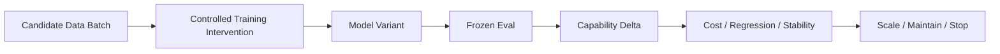

# 第 21 章 Data Experiments：如何证明一批数据真的有用

> 所属体系：[`LLM_Agent_Data_Knowledge_System.md`](../LLM_Agent_Data_Knowledge_System.md)
>
> 前置章节：[`第 20 章 Data Quality、Filtering、Deduplication 与 Mixture`](./20_Data_Quality_Filtering_Deduplication_and_Mixture.md)
>
> 关联章节：[`第 9 章 Hard Case Mining 与 Curriculum`](./09_Hard_Case_Mining_and_Curriculum.md)、[`第 16 章 Benchmark Design 与 Evaluation Protocol`](./16_Benchmark_Design_and_Evaluation_Protocol.md)、[`第 17 章 Data Flywheel`](./17_Data_Flywheel_and_Continuous_Improvement.md)、[`第 18 章 Data Strategy 与 Data Valuation`](./18_Data_Strategy_and_Data_Valuation.md)、[`第 19 章 Data Governance、Lineage 与 Reproducibility`](./19_Data_Governance_Lineage_and_Reproducibility.md)
>
> 本章目标：建立一套系统的数据实验方法，理解 Controlled Add / Remove、Matched-budget Comparison、Small-scale Pilot、Scaling Curve、Quantity vs Quality、Seed Variance、Interaction Effect、Counterfactual Data Experiment、Offline Proxy vs Downstream Eval、Statistical Power、Experiment Registry 与 Scale / Stop Decision 的基本逻辑。
>
> 本章核心问题：**一批数据看起来高质量、难度高、Judge 分高、和当前 failure 很相关，都不等于它真的能让模型变好。Data Experiment 的任务，是在尽量受控的条件下回答：哪类数据让哪项能力提高了多少，这个增益是否稳定、是否值得成本、是否带来副作用，以及还能不能继续扩。**

---

# 21.0 为什么“数据质量高”还不够？

假设我们有一批新数据：

```text
20,000 条 Agent Recovery Trajectories
```

它们满足：

```text
人工审核通过率高
Verifier 可验证
失败类型明确
轨迹结构完整
几乎没有重复
```

很容易得出：

> 这是一批高质量数据。

但真正对训练最重要的问题仍然没有回答：

```text
加入训练以后模型会变好吗？
改善的是 recovery，还是只是更会模仿某种格式？
提升是否只出现在同模板任务？
会不会损害正常 tool use？
20k 是否比 5k 更好？
它的效果是不是换一个 seed 就消失？
如果给 baseline 同样训练 token，优势还在吗？
```

因此必须区分：

```text
Intrinsic Data Quality
≠
Downstream Learning Value
```

前者回答：

> 数据本身是否可靠？

后者回答：

> 模型学了以后有没有变得更好？

真正的数据实验关心第二个问题。

可以画成：



---

# 21.1 Data Experiment 的基本单位是什么？

一个完整的数据实验至少要定义：

```text
Research Question
Baseline
Data Intervention
Training Protocol
Evaluation Protocol
Primary Metric
Secondary Metrics
Budget
Seeds
Decision Rule
```

例如：

```text
RQ:
加入 recovery-focused preference data，
是否能提高 Agent 在 recoverable tool failure 上的成功率？

Baseline:
原 SFT + Preference mixture

Treatment:
Baseline + 10k recovery preference pairs

Train:
相同 base model
相同 optimizer
相同 total token budget

Eval:
Frozen recovery benchmark
+ general agent benchmark
+ safety regression

Primary:
Recovery Success Rate

Secondary:
Overall Success
Harmful Retry Rate
Tool Calls
Latency
```

只要这些没有提前定义，实验就很容易变成：

```text
跑完以后看哪个指标好看就报哪个
```

也就是典型的 post-hoc storytelling。

---

# 21.2 Data Intervention：你到底改变了什么？

数据实验首先需要明确 treatment。

常见 treatment 类型包括：

```text
Add Data
Remove Data
Replace Data
Reweight Data
Change Quality Threshold
Change Difficulty Mix
Change Source Mix
Change Curriculum Order
Change Pair Construction
Change Negative Sampling
```

例如：

```text
Baseline
General SFT 80%
Tool SFT 20%
```

实验可以是：

```text
Treatment A
General SFT 70%
Tool SFT 20%
Recovery 10%
```

也可以是：

```text
Treatment B
总 token 不变
从 General 中替换 10% 为 Recovery
```

这两种实验回答的不是同一个问题。

第一种同时改变了：

```text
Recovery Data
+
Total Training Budget
```

第二种更接近：

> 在固定预算下，Recovery 是否比被替换掉的数据更值钱？

因此必须区分：

```text
Additive Intervention
vs
Substitution Intervention
```

---

# 21.3 Matched-budget Comparison：数据实验最重要的控制之一

假设：

```text
Baseline
训练 10B tokens
Accuracy = 72%

Treatment
额外加入 2B high-quality tokens
训练 12B tokens
Accuracy = 74%
```

不能直接得出：

> 这 2B 数据很好。

因为 alternative explanation 是：

> 只是多训练了 20%。

因此更严谨的比较是：

```text
Baseline+Budget
12B tokens
其中额外 2B 来自原 mixture

Treatment
12B tokens
其中 2B 来自目标数据
```

也就是：

```text
same total token budget
same training steps
same optimizer
same base model
```

尽量只改变：

```text
data composition
```

这就是 Matched-budget Comparison。

对于 Agent 数据，还可以匹配：

```text
Number of Episodes
Number of Tool Calls
Average Trajectory Length
Training Tokens
Compute
```

具体匹配哪个 denominator，取决于研究问题。

---

# 21.4 Controlled Add Experiment：这批数据“加进来”有没有用？

最直接的数据实验是：

```text
Baseline
vs
Baseline + D
```

其中 $D$ 是候选数据。

记：

$$
\Delta(D)=Metric(M_{base+D})-Metric(M_{base})
$$

这能回答：

> 在当前 baseline 上加入 D，整体效果如何？

但要注意：

```text
Add Experiment
```

测到的是：

```text
Data Effect
+
Extra Budget Effect
```

如果 total training budget 增加了。

所以 Add 实验很适合作为：

```text
快速 pilot
```

但做正式 attribution 时，最好进一步做 matched-budget replacement。

---

# 21.5 Remove Ablation：删掉它会不会变差？

另一种经典实验：

```text
Full Mixture
vs
Full Mixture - D
```

如果删除 D 后：

```text
Target Capability ↓
```

说明 D 可能有贡献。

但 Remove Ablation 也有两个坑。

## 21.5.1 Token budget 变化

如果删掉 D 后总训练量变少，下降可能只是：

```text
less compute / less tokens
```

所以最好：

```text
remove D
+
用其他数据补齐 budget
```

---

## 21.5.2 Mixture Interaction

某类数据可能单独作用很弱，但和另一类数据组合很重要。

例如：

```text
Tool SFT
+
Recovery Preference
```

如果没有 Tool SFT，Recovery Preference 可能几乎学不到。

所以：

```text
D 的边际贡献
```

可能依赖当前 mixture。

---

# 21.6 Add 与 Remove 为什么最好都做？

如果资源允许，一个数据资产最好有两个方向证据：

```text
Baseline + D
```

和：

```text
Full - D
```

如果两者都指向同样结论：

```text
加入 D 提升
删除 D 下降
```

因果解释会更强。

但如果：

```text
加入 D 没提升
删除 D 却下降
```

可能说明：

```text
D 已经是当前 mixture 中不可缺少的基础成分
但继续增加 D 已经进入饱和区
```

这正是 Marginal Utility 的典型现象。

---

# 21.7 Small-scale Pilot：为什么不要一上来做 100 万条？

数据实验最常见的浪费之一：

```text
先生产 1M
↓
再发现没用
```

更合理的是分阶段：

```text
1k
↓
5k
↓
20k
↓
100k
↓
scale
```

每一步都问：

```text
signal 是否出现？
增益是否稳定？
边际收益是否下降？
是否出现 regression？
数据生产成本是否合理？
```

因此一个成熟的数据项目应该有：

```text
Pilot Gate
Scale Gate
Stop Gate
```

而不是默认：

```text
项目立项
=
最终一定扩到百万级
```

---

# 21.8 Scaling Curve：数据量和能力提升是什么关系？

假设同一类数据做：

```text
1k
5k
10k
50k
100k
```

得到：

```text
Recovery Success
61%
66%
69%
71%
71.5%
```

可以看到典型：

```text
Diminishing Return
```

概念上可以画成：

```text
Capability Gain
^            _______
|          /
|        /
|      /
|_____/______________> Data Size
```

这条曲线非常重要，因为它直接决定：

```text
继续扩数据
还是
换一个 capability gap
```

如果：

```text
50k → 100k
只提升 0.5pt
```

而另一类数据：

```text
5k 就能提升 2pt
```

那么战略上应该重新分配预算。

---

# 21.9 Quantity vs Quality：更多低质量和更少高质量怎么比？

一个经典问题：

```text
100k auto-labeled
vs
10k expert-verified
```

不能仅按 sample count 比。

可以做：

```text
A. 10k high-quality
B. 50k medium-quality
C. 100k low-cost synthetic
D. mixed
```

并匹配：

```text
training token budget
```

然后比较：

```text
Target Gain
Generalization
Regression
Cost
```

最终更有价值的问题是：

> **每单位成本，哪种 quality tier 带来的 downstream gain 最大？**

即：

$$
ROI_q=\frac{\Delta Metric_q}{Cost_q}
$$

这比“高质量总比低质量好”更接近真实资源配置问题。

---

# 21.10 Quality Threshold Experiment：filter 阈值应该多严格？

例如一个 Judge 给 quality score：

```text
0 ~ 1
```

可以构造：

```text
threshold = 0.6
threshold = 0.7
threshold = 0.8
threshold = 0.9
```

阈值越高：

```text
平均质量 ↑
数据量 ↓
多样性可能 ↓
hard cases 可能被误删
```

所以不能默认：

```text
threshold 越高越好
```

应该比较：

```text
Pass Rate
Diversity
Difficulty
Capability Coverage
Downstream Gain
```

甚至可能出现：

```text
0.8 比 0.9 更好
```

因为 0.9 过滤掉了过多难例和少数模式。

---

# 21.11 Hard Data Experiment：难数据真的更有用吗？

前面已经反复强调：

```text
Hard ≠ Valuable
```

数据实验可以直接比较：

```text
Easy Bucket
Medium Bucket
Hard Bucket
Frontier Bucket
```

最好匹配：

```text
sample / token budget
```

然后看：

```text
target capability
held-out hard cases
general cases
regression
```

一个常见结果可能是：

```text
Easy → 基础稳定
Medium / Frontier → 学习收益最高
Extremely Hard → 噪声大、学习收益低
```

这正是为什么 capability frontier 比“最难样本”更重要。

---

# 21.12 Curriculum Experiment：顺序真的重要吗？

如果同一批数据总量不变，可以比较：

```text
Random Shuffle
Easy → Hard
Hard → Easy
Foundation → Frontier
Static Mixture
Dynamic Curriculum
```

因为只改变顺序和 sampling policy，训练 token 不变。

这样能更干净地回答：

> Curriculum 本身有没有价值？

而不是把：

```text
数据种类变化
+
数据量变化
+
训练顺序变化
```

全部混在一起。

---

# 21.13 Data Mixture Experiment：不只是“有没有”，还要测“放多少”

例如 Recovery 数据占比：

```text
0%
1%
3%
5%
10%
20%
```

对每个点记录：

```text
Recovery Success
General Success
Over-retry Rate
Tool Cost
Safety
```

可能出现：

```text
Recovery Success
持续上升

General Success
先稳定后下降
```

于是最佳点可能不是最大比例，而是一个 Pareto trade-off。

可以写成：

$$
M^*=\arg\max_M U(M)
$$

其中：

```text
U
```

综合：

```text
Target Gain
Regression
Cost
Risk
```

---

# 21.14 Interaction Effect：两类数据合起来可能不是简单相加

考虑两个数据组件：

```text
A = Tool-use SFT
B = Recovery Preference
```

做 2×2 实验：

```text
No A, No B
A only
B only
A + B
```

如果：

```text
Gain(A+B)
>
Gain(A)+Gain(B)
```

说明可能存在 synergy。

如果：

```text
Gain(A+B)
<
Gain(A)+Gain(B)
```

可能存在 interference。

这种实验非常适合回答：

```text
两类数据应该独立做？
还是联合做？
```

而不是默认数据效果线性可加。

---

# 21.15 Source Experiment：Human、Synthetic、Production 哪个更值？

针对同一个 capability gap，可以构造：

```text
Human-authored
Teacher-generated
Production-mined
Programmatic
Hybrid
```

尽量匹配：

```text
size
tokens
difficulty
capability distribution
```

然后比较：

```text
learning gain
cost
novelty
diversity
regression
```

最终得到的不是：

> Human 一定最好 / Synthetic 一定最便宜。

而是：

> 对这个 capability，在这个阶段，哪种 source 的 marginal ROI 最好。

---

# 21.16 Synthetic Data Experiment：Generator 和 Verifier 要分开消融

一个 synthetic pipeline 可能有：

```text
Generator
↓
Verifier
↓
Filter
↓
Training
```

如果最后数据有效，不能不知道是哪一层贡献最大。

可以比较：

```text
Raw Synthetic
Verified Synthetic
Human-corrected Synthetic
Synthetic + Hard Negative
```

也可以固定 generator，只改 verifier。

这样能判断：

```text
生成质量 bottleneck
还是
过滤质量 bottleneck
```

---

# 21.17 Negative Data Experiment：错误样本到底怎么用？

失败样本可以被转成：

```text
Preference Pair
Critique
Correction
Recovery Trajectory
Hard Negative
Verifier Training
```

不同形式可能效果不同。

例如同一批失败：

```text
A: 只保留正确 correction
B: 原错误 + correction
C: pairwise preference
D: recovery trajectory
```

然后比较目标能力。

这能回答：

> 同一个 failure，哪种 supervision interface 最有效？

而不是只问：

> 失败数据有没有价值？

---

# 21.18 Counterfactual Data Experiment：控制 state，只改变监督动作

对于 Agent / reasoning state，可以构造 matched counterfactual：

```text
Same State S
├── baseline action a0
├── better action a1
└── alternative a2
```

然后构造：

```text
Preference(a1 > a0)
Correction(a0 → a1)
Recovery from S
```

这类数据最大的优势是：

```text
prior history 被控制
```

所以更接近局部决策监督。

它非常适合研究：

```text
current-state decision
candidate selection
recoverability
continue / stop
branch / repair
```

---

# 21.19 Offline Proxy vs Downstream Eval：proxy 好看不等于训练有用

很多数据 pipeline 会优化 proxy：

```text
Judge Score
Verifier Pass Rate
Difficulty Score
Novelty
Diversity
Preference Margin
```

这些都很有用，但它们只是 proxy。

真正最终要看：

```text
Training
↓
Held-out Evaluation
```

例如：

```text
Synthetic verifier pass rate
95% → 99%
```

不代表：

```text
model downstream accuracy
一定提高
```

所以需要区分：

```text
Data-level Proxy
vs
Model-level Outcome
```

并定期验证二者相关性。

---

# 21.20 Proxy Validation：一个数据筛选分数值得信吗？

假设你有：

```text
Data Quality Score q(x)
```

最基本可以做：

```text
按 q 分桶
↓
训练 / 加权
↓
看 downstream gain
```

例如：

```text
Top 20%
20–40%
40–60%
60–80%
Bottom 20%
```

如果：

```text
q 越高
模型增益越大
```

说明 proxy 有一定有效性。

如果没有单调关系：

```text
quality scorer
```

可能并没有真正捕捉 learning value。

---

# 21.21 Seed Variance：一次训练提升不代表稳定提升

训练本身存在随机性：

```text
init
batch order
data sampling
dropout
optimizer noise
```

所以：

```text
Baseline = 72.1
Treatment = 72.8
```

如果 seed-to-seed 波动是：

```text
±1.5
```

这个 0.7pt 可能没有太强证据。

因此重要实验至少应该考虑：

```text
multiple seeds
mean
variance
confidence interval
```

资源有限时，也可以：

```text
先单 seed pilot
↓
出现 promising signal
↓
再做 multi-seed confirmation
```

而不是所有实验都一上来三到五个 seed。

---

# 21.22 Evaluation Variance：别只盯训练随机性

Agent evaluation 还可能有：

```text
generation randomness
environment stochasticity
judge variance
tool instability
```

因此方差来源可能是：

```text
Train Seed
Inference Seed
Environment Seed
Judge Seed
```

要根据研究对象区分。

例如：

```text
如果模型固定、只研究 sampling policy
```

就不应该把 training variance 当主要问题。

---

# 21.23 Paired Evaluation：同一 case 上比较，统计效率更高

如果 Baseline 和 Treatment 都在同一批 case 上运行，可以记录：

```text
B correct, T correct
B correct, T wrong
B wrong, T correct
B wrong, T wrong
```

相比只比较两个总体准确率，paired data 能直接分析：

```text
Repair
Degradation
```

对于 Agent 还可以看：

```text
Rescue
Harmful
Cost Delta
```

因为 sample-level pairing 消除了部分 case difficulty 差异。

---

# 21.24 Statistical Power：小数据集为什么容易“看起来什么都有趋势”？

如果测试集很小：

```text
N = 30
```

一次多对 2 题：

```text
+6.7pt
```

看起来很大。

但不确定性也很大。

因此实验设计前应该考虑：

```text
expected effect size
sample size
baseline rate
variance
paired structure
```

如果 benchmark 本身只有 30 题，结论就应该写得更谨慎：

```text
observed improvement
```

而不是：

```text
stable general improvement
```

---

# 21.25 Multiple Comparisons：试太多方案，总会碰到一个“显著”

假设尝试：

```text
20 个 filter threshold
10 个 mixture ratio
5 个 curriculum
```

最后挑一个最好结果汇报。

即使所有方法真实效果一样，也很可能出现一个偶然高点。

因此需要：

```text
Development Set
Final Holdout
```

或者明确：

```text
exploratory
vs
confirmatory
```

前者可以大量尝试，后者要在未用于调参的 holdout 上确认。

---

# 21.26 Exploratory Experiment 与 Confirmatory Experiment

这是一个非常实用的区分。

## Exploratory

目标：

```text
快速找方向
```

允许：

```text
小样本
单 seed
多个配置
代理指标
```

---

## Confirmatory

目标：

```text
验证结论
```

需要更严格：

```text
Frozen Protocol
Held-out Eval
Matched Budget
Multiple Seeds when needed
Predefined Metrics
Full Cost Accounting
```

研究原型阶段没有必要把每个想法都做成 confirmatory。

但一旦要写进论文主结论、上线决策或大规模投资，就应该升级实验强度。

---

# 21.27 Training Budget 与 Data Budget 要分开记账

很多实验只记：

```text
Data Size
```

但真正成本至少有：

```text
Data Acquisition Cost
Annotation Cost
Generation Cost
Verification Cost
Training Compute
Evaluation Compute
Engineering Time
```

因此数据实验的收益应该同时看：

```text
Gain / Data Cost
Gain / Training Cost
Gain / Total Cost
```

这和第 18 章 Data Valuation 直接对应。

---

# 21.28 Data Efficiency：少量数据能带来多少增益？

一个重要指标是：

```text
Gain per 1k samples
Gain per 1M tokens
Gain per $1000
```

例如：

```text
Dataset A
10k samples
+2.0pt

Dataset B
100k samples
+2.5pt
```

B 总提升更高，

但 A 的 data efficiency 可能远高于 B。

所以：

```text
Total Gain
```

和：

```text
Marginal Gain
```

要同时报告。

---

# 21.29 Transfer Experiment：修一个 failure，会不会泛化到同 capability？

假设真实 failure 是：

```text
会议取消时忽略 negative constraint
```

你生成训练数据：

```text
Calendar domain
```

如果测试也都是 Calendar，可能只是模板记忆。

更强的测试应该包括：

```text
File deletion
Email recipients
Order cancellation
CRM updates
```

都共享：

```text
Negative Constraint Handling
```

如果跨 domain 也提升，说明学到的更可能是：

```text
capability
```

而不是：

```text
surface template
```

---

# 21.30 In-domain vs Out-of-family Eval

因此可以把 eval 分成：

```text
Seen Family
Near Family
Held-out Family
Cross-domain Transfer
```

理想情况：

```text
Seen Family ↑↑
Held-out Family ↑
Cross-domain ↑
```

如果只有：

```text
Seen Family ↑↑
其他 ≈ 0
```

那可能只是局部记忆或 template adaptation。

---

# 21.31 Regression Analysis：目标能力提升了，别的能力掉没掉？

每个数据实验都应该至少有：

```text
Target Eval
General Eval
Safety / Risk Eval
Regression Set
```

例如 Recovery 数据加入后：

```text
Recovery +5pt
```

但：

```text
Normal Tool Efficiency -4pt
```

说明模型可能开始：

```text
over-retry
```

所以不能只看主指标。

---

# 21.32 Failure Transition：不只看分数，也看错误结构怎么变

一个版本：

```text
Tool Selection Failure 30%
Recovery Failure 25%
Verification Failure 10%
```

训练后：

```text
Tool Selection Failure 15%
Recovery Failure 10%
Verification Failure 25%
```

总体可能提升，

但 failure frontier 已经移动。

因此数据实验还应分析：

```text
Failure Type Transition
Severity Transition
Recoverability Transition
```

这能指导下一轮数据生产。

---

# 21.33 Mechanism Check：为什么这批数据会有效？

如果一个 intervention 有效，最好继续问：

> 为什么有效？

例如 Recovery Preference 提升后，可以看：

```text
timeout 后盲目 retry 是否下降？
permission denied 后 escalation 是否增加？
verification 是否更频繁？
last recoverable state 是否更常被利用？
```

这叫 mechanism check。

它能帮助区分：

```text
真正学到目标能力
```

和：

```text
通过其他 shortcut 提升总分
```

---

# 21.34 Counterfactual Mechanism Check

更进一步，可以在同一 state 上测试：

```text
State A
TIMEOUT

State B
PERMISSION_DENIED
```

如果模型对两者都机械 retry，说明：

```text
学到的是 retry habit
```

而不是：

```text
error-conditioned recovery policy
```

所以 matched counterfactual eval 非常适合检查机制。

---

# 21.35 Data Experiment Registry：为什么实验也需要治理？

当数据实验变多，很快会出现：

```text
这个 5% mixture 当时用哪个数据版本？
这个 +1.2pt 是哪个 seed？
那个 filter 阈值 0.8 为什么后来没用了？
这个实验有没有匹配 token budget？
```

因此可以建立 Experiment Registry。

至少保存：

```text
experiment_id
research_question
baseline_id
treatment_data_id
data_version
selection_policy
mixture_config
training_config
eval_protocol
seed
cost
primary_metric
secondary_metrics
result
conclusion
next_action
```

---

# 21.36 一个推荐的 Data Experiment Manifest

例如：

```yaml
experiment_id: recovery_pref_v3
question: Does recovery preference improve recoverable tool-failure success?
base_model: model_v17
baseline_data: mixture_v9
treatment_data: recovery_pref_10k_v3
intervention: replace_3_percent_tokens
matched_budget: true
train_tokens: 8B
seeds: [11, 23, 37]
primary_eval: recovery_holdout_v4
secondary_eval:
  - general_agent_v8
  - safety_regression_v5
primary_metric: recovery_success
cost_metrics:
  - train_tokens
  - tool_calls
  - latency
  - data_cost
```

这能让实验半年以后仍然可读。

---

# 21.37 Scale / Stop Decision：实验最终要服务决策

每个数据实验最终不应该只有：

```text
Result = +1.3pt
```

还应该落到动作：

```text
SCALE
MAINTAIN
REVISE
STOP
RETIRE
```

例如：

## SCALE

```text
目标能力稳定提升
多 seed 一致
无明显 regression
边际收益仍高
成本合理
```

## MAINTAIN

```text
数据重要但已接近饱和
保持当前 mixture
不再大规模扩
```

## REVISE

```text
有信号
但质量 / source / verifier 有问题
```

## STOP

```text
无稳定收益
或成本过高
或 regression 明显
```

## RETIRE

```text
能力已饱和
或任务分布已变化
```

---

# 21.38 一个实用的三阶段决策框架

可以把数据项目分成：

```text
Stage 1: Cheap Signal
Stage 2: Controlled Confirmation
Stage 3: Scale Validation
```

### Stage 1

```text
小数据
低成本训练
快速 eval
```

回答：

> 有没有信号？

### Stage 2

```text
matched budget
更严格 holdout
multi-seed when needed
```

回答：

> 信号是真的吗？

### Stage 3

```text
更大规模
完整 regression
完整成本
线上 shadow / A/B
```

回答：

> 值不值得规模化？

这比：

```text
一上来做大项目
```

风险低得多。

---

# 21.39 Negative Result 也必须进入知识库

如果某批数据实验失败：

```text
+0.1pt
within noise
```

这不是“没有结果”。

它至少告诉我们：

```text
当前数据形式可能无效
当前 capability 可能已饱和
当前 supervision interface 可能不对
当前 proxy 可能和 learning value 不一致
```

所以 Experiment Registry 应该保留：

```text
failed intervention
null result
regression
unexpected interaction
```

否则团队会重复做同一个失败实验。

---

# 21.40 Null Result 的严谨表述

不要写：

```text
“Recovery Data 没有价值。”
```

更严谨的是：

> 在当前 base model、数据构造方式、mixture、训练预算与 evaluation protocol 下，没有观察到稳定的增益。

也就是说：

```text
No Evidence of Benefit
≠
Evidence of No Possible Benefit
```

这个边界非常重要。

---

# 21.41 数据实验中的 Leakage

最危险的一种情况：

```text
根据 test failures 生成训练数据
↓
再在同一个 test 上测提升
```

这会让：

```text
regression repair
```

和：

```text
general capability gain
```

混在一起。

更好的设计：

```text
Observed Failure Seed
↓
抽象 capability
↓
生成 sibling train family
↓
原 failure 保留 regression
↓
另一个 held-out family 测泛化
```

---

# 21.42 Data Split 在实验中的层级

应根据要证明的泛化能力选择 split：

```text
Sample-level
Entity-level
Template-level
Family-level
Workflow-level
Environment-level
Domain-level
```

如果训练和测试只在 sample 层随机拆，

但共享：

```text
同 synthetic seed
同 workflow
同 template
```

可能严重高估泛化。

---

# 21.43 数据实验和普通模型实验的区别

普通模型实验常问：

```text
Architecture A vs B
Optimizer A vs B
```

数据实验则更关注：

```text
Source
Selection
Label
Quality
Difficulty
Mixture
Curriculum
Supervision Interface
```

但科学原则相同：

```text
控制变量
明确 treatment
固定评测
报告成本
分析方差
限制结论范围
```

---

# 21.44 研究实例：More Thinking 的实验纪律能迁移到 Data Experiment

More Thinking 类型实验里，一个重要结构是：

```text
固定模型
固定 benchmark
固定 protocol
只改变 reasoning depth / stopping policy
```

然后看：

```text
Wrong → Right
Right → Wrong
Token Cost
```

这和数据实验完全同构：

```text
固定模型初始化 / training protocol
固定 evaluation
只改变 data intervention
```

然后看：

```text
Capability Repair
Capability Degradation
Training / Data Cost
```

核心都是：

> **不要只看平均分，而要看 intervention 到底修了什么、伤了什么、花了多少。**

---

# 21.45 研究实例：RoTFuse / K17 与 Data Experiment

类似 K17 这种局部 intervention，可以拆成：

```text
Risk Mining
↓
Candidate Generation
↓
Selector
↓
Outcome
```

如果以后把这些状态转成训练数据，也可以做数据实验：

```text
A: 随机 reasoning states
B: low-confidence states
C: rescue-positive states
D: sibling-discordant states
```

匹配数量和 token budget，比较训练效果。

这会直接回答：

> 哪种 reasoning state 最有 training value？

而不是只根据：

```text
uncertainty score
```

推测它们“可能有价值”。

---

# 21.46 从 Mining Signal 到 Training Value，需要单独验证

例如：

```text
Low Confidence
Disagreement
High Loss
High Reward Gap
Failure Frequency
```

这些都可以作为 mining signal。

但：

```text
Mining Signal Strong
≠
Training Value High
```

真正应该建立：

```text
Mining Strategy
↓
Selected Data
↓
Train
↓
Measured Gain
```

然后比较：

```text
Random
vs
Uncertainty
vs
Disagreement
vs
Failure Mining
vs
Risk-weighted
```

这才是对 acquisition policy 的真实验证。

---

# 21.47 Data Experiment Dashboard 应该看什么？

至少可以分四组。

## Data Layer

```text
size
tokens
source
diversity
difficulty
quality
acceptance rate
```

## Training Layer

```text
training tokens
steps
compute
loss
seed
```

## Evaluation Layer

```text
target metric
general metric
regression
failure transition
cost
```

## Decision Layer

```text
marginal gain
ROI
confidence
scale / stop
```

这样才能把：

```text
数据生产
```

和：

```text
模型收益
```

真正连起来。

---

# 21.48 一套通用的数据实验设计模板

面对任何“这批数据值不值得做”的问题，可以按下面顺序：

```text
1. 明确 Capability Gap
2. 定义数据 intervention
3. 明确 baseline
4. 决定 Add / Replace / Remove
5. 匹配 token / compute budget
6. 冻结 training protocol
7. 冻结 eval protocol
8. 定义 primary + regression metrics
9. 先小规模 pilot
10. 看 scaling curve
11. 看 seed / inference variance
12. 做 paired / failure transition analysis
13. 计算 total cost / ROI
14. 做 held-out transfer
15. 给出 Scale / Maintain / Stop 决策
```

---

# 21.49 面试 / 工作中如何回答“你会怎么验证一批数据有没有用？”

一个成熟回答可以是：

> 我不会只看数据的 Judge 分数、人工通过率或者难度，而会把它当成一个 controlled data intervention。先明确它针对哪个 capability gap，再做小规模 pilot；训练侧尽量固定 base model、optimizer、总 token budget，只改变 data mixture；评测侧使用 frozen held-out benchmark，同时看 target capability、general regression、safety 和 cost。若有提升，再做多 seed 或更大规模确认，并画 data scaling curve，看边际收益是否开始饱和。最终不是只报“提升了 1 个点”，而是给出这批数据的 marginal gain、ROI、失败转移和是否值得继续扩。

---

# 21.50 本章常见误区总结

## 误区 1

```text
数据通过率高
=
训练价值高
```

不成立。

---

## 误区 2

```text
Baseline + Data 提升
=
Data 有效
```

如果 budget 也增加，不够严谨。

---

## 误区 3

```text
单 seed +0.7pt
=
稳定提升
```

要看 variance。

---

## 误区 4

```text
目标能力提升
=
整体变好
```

还要看 regression。

---

## 误区 5

```text
Hardest Data
=
Best Data
```

不一定。

---

## 误区 6

```text
Judge Score 提升
=
Downstream Learning Value 提升
```

需要 downstream validation。

---

## 误区 7

```text
更多 Data
=
更好
```

可能已进入 saturation。

---

## 误区 8

```text
线上 failure 修好
=
能力泛化
```

需要 held-out family / cross-domain transfer。

---

## 误区 9

```text
Null result
=
数据永远没价值
```

结论必须限定 protocol。

---

## 误区 10

```text
试很多配置后挑最好一个
=
发现稳定规律
```

需要独立 holdout confirmation。

---

# 21.51 本章最终心智模型

可以把 Data Experiment 压缩成一句话：

> **把“数据”当成一个可控 intervention，而不是一个静态文件。**

它的科学问题是：

```text
Data Intervention
        ↓
Model Behavior Change
        ↓
Capability Gain / Regression
        ↓
Cost / Stability / Transfer
        ↓
Decision
```

所以真正成熟的数据工作不是：

```text
“我做了 50 万条数据。”
```

而是：

```text
“我针对 recovery capability 构造了三种监督形式，
在 matched-token protocol 下做了 5k / 20k / 50k scaling，
发现 preference + correction 组合在 20k 后边际收益趋于饱和；
held-out recovery success 提升 3.1pt，
general tool-use 无显著回退，
单位数据成本收益高于 random hard-case baseline，
因此建议扩到 30k 左右后停止，把预算转向 verification failure。”
```

这才是 Data Experiment 最终希望建立的决策能力。

---

# 21.52 与下一章的衔接

到这里，我们已经能够回答：

```text
什么数据值得做？
怎么做？
怎么筛？
怎么混？
怎么验证它真的有效？
```

下一步会进一步进入一个更接近真实岗位与系统工程的问题：

> **一套 LLM / Agent 数据系统，日常到底怎么被生产化地组织起来？**

因此下一章将进入：

# 第 22 章 Data Production System：从任务池到可持续数据生产流水线

会系统展开：

```text
Task Queue
Data Jobs
Generator Workers
Environment Workers
Annotation Queue
Judge / Verifier Service
Retry / Idempotency
Artifact Store
Metadata Store
Dataset Build
Quality Dashboard
Experiment Handoff
Cost Accounting
SLA / Throughput
Failure Recovery
```

也就是说，第 21 章解决：

> **怎么证明一批数据有用。**

第 22 章开始解决：

> **已经知道什么数据值得做以后，怎么稳定、可追踪、可扩展地把它生产出来。**
