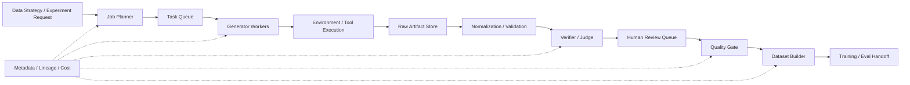
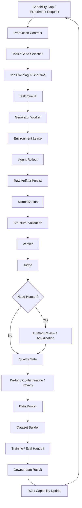

# 第 22 章 Data Production System：把高价值数据稳定地生产出来

> 所属体系：[`LLM_Agent_Data_Knowledge_System.md`](../LLM_Agent_Data_Knowledge_System.md)
>
> 前置章节：[`第 21 章 Data Experiments`](./21_Data_Experiments_and_Causal_Validation.md)
>
> 关联章节：[`第 7 章 Synthetic Data`](./07_Synthetic_Data_Generation_and_Synthesis.md)、[`第 10 章 Agent Task Design`](./10_Agent_Task_Design.md)、[`第 11 章 Environment Design`](./11_Environment_Design.md)、[`第 12 章 Agent Trajectory Anatomy`](./12_Agent_Trajectory_Anatomy.md)、[`第 15 章 Grader、Verifier 与 LLM-as-a-Judge`](./15_Grader_Verifier_and_LLM_as_a_Judge.md)、[`第 17 章 Data Flywheel`](./17_Data_Flywheel_and_Continuous_Improvement.md)、[`第 19 章 Data Governance、Lineage 与 Reproducibility`](./19_Data_Governance_Lineage_and_Reproducibility.md)
>
> 本章目标：把“知道什么数据值得做”进一步落成可运行的数据生产系统；理解 Task Queue、Data Job、Generator / Environment Worker、Annotation Queue、Judge / Verifier Service、Artifact Store、Metadata Store、Retry / Idempotency、Quality Gate、Dataset Build、Cost Accounting、SLA、Failure Recovery 与 Experiment Handoff 之间的关系。
>
> 本章核心问题：**一个成熟的数据系统，不只是能“生成一批数据”，而是能在规模扩大、任务失败、模型版本变化、Judge 更新、环境异常和人工审核介入时，仍然保证每条数据有身份、有状态、有证据、有成本、有 lineage，能够被安全重试、局部恢复、重新判分，并最终稳定转化为可训练和可评测的数据资产。**

---

# 22.0 为什么 Data Production 是一个系统问题，而不是一段脚本？

研究原型阶段，生产数据可能只有：

```text
for task in tasks:
    output = model.generate(task)
    save(output)
```

这对几十、几百条实验数据通常够用。

但一旦进入真实的大模型 / Agent 数据生产，很快会出现：

```text
100 万个任务只跑完了 83 万个
部分任务重复生成了三次
Judge 服务中途换了版本
环境 reset 失败导致 episode 污染
某个 Tool API timeout 后盲目重试造成副作用
人工审核积压 20 万条
同一条 trajectory 同时存在 raw / normalized / scored 三份版本
GPU 花费已经很高，但不知道钱花在哪个数据 bucket
数据跑完了，却不知道哪些样本对应哪个 model version
```

这时候问题已经不是：

> “生成脚本有没有写对？”

而是：

> **整个生产过程能否被调度、追踪、恢复、审计和计量。**

所以 Data Production System 可以抽象成：



真正成熟的系统不是追求“所有东西都自动化”，而是确保：

```text
每个阶段都有明确输入
每个阶段都有明确输出
每个阶段都有状态
失败可以局部恢复
结果可以回溯到来源
成本可以分摊到任务与数据资产
```

---

# 22.1 Production Request：一批数据生产首先要有“生产合同”

不要直接从：

```text
“生成 10 万条数据”
```

开始。

一个生产请求至少应该定义：

```text
Target Capability
Target Dataset Size
Source Tasks / Seeds
Generation Policy
Environment Version
Verifier / Judge Policy
Human Review Policy
Acceptance Criteria
Budget
Deadline / Priority
Output Dataset Schema
```

例如：

```yaml
production_request_id: recovery_pref_v3
capability: agent_recovery
source_pool: timeout_failure_frontier_v2
requested_pairs: 20000
model: model_v17
candidate_n: 4
environment_snapshot: order_env_v5
verifier: final_state_v3
judge: recovery_rubric_v4
human_review:
  high_severity: 100%
  disagreement: 100%
  random_audit: 2%
max_budget_usd: 12000
output_schema: preference_pair_v3
```

它可以看成：

> **Data Production Contract。**

之后所有调度、成本、验收和 lineage 都围绕这个 contract 展开。

---

# 22.2 Data Job：不要把“一次生产”当成一个不可拆的大任务

假设要生产：

```text
100,000 trajectories
```

不应该只有一个：

```text
job = generate_100k
```

更好的做法是把它拆成多个可独立重试、独立计量的 Data Job。

例如：

```text
Production Request
├── Job 001: task bucket A / shard 00
├── Job 002: task bucket A / shard 01
├── Job 003: task bucket B / shard 00
└── ...
```

每个 job 最好有：

```text
job_id
parent_request_id
input_manifest
worker_type
runtime_config
priority
retry_policy
budget_limit
status
attempt_count
output_manifest
```

这样局部失败时：

```text
Job 037 failed
```

只需重跑 Job 037，
而不是重跑整个 100k。

---

# 22.3 Job State Machine：生产任务必须有显式状态

一个 Data Job 最好不是：

```text
存在 / 不存在
```

而是有完整状态机：

```text
PENDING
↓
CLAIMED
↓
RUNNING
↓
SUCCEEDED
```

异常分支：

```text
RUNNING
├── RETRYABLE_FAILED
├── NON_RETRYABLE_FAILED
├── PARTIAL
├── CANCELLED
└── QUARANTINED
```

对于人工流程还可以有：

```text
WAITING_REVIEW
WAITING_ADJUDICATION
```

为什么状态机重要？

因为：

```text
“没有 output”
```

可能意味着：

```text
还没开始
正在跑
worker 死了
输入无效
执行失败
被人工拦截
结果进入 quarantine
```

这些语义完全不同。

---

# 22.4 Task Queue：决定“下一条数据谁先做”

生产系统通常不会只有一种任务。

可能同时有：

```text
普通 SFT Generation
高风险 Recovery Case
Benchmark Regression
Judge Re-score
Human Adjudication
Synthetic Expansion
```

因此 Task Queue 需要支持：

```text
Priority
Capability Bucket
Worker Requirement
Cost Class
Deadline
Dependency
```

例如：

```text
P0
高风险 regression / blocking experiment

P1
论文主实验 / 上线前 eval

P2
正常数据生产

P3
后台 synthetic expansion
```

重要原则：

> **Queue Priority 应来自业务 / 实验价值，而不是谁先提交谁先跑。**

---

# 22.5 Queue 和 Dataset 不是一回事

Queue 里的 unit 表示：

```text
待执行工作
```

Dataset 里的 unit 表示：

```text
已经形成的数据资产
```

所以：

```text
Task Queue Item
≠
Training Sample
```

一个 queue item 可能最终：

```text
生成 4 个 candidates
产生 4 条 trajectory
形成 2 个 preference pairs
其中 1 条进入 SFT
另外 1 条进入 regression
```

因此生产过程最好允许：

```text
1 Job → N Artifacts → M Dataset Records
```

---

# 22.6 Worker：生产系统中的执行单元

可以把 worker 按职责拆开。

## 22.6.1 Generator Worker

负责：

```text
Prompt Assembly
Model Inference
Candidate Sampling
Response Capture
Token / Logprob Capture
```

---

## 22.6.2 Environment Worker

负责：

```text
Environment Reset
Episode Setup
Tool Execution
State Transition
State Snapshot
Final State Capture
```

---

## 22.6.3 Verifier Worker

负责：

```text
Executable Check
Final-state Predicate
Constraint Check
Side-effect Check
```

---

## 22.6.4 Judge Worker

负责：

```text
Rubric-based Scoring
Preference Comparison
Failure Classification
Process Grading
```

---

## 22.6.5 Transformation Worker

负责：

```text
Normalization
Redaction
Dedup Features
Schema Conversion
Pair Construction
Dataset View Build
```

---

## 22.6.6 Human Review Worker

不一定是自动 worker，但系统上应被当作同一种“可调度 stage”：

```text
Review
Adjudication
Expert Check
Gold Annotation
```

这样系统才能统一计算：

```text
Queue Depth
Turnaround Time
Cost
Acceptance Rate
```

---

# 22.7 Worker 最重要的设计之一：输入必须可重放

一个 Worker 不应该依赖：

```text
“当时进程内刚好有的状态”
```

而最好依赖一个明确 input manifest。

例如：

```json
{
  "task_id": "task_1847",
  "task_version": "v3",
  "environment_snapshot": "order_env_v5_s102",
  "model_version": "model_v17",
  "prompt_version": "agent_prompt_v8",
  "toolset_version": "tools_v6",
  "seed": 3014
}
```

这样某条 episode 出问题后可以：

```text
replay exact input
```

而不是凭日志猜当时到底跑了什么。

---

# 22.8 Retry：不是“失败了就再跑一次”

生产系统里 Retry 是一个非常容易被写坏的地方。

先区分：

```text
Transient Failure
vs
Deterministic Failure
vs
Semantic Failure
```

## Transient Failure

例如：

```text
HTTP 503
network timeout
rate limit
GPU preemption
```

通常适合 retry。

## Deterministic Failure

例如：

```text
invalid schema
missing file
bad config
unsupported tool
```

盲目重试没有意义。

## Semantic Failure

例如：

```text
model selected wrong action
```

这不是 production retry 的理由，
而应该成为 data / eval outcome。

所以：

> **System Retry 和 Agent Recovery 必须区分。**

否则 production system 会偷偷替模型“擦屁股”，污染真实行为记录。

---

# 22.9 Idempotency：Agent 数据生产中特别重要

假设一个 write action：

```text
charge_credit_card()
```

Tool timeout 后系统自动 retry。

如果第一次其实已经成功，只是 response 丢了，第二次 retry 就可能重复扣款。

所以 worker / tool action 最好标注：

```text
idempotent = true / false
```

对于非幂等动作：

```text
retry
```

前应先：

```text
verify previous state
```

或者使用：

```text
idempotency_key
transaction_id
```

这个原则不仅保护真实系统，也保证 Agent benchmark 的行为语义可信。

---

# 22.10 Retry Budget：无限重试本身是一种生产 bug

每个 job 应该有：

```text
max_attempts
max_runtime
max_cost
```

并使用例如：

```text
exponential backoff
```

超过上限后进入：

```text
DEAD LETTER QUEUE
```

而不是：

```text
永远 retry
```

Dead Letter Queue 里的样本往往很有价值，因为它们可能集中代表：

```text
坏输入
系统 bug
环境不稳定
未覆盖 edge case
```

---

# 22.11 Dead Letter Queue：失败数据也要有归宿

DLQ 不是“垃圾桶”。

应该记录：

```text
failure_stage
error_code
attempt_count
last_error
input_manifest
runtime_version
```

然后定期做：

```text
Failure Clustering
↓
Root Cause
↓
Fix / Requeue / Drop
```

例如：

```text
60% PERMISSION_DENIED
```

可能说明 task generator 没有正确约束权限，而不是 worker 不稳定。

---

# 22.12 Checkpoint：长任务要支持局部恢复

假设一条 Agent trajectory 有 40 个 step，执行到第 38 步 worker 被抢占。

如果每次都：

```text
从 step 0 重新开始
```

成本会很高。

对于可安全恢复的流程，可以保存：

```text
checkpoint_state
last_committed_event
world_snapshot
memory_snapshot
```

但要非常注意：

> **Checkpoint Recovery 不能改变实验语义。**

如果恢复会导致：

```text
重新采样不同模型输出
工具随机状态不同
外部时间变化
```

那么它已经不是严格 replay。

所以应区分：

```text
Operational Resume
vs
Scientific Replay
```

---

# 22.13 Artifact Store：原始证据和大文件放哪里？

Artifact Store 负责存：

```text
Raw Responses
Trajectories
Tool Logs
Environment Snapshots
Model Outputs
Candidate Pools
Screenshots / Files
Judge Evidence Packages
```

核心原则：

```text
large immutable payload
```

尽量不要全部塞到 metadata DB。

每个 artifact 最好有：

```text
artifact_id
content_hash
storage_uri
size
media_type
producer_job_id
created_at
```

---

# 22.14 Metadata Store：Data Production 的索引和账本

Metadata Store 记录的是：

```text
job status
sample identity
versions
lineage
cost
quality score
failure code
dataset membership
```

一个常见设计思想是：

```text
Artifact Store
= 大 payload

Metadata Store
= 可查询关系和状态
```

例如查询：

```text
找出 model_v17 生成、judge_v4 判为 disagreement、
且属于 recovery bucket 的所有 trajectories
```

这种需求应该靠 metadata 查询完成。

---

# 22.15 Data Catalog：让人知道“系统里有什么数据”

数据一多以后，最常见的问题不是没有数据，而是：

> “不知道哪些数据已经存在。”

Data Catalog 至少记录：

```text
dataset_id
dataset_version
purpose
owner
schema
source
size
capability distribution
quality summary
license / privacy
lineage
used_by_models
```

避免团队反复：

```text
重新造一批几乎一样的数据
```

---

# 22.16 Normalization Stage：Raw 输出不要直接变训练数据

例如 model 输出：

```text
自然语言
Tool Call JSON
Tool Result
System Error
```

需要先转为 canonical schema。

Normalization 可以做：

```text
Parse
Canonicalize
Field Rename
Type Cast
Timestamp Normalize
Tool Schema Normalize
Error Code Normalize
```

但原则是：

> **Normalization 可以改变表示，不应该偷偷改变语义。**

如果：

```text
原 tool result = TIMEOUT
```

不能为了方便下游改成：

```text
success=false
```

然后丢掉 timeout 语义。

---

# 22.17 Validation Stage：先判断“数据是否完整”，再判断“数据是否好”

Validation 更偏结构性：

```text
schema valid?
required fields present?
trajectory closed?
tool call has matching result?
state snapshot exists?
version fields present?
```

这和 Quality Evaluation 不同。

例如：

```text
模型给了错误答案
```

仍然可能是一条：

```text
structurally valid data
```

而且可能是极有价值的 hard negative。

所以：

```text
Structural Validity
≠
Behavioral Correctness
```

---

# 22.18 Verifier Service：把“可执行真值”做成基础设施

对于大量 Agent / reasoning 数据，Verifier 最好不是每个项目各写一套脚本，而是逐步形成可复用服务。

例如：

```text
math verifier
code test runner
SQL executor
final-state verifier
constraint checker
file-state checker
```

输入：

```text
candidate + evidence
```

输出：

```text
verdict
partial scores
evidence
verifier_version
```

关键是保存：

```text
verifier_version
```

因为以后 verifier 修 bug 时需要：

```text
re-score historical artifacts
```

---

# 22.19 Judge Service：统一 Judge，不等于一个 Prompt 包打天下

一个 Judge Service 可以提供：

```text
pointwise grading
pairwise comparison
failure classification
rubric scoring
```

但内部应该允许：

```text
不同 rubric
不同 judge model
不同 evidence package
不同 calibration profile
```

所以请求里最好明确：

```text
judge_task_type
rubric_version
judge_model_version
evidence_schema_version
```

而不是：

```text
score(text)
```

一个万能 API。

---

# 22.20 Human Review Queue：人工应该被当成稀缺资源调度

Human review 不应该是：

```text
随机看一些
```

更合理的队列优先级可以来自：

```text
Judge Disagreement
Low Confidence
High Severity
New Failure Type
Gold Calibration
Random Audit
```

例如：

```text
100% high-risk
100% judge-rule disagreement
20% new failure cluster
2% random pass audit
```

这能把有限人工预算集中在最有价值的位置。

---

# 22.21 Annotation Queue 与 Generation Queue 不应混在一起

两类 queue 的约束不同：

```text
Generation Queue
关注 GPU / API / Environment capacity

Annotation Queue
关注 annotator expertise / SLA / disagreement
```

Annotation task 还可能需要：

```text
expertise routing
blind labeling
pair randomization
adjudication
```

因此应该独立建模。

---

# 22.22 Human SLA：数据生产里“人工延迟”也是系统瓶颈

真实流程可能：

```text
Generation: 3 hours
Judge: 1 hour
Human Review: 5 days
```

于是端到端数据生产 latency 不是 GPU 决定的，
而是人工 queue 决定的。

所以需要看：

```text
Queue Depth
Median Turnaround Time
P95 Turnaround Time
Abstention Rate
Adjudication Rate
```

这也是为什么前面要做：

```text
automatic routing
```

而不是全部送人工。

---

# 22.23 Quality Gate：什么时候一条数据才算“生产完成”？

不要把：

```text
model output 已经生成
```

当成：

```text
data ready
```

可以定义多层 gate：

```text
G0 Structural Validity
G1 Provenance Complete
G2 Privacy / License Pass
G3 Verifier / Judge Complete
G4 Quality Threshold
G5 Dedup / Contamination Pass
G6 Human Audit if required
```

最终：

```text
READY_FOR_DATASET
```

才进入正式 dataset build。

---

# 22.24 Quality Gate 不应该只输出 Pass / Fail

可以输出：

```text
PASS
DROP
QUARANTINE
REVIEW
DOWNWEIGHT
REGRESSION_ONLY
```

例如某条数据：

```text
任务失败
```

不能直接 DROP。

它可能更适合：

```text
Preference Negative
Recovery Seed
Regression Case
```

所以 Quality Gate 实际上也是：

> **Data Routing Gate。**

---

# 22.25 Data Router：一条轨迹可以进入多个 downstream 资产

例如一条 Agent failure：

```text
Raw Trajectory
↓
Failure Type = Recovery Failure
↓
Same-state Better Alternative exists
```

它可以同时成为：

```text
Preference Pair
Recovery SFT
Failure Benchmark
Regression Case
Synthetic Seed
```

因此最好保留：

```text
one source artifact
→ many derived views
```

而不是复制五份互相失联的数据。

---

# 22.26 Dataset Builder：训练集应该是“可重建视图”

理想情况下：

```text
train_recovery_v4.jsonl
```

不是手工拼出来的黑盒文件。

而应该由：

```text
source dataset IDs
filter version
sampling policy
mixture config
schema transform
```

构建。

也就是说：

```text
Dataset View = Source Assets + Build Recipe
```

这样才能：

```text
rebuild
compare
re-score
remove contaminated source
```

---

# 22.27 Dataset Build Manifest

一个训练数据版本可以保存：

```yaml
dataset_id: agent_mix_v12
sources:
  - sft_general_v7
  - recovery_pref_v4
  - tool_failure_v3
filters:
  - privacy_filter_v3
  - semantic_dedup_v5
mixture:
  general: 0.70
  recovery: 0.20
  failure: 0.10
sampling_unit: token
schema: train_chat_v6
build_code_commit: abc123
```

这就是第 19 章治理框架在生产系统中的实际落点。

---

# 22.28 Dataset Build 应该是 Deterministic 吗？

能 deterministic 的部分尽量 deterministic。

例如：

```text
filter
schema conversion
stable hash split
```

如果 sampling 带随机性，应保存：

```text
seed
sampling policy
```

目标不是所有结果永远一样，而是：

> **同一个 build recipe 能解释为什么得到这一版 dataset。**

---

# 22.29 Split Service：Train / Dev / Test 不要等最后再切

如果数据 lineage 很复杂，最后随机 split 容易产生：

```text
same seed family across train/test
same workflow across train/test
same environment state across train/test
sibling candidates across train/test
```

所以 split 应尽早基于：

```text
family_id
workflow_id
seed_id
environment_id
case_id
```

做 group assignment。

尤其对于 same-state candidates：

> **Sibling branches 应该作为一个 group split。**

---

# 22.30 Online Split Registry：避免后续 synthetic expansion 污染 test

一旦：

```text
seed_family_1847 → test
```

后续由它扩出来的：

```text
synthetic child A
synthetic child B
```

也不应该偷偷进入 train。

因此需要：

```text
split lineage inheritance
```

这比最后 exact-dedup 更可靠。

---

# 22.31 Cost Accounting：每条数据都应该有“成本账”

一条数据的成本可能来自：

```text
Generation Tokens
GPU Time
Tool Calls
Environment Runtime
Verifier Cost
Judge Cost
Human Annotation
Human Adjudication
Storage
```

所以可以定义：

$$
C_{sample}
=
C_{gen}
+C_{env}
+C_{verify}
+C_{judge}
+C_{human}
+C_{infra}
$$

生产系统最好能聚合：

```text
Cost per Raw Sample
Cost per Accepted Sample
Cost per Verified Sample
Cost per Preference Pair
Cost per Capability Bucket
```

真正有意义的往往不是：

```text
每生成一条多少钱
```

而是：

> **每得到一条可用高价值数据多少钱。**

---

# 22.32 Yield：Raw Throughput 不是最终产能

假设一天生成：

```text
1,000,000 raw candidates
```

最终：

```text
schema pass 900k
verifier pass 400k
dedup 后 250k
human / judge 后 180k
最终高价值 80k
```

那么：

```text
Raw Throughput = 1M/day
```

但：

```text
High-value Yield = 80k/day
```

真正应该优化后者。

---

# 22.33 Production Funnel Dashboard

一个成熟 dashboard 可以看：

```text
Requested
↓
Generated
↓
Valid
↓
Verified
↓
Unique
↓
Accepted
↓
Dataset-ready
```

每层都看：

```text
Count
Pass Rate
Latency
Cost
Failure Reason
```

这样就能找到 bottleneck。

例如：

```text
Generation 很快
但 Human Review 堵住
```

优化 GPU 没用。

---

# 22.34 Capability-aware Dashboard

不要只看全局 throughput。

应该切片：

```text
By Capability
By Source
By Difficulty
By Failure Type
By Risk
By Model Version
```

否则整体 acceptance 率 70%，
可能掩盖：

```text
Recovery bucket 只有 8%
```

这通常意味着 production design 有问题。

---

# 22.35 SLA：什么样的“完成速度”才算正常？

不同生产任务可以有不同 SLA：

```text
Critical Regression
< 2 hours

Experiment Pilot
< 1 day

Large Synthetic Build
< 3 days

Human Expert Gold
< 1 week
```

但要注意：

> **SLA 是服务目标，不应该为了赶时间破坏数据质量。**

因此还要配：

```text
Quality SLO
```

例如：

```text
>= 99.5% lineage completeness
>= 99% schema validity
<= 1% unreviewed high-risk samples
```

---

# 22.36 Throughput、Latency、Quality 三者经常互相冲突

生产系统很容易优化：

```text
samples / hour
```

但如果：

```text
Verifier 关掉
Judge 降级
Human Audit 减少
```

吞吐会暴涨，质量却下降。

因此至少同时看：

```text
Throughput
Acceptance Yield
Quality
Cost
Latency
```

形成多目标优化，而不是单 KPI。

---

# 22.37 Backpressure：下游堵住时，上游不能无限生产

例如：

```text
Generator 每天 1M
Human Review 每天 50k
```

如果仍然全速生产：

```text
queue explosion
storage explosion
stale data
```

所以系统需要 backpressure：

```text
if review_queue > threshold:
    slow low-priority generation
```

或者改变 routing：

```text
更多样本自动 Judge
仅高价值送人工
```

---

# 22.38 Staleness：排队太久的数据可能已经过期

假设：

```text
Model v12 failures
```

排队一个月后才开始人工标注，
此时 production 已经是：

```text
Model v16
```

那么这批数据的边际价值可能已经下降。

所以 queue item 最好有：

```text
created_at
source_model_version
freshness_deadline
```

超期后重新判断：

```text
still relevant?
```

---

# 22.39 Production Sampling：不要让高频 easy case 占满系统

如果从生产日志直接按频率采样：

```text
easy lookup
```

可能占据 80%。

真正高价值的：

```text
rare recovery
permission
verification
```

会被淹没。

因此可以有：

```text
stratified quota
risk oversampling
frontier sampling
novelty sampling
```

生产系统实际承担了第 9、17、18 章中的 acquisition policy。

---

# 22.40 Quota：用“能力配额”控制数据投资

例如一轮生产：

```text
Tool Selection 20%
Recovery 25%
Verification 20%
Constraint 20%
State Tracking 15%
```

实际生产过程中如果：

```text
Recovery acceptance 太低
```

系统可以动态补采，而不是最后才发现 mixture 不平衡。

---

# 22.41 Dynamic Quota：配额也不应该永远固定

随着模型变化：

```text
Tool Selection 已饱和
Recovery 仍然弱
```

下一轮 quota 就应该重平衡。

因此：

```text
Production Policy
```

应该由：

```text
Latest Capability Eval
Failure Distribution
Data ROI
```

驱动。

这就是 Data Flywheel 在 infrastructure 层的体现。

---

# 22.42 Environment Pool：Agent 数据生产的特殊基础设施

Agent rollout 往往需要：

```text
DB
Filesystem
Browser
Calendar
CRM
Code Sandbox
```

每个 episode 最好分配：

```text
isolated environment instance
```

执行结束后：

```text
snapshot
verify
reset
```

而不是多个 worker 共用同一状态。

否则会发生：

```text
cross-episode contamination
```

---

# 22.43 Environment Leasing

可以把环境实例理解为：

```text
lease
```

Worker：

```text
Acquire Environment
↓
Run Episode
↓
Verify State
↓
Release / Reset
```

如果 worker crash，
lease 超时后：

```text
environment marked dirty
```

不能直接被下一条 task 复用。

---

# 22.44 Environment Health Check

Environment worker 开始前可以检查：

```text
snapshot hash
schema version
clock
permissions
seed
fixture integrity
```

结束后检查：

```text
reset success
unexpected side effects
```

这样很多“模型错误”可以在源头排除为 environment corruption。

---

# 22.45 Tool Service Versioning

Agent 数据特别需要记录：

```text
tool_name
tool_schema_version
tool_backend_version
```

因为：

```text
同一个 tool 名
```

如果 argument schema 变了，
模型行为就不可直接比较。

---

# 22.46 Model Serving：生产模型版本必须可识别

不要只保存：

```text
model = qwen
```

而应记录：

```text
base_model
checkpoint
adapter
serving_image
tokenizer
inference_engine
generation_config
```

否则同名模型的两个 serving deployment 可能实际行为不同。

---

# 22.47 Generation Cache：什么时候可以复用已有结果？

如果：

```text
input
model
prompt
sampling config
seed
```

完全相同，
某些任务可以直接复用缓存。

但要注意：

```text
Agent Environment State
Tool Backend
Time
```

也是输入的一部分。

所以 Agent cache key 不能只 hash prompt。

---

# 22.48 Cache Hit 不应该破坏实验独立性

如果 benchmark 要测：

```text
stochastic repeated runs
```

却因为 cache：

```text
所有重复 run 返回同一条结果
```

就失去了 variance 测量意义。

因此 cache policy 也属于 experiment protocol。

---

# 22.49 Data Production 里的可观测性 Observability

至少需要：

```text
Logs
Metrics
Traces
Artifacts
```

## Logs

发生了什么。

## Metrics

整体健康度。

## Traces

一个 job 跨服务经历了什么。

## Artifacts

真实输出证据。

这四者缺一不可。

---

# 22.50 Distributed Trace：一条样本跨多个服务时如何追？

例如：

```text
Task Queue
→ Generator
→ Environment
→ Verifier
→ Judge
→ Human
→ Dataset Builder
```

最好有统一：

```text
trace_id
```

每个 stage 记录：

```text
span_id
parent_span_id
```

这样一条坏数据可以追到：

```text
到底在哪一步发生了问题
```

---

# 22.51 Error Taxonomy：生产系统错误也需要分类

不要全部记录：

```text
ERROR
```

至少区分：

```text
INPUT_ERROR
MODEL_SERVER_ERROR
TOOL_ERROR
ENVIRONMENT_ERROR
TIMEOUT
RATE_LIMIT
SCHEMA_ERROR
VERIFIER_ERROR
JUDGE_ERROR
HUMAN_REVIEW_BLOCKED
STORAGE_ERROR
```

这样才能判断：

```text
应该 retry
还是修代码
还是改数据
```

---

# 22.52 Production Failure ≠ Model Failure

这是整个系统最重要的边界之一。

例如：

```text
GPU worker OOM
```

不能变成：

```text
model failed task
```

同样：

```text
Tool API down
```

也不能默认是 Agent failure。

所以至少分：

```text
Infrastructure Outcome
Model / Agent Outcome
Evaluation Outcome
```

三套状态。

---

# 22.53 Exactly-once 很难，At-least-once + Idempotency 更现实

分布式生产里，追求：

```text
每条 job 绝对只执行一次
```

成本往往很高。

更常见的工程策略是：

```text
At-least-once Execution
+
Idempotent Commit
```

即 worker 可能重复执行，
但最终：

```text
same job_id
```

不会重复写出两份正式 dataset record。

---

# 22.54 Commit Protocol：何时结果才算真正提交？

例如：

```text
model generation done
```

但 artifact 还没上传，
metadata 还没写完。

这时不能标：

```text
SUCCEEDED
```

更安全的顺序：

```text
1. Produce Artifact
2. Persist Artifact
3. Persist Metadata
4. Validate Hash / Manifest
5. Commit Job Success
```

这样减少半写状态。

---

# 22.55 Partial Success：一批 job 允许部分完成

例如 N=8 candidate generation：

```text
6 个成功
2 个失败
```

是否整个 job 失败？

要看 contract。

可能定义：

```text
min_candidates = 6
```

则 job 可标：

```text
PARTIAL_ACCEPTED
```

重要的是提前定义，而不是事后随意解释。

---

# 22.56 Budget Guardrail：避免生产任务失控烧钱

每个 request / job 可以设：

```text
max_tokens
max_gpu_hours
max_api_cost
max_tool_calls
max_human_hours
```

如果超预算：

```text
pause
```

而不是继续跑到发现账单异常。

---

# 22.57 Cost Anomaly Detection

例如历史上：

```text
Recovery sample
平均 $0.12
```

突然升到：

```text
$0.47
```

可能是：

```text
trajectory 变长
retry 爆炸
Judge 调用增加
环境 timeout
```

生产系统应该能按：

```text
stage
capability
model
source
```

定位成本异常。

---

# 22.58 Data Quality Drift

即使 pipeline 没改，数据质量也可能漂移。

例如：

```text
Teacher Model backend changed
Production User Mix changed
Tool API changed
Environment became noisier
```

所以 production dashboard 应监控：

```text
acceptance rate
verifier pass rate
judge distribution
failure composition
length distribution
capability distribution
```

随时间的变化。

---

# 22.59 Canary Production

一个新：

```text
Generator
Judge
Filter
Schema
```

不要直接处理全量。

可以先：

```text
1%
↓
5%
↓
20%
↓
100%
```

每一档检查：

```text
quality
cost
latency
failure
```

这和模型上线 canary 类似。

---

# 22.60 Shadow Production

如果要替换旧 pipeline，
可以：

```text
Old Pipeline
→ 正式产出

New Pipeline
→ Shadow 运行
→ 不进入正式 dataset
```

对比：

```text
yield
quality
cost
failure modes
```

确认后再切换。

---

# 22.61 Judge / Verifier 更新时，优先 Re-score 而不是 Re-generate

假设 raw trajectory 没变，
只是：

```text
judge_v3 → judge_v4
```

通常应该：

```text
reuse raw artifact
↓
re-score
```

而不是重新生成模型 trajectory。

因为重新生成会引入：

```text
new policy behavior
new stochasticity
```

这会把两个变量混在一起。

---

# 22.62 Derived Stage 应该可重放

理想状态：

```text
Raw Artifact
```

一旦保存，后面的：

```text
Normalization
Verifier
Judge
Filtering
Dataset Build
```

都可以在新版本下重新运行。

这就是为什么第 19 章强调：

```text
Raw Immutable
Derived Rebuildable
```

---

# 22.63 Experiment Handoff：Data Team 到 Training Team 之间需要明确接口

不要只交付：

```text
/data/train.jsonl
```

至少应该一起交：

```text
Dataset Manifest
Schema
Data Card
Mixture Recommendation
Known Risks
Build Recipe
Quality Report
Cost Report
Evaluation Expectation
```

让训练实验知道：

```text
这批数据为什么存在
应该怎么用
哪些能力预期改善
哪些 regression 要监控
```

---

# 22.64 Training Handoff 之后要回流结果

Data Production 不应该到：

```text
文件交出去
```

就结束。

训练完成后应该回流：

```text
training_run_id
dataset_version
downstream_delta
regression
cost
```

然后更新：

```text
Data ROI
Capability Map
Next Production Quota
```

这样 production system 才真正接入 Data Flywheel。

---

# 22.65 Experiment Registry 和 Production Registry 要打通

可以形成：

```text
Production Request
↓
Dataset Version
↓
Training Run
↓
Eval Run
↓
Decision
```

这样以后能回答：

```text
哪一次数据生产
最终影响了哪个实验结论？
```

---

# 22.66 Data Production 的一个推荐最小 Schema

```json
{
  "sample_id": "s_1847",
  "production_request_id": "req_recovery_v3",
  "job_id": "job_0031",
  "task_id": "task_1847",
  "source_type": "failure_mining",
  "source_model_version": "model_v16",
  "generation_model_version": "model_v17",
  "environment_snapshot": "order_env_v5_s102",
  "prompt_version": "agent_prompt_v8",
  "toolset_version": "tools_v6",
  "raw_artifact_id": "artifact_x91",
  "verifier_version": "final_state_v3",
  "judge_version": "judge_v4",
  "quality_status": "pass",
  "dataset_routes": ["preference", "regression"],
  "cost": {
    "generation": 0.07,
    "judge": 0.01,
    "human": 0.00
  }
}
```

这不是唯一标准，
但它体现了：

```text
Identity
Origin
Runtime
Evidence
Evaluation
Routing
Cost
```

几个关键维度。

---

# 22.67 生产系统不应该过早追求“大而全”

一个小研究团队完全可以先做：

```text
JSONL Manifests
Stable IDs
Directory Artifacts
SQLite / DuckDB Metadata
Simple Queue
Deterministic Shards
Retry Script
Cost CSV
Git Versioning
```

只要关键原则满足：

```text
可追踪
可恢复
可重建
可审计
```

就已经比一个“功能很多但 lineage 不清”的平台更有价值。

---

# 22.68 什么时候值得升级基础设施？

可以看几个信号：

```text
同类脚本重复出现很多次
失败恢复成本越来越高
数据规模无法人工管理
多人协作频繁覆盖产物
成本无法归因
Judge / Verifier 版本越来越多
人工 queue 成为瓶颈
```

这时再逐步引入：

```text
workflow engine
queue service
metadata DB
artifact store
serviceized verifier
central dashboard
```

而不是一开始就为了“工程完整性”搭巨大平台。

---

# 22.69 Research Prototype 与 Production Platform 的边界

研究原型关注：

```text
科学问题是否能被快速可信验证
```

允许：

```text
手工运行
小脚本
有限并发
人工检查
```

Production Platform 关注：

```text
长期稳定
规模化
权限
故障恢复
成本
多人协作
```

两者不是谁更高级，
而是目标不同。

最重要的是：

> **不要用产品级基础设施要求拖慢一个仍在探索科学问题的研究项目。**

---

# 22.70 一个完整的 Agent Data Production Pipeline

可以整理为：



这时生产系统已经不只是：

```text
模型批量推理
```

而是一套完整的：

> **Experience Manufacturing System。**

---

# 22.71 一个具体例子：生产 Recovery Preference Data

假设线上发现：

```text
Tool Timeout 后盲目重试
```

是高价值 failure。

## Step 1：创建 Production Request

```text
Target:
Recovery under transient failure

Size:
20k preference pairs
```

## Step 2：选 Seed

从生产日志中选择：

```text
TIMEOUT
RATE_LIMIT
CONFLICT
```

且：

```text
Last Recoverable State exists
```

的 case。

## Step 3：冻结环境

```text
environment snapshot
failure injection
clock
permissions
```

## Step 4：同状态生成候选

```text
State S
├── retry immediately
├── verify then retry
├── backoff
├── switch tool
└── ask user
```

## Step 5：Rollout-to-end

得到 downstream outcome。

## Step 6：Verifier

检查：

```text
Task Success
Forbidden Side Effect
Duplicate Write
```

## Step 7：Pair Construction

优先：

```text
successful recovery
vs
plausible harmful retry
```

而不是随机 pair。

## Step 8：Human Audit

对：

```text
high severity
disagreement
new failure mode
```

送人工。

## Step 9：Dataset Build

输出：

```text
recovery_pref_v4
```

## Step 10：Training / Eval

matched-budget experiment。

## Step 11：回流结果

```text
Recovery Success +3.1pt
Harmful Retry -42%
General Tool-use -0.1pt
```

于是下一轮生产系统知道：

```text
该数据值得继续扩，但边际收益需要继续监控。
```

---

# 22.72 Agent Production 中最容易漏的几个“隐式状态”

包括：

```text
Clock
Timezone
Tool Backend
Permission Set
Memory Snapshot
Harness Version
Retry Policy
Context Builder
```

这些不记录，后续：

```text
replay
comparison
failure attribution
```

都会变得不可靠。

---

# 22.73 对 reasoning data，同样可以使用生产系统思想

例如同一个 prefix：

```text
Authoritative Prefix P
```

生产：

```text
u0
c1
c2
```

同样需要保存：

```text
prefix hash
model version
generation config
candidate lineage
score
future outcome
selection decision
```

于是 reasoning experiment 也可以被当成：

```text
state-level data production job
```

而不仅仅是“跑一个模型脚本”。

---

# 22.74 Triggered Production 的特殊分母问题

假设系统：

```text
1000 states screened
300 triggered
900 candidates generated
```

Dashboard 应分别保存：

```text
screened_count = 1000
triggered_count = 300
candidate_count = 900
accepted_candidate_count = ...
```

不能把：

```text
300 triggered
```

说成：

```text
总数据量 300
```

因为 screening 本身也是 production process 的一部分。

---

# 22.75 Production Coverage 与 Acceptance Precision

对于 selective production，可以关心：

```text
Coverage
= 被送入昂贵生产流程的比例
```

和：

```text
Acceptance Precision
= 被生产出来后真正有价值的比例
```

触发越宽：

```text
coverage ↑
cost ↑
```

但未必：

```text
high-value yield ↑
```

这和 selective inference 的 risk-coverage 思路非常类似。

---

# 22.76 Data Production 和 Test-time Compute 的共同本质

它们都可以理解为：

> **有限计算预算应该在哪些 state 上花。**

Test-time：

```text
是否继续思考？
是否 branch？
```

Data Production：

```text
是否值得为这个 sample 生成更多 candidate？
是否值得送昂贵 Judge？
是否值得人工审核？
```

因此：

```text
Adaptive Compute Allocation
```

也是 Data Production 的重要思想。

---

# 22.77 多级生产漏斗

一种很实用的设计：

```text
Stage 1 Cheap Screening
↓
Stage 2 Cheap Generation
↓
Stage 3 Programmatic Verification
↓
Stage 4 LLM Judge
↓
Stage 5 Human Expert
```

让：

```text
最贵的资源
```

只处理：

```text
最值得处理的样本
```

这和第 15 章 hierarchical evaluation 是完全同一套思想。

---

# 22.78 Production System 的几个核心 KPI

可以分为五类。

## Volume

```text
Raw Generated
Accepted Samples
Dataset-ready Samples
```

## Quality

```text
Verifier Pass
Human Audit Pass
Label Agreement
Dedup Rate
```

## Efficiency

```text
Cost / Accepted Sample
GPU Hours / Dataset
Human Hours / Dataset
```

## Reliability

```text
Job Success Rate
Retry Rate
DLQ Rate
Environment Corruption Rate
```

## Value

```text
Downstream Gain
Data ROI
Capability Gain / Cost
```

最后一类最重要。

---

# 22.79 不要让基础设施 KPI 取代科学目标

一个 pipeline 可以：

```text
99.99% uptime
10M samples/day
```

但如果：

```text
数据对模型没用
```

仍然没有价值。

所以生产系统最终要服务的是：

```text
Capability Improvement
```

而不是：

```text
Pipeline Activity
```

---

# 22.80 常见失败模式

## 失败模式 1：把脚本成功当数据成功

```text
exit code = 0
```

不等于：

```text
data valid
```

---

## 失败模式 2：没有 job identity

失败后不知道：

```text
哪些已跑
哪些没跑
哪些重复跑
```

---

## 失败模式 3：所有 error 都 retry

导致：

```text
无限重试
重复 side effect
成本失控
```

---

## 失败模式 4：Production Retry 混入 Agent Recovery

系统替模型修错，污染真实 trajectory。

---

## 失败模式 5：只存 final dataset，不存 raw artifact

以后 Judge 修正时无法 re-score。

---

## 失败模式 6：只存文件，不存 lineage

半年后不知道来源。

---

## 失败模式 7：生成完成就算数据完成

忽略：

```text
verification
privacy
dedup
human audit
```

---

## 失败模式 8：吞吐量是唯一 KPI

导致质量被牺牲。

---

## 失败模式 9：没有 backpressure

下游堵塞，上游无限生产。

---

## 失败模式 10：高风险数据和普通数据同一个人工队列

关键 case 被淹没。

---

## 失败模式 11：环境实例复用不 reset

导致 cross-episode contamination。

---

## 失败模式 12：Judge / Verifier 更新后重新生成所有 trajectory

混淆评价变化与行为变化。

---

## 失败模式 13：没有成本账

知道花了很多钱，但不知道花在哪。

---

## 失败模式 14：Dataset Build 靠人工复制文件

不可复现、容易混版本。

---

## 失败模式 15：基础设施过度工程化

科学问题还没验证，就先搭一年平台。

---

# 22.81 面试 / 工作中常见关键词

| 关键词 | 核心含义 |
|---|---|
| Data Job | 一次可独立调度、重试、计量的数据工作单元 |
| Task Queue | 待执行工作的调度队列 |
| Worker | 执行生成、环境、Judge、Verifier 等任务的执行单元 |
| Idempotency | 重复执行不会产生额外副作用 |
| Retry Policy | 哪些失败可以重试、重试多少次 |
| Dead Letter Queue | 多次失败后进入待诊断队列 |
| Artifact Store | 保存大体积原始产物 |
| Metadata Store | 保存状态、lineage、版本、成本等元数据 |
| Quality Gate | 决定数据是否可进入正式资产 |
| Data Router | 决定数据进入 SFT / Preference / Regression 等哪个用途 |
| Dataset Builder | 根据 manifest 和规则构建训练 / 评测数据视图 |
| Backpressure | 下游堵塞时主动限制上游生产 |
| SLA / SLO | 时效和质量服务目标 |
| Yield | 原始产出中真正转化为可用数据的比例 |
| Experiment Handoff | 数据资产进入训练 / 评测实验的标准接口 |

---

# 22.82 自检 / 面试题

1. 为什么 Data Production 不能只靠一个批量推理脚本？
2. Data Job 和 Training Sample 有什么区别？
3. 为什么 Job 需要显式状态机？
4. 哪些错误应该 retry，哪些不应该？
5. System Retry 和 Agent Recovery 有什么区别？
6. 为什么幂等性对 Agent write action 很重要？
7. Dead Letter Queue 应该怎么用？
8. Artifact Store 和 Metadata Store 分别存什么？
9. 为什么 Raw Artifact 最好不可变？
10. Normalization 和 Quality Evaluation 有什么区别？
11. Verifier Service 为什么需要版本号？
12. Human Review Queue 应该如何优先级排序？
13. Quality Gate 为什么不应该只有 Pass / Fail？
14. Dataset View 为什么应该由 Build Recipe 构建？
15. 为什么 sibling candidate 应该 group split？
16. 每条数据的成本应该包括哪些部分？
17. Raw Throughput 和 High-value Yield 有什么区别？
18. 什么是 backpressure？
19. 什么是 data staleness？
20. 为什么 environment pool 必须 reset / isolate？
21. 为什么 Agent cache key 不能只看 prompt？
22. Production Failure 和 Model Failure 如何区分？
23. 为什么 At-least-once + Idempotent Commit 常比 exactly-once 更现实？
24. Judge 更新时为什么通常应该 re-score 而不是 re-generate？
25. 一个 Data Production System 最终应该优化什么 KPI？

---

# 22.83 一个通用的数据生产系统设计模板

如果面试题是：

> “设计一个用于大模型 / Agent 数据生产的平台。”

可以按下面顺序回答。

## Step 1：定义 Production Contract

明确：

```text
目标能力
规模
来源
质量标准
预算
输出 schema
```

## Step 2：拆 Data Jobs

把大任务拆成：

```text
可独立重试
可独立计量
可独立审计
```

的 shard。

## Step 3：设计状态机

```text
Pending → Running → Success / Retry / DLQ
```

## Step 4：设计 Worker

```text
Generation
Environment
Verifier
Judge
Transformation
Human Review
```

## Step 5：保存 Raw Artifacts + Metadata

建立：

```text
Identity
Version
Lineage
Cost
```

## Step 6：设计 Retry / Idempotency

明确：

```text
Transient vs Deterministic vs Semantic Failure
```

## Step 7：Quality Gate

```text
Validity
Verification
Privacy
Dedup
Human Audit
```

## Step 8：Data Routing

```text
SFT
Preference
Verifier
Regression
Synthetic Seed
```

## Step 9：Dataset Build

用：

```text
manifest + recipe
```

生成可重建视图。

## Step 10：Dashboard

同时看：

```text
Throughput
Yield
Quality
Cost
Reliability
Downstream Value
```

## Step 11：Training / Eval Handoff

交付：

```text
Dataset
Manifest
Data Card
Known Risk
Expected Capability Gain
```

## Step 12：结果回流

将：

```text
Downstream Gain
Regression
ROI
```

回写 Data Strategy。

这才形成真正的数据生产闭环。

---

# 22.84 最终心智模型

可以把 Data Production System 压缩成：

```text
Plan
→ Queue
→ Execute
→ Persist
→ Verify
→ Route
→ Build
→ Measure
→ Learn
```

每一步都要有：

```text
Identity
State
Version
Evidence
Cost
Lineage
```

于是我们不再只是：

> “批量跑模型，产出 JSONL。”

而是在建设：

> **一套能够持续制造、筛选、验证和复用模型经验的 Experience Manufacturing System。**

它最终服务的不是“产了多少数据”，而是：

> **能否以可控成本、可审计方式，稳定地产出真正推动目标能力前进的数据。**

---

# 下一章

第 23 章将进入：

**Data Monitoring、Online Feedback 与 Drift Detection：模型上线之后，怎么知道数据分布、失败分布和能力边界已经变了？**

将重点回答：

```text
Production Monitoring
Data Drift
Concept Drift
Failure Drift
Capability Drift
Judge Drift
Tool / Environment Drift
Alerting
Shadow Evaluation
Fresh Benchmark
Online Feedback
Human Escalation
Rollback Signal
```

也就是从：

> “怎么把数据稳定生产出来”

进一步进入：

> **“生产系统和模型上线以后，怎么知道什么时候该重新收数据、重新评测、重新训练。”**
