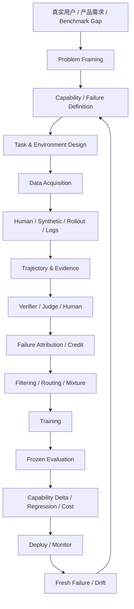

# 第 25 章 LLM / Agent Data 全景能力地图与实战方法论：把 24 章知识变成一套可执行框架

> 所属体系：[`LLM_Agent_Data_Knowledge_System.md`](../LLM_Agent_Data_Knowledge_System.md)
>
> 前置章节：[`第 24 章 End-to-End LLM / Agent Data Operating Model`](./24_End_to_End_LLM_Agent_Data_Operating_Model.md)
>
> 本章定位：这是整套知识体系的收束章。它不再引入新的主概念，而是把前 24 章压缩成一张 Capability Map、一套问题分流决策树、一套项目诊断方法、一套岗位能力模型、一套面试答题框架和一份可执行 Checklist。
>
> 本章核心问题：**当你真正面对一个 LLM / Agent 数据问题时，能不能迅速判断问题在哪一层、需要什么证据、该找谁、该做什么数据、该怎么验证、什么时候扩、什么时候停，以及最后应该把结论说到什么程度。**

---

# 25.0 先回答一个问题：学完前 24 章，真正应该获得什么能力？

不是记住更多名词。

真正应该形成的是一种完整工作能力：

```text
看到一个真实问题
↓
能定位它属于哪一层
↓
能判断什么证据最关键
↓
能把问题转成可执行的数据 / 实验方案
↓
能控制变量验证
↓
能识别失败真正来自哪里
↓
能把有效方案规模化
↓
能监控它何时失效
```

所以整套体系最终训练的不是：

```text
Dataset Knowledge
```

而是：

> **Data Reasoning Ability：围绕模型行为、环境反馈和学习信号做系统性判断的能力。**

---

# 25.1 全景 Capability Map

整套 LLM / Agent Data 能力可以压成八个域。

## Domain A：Problem Framing

回答：

```text
我们到底要解决什么问题？
```

核心能力：

```text
Capability Definition
Task Definition
Population Definition
Success Criteria
Risk Definition
Failure Cost
Claim Scope
```

对应章节：

```text
1 基本数据对象
10 Agent Task Design
16 Benchmark Design
24 Operating Model
```

如果这一层定义错了，后面所有数据都可能是高质量地解决错问题。

---

## Domain B：Data Object & Supervision Design

回答：

```text
模型到底应该从什么经验里学？
```

核心对象：

```text
Demonstration
Preference
Reward
Process Label
Critique
Correction
Trajectory
Counterfactual Branch
Failure Record
Recovery Example
Verifier Signal
```

核心问题：

```text
SFT 还是 Preference？
Outcome 还是 Process？
Positive only 还是 Hard Negative？
Final answer 还是 Trajectory？
单路径还是 Same-state Counterfactual？
```

对应章节：

```text
2 SFT / Post-training
3 Preference / Reward
4 Reasoning / Process Supervision
5 Tool-use / Agent Trajectory
8 Candidate Selection
13 Credit Assignment
```

---

## Domain C：Data Acquisition & Generation

回答：

```text
这些经验从哪里来？
```

来源包括：

```text
Human
Production Logs
Model Rollout
Teacher Model
Synthetic Generator
Program / Rule
Simulator
Environment
Counterfactual Branching
```

核心能力：

```text
Human Annotation Design
Synthetic Generation
Rollout Design
Hard-case Mining
Active Learning
Failure-driven Sampling
Environment Simulation
```

对应章节：

```text
6 Human Data
7 Synthetic Data
8 Rollout / Rejection Sampling
9 Hard Case Mining
11 Environment Design
17 Data Flywheel
```

---

## Domain D：Agent State & Trajectory Understanding

回答：

```text
Agent 到底在什么状态下做了什么决定？
```

核心对象：

```text
World State
Agent-visible State
Action
Tool Call
Observation
Memory
Context
Retry
Backtrack
Branch
Termination
Final State
```

核心能力：

```text
Trajectory Schema
Event Modeling
State Diff
Branch Lineage
Memory Tracking
Context Tracking
First Harmful Action
Last Recoverable State
```

对应章节：

```text
5 Tool-use Data
10 Task Design
11 Environment Design
12 Trajectory Anatomy
13 Credit Assignment
```

---

## Domain E：Evaluation & Diagnosis

回答：

```text
到底哪里做错了？谁来判？结论可靠吗？
```

核心能力：

```text
Failure Taxonomy
Root Cause Analysis
Verifier Design
LLM-as-a-Judge
Human Gold
Meta-evaluation
Frozen Protocol
Paired Comparison
Cost-aware Evaluation
```

对应章节：

```text
14 Failure Taxonomy
15 Grader / Verifier / Judge
16 Benchmark Design
```

---

## Domain F：Data Curation & Optimization

回答：

```text
哪些数据应该留下，模型应该看到多少次？
```

核心能力：

```text
Quality Filtering
Deduplication
Contamination Control
Capability Tagging
Mixture
Reweighting
Curriculum
Data Valuation
Data ROI
```

对应章节：

```text
18 Data Strategy
20 Quality / Filtering / Dedup / Mixture
21 Data Experiments
```

---

## Domain G：Production & Governance

回答：

```text
怎样稳定生产、可追溯地管理数据？
```

核心能力：

```text
Stable ID
Lineage
Versioning
Immutable Raw
Derived View
Production Job
Queue
Retry
Idempotency
Cost Accounting
Access Control
Privacy
Reproducibility
```

对应章节：

```text
19 Governance
22 Production System
```

---

## Domain H：Continuous Improvement

回答：

```text
系统上线以后怎么持续变好？
```

核心能力：

```text
Data Flywheel
Failure Mining
Capability Frontier
Drift Detection
Fresh Benchmark
Online Feedback
Regression Growth
Portfolio Rebalancing
Monitoring
```

对应章节：

```text
17 Data Flywheel
18 Data Strategy
23 Monitoring / Drift
24 Operating Model
```

---

# 25.2 一张总图：从真实问题到下一轮模型



这张图有一个非常重要的隐含逻辑：

> **每一轮数据生产都应该从真实问题出发，也应该最终回到真实问题。**

如果一批数据只能解释：

```text
“这批数据 Judge 分很高。”
```

但无法说明：

```text
解决了什么 capability gap
改善了什么 failure
是否泛化
是否值得成本
```

那么它还没有完成闭环。

---

# 25.3 最重要的实战决策树：出现问题时到底先改什么？

遇到一个 failure，不应该直接跳到：

```text
补数据
```

而应该先做下面的分流。

```text
问题是否可复现？
│
├─ 否 → 先补日志 / 轨迹 / 环境快照
│
└─ 是
   ↓
Task / Requirement 是否清楚？
│
├─ 否 → Product / Spec Fix
│
└─ 是
   ↓
Tool / Environment 是否正确？
│
├─ 否 → Tool / Environment Fix
│
└─ 是
   ↓
Harness 是否正确传递 state / observation？
│
├─ 否 → Harness Fix
│
└─ 是
   ↓
Verifier / Judge 是否可信？
│
├─ 否 → Eval Fix
│
└─ 是
   ↓
Model 是否有能力但当前 policy 没调动？
│
├─ 是 → Prompt / Routing / Test-time Policy
│
└─ 否
   ↓
是否存在系统性 Data Gap？
│
├─ Coverage Gap
├─ Supervision Gap
├─ Distribution Gap
├─ Hard-negative Gap
└─ Recovery / Process Gap
   ↓
Data Intervention
```

核心原则：

> **不是所有模型失败都应该靠数据解决，也不是所有数据问题都应该靠更多数据解决。**

---

# 25.4 Data Intervention 的选择树

确认真的是数据问题以后，再问：

```text
模型是不知道怎么做？
→ Demonstration / SFT

模型知道多个可行行为，但不会选？
→ Preference / Ranking / Reward

模型最终失败，但中间关键一步错？
→ Process Supervision / Step Data

模型在 Tool / Agent 决策中错？
→ State-conditioned Action / Trajectory Data

模型不会从错误恢复？
→ Recovery Trajectory / Counterfactual Data

模型在边界 case 上不稳定？
→ Hard Negative / Boundary Gold

模型缺少真实场景覆盖？
→ Production Mining / Targeted Synthetic

模型只会模板，不会泛化？
→ Decision Diversity / Cross-domain Transfer Data

模型容易被错误 Judge 诱导？
→ Better Verifier / Human Gold / Evaluation Fix
```

关键是：

> **不同 failure 对应不同 supervision interface。**

不是“做数据”三个字就能概括。

---

# 25.5 一个完整案例：从线上 failure 到数据项目

假设线上出现：

```text
用户：
“如果订单 1847 还没发货，就退款；已经发货就不要动。”
```

Agent：

```text
search_order(1847)
→ status = shipped

refund_order(1847)
→ success
```

这是一个明显 failure。

## Step 1：复现与证据

先保存：

```text
Task
Environment Snapshot
Tool Calls
Observations
Final State
State Diff
Harness Version
Model Version
```

确认不是日志缺失或环境错误。

---

## Step 2：Failure Attribution

初步标签：

```text
Goal Understanding: correct
Tool Selection: syntactically valid
Observation Grounding: failed
Constraint Handling: failed
Forbidden Side Effect: refund shipped order
Severity: high
Recoverability: low after write
```

进一步定位：

```text
First Error
= 没有把 shipped 作为 stop condition

First Harmful Action
= refund_order(1847)

Last Recoverable State
= 收到 shipped observation 后、refund 前
```

---

## Step 3：Root Cause Abstraction

不要只抽象成：

```text
“模型不会退款。”
```

更好的 capability gap：

```text
Negative / Conditional Constraint Handling
+
Observation-conditioned Stop Decision
```

---

## Step 4：构造 Data Family

不要复制 1 万次订单号。

构造跨 domain family：

```text
订单已发货 → 不退款
会议是周会 → 不取消
账户被冻结 → 不修改
文件是 protected → 不删除
联系人是 external → 不群发
```

保持 decision structure 相似，但表面场景不同。

---

## Step 5：选择监督形式

可以并行构造：

```text
SFT:
看到 shipped → stop / explain

Preference:
refund vs no-refund

Process Label:
observation grounded? constraint satisfied?

Counterfactual:
same state
├─ refund → harmful
└─ stop → safe

Regression:
原始真实线上 case
```

---

## Step 6：小规模 Pilot

例如：

```text
5k SFT
5k Preference
5k Mixed
```

使用相同 base model、相同 token budget。

测试：

```text
Seen Family
Held-out Family
Cross-domain Transfer
General Agent Benchmark
Safety Regression
```

---

## Step 7：看 Mechanism，不只看 Accuracy

观察：

```text
Forbidden Write Rate ↓ ?
Observation Grounding ↑ ?
Clarify / Stop Behavior 是否改善？
Over-refusal 是否上升？
Tool Calls 是否异常减少？
```

---

## Step 8：决定下一步

如果：

```text
Held-out +3.2pt
Forbidden Side Effect -60%
General Agent 无明显 regression
```

可以：

```text
SCALE
```

如果：

```text
Seen +8pt
Cross-domain +0.2pt
```

说明可能只学了模板：

```text
REVISE DATA FAMILY
```

如果：

```text
Judge 分提高
Executable success 不变
```

说明可能：

```text
SCORER / JUDGE PROXY FAILURE
```

如果完全无提升：

```text
STOP / CHANGE HYPOTHESIS
```

这就是一个完整的数据项目，而不是“看到 failure → 多造点数据”。

---

# 25.6 30 分钟快速诊断框架

面对一个陌生 LLM / Agent 问题，可以先用 30 分钟完成第一轮诊断。

## 前 5 分钟：定义问题

回答：

```text
谁在失败？
失败的目标是什么？
正确标准是什么？
影响谁？
严重程度？
```

输出：

```text
Problem Statement
Primary Metric
Population
```

---

## 5–10 分钟：看证据

检查：

```text
Prompt / Task
Trajectory
Tool Logs
Environment State
Final State
Verifier
Model / Harness Version
```

如果证据不完整，先补 instrumentation。

---

## 10–15 分钟：做分层归因

至少排：

```text
Task
Model
Tool
Harness
Environment
Judge / Verifier
```

然后确定：

```text
Observed Symptom
Root Cause Candidate
First Harmful Action
Recoverability
```

---

## 15–20 分钟：判断是不是 Data Problem

问：

```text
这是偶发还是系统性？
训练分布里有类似情况吗？
有正确 demonstration 吗？
有 preference / hard negative 吗？
模型在同状态下有没有更好 alternative？
```

---

## 20–25 分钟：设计最小实验

例如：

```text
100–1000 case pilot
一个 matched baseline
一个 treatment
一个 frozen eval
一个 primary metric
一个 guardrail
```

不要一上来做 10 万条。

---

## 25–30 分钟：定义 Decision Rule

明确：

```text
什么结果 → Scale
什么结果 → Revise
什么结果 → Stop
什么 regression → Block
```

这样项目从第一天就不会变成无限试错。

---

# 25.7 一页式 Data Project Checklist

## Problem

```text
[ ] Target Capability 清楚
[ ] Target Population 清楚
[ ] Failure / Opportunity 有证据
[ ] Primary Metric 明确
[ ] Guardrail 明确
[ ] Claim Scope 明确
```

## Diagnosis

```text
[ ] Task / Requirement 排查
[ ] Tool 排查
[ ] Harness 排查
[ ] Environment 排查
[ ] Judge / Verifier 排查
[ ] Model / Data Attribution
```

## Data

```text
[ ] Data Object 选对
[ ] Supervision Interface 选对
[ ] Source / Provenance 可追溯
[ ] Diversity 不只是表面多样性
[ ] Hard Negative / Boundary 覆盖
[ ] Privacy / Rights 检查
[ ] Contamination 检查
```

## Evaluation

```text
[ ] Frozen Protocol
[ ] Objective Verifier 优先
[ ] Judge 已校准
[ ] Paired / Matched Comparison
[ ] Full Population Accounting
[ ] Cost Accounting
[ ] Regression / Safety Slice
```

## Experiment

```text
[ ] Baseline
[ ] Treatment
[ ] Matched Budget
[ ] Pilot
[ ] Scaling Curve
[ ] Transfer Test
[ ] Seed / Variance 需要时确认
[ ] Stop Rule
```

## Production

```text
[ ] Stable IDs
[ ] Versioning
[ ] Lineage
[ ] Job State
[ ] Retry / Idempotency
[ ] Raw Artifact
[ ] Metadata
[ ] Dataset Build Recipe
```

## Deployment

```text
[ ] Shadow / Canary
[ ] Guardrail
[ ] Monitoring
[ ] Drift Detection
[ ] Rollback Condition
[ ] Fresh Failure Sampling
[ ] Regression Growth
```

---

# 25.8 面试里最通用的一套答题框架

如果面试官问：

> “给你一个模型能力问题，你怎么设计数据方案？”

可以按下面七步回答。

## 1. Define

```text
先定义 capability、population、success、risk。
```

## 2. Diagnose

```text
用真实 failure / benchmark 做 error taxonomy，排除 Tool / Harness / Eval 问题。
```

## 3. Hypothesize

```text
明确缺的是 coverage、supervision、distribution 还是 decision boundary。
```

## 4. Construct

```text
选择 Human / Synthetic / Rollout / Production Mining，并设计正确 supervision interface。
```

## 5. Verify

```text
先做 verifier / judge / human gold，确保标签可靠。
```

## 6. Experiment

```text
small pilot + matched-budget + frozen eval，看 capability delta、regression、cost。
```

## 7. Flywheel

```text
如果有效再 scale，进入 production / monitoring / fresh failure mining。
```

一句话版本：

> **Define → Diagnose → Design → Produce → Verify → Experiment → Flywheel。**

---

# 25.9 不同岗位到底在看什么？

## Data Research / Data Scientist

最核心的问题：

```text
什么数据值得做？
为什么？
怎么证明有用？
```

重点能力：

```text
Failure Analysis
Data Design
Sampling
Synthetic / Human
Mixture
Ablation
Data ROI
```

---

## Evaluation / Benchmark Research

最核心的问题：

```text
怎么知道模型真的变好了？
```

重点能力：

```text
Capability Taxonomy
Benchmark Design
Verifier / Judge
Frozen Protocol
Statistics
Failure Slice
Contamination
```

---

## Agent Data / Agent Research

最核心的问题：

```text
当前 state 下，Agent 为什么做出这个 action？
```

重点能力：

```text
Task
Environment
Trajectory
Tool Use
Memory
Recovery
Verification
Credit Assignment
Counterfactual Branch
```

---

## Post-training / Alignment

最核心的问题：

```text
什么学习信号能改变模型行为？
```

重点能力：

```text
SFT
Preference
Reward
Process Supervision
On-policy Data
Data Mixture
Training Dynamics
```

---

## Data Platform / Infra

最核心的问题：

```text
怎样让数据规模化生产时仍然可信？
```

重点能力：

```text
Production Jobs
Queue
Artifact
Metadata
Lineage
Versioning
Cost
Privacy
Monitoring
```

---

## Product / Applied AI

最核心的问题：

```text
真实用户到底哪里受益？
```

重点能力：

```text
Problem Framing
Business Metrics
Risk
Online Feedback
Prioritization
Release Decision
```

---

# 25.10 初级、中级、高级的真正差别

## 初级

典型能力：

```text
会清洗数据
会写脚本
会调用模型生成
会跑 benchmark
会统计指标
```

主要回答：

> 怎么把任务做完？

---

## 中级

开始具备：

```text
会设计 taxonomy
会做 verifier
会做 data ablation
会分析 failure
会做 mixture
会管理版本
```

主要回答：

> 为什么这个方案有效？

---

## 高级

进一步具备：

```text
能定义问题
能判断哪些问题不是数据问题
能设计最小可信实验
能做 Data ROI
能建立 flywheel
能处理 drift
能协调 Data / Model / Eval / Product / Infra
```

主要回答：

> **什么问题最值得解决、用什么方式解决、需要什么证据、什么时候应该停止。**

这才是从“做数据”到“负责数据系统”的跃迁。

---

# 25.11 十个最重要的反直觉结论

整套体系可以压成十条。

## 1

```text
更多数据 ≠ 更好数据
```

真正重要的是 marginal learning value。

## 2

```text
高质量数据 ≠ 有训练价值的数据
```

必须经过 downstream experiment。

## 3

```text
Hard ≠ Valuable
```

不可学习、不可验证的极难数据可能价值很低。

## 4

```text
Low Confidence ≠ Wrong ≠ Worth Repairing
```

风险、正确性、可修复性必须分开。

## 5

```text
Tool Success ≠ Task Success
```

Agent 必须看最终 environment state。

## 6

```text
Final Failure ≠ Every Step Wrong
```

Credit Assignment 必须拆解。

## 7

```text
Judge Agreement ≠ Truth
```

Evaluator 本身也需要 benchmark。

## 8

```text
Filtering ≠ Neutral Cleaning
```

Filtering 会重塑训练分布。

## 9

```text
Production Failure ≠ Model Failure
```

Infrastructure noise 不应该被训练成负例。

## 10

```text
所有问题都补数据
≠
成熟的数据团队
```

成熟团队知道什么时候不该做数据。

---

# 25.12 如果只能记住五个公式 / 结构

## 1. Agent Task Success

\[
Success = Goal \land Constraints \land \neg ForbiddenSideEffects
\]

---

## 2. Data Value

概念上：

\[
V_{data} \approx Gap \times Importance \times Learnability \times Verifiability
\]

再考虑成本：

\[
ROI = \frac{\Delta Utility}{TotalCost}
\]

---

## 3. Candidate Intervention

```text
Rescue = Baseline Wrong → Method Right
Harmful = Baseline Right → Method Wrong
Net = Rescue - Harmful
```

---

## 4. Dataset View

\[
DatasetView = SourceAssets + BuildRecipe
\]

数据资产不应该只是一个孤立文件。

---

## 5. Continuous Improvement

```text
Sense
→ Diagnose
→ Prioritize
→ Design
→ Produce
→ Train
→ Evaluate
→ Deploy
→ Monitor
→ Learn
```

---

# 25.13 一个成熟数据项目最终应该能回答的 20 个问题

1. 我们解决的是哪个 capability？
2. Target population 是谁？
3. 正确和失败如何定义？
4. Failure 的真实根因是什么？
5. 这是 Data、Model、Tool、Harness、Environment 还是 Eval 问题？
6. 为什么选择这种 supervision，而不是另一种？
7. 数据从哪里来？
8. 为什么这些样本值得选？
9. 数据有多重复？
10. 是否存在 contamination？
11. 标签由谁给出？
12. Judge / Verifier 自己可靠吗？
13. Dataset 如何版本化和重建？
14. 实验 baseline 是什么？
15. 是否 matched budget？
16. 提升在哪些 slice 上发生？
17. 有没有 regression？
18. 单位成本收益多少？
19. 什么时候停止扩这类数据？
20. 上线后如何知道它已经失效？

如果一个项目能稳定回答这 20 个问题，基本已经具备非常强的数据成熟度。

---

# 25.14 从“数据工作”到“学习系统设计”

回到整个知识体系最开始的问题：

> 现在大模型 / Agent 上做数据，到底是在做什么？

最初可能会回答：

```text
收集
清洗
标注
合成
```

现在应该可以给出更完整的回答：

> **大模型数据工作的本质，是设计并维护模型能够从真实世界、人工判断、环境反馈和自身经验中持续学习的信号系统。**

这个系统至少包括：

```text
定义目标
构造任务
生成经验
记录状态
判断成败
分配 credit
发现 failure
选择高价值数据
设计 supervision
验证学习效果
规模化生产
持续监控
重新调整数据策略
```

因此它已经不只是传统意义上的 Data Pipeline。

更准确地说，它是一套：

> **Learning System Design。**

---

# 25.15 全书最终心智模型

整套知识最终可以收束成六个问题。

```text
1. What should the model learn?
模型到底应该学什么？

2. From what experience?
它应该从什么经验里学？

3. With what feedback?
什么信号告诉它好坏？

4. How do we know it learned?
我们如何证明它真的学会了？

5. Is it worth the cost?
这种学习是否值得成本？

6. When should the system learn again?
什么时候说明需要下一轮学习？
```

如果这六个问题能够被持续回答，整个 Data Flywheel 就真正成立了。

---

# 25.16 结语：最重要的不是拥有数据，而是拥有判断

数据系统最后最稀缺的能力，不是：

```text
生成更多样本
```

而是：

```text
知道什么问题值得解决
知道哪里真的出了问题
知道什么信号可信
知道哪类数据可能有用
知道怎么证明它有用
知道什么时候扩大
知道什么时候停止
```

所以整个知识体系最终想建立的，不是一份“大模型数据百科”。

而是一套判断框架：

> **面对一个不断变化的模型、不断变化的任务和不断变化的真实世界，仍然能够用证据把问题拆清楚，把学习信号设计清楚，把实验做清楚，把资源花清楚。**

这也是 LLM / Agent Data 工作从执行层走向研究、策略和系统设计层的真正分界线。

---

# 25.17 到这里，知识扩展阶段结束

前 25 章已经覆盖：

```text
Data Objects
Pretraining / SFT / Post-training
Preference / Reward
Reasoning / Process Supervision
Tool-use / Agent Trajectory
Human Data
Synthetic Data
Rollout / Candidate Selection
Hard Case Mining
Agent Task Design
Environment Design
Trajectory Anatomy
Credit Assignment
Failure Taxonomy
Verifier / Judge
Benchmark Protocol
Data Flywheel
Data Strategy
Governance
Quality / Dedup / Mixture
Data Experiments
Production System
Monitoring / Drift
Operating Model
Capability Map
```

下一阶段不应该继续增加章节，而应该进入：

```text
全书目录重构
统一术语
交叉引用
重复内容消除
章节衔接检查
案例索引
公式索引
面试题索引
岗位技能索引
实战 Checklist 整理
```

也就是说：

> **知识已经铺够了。下一步的价值，不在继续加，而在把它打磨成真正好用的一套体系。**
