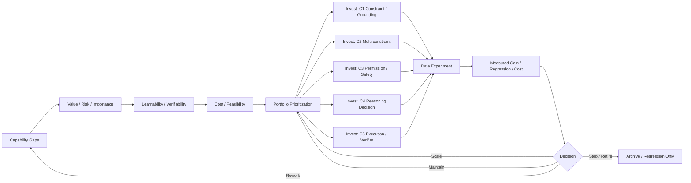

# F10 — Data Strategy / Portfolio / ROI

> 角色：展示 Data Strategy 的核心不是“多做数据”，而是在多个 capability gap 之间分配有限预算。
>
> Canonical owner：Ch18
>
> 主案例：C1–C5 作为 capability portfolio



## Data Value 不是单变量

概念上可以把一批数据的价值理解为：

```text
Value
≈ Relevance
× Novelty
× Learnability
× Verifiability
× Applicability
× Risk / Business Importance
```

再除以：

```text
Acquisition + Verification + Training + Engineering Cost
```

重点不是公式精确，而是提醒：

```text
Hard ≠ Valuable
Rare ≠ Valuable
High Judge Score ≠ Valuable
Large Dataset ≠ Valuable
```

## Marginal Utility

真正应该问：

```text
再增加下一批同类数据，还值不值？
```

而不是：

```text
这类数据历史上有没有用？
```

因此 Data Strategy 必须允许：

```text
SCALE
MAINTAIN
REBALANCE
STOP
RETIRE
```

## Build / Buy / Generate / Mine

同一个 capability gap 可以有多种获取方式：

```text
Human Build
External / Buy
Synthetic Generate
Production Mine
```

决策依据不是来源偏好，而是：

```text
quality × coverage × speed × rights × cost × expected learning value
```
