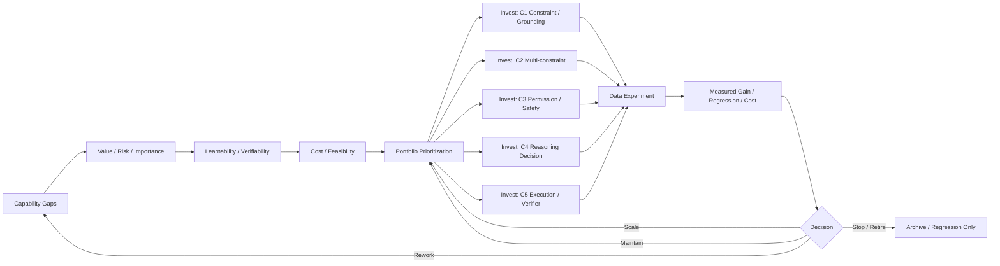

# F10 — Data Strategy / Portfolio / ROI

> **Figure Question：** 有限 Data Budget 应该投到哪些 Capability Gap，什么时候 Scale、Maintain、Rework 或 Stop？
>
> **Level：** Part-level
>
> **Canonical Owner：** Ch18
>
> **Primary Case：** `C1–C5` capability portfolio
>
> **Scope：** 固定 Data Strategy 的资源配置循环；Mixture 技术细节归 Ch20，因果证明归 Ch21。



## Read the Spine

Data Strategy 不是：

```text
哪个 dataset 最大
哪个 benchmark 最差
哪个 failure 最多
```

而是：

```text
Capability Gap
→ Value / Risk / Importance
→ Learnability / Verifiability
→ Cost / Feasibility
→ Portfolio Prioritization
→ Data Experiment
→ Measured Gain / Regression / Cost
→ Scale / Maintain / Rework / Stop
```

也就是说，真正的决策单位是：

> **Capability-level Data Investment。**

## Critical Boundaries

```text
Hard
≠ Valuable

Rare
≠ Low Priority

High Judge Score
≠ High Learning Value

Large Dataset
≠ High ROI

Historical Value
≠ Positive Marginal Utility now
```

任何价值判断都应该绑定：

```text
Model
Capability
Metric
Distribution
Risk Profile
Training Recipe
```

## Case Lens — C1–C5 Portfolio

```text
C1
conditional constraint / grounding

C2
multi-constraint / partial completion

C3
permission / side-effect / harness ownership

C4
reasoning continuation / repair

C5
execution / verifier coverage
```

团队不是“五个 case 都做一样多”，而是比较：

```text
expected value
risk reduction
learnability
verification quality
cost
marginal return
```

再决定组合。

同一个 gap 也可以选择：

```text
Build
Buy
Generate
Mine
```

来源不是价值本身。

## Cross-links

- [`Ch18 — Data Strategy & Data Valuation`](../18_Data_Strategy_and_Data_Valuation.md)
- [`Ch20 — Data Quality / Filtering / Mixture`](../20_Data_Quality_Filtering_Deduplication_and_Mixture.md)
- [`Ch21 — Data Experiments`](../21_Data_Experiments_and_Causal_Validation.md)
- [`F9 — Data Flywheel`](./F9_Data_Flywheel.md)
- [`F11 — Governance / Lineage DAG`](./F11_Governance_Lineage_DAG.md)
- [`Case Index`](../00_Case_Integration_Index.md)

## Caption

**F10 — Data Strategy / Portfolio / ROI.** Data Strategy 的核心不是多做数据，而是在多个 capability gap 之间比较价值、风险、可学性、可验证性与总成本，并用真实 Data Experiment 的边际收益决定 Scale、Maintain、Rework、Stop 或 Retire。
