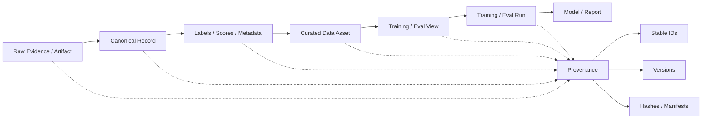

# F11 — Governance / Lineage DAG

> **Figure Question：** 一个最终模型 / 报告怎样沿数据、标签、训练和评测关系追溯回原始 Evidence？
>
> **Level：** Part-level
>
> **Canonical Owner：** Ch19
>
> **Primary Case：** `C1` family assets
>
> **Scope：** 固定 system-wide lineage / provenance 主关系；trajectory-local event lineage 归 F5 / Ch12。



## Read the Spine

主链是：

```text
Raw Evidence
→ Canonical Record
→ Labels / Scores / Metadata
→ Curated Data Asset
→ Training / Eval View
→ Run
→ Model / Report
```

旁边的 Provenance 不是“备注字段”，而是贯穿整条链的：

```text
Stable ID
Version
Manifest / Hash
Origin / Transform / Usage relation
```

这样才允许双向追踪。

## Critical Boundaries

```text
Identity
≠ Label

Raw Evidence
≠ Derived Interpretation

Dataset View
≠ Source Asset

Historical Decision
≠ Corrected Label
≠ Fresh Re-execution Result

Re-score
≠ Re-run
≠ Replay
```

Lineage 的目的不是保留漂亮文件名，而是：

> **允许系统纠错而不篡改历史。**

## Case Lens — C1 Family

```text
C1-F1 raw trajectory
→ corrected failure label
→ preference / recovery asset
→ mixture_v12
→ train_run_203
→ model_v18
→ recovery_eval_v6
```

如果后来发现旧 Judge 有 bug：

```text
Preserve Raw Evidence
→ Correct Label Version
→ Rebuild Derived Views
→ Re-score Frozen Outputs
→ Trace affected Runs / Models
```

而不是：

```text
重新生成一条 trajectory
然后把新行为覆盖旧历史
```

## Cross-links

- [`Ch19 — Data Governance / Lineage / Reproducibility`](../19_Data_Governance_Lineage_and_Reproducibility.md)
- [`F5 — Trajectory Anatomy`](./F5_Trajectory_Anatomy.md)
- [`F10 — Data Strategy / Portfolio / ROI`](./F10_Data_Strategy_Portfolio_ROI.md)
- [`F12 — Data Production System`](./F12_Data_Production_System.md)
- [`C1 — Order / Refund Agent`](../cases/C1_Order_Refund_Agent.md)

## Caption

**F11 — Governance / Lineage DAG.** 成熟数据系统必须能把模型、报告、run、dataset view、label 和 canonical record 一直追溯到 Raw Evidence；Derived interpretation 可以修正和版本化，但 Raw Facts 与 Historical Decisions 不能被静默改写。
