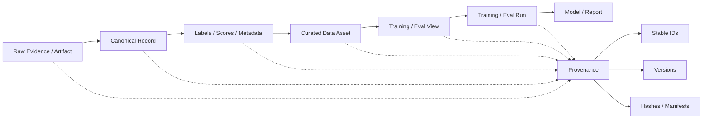

# F11 — Governance / Lineage DAG

> 角色：展示一个最终结论如何沿数据、标签、训练和评测链路追溯回原始证据。
>
> Canonical owner：Ch19
>
> 主案例：C1 family assets



## Lineage 不是文件名链

真正要能回答：

```text
这个模型为什么这样？
↓
用了哪个 training run？
↓
用了哪些 dataset view？
↓
这些 view 来自哪些 asset / batch？
↓
这些 label 是谁、按什么 rubric / verifier 产生？
↓
原始 evidence 是什么？
```

## 三种历史动作必须分开

```text
Re-score
= 原输出不变，只重新评价

Re-run
= 用当前 policy / runtime 重新执行

Replay
= 尽量按冻结历史输入和环境重现当时执行
```

因此：

```text
Historical Decision
≠ Corrected Label
≠ Fresh Re-execution Result
```

## C1 Example

```text
C1-F1 raw trajectory
→ corrected failure label
→ preference pair
→ recovery_pref_v4
→ mixture_v12
→ train_run_203
→ model_v18
→ recovery_eval_v6
```

如果后来发现 Judge 有 bug，优先：

```text
reuse raw trajectory
→ re-score
```

而不是重新生成 trajectory，避免把 evaluator change 和 policy change 混在一起。

## Governance Minimum

即使是研究原型，至少也应有：

```text
Stable ID
Version
Code / Config
Manifest
Hash / Count
Raw Evidence Preservation
```

目标不是官僚化，而是：

> **让结论可以被解释、纠正和重建。**
