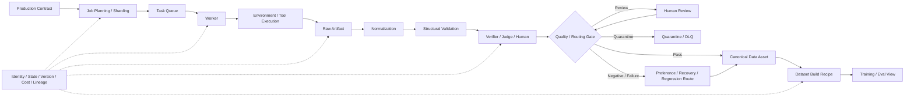

# F12 — Data Production System

> 角色：展示高价值数据怎样从 Production Contract 变成可重建 Dataset View，并把成本、状态、lineage 一起带过去。
>
> Canonical owner：Ch22
>
> 主案例：C1 recovery / constraint family



## Production Request ≠ Job ≠ Sample

```text
Production Request
= 我要生产什么能力的数据

Data Job
= 一次可独立执行 / 重试 / 计量的工作

Artifact
= 执行产生的原始证据

Dataset Record / View
= 最终被训练 / 评测消费的派生数据
```

因此允许：

```text
1 Job → N Artifacts → M Derived Records
```

## Retry Boundary

```text
Infrastructure Retry
≠ Agent Recovery
```

Transient failure 可以 retry；模型语义失败必须保留为 outcome，不能被生产系统偷偷修掉。

## Dataset View

```text
Dataset View
= Source Assets
+ Filters
+ Sampling Policy
+ Mixture
+ Schema Transform
+ Build Version
```

理想状态下，训练集不是人工复制出来的黑盒 JSONL，而是可重建视图。

## KPI

不要只看：

```text
Raw Throughput
```

更要看：

```text
High-value Yield
Cost / Accepted Sample
Lineage Completeness
Failure / Retry / DLQ Rate
Downstream Gain
```

基础设施最终服务的是 capability improvement，而不是 pipeline activity。
