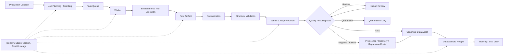

# F12 — Data Production System

> **Figure Question：** 高价值 Experience 怎样从 Production Contract 变成可重建 Dataset View，并把状态、成本和 lineage 一起带过去？
>
> **Level：** Part-level
>
> **Canonical Owner：** Ch22
>
> **Primary Case：** `C1` recovery / constraint family
>
> **Scope：** 固定 experience manufacturing infrastructure；Monitoring、Strategy、Governance 和 downstream causal proof 分别由相邻章节负责。



## Read the Spine

```text
Production Contract
→ Job Planning / Sharding
→ Queue
→ Worker
→ Environment / Tool Execution
→ Raw Artifact
→ Normalize / Validate
→ Evaluate / Route
→ Canonical Asset
→ Build Recipe
→ Training / Eval View
```

贯穿全流程的不是一个“metadata 表”，而是：

```text
Identity
State
Version
Cost
Lineage
```

这些信息必须和数据一起流动。

## Critical Boundaries

```text
Production Request
≠ Data Job
≠ Raw Artifact
≠ Dataset Record / View

Infrastructure Retry
≠ Agent Recovery

Raw Throughput
≠ High-value Yield

Dataset File
≠ Rebuildable Dataset View
```

生产系统不能偷偷把模型语义 failure 当成 infrastructure retry 修掉，否则真实 outcome 会被生产 pipeline 抹平。

## Case Lens — C1 Recovery Family

```text
Production Contract:
生成 conditional-constraint / recovery family
↓
Job:
构造 C1 sibling case + environment snapshot
↓
Worker:
rollout / tool execution
↓
Raw Artifact:
trajectory + state diff + evaluator evidence
↓
Routing:
positive / harmful / recovery / regression
↓
Asset:
verified family
↓
Build Recipe:
SFT / Preference / Regression View
```

真正需要监控的不是：

```text
今天生成了多少条
```

而是：

```text
Verified Yield
Unique / High-value Yield
Cost / Accepted Sample
Lineage Completeness
Downstream Gain
```

## Cross-links

- [`Ch22 — Data Production System`](../22_Data_Production_System.md)
- [`F11 — Governance / Lineage DAG`](./F11_Governance_Lineage_DAG.md)
- [`F13 — Monitoring / Drift`](./F13_Monitoring_Drift_Diagnostic_Tree.md)
- [`C1 — Order / Refund Agent`](../cases/C1_Order_Refund_Agent.md)

## Caption

**F12 — Data Production System.** 数据生产不是“批量生成 JSONL”，而是把 Production Contract 转成可执行 Job、可验证 Raw Artifact、可路由 Data Asset 与可重建 Dataset View，同时保留 Identity、Version、Cost 和 Lineage；throughput 只有在产生高价值下游资产时才有意义。
