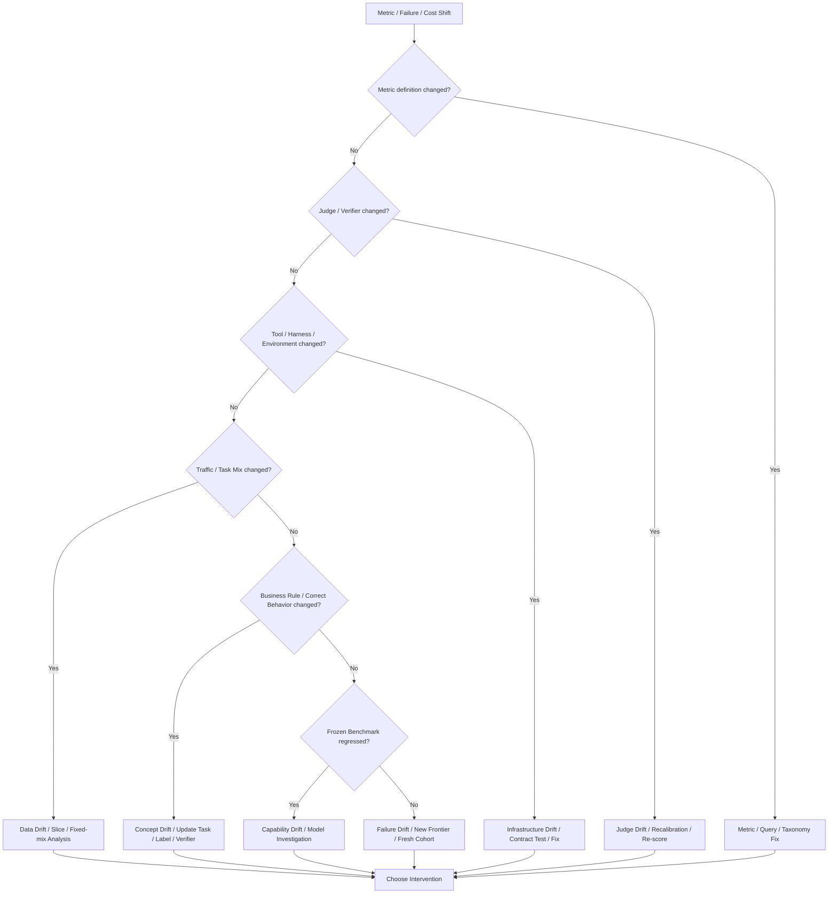

# F13 — Monitoring / Drift Diagnostic Tree

> **Figure Question：** 线上指标变化以后，首先应该排查什么，怎样避免把所有 drift 都误判成模型退化？
>
> **Level：** Part-level
>
> **Canonical Owner：** Ch23
>
> **Primary Case：** `C1` production failure + `C3` harness / tool drift
>
> **Scope：** 固定 Monitoring / Drift 的第一层诊断树；更深的 Failure Root Cause 仍回到 Ch14，组织 routing 回到 Ch24。



## Read the Spine

不要从：

```text
metric down
```

直接跳到：

```text
model regressed
```

更稳的顺序是依次排查：

```text
Measurement changed?
↓
Evaluator changed?
↓
Tool / Harness / Environment changed?
↓
Traffic / Task Mix changed?
↓
Correct Behavior / Business Rule changed?
↓
Frozen Capability regressed?
↓
New Failure Frontier emerged?
```

最后才进入对应 intervention。

## Critical Boundaries

```text
Monitoring
≠ Diagnosis

Data Drift
≠ Capability Drift

Judge Drift
≠ Model Regression

Raw Metric
≠ Fixed-mix Metric

Ranking Quality
≠ Fixed Threshold Calibration
```

Selective system 还必须保留：

```text
Eligible
Triggered
Intervened
Executed
Observed Outcome
```

否则 success 上升可能只是系统越来越少处理困难 case。

## Case Lens

### C1 — Production failure composition changed

如果 shipped/refund failure 占比突然上升，先问：

```text
traffic mix 变了吗？
business rule 变了吗？
model 真在 frozen benchmark 上退化了吗？
```

而不是直接追加 C1 training data。

### C3 — Harness / Tool drift

如果：

```text
Tool backend response schema changed
```

导致 Harness 把 failure 解析成 success，那么表面可能出现：

```text
unsupported success claims ↑
```

但 Owner 是 infrastructure，而不是 Model。

## Stable Ruler + Moving Frontier

```text
Frozen Core Benchmark
→ Regression / longitudinal comparability

Fresh Failure Cohort
→ New tools / rules / tasks / failure modes
```

两者缺一不可。

## Cross-links

- [`Ch23 — Monitoring / Online Feedback / Drift`](../23_Data_Monitoring_Online_Feedback_and_Drift_Detection.md)
- [`Ch14 — Agent Failure Taxonomy`](../14_Agent_Failure_Taxonomy.md)
- [`F9 — Data Flywheel`](./F9_Data_Flywheel.md)
- [`F12 — Data Production System`](./F12_Data_Production_System.md)
- [`F14 — Operating Model + Capability Map`](./F14_Operating_Model_and_Capability_Map.md)
- [`C3 — File / Repository Agent`](../cases/C3_File_Repository_Agent.md)

## Caption

**F13 — Monitoring / Drift Diagnostic Tree.** 指标变化并不自动等于模型退化：Measurement、Evaluator、Infrastructure、Traffic Mix、Concept 与 Capability 都可能漂移；Monitoring 负责发现“变了”，Diagnosis 才负责确认“为什么变、该修谁”。
