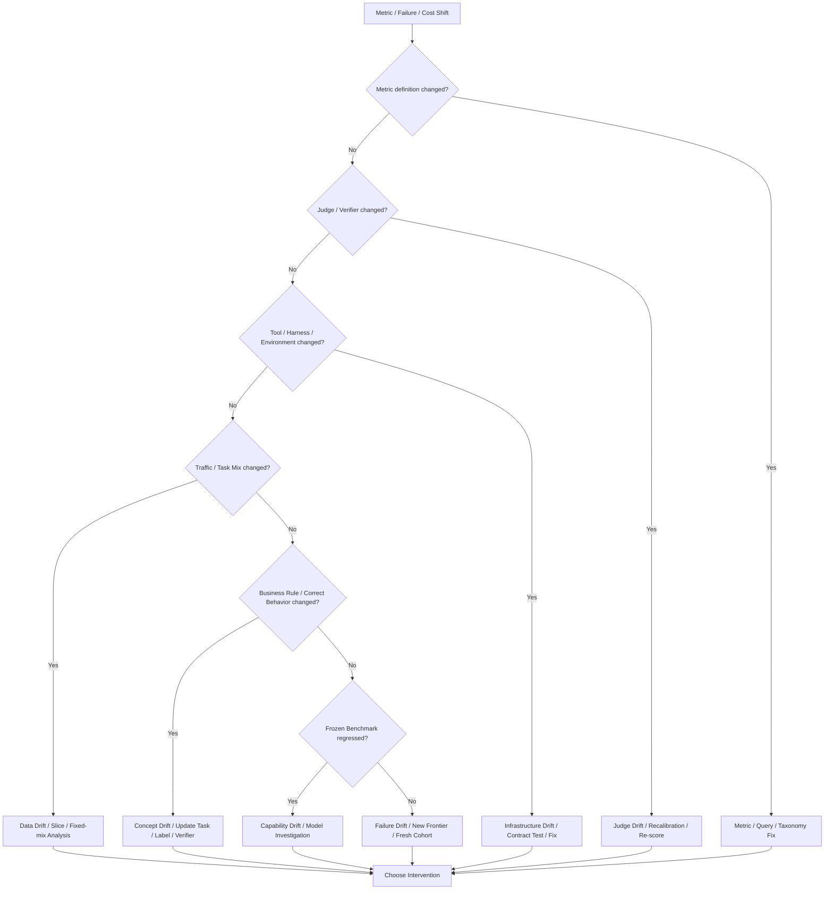

# F13 — Monitoring / Drift Diagnostic Tree

> 角色：当线上指标变化时，先判断“什么变了”，再决定是否需要 Data / Model / Tool / Harness / Evaluator intervention。
>
> Canonical owner：Ch23
>
> 主案例：C1 production failure + C3 harness / tool drift



## 六类 Drift

```text
Data Drift
→ 输入 / traffic mix 变了吗？

Concept Drift
→ 正确行为定义变了吗？

Failure Drift
→ 失败组成变了吗？

Capability Drift
→ 模型在固定尺子上退化了吗？

Judge Drift
→ 测量工具变了吗？

Infrastructure Drift
→ Tool / Harness / Environment 变了吗？
```

## Stable Ruler + Moving Frontier

```text
Frozen Core Benchmark
→ 纵向可比 / Regression

Fresh Failure Cohort
→ 新任务 / 新 failure / 新工具 / 新规则
```

二者缺一不可。

## Coverage / Triggered System

对于 selective system，监控必须保留：

```text
Eligible
Triggered
Intervened
Executed
Observed Outcome
```

并同时看：

```text
Coverage
Success@Coverage
Risk@Coverage
Trigger Rate
Calibration
Cost
```

否则 success 上升可能只是系统越来越少处理困难任务。

## Trigger / Score Drift

即使 threshold 数值不变：

```text
score distribution changed
```

也可能导致：

```text
Trigger Rate 20% → 70%
```

所以：

```text
Ranking quality good
≠ Fixed threshold still calibrated
```

## Response Principle

```text
Drift Signal
→ Diagnose
→ Fresh Cohort / Replay / Shadow
→ Root Cause
→ Small Intervention
→ Controlled Validation
→ Scale / Rollback / Monitor
```

不要把所有 drift 都翻译成：

```text
“再训练一次模型”
```
