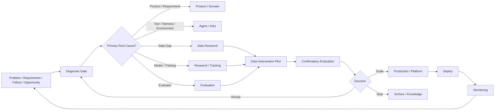
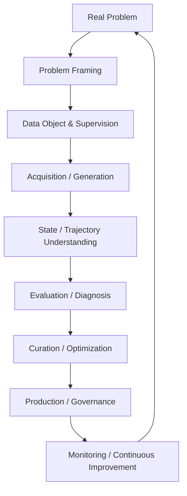

# F14 — Operating Model + Capability Map

> **Figure Question：** 团队和个人怎样调用整套 LLM / Agent Data 系统解决真实问题？
>
> **Level：** Book-level
>
> **Canonical Owner：** Ch24–25
>
> **Primary Case：** All Canonical Cases
>
> **Scope：** 作为全书视觉收束，同时固定 Organization OS 与 Practitioner OS；不重新定义前 24 章的 canonical concepts。

## A. Organization Operating Model



## B. Practitioner Capability Map



## Read the Spine

这张图有两个视角，但只有一个核心思想。

组织视角：

```text
Problem
→ Diagnose
→ Assign Correct Owner
→ Pilot
→ Confirm
→ Scale / Revise / Stop
→ Deploy
→ Monitor
↺
```

个人视角：

```text
Frame Problem
→ Understand Data / State / Trace
→ Acquire Experience
→ Evaluate / Diagnose
→ Curate / Experiment
→ Produce / Govern
→ Monitor / Improve
↺
```

二者都在回答：

> **真实问题怎样经过证据、责任归因和受控 intervention，最终变成可持续改进。**

## Critical Boundaries

```text
Problem
≠ Data Problem

Failure Layer
≠ Failure Owner

Pilot Result
≠ Scale Decision

Organization OS
≠ Practitioner OS
```

尤其第一条最重要：

```text
Tool / Harness / Environment / Evaluator / Product Spec 问题
```

不应该因为“AI 项目”就自动路由给 Data Team。

## 30-minute Diagnosis Lens

```text
0–5 min
定义目标、population、metric

5–10 min
看 Task / Case / Trace / Tool / State / Evidence

10–15 min
做 Product / Model / Tool / Harness / Environment / Evaluator 归因

15–20 min
判断是否真的是 Data Gap

20–25 min
设计最小可信 intervention

25–30 min
预先定义 Scale / Revise / Stop Rule
```

这不是时间硬约束，而是一个防止“先想方案、后找问题”的工作顺序。

## Six Root Questions

```text
1. What should the model learn?
2. From what experience?
3. With what feedback?
4. How do we know it learned?
5. Is it worth the cost?
6. When should the system learn again?
```

这六问把整本书重新压回一个终局 mental model：

> **Learning System Design。**

## Cross-links

- [`Ch24 — End-to-End Operating Model`](../24_End_to_End_LLM_Agent_Data_Operating_Model.md)
- [`Ch25 — Capability Map & Practical Methodology`](../25_LLM_Agent_Data_Capability_Map_and_Practical_Methodology.md)
- [`F1 — Learning System Overview`](./F1_Learning_System_Overview.md)
- [`F9 — Data Flywheel`](./F9_Data_Flywheel.md)
- [`Role Index`](../00_Role_Index.md)
- [`Problem Index`](../00_Problem_Index.md)
- [`Checklist Index`](../00_Checklist_Index.md)

## Caption

**F14 — Operating Model + Capability Map.** 真实问题首先经过 Diagnosis 和 Owner Routing，而不是自动变成 Data Project；团队用 Pilot / Evaluation / Scale Gate 运转系统，个人则通过 Problem Framing、Trajectory Understanding、Evaluation、Curation、Production 与 Monitoring 调用同一套能力。
