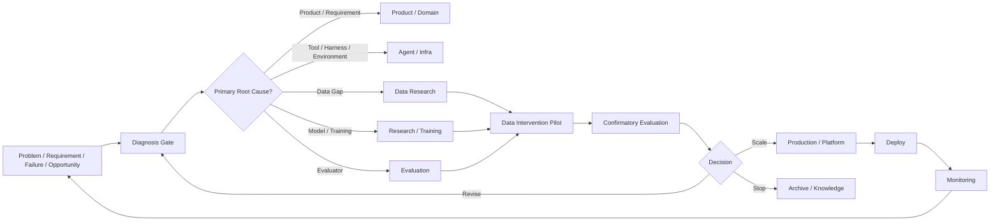
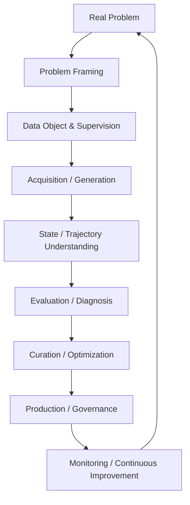

# F14 — Operating Model + Capability Map

> 角色：全书收束图。把“团队怎么运行”和“个人怎么调用”放在同一张 operating architecture 中。
>
> Canonical owner：Ch24–25
>
> 主案例：All Canonical Cases

## A. Organization Operating Model



核心不是“所有问题都进入 Data Team”，而是：

```text
Problem
→ Diagnosis
→ Correct Owner
→ Evidence Gate
→ Intervention
→ Evaluation
→ Decision
```

## B. Practitioner Capability Map



八域能力不是八个独立岗位，而是解决问题时会反复调用的八组能力。

## 30-minute Diagnosis Lens

```text
0–5 min
定义目标、population、metric

5–10 min
看 Task / Case / Trace / Tool / State / Evidence

10–15 min
做 Product / Model / Tool / Harness / Environment / Evaluator 归因

15–20 min
判断是否真的是 Data Gap

20–25 min
设计最小可信 intervention

25–30 min
预先定义 Scale / Revise / Stop Rule
```

## 六个根问题

```text
1. What should the model learn?
2. From what experience?
3. With what feedback?
4. How do we know it learned?
5. Is it worth the cost?
6. When should the system learn again?
```

这六问对应整本书最稳定的终局 mental model：

> **Learning System Design。**
