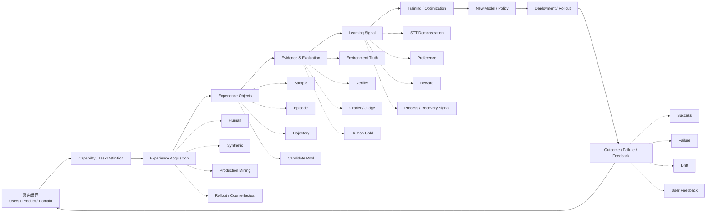

# F1 — Learning System Overview

> 角色：全书总图。回答“LLM / Agent Data 工作到底在维护什么系统？”
>
> Canonical owner：Ch0 / Ch25
>
> 关联：Ch17 Data Flywheel、Ch18 Data Strategy、Ch21 Data Experiments、Ch24 Operating Model



## 读图方式

这张图不是“训练 pipeline”，而是整个知识体系的最小闭环：

```text
真实目标
→ 定义能力
→ 获取经验
→ 记录经验
→ 判断发生了什么
→ 构造学习信号
→ 改变模型
→ 回到真实世界
```

其中最容易被忽略的三条边界是：

```text
Experience ≠ Learning Signal
Evidence ≠ Label
Training Data ≠ Raw Production Log
```

## Case Lens

- `C1`：真实 Agent failure 如何从 production 进入 verifier、data、training，再回到 monitoring。
- `C4`：reasoning state 如何产生 same-prefix counterfactual，再转成 selector / process / training signal。

## 对应章节

```text
Ch1–9   → Experience / Supervision / Acquisition
Ch10–16 → Task / Environment / Trajectory / Measurement
Ch17–21 → Flywheel / Strategy / Curation / Experiment
Ch22–24 → Production / Monitoring / Organization
Ch25    → 全系统调用
```
