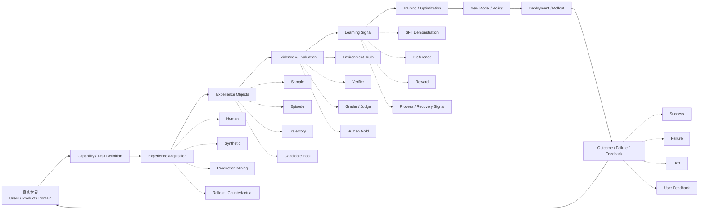

# F1 — Learning System Overview

> **Figure Question：** LLM / Agent Data 工作到底在维护什么系统？
>
> **Level：** Book-level
>
> **Canonical Owner：** Ch0 / Ch25
>
> **Primary Case：** `C1` + `C4`
>
> **Scope：** 固定整本书的 Learning System 最小闭环；不展开具体 acquisition、evaluation、training 或 production 技术细节。



## Read the Spine

第一眼只看主环：

```text
真实目标
→ 定义能力
→ 获取经验
→ 记录经验
→ 判断发生了什么
→ 构造学习信号
→ 改变模型 / Policy
→ 回到真实世界
```

这张图不是“训练 pipeline”，而是：

> **Learning System 的最小闭环。**

Human / Synthetic / Production / Rollout 只是经验来源；Verifier / Judge / Human Gold 只是读 Evidence 的方式；最终都必须回到真实 Outcome 和下一轮学习。

## Critical Boundaries

```text
Experience
≠ Learning Signal

Evidence
≠ Label

Training Data
≠ Raw Production Log

Deployment Feedback
≠ automatically a Data Problem
```

这四个边界一旦混掉，数据工作就很容易退化成：

```text
收日志
→ 清洗
→ 训练
```

而失去 Diagnosis / Evaluation / Controlled Validation。

## Case Lens

### C1 — Order / Refund Agent

```text
production failure
→ environment evidence
→ failure diagnosis
→ constraint / recovery data
→ controlled experiment
→ deploy
→ monitor
```

它说明一个真实 failure 怎样穿过整套 learning system。

### C4 — Reasoning Continue / Repair

```text
reasoning state
→ same-prefix candidate pool
→ future outcome evidence
→ selector / process signal
→ reasoning intervention
```

它说明 Learning System 不只作用于外部 Agent，也可以作用于内部 reasoning state。

## Cross-links

- [`Ch0 — Overview`](../00_Overview.md)
- [`Ch25 — Capability Map & Practical Methodology`](../25_LLM_Agent_Data_Capability_Map_and_Practical_Methodology.md)
- [`F9 — Data Flywheel`](./F9_Data_Flywheel.md)
- [`F14 — Operating Model + Capability Map`](./F14_Operating_Model_and_Capability_Map.md)
- [`C1 — Order / Refund Agent`](../cases/C1_Order_Refund_Agent.md)
- [`C4 — Reasoning Continue / Repair`](../cases/C4_Reasoning_Continue_Repair.md)

## Caption

**F1 — Learning System Overview.** LLM / Agent Data 不只是“准备训练样本”，而是在真实目标、经验、证据、学习信号、训练、部署和反馈之间维护一个可验证闭环；其中 `Experience ≠ Learning Signal`、`Evidence ≠ Label` 是最关键的边界。
