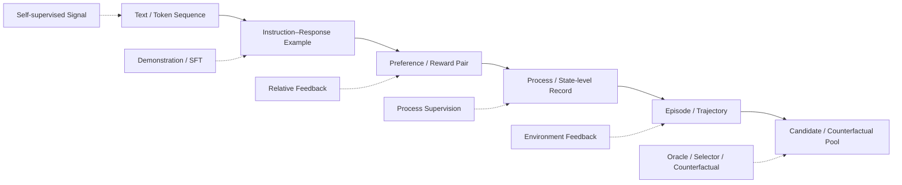

# F2 — Data Object & Learning Signal Evolution

> **Figure Question：** 数据对象怎样从静态 Example 扩展成可交互 Experience，Learning Signal 又作用在哪一层？
>
> **Level：** Part-level
>
> **Canonical Owner：** Ch1–3
>
> **Primary Case：** `C1`
>
> **Scope：** 固定 Data Object 与 Learning Signal 的演化关系；不把 Environment Feedback、Reward、Label 或 Dataset View 混成同一种东西。



## Read the Spine

对象从左到右，保存的上下文、环境证据和因果结构逐渐增加：

```text
Text / Token
→ Instruction–Response
→ Preference / Reward Pair
→ Process / State Record
→ Episode / Trajectory
→ Candidate / Counterfactual Pool
```

Learning Signal 不是“对象本身”，而是对这些对象施加的监督关系：

```text
Pretraining
→ continuation signal

SFT
→ demonstration imitation

Preference
→ relative desirability

Reward
→ optimization scalar

Process Supervision
→ intermediate decision quality

Environment Feedback
→ what actually happened
```

## Critical Boundaries

```text
Data Object
≠ Learning Signal

Outcome
≠ Reward

Environment Feedback
≠ automatically a training label

Source Experience
≠ Derived Dataset View
```

同一条 experience 可以被不同 supervision interface 重用，而不是被误认为多条互不相关的数据。

## Case Lens — C1-F1

一条 C1 failure trajectory 可以派生：

```text
SFT correction
Preference pair
Failure label
Recovery example
Regression case
Verifier test
Synthetic seed
```

它们都来自同一个 source experience，只是：

```text
view / supervision / usage
```

不同。

## Cross-links

- [`Ch1 — Data Objects & Learning Signals`](../01_Data_Objects_and_Learning_Signals.md)
- [`Ch2 — Pretraining / SFT / Post-training Data`](../02_Pretraining_Instruction_SFT_and_Post_training_Data.md)
- [`Ch3 — Preference Data / Reward / Feedback`](../03_Preference_Data_Reward_and_Feedback.md)
- [`F1 — Learning System Overview`](./F1_Learning_System_Overview.md)
- [`F3 — Reasoning State Decision Stack`](./F3_Reasoning_State_Decision_Stack.md)
- [`C1 — Order / Refund Agent`](../cases/C1_Order_Refund_Agent.md)

## Caption

**F2 — Data Object & Learning Signal Evolution.** 现代 LLM / Agent Data 从静态 Example 扩展到 Episode、Trajectory 与 Counterfactual Pool；对象本身与监督信号必须分开，因为同一 source experience 可以派生多种 SFT、Preference、Process、Regression 与 Evaluation view。
