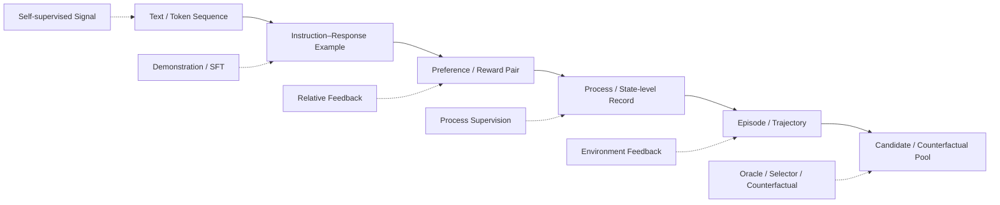

# F2 — Data Object & Learning Signal Evolution

> 角色：展示数据对象如何从静态 Example 扩展为可交互 Experience，以及不同 Learning Signal 作用在哪一层。
>
> Canonical owner：Ch1–3
>
> 主案例：C1 Order / Refund Agent



## 对象链

```text
Sample / Example
→ Task / Case
→ Episode
→ Trajectory
→ Candidate Pool / Counterfactual Family
```

对象越往右，保留的决策上下文、环境证据和因果信息越多。

## Signal 链

```text
Pretraining
→ token continuation

SFT
→ demonstration imitation

Preference
→ relative desirability

Reward
→ optimization scalar

Process Supervision
→ intermediate decision quality

Environment Feedback
→ what actually happened
```

## 关键边界

```text
Data Object
≠ Learning Signal

Outcome
≠ Reward

Environment Feedback
≠ automatically a training label
```

一条 `C1-F1` trajectory 可以同时派生：

```text
SFT correction
Preference pair
Failure label
Regression case
Verifier test
Synthetic seed
```

但这些 derived views 都来自同一个 source experience，而不是六条互不相关的数据。
