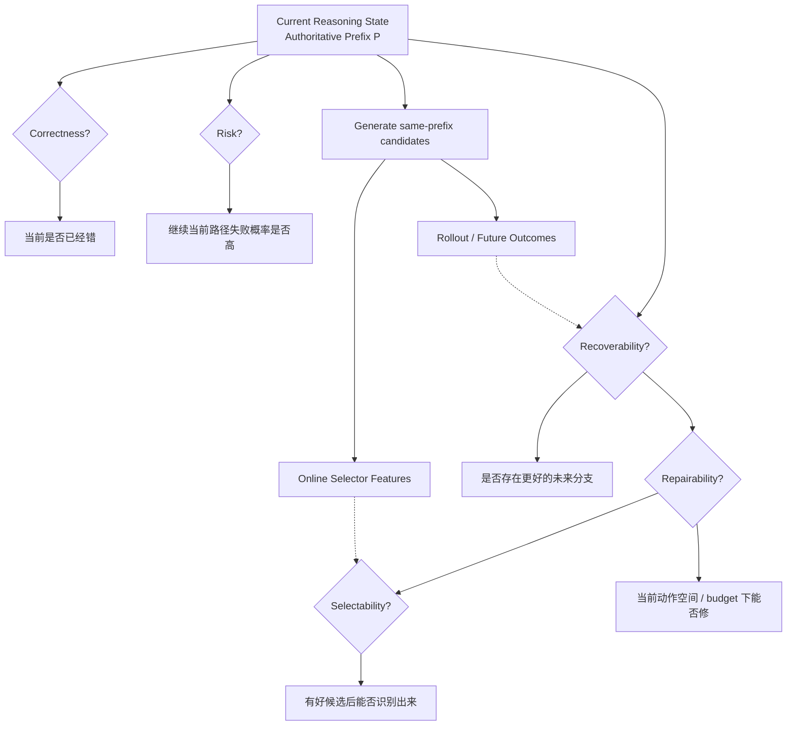

# F3 — Reasoning State Decision Stack

> 角色：固定 reasoning-state 里最容易混淆的五个问题：Correctness / Risk / Recoverability / Repairability / Selectability。
>
> Canonical owner：Ch4
>
> 主案例：`C4-SC`（same authoritative prefix sibling set）



## C4-SC

```text
Prefix P
├── u0 → O0
├── c1 → O1
└── c2 → O2
```

离线未来 outcome 可以定义：

```text
Rescue
Harmful
Neutral-positive
Neutral-negative
```

但这些 outcome label 不能在在线决策时泄漏成 feature。

## 必须分开的五问

```text
Correctness
这里已经错了吗？

Risk
继续当前路径危险吗？

Recoverability
存在更好的未来吗？

Repairability
现在真有办法修吗？

Selectability
我们能识别出更好的候选吗？
```

## 关键原则

```text
Low confidence
≠ Wrong
≠ Recoverable
≠ Repairable
≠ Selectable
```

因此一个好的 trigger detector 也不能单独证明 intervention system 会有效。
