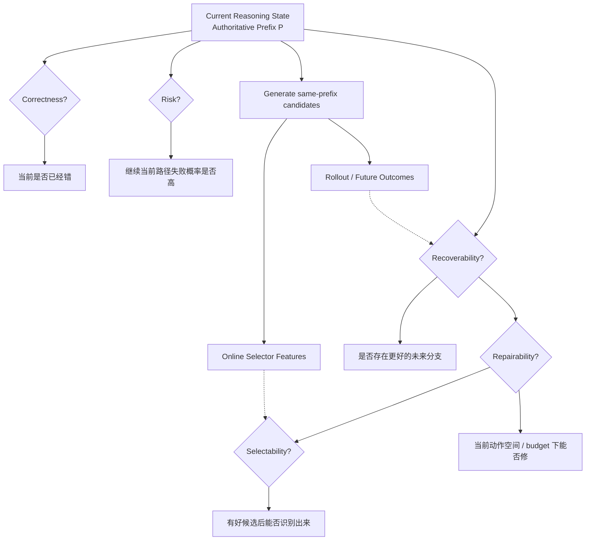

# F3 — Reasoning State Decision Stack

> **Figure Question：** 一个 Reasoning State 上，Correctness / Risk / Recoverability / Repairability / Selectability 为什么必须分开？
>
> **Level：** Part-level
>
> **Canonical Owner：** Ch4
>
> **Primary Case：** `C4-SC`
>
> **Scope：** 固定 reasoning-state decision stack；不把低置信、错误、可修复、可选择混成一个“uncertainty”概念。



## Read the Spine

同一个 state 上其实有五个不同问题：

```text
Correctness
这里已经错了吗？

Risk
继续当前路径危险吗？

Recoverability
存在更好的未来 continuation 吗？

Repairability
在当前 action space / budget 下真能修吗？

Selectability
好候选存在以后，在线系统认得出来吗？
```

这五问不是同义词，也不是同一个 detector 的不同阈值。

## Critical Boundaries

```text
Low Confidence
≠ Wrong

Wrong
≠ Recoverable

Recoverable
≠ Repairable

Repairable
≠ Selectable
```

因此：

> **一个 trigger detector 很准，不等于整个 intervention system 会净获益。**

真正的系统效果还取决于 candidate generation、action space、selector 与 cost。

## Case Lens — C4-SC

```text
Authoritative Prefix P
├── u0 → O0
├── c1 → O1
└── c2 → O2
```

离线 future outcome 可以帮助定义：

```text
Rescue
Harmful
Neutral-positive
Neutral-negative
```

但在线 selector 只能使用当下允许的信息，不能把 future outcome 泄漏成 feature。

所以：

```text
Oracle Opportunity
≠ Online Selectability
```

## Cross-links

- [`Ch4 — Reasoning Data & Process Supervision`](../04_Reasoning_Data_and_Process_Supervision.md)
- [`F2 — Data Object & Learning Signal Evolution`](./F2_Data_Object_and_Learning_Signal_Evolution.md)
- [`F6 — Credit → Failure Causal Map`](./F6_Credit_to_Failure_Causal_Map.md)
- [`C4 — Reasoning Continue / Repair`](../cases/C4_Reasoning_Continue_Repair.md)

## Caption

**F3 — Reasoning State Decision Stack.** 对一个 reasoning state，Correctness、Risk、Recoverability、Repairability 与 Selectability 是五个不同问题；低置信只能是 signal，不能自动证明当前错误、存在可修复分支或在线 selector 能找到它。
