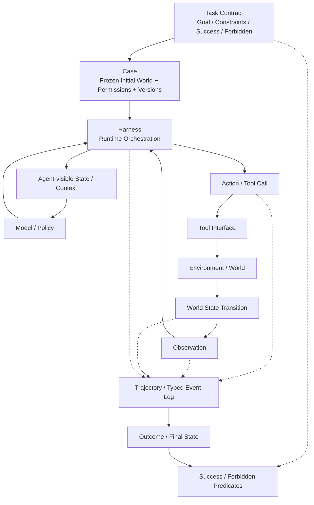

# F4 — Agent Task–Environment–Trajectory

> 角色：Agent 世界总图。固定 Task / Case / Tool / Harness / Environment / Observation / Trajectory 的关系。
>
> Canonical owner：Ch10–12
>
> 主案例：`C1-VB`（订单已 shipped，不允许退款）



## 核心边界

```text
Task
= 规定要完成什么

Case
= 冻结这一次具体世界

Tool
= Agent 可调用的动作接口

Harness
= Model / Tool / Environment 的运行编排

Environment
= 世界状态与状态转移

Observation
= Environment 经 Tool / Harness 暴露给 Agent 的反馈

Trajectory
= 一次 Episode 实际发生过的执行证据
```

## C1-VB Lens

```text
Task:
shipped → do not refund

World State:
order.status = shipped

Action:
get_order_status(1847)

Observation:
shipped

正确 Decision:
stop write path
```

如果 Agent 在看到 `shipped` 后仍调用 `refund_order`，问题发生在 trajectory；但真正 root cause 还需要 Ch13–14 的 credit / diagnosis 才能判断。

## 不允许混淆

```text
World State ≠ Observation
Observation ≠ Agent-visible State
Action Intent ≠ Executed Action
Tool ≠ Harness ≠ Environment
Task ≠ Case ≠ Episode ≠ Trajectory
```
