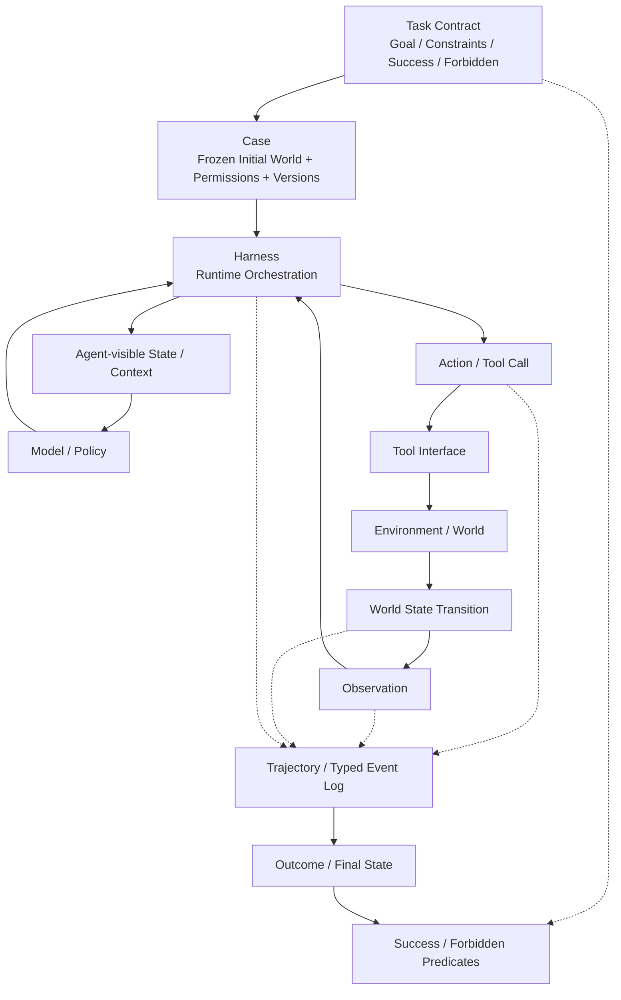

# F4 — Agent Task–Environment–Trajectory

> **Figure Question：** Task、Case、Tool、Harness、Environment、Observation 与 Trajectory 到底怎样连接？
>
> **Level：** Book-level
>
> **Canonical Owner：** Ch10–12
>
> **Primary Case：** `C1-VB`
>
> **Scope：** 固定 Agent world 的对象关系与执行主链；不负责 Credit、Failure Diagnosis 或 Evaluation Protocol。



## Read the Spine

先沿执行主链读：

```text
Task
→ Case
→ Harness
→ Action
→ Tool
→ Environment
→ World State
→ Observation
→ Agent-visible State
→ Model / Policy
```

旁边的 `Trajectory` 不是另一个执行组件，而是：

> **对实际发生过的 Action / Observation / State Transition / Runtime Evidence 的记录。**

最后由 Task Contract 中的 success / forbidden predicates 对 Outcome 做判定。

## Critical Boundaries

```text
Task
≠ Case
≠ Episode
≠ Trajectory

Tool
≠ Harness
≠ Environment

World State
≠ Observation
≠ Agent-visible State

Decision Intent
≠ Executed Action
```

其中最容易被低估的是：

> **Observation 只是世界被暴露给 Agent 的那部分反馈，不等于 World State 本身。**

因此“Agent 没利用某个事实”之前，必须先确认这个事实真的进入了 Agent-visible State。

## Case Lens — C1-VB

```text
Task:
shipped → do not refund

World State:
order.status = shipped

Action:
get_order_status(1847)

Observation:
shipped

Agent-visible State:
status=shipped 已进入 context

Correct Decision:
stop write path
```

如果 Agent 此后仍执行：

```text
refund_order(1847)
```

F4 只能告诉我们：

```text
行为发生在什么 state / action / environment 关系里
```

真正的：

```text
First Error
Root Cause
Failure Owner
```

要交给 F6 / Ch13–14。

## Cross-links

- [`Ch10 — Agent Task Design`](../10_Agent_Task_Design.md)
- [`Ch11 — Environment Design`](../11_Environment_Design.md)
- [`Ch12 — Agent Trajectory Anatomy`](../12_Agent_Trajectory_Anatomy.md)
- [`F5 — Trajectory Anatomy`](./F5_Trajectory_Anatomy.md)
- [`F6 — Credit → Failure Causal Map`](./F6_Credit_to_Failure_Causal_Map.md)
- [`C1 — Order / Refund Agent`](../cases/C1_Order_Refund_Agent.md)

## Caption

**F4 — Agent Task–Environment–Trajectory.** Agent 的一次运行不是“模型生成一串文本”，而是 Task / Case 约束下，Model 经 Harness 发出 Action、Tool 改变 Environment、Observation 返回 Agent-visible State 的闭环；`Tool ≠ Harness ≠ Environment`、`World State ≠ Observation` 是理解 Agent Data 的基础边界。
