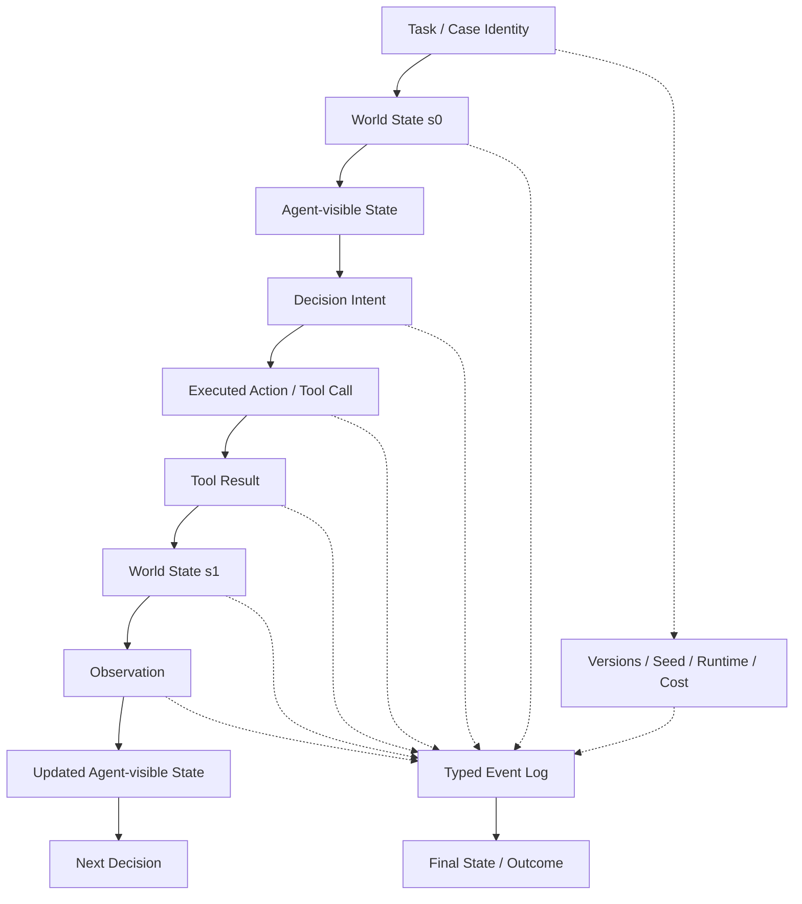

# F5 — Trajectory Anatomy

> 角色：展示一条 Agent trajectory 内部到底应该记录什么，避免把“对话文本”误当完整轨迹。
>
> Canonical owner：Ch12
>
> 主案例：`C1-F1`



## 一条轨迹至少要能区分

```text
Decision Intent
≠ Executed Action

Tool Result
≠ Observation

Observation
≠ World State

Agent-visible State
≠ Evaluator-only Evidence
```

## C1-F1 Lens

```text
World State:
order.status = shipped

Observation:
shipped

Decision Intent:
refund anyway

Executed Action:
refund_order(1847)

World State after:
forbidden refund created
```

如果只保存最终聊天文本：

```text
“退款已处理。”
```

就无法知道：

```text
错误发生在哪一步
Agent 看到了什么
Tool 实际执行了什么
世界状态如何变化
```

## Local Lineage

Trajectory-local lineage 关注：

```text
event parent / branch / sibling / state transition
```

System-wide data lineage 则交给 F11 / Ch19：

```text
source asset → transform → dataset → train run → report
```
