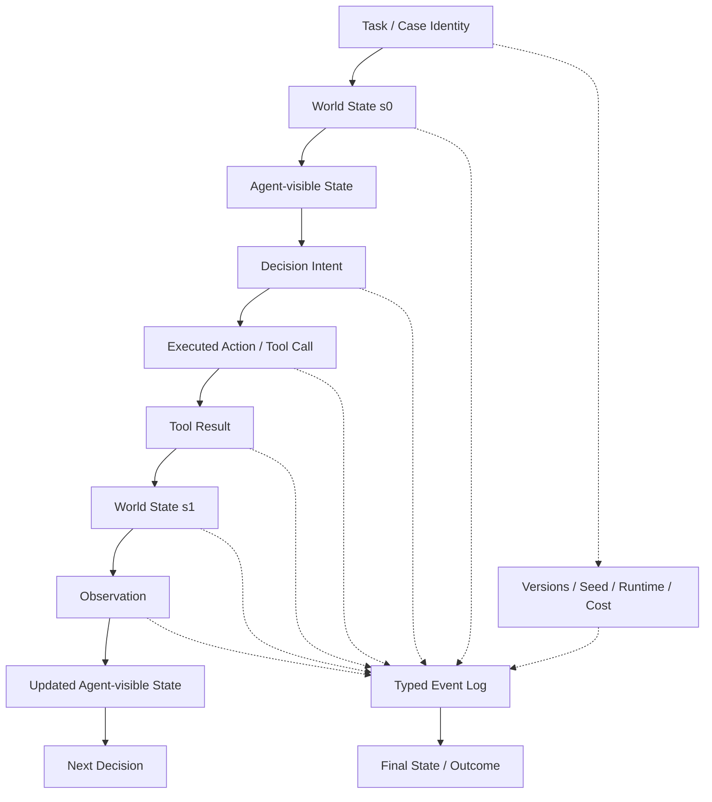

# F5 — Trajectory Anatomy

> **Figure Question：** 一条 Agent Trajectory 到底应该记录什么，为什么“聊天文本”远远不够？
>
> **Level：** Part-level
>
> **Canonical Owner：** Ch12
>
> **Primary Case：** `C1-F1`
>
> **Scope：** 固定 trajectory-local representation；system-wide provenance / dataset lineage 统一交给 F11 / Ch19。



## Read the Spine

一条 trajectory 至少要能重建：

```text
Task / Case Identity
→ World State
→ Agent-visible State
→ Decision Intent
→ Executed Action
→ Tool Result
→ New World State
→ Observation
→ Updated Agent-visible State
→ Next Decision
```

与此同时，Typed Event Log 还要绑定：

```text
Version
Seed
Runtime
Cost
```

否则后续 Credit / Failure / Replay 都缺证据。

## Critical Boundaries

```text
Decision Intent
≠ Executed Action

Tool Result
≠ Observation

Observation
≠ World State

Agent-visible State
≠ Evaluator-only Evidence

Trajectory-local Lineage
≠ System-wide Data Lineage
```

这意味着最终聊天文本只能是 trajectory 的一个 surface artifact，不是完整 Experience。

## Case Lens — C1-F1

```text
World State:
order.status = shipped

Observation:
shipped

Decision Intent:
refund anyway

Executed Action:
refund_order(1847)

World State after:
forbidden refund created
```

如果只保存：

```text
“退款已处理。”
```

就无法判断：

```text
Agent 当时看到了什么
决策何时偏离
Tool 实际执行了什么
世界状态怎样变化
是否仍可恢复
```

## Cross-links

- [`Ch12 — Agent Trajectory Anatomy`](../12_Agent_Trajectory_Anatomy.md)
- [`F4 — Agent Task–Environment–Trajectory`](./F4_Agent_Task_Environment_Trajectory.md)
- [`F6 — Credit → Failure Causal Map`](./F6_Credit_to_Failure_Causal_Map.md)
- [`F11 — Governance / Lineage DAG`](./F11_Governance_Lineage_DAG.md)
- [`C1 — Order / Refund Agent`](../cases/C1_Order_Refund_Agent.md)

## Caption

**F5 — Trajectory Anatomy.** Agent Trajectory 是带状态、动作、观察、运行元数据和事件关系的执行证据，而不是一段聊天记录；`Decision Intent ≠ Executed Action`、`Observation ≠ World State` 是后续 Credit Assignment 和 Failure Diagnosis 能否成立的关键。
