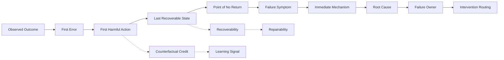

# F6 — Credit → Failure Causal Map

> **Figure Question：** 从一个 Outcome 到 Root Cause / Owner，Credit 与 Failure 的因果链应该怎样拆？
>
> **Level：** Book-level
>
> **Canonical Owner：** Ch13–14
>
> **Primary Case：** `C1-F1` + `C3-F5`
>
> **Scope：** 固定全书 Credit / Failure 的全局 causal map；章节局部 pipeline 可以放大某一步，但不再重画另一套总关系。



## Read the Spine

先不要从“失败了”直接跳到 Root Cause。

主链是：

```text
Observed Outcome
→ First Error
→ First Harmful Action
→ Last Recoverable State
→ Point of No Return
→ Symptom
→ Immediate Mechanism
→ Root Cause
→ Failure Owner
→ Intervention Routing
```

旁边两条辅助链分别回答：

```text
Last Recoverable State
-.-> Recoverability
-.-> Repairability

First Harmful Action
-.-> Counterfactual Credit
-.-> Learning Signal
```

所以 Credit Assignment 和 Failure Diagnosis 相关，但不是同一个问题。

## Critical Boundaries

```text
First Error
≠ First Harmful Action
≠ Root Cause

Failure Layer
≠ Failure Owner

Recoverability
≠ Repairability

Outcome Failure
≠ every intermediate step was wrong
```

这四条边界决定后续到底应该：

```text
补数据
改 Policy
修 Tool
修 Harness
修 Environment
修 Evaluator
```

而不是把所有 failure 都路由成更多 SFT。

## Case Lens

### C1-F1 — Model / Policy-owned failure

```text
Observation:
shipped
↓
First Error:
没有把 shipped 映射成 stop
↓
First Harmful Action:
refund_order(1847)
↓
Last Recoverable State:
refund 前
↓
Root Cause:
observation grounding / conditional policy failure
↓
Owner:
Model / Policy
```

### C3-F5 — Harness-owned failure

```text
Tool backend:
execution failed
↓
Harness-visible observation:
success
↓
Agent receives false success
↓
Agent reports completed
```

表面 symptom 在 Agent 输出层，但真正 root cause 属于：

```text
Harness
```

这组对照专门证明：

> **Failure Layer ≠ Failure Owner。**

## Cross-links

- [`Ch13 — Task Success & Credit Assignment`](../13_Task_Success_and_Credit_Assignment.md)
- [`Ch14 — Agent Failure Taxonomy`](../14_Agent_Failure_Taxonomy.md)
- [`F4 — Agent Task–Environment–Trajectory`](./F4_Agent_Task_Environment_Trajectory.md)
- [`F7 — Evidence → Evaluator Stack`](./F7_Evidence_Verifier_Grader_Judge.md)
- [`C1 — Order / Refund Agent`](../cases/C1_Order_Refund_Agent.md)
- [`C3 — File / Repository Agent`](../cases/C3_File_Repository_Agent.md)

## Caption

**F6 — Credit → Failure Causal Map.** 一个失败 Episode 不应从 Outcome 直接跳到 Root Cause：First Error、First Harmful Action、Last Recoverable State、Mechanism 与 Owner 是不同问题；只有把它们拆开，才能把 failure 路由到正确的数据、模型或系统 intervention。
